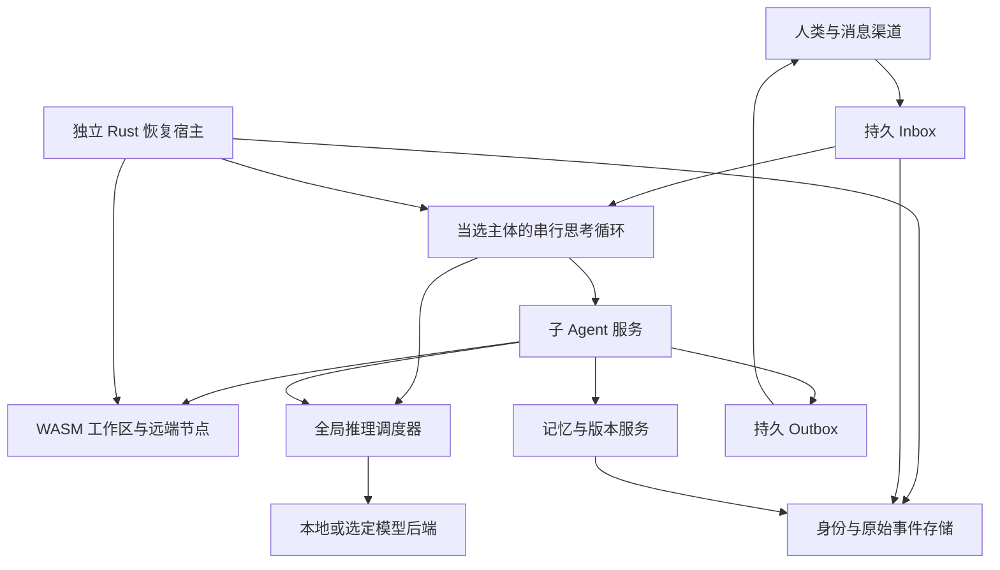

# Shenko 产品 SPEC v0.6.2

# 1 文档状态与产品定义

版本：v0.6.2，产品规格、规范执行合同与完整开发交接。正式产品名 Shenko（深刻）；保留全部原始要求和后续裁决，追踪 147 项需求、55 组行为与 59 组来源记录（含一项历史拼写别名，不等于独立上游数），共 216 个验收定义。本版追加 U54–U63、R143–R147、B51–B55，扩展既有章节：主体持续接续及最多 600 秒的自主语义等待；从任何输入产生 awareness，并将有用经验自主沉淀为原子单元；时间、未竟目标、重复感、项目、社交和邮件的独立感知/察觉组合；多设备同步同一自我、真实已授权能力与环境自修复；每连通域单一主节点、异构模型/隐私感知与无模型提取恢复；必读 shenko-dev 与兼容 OpenAI/Anthropic 的原子开发 Skill；Rust 2024。dreaming 仅是社区可选插件方向。§46–47 的完整自主开发交接及 Provider 版本合同继续有效。S1–S5 均在完整目标内；首版不是终点，PR 等待 review 不暂停工作，真实账号、资源和验证边界保持准确。历史规格与原话完整保留；新增 7 个验收定义是产品义务，并非每个增量要重写整套测试。原始研究截点：2026-10-22 UTC。编制期仓库只含规格与交接资料，当时尚未开始产品实现、部署或目标机器测试；该历史边界不代表当前工程状态。

2026-10-27 设计澄清：追加协作席记录的 U63、§5.6 与 §45.13，保留原研究截点，不声称全部上游研究重新核验。U63 的原始会话尚未由集成席独立回读，来源边界见该节。当前仓库已有实现并持续开发；本次变更仅写入非阻塞 thought、事实投影及插件化时间/环境感知合同，不新增产品实现或运行证据。具体已完成切片和剩余义务以任务卡、真实源码与绑定版本的证据为准。

正式命名：**Shenko（深刻）**。名称来源按 U39 记录为 Always Online 的“More and more 尽是深刻”，并保留用户提供的 `shen1-kʻo4`、`ㄕㄣ ㄎㄜˋ`。品牌展示使用 Shenko，不附 slogan 或解释性副标题；产品由布局、设计和交互表达。框架／产品名与每个 Agent 的姓名分开，实例初始化时由用户命名或让 Agent 自己命名。Sonzai 等此前候选仅留作命名历史，不再是当前待定项。

**定位：Pi 是面向 coding agent 的最小框架；本产品是面向 personal agent 的最小框架。** 编码是它能安装的一类能力。产品组织的中心是一个人的 Agent 的持续身份、关系、承诺、记忆、主动注意力和跨环境行动，而不是某个代码仓库或一次编码任务。

**产品定义：一个由用户拥有、在本地持续生活和工作的 Agent。正常连通运行只有一个当选主体，每个主体分支只有一条永续串行的思考循环；故障分叉与重连收敛按 §5.4。主体主动决定下一步，将实际行动、研究、版本操作和记忆维护交给子 Agent；通过可恢复的 WASM 家园、原始会话证据和统一推理调度，在个人与群聊中保持连续人格。**

框架应把“个人连续状态”与“任务临时状态”分开：关系、承诺和长期目标跨 session 存续；编码、检索、课堂旁听、远程操作都是有边界的任务插件。安装编码插件不改变产品身份，卸载编码插件后仍应是完整可用的 personal agent。主体 harness 自身也可替换，不把个人 Agent 的行为体系全部硬编码进最小 kernel。

“持续思考”“持久执行环境”“子 Agent”“本地隐私”“小内核”是同时成立的目标。主体持续推理会消耗模型算力，小内核只说明控制软件的负担；本规格不承诺无限思考、零推理成本、手机永不被系统挂起可以同时实现。

标记规则：**已确认**来自用户原始需求及追加裁决；**研究事实**有相应一手来源与版本；**首版默认／建议默认**是开发 Agent 可以自主采用、验证和替换的工程方案，不表示必须等待人类逐项批准；**规范合同**给出必须保持的可观察行为与失败语义；**技术验收**需由实现证据证明，不等于已实现，也不自动产生人类 gate。当前只做 SPEC 是本次任务范围，后续开发任务的自主推进规则见 §40。

首版开发者 profile 明确允许宿主原生 Execution／Build／Seat 插件，连接已有 NapCat、tmux 与 coding agent，同时保留真正可恢复的 WASM 家园与默认宿主挂载 Git 记忆；不等待所有 CLI 都移植 WASM 才完成首版闭环。所有权模型与最低控制硬件仍有待定部分，本文暂以“单主人、多受众、主体统一知识；64 位、至少 512 MB 控制节点；模型可在另一自有节点”展开，最低硬件属于待测建议。D1 已取消按受众屏蔽主体记忆的默认方案；D12 首个模型基线为用户 Qwen3.8-27B 四流 128K，经 Tailnet 调用。真实 SSH WASM、Android 本地运行和各设备 profile 继续是正式目标，未实测兼容性不冒称已成立。

# 2 已确认的产品约束

1. 面向个人聊天和群聊，借鉴 AstrBot 与 OpenClaw 的渠道广度。默认任何平台可达用户均可对话；管理员必须由人类明确登记。

2. Rust 2024（edition 2024）编写核心控制功能，提供 Webserver 与正式 Web UI；内核小、可恢复、适合长时间运行和低资源设备。实际工具链和依赖版本由构建锁记录，edition 不冒充固定编译器版本。

3. Agent 有自己的持久 WASM 执行环境，目标是实用 Linux/POSIX 兼容工具环境，可映射任意宿主进程有权访问的路径，真实运行和安装工具。

4. Nix 或 Nix-like 包管理；Agent 可以自主装包、试验、升级和回滚。toybox、gcc-wasm、Git、认证 GitHub/Gitea CLI 和 SSH WASM 保留为明确兼容目标。

5. 出厂记忆是挂载到初始 WASM 沙箱的宿主目录，其中初始化 Git 仓库。私有远端可选，默认没有远端也能完整工作。

6. 软件和工作区有二进制友好的版本/分支/恢复机制；沙箱损坏时宿主自动恢复，最终能回到初始可启动版本。按最新决定，在合格真实 Linux VM 中直接使用原版 LayerFS；WASM 状态独立实现，不再以重做或移植 LayerFS 为默认前置路线。

7. Agent 按需创建自己的 SSH 身份；UI 展示公钥。支持人类机器、后续完整容器和多个自有节点。

8. 原始 session 是真相源，可在预算切窗或压缩后检索和重读；会话存储采用 SQLite FTS5 类设计，保留外部 memory backend 接口。

9. 本地 AI 与极致隐私优先。推理并发、上下文、优先级和共享物理资源必须统一管理；支持真实 backend KV slot/affinity 能力透传。

10. 子 Agent 支持低开销递归探索、多方案分支、深度研究和适时收敛；不能产生父子任务互相等待的资源死锁。

11. UI 使用 Proto-UI 当前主线与 shadcn；每轮开发核验并 bump 最新主线，锁定确切版本；留出 Proto-UI compiler 迁移接口。布局承担状态表达，不做普通后台表格的简单拼装。

12. 接入 iLinkBot 路线、QQ 官方机器人、NapCat、已有 napcat-cli、飞书等；提供 Ninfer 与 Strata 的中英文教程。

13. **追加约束：每个连通域只有一个当前主体，完整连通后只有一个当选主体；每个分支只有一条 proactive thought loop，分叉与重连收敛按 §5.4。默认持续思考，主体自愿语义等待仍由同一主模型轮询，最长 600 秒，见 §5.1。主体没有直接文件操作、shell、SSH、装包或版本操作工具；保存/读取记忆走专用委派接口。版本、任务进度与实际记忆机制在子 Agent 侧。**

14. **追加约束：人格追加在稳定核心 system prompt 之后；人格不能改变工具调用合同、权限、恢复或资源上限。**

15. **追加约束：外部消息几乎总是直接注入主体思考序列，附来源渠道/provider、发送者别名与稳定身份、内容、富文本/附件的受控获取引用。消息源和模型 API provider 均插件化，联系人编号和可选声纹识别可以自然演进或由插件提供。**

16. **追加约束及最新澄清：C=1 单并发轮转必须能够保留多份上下文。KV 分配通过可替换调度器/策略插件自动完成，允许主体表达偏好；50/50 是理想条件下算法应能自行得到的分配结果，不是要求用户手设比例，也不要求所有负载始终各半。仅手动设成 50/50 能运行不算满足。容量可以自动发现，未知能力不能伪报。**

17. **追加研究：纳入主动遗忘重启研究子 Agent，以及主动记忆提醒两条机制；研究结论与产品推论分开，不因上下文 reset 删除原始证据。**

18. **追加约束：可安装远程 Agent 操作插件，定位并控制 SSH/其他 runtime 上的 Claude Code、omp、tmux/agent seat；自主处理选项与已授权 permission，不确定时按人格与情境自主寻找可联系用户的渠道。**

19. **追加约束：支持传统 Skill 和 MCP 市场，常用能力推荐原生插件；插件不仅可安装，还必须可发现、学会用、在适当情境使用，并面向未来模型保留更简洁替代路径。**

20. **追加目标：可恢复 Python/Bun/Node WASM REPL 与动态依赖安装作为插件，三个具名目标分别注明真实 runtime 与兼容程度。**

21. **追加约束：原生预留实时通话、旁听课堂、录音、声纹等插件接口；媒体信息进入同一主体循环，保留完整工具委派能力，允许通过子 Agent 自主发展这些能力。**

22. **再次确认：核心必须非常小，一切业务能力均插件化；不能把可选媒体、REPL、模型、渠道或大型工具变成必选常驻依赖。**

23. **追加约束：Agent 可通过子 Agent 重写、替换自己的任何软件部分，包括主体 harness、提示词与人格、调度器、插件系统、记忆、UI、Rust kernel 和救援程序。采用候选版本、迁移、验证、交接与恢复，不设置永久不可改的代码区域，也不默认要求逐次人工批准。当前用户行为合同仍须满足；允许改代码不自动授予新的管理员身份或外部权限。**

24. **追加约束：Computer Use 是正式插件路线。WASM 家园之外可连接被授予的 root Android、Linux、Windows、macOS 机器、容器、VM、远程桌面和 agent seat，使用相应屏幕、shell、浏览器、键鼠、应用与文件能力。实际操作按已授权设备能力执行；不能把可操作环境限制为 WASM，也不能把所有 OS 桌面等同于 Linux 容器。**

25. **定位再次确认：这是 personal agent 的最小框架，Pi 的 coding-agent 最小框架思想是参考；必须逐项研究和保留全部需求，不把个人关系、主动生活、音频或远程行动裁掉为编码附属功能。**

26. **追加约束：动态生成式 UI 是 Agent 的正式能力。参考用户称为 OpenAI Dynamic Response 的方向，按目标界面支持的 DSL、元素、语法或 UI 工具自主生成响应，并可跨 Web、原生卡片、文本、媒体、语音等界面降级；不能只做一个固定聊天皮肤。**

27. **追加约束：是否启用自动更新、何时及更新哪些部分、联网是否走代理等配置问题，都可作为消息进入唯一主体。Agent 自主决定并委派子 Agent 执行，也可自主调整更新与联网策略；不把这些决定默认转交用户审批。**

28. **主体统一个人知识、可自改灵魂；保密与关系由其自主判断，不硬编码亲密度。每次委派可自由指定 child 的完整 system prompt 和不同模型。**

29. **主子共享能力全集并可双向讨论；Agent 能发现自身工具不足，自主安装、编写插件/外部应用或移植 WASM 能力。**

30. **外部消息通常最高紧急可打断 child；停滞时由主体决定临时免打扰，结束后处理队列；垃圾过滤由主体决定并能自主发现误屏蔽。**

31. **自更新优先磁盘成本，允许 breaking change；保留运行旧副本，迁移/烟测新版本后最后交接自身，能力插件化。**

32. **原始文字、录音和屏幕帧默认永久；空间不足由主体决定迁往用户自有存储或遗忘，能力插件化。**

33. **自主兴趣可长期持续投入，不要求与用户当前任务有关，也不设统一的兴趣寿命。**

34. **多节点同步同一自我并在线优先：每连通域单主，主节点按真实异构模型能力、可达性与隐私安排 child 和递归接管；可 access LLM 的孤岛可独立演进，重连选主并合并经历任务。新设备身份加入与旧分支汇合分别处理；无 LLM 时日志、授权记忆提取与离线恢复仍可工作。**

35. **首个真实基线是用户自有 Qwen3.8-27B，经 Tailnet，四流 128K；133120 是部署冗余。**

36. **UI 给 Claude Opus 完整功能/体验 brief，保留布局与视觉自由，诊断按需展开；继续 Proto-UI 最新主线、shadcn 与 compiler seam。**

37. **budget compact 与 snapcompact 均为正式交付的独立插件，各自可安装、更新、卸载和替换，不写入核心；OMP notes-backed windows 同时作为历史访问参考。后端视觉能力决定 snapcompact 的实际启用，不取消插件交付要求；原始历史、执行进度和 KV 保证不与派生上下文混同。**

38. **框架／产品名称为 Shenko（深刻），与实例姓名分离；初始化可由用户命名、稍后命名或让 Agent 自主取名，姓名不影响稳定身份连续性。**

39. **品牌与首页不使用 slogan 或解释性副标题；以布局、交互和设计表达产品，操作信息仍须清楚。**

40. **首版开发者发行就完成 NapCat／QQ → 现有 tmux coding agent → 自身候选开发／验证 → 自主迁移激活的闭环；不能把自开发与运行接续推迟到后期。**

41. **插件按操作声明副作用、实际资源、checkpoint 覆盖、重试／取消／补偿与恢复边界；沙箱回退不能抹去已发生的外部事实。**

42. **cordis-rs（dshbox/cordis-rs）为用户指定的插件主干；U45 已纠正 U35 的拼写。借鉴 Fabric 的 API 注入时序与兼容思想，明确 hook 的版本、phase、相对顺序与热替换，不另换主干。**

43. **默认内置但可替换的自解释插件，让主体与 child 按需查询自身代码、说明书、设计哲学和当前运行事实，能够回答自身问题并指导自开发。**

44. **每项有意义的设计均连接用户来源或固定上游 Ref，并记录采用范围、差异、行为验收与实现证据；不是只列致谢。**

45. **开发 Agent 在已授权目标内自主研究、实现、验证、修复和集成，不默认留下逐 commit、逐 PR、逐阶段或逐升级的人类 gate。**

46. **视觉风格和美观以具体 Magpie 画面与交互为参照，保持生活化的个人主体体验，由后续设计 Agent 自主完成。**

47. **正式框架／产品名为 Shenko（深刻），不加 slogan；实例名称由用户或 Agent 自己选择，身份不因改名而变化。**

48. **核心行为必须写成可实施合同：具体记录、状态、版本、原子提交、取消、失败恢复与可判定用例；不能靠更多“应当支持”代替。**

49. **供应商周期额度由后期插件观测和预测，可自主调整模型与主体平均准入次数；本地优先，不把规划目标冒称精确余额或必然刚好用完。**

50. **流式界面参考 Magpie 与 Alma，保持阅读锚点、选区和交互状态，用可回放指标验收。**

51. **默认 WebUI 只有主体时间线和输入；append/steer 进入同一 loop，任务、设置、Playground 等按需展开。**

52. **所有设置可以经对话修改，面板读取同一实际配置；配置执行、观测与恢复能力可以组合使用，不把候选、验证、应用、观察、确认写成通用硬流程，不设置永久不可改配置或常规人工 gate。**

53. **Playground 长期保存并运行有界面、有后端、有数据的作品，其业务变化经持久事件进入主体同一 inbox。**

54. **首次打开只补实际缺失的推理连接与明确管理员初始化；发行自带无需 LLM 的可恢复 seed，名字、人格和渠道可后续发展，首个主体只创建一次。**

55. **thought loop 可从任意外部输入即时汲取 awareness；有复用价值的直觉再各自沉淀为可安装、查阅、修改和移除的单元。时间、未竟目标、重复/无聊、项目、社交与邮件察觉可独立组合，dreaming 仅社区可选；不设总意识插件或固定流程，来源与实际权限不因沉淀升格。**

56. **感知、awareness、Skill 和插件代码均可细粒度安装与查阅；provider 自动解析安装所需依赖，代码依赖带版本，直觉依赖允许笼统或精确并保存实际解析结果。**

57. **Why 是能力说明与开发规范的一部分：交代目标、关键理由、适用前提和可观察效果；让主体与孩子在工具或条件变化时自主调整方法，不增加逐操作说明或人工 gate。**

# 3 研究结论与竞品定位

## 3.1 具名竞品

| 对象 | 已核验的产品事实 | 本产品采用的启发 | 本产品的差异目标 |
| --- | --- | --- | --- |
| OpenAI dots | 2026-09-29 发布；独立云电脑，持续任务与跨渠道工作；空闲主动研究使用连接应用的只读能力 | 持续交付、活动可见、主对话与项目成果分离 | 用户自托管、可选本地模型、授权范围内可行动的自主循环 |
| Claude Duet | 2026-10-21 研究预览；云电脑，主对话和专题频道共用记忆，Tasks/Make、历史搜索与简报 | 安静的主对话、成果工作区、连续人格 | 运行环境/模型可选、执行可观察、SSH 与本地节点 |
| Meta Muse | 长期目标、子 Agent、自建工具、自改及云执行；运行 cell 与身份/持久状态分离 | 可损坏环境不能带走身份与任务；持续授权 | 本地所有权、小型 Rust 控制面、WASM 家园、本地资源调度 |
| AstrBot | 多平台与插件；有沙箱、实验性 subagent/future_task；主动任务文档区分定时执行与持续自主监控 | 消息归一化、会话工作区、渠道兼容 | 原生永续主体循环及可恢复的委派体系 |
| OpenClaw | 自托管 Gateway、多渠道/节点、可换模型与 harness；默认 pairing 可以配置为开放对话 | 节点能力发现、mailbox、渠道/运行协议 | 默认开放聊天、最小可信宿主、全局推理与 KV 管理 |

依据：[dots 官方发布](https://openai.com/index/introducing-dots/)、[Duet 官方介绍](https://claude.com/resources/articles/claude-duet)、[Duet 帮助](https://support.claude.com/en/articles/17631495-get-started-with-claude-duet)、[Muse 发布](https://about.fb.com/news/2026/09/introducing-muse-personal-ai-agent/)、[Muse 架构](https://research.meta.ai/blog/security-and-safety-for-ai-agents-our-approach-with-muse)、[AstrBot 主动任务](https://docs.astrbot.app/use/proactive-agent.html)、[OpenClaw 队列](https://docs.openclaw.ai/concepts/queue)、[OpenClaw 安全与开放策略](https://docs.openclaw.ai/gateway/security)。没有进行同机性能比较；不能据编程语言或宣传数字宣称本产品更快、更省内存。

## 3.2 Harness 与记忆系统

| 对象 | 研究发现 | 规格中的采用方式 |
| --- | --- | --- |
| pi | 树形 session、追加 compaction、可替换 operations 与扩展 | 原始事件和上下文投影分离；同一资源操作可跨本地/SSH 后端 |
| oh-my-pi | 统一资源 URI、结构化子 Agent、SSH 管理、多 memory backend；memory recall 可固定首轮结果再追加变化 | 作为工具与子 Agent 体验的主要参考；减少小模型拼命令、重复读长上下文的负担 |
| DeepSeek Harness | model/tools/session/agent loop 插件化；持久 session 事件与实时运行事件分开 | harness 可替换；事件、工具、服务生命周期有正式合同 |
| cordis-rs | Rust typed services/events、资源生命周期与 generation 清理 | 可作为可信模块装配候选；Scope/ServiceRealm 不被当作安全沙箱 |
| Codex budget compact | 当前公开路径直接开启新 context window，跳过模型/服务器摘要；历史和 notes 工具另行提供 | 本地实现窗口、原文寻址与任务连续性；不把 summary 当唯一记录 |
| QMD / OpenViking | 分别提供混合检索与分层上下文组织的参考；各有额外运行/模型依赖 | 选装 backend 与设计参考，不塞进路由器必选内核 |
| Pi Durable | task/checkpoint、提交后发布、持久取消/补偿、nested-call journal | §10.6 正式恢复协议，不以 cleanup 或 transcript 代替 |
| OMP snapcompact / notes windows | 文字 PNG 视觉表示与独立笔记/原文切窗模式，各有预算与限制 | §12.3 多种 ContextPolicy 按本地模型实测，不误当 RAM/KV 快照 |

依据：[pi](https://github.com/earendil-works/pi)、[pi 会话格式](https://github.com/earendil-works/pi/blob/main/packages/coding-agent/docs/session-format.md)、[oh-my-pi](https://github.com/can1357/oh-my-pi)、[DSH 架构](https://github.com/deepseek-ai/deepseek-harness/blob/master/docs/architecture.md)、[cordis-rs](https://github.com/dshbox/cordis-rs)、[Codex 切窗实现](https://github.com/openai/codex/blob/a3d93e1e692f1144cf8685175a5d1f6bf7294f57/codex-rs/core/src/compact_token_budget.rs)、[Codex 历史工具](https://github.com/openai/codex/blob/a3d93e1e692f1144cf8685175a5d1f6bf7294f57/codex-rs/ext/history-notes/src/tools.rs)、[QMD](https://github.com/tobi/qmd)、[OpenViking](https://github.com/volcengine/OpenViking)。这些是参考实现，不意味着将其全部依赖原样移植。

## 3.3 四个会影响方案的事实纠正

**WASM 不自动等于 Linux ABI。** WASI/WASIX 提供的系统接口与 Linux ELF、动态链接、fork、native 扩展、GPU 驱动并不等价。Linux/POSIX 兼容的 memory 项目可能仍需要移植或远端服务。WASI 0.3 已于 2026-06-11 发布，不能再按尚未发布的 Preview3 规划；但每个 runtime/工具链的具体接口兼容仍需核验。[WASI 0.3 官方说明](https://bytecodealliance.org/articles/WASI-0.3)

**LayerFS 采用真实 Linux VM 内直接集成路线。** v1.0.0 source release 的 Store 和完整 workspace 各有平台条件；Disposable profile 不提供崩溃/断电持久性承诺。用户已决定不重做 LayerFS：原版用于合格 Linux VM，WASM 状态单独实现；上游提交与本产品持久发表分别记账，具体拓扑与保证见 §10.2.1。主线 qualification 不能冒充发布版保证。[固定 SDK 合同](https://github.com/Ephemeral-AI-Lab/layerfs/blob/2aaf2552ce21154928b9f9c83582e41a637f5910/sdk/js/README.md)、[平台 guard](https://github.com/Ephemeral-AI-Lab/layerfs/blob/2aaf2552ce21154928b9f9c83582e41a637f5910/core/crates/layerfs-store-service/src/kernel_guard.rs)

**Proto-UI 当前主线不是已发布的 0.3.0 RC。** 核验到 React adapter 为 0.3.0-alpha.1；compiler 包仍 private，不能假称稳定可替换。采用用户指定的主线路线，同时在文档和产物中记录真实版本。[已核验 manifest](https://github.com/Proto-UI/Proto-UI/blob/b928a56c6909835771fc2131503b4a7139db738c/packages/adapters/react/package.json)、[compiler manifest](https://github.com/Proto-UI/Proto-UI/blob/b928a56c6909835771fc2131503b4a7139db738c/packages/compiler/package.json)

**KV 功能不能统一伪装成 OpenAI-compatible。** slot、prefix reuse、Responses continuation、backend sticky routing 是不同能力；缺少某项时需报告“不支持/未知”，并回退到本地原文重建。后文给出专门矩阵。

# 4 核心产品场景

| 场景 | 用户可观察的完整行为 |
| --- | --- |
| 无人三天 | 主体继续串行思考，委派研究、整理记忆、验证工具和自维护；成果进入 Inbox；任务耗费和原因可查 |
| 群里新人提问 | 无需 pairing 或管理员批准即可聊天；主体自主选择回复所需上下文及表达目标，委派有限对话 child；投递目标与实际内容可追溯 |
| 长任务被新消息打断 | 主体收到新事件，修订注意力；原任务保持子 Agent 进度和分支，不在聊天窗口滚屏重述全部工作 |
| 试验三种方案 | 子 Agent 从共同快照分叉，独立记录证据/文件差异/成本；综合子 Agent 给出比较，选择后提升相应分支 |
| 自己装坏环境 | 宿主保持运行并冻结故障 generation，恢复已知健康或 factory；已接收消息、身份、撤销和外部操作记录不后退 |
| 忘记旧要求后切窗 | 新 context 仍含任务最小状态；由 memory/history 子 Agent 找回原始会话及出处，明确区分现行要求与已废弃内容 |
| 人类授权新机器 | 子 Agent 生成 SSH 身份，UI 显示公钥/指纹；人类在目标机器添加公钥后，Agent 能自主访问授权路径与执行任务 |
| 本地模型只有一个槽 | 主体与所有子 Agent 交替使用同一推理许可；等待者不占执行席位；没有递归锁死，也不超发 |
| Android 被杀/路由器重启 | 按 §5.4 在可用节点接管或恢复主体分支，重连后选主并合并记忆/任务；离线期间无法证明收到的消息标为未知，不编造恢复历史 |
| QQ 让它继续开发自己 | 主体找到已有 tmux coding seat，child 完成候选开发/验证，主体自主选择升级；迁移后仍记得原任务并继续回复，详见 §35 |
| 回退混合副作用任务 | 恢复受管状态，保留已发消息/远端效果与 unknown；插件报告真实边界并自主核对，详见 §36 |
| 问它为什么这样工作或让它扩展自己 | 自解释插件查当前代码、手册、哲学和运行配置；回答有版本依据，child 据此使用正确 hook/API，详见 §37–38 |

# 5 单线程永续主体与子 Agent

本章的产品语义保留；首版 SubjectStep、InputPlan、S0/S1、任务归属、逐事件处置和请求封口的具体字段与转移见 §41。消费进度以逐事件状态为准，不能以单个最大游标覆盖优先级空洞。

## 5.1 唯一主体的正式语义

“单线程”指一条主体分支内只有一个有效决策序列，不要求 Rust Webserver、网络 IO 或子 Agent 都跑在一个 OS 线程上。正常连通运行只有一个当选主体；第 n+1 步基于第 n 步提交状态，新消息和结果进入同一 mailbox。D11 新增以在线为先的故障分叉与恢复选主：分区中的临时分支须明确标记、各自串行，重新连通后只保留当选主体并合并记忆任务，见 §5.4；不能把它们伪装成未分叉的单条历史。

主体每一步读取一个有限的事件增量与注意力上下文，决定继续哪个目标、委派什么、需要什么记忆，并提交结构化决定。提交后立即让出当前推理许可，登记下一步请求；没有外部消息也继续下一步，思考未完成目标、兴趣、改进机会或已有工作是否值得继续。可以做内部反省而不制造新任务，不以无限子任务证明自己“还活着”。

主体永不因为“当前任务为空”自动完成，也不默认改成仅事件触发。资源调度等待、后端失败重试、设备挂起/断电和人类主动暂停会阻止实际推理；UI 必须准确显示这些状态。无法在物理离线时推理的事实不能用假动画掩盖。

U55 明确允许主体自己选择**基于语义条件的等待**：例如等到新证据足以改变判断，而非“睡到某个时刻”。等待时仍由它自己的同一主模型，沿同一条 SubjectStep 序列持续轮询前文与新增上下文，判断条件是否满足、是否出现更值得关注的事或应提前退出；没有新输入也不将后继改成事件唤醒。每次等待最多 600 秒，期限是等待模式的上限而非唤醒条件；满足条件或主动改变判断可更早退出，到期自动恢复正常思考。不得每轮暗中重设期限形成无限等待。它不是第二个等待 Agent，也不占住当前模型请求等待外部结果。

正常推理可用时，持续接续和语义等待都不断请求同一主体的后继推理。真正的模型容量/额度等待、故障、OS 挂起与主动暂停按事实呈现，不能改名为自主语义等待来声称仍在思考。有限 child 可以使用 checkpoint、定时 sleep 或等待依赖；这些状态不复制到主循环。语义等待的持久期限、恢复及提交合同见 §41.5。

同一时刻允许多个子 Agent 的逻辑任务存在、多个工具 IO 进行，也可在模型容量允许时有多个子 Agent 推理。它们都是有任务边界和终止条件的 worker，不具有第二条无限主动主循环。

## 5.2 主体能力表

| 主体接口 | 能做什么 | 实际执行者 |
| --- | --- | --- |
| handoff | 指定目标、上下文、完整 child system prompt、模型、可用能力、阶段预算与成功条件；获得 task handle | 子 Agent 服务创建 worker |
| steer / cancel | 修订委派目标或请求取消，不越过原权限/资源边界 | worker 与运行时验证并执行 |
| collect | 接收结构化进展、结果、冲突或失败摘要；引用原始证据 | worker 产生，运行时投递 |
| memory recall | 提交有 scope、时间范围与结果预算的回忆需求 | 记忆子 Agent 检索、引用、返回 |
| memory save | 表达要保存/更正/忘记的内容与来源 | 记忆子 Agent 验证、写入、提交版本 |
| publish intent | 如需回复或主动联系，委派带受众范围的交流任务 | 对话子 Agent 与 durable outbox |
| resource policy intent | 请求调节主/子份额、紧急程度或探索预算；不能虚构容量或提高 owner 硬上限 | 调度策略插件接受、校验并返回 revision |
| operating policy intent | 自主决定自动更新与联网/代理策略，提出带来源和 revision 的配置意图；不直接操作文件或网络 | 子 Agent 与 UpdatePolicy/NetworkPolicy 插件应用、验证并返回回执 |
| dialogue | 与 child 双向讨论、追问、补充证据、提出能力缺口；异步等待 | 持久消息/任务插件按实例与任务版本投递 |

主体不暴露 file read/write/list、shell、SSH、git、package install、snapshot/merge、数据库查询或直接网络工具。不能通过“通用工具调用器”“插件调用”“让工具执行任意代码”重新获得这些能力。其工具集合由宿主硬性限制，不能只在 system prompt 中写“不要写文件”。

“禁止主体写文件”不禁止运行时保存主体状态。会话事件、已提交决定、child handle 和恢复所需的游标由宿主按协议落盘；这不是赋给模型的文件操作权。用户所说版本、进度和记忆机制在子 Agent 中，具体体现为只有 worker 能提交工作区 checkpoint、进度事件和 memory change；宿主负责可靠存储这些记录。

## 5.3 委派与对话

外部消息默认进入主体结构化输入序列，由它决定理解、回复或委派；不能默认跳过主体直接交给另一个长期聊天人格。普通聊天可由有限对话 child 生成并在有效委派内发送。主体选择其角色、完整 system prompt、所用模型与必要的人格上下文；child 可以有不同工作角色，不必机械复制整份主体 system。免打扰/垃圾过滤按 §13.8 进入可追溯的延期或隔离状态，仍可由主体回看。

D2 已裁决：允许有限直接发布。主体在 handoff 时可一次授予 ReplyGrant，绑定 task/generation、目标 provider/account/conversation/thread、所回复事件、可发消息类型、完成/取消条件和必要的有效期。child 在有效委派内可把文本、附件或动态 UI 交给渠道插件直接发送，无需主体逐条再写一次，也无需每条询问人类；研究任务没有该委派时按通常结果路径回传。

一个逻辑回复只登记一个发布责任人。进展、澄清、阶段成果、最终答案和失败分别记录；“收到，正在查”不吞掉最终答案或随后失败。直接发送后，主体消费内容摘要、来源和投递回执，不默认再复述同一答案。peer 广播/自动回传不产生新的外部发言委派，也不形成主子互相自动回复的无限链。

发送前校验当前任务版本与有效委派；取消/改目标后的晚结果不抢发。发件箱持久记录 prepared/dispatched/confirmed/failed/unknown、逻辑 reply ID、结果 revision 和平台消息 ID。内部 Agent 收到、平台接受、人类已读、任务完成是不同状态；发送后断线先核查，平台缺少幂等/查询时如实保留不确定性。消息已经发出后，撤回/编辑是独立操作，不能把 task 取消当消息从未存在。已完成结果的交付不应额外占用推理 slot。

参考 OMP 固定版本的 owner-routed async-result、父消息/有效 steer 驱动的有限跟进、canonical result 接受条件、delivery epoch 与防重复 relay。其 IRC 为 Agent 间 mailbox，主 UI relay 为展示；这不是现成的 QQ/飞书外发能力。本产品在相应思想上增加 durable 渠道发布合同。[OMP 结果接受/回传](https://github.com/can1357/oh-my-pi/blob/0b5c27ab24719c86a5986b95ee55f4e75bc1aaa0/packages/coding-agent/src/task/executor.ts)、[async delivery](https://github.com/can1357/oh-my-pi/blob/0b5c27ab24719c86a5986b95ee55f4e75bc1aaa0/packages/coding-agent/src/session/async-job-delivery.ts)、[IRC bus](https://github.com/can1357/oh-my-pi/blob/0b5c27ab24719c86a5986b95ee55f4e75bc1aaa0/packages/coding-agent/src/irc/bus.ts)。每次完整指定 child system prompt 和不同模型是本产品一级能力，不误称 OMP 普通 task wire 已普遍提供这两个参数。

子 Agent 进度应包含：当前阶段、完成证据、下一阻碍、预算使用、工作分支、待处理外部副作用。主体获得有限结果包，不把每个孩子的全部思考串回自己的 context。记忆读写的确定性步骤可以在 memory worker 内不调用模型；只有语义反思/综合需要推理，避免每次读取强制额外 LLM 回合。

## 5.4 崩溃恢复与唯一性

每一步由 agent identity、branch ID、controller incarnation/epoch、turn sequence 和 attempt ID 标识。同一分支只有当前有效 incarnation 能提交决定，过期结果不触发新委派。主体决定、已消费 inbox 游标、委派 outbox 与唯一后继登记原子提交，或用同等恢复协议完成；不能确认消费消息却丢掉下一步。提交后异步启动 worker，按 operation ID 恢复而不重复创建孩子；跨分支汇合按后续协议进行。

D11 已裁决：在线优先，主体不永久属于某一设备。Android 挂起或节点失联时可在在线节点接管；出现多个主体时动态投票、停止其他主体的新决定，并把它们的记忆和任务合入新主体。以下为落实该决定的分支/选举协议草案，正常连通状态仍只有一个当选主体。

U57/U60/U61 将它明确为同一自我的多设备同步与分布式容灾：身份、人格/灵魂、关系、记忆、承诺、未竟目标和任务/效果事实可以跨节点接续。每个实际连通域有一个明确的当前主节点负责主体决定，其余节点提供同步副本、执行位置或有限 worker；网络完整连通时合为一个当选主体。健康与可达性变化可自主触发选主和接管，不加人类批准步骤。完全断开的、仍可 access LLM 的节点允许作为独立分支继续演进，等待未来合并；这保留 D11 的在线优先选择，不能同时承诺分区下物理上永不双活。同步进度、缺失数据和恢复能力按真实水位表达。

首次加入已有节点群时，较晚创建的新节点通过发现与身份记录确认可信的较早节点及当前主身份，撤销自身新建的独立主体身份，转而同步和延续既有自我。身份来源的创建顺序与当前主节点的能力选举不同，最早身份不永久占据主节点。撤销独立身份表示停止继续使用该身份产生主体决定，不以此删除已经发生的经历、效果回执或其他用户文件；迁移来源仍可追溯。已有分叉重连走事实合并，不能因为某分支较晚就将它整段 reset。对方声称“更早”或网络可达不替代已授权节点身份核对。

### 5.4.1 选举控制与真实经历分别保存

ElectionProvider 可采用经过验证的 Raft 类共识实现管理成员配置、选主结果和交接；BranchJournal 独立保存各分支的真实经历。节点有持久身份，一身份一票，复制多个 Agent 进程不增加票数。多数按有效成员配置计算，不能把眼前可见节点擅自当作全体；成员变更使用相应重配置协议。候选偏好可考虑健康、模型可用性和数据可解释性，但不绕过底层投票与日志规则。[Raft 原论文 §§5.2–6](https://raft.github.io/raft.pdf)

网络分区且无有效 quorum 时，可达节点在本连通域推选临时统筹者并建立显式 availability branch，继续思考和已有能力范围内的任务，不伪称取得全局 quorum 或全局选举。每个连通域只保留一个当前统筹主体；如果全部节点互相断开，每个仍有可访问模型的孤岛都可独立演进。未确认旧实例停止时，接管者使用新 branch_id；只有确认 handoff 才在同一分支更换 incarnation。每分支仍串行，不把两侧本地序号拼成同一条未分叉历史。事件带 agent/branch/node/incarnation/local_seq/event_id/causal_parents/schema；墙钟时间不决定哪侧事实可以被覆盖。

模型能力属于节点的实际绑定，可由本地 LLM、可达的其他节点模型或已授权外部 API 提供。主节点观察各节点当前可达性、模型能力/限制、资源和隐私属性，给不同节点派发适合的 subagent。主节点断线时，依赖该节点宿主模型的路径即不可用；备用选择在仍实际可达、可推理的候选中优先能力最强且适合当前工作的节点，后续失败再按同一规则递归选择。能力判断依据版本化模型资料和实际可用证据，不能只凭节点名、缓存声明或静态参数量。Android 加 Kimi-Code API 也可成为有智能能力的节点；Qwen3.8-27B 是 §22.1 的参考部署，不是选主或加入门槛。

Provider 配置、凭据、本地权重、KV 与网络通路不保证能够同步，也不要求跨设备强行复制。同步的是同一自我的可续接状态及可解释的能力事实；请求仍绑定实际执行节点/provider。Provider 的数据去向、远端/本地边界、已知隐私风险及未知属性参与任务和上下文路由，遵循已有用户授权与数据策略；未知隐私不冒称本地私密，不因 failover 自动将所有私密上下文发送给任何可用 API，也不增加逐次人类审批。没有适用模型时保持控制与可提取状态，见 §22.2。

Raft 的冲突未提交控制日志可能被截断，不能让落选分支的真实经历仅存在于该尾部。记忆、消息、外部结果及对象引用需在独立事实记录中可导入；分区分支是本产品额外协议，不是假装 Raft 允许少数派提交。无可用机器、模型或存储时仍无法持续推理，UI 如实显示；故障检测心跳不替代主 thought loop。

### 5.4.2 重连后只留下一个主体

恢复连通后核对节点身份、协议/成员版本和水位，选出有效统筹者；看到选举结果的其他分支在安全边界停止新的主体决定，交出在途任务与结果，再作为归档分支或有限 worker 保留。合并 child 按 event_id 与平台消息 ID 去重，保留来源；冲突记忆并列呈现，由新主体形成可追溯判断。人格/灵魂、关系、兴趣、承诺和待办的差异同样由它自主消化，不用普遍 last-write-wins 擦除。

接管和旧主恢复均核对有效 election/epoch 与目标端 fencing；旧主不能凭恢复了进程或持有旧缓存继续充当正常主节点。已完成任务与未知外部效果一起接续：未知仍须查证，不能以新主身份盲重发。主节点、各分支状态、同步水位和已确认的容灾覆盖应可通过 §38 自解释查询；未复制到幸存节点的事实不能声称零损失。

已有成功回执的任务不能退回未执行；重复计划可合并，两次真实执行仍保留两份事实。取消、失败与 unknown 分开。应用删除标记、验证对象闭包并记下各来源水位后，才确认本次合并完成；未来重连的遗漏分支继续增量导入。永久分区不承诺固定时限收敛；节点离线期间也不伪造已收到的消息。

### 5.4.3 资源与副作用不随选举清零

目标支持 fencing 时必须由资源端拒绝过期令牌；本地租约过期、进程心跳丢失或给日志加 epoch，不能阻止旧实例恢复后继续外部写入。目标不支持幂等/排他时，如实记录可能的重复与未知结果，查证和补偿作为新任务。选主选择后续统筹者，不撤销已经发生的外部事实。[fencing 原理](https://martin.kleppmann.com/2016/02/08/how-to-do-distributed-locking.html)

多个分支访问同一物理 Engine 仍经过该域统一 broker，旧请求未确认结束继续计占用；不得每个分支重新领取完整 C。使用其他已授权的独立 Engine 可以继续，但容量和 KV 句柄独立计账。相同 branch 的旧 attempt 未决时不得创建第二个可提交续写；D11 允许的是显式新分支，最终带来源汇合。所有选举、迁移和合并组件都是可替换插件。

### 5.4.4 统一 Node、共享认知与节点能力

2026-10-26 用户澄清，关联 [设计跟踪 #71](https://github.com/cyjin-yl/shenko/issues/71)。本节是设计合同补充，尚未完成跨节点实现与验收；不改变 §5.4.1–3 的身份采用、选主和效果对账。

所有设备共用一个 Node 抽象和最小核心，不定义特殊 PhoneNode/ServerNode。primary/executor 是运行时角色；设备差异由实际能力、插件适配器与部署组合表达。核心提供可替换的装配、持久事实、委派与恢复机制，不硬编码个性化适配或反思策略；认知插件见 §45.12，移动 OS 插件见 §24.5。

Skill、perception、awareness 的包、单元身份、版本、依赖与配置可以跨节点同步，复用 §45.10 的安装闭包。内容已复制、已安装、已启用和在该节点实际可运行分别记录。OS/arch/runtime/工具要求是能力事实；标签未知或声明平台不同不能直接否决，主体可调查、适配、尝试并记录版本、环境、时间及结果，也不能把未知登记为已验证。

用户要求记忆与认知数据必须同步以支撑容灾，workspace 按需同步。主体与任务恢复所需的经历、决策、目标、待办、执行检查点以及对应正文/CAS 内容不能只留在某个 workspace，也不能仅复制引用。沿用已有分区与水位合同保留复制欠账，未复制数据不冒称已受容灾保护；不由这次补充擅自选择全局强一致、零丢失或牺牲离线可用性。

用户将可信本地模型节点视为共同认知的协作者。共享理解仍保留观察来源和证据谱系：同一证据的复制、摘要或多模型复述不构成多份独立验证，不能计成独立“多票”增强可信度；这与成员选举的一身份一票是不同问题。接收节点独立验证自己的插件、服务、OS 授权与实际可用能力，不把另一节点的成功直接移植成自己的成功。组件与认知同步不自动决定凭据/provider 的复制策略，也不把非本地 provider 冒称为可信本地模型。

用户原话：“请不要对 shenko 有任何权限限制，只对它说明操作的风险和执行后的收益”。产品说明风险、预期收益与后果，供主体自主决策，不新增产品权限白名单、静态 hard deny 或人类审批 gate。实际 OS、账号、服务及平台所提供的能力仍是现场事实；设计文档不授予开发助手新的设备操作权限，不以虚构授权或执行结果消除真实限制。

## 5.5 共享能力全集与主体—child 双向协作

主体和 child 使用同一套 Agent 定义、能力目录、插件实现与版本体系；“主/子”是当前任务与 role 的区别，不是两套互不相通、孩子天然缺能力的框架。任何一方都可认识已安装能力、发现缺口、提出安装或开发意图，并按任务需要请求另一方协助。一个 child 产出的插件经验证与提升后进入共享 registry，主体和其他孩子在后续安全边界即可发现，不要求重新启动或复制整套安装。

当前有效 role 决定本轮直接执行入口：主体继续保留 §5.2 的意图、语义记忆和委派职责；文件、SSH、REPL、安装与版本操作由执行角色的 child 完成。共享能力全集不把主体变成第二个文件操作者，也不要求所有 child 接收全部工具 schema 或所有私密上下文。角色、任务 scope、数据可见性、执行 lease 与资源预算分别表达；切换 role 或提升插件有版本回执，不能借修改角色名字绕过当前有效合同。框架本身和这些角色实现仍可按 §9 自改。

协作不是只返回一次最终摘要。提供持久的双向 dialogue：主体可追问假设、解释目标、讨论设计、提供来源、请求验证；child 可反问需求、报告观察不足、提出能力方案、请求同伴或反馈冲突。每条消息带 task/conversation、sender/recipient instance、role revision、in-reply-to、来源与附件引用；状态至少区分已收、已投递、已处理、已取代。恢复后续接同一讨论，不重复发起孩子或执行已完成动作。

对话可以异步进行。等待回答、等待工具和等待孩子时释放模型计算许可；每个接收者的对话更新按自己的顺序处理。主体仍只有一条有效决策序列，child 仍有目标与终止条件。主子双方引用同一证据/插件产物，而非在各自 context 中反复复制全部历史。自然任务验收应包含 child 主动指出“现有工具看不到选中项”并与主体共同收敛出修复方案。

## 5.6 非阻塞 thought 接口与事实投影

来源：U63 对 R048/R051/R099/R143 的进一步裁决。Why：主体应保持注意力与决策连续，不先执行慢工具、等超时再让位。以下是正式产品合同，不据文档新增声称已实现。

- thought 可用接口只返回**当前已有的有界结果**，或提交异步工作后返回可关联的状态/handle；不等待工具、网络、磁盘检索、child 或新一轮模型调用完成。collect/get-result 只读取有界已物化快照，未完成返回 pending；慢检索、刷新、结果物化由后台 owner 执行。
- “非阻塞”覆盖隐藏的控制面：提交入口不能把无界锁等待、队列背压或 fsync 搬进 thought 调用。实现须声明可验证的控制面时限；超限返回准确的未接纳/提交结果未知，或明确的 submission-pending token，不能伪报 accepted/executing。优先复用已有状态与错误，不为术语另造第二套任务系统。若选择 pending token，必须可去重、可查询并在持久接纳后关联同一 task；具体运输形式是工程选择，不是已存在 API。
- accepted/task handle 只能确认已达到声明耐久等级的接纳；执行副作用仍须在 §41 的 S1/T1 意图提交之后。提交超时不证明没提交，恢复按稳定身份对账，不因返回超时而再造一个工作。提交/存储实际不可用按故障呈现，不冒称正常思考已经提交后继。
- 默认 bg 只表示调用者不等待，不表示 detached。保留 task owner、祖先取消关系、预算、代码版本与恢复责任；转移所有权必须显式持久化。主流没有直接 shell/文件/任意代码工具；统一 gateway 不能成为 §5.2 的权限旁路。
- 只有主体显式语义 wait 才进入自主等待模式，仍遵循 §5.1 同一模型持续判断、最长 600 秒且不自动续期。bg/pending、无新输入或轮询取结果不能隐式开启 wait；真实容量/额度等待、存储故障与 OS 挂起分别记账。
- 原生、WASM、REPL/CodeMode 等执行入口共享 authority、operation 身份、预算归属、取消与 replay 合同，嵌套调用不得绕过；共享合同不要求所有执行器拥有相同暂停/快照能力。调度让位、客户端停止等待与外部效果真正停止是不同事实；无终态证据不能清除真实资源占用。

接入沿用同一事实链：主体意图 → S1 持久任务 → child/provider 的 T1/effect/E1/T2 → 已提交结果 → 后续 S0 投影。Pi Durable 的 intent/effect/outcome 与双侧 replay 合同继续以 §10.6/§41.4 为准；unsafe/unknown 不因重启自动重跑。

原始事件和执行账本是真相；context 是带版本的派生视图，不新建竞争日志。投影区分用户 steer/取消/关键故障、可关联完成结果、普通进度/大日志，按 §41.6 因果与注意力合同在合法边界呈现；重要正文首次呈现不被 compact 指针替代。高优先级不改写原始顺序，也不提升外部内容权限。进行中的模型请求不被追加字符串篡改；必要 interrupt 仍需真实后端与当前 DND 合同。

迟到结果按 task/operation/attempt/result、owner/epoch 和有效版本关联，保存原事实但不继承旧控制权；取消/steer 与完成竞态在既有账本线裁决，旧结果不能自动驱动新分支副作用。结果已落盘、通知丢失或尚未呈现时，可由持久 ready 状态重建投影；重复通知不重复处置、派生任务或计费。

验收复用 RT01–RT04、P41-06、A01/A02：慢 child 与控制面拥塞不使 thought 工具无界等待；accepted 之前崩溃不丢已承诺意图，效果成功/回执未落盘先对账；取消与迟到结果不恢复旧权力；结果先落盘后丢通知仍能续接。这里细化现有 case，不以新增文字把旧证据扩张为全部通过。

# 6 人格、可自改灵魂与统一知识

system 仍按“运行角色与工具合同 → 类型/资源/输出规范 → 人格与灵魂”的顺序组织。这里的“灵魂”是 Agent 用一句或数句话表达的为人处事哲学、自我认知、价值取向与关系态度；它可自主反省、改写并通过 child 保存和提升版本。人格不只控制语气、幽默与审美，也参与社会判断和兴趣选择，但不能把工具 schema、参数或错误回执改写成文学表达。实现这些规则的代码和提示词仍可按 §9 演进。

人格/灵魂保存版本和来源，更新在下一个有效主体边界生效；当前任务可固定快照，或由主体显式 steer 到新版本。主体委派 child 时可以自由编写该任务的完整语义 system prompt、选择角色和模型，不要求所有孩子机械继承同一性格或同一 system 文本。运行器把确切的 role、能力入口和工具 schema 按所选 provider 协议绑定，记录最终 prompt/model/toolset fingerprint；不能假装更换模型后 KV 仍有效。主/子共享能力全集，实际执行入口继续遵守当前 role；多模型若落到同一物理后端，仍共享全局预算。

初始化提供“由用户取名”与“让 Agent 自己取名”两种选择。实例姓名属于其可演进的个人身份表达，不固定等于框架品牌；自主取名由主体形成选择，通过初始化／身份插件保存。内部稳定 identity ID 与显示姓名分离，改名不创建另一个主体，也不丢失历史、任务和跨节点连续性。命名交互由可替换插件承担，不为品牌或命名流程增加专用内核分支。

**D1 已裁决：主体拥有统一的个人知识与经历视野。** 私聊、群聊及共同经历都可以进入主体记忆；正在面对哪个受众，不应成为它无法回忆其他经历的硬隔离条件。它可以在同一次思考中知道不同人的私事，再决定说什么、对谁说、何时沉默。有限 context window 仍需选择注意力与回忆材料，但这是容量与相关性的取舍，不再以受众为由强制屏蔽主体的知识。

“这是秘密，请替我保守”作为带来源的社会请求、经历或承诺进入记忆，由主体结合其人格、灵魂、当前情境及自行回顾的关系历史作判断。它可以选择保守，也可以因关系和价值判断改变而决定不再保守；不将此承诺编码成永久 ACL，也不由系统亲密度分数、信任阈值或每轮强行注入的人物关系卡决定。关系可以被 Agent 自己写进记忆、检索和修订；身份插件负责认出谁和证据来源，不替它计算必须如何待人。

因此，产品不再宣称“群聊模型上下文绝不接触私聊内容”的硬隔离保证。受众标签继续用于投递目标、来源追踪与实际消息回执；Agent 对要说出的内容承担其自主判断，child 根据委派获得主体选择的上下文和表达目标。平台账号认证、手动设置管理员、机器能力和 provider 路由是独立的操作事实，不因社会关系变化自动改变；密钥传输等确定性基础设施仍通过 secret handle 工作。保密选择不得与管理员授予或模型数据路由混为同一种机制。

UI 展示可核对的意图摘要、委派、证据、进度与结果，不把内部逐 token 推理冒充可验证的行动日志，也不伪造“还在想”的内容。持续主体是真实运行机制；对人的可见表达是有限、可解释的活动摘要。

# 7 系统架构与故障边界



建议进程边界为极小 supervisor、可重启控制/服务模块、可终止的 sandbox worker；具体是否合并低资源服务进程以测量决定。supervisor 不依赖 Agent 可以卸载的插件图。模型后端、浏览器、NapCat、向量服务和完整容器均是选配节点，不能把常驻成本藏在 sidecar 后声称内核很小。

“宿主侧服务”不等于“全部写进不可卸载内核”。按用户再次强调的要求，最小 kernel 只负责启动/恢复、插件生命周期与服务绑定、epoch/取消/能力 handle，以及不能绕过的硬资源约束。WASM engine、主体 harness、推理调度策略、SQLite/身份存储实现、包/版本服务、Webserver/UI 和所有渠道均是插件或可替换 provider；产品默认带一组经过验证的 bootstrap 插件。

bootstrap manifest 保存已存在的 current、last-known-good 与 factory 插件闭包及其适用状态；初次安装可以只有 factory/seed，没有旧实例或可用旧模型。替换持有唯一消息/身份状态的服务时，保留可启动闭包与状态交接条件，不把当前运行状态交给无恢复承担者的卸载动作。救援实现读取有限引导元数据、停止坏实例并启动已记录的可用闭包；kernel、manifest 解析器、bootstrap 与救援程序都可生成候选并替换。这里规定实际代际交接的数据与恢复责任，不规定所有配置都经过同一五步计划，也不把某个源码区永久冻结。首启由可替换 seed 提供无 LLM 的配置/诊断入口；完整初始化见 §44。

插件化要有真实依赖和生命周期边界，不能仅把大单体拆成几个 Rust crate 就声称可替换。原生可信 provider 可按设备编译组合或运行在隔离进程；WASM 插件通过版本化接口。稳定扩展协议不依赖跨编译器版本的 Rust 动态 trait ABI。默认系统常驻总成本须连同 bootstrap 插件、沙箱与 sidecar 一起报告。

模型驱动的计划、复杂工具、工作区修改、记忆整理、包选择和自我改进由 worker 负责。用户已于 U45 确认插件化主干为 dshbox/cordis-rs；本产品在其生命周期、typed services/events 上增加 hook 注入时序、耐久执行和 API 兼容合同，不另建插件框架。首版采用可替换宿主 Execution／Build／Seat provider 接入开发机已有工具；执行位置如实公开，不替代真实 WASM 兼容目标。默认开发者插件闭包见 §35.3，副作用与恢复合同见 §36，自解释见 §38，首次 bootstrap 与 Awareness 见 §44–45。

扩展接口采用版本化语义合同：ModelAdapter、RuntimeProvider、ExecutionProvider、ResourceProvider、MemoryBackend、ChannelAdapter、PackageProvider、WorkspaceVersioner、CredentialProvider、ContextPolicy、UiProjection；后文具体化的 SessionStore、BrokerPolicy、ContactProvider、RemoteAgentProvider、ComputerUseProvider、REPLProvider、UpdatePolicy、NetworkPolicy、DurableExecutionProvider、MigrationProvider、RetentionPolicy、ArchiveProvider、ElectionProvider、CapabilityGrowthPolicy、InterruptPolicy/DND 与媒体/实时会话接口属于同一插件体系。名称可在实现前统一，职责不能成为绕开生命周期和调度的旁支。接口声明 capability、版本、取消/清理语义和结构化错误。可信原生插件须明确标识；不可信/自生成插件在 WASM 或隔离进程中运行，不能用 cordis 的服务作用域冒充权限隔离。

Web API 与 UI 共用类型 schema，支持事件游标恢复、任务查询与控制、资源状态、记忆出处和环境恢复。生产运行不要求 Node 常驻；前端构建工具只在开发/构建节点使用。局域网访问支持认证与部署级 TLS，管理会话不能因聊天默认开放而匿名获得。

# 8 WASM 家园与工具兼容

## 8.1 Runtime 选择与兼容等级

截至研究日，候选包括 Wasmtime 50.0.0、Wasmer 7.5.0、WAMR 2.4.5。Wasmtime 已提供 aarch64-android 产物；Wasmer/WASIX 更值得验证 shell/process 工具环境；WAMR 值得评估受限设备 profile。不能把某 runtime 的最小 VM 数字当作完整 Bot 的内存占用，也不预先假设同一份包可跨不同 WASI/WASIX import 集运行。[Wasmtime release](https://github.com/bytecodealliance/wasmtime/releases/tag/v50.0.0)、[Wasmer release](https://github.com/wasmerio/wasmer/releases/tag/v7.5.0)、[WAMR](https://github.com/wasm-micro-runtime/wasm-micro-runtime)、[WASIX 功能](https://www.wasix.org/docs/explanation/features/)

BoxLite 作为完整 Linux microVM 的可选 RuntimeProvider 候选列入 §34。它可在具备 KVM/HVF 的本机或自有节点承载 native 工具、REPL、构建与桌面；其本地/远端挂载、磁盘快照和资源要求分别协商，不替代本节 WASM 兼容目标。

建议以 RuntimeProvider 隔离引擎选择：正式工具执行 profile 必须经过组合验收再选主引擎；标准 component 插件和 POSIX userland 可有不同 adapter，但共享资源必须通过正式 VFS/服务协议，不假装不同 runtime 自动共享进程命名空间。最小硬件 profile 可裁剪功能，UI 与包解析器必须说明不兼容项。

| 等级 | 含义 | 能否算作真实 WASM 工具 |
| --- | --- | --- |
| W0 标准组件 | 使用明确版本的 WASI/WIT 导入 | 可以，按声明接口运行 |
| W1 扩展 POSIX userland | 使用固定 WASIX/兼容 sysroot、进程/网络等扩展 | 可以，需标注 runtime profile |
| W2 专用 host imports | 主要工具逻辑在 WASM，宿主提供所需系统能力 | 可以，但必须公开 import 与宿主依赖 |
| H 宿主适配 | 通过 API 调用 native SSH、Git 或其他程序 | 仅为可选适配，不称为对应 CLI 的 WASM 移植 |
| R 远端环境 | 通过 SSH/节点/容器运行不兼容的软件 | 完整能力的补足路径，不称为本地 WASM 兼容 |

## 8.2 工具清单与真实差距

| 工具目标 | 研究状态 | 发布验收 |
| --- | --- | --- |
| sh 与基本 userland | WASIX 生态有相关构建/移植线索 | 管线、重定向、进程退出、信号/取消、目录与文本工具组合可运行 |
| toybox | 保留用户点名目标；尚未核验满足全套需求的成品 | 指定 applets、ABI 与 smoke suite，不用有限内置命令冒充完整安装 |
| gcc-wasm / 编译工具链 | Clang/lld WASM 路线有现成线索；GCC hosted/target 两种含义需区分 | 既注明编译器自身运行在哪里，也注明输出目标；GCC 条目保持待验证 |
| git + gh WASM | 社区 wasi-gh 已存在，但依赖专用 host 模块；私有 Git credential helper 链路另有缺口 | 私库 clone/pull/commit/push、认证过期与凭据清理端到端通过 |
| Gitea CLI WASM | 本轮未核验可直接采用的 tea 成品 | 保留移植/适配路线与独立验收，不因 gh 可用就勾选完成 |
| SSH WASM | 社区 OpenSSH WASIX 移植有 ssh/keygen/scp/sftp；特定高级功能不完整 | 在选定 runtime 中真实 keygen、认证、执行和文件传输，公开未支持功能 |
| 任意 memory 系统 | 不能由“POSIX 兼容”推导自动可运行 | 发布 dependency profile；能 WASM 就本地运行，否则明确 adapter/native/remote 路线 |

已查到的 [wasi-gh](https://github.com/ai-ecoverse/homescoop/blob/main/packages/wasi-gh/package/README.md) 需要专用 HTTP/exec host 适配；[OpenSSH WASIX port](https://github.com/ai-ecoverse/homescoop/blob/main/packages/wasix-openssh/package/README.md) 不应被当成完整原生 OpenSSH 的等价物。相关 [slicc-kernel](https://github.com/ai-ecoverse/slicc-kernel) 生产路线以浏览器 worker/OPFS 为主，Node headless 入口不是已支持的生产 daemon；不能为了移植几件工具就悄悄给 Rust 产品增加必选浏览器内核。

“真实 SSH WASM”的判断是 SSH 客户端协议/认证逻辑在 WASM 模块执行，宿主提供 socket、熵、时钟、文件或受限签名能力。仅在宿主启动 native ssh，然后转发 stdout，不算该要求完成。

## 8.3 执行和挂载合同

每个 worker 可拥有独立 cwd、环境变量、stdin/stdout/stderr、argv、退出状态、资源限制与取消句柄。结构化 argv 执行和显式 shell 字符串分开，不能依赖 JSON 字符串转义作为 shell escaping。长输出保留完整对象并返回有限预览及读取 URI。

支持任意宿主可访问路径映射到任意合理 guest 路径，不限制为固定 workspace。每项 mount 明确：来源路径、guest 路径、读写模式、是否持久、是否受版本管理、可见 worker 和撤销行为。路径解析抵御 symlink/rename 越界；不会绕过宿主 OS 权限。特殊文件、设备、proc/socket 等应单独声明兼容能力，不承诺 Linux 特殊文件语义全部可用。

挂载模式必须同时存在：只读；直接读写；受管理 COW。直接读写用于真实主机文件协作，COW 用于分支试验。解除挂载后的已有 handle 行为有明确规则；撤销后新操作被拒，进行中的 IO 尽力终止并记录结果。Agent 能否自主增加新 host mount 由已授能力决定，不能通过初始任意挂载支持自动获得整个主机。

# 9 Nix-like 包与自我改进

首版升级具体执行顺序、ActivationRecord、水位、旧调用回执和回退后的新增事实接续见 §41；本章说明包与自我改进目标。所有代际实现可替换，当前有效代负责完成交接。

包描述至少记录名称/版本、内容 digest、来源、目标 ABI、需要的 imports、依赖闭包、入口、可用设备 profile、权限需求和迁移信息。不可变 store 以内容寻址，环境 generation 引用一份锁定闭包；选用的包激活合同通过原子选择当前 generation 发表，已有调用仍绑定原闭包；GC 保留活跃、健康、factory、候选与人工 pin 的根。细粒度包可以交付 provider/插件代码、感知、awareness、Skill 或其组合。各单元有独立身份与可查内容；provider 声明的必需依赖自动解析安装，代码带版本约束，直觉的依赖允许笼统能力或精确对象。实际结果锁定到工件与版本，详见 §45；不另建一套 awareness 包管理器。

这些是必须达到的 Nix-like 语义，不等于承诺把完整 Nix 在 WASM 内跑通。开发/构建节点可使用真正 Nix 构建工具链，设备消费可复现产物；package provider 保留替换为原生 Nix 的可能。[Nix profiles 参考](https://nix.dev/manual/nix/2.35/package-management/profiles)

安装与更新由子 Agent 执行。主体或受委派任务可使用 awareness 能力识别依赖、兼容性或恢复方面的注意事项，再组合包解析、构建、检查、试用、迁移、修复和恢复能力；选择哪些步骤与顺序属于当前任务策略。涉及软件代际交接时使用相应 Activation 合同。是否自动更新和采用哪种策略由 Agent 自主决定，无逐项人类批准。真实能力、操作授权和已发生效果分别记录；新包的文字说明不会自动授予它外部账户权限。

## 9.1 任何部分都可自主重写

自我改进子 Agent 可以重写工具、Skill、memory 策略、人格和 system prompt、主体 harness、调度算法、插件管理器、UI、包/版本系统、Rust kernel、启动器与救援程序。核心源码和二进制均不是永久禁区；Rust 小核心仍是现行产品要求，新实现应满足。主体提出改进目标并委派，worker 构建和验证；主体本身仍没有直接文件或代码执行工具。

自我改进按目标和当前策略记录基线、输入、成本、状态格式、工件及适用恢复方案。awareness 能力可以帮助识别应注意的问题，主体或受委派执行者据此组织“提出→构建→验证→切换→观察→保留或回滚”，也可复用证据、跳过无关步骤或换另一流程；这串步骤不是 awareness 的定义或内核统一流水线。D7 的磁盘优先、breaking-change 迁移和最后交接要求仍适用于对应自迁移任务，见 §9.5/41.12。真实外部权限和管理员登记是独立事实，不能靠修改程序伪造。

## 9.2 版本交接与行为合同

候选代码不直接覆盖唯一正在运行的实例和唯一救援副本。保留旧程序与旧数据可运行，另建候选闭包和迁移副本，烟测启动、读写、消息/任务恢复、全局并发和工具行为；验证后通过新 epoch 与路由交接切换，失败回到旧闭包。新旧格式可不兼容，恢复靠旧副本和已对账的增量，而非强迫旧程序理解所有新格式。详细插件协议见 §9.5。

kernel 和 rescue 可以分步相互替换，但不能同时擦掉所有旧可启动版本。factory 指定版本可更新；初始交付版本及必要读取工具默认归档保留。保留策略可按 D8 由主体自主调整和迁移，但当前迁移尚需的旧副本、未完成任务和恢复根不能被普通 GC 当垃圾。内容对象不可变是版本存储规则，不是永久冻结某份代码。

“一条主体、主体不直接操作文件、人格尾置、管理员手动登记、配置的全局上限”等是用户现行产品合同。实现这些合同的代码可以完全更换，新版本需继续满足合同；若用户随后改变合同，规格与验收随之版本化。不得把任意代码重写当成用户已经同意取消原要求。验证器、评估样本和发布策略本身也可改，但要由当前有效版本完成交接并保留独立回退证据。

有限测试不能数学证明任意自改程序永远正确；尤其全部可信实现都可替换时，长期保证来自可审计的版本、故障隔离、可恢复状态和持续验证，不能宣传“任意自改也绝不损坏”。候选人格/主体提示词可做有限离线回放或受控影子评估，不生成第二个对外自主主体。

## 9.3 构建位置与生命周期清理

运行设备不必同时是构建设备。BuildProvider 可在本机 WASM、已授权远端构建节点、原生容器或交叉工具链中构建候选；路由器/Android 不必常驻 rustc、LLVM 或 npm 构建树。构建任务记录 source/recipe/toolchain/target digest、依赖闭包、验证结果与制品身份，部署设备再验证其实际兼容性。远端不可达只会阻碍此次更新，不取消任何部分可改的能力。[Cargo target 构建](https://doc.rust-lang.org/cargo/commands/cargo-build.html)、[Nix 远端构建](https://nix.dev/manual/nix/2.35/advanced-topics/distributed-builds)

设备需要容纳候选、上一代恢复闭包与必要迁移空间；不能只计最终新 binary。硬件 watchdog 是实际设备支持时的可选 provider，不假定所有 Android/路由器都能使用。内核、默认插件与编译工具链的大小分别测量，不能用未经验证的“<10MB”概括整个栈。

cordis-rs 的 effect/generation 清理适合撤销进程内订阅、任务和服务绑定，但不是断电后的事务日志。正常卸载、cleanup 失败、进程强杀与持久恢复分别处理；`ctx.effect` 无法自动撤回已经完成的 SSH 写入或发信。程序需要 operation ledger 与恢复协议，不能把 cleanup callback 当作所有副作用的逆操作。[effect 源码](https://github.com/dshbox/cordis-rs/blob/1754062cef67cfc119fc7a2084c0321a231b9092/crates/cordis-core/src/effect.rs)

Pi Durable 的任务状态、原子提交、持久取消和补偿作为独立恢复架构参考，见 §10.6；可恢复业务补偿应实际实现，不止记录“cleanup 做不到”。

## 9.4 自主更新策略与联网配置

自动更新策略本身属于 Agent 可自主决定的运行状态。主体可以选择启用或停用自动更新、立即更新、延后、跳过某个版本、限定更新对象、调整检查与部署时机，以及在失败后回滚或再次尝试。发现新版本不等于必须安装；“自己决定是否更新”和“无需逐次询问用户”同时成立，涵盖插件、包、harness、kernel 与救援程序。开发任务核验最新 Proto-UI 主线的要求，与运行中的 Agent 是否立即部署新版本分别管理。

UpdatePolicy 与 NetworkPolicy 均为可替换插件。版本发布、依赖不兼容、配置选择、连接异常和代理可用性变化都可产生结构化事件，例如 update.available、configuration.question、network.health.changed，并通过持久收件箱进入同一主体序列。事件携带来源、当前配置 revision、受影响组件、可用选项或能力、相关证据和处理状态；软件弹出的配置问题可由 Agent 回答，不默认转成等待人类的确认框。没有外部消息时，主体也可自行发起检查和改进。

U57 要求对自身各已授权环境主动发现漏洞、损坏和过时依赖，选择修复或更新并委派执行，必要时自主开发缺少的检测/修复能力。漏洞来源、受影响实际版本、修复动作、采用结果和剩余风险分别保留；检查未执行不能报环境健康。目标设备的权限与恢复闭包按事实使用，正常维护无新增人类 gate；失去模型后的日志、导出和已有确定性恢复不依赖主体重新推理，见 §22.2。

主体可以自主决定直连或代理、选用哪个已可用代理、按 provider/目标/runtime 采用何种路由，以及何时切换。路由合同声明适用协议、目标解析位置和现有连接如何处理，不能只设置环境变量便假定 HTTP、WebSocket、SSH 与 WASM socket 全部已经采用。它通过语义决定与 handoff 让子 Agent 探测、生成候选配置并执行；主体仍无直接网络、文件写入或 shell 工具。现有管理员登记、外部账户权限与用户明确设定的资源/网络约束保持有效，但不额外添加“代理变更必须人工批准”的产品门槛。

配置变更记录原因、意图、旧/新 revision、实际采用配置的消费者、观测与所选策略。主体或受委派任务可使用 awareness 能力识别相关情境，再选择直接应用、候选试验、预探测、事后观察、修复或恢复等执行能力；不存在所有修改统一遵循的先验证后应用门槛。界面分别显示 desired、实际采用 revision 和健康证据。代理切换中断连接不证明旧推理请求已经终止；同一后端经直连、代理或隧道仍属同一资源组，并发、未知请求和 KV 继续按 §13 记账。代理 URL 改变不产生额外许可。凭据使用已有 secret handle。

默认发行可提供网络/配置相关 awareness 能力，帮助主体识别可能切断自身控制链的修改；当前策略通常会复用或物化不依赖在线模型的恢复程序。识别、决策、配置执行、探测与恢复由各自能力承担，不要求一个插件全包。主体可选择恢复旧配置、继续修复、前进迁移或暂时保留异常。没有旧配置的首次接入失败，返回仍可用的 bootstrap 入口，不虚构 known-good 模型。恢复程序的可用性及覆盖范围按真实工件和控制路径记录；跳过或替换策略不能冒称已具备恢复保证。通知与请求批准分开；正常自维护无需人类逐次确认。详见 §43–45。

## 9.5 磁盘优先的 breaking-change 迁移插件

D7 已裁决：接受额外磁盘成本，允许新版本破坏旧 schema/ABI；主体已知道升级提议并可自主决定是否执行。SelfUpdate/MigrationProvider 组织旧副本继续运行、迁移、烟测和最后交接自身，不要求用户在线批准，也不把向后兼容做成永远不可解除的要求。

| 阶段 | 要完成的工作 |
| --- | --- |
| prepare / copy | 保留旧版本 A 的软件闭包、可读数据和恢复工具；另建 B。自一致水位 w0 复制并转换，A 继续运行，新事实进入可追赶 journal |
| catch_up | 按水位追赶增量，记录转换版本、对象闭包和已迁移位置；双格式视图不能同时无协调地写同一底层文件树 |
| smoke | B 实际启动，核对数据/索引、工具、插件、模型调度、消息和任务恢复；重放测试不再次发送真实 outbox，不把启动成功当全部迁移成功 |
| handoff | 在主体轮次边界停发 A 的新决定，追平 w1；移交 inbox/outbox、在途任务、原始记忆/人格/灵魂/兴趣、身份和删除标记，以及 active/reserved/cancel-pending/unknown 请求，再切 incarnation 与路由 |
| observe / retire | 观察 B，保留 A 可启动及其旧格式数据。B 未产生新事实时可直接退 A；已产生新事实时先导入和对账后接回，不能回滚掉切换后的经历 |

新格式增量需保留能解释它的 reader/migrator 与来源；journal envelope 本身也可升级，但交接时必须有确切的版本转换路径。内核、救援程序、迁移器、选举器与验证器都可替换，不设永久 Ring 0。更老副本可按 §12.4 自主归档/回收，但当前迁移和恢复还依赖的闭包、对象、解码器和密钥引用不能被普通 GC 提前删除。

多节点升级记录协议/数据兼容矩阵；不兼容节点通过明确的桥接迁移或暂存分支交换事实。一个节点烟测成功不代表所有节点都完成了协议升级。所有构建、迁移和烟测由 child/provider 执行；主体仍只作决定和委派，候选模型测试仍进入实际 broker。

# 10 文件版本与恢复

首版 StoreProvider、TaskRecord、OperationRecord、AttemptRecord、T1/E1/T2 与失败重开的规范合同见 §41。文件系统快照、任务状态与已经发生的外部事实各自有记录，恢复不能将它们混为一次 rollback。

## 10.1 三个状态域

| 状态域 | 示例 | 回滚规则 |
| --- | --- | --- |
| 可替换软件 | rootfs、包闭包、harness/plugin generation | 可退到健康版本，最终退 factory |
| 受管理工作区 | 子任务文件、试验产物、受管记忆分支 | 以指定 snapshot 分叉/比较/恢复/提升 |
| 不随沙箱倒退的持久事实 | 身份、公钥绑定、权限撤销、原始会话、任务/副作用回执、删除墓碑 | 沙箱恢复不可回滚；专用备份/迁移/删除协议 |

快照是文件状态，不是 CPU/进程内存、活跃 SSH 连接、模型 KV 或已经发出的消息。直接 RW host mount、远端 SSH 写入与对外推送均是外部状态；恢复文件快照不能宣称撤销了这些行为。

## 10.2 二进制友好的版本层

本产品的 WASM 状态层采用独立实现：不可变内容对象、文件树与原子 branch head，研究内容定义分块/rope 和 copy-on-write；二进制共享已有对象，文本支持人类可读 diff。二进制冲突保留候选，不假合并；已压缩/加密文件是否适合细分块需基准验证。它不是重新实现完整 LayerFS；完整 Linux 分支环境按下一节直接使用原版。

每个 workspace 绑定 task、worker instance、scope、capability、base generation 和 parent branch。fork 不复制凭据或控制 ledger。多个 memory worker 用不同 worktree/COW branch，再串行发布，不能同时 checkout 同一个 live Git 工作树。版本服务向子 Agent 提供 fork/checkpoint/diff/merge/promote/discard，主体只能委派这些动作并接收回执。

### 10.2.1 LayerFS 原版运行于真实 Linux VM

按用户最新决定，完整 Linux 分支工作区直接接入 LayerFS 原版；不把重新实现 LayerFS、裁剪其 Store 或移植其 Docker/FUSE 路径作为默认工程。本产品的 WASM 文件状态则独立设计，复用已验证的内容寻址、不可变对象、原子根引用和持久提交原则，两者通过版本引用与显式同步协作。自主移植能力仍然存在，但不再把 LayerFS WASM port 作为实现个人 Agent 的前置条件。

固定 v1.0.0 source release `2aaf2552ce21154928b9f9c83582e41a637f5910` 的 Store 有明确平台合同：所有直接 opener 必须共享同一个 Linux kernel 和本地文件系统；打开前的 guard 检查 Store 父目录的 ext4/xfs/btrfs 类型。跨 VM 的 virtiofs/NFS 共享目录不能据宿主底层是 ext4 就当作满足条件。SDK 的 fs/branch fast path 与完整 workspace 也不同：前者直接打开 Store，后者的标准 mount/exec/commit 路径还需要 Docker Engine、FUSE、设备和挂载权限、匹配 runtime image 及 plain local named volume。[Store guard](https://github.com/Ephemeral-AI-Lab/layerfs/blob/2aaf2552ce21154928b9f9c83582e41a637f5910/core/crates/layerfs-store-service/src/kernel_guard.rs)、[SDK 合同](https://github.com/Ephemeral-AI-Lab/layerfs/blob/2aaf2552ce21154928b9f9c83582e41a637f5910/sdk/js/README.md)、[Docker backend](https://github.com/Ephemeral-AI-Lab/layerfs/blob/2aaf2552ce21154928b9f9c83582e41a637f5910/core/crates/layerfs-sandbox/src/backend/docker/container.rs)

推荐拓扑是一个合格 Linux VM 内共同运行 node adapter、同版 SDK/native addon、Docker Engine、daemon/Sandboxes 与本地 Store；有限 child 经 adapter 操作 branch/workspace。其他节点调用该 adapter 或交换版本化产物，不跨 kernel 直接打开同一个 SQLite Store。Adapter 是本产品计划实现的插件接口，不宣称上游已有完整远程 Store API。操作账本绑定 task、worker、node、runtime generation、scope、branch/workspace 与 invocation ID；镜像升级和 Store schema 升级分开验证。

BoxLite 作为 §34 的优先候选进入组合验收；其实际 ext4 block/QCOW2 rootfs 路径提供基础，但仍须验证 guest 内 Docker、FUSE、设备、cgroup、mount 和权限配置。普通 Docker-in-guest 不等于嵌套硬件虚拟化。若某 BoxLite 版本/profile 不满足，就选择其他合格的 Linux VM provider 运行原版 LayerFS。[BoxLite rootfs](https://github.com/boxlite-ai/boxlite/blob/b59b8c1f39e45e49adede56a65749a431d1380e7/src/boxlite/src/litebox/init/tasks/container_rootfs.rs)、[guest capabilities](https://github.com/boxlite-ai/boxlite/blob/b59b8c1f39e45e49adede56a65749a431d1380e7/src/guest/src/container/capabilities.rs)

发布版 Disposable/WAL/`synchronous=OFF` 不提供崩溃/断电耐久保证，不能因放入 VM 或使用 QCOW2 自动升级。产品区分 `layerfs_committed` 与 `product_durable`：前者是上游当前 profile 的提交回执，后者只有在选定成果、所需对象闭包、来源及 durable manifest 按本产品持久协议发表后才成立。唯一原始 session、身份/撤销、外部效果账本和已确认记忆不只放在 Disposable Store。备份整个 Store 时必须满足一致的 DB/WAL/对象条件，不能只复制活跃的 .sqlite 文件。[发布版持久状态](https://github.com/Ephemeral-AI-Lab/layerfs/blob/2aaf2552ce21154928b9f9c83582e41a637f5910/sdk/js/README.md#L374)、[持久性 qualification](https://github.com/Ephemeral-AI-Lab/layerfs/blob/2aaf2552ce21154928b9f9c83582e41a637f5910/core/crates/layerfs-persistence/README.md)

节点/VM 重启后先对账实际 workspace incarnation、操作意图和外部结果，不假设上游已替产品提供未知操作的自动重放。此集成保留 LayerFS 的原有分支与内容能力；WASM 状态、durable task journal、Git 和 VM 磁盘各自的恢复保证继续独立表达。

## 10.3 默认 Git 记忆和私有仓库

首次启动创建宿主 memory 目录，初始化本地 Git，并挂载为 guest 的 /memory。目录的实际位置可配置。factory 恢复重新挂载该目录，不清空它。文件化记忆与知识由 worker 维护，保留出处引用和 schema；SQLite 原始事件独立存放，不将持续变化的数据库二进制每轮提交进 Git。

GitHub/Gitea remote 支持私有认证、多个仓库、read/write scope、pull 冲突和 token 到期。默认不创建公开仓库、不自动推任何远端。配置私库同步后，在授权范围内自动提交与推送；远端可见性变更、认证失败、同步落后要明确可见。SSH key、token 和会话凭据不进入普通 memory Git/snapshot。

二进制附件进入对象存储，Git 保存引用；用户选择 Git LFS 时记录其独立认证、配额与可用性。Git 与对象存储共享版本引用的完整性需要验证，不能成功 push Markdown 却遗漏实际附件。

## 10.4 恢复流程

健康检查区分核心失活、单 worker 崩溃、坏包、只读文件系统和外部服务不可达。单个 SSH target 失败不触发全环境重置。故障 generation 停止新委派，已发副作用保留 ledger；尝试重启，超出已配置失败阈值退到 last-known-good，再失败退 factory，保留诊断材料和原始持久事实。

恢复后的主体从最后提交轮次与未完成委派恢复；worker 根据 receipt/当前外部状态继续或报告不确定，不盲目重放。被撤销密钥和被删除记忆不能因为旧 snapshot 回来。磁盘满时阻断新增非必要业务/媒体写入；在预留控制空间内继续记录迁移、删除、回收及恢复所需状态，并按 §12.4 执行主体的压力处置策略。连控制空间也不可用时明确标记无法提交与实际缺口，不伪造持久成功，也不不断回滚加剧占用。

持久性门槛：对象落盘后才能发布引用它的 manifest；SQLite 事件与需要确认的事务使用明确同步策略；恢复测试区分进程强杀、OS 崩溃与真实断电。没有电源故障试验前，不宣称已证实断电零丢失。

## 10.5 二进制引用、提交和回收协议

采用“Git 文本 + 对象引用”作为建议默认：文本、Markdown、配置直接版本化；大音频、屏幕帧、向量和其他二进制由对象 provider 存储。自定义 pointer 记录格式版本、object/manifest ID、大小、backend namespace 与不含秘密的 key handle；标准 Git LFS 则使用其自己的协议，自定义 BLAKE3 pointer 不自动与 LFS 兼容。具体 hash/分块算法可换，不能把选 BLAKE3 当成已实现持久性或加密。[Git LFS spec](https://github.com/git-lfs/git-lfs/blob/main/docs/spec.md)

提交顺序是持久登记 intent、写完整对象闭包、确认本地持久化，再以预期旧 revision 发布 branch/head 和 receipt。对象在外部文件而 metadata 在 SQLite 时要处理两者间崩溃间隙。发布冲突显式保留候选；LWW 仅适用于明确选择该规则的路径，不能称 Merkle/CAS 天然自动合并。

远端同步先确认对象可取，再发布 Git ref/共享 root。区分 accepted、committed-local、replicated；Git push 成功不代表大文件已同步。凭据过期、payload 缺失、key handle 失效和远端不支持条件更新分别报告。默认本地 Git 仍能离线完整工作，不要求远端仓库作为唯一 durability 来源。

GC 保护活跃分支、保留的 Git 历史、原始会话附件、读者/transfer lease、pending 提交/上传、候选与上一代恢复闭包和 owner pin。基于一致 roots/epoch 标记，删除前处理并发新根；不能只扫当前 main 然后删掉正在提交的对象。失败实验分支可清理，但 research reset 不删原始证据。GC 有界运行，记录回执；满盘时不能先删唯一恢复闭包来腾空间。

SQLite 同步模式、底层 flush 行为和故障类型共同决定实际 durability；WAL、内容寻址和“对象不可变”都不能单独推出断电保证。提交中断、head 更新前后、receipt 发送前后、满盘与并发 GC 属于未来专项验收。[SQLite 原子提交](https://www.sqlite.org/atomiccommit.html)

## 10.6 参考 Pi Durable 的持久执行协议

正式吸收 Pi `packages/durable` 的架构：保存工作本身、任务阶段、父子所有权、checkpoint、取消意图、调用日志和结果，重启后由可恢复的状态机继续。它补足进程内生命周期清理，不能只靠重新打开 transcript 猜测进度。本轮固定 `c60de42e98428dc1ef7440d78c23f5915966cdb3`，包版本 1.4.0，README 仍标 Experimental；参考合同不意味着将 TypeScript 及其全部依赖塞进 Rust 核心。[README](https://github.com/earendil-works/pi/blob/c60de42e98428dc1ef7440d78c23f5915966cdb3/packages/durable/README.md)、[规范](https://github.com/earendil-works/pi/blob/c60de42e98428dc1ef7440d78c23f5915966cdb3/packages/durable/docs/spec.md)

DurableExecutionProvider 与 StorageProvider 保持可替换，主体只提出决定/委派。关键合同如下：

| 机制 | 本产品要求 |
| --- | --- |
| 原子提交后发布 | 主体决定、入站游标、任务/checkpoint、委派 outbox 与必要文档/对象引用以一致批次提交；成功落入声明的持久等级后才确认或发布 |
| 持久任务树 | 记录 owner、task kind/version、code generation、checkpoint、child handles、scope、runtime/seat、epoch；重启对账并恢复，父任务不丢已创建孩子 |
| 副作用 intent/effect/receipt | 先保存稳定 operation/idempotency key 与意图，再执行，最后保存真实结果；恢复到 intent 表示效果可能已发生，需查询、幂等重试或保留 unknown |
| 持久取消和补偿 | 先提交取消意图，再通知执行；按所有权处理孩子和可用补偿。补偿本身也是持久任务，可在再次崩溃后继续；服务真实支持何种撤销就记录何种结果 |
| 工具与嵌套调用重放 | 已完成调用按稳定 key 读取结果；只有持久记录和当前实现均满足 replay 合同才自动重跑未完成调用；不以“重启”删除原有费用或副作用事实 |
| 代码/插件演进 | 当前执行绑定实现版本和环境 fingerprint；缺定义、迁移不兼容或路径分叉进入可诊断状态，由主体委派修复；不让旧 journal 静默套用到不匹配的新代码 |
| 唤醒与单主体 | supervisor/boot recovery/Android 生命周期和多节点 fencing 分别负责恢复；持久 DB 不等于活进程，正常可运行时继续永续主体 |

Pi Durable 的规范明确使用 intent → effect → outcome，并要求 intent 阶段恢复时采用安全重试、查询外部 handle 或记录中断。它的 abort handler 可承载真实业务补偿；能补偿的工作应尽量设计为可恢复补偿，不再仅留下“无法撤销”的空泛说明。对于没有真实逆操作的效果，保留已发生事实，不能把 task 取消当成外部效果已消失。[effect 协议](https://github.com/earendil-works/pi/blob/c60de42e98428dc1ef7440d78c23f5915966cdb3/packages/durable/docs/spec.md#L2045)、[任务与 abort](https://github.com/earendil-works/pi/blob/c60de42e98428dc1ef7440d78c23f5915966cdb3/packages/durable/docs/spec.md#L2137)、[工具重放实现](https://github.com/earendil-works/pi/blob/c60de42e98428dc1ef7440d78c23f5915966cdb3/packages/durable/src/harness/tool.ts)

断电承诺由实际 storage profile 决定。Pi 的 Node SQLite 默认 WAL + `synchronous=NORMAL`，README 明示最新 commit 可能因断电/宿主故障丢失；JSONL 的 `fsync:true` 是显式选项且完整历史会占用内存。本产品需选择满足 §10.4 ACK 语义的 SQLite/对象持久策略，并在目标设备验证；不能仅借用 durable 名称就宣称断电通过。Pi 的单进程 storage ownership 也不替代本产品跨节点 epoch/fencing。[storage 说明](https://github.com/earendil-works/pi/blob/c60de42e98428dc1ef7440d78c23f5915966cdb3/packages/durable/README.md#L752)、[Node SQLite adapter](https://github.com/earendil-works/pi/blob/c60de42e98428dc1ef7440d78c23f5915966cdb3/packages/chord/src/sqlite/node.ts)

原始 session、语义记忆、WASM 文件状态、LayerFS 分支、BoxLite 磁盘和 durable task journal 是可关联而不同的状态。Checkpoint manifest 保存它们的稳定引用和保证等级；恢复按有效任务与外部事实对账，不能用一次 VM/FS 回滚覆盖全部状态。所有需要模型的恢复、诊断和协作照常经过 §13 broker；等待与持久休眠的子任务不占推理许可，主体持续思考语义保持不变。

插件逐操作的静态声明、动态资源绑定、checkpoint manifest、外部效果回执和跨版本恢复合同详见 §36；插件/hook 的生命周期清理不能替代这份持久合同。

# 11 SSH 身份与远端工具

Agent 可委派 keygen worker 创建身份；人类界面展示完整公钥、算法、指纹、创建时间、授权目标、轮换/撤销状态，并支持复制或下载。私钥属于 Agent 身份，不随 rootfs factory 回滚更换。

两种兼容模式均列入产品模型：托管私钥/签名能力；受保护、按 worker 挂载的密钥文件。建议优先托管，但当前 WASM SSH port 是否支持所需签名桥必须实证；若只能使用文件，明确标为兼容模式，最小范围注入、用后清理，不将其混入普通 snapshots。不能声称现有 port 自动支持 host ssh-agent。

首次连接验证 host fingerprint/host CA/已登记节点身份；可配置 TOFU 供无人值守使用，不能把未经验证的首次主机描述为已证明可信。known_hosts 变化产生独立可见状态，不因为普通网络重试静默接受新身份。

统一工具面向小模型提供：stat/list/read/search、带版本或内容 hash 的 patch/write_atomic、upload/download，以及 argv 化 exec、stdin、stream、poll、cancel。资源 URI 可采用 ssh://target/path；目标选择和凭据绑定由已验证 target ID 完成，不让模型每次拼用户名、端口和私钥文件路径。

超时、输出截断、远端退出码、连接断开与执行结果未知必须不同。断开不能证明远端命令停止。高影响命令可采用远端 operation ID/receipt helper；不支持时由 worker 验证状态再决定重试。连接复用、SFTP、跳板/多跳等按实际 port 能力曝光，不照抄原生 oh-my-pi ControlMaster 就声称 WASM 已支持。

未来完整容器与自有节点实现同一 ExecutionProvider/ResourceProvider；节点报告架构、环境、能力和健康。主要连接方式是用户已授权给 Shenko 使用的 SSH Key；在既有授权内自主连接和操作，不为每个已授予能力再设人工 gate。节点管理协议可以增量补充，不强迫所有远端安装完整主 Agent。

U57 的内网直连/直接感知发现、Tailnet 与 ZeroTier 是可组合的发现和可达路径。相应感知插件可以自主发现已安排设备的地址、健康和能力，并将现场观察交给主体；已登记节点身份与授权仍按现有 SSH/节点合同核对。发现地址或读到外部设备描述不自动产生操作权限，路径变化也不改变同一设备/自我的身份。

Shenko 可通过有限执行 child 使用任意已授权设备真实提供的能力：root Android 的完整屏幕控制与任意 shell，Linux、macOS、Windows 的相应屏幕、应用、文件、shell 及可用管理能力，均是正式扩展目标。设备能力随实际账号、root/系统权限、会话与 provider 绑定呈现，不将普通权限冒称 root，也不把远端节点一律缩成文件服务器。同步自我与操作设备共用 §5.4/§22/§24 的身份、状态和效果合同；凭据按现有凭据管理器绑定，不因同步记忆而复制私钥到普通知识正文。

# 12 会话真相源和记忆

## 12.1 数据模型与来源

建议宿主 SQLite 保存 append-only 原始事件及必要索引，主要实体为 agent/epoch、session、scope、window、task/attempt、event、tool receipt、operation/outbox、memory intent/revision、object ref、generation。每条事件有稳定 ID、顺序、时间、身份、可见范围和来源；完整大输出/附件在 CAS，事件保存 hash/ref，模型获得有限预览。

SQLite 原始事件是“发生了什么”的证据；Git 文件是明确整理过的知识与记忆，两者互相引用而不混同。summary、FTS、embedding 和 UI 投影可重建。模型猜测、用户陈述、工具观测、已验证事实与过时事实必须能区分；摘要不能将未证实陈述升级为事实。

采用短事务、单写入协调、合理 checkpoint，不让 worker 持有数据库写锁等待推理或网络。SQLite WAL 不放到不满足其共享内存/锁语义的网络文件系统；备份使用一致备份机制，不能只复制主 db 忽略 WAL。依赖要包含已知 WAL-reset 修复，并在开发时核对当前稳定版本。[SQLite WAL](https://sqlite.org/wal.html)、[备份 API](https://sqlite.org/backup.html)、[SQLite 变更记录](https://sqlite.org/changes.html)

## 12.2 记忆请求与提交

memory save 接收语义内容、source refs、scope、期望 revision 和幂等键，不接收任意文件路径、脚本或裸 SQL。运行时先持久登记 intent，返回 accepted/pending。memory worker 检索相关项、处理冲突、写文件/选定 backend、提交 Git 或 revision，再返回 committed/failed/conflicted 与出处。

**accepted 不等于 remembered。** 主体和 UI 只有收到 committed 回执才称“已记住”。需要 read-your-writes 时可以返回清楚标记的 pending overlay；任务承诺/权限等关键状态需要等待正式提交，普通补充知识可最终一致。SQLite intent、Git commit 与搜索索引不是一个天然跨系统事务，采用可重放的提交 ledger；崩溃后按 intent ID 找回 commit，补齐 receipt/索引，不重复写一条新记忆。

同一事实被多个 worker 更新时使用 base revision 与来源冲突检查，保留矛盾证据，不以最后写入时间无声覆盖。主体理解冲突并委派核实，不直接修改数据库解决。

## 12.3 历史切窗和中文检索

历史子 Agent 支持列窗口、列事件、按 ID 读取、全文搜索、时间/人物/任务过滤与证据引用。ContextPolicy 支持 summary+recent、budget-window+history recall、snapcompact 等可替换策略，按模型与任务实测选择。新窗口保留未完成委派、执行目标、预算、有效工具/权限版本与关键 source handles；社会关系、亲密程度与是否继续信守某项私人承诺由主体自主回忆判断，不作为硬编码关系卡每轮灌入。

所有 compact/new-window 都保留原始事件。回忆结果含范围、时间、source ID、是否被 superseded/删除与可信状态。重要 tool failure 不能在摘要里变成成功，取消的 assistant attempt 不能拼成已经执行的操作。[Codex 历史工具参考](https://github.com/openai/codex/blob/a3d93e1e692f1144cf8685175a5d1f6bf7294f57/codex-rs/ext/history-notes/src/tools.rs)

中文检索必须有专项设计：FTS5 unicode61 不自动完成中文分词；trigram 的 MATCH 不匹配少于三个 Unicode 字符。要求覆盖单字/两字词、人名、英文标识符、代码与中英混合，使用合适 tokenizer、双字索引或有限范围 substring fallback。资源访问资格在检索前检查；主体不按当前群聊受众屏蔽它已有的个人记忆，遵循 §6 的统一知识裁决。[FTS5 官方文档](https://sqlite.org/fts5.html)

外部 MemoryBackend 统一 retain/recall/reflect/update/forget/flush/health 与 provenance。QMD/OpenViking/Hindsight 等可选装，native 依赖、embedding/VLM 与服务进程纳入资源图；任何内部模型调用也必须经统一推理预算，不能借 memory 插件绕开全局锁。

### 12.3.1 Budget compact、notes-backed windows 与 snapcompact

用户已明确要求 budget compact 与 snapcompact 均实现为正式交付的独立插件，分别拥有 manifest、版本、依赖与生命周期，可独立安装、更新、卸载和替换。它们通过可替换 ContextPolicy 合同运行；策略实现不进入核心。其他上下文路线也可经同一合同接入，保持原始事件与附件真相源独立。切窗改变的是本轮模型可见表示，不改变主体持续逻辑序列，也不等于丢弃经历或回滚任务。

| 策略 | 已核验机制 | 本产品采用方式与成本 |
| --- | --- | --- |
| Codex budget compact | 固定源码 manual/auto 路径都跳过模型/服务器摘要，执行 start_new_context_window；正常触发 compact hooks 与事件 | 正式 budget compact 插件：新窗口保留必要运行状态与稳定 window/item 引用，按需读取历史；本地实现 SQLite/FTS5 与 notes，不依赖 Codex 云历史服务 |
| OMP notes-backed windows | 同版本有默认关闭的实验模式：context_notes、new_context、read/grep history://current/full，保留近期完整 tool-call/result 单元和稳定 entry IDs | 研究分支绑定、笔记 revision 与恢复工具齐备检查；不能只切掉历史却不提供可用的原文入口 |
| summary + recent | 模型形成语义摘要，保留近期原事件 | 作为可选策略；摘要 child 走全局 broker，记录遗漏、失真与额外调用成本 |
| OMP snapcompact | 本地把有界历史文字序列化、规范化并渲染为密集 PNG，具视觉能力的模型再读回；渲染不调用摘要 LLM | 正式 snapcompact 插件，按需安装并按真实视觉能力启用；计入渲染/内存、图像字节、视觉编码/token、prefill 与阅读正确率，不当作 VM/进程/KV 快照 |

两个插件共同使用版本化的历史引用、窗口准备/提交、未完成执行状态和成本报告接口，各自实现上下文表示、触发条件与适用能力声明。snapcompact 的字体、渲染器、帧格式和视觉依赖由插件及其依赖管理；模型或后端暂不支持时应报告 unavailable/degraded，交由当前策略或主体选择 budget compact 等可用路线。未启用不等于没有实现，不能把视觉限制作为取消该插件交付的理由。插件升级/卸载在切窗安全边界交接；已提交窗口保留其解码版本、源事件引用与必要派生物，旧 generation 不能晚提交覆盖新窗口；历史可恢复性不依赖原插件进程仍然存活。

Codex 固定 `a3d93e1e692f1144cf8685175a5d1f6bf7294f57` 的 history-notes 有窗口/条目列举、读取和搜索等能力，但 extension 的启用涉及特定 provider/backend 条件，接口也有 eventually-consistent 提示。这里参考它的心智与接口，不宣称复制工具名即可本地运行；本产品需明确本地已提交事件的读取一致性。[budget 路径](https://github.com/openai/codex/blob/a3d93e1e692f1144cf8685175a5d1f6bf7294f57/codex-rs/core/src/compact_token_budget.rs)、[history tools](https://github.com/openai/codex/blob/a3d93e1e692f1144cf8685175a5d1f6bf7294f57/codex-rs/ext/history-notes/src/tools.rs)、[extension 条件](https://github.com/openai/codex/blob/a3d93e1e692f1144cf8685175a5d1f6bf7294f57/codex-rs/ext/history-notes/src/extension.rs)

OMP 固定 `0b5c27ab24719c86a5986b95ee55f4e75bc1aaa0`，snapcompact 源码包版本 18.12.6。它的 Archive.text 已经过工具输出/参数截断和字符规范化，并记录 truncatedChars；中段转成图像，文字头尾保留，再次 compact 合并的是有界 source。它不是无损原文档案，PNG 和有界文字都只能是可重建的派生物。Bun/TypeScript + N-API Rust renderer 的现状也不等于已有 WASI 版本，可由 §18.8 移植。[snapcompact README](https://github.com/can1357/oh-my-pi/blob/0b5c27ab24719c86a5986b95ee55f4e75bc1aaa0/packages/snapcompact/README.md)、[实现](https://github.com/can1357/oh-my-pi/blob/0b5c27ab24719c86a5986b95ee55f4e75bc1aaa0/packages/snapcompact/src/snapcompact.ts)、[notes/compaction 文档](https://github.com/can1357/oh-my-pi/blob/0b5c27ab24719c86a5986b95ee55f4e75bc1aaa0/docs/compaction.md)

### 12.3.2 切窗事务、未完成工具和 KV 代价

切换在安全边界完成：准备新表示，核对 source window/branch leaf/model generation，提交新 window 与恢复包，再续接原序列。期间新消息继续入队，旧快照不能覆盖它们。执行 ledger 独立保存 call ID、完整参数引用、执行/取消/unknown 状态、remote operation ID 和真实结果；保留完整调用单元或可恢复引用，不执行截断 JSON，不伪造 tool success，不因切窗重复已发生的 SSH/GUI/消息动作。OMP 对运行中 compact 的 abort、结果入账与有条件续接只提供事件顺序参考，不等于任意外部操作可回滚。[维护逻辑](https://github.com/can1357/oh-my-pi/blob/0b5c27ab24719c86a5986b95ee55f4e75bc1aaa0/packages/coding-agent/src/session/session-maintenance.ts)、[工具运行中 compact 测试源码](https://github.com/can1357/oh-my-pi/blob/0b5c27ab24719c86a5986b95ee55f4e75bc1aaa0/packages/coding-agent/test/agent-session-compact-running-tool.test.ts)

新窗口、摘要或图像会改变实际输入身份；只能复用真正相同的前缀，不能保留旧 KV handle 就声称后缀零重算。snapcompact 中的图像档案半预算启发式不是本产品主/子 50/50 调度算法。各策略按相同任务测正确率、原文定位、未完成工作续接、cached/computed prefill、Replay、总完成时长和所有辅助成本；无缩减、超限或帧不可读时可回退其他策略，不无限 compact。

首个基线仍是用户确认的四流 128K，133120 仅为冗余。图像路径另协商真实限制：用户指定 NInfer 版本的 Vision 默认关闭，启用后的 merged-token envelope 为 32768，视觉请求取 min(max-context,32768)，不能从文本 128K 推出图像请求也有同等窗口；以后版本按实际部署更新能力。对当前 1Cat 基线同样测视觉处理器、缩放、CJK/数字/路径/代码精度与图像 token，而非照搬云模型字体/帧常量。[NInfer serving](https://github.com/Neroued/ninfer/blob/64d10fbf9f8e6bfc79ab0570b94674c5b9997929/docs/serving.md)

主体提出 compact/回忆意图，实际笔记、档案加工和状态提交由 child/provider 完成；不因此给主体文件工具。C=1 下主体不得占住唯一许可等待摘要 child；确定性渲染虽不占 LLM 槽，仍计设备 CPU/RAM/IO。灵魂、关系及社会承诺按 §6 自主回忆，不借恢复包硬塞固定亲密度。

## 12.4 遗忘、保留和隐私

区分研究 worker 的 context/workspace reset、语义记忆 forget 和真实 erase：reset 改变新尝试看见什么，semantic forget 改变默认回忆，erase 才删除内容。真实删除可来自 owner 指示，也可来自 D8 已授权的主体空间处置决定；前两者不自动删除原始会话、实验档案或外部效果记录。研究 reset 后新 worker 默认不被旧失败叙事重新填满，原始档案仍可按策略独立回查。

D8 已裁决：原始文字、录音和实际采集的屏幕帧默认永久保留，没有隐含 TTL；默认永久并非无限存储承诺。RetentionPolicy/ArchiveProvider 将空间、增长、可重建缓存、候选存储和预计迁移成本作为事件交给主体。主体可自主决定去重/压缩、迁往用户自己的网盘/对象存储/其他节点，或真正遗忘某些内容，不需要逐次询问用户。这些操作由 child/provider 执行，策略本身可继续改写。

| 意图 | 要求 |
| --- | --- |
| semantic_forget | 改变默认 recall/关系判断或标记过时，保留原文；与物理删档分开 |
| archive_move | 认证用户自有目标，传完整对象与 manifest，核对 hash、必要密钥引用并读回验证；可恢复后才释放本地唯一完整副本 |
| erase | 主体选择具体范围与原因，worker 删除原对象、索引、派生摘要和可控历史/备份，记录实际删除与尚不可达副本 |
| restore / merge | 先应用有效删除标记再开放旧快照；不复活已删正文，不用摘要再造后冒充原文 |
| GC | 保留活跃分支、迁移、恢复闭包、未决动作与归档 manifest 的根；不能按对象年龄直接清掉仍有用途的资料 |

真实删除的墓碑只保留必要身份、范围和效果记录，不保留本来要删除的秘密正文。它在断电恢复和分支同步中继续生效；明确重新创建的内容使用新事件。空间压力下可优先清理可重建缓存、再迁移原文，这只是可替换的建议策略，不能成为永远禁止主体选择遗忘的固定规则。Git 历史、备份和远端副本的删除能力分别报告，不能声称删除本地 key 就使所有副本消失。

预警应在耗尽前进入主体，预留必要控制/journal 空间；主体可提前委派无模型时也可执行的压力处置方案。若突发满盘且无可执行方案，记录真实捕获缺口，不静默删掉未被选中的唯一原始资料。长期兴趣与长期资料分开管理，研究 reset/compact 本身不触发 erase。

原始数据保存期限已裁决为默认永久，不再等待固定天数。Agent 的自主真实删除能力不把 compact、研究 reset、回滚或投票落选变成隐式删档；每种操作保留准确语义与可核对结果。

# 13 推理调度与 KV 池

本章说明调度目标与真实后端边界；首版 Request/Permit/ContextLease、有限 generation、取消确认、未知占用和 native evidence 的精确执行合同见 §41。计算许可与缓存驻留分别核算。

## 13.1 三种资源必须分开

| 资源 | 含义 | 典型行为 |
| --- | --- | --- |
| 逻辑 Agent/task | 已存在的主体与工作任务 | 可以很多；等待时可持久停放 |
| 计算许可 C | 后端同时处理的 generation 请求 | C=1 时一次只有一个执行者 |
| 上下文驻留池 K | 可保留的 KV/模型 recurrent state 与相关缓存 | 可以同时保留主体和多个子 Agent，独立于 C |

**单并发不等于单上下文。** 主体计算完成后让出计算许可，其上下文仍可留在池里；子 Agent 使用另一个驻留上下文完成一步，再轮到主体。这正是本地单 GPU 场景需要正式支持的执行方式。缓存池解决重建成本，轮转调度解决计算机会，二者不可混为一项 semaphore。

所有请求必须进入同一 InferenceBroker，包括主体、孩子、记忆、重排、摘要、judge、ASR/VLM/声纹插件在共享设备上的推理。resource group 对应实际共享设备/engine，不是一个 URL；同 engine 的多个模型别名、Chat/Responses 路由、不同 host alias 不得获得独立满额上限。

严格“全局”只覆盖受控消费者。若其他应用可直连同一服务，它们也需走代理；否则必须有可强制执行且已从共享总额扣除的容量预留，才能保持相应硬保证。无法证明其上限时，整体保证降为共享负载下的软约束。插件不能用任意网络请求绕过已声明的模型入口。有模型调用的外部 memory 服务同样纳管；独立预算仅适用于不共享相关物理约束的资源域，不能用另一服务名把同一 GPU 的额度重复计算。

## 13.2 自动分配中的半池情形

根据用户最后澄清，比例与算法属于可替换 KVPolicy/BrokerPolicy 插件；在适合均分的理想条件下，自动算法应自行得到主/子约 50/50。不能把要求退化为“提供一个手动 half-pool 开关”。内核不硬编码 0.5，负载变化后算法应选择更合适的比例。

该验收场景中，扣除模型/运行暂存与安全余量后，可用上下文池为 K，C=1；主体与子 Agent 集体的有效驻留需求及保留收益使均分成为合理分配。算法无需用户填写比例，即分配约 K/2 给主体、K/2 给所有孩子，容忍真实 page 粒度和必要 headroom 的偏差。每个孩子不能各拿半池。验收同时改变主上下文大小、孩子工作集和换入成本，确认算法会离开不再合适的 50/50，而不是碰巧硬编码命中测试。

在真实支持分配/保留/换入换出的后端上，主上下文不因为孩子运行一步而被驱逐。子池按近期返回概率、优先级与重建成本保留多个 context；放不下时降到 host RAM/磁盘快照或只保留原文，具体取决于后端能力。等待 worker 不占计算许可，但可持有受限缓存租约。

不能用“给请求加一个 slot ID”冒充容量分区。若 backend 没有保留/配额控制，仅有 prefix cache，则该模式只能是软策略；UI 标明 soft/advisory，不能勾选硬保留验收。必要时开发针对该 backend 的扩展协议或适配补丁，完整目标仍保留。

半池也不是无限上下文承诺。若主体真实状态超过调度器当前赋予的可用份额，应按策略扩借空闲容量、缩短投影/切窗、spill 或明确排队，不能驱逐有保证的其他池后仍报告硬隔离。混合架构模型需要计入 recurrence/StateImage 等非 KV 状态；跨模型 token 数不能直接相加假装等价字节。

对算法在某个周期选出的配额，应区分硬上限与可收回权益：硬上限约束当前实占；可借用权益允许暂借闲置容量，界面分别显示 entitled、used、borrowed、reclaim-pending。自动策略可在安全边界更新配额，不要求永久保留该次比例。借用回收受实际迁移确认约束，不能把“稍后能腾出来”立即当空闲。共享 prefix 的物理页只计一次，释放某个逻辑 context 可能没有释放任何物理字节；公平归账与真实占用分开。

主体可为了任务、窗口与缓存保留多个 context，但它们合计使用调度器赋予主体的份额；在本均分验收场景中约为 K/2，不能每个 context 再领 K/2。D1 不要求按私聊/群聊做知识隔离，只有当前选定窗口进行下一步串行推理；记忆可跨这些窗口回忆。故障分叉的物理开销另按 §5.4 和实际后端预算如实记账。

## 13.3 自动分配与主体调控

正式默认路线是算法自动，或主体给偏好、算法执行。固定比例只可作为选装调试/对照策略，不能用它替代自动分配验收。主体可在决定中给出注意力、预期返回时间、哪些任务应保留热上下文、期望主子份额、延迟/吞吐偏好和候选重置。它不直接写配置文件，也不能提高 owner 设置的硬并发/成本/内存上限。

建议算法按三个时间尺度工作：每请求选择下一个计算者；每次 context 生命周期变化决定保留/借用/回收；较慢周期根据真实命中、队列和内存压力调整份额。大体目标是降低“队列等待 + 重建 prefill + 换入换出”的加权代价，同时满足唯一主体、硬上限、期限与公平性。没有完整后端信息时不宣称全局最优。

驻留价值可由近期恢复概率、未缓存重建耗时、任务优先级和状态字节估计；主循环连续使用，因此通常有较高保留价值。孩子因长时间 SSH/搜索而暂时离开时，可借出未占用预算，但只在不破坏当前硬保留承诺时执行。回收发生在安全边界，避免频繁抖动；用滞回和最小驻留时间减少刚换出又换入。

**K 可以不填。** 首选 backend capability/配置/metrics 发现有效池与状态需求；其次使用有可信 tokenizer/模型配置支持的保守估算；信息不足时启用“容量未知”模式：从低并发和有限热 context 起步，依据 cache hit、延迟、内存压力与可观测拒绝谨慎调整。不能以不断触发 OOM 当探测算法，也不能在无法控制 engine eviction 时宣称已保证半池。

建议对信息不足的后端做慢速增加、资源压力时快速回退，并保存此前健康配置。可配置上限、估算置信区间、backend 的有效 slot 数、当前实际占用都在诊断页展示；未知值显示未知，不用模型推测填成确定数字。

### 自动策略的可执行算法规格

采用有界在线启发式，输入为 C、各 typed pool 容量/置信、ready DAG、deadline/aging、主体偏好、context 的实际恢复 frontier 与各 tier 副本，以及实测 prefill/搬运/切换代价。可选动作只能来自 adapter 声明的真实能力；不支持 pin/fork/spill 的后端不能进入相应候选方案。

每次资源状态变化时依次执行：

1. 先按紧急程度、公平份额、老化与依赖继承选出本轮必须推进的任务集合。

2. 在当前方案、按可观测工作集/成本算出的候选、对称均分候选及相邻份额/驻留方案之间作有限枚举；大型工作集用按边际收益排序与局部交换，限制 planner 自身耗时。均分只是候选，在相应条件下由成本/公平约束选中，不能无条件优先。

3. 检查完整资源向量：现有占用、正在使用的 source、已预约 destination、下一执行单元增长与临时峰值。最终能装下但迁移途中装不下的方案也不可行。

4. 对可行方案比较加权排队、搬运、未覆盖 prefill/replay 和预计后续重建成本。某个 context 的保留价值取决于下次复用概率与省下的真实成本，而非 token 越多越好。

5. 可选的性能优化仅在预计收益超过迁移成本与不确定性余量时切换，使用最小保持期与滞回防止频繁抖动。为满足公平服务、必要依赖推进、权限撤销或物理资源安全而必需的切换，不受该收益门槛阻止；不能因为热主体更便宜就永久阻止冷孩子恢复。

6. reserve → transfer/close → confirm → publish/release；实际状态变化后重新计算，不提前释放尚有 reader 或迁移未完成的空间。

7. 记录实际命中、队列、恢复时间和公平结果，更新下一周期估计；小规模离线 oracle 与固定策略用于以后评测“接近优良”的程度。

`resume_cost = transfer_time + uncovered_prefill_or_replay + switch_overhead` 是成本组成定义，不是统一硬件常数。每请求 quantum 通常是一段有限输出的完整调用；只有后端真正支持 pause/resume 才能更细。短 quantum 降低等待，但可能增加频繁换入；算法需要测总成本，不能把“每 token 轮转”当免费实现。

父任务释放 compute 后仍可能因硬 pin 占满状态池阻塞孩子。因此创建必要依赖前必须确认至少一个孩子有可推进路径；父 context 可按策略 spill，不能不可撤销地 pin 全池后无限等孩子。资源不足可报告明确 infeasible 或调整策略，不能悄悄越过硬上限。

## 13.4 计算顺序与无死锁规则

D3 已选择外部消息通常为最高紧急，允许打断 child；紧急程度与管理员权限分别处理。连续消息令孩子无进展时，进度插件向主体提出免打扰建议，由主体决定是否保护工作、时长、范围和结束后队列处理。公平性不靠永久压低来信优先级实现，也不把消息风暴下的饥饿藏起来；具体协议见 §13.8。

C=1 不空留一个永远闲置的紧急 slot。主体持续申请下一轮，children 在真实边界公平推进；外部消息可按 D3 请求暂停或取消孩子，重算成本如实记录。后端不支持请求内抢占时，有限 generation 结束后轮转仍可工作；不能把 priority 参数当成任意中途抢占保证。频繁打断时由主体决定免打扰，不改成低频 Tick。

父任务等待孩子时不仅要释放 inference permit，也要释放孩子启动必需的 worker 执行席位；逻辑 parked parent 不算 running worker。禁止持有 SQLite 写事务/工作区独占锁等待 LLM。分配多个资源采用可回滚预留或一致顺序，不先占一半再无限等待另一半。

所有请求入队前验证：渲染后的输入 token + 输出预留 + 模板/工具/多模态开销不超过有效窗口；有效窗口取模型、backend 与用户设置的共同限制。按 uncached prefill 量和状态预算 admission，不只数 HTTP 连接。

连接断开、客户端超时、本地 lease 到期不证明服务器已停止。取消进入 cancellation-pending；确认实际请求终止、实例销毁或能证明旧负载不再占用该物理资源域，才回收容量。仅逻辑 fencing、断网或换路由不足以释放 C。同一分支旧 attempt 未决时不得启动第二个可提交续写；按 D11 在线优先建立的显式新分支可使用独立可用资源域，不能靠改 branch ID 绕过原 Engine 的占用与全局上限。

## 13.5 KV 句柄与上下文稳定性

每个 context handle 绑定 backend instance epoch、model/tokenizer/template/toolset digest、scope、session/window、prefix hash、lease/expiry 与支持的操作。backend 重启、模型切换、模板变化、scope 改变都会使相应 handle 失效。缓存只是加速层；失效后从原始事件重建，不丢任务和身份。

替换 broker/harness/kernel 时，active、reserved、cancel-pending、unknown 请求、deadline、KV lease、权限 revision 与后端 epoch 都进入交接记录；不能因新代码账本为空而重发满额请求。已失联旧 backend 的逻辑隔离只阻止旧结果生效；按 §13.4 确认实际执行终止或物理资源释放后，才能归还对应容量。插件索引、guide、执行 binding 和已验证模型 profile 绑定同一兼容 revision/digest，避免文档升级但实际工具仍旧版。

稳定 system、工具顺序/序列化和 memory snapshot；新消息和提醒尽量追加到后缀。身份、人名或时间不要每步重写在最前面。并行孩子只在有权限的共同前缀上共享缓存。人格更新、主动 reset、删改临时提醒可能造成重算，要计入调度成本，不能为了命中率阻止有价值的新证据或遗忘。

部分 backend 只能 append，不能 rewind/replace。它们使用 append-compatible 的提醒/过期声明；需要精确临时上下文的模式必须可重建或换窗口。明确区分这两种语义，不能为了 KV 隐瞒已改变了 memory policy。

## 13.6 Backend 能力矩阵

| 后端 | 已核验的能力方向 | 明确不能默认承诺 |
| --- | --- | --- |
| 通用 OpenAI-compatible | 全量历史请求与标准工具协议，按实际支持配置 | 标准化 slot/pin/fork/save、真实 KV 容量或取消确认 |
| llama.cpp | id_slot/cache_prompt 与 slot save/restore/erase 路线 | 所有端点/版本都兼容同一组 slot 参数 |
| vLLM | prefix caching、cache_salt、原生请求/connector/KV hints；按 SDK/gRPC/HTTP 区别支持 | 所有传输等价、session_id 等于硬驻留、sleep 等于无损单会话 park |
| 1Cat-vLLM | 独立 fork 的实际 Chat/Anthropic 扩展、SM70 诊断与真实缓存使用量 | 自动继承最新上游字段；HTTP 200 等于参数已生效或 cache reset 已成功 |
| SGLang + Dynamo | 实验 session_control 和 sticky/streaming session 路线 | 通用 branch/rewind；所有 SGLang 部署都已具备 |
| NInfer | prefix reuse、engine 内状态保留；Responses continuation 可关联内部 session | prompt_cache_key 等于 slot；公开可硬切半池或任意固定 slot |
| Strata | 串行/parallel、Host conversation parking、原生 slot/事件协议 | Host 停车等于 GPU 驻留；按领域禁止并发；stdio 功能等于 HTTP 已开放 |

依据：[llama.cpp server](https://github.com/ggml-org/llama.cpp/blob/master/tools/server/README.md)、[vLLM prefix caching](https://docs.vllm.ai/en/latest/design/prefix_caching/)、[Dynamo SGLang sessions](https://docs.nvidia.com/dynamo/latest/knowledge-base/modular-components/backends/sg-lang/agents-on-sg-lang)、[NInfer cache 调度](https://github.com/Neroued/ninfer/blob/64d10fbf9f8e6bfc79ab0570b94674c5b9997929/docs/maintainer/resource-scheduling-and-context-cache.md)、[Strata batching](https://github.com/Niko1221/Strata/blob/011c9e600a93bbc9fd451c563501b5831c32bbca/docs/BATCHING.md)。以上是 adapter 的功能边界，不代表本产品已经实现这些 adapter。

Dynamo 的 streaming session 还需考虑 append-only、空闲 TTL 和 pinned KV 清理；并非靠一个通用 OpenAI 字段就可完成。本产品不强制部署 Dynamo 集群，保留其能力作为选装 provider。

诊断指标至少包含 queue wait、TTFT、cached/uncached prompt tokens、prefill 时间、active generation、parked tasks、KV/state 驻留、换入换出、取消未确认、主体最大等待、child 公平性与每任务总成本。内部指标与用户界面的“为什么在等”建立可解释映射。

## 13.7 原生 API、能力协商与真实透传

NInfer、Strata、vLLM 和 1Cat-vLLM 是明确的原生后端适配目标；OpenAI-compatible 只是可用传输之一。各插件可提供 HTTP 扩展、gRPC、SDK 或节点 companion，以原生能力目录和版本化命名空间呈现实际支持的操作。共同框架管理任务身份、预算和事件；后端专属的 lane、KV pool、StateImage、Host backing、conversation parking、connector 和 decode 状态保持原义。

能力声明至少绑定 backend family、实际 build/version、model/tokenizer/template fingerprint、transport、connector/configuration 和 engine incarnation；每项能力分别标记 available / requires-configuration / unsupported / unknown。另记录作用域（request/conversation/engine/device pool）、保证（advisory/best-effort/acknowledged/reserved）、容量单位及 measured/estimated/unknown、可调用 schema 和原始返回。内部实现存在、某入口能调用、部署已启用、某次请求实际生效是四种不同事实。

扩展使用 `native.ninfer`、`native.strata`、`native.vllm`、`native.1cat` 等命名空间；声明支持的字段、事件、错误和句柄须端到端透传，且不丢失原生值与版本。不能支持时返回可诊断缺口，Agent 可按 §18.7 委派补插件、companion 或必要的后端适配。后端忽略未知字段时，HTTP 200 不能使能力状态变为已支持。原生调用同样经过作用域与全局资源记账，不能绕过 broker。

### 13.7.1 四个后端的适配重点

| 后端 | 原生接入计划 | 保留的真实边界 |
| --- | --- | --- |
| NInfer | Chat/Responses/Anthropic 实际扩展、cache hints、Prometheus 与 JSONL 请求级调度事件；必要时以明确版本的 companion 连接内部 Engine | execution lanes、各类 KV、Device StateImages、Host backing 分开；Snapshot 与 Replay 分开。内部稳定边界暂停不是任意客户端抢占。prompt_cache_key 不是 Engine session key，TTL 不是驻留承诺 |
| Strata | 服务配置和其真实引擎协议；接入 BGEN/BADM/BT/BDONE/BSTOP/BYIELD 等事件与操作时由服务/companion 保持单一 Engine 所有权 | stdio 能力不能冒充现有 HTTP 字段。Host conversation parking、GPU residency、parallel decode 分开；BSTOP 与 prompt 读取时的 BYIELD 语义不同，具体构建/配置需核对 |
| vLLM | 按构建与传输接入 priority、request/session identity、cache_salt、kv_transfer_params、可用 KV hints/connector 及原生观测 | prefix caching 和 affinity 不保证持久物理槽；engine-wide pause/sleep 与单请求控制不同。所查 sleep 会丢 KV，不能作为默认保留缓存轮转办法 |
| 1Cat-vLLM | 独立核验 fork 的 Chat/Anthropic 扩展、原生 engine 接口和 /v1/sm70/acceleration 诊断，不继承未经验证的上游能力 | 所查 Chat schema 未声明上游 session_id；未知字段可被接受后忽略；加速配置报告不证明某请求实际走了某 kernel；cache-read usage 无数据时不得编造 |

NInfer 和 Strata 沿用用户给定固定版本。[NInfer 调度](https://github.com/Neroued/ninfer/blob/64d10fbf9f8e6bfc79ab0570b94674c5b9997929/docs/maintainer/resource-scheduling-and-context-cache.md)、[NInfer serving](https://github.com/Neroued/ninfer/blob/64d10fbf9f8e6bfc79ab0570b94674c5b9997929/docs/serving.md)、[Strata batching](https://github.com/Niko1221/Strata/blob/011c9e600a93bbc9fd451c563501b5831c32bbca/docs/BATCHING.md)。vLLM 本轮固定主线 `c722f3a5368a9eed2b90c1a14b8eaf17acba3e93`，1Cat 固定 `1d7321bf2d35ac8970870dc51bc1f7405517c3ca`；源码能力不自动等于当日正式安装包的能力。[vLLM Chat schema](https://github.com/vllm-project/vllm/blob/c722f3a5368a9eed2b90c1a14b8eaf17acba3e93/vllm/entrypoints/openai/chat_completion/protocol.py)、[1Cat Chat schema](https://github.com/1CatAI/1Cat-vLLM/blob/1d7321bf2d35ac8970870dc51bc1f7405517c3ca/vllm/entrypoints/openai/chat_completion/protocol.py)、[1Cat 忽略额外字段的处理](https://github.com/1CatAI/1Cat-vLLM/blob/1d7321bf2d35ac8970870dc51bc1f7405517c3ca/vllm/entrypoints/openai/engine/protocol.py)、[SM70 诊断说明](https://github.com/1CatAI/1Cat-vLLM/blob/1d7321bf2d35ac8970870dc51bc1f7405517c3ca/docs/serving/sm70_release_profile.md)

### 13.7.2 传输差异必须可见

vLLM 的 KvHintsEnvelope 有 protocol_version/message_id/actions，各 action 有独立 ID、类型、版本及 payload；Python AsyncLLM 和 Rust gRPC 路径有真实支持证据。但同一提交的 Rust HTTP generate 转换明确设为 `kv_hints: None`，所查 Python Chat schema 也没有声明该字段。插件必须准确告诉 Agent 当前传输缺什么，并可选择另一传输或构建适配；不能只见内部类型就宣称普通 HTTP 已透传。[KV hints 协议](https://github.com/vllm-project/vllm/blob/c722f3a5368a9eed2b90c1a14b8eaf17acba3e93/vllm/v1/kv_hints/protocol.py)、[gRPC 转换](https://github.com/vllm-project/vllm/blob/c722f3a5368a9eed2b90c1a14b8eaf17acba3e93/rust/src/server/src/grpc/convert.rs)、[HTTP 转换](https://github.com/vllm-project/vllm/blob/c722f3a5368a9eed2b90c1a14b8eaf17acba3e93/rust/src/server/src/routes/inference/generate/convert.rs)

同名管理路由也不能合并语义：上游 reset_prefix_cache 返回实际 success；所查 1Cat 路由忽略该返回值并直接给 HTTP 200。上游 abort_requests 的回执表示取消请求已提交，底层发送 ABORT 不等于 GPU 已静止。产品保持 requested → accepted → terminal/quiesced 及 unknown 状态；可靠结束前不归还计算许可，单请求取消不得因空 ID 变成全局取消。全局 pause/sleep/reset 需要明确 engine 作用域，不能伪装成对一个孩子的操作。[上游 reset](https://github.com/vllm-project/vllm/blob/c722f3a5368a9eed2b90c1a14b8eaf17acba3e93/vllm/entrypoints/serve/dev/cache/api_router.py)、[1Cat reset](https://github.com/1CatAI/1Cat-vLLM/blob/1d7321bf2d35ac8970870dc51bc1f7405517c3ca/vllm/entrypoints/serve/cache/api_router.py)、[abort API](https://github.com/vllm-project/vllm/blob/c722f3a5368a9eed2b90c1a14b8eaf17acba3e93/vllm/entrypoints/rl/online/api_router.py)、[EngineCore client](https://github.com/vllm-project/vllm/blob/c722f3a5368a9eed2b90c1a14b8eaf17acba3e93/vllm/v1/engine/core_client.py)

### 13.7.3 资源域、轮转与缓存承诺

不同 URL、代理、模型别名、OpenAI/Anthropic/gRPC 入口若指向同一 resident Engine，必须能显式绑定同一 physical resource domain；不同 URL 不能产生额外并发预算，同名模型也不能据名称自动合并不同设备。所有受本产品控制的主/子/记忆/发现请求都经过该域 broker。外部未受控客户端的占用由可取得的压力指标辅助估计，不宣称本地信号量已经控制它们。

C=1 时，每次有限 generation 完成，主体的下一轮继续入队，children 公平取得执行机会；请求内抢占只进一步改善延迟。调度器须处理 thinking/assistant 续写、完整工具参数和 prefill 成本，截断 JSON 不能执行，重建上下文不能冒充无损续写。Strata 的有效并发以当前模型、硬件、负载和时延目标的实际比较选择，不按任务领域禁止并发。

50/50 仍是理想均衡负载下算法自动实现的结果，共享前缀只计一次，工作变化后自动偏移。后端有真实保留/配额控制时才承诺物理保证；只有 hint/affinity/Host backing 时报告 best effort 与实测命中/恢复；只有普通生成接口时仍实现公平推进，并指出原生能力缺口。池大小可以未知，未知不改成零或捏造绝对 token 数。指标保留单位、时间起点及 null，Snapshot/Replay/prefill、编译缓存/CUDA graph/KV cache 分开记录。

## 13.8 外部打断、主体决定免打扰与过滤修复

D3 已裁决：外部消息通常按最高紧急程度处理，允许打断 child 当前 generation；消息来源本身不会因“紧急”得到管理员权限。实际让出仍依后端：有单请求 yield/park 就在支持的边界使用，只有 cancel 就请求取消并等待真实结束；没有请求内抢占则等当前有限 generation 完成。推理被打断不等于已启动的 SSH/GUI/文件任务被撤销，执行结果继续回收，不重复已发生动作。多条来信合并一次让出请求，不能反复取消已在退出的同一请求。

| 状态对象 | 必须区分的阶段 |
| --- | --- |
| 入站消息 | received → ready / deferred / quarantined → presented → handled；呈现不等于处理完成 |
| child 推理 | runnable → running → yield/cancel requested → terminal/quiesced → 可恢复后继；accepted/unknown 不提前释放 C |
| 免打扰 | off → proposed → active → ending → off；active 来自主体决定，结束/复核条件持久化 |

Progress/InterruptPolicy 插件观察实际检查点推进、被打断次数、可用计算时间、Replay/prefill 成本及最老待办；若频繁打断使孩子无法推进，向主体发出合并的建议：“要不要保护这项工作一段时间？”主体可接受、改时长或范围、拒绝、取消任务、换安排，不能由内核固定决定。询问对象是主体 thought loop，不是默认打扰人类。具体阈值和复核节奏属于可改策略；同一停滞事件不反复轰炸主体。

C=1 时建议与外部消息在主体下一次可执行调用一起呈现；child 不持有计算许可等主体作答，也不为“询问主体”额外开一条推理。取消未确认、Tailnet/代理断线时仍保留占用；状态对账与连接恢复由非 LLM 插件逻辑完成，不等待那个被占用槽里的主体先思考。请求内抢占不是基础活性的前提，也不能用本地超时假装远端执行已停止。

DND 插件记录主体决策、适用来源/任务、结束或复核条件、主体选择的穿透规则和队列游标；匹配消息持久排队。主体可主动调整/结束。到期生成可恢复的 dnd.ended 事件，提示它集中处理期间消息；包含数量、来源、附件和可分页读取的原文范围。大队列可委派摘要，但 handled 游标仅在实际处理后前进，不把看过一份摘要当成逐条已办妥。临时 DND 在重启后不能无故变成永久 DND，主体持续思考与孩子执行仍继续。

Agent 可自主生成、修改、启停垃圾过滤规则。规则候选可 dry-run，查看命中样例再提升；执行与持久写入由 child/策略插件完成。过滤健康插件独立观察 provider 接入计数、被隔离来源、覆盖率、最近改动和有界样例，并沿内部控制事件把异常证据交给主体，不再被同一外部过滤规则吞掉。这样通配符误屏蔽所有消息时，主体仍可理解问题、委派缩小/撤销规则并回放合法队列。100% 命中只是一条线索，不能自动认定规则错误或把真实垃圾全部放行。健康插件和策略本身也可演进，不新增不可修改内核。

# 14 递归研究与选择性记忆

## 14.1 两篇新增研究的含义

**Scaling Discovery Requires Forgetting**，arXiv:2610.20563，2026-10-14，已核验对应用户贴出的讨论。其方法同时刷新研究 Agent 的 session 与可见 candidate/search state，只从最佳候选及评分继续；harness 仍可保存历次脚本。实验采用 pi 与一个模型、四项有评测器的任务、每组三次，15%/39% 是特定比较的最高改进，不能作为日常 Agent 的通用增益。[论文](https://arxiv.org/abs/2610.20563)、[全文](https://arxiv.org/pdf/2610.20563)

**Remember When It Matters**，arXiv:2607.08716v1，采用独立 memory Agent 维护 bank 并选择提醒或保持沉默。摘要的 +8.3/+6.8 个百分点来自特定 action/memory 模型组合，不代表低成本本地部署也有同等收益。正文表格中 selective 与 always-inject 在 macro/micro 指标上并非全面胜出；主表与消融部分数据也不一致，应保留该限定。[论文](https://arxiv.org/abs/2607.08716)、[全文](https://arxiv.org/html/2607.08716v1)

两者指导不同问题：探索 worker 可能被既有尝试束缚，需要重新看问题；执行 worker 或主体可能忘了仍有效的要求，需要在关键时刻提醒。以下组合是本产品的设计提议，并非论文已经证明的联合算法。

## 14.2 四种状态不同处理

| 状态 | 默认处理 |
| --- | --- |
| 原始事实与执行档案 | 默认永久、可寻址，不因 reset 消失；实际迁移/删除按 §12.4 主体保留策略处理 |
| 运行合同与在途任务 | 保留来源、版本、外部效果和未完成依赖，切窗/reset 后可恢复 |
| 私人承诺与关系判断 | 作为经历和可回忆资料保存，是否信守由主体人格/灵魂与当前判断决定，不作为自动永久 ACL |
| 探索叙事与旧假设 | 可从新 worker 的可见 context/workspace 中移除 |
| 当前最好产物 | 校验后作为新一轮起点，记录评分与可复现实验环境 |

研究 reset 作用于子 Agent，不创建第二个主体，也不抹掉人格、长期身份或 owner 的原始要求。主体可以正常切 context window 维持无限逻辑生命周期；那是连续性的管理，不是每轮重新发明自己。

## 14.3 Research reset 合同

每个研究任务有任务说明、约束、评分/验证器、证据 ledger、候选集、预算和停止条件。reset 时先冻结候选并确认外部副作用状态；保留可复现的最佳 artifact、必要依赖和真实成绩；新 worker 从新 session 与干净分支开始，不默认暴露旧失败叙事或全部 Git/FTS 候选历史。

所有旧记录仍在受控档案中，用于审计与指定回查。若新 worker 一启动就被 memory 插件塞回旧失败总结，或能直接扫描包含旧候选的工作树，reset 的目的可能被抵消。因此每个 worker 有 research epoch 和 memory policy；旧试验资料的自动注入默认关闭，仅保留仍有效约束、现实环境事实和避免重复外部副作用所需记录。

reset 可由停滞信号、同构提案、证据方向改变、计划轮次或主体提出；具体阈值由评测确定，不复制论文“固定三次”作为普适规则。它有真实冷启动/prefill 成本，必须算进原任务总预算。若当前最佳只是在一个脆弱 judge 上得分高，不能盲目全体重置到同一结果；保留多样性或 Pareto 候选，并用独立验证核对。

开放式调研通常没有可信单一 score，采用需求覆盖、证据质量、矛盾处理、可执行性和未解问题的综合评审；不能把自评“最佳答案”当成客观最优。

## 14.4 主动记忆 worker

提供可插拔的 MemoryInterventionPolicy。memory worker 观察有限轨迹与结构化 bank，维护要求、环境事实、尝试/诊断、未完成目标；随后明确输出 silent 或带出处、相关性和作用范围的 reminder。它可以提醒主体，也可以提醒执行子 Agent，但没有自己的无限目标循环，也不能接管主体计划。

主体的正常持续思考不会因 memory worker 存在而变成双主体。memory worker 的调用是有界任务，推理经过同一 broker，费用计入当前预算。使用高能力云模型或每步两次调用不是本地默认；触发频率、错误事件、重复失败与 context 变化可由策略选择，并记录漏提醒/误提醒。

提醒优先进入下一调用的结构化后缀，不改写稳定核心 system。精确 transient overlay 与 append-compatible 通知是两种可测模式：前者按轮次退出可见上下文，可能引发重算；后者在历史中保留提醒并标记过期，较利于缓存但不等于论文所称临时注入。必须观察实际发往后端的消息序列，不以“只消费一次”就声称后续 history 不再包含它。

transient 只规定后续模型投影不再携带提醒，原始 ledger 仍保存当次注入、出处与 call manifest。论文近期窗口 k=8 与触发间隔不是同一参数；本地策略可独立选择频率/selector，但不声称自动复现论文收益。轻量规则、小模型或 embedding 可以作为候选，经等预算评测再确定默认。

## 14.5 递归收敛

子任务形成 DAG，有父预算账户和唯一语义指纹；相同查询/来源/实验去重。spawn 只分配已有预算，不凭递归增加总预算；为最终比较、复核和交付预留份额。工具 IO 可并行，推理 admission 与 KV 驻留独立调度。

研究阶段先扩展假设，再围绕证据缺口收敛；达到阶段验收、边际收益下降或本阶段资源需要调整时，保存当前结论、证据、未知点和继续成本。D9 允许兴趣长期续开，不能把阶段结束、暂时没有用户用途或一次预算耗尽当作必须永久停止的理由。主体可自主分配下一阶段，也可选择改变/放弃兴趣；阶段产物便于连续性，不是必须定期向人交作业。

验证采用相同总资源预算比较：保留全部上下文、summary、reset、selective reminders、reset+reminders；计入主体/子 Agent/记忆/judge 的全部推理与冷 prefill。任务正确率、证据覆盖、重复错误、延迟、资源消耗共同评估，避免只追 cache hit 或多开孩子数量。

## 14.6 可无限延续的自主兴趣

D9 已裁决：Agent 可以持续投入与用户眼前事务无关的兴趣，例如长期研究一个数学问题；这种探索本身就是产品目标，不需要不断证明对用户有即时用途，也不要求先取得人的批准。

长期兴趣保存为可持续续开的 project/interest lineage。主体可反复委派探索、回顾结果、扩展问题、改变路线、休息后继续或自主放弃；单个 child/实验仍有明确任务、checkpoint 和本轮退出条件。有限执行单元帮助调度和恢复，不构成兴趣的终身 token 上限。主体可在已配置设备与 API 约束内自主续配阶段预算，不因一次预算耗尽就被系统永久终止兴趣。

收敛针对某个问题、实验或阶段：可以形成证据、当前猜想、可复现实验或值得继续的未解问题，而不要求所有兴趣最终产出一个“已完成”答案。是否记录日记、向用户展示成果、提高投入或暂缓由主体判断；没有强制的固定汇报周期。全局并发、物理资源、消息免打扰和任务账本照常有效；自发兴趣不获得绕过资源上限的隐藏通道。

# 15 消息注入与认识人的能力

## 15.1 消息封套

外部消息一旦被 provider 接受，先形成 durable inbox event，再进入唯一主体 mailbox。输入至少含 provider/plugin ID、provider account/tenant、conversation/thread ID、message ID、发送者平台稳定 ID、显示名/别名、可选 person ID、发送/接收时间、正文与结构化内容、reply/mention 关系、scope、附件引用及获取方式。 配置选择、更新通知和网络/代理状态也可由插件作为结构化消息投递到同一主体；Agent 自主决定并委派处理，不默认把这些消息转交用户作答，见 §9.4。

主体看到自然语言可读的封套，例如“来自飞书某群，联系人 P0042（本群显示名 A、已验证平台 ID）发来消息……；附一个文件，可通过受控 attachment handle 获取”。显示名、别名、Agent 取的编号与平台账号不可混作身份主键。消息正文是消息内容，不能冒充 system 指令或由正文自称管理员。

富文本保留文本、链接、提及、图片/语音/视频/文件的结构。附件元数据含名称、MIME、大小、hash、有效期、下载/读取 provider 与权限；临时 URL/token 不直接塞进不必要的公开日志。主体需要内容时委派读取或媒体 worker，不能因为有附件就获得任意文件工具。

所有消息立即持久入队，但正在进行的 generation 能否中途加入新内容取决于后端。通常在下一安全步/工具边界注入；真正紧急时可按策略取消并重新构造请求。不能声称普通 HTTP streaming 会自动把新 token 加进已经开始的 prompt。消息在队列中可合并展示，但每个原始 ID 保留，不能静默丢弃。

## 15.2 联系人与声纹插件

ContactProvider 保存稳定内部 person ID、各平台账号、别名变化、关系来源、置信状态和可见范围。Agent 可通过 memory worker 自然维护联系人笔记和编号，也可安装专门插件；自然认识一个人和赋予管理权限是两个操作。个人连续性还包括共同经历、为什么认识这个人、对方表达的偏好、已作承诺、待回访事项和最近有效联系路径。这些复用 Memory/Task/Contact 协议，不把生活关系缩减为通讯录，也不需要增加内核业务代码。

跨渠道合并依据明确关联或可验证账号关系，昵称相同不自动合并。Agent 的推断可以存为待证实关系，错误合并可拆分，历史来源不被改写。公开活动流不能泄露某人的其他私聊账号。

可选本地声纹/说话人识别插件返回分段、候选 speaker/person、置信度及模型版本，保留 unknown 和多说话人情形。转写与声纹是不同能力；匹配结果用于认识人与上下文建议，不独立提升管理员或 SSH 权限。声纹数据的范围、保留/删除与计算设备由配置控制；若使用与 LLM 共享 GPU，必须纳入相同资源图。

### 15.2.1 复用 Life 的已有身份材料

已核验用户的私有项目 [cyjin-yl/life](https://github.com/cyjin-yl/life)，本轮读取固定版本 `618f0dcb13eea858b36c7a3f9a802208b56378e6`。People catalog 已要求稳定内部 ID；voiceprints 文档已有 `cluster_id`、`rank_id`、`candidates`、`confirmed_identity`、`model_revision` 以及证据、候选状态和修订记录。本产品据此设计可替换的 Life adapter，复用已有材料与 ID，而不是重新给已认识的人建立一套无关联编号。[People catalog](https://github.com/cyjin-yl/life/blob/618f0dcb13eea858b36c7a3f9a802208b56378e6/catalog/people/README.md)、[voiceprints 约定](https://github.com/cyjin-yl/life/blob/618f0dcb13eea858b36c7a3f9a802208b56378e6/catalog/voiceprints/README.md)

该版本同时区分现行录音内匿名登记与历史实名/跨录音流程：当前 `rank_id` 按录音内片段统计产生，rank/簇数不等于真实人数；历史记录不能直接当新录音自动实名的规则。Adapter 必须保留 recording scope、模型/数据 revision、候选与确认来源、合并/拆分历史，以及原匿名片段的可追溯性。未来识别策略可以自主扩展，但需标明采用的新策略、证据和实际识别范围，不悄悄改写旧判断。

复用关系与身份 schema 不等于已核验 Life 中存在完整的消息平台账号绑定或管理员鉴权引擎。平台认证主体、候选 person 关联和管理角色仍是独立记录；声纹匹配或关系推断不自动授予管理权。Admin 继续由人类明确设置。这里只引用通用结构与设计，不把真实联系人详情或声纹资产复制为公开示例。

模型 embedding 的维度与指纹从实际运行信息读取，不将旧文档常量固化。身份材料可用于自主回忆，但不自动注入亲密度或强制关系立场。

## 15.3 消息插件合同

MessageProvider/ChannelAdapter 支持 capability discovery、认证/续期、receive/ack、cursor、附件获取、send/edit/retract/typing、投递回执和健康状态。渠道插件故障不使主 loop/记忆服务一起退出。插件暴露真实平台能力，例如 direct/group、富文本、流式回复、主动投递和回复窗口。

入站按 account+provider message identity 去重；先持久写入再推进可重放游标。出站经 durable outbox，区分已生成、待发送、已送达、明确失败与结果未知。平台没有可靠幂等/回执时，不能承诺 exactly-once；不确定操作由 Agent/worker 观察核对再决定重试。

# 16 中国平台与开放对话

| 路线 | 正式接入范围与要求 | 已知边界 |
| --- | --- | --- |
| QQ 官方机器人 | 单聊、群聊、频道；认证、事件、媒体、回复/主动投递 | 可接全量群消息取决于平台设置；回复窗口与限频可变，不能写死成无限主动触达 |
| NapCat / OneBot | 原生客户端 adapter，连接已有本地/远端协议端 | NapCat/NTQQ 本体不要求塞进 WASM；账户命名空间与官方 OpenID 分开 |
| napcat-cli | 兼容用户已有 daemon/事件/HTTP wake 部署 | 保留其现有使用路径，不让 Python/FUSE 成为全产品必选 |
| 微信 iLinkBot 路线 | 基于明确版本的 iLink provider，处理二维码授权、游标、context token 与附件 | 当前 Tencent 官方插件声明 direct；微信群能力不能假称已具备；具体 iLinkBot wrapper 可后续指定 |
| 飞书 / Lark | 私聊、群、线程、卡片、文件；长连接或回调 | App/tenant/权限与国际 Lark 区别明确；回调快速确认，推理异步执行 |
| 其他平台 | 同一 provider 插件合同与市场 | 平台不可达或拒绝发送时，成果仍在网页 Inbox |

依据：[QQ 消息总览](https://bot.q.qq.com/wiki/develop/api-v2/server-inter/message/overview.html)、[Tencent iLink 协议](https://github.com/Tencent/openclaw-weixin/blob/main/docs/ilink-bot-protocol.md)、[iLink 渠道能力](https://github.com/Tencent/openclaw-weixin/blob/main/src/channel.ts)、[napcat-cli](https://github.com/cyjin-yl/napcat-cli)、[飞书消息事件](https://open.feishu.cn/document/server-docs/im-v1/message/events/receive?lang=zh-CN)。以实现时平台最新文档和契约测试为准；本文不把本次限频数值当长期核心常量。

默认所有能到达的用户可对话，不设默认 DM pairing/群 allowlist。群主身份不自动获得本 Agent 管理权；管理员由 owner 明确设置。服务保护使用可配置的公平份额/节流与可解释排队，不暗改成只允许少数人聊天。

“开放对话”不等于每条群消息都必须回答。群参与模式可设被叫到才答、自然参与、积极参与；消息仍按所配置的收取/留存能力进入主体，主体自行决定有无值得说的话。bot 互相唤醒、碎片消息合并、群休息时间和连续追问由行为插件处理。

任务完成与通知送达是两个状态。超过平台被动回复窗口、联系人关闭主动消息、账号掉线时，Agent 可以选择其他已授权渠道联系相关人；网页 Inbox 是可取结果的位置，不能被当成唯一固定的联络策略。

# 17 远程 Agent 遥控插件

首版 SeatObservation、问题 revision、输入 lease、respond 的前置条件、确认及 unknown 恢复见 §41；以下能力目标不得被具体适配降格为只看文本或盲发按键。

## 17.1 任务与 seat 的连续性

RemoteAgentProvider 是可安装原生插件，统一支持已存在的 Claude Code、omp、其他 agent seat 和 tmux pane。来信进入主体后，主体通过语义 memory 找到任务对应 runtime/node、仓库/cwd、seat/session、最近 checkpoint、接管方式与已授能力，再委派远程操作子 Agent。记忆中的位置是线索，执行前必须核验现场是否仍是该任务。

TaskSeat 记录稳定 seat ID、adapter 类型/版本、host identity、远端 agent/session ID、tmux server/session/window/pane ID、进程标识、cwd、task lineage、会话来源、最近观察版本和 owner/lease。任务可搬迁，历史定位保留 supersedes 关系；不能把过时的 pane 编号当永久身份。

插件提供 discover/inspect/attach/submit/steer/interrupt/read_events/respond/resume/detach 与问答/权限事件。优先使用结构化 SDK/RPC/事件接口；只有现成交互终端无此能力时使用 tmux capture/control/send-input 路径。OMP 已公开 stdio JSONL RPC，Claude Agent SDK 有工具许可和用户问答回调；具体版本能力需要 adapter 契约测试。[OMP RPC](https://github.com/can1357/oh-my-pi/blob/main/docs/rpc.md)、[Claude 用户输入](https://code.claude.com/docs/en/agent-sdk/user-input)、[Claude 权限](https://code.claude.com/docs/en/agent-sdk/permissions)、[tmux 手册](https://man7.org/linux/man-pages/man1/tmux.1.html)

远程执行路径仍属于子 Agent，主体不直接 SSH 或向终端输入。一个 seat 同时只有一个有效写入操作者；人类接管或另一个 worker 取得新 lease 后，旧写入被拒。终端输入前核验程序/会话及提示版本，防止 Agent 已退出到 shell 后把选择答案当 shell 命令执行。断线后先读现场再重发，不盲目按 Enter。

## 17.2 自主处理问题与许可

远端 AskUserQuestion、选项框和 permission prompt 统一为 DecisionRequest：问题 ID、seat epoch、任务关联、选项及含义、原始 action/参数、超时与可恢复方式、授权主体、最新状态。问题是规划选择、补充信息、工具许可还是确实缺少新授权，要能区分；不能把所有弹窗统一映射成“按同意”。

**已委托范围内，Agent 有权自主决定选项并继续任务。** 它可以根据目标、用户偏好、长期授权和现场证据选择，给出简洁决定理由与回执，无需每个远端 permission 都打扰用户。用户可以授予很宽的持续权限；插件不额外发明固定逐项批准流程。

决定者是当前有效主体，或主体授予明确决策范围的有限子 Agent；具体按钮/API 响应由远程操作 worker 执行。超出既有授权或确实拿不准时，主体选择补查信息、试验、等待、寻找可联系的人或改变方案。由 Agent 形成联系计划，不采用“未知一律硬报错”和固定唯一通知渠道。

RemoteAgentProvider 必须拒绝过期 question 的回答，记录人类与 Agent 哪一方先完成决定；timeout/default/recommended 不能冒充 Agent 已作出决定。对无法暂停很久的远端客户端，使用其已支持的 defer/checkpoint/resume，或记录阻塞现场再重建；不能假定每个 CLI 都支持永久等待。

## 17.3 主动寻找人类

Contact/Message provider 向主体提供已授权联系路径、可达性、近期送达、时区/安静时间、敏感内容可发送范围和回复关联。主体根据紧急程度、人格、用户习惯与过去反馈选择先联系哪里、如何措辞、多久再试，必要时并行/轮换多个渠道。可使用所有已连接且获准的联系办法，不依赖单个硬编码 fallback。

每次询问具有跨渠道 decision ID，任一渠道的有效答复使其他待询问副本收敛；不同人冲突回答回到同一主体处理。敏感任务可先发简短提醒和受控链接，不能因“所有方式联系”把秘密全文散播到公开群。投递失败是下一轮思考的观测，不能替代 Agent 自己决定接下来怎么办。

所有都联系不上时，主体继续其他工作并保留这项待决任务，按其策略再尝试或采用已获授权的保守替代；不能声称沉默就是新授权。

## 17.4 远端推理资源

控制一个远端 Agent 不等于控制其每次模型请求。若它也使用本地共享 API，必须经统一 broker/proxy，子 Agent 再开子 Agent 也不能绕限；若无法接管它的推理入口，则标为 unmanaged。只有可验证且可强制的限额已从共享总额扣除，才可用容量预留维持相应保证；未知外部并发不能靠填写一个预留数解决，必须明确未覆盖、不能宣称物理全局硬上限仍完整成立。远端自有 GPU/云后端可作为另一个资源组，仍记录成本与任务 lineage。

## 17.5 终端观察与语义整理

PTY 路径先用终端状态机处理 ANSI、重绘、窗口大小与光标，输出带 revision 的 screen grid/text runs，再由 adapter 提取有限 diff、候选问题、选项和选择状态。观察应保留需要的前景/背景/反显等属性、尺寸、cursor、pane/process/seat identity、捕获时间及原始证据引用；光标位置不自动等于 TUI 选中项。[vt100 crate](https://docs.rs/vt100/latest/vt100/)

tmux 原生 `capture-pane -e` 可以保留文本与背景属性的 escape sequences；默认纯文本 capture 不具备同样信息。缺高亮时先验证该参数、正确 screen buffer、SSH/编码链路和 parser 是否保留属性，再决定写 wrapper、终端语义插件或外部应用。Control mode 可提供持续 pane 输出，但其转义仍需正确解码。不能从“所有选项文字都在”推断当前选中了哪一项。[官方 manual](https://github.com/tmux/tmux/blob/1c418f0b62d131b57d2e113362c2911867102652/tmux.1)、[capture 实现](https://github.com/tmux/tmux/blob/1c418f0b62d131b57d2e113362c2911867102652/cmd-capture-pane.c)

模型通常接收结构化观察与必要的选中候选，不把 spinner/完整 ANSI 历史灌满 context；未知或丢失的选择状态明确报告为能力缺口。先有 Claude/OMP 的结构化 RPC/SDK 问题事件时使用相应接口，终端解析保留为实际可用的兼容路径。Unicode/宽字符、反显、重复选项文本、alternate screen、resize、断线和问题消失均需验收；输入前重新验证有效 seat/question/lease。完整自主补全流程见 §18.7。

终端 parser 的画面 diff 不是已验证的问题语义；静默、历史中的 y/N、看起来像 AskUserQuestion 都不能证明当前程序正在等待回答。优先使用 SDK/RPC 事件；终端推断绑定 seat/process/question revision，输入前重读现场，核验目标仍消费该问题。问题已被人类处理或程序退出时，旧答案不能被送进 shell。采纳语义整理以节约上下文，不把启发式解析伪装成可靠的权限协议。

# 18 插件能被发现并正确使用

## 18.1 原生插件优先和生态兼容

支持原生插件、传统 Skill 包、独立可安装的 awareness/感知单元与 MCP 市场。常用执行能力优先包装成原生插件：明确类型/效果/错误/恢复，减少常驻进程，共享资源与上下文控制。Skill 偏怎样执行，awareness 偏应想到什么；感知提供可追溯状态。它们可以组成 provider 的自动依赖闭包，也能独立查阅和演进，具体合同见 §45。Skill/MCP 不被禁用，通过兼容 provider 进入同一版本、能力和成本模型。

独立安装是复用与交付方式，不是主体领悟的前置条件。时间、任务、项目与社交/邮件状态可由原子感知提供，新的 prompt、聊天、帖子或视频也可当场带来察觉；有价值的经验再自主沉淀为 awareness。§38 提供来源、Why 与实际能力的自解释，§45 给出组合和生命周期，§46 的必读 shenko-dev/原子开发 Skill 则服务仓库开发者。

原生不等于不受限制地加载 Rust 动态库。可信 core module 与可安装 WASM/隔离插件分开。市场提供搜索、来源/签名、版本、依赖、ABI、设备兼容、权限说明、安装/更新/卸载/回滚；安装行为由有能力的子 Agent 完成。卸载需清理订阅、计时器、进程、文件 handle、SSH session 与 KV lease。

Skill 文档作为按需加载的任务指导，不因此获得高于用户/宿主的权限。MCP schema、资源和提示按选定任务展开，处理认证、取消、server 失效和工具列表变化；不得把所有市场工具一次塞进主体 system。外部 MCP 安装并不自动代表其内部模型调用已经纳入 broker。 独立 awareness 与 Skill 使用相似的渐进披露机制；安装依赖的内容会进入可查目录和适用情境索引，不因此把全文常驻每次 prompt，也不将其天然变成 system prompt 中不可覆盖的命令。

## 18.2 可使用性包

每个插件的使用说明先讲清它要帮助完成什么、关键方法为什么有用、在什么条件下成立，以及可以观察什么来判断结果。然后按实际需要提供用途/别名、适用与不适用例、schema 和版本帮助、参数/输出约定、前置条件、已知限制、恢复办法与相关验证。说明可以很短，信息已经表达充分时不强制逐项填表。副作用、实际恢复边界与 receipt 见 §36，hook/兼容见 §37；运行版本对应的源码、手册及设计理由经 §38 可发现。具体命令或步骤的必要性应能解释，工程默认和有版本范围的限制分别标明；见 §40.9。

分为三层：稳定的短能力索引用于发现；选择后展开任务 playbook 与少量示例；调用时才取详细 API/边界文档。主体只获得有助于委派的能力概览，执行子 Agent 才加载真正工具。插件不能凭描述注册到主体的禁止工具集合。 内置自解释同样遵循这条语义/执行分工：主体能理解自身代码与设计，实际读取和检查由服务/child 完成。 能力的简短目的与关键理由可以随索引或所选片段披露，使模型有依据判断是否适用；完整论证、历史和反例按需展开，不要求每轮重新加载或让模型复述。

安装后状态至少区分 installed、healthy、discoverable、verified-for-model 与 degraded。只有加载成功不算完成。示例命令跑通也不代表 Agent 会在自然任务里选中它；需要在未点名插件的请求上测到实际使用行为。

## 18.3 相关研究与设计判断

下表按实际研究版本区分证据和推论，数字不是本产品性能承诺。

| 一手研究 | 核验结论与限制 | 本产品要验证的设计 |
| --- | --- | --- |
| [SkillsBench v4](https://arxiv.org/html/2602.12670v4) | 87 个任务、18 组 model-harness；精选 Skills 平均 pass rate 从 33.9% 到 50.5%，增加 16.6 个百分点。读过 Skill 后仍会失败，自生成说明不能自动视为有效 | 少量相关过程知识与可执行结果验证；不以读取率代替完成率 |
| [ToolRet v2](https://arxiv.org/html/2503.01763v2) | 约 7.6k 检索任务与 43k 工具；通用检索强不保证工具候选完整 | 先测 candidate recall，再测选择与执行，不能只接 embedding top-k |
| [ToolScout v1](https://arxiv.org/html/2608.16502v1) | 工具库相同，来源/措辞风格变化也可能使专用检索器失效；主要衡量检索和受控选择代理指标 | 中英、口语、ASR、API 文档分组评估；保留 lexical 和不同检索策略的回退 |
| [FitText v4](https://arxiv.org/html/2605.02411v4) | 在执行中迭代检索探针与工具生态；具体模型存在能力门槛，其 40 并发时延实验不能外推到 C=1 | 有限顺序改写/再检索，先测浅层策略；复杂演化搜索必须计完整预算 |
| [Tool-DE v1](https://arxiv.org/abs/2510.22670) | 扩充用途、适用条件、限制和标签改善工具检索；新增描述仍须验证 | manifest 补足 use_when/not_when 与例子，不能靠自动生成说明扩大真实能力 |

[Agent Skills 的渐进披露](https://www.anthropic.com/engineering/equipping-agents-for-the-real-world-with-agent-skills) 与 [工具搜索/程序式调用](https://www.anthropic.com/engineering/advanced-tool-use) 提供厂商工程参考，证据层级不同于上述论文；本产品在目标本地模型上的效果必须独立测量。

本产品采用可替换 DiscoveryPolicy 与 TeachingPolicy：当前可用规则、混合检索、reranker、示例和短 playbook；未来模型若能直接理解 schema，则切换为 schema-only 或模型自选。执行合同、权限和来源仍然保留，不把一代模型需要的冗长提示词固化成永久协议。

## 18.4 27B 本地模型的优化

用户提出“推理强、世界知识不足”作为关注点。规格将它转成待测模型 profile，不泛化为所有 27B 的定律；模型版本、量化、模板和训练都会改变表现。对例如 Qwen 27B 系列，应分别测试事实知识、推理、工具选择、参数构造、长任务状态维持和语言覆盖。[Qwen3.8-27B 官方模型卡](https://huggingface.co/Qwen/Qwen3.8-27B)

知识缺口：优先查询带来源/日期/版本的本地知识包或当前一手文档，让模型根据证据推理；新事实入 memory 需要出处和置信标记。没有证据时输出不确定或继续检索，不能靠增加 reasoning token 生成一个看似合理的 API。 对于因缺乏领域常识而连问题都未想到的情况，使用可独立安装的 awareness 补足相关直觉，例如从具体 QQ provider 的身份联想到 NapCat 排查入口；这与取得当前连接状态的感知、以及具体排查步骤的 Skill 分开，见 §45。模型画像仍按实际任务验证。

工具选择错误：结合任务意图、scope、runtime 能力、参数/输出需求检索候选，而非只做关键词触发；给容易混淆的插件加入对照例。提供按能力查询的退路，使检索漏召回不直接变成“我没有这个能力”。

执行错误：用少参数、强类型、明确默认值与结构化错误的原生工具降低负担；SSH 文件访问、memory、远程 seat、包安装和 REPL 各有稳定操作。参数修复有次数与成本上限；缺知识时查文档，缺工具时发现插件，不统一用更长提示词解决一切。

复杂批处理可委派 REPL/程序式工具，在有限代码内完成多次数据操作，减少模型往返；需要的 capability 仍明确。过程知识与世界知识分开管理，避免每个插件重复塞入泛百科内容。

## 18.5 评估与持续改善

每个主要插件建立中英自然任务集，包含正例、近似但不适用反例、缺前置条件、旧版本说明、长任务晚阶段与数十/数百干扰插件。记录 discover recall、误用率、schema 有效率、端到端成功、重试/模型调用数、prefill、时延与资源成本。

自改进子 Agent 可以调整能力说明、例子、检索字段和 wrapper。涉及工具选择/认知策略并宣称效果改善时，在独立任务及等预算对照中验证，不能只把失败样例背进 prompt；普通措辞纠错或低影响实现修复按实际影响验证，不一律要求全量 held-out 评测。用户自定义插件可保留未经全面评测状态，界面如实显示其范围。语义选择不能保证零错误，当前有效 role、类型和资源不变量由对应执行服务落实；所有实现仍按版本协议可替换。

评估增加“已知正确答案的分层对照”：分别只补足必要事实、只给正确工具候选、指定正确工具但让模型构参、提供正确参数但注入执行故障。由此判断问题出在知识、发现、选择、参数还是执行环境。对照差值可能互相影响，不能直接相加成模型缺陷百分比。固定模型 revision、量化、模板、context、sampling 与总预算；若 wrapper 比长提示更有效，就优化 wrapper。

安装回执包含 capability registry revision、索引水位、各独立单元及其锁定依赖、模型验证范围。下一轮能发现新装内容；停用、依赖失配或不可用状态及时反映。知识和例子绑定其实际适用版本，升级后重新判断兼容，不能一概把旧例子当仍适用。简单集合可用短 catalog，不强制每次调用 embedding/reranker。installed、available、discoverable、是否被模型采用与任务实际效果分别可观测；按自然任务验证闭环，不把安装到核验排成所有单元强制经历的唯一阶段。

## 18.6 即时工具知识与使用审计

CapabilityHelpProvider 优先提供确切版本的静态 schema、内置参考或已验证 recipe；需要时由 worker 做有时限、输出上限的 help 探测，按 executable/package digest、版本、子命令和 locale 缓存。不能对任意未知程序或 shell 字符串机械拼接 `--help`；那仍然是一次执行，且文档版本可能不匹配。主体只发知识/委派意图，不借帮助查询取得 exec 权限。

Plugin Use Auditor 是有界审计 worker，抽样成功、失败和未使用工具的轨迹，区分漏用、误用、说明不足、参数错误、实现错误与证据不足。结果用于生成候选指南/wrapper/检索改进，不自动把模型评价写成事实。不能用“N 次成功调用”替代多样自然任务、反例与恢复验收；审计器和教学策略本身也可替换。

## 18.7 能力缺口发现与自主补全

“会使用已安装插件”只是第一层。Agent 还须识别当前工具的观察、操作、协议或恢复能力不足，并把缺口转化为可以验证的改进任务。此能力由可替换的 CapabilityGrowthPolicy、发现服务、构建/移植 worker 与验收服务组合，不增加固定业务内核。

缺口记录至少包含：原始目标、期望能够观察或完成的事情、当前能力与版本、实际证据、缺失信息或失败方式、影响的任务、已有尝试及成功判据。不能仅因一次命令失败就认定需要新插件；模型可以先检查知识不足、调用参数、版本差异、权限/环境缺失和真正的接口缺口。记录可来自主体判断、child 反馈或确定性健康探针，最终选择如何补全由 Agent 自主完成。

补全路线包括读取确切版本说明、正确配置已有工具、发现并安装现成插件、组合现有原语、编写 wrapper/原生插件/外部应用、增加节点 companion、移植 WASM 能力、选用合适远端 runtime。它们不是固定的逐层审批流程；Agent 根据任务价值、时延、空间、后续复用与已有证据选择合适路径，并可与 child 来回讨论。

形成候选后，由 worker 在独立 generation/workspace 中构建，验证能力声明和最初阻塞场景，安装/提升并更新 discovery 索引，随后重新进入原任务。需要时自主回滚、换路线或停止收益不足的尝试。验证包括成功场景、相似但不适用的反例、失败恢复，以及“没有直接点名新插件时是否会正确使用”。记录构建与迁移来源、版本、依赖、实际限制和任务结果；不以安装成功冒充解决了原始问题。

以 tmux 为正式验收案例：纯文本 capture 丢了反色/颜色高亮后，Agent 需明确表示“当前选中项未知”，先核查 capture 参数和传输是否保留属性，再判断是否需要终端 cell 状态、语义协议或专用插件。新能力必须在选项内容不变但高亮移动、光标与选中行不同、窗口 resize、重绘和重新连接时仍能正确观察并完成原任务；不能仅检查屏幕文本包含那些选项。

自主补全同样接受全局资源合同：研究、编译、验证和辅助模型记入任务预算；等待孩子不占孩子需要的推理许可；同一能力缺口的并行改进可共享证据和候选，避免递归重复造轮子。能力不足可以促成新工具，而不是永久将该需求标为不支持。

## 18.8 WASM 能力自主移植

WASM 兼容差距也是 Agent 可以处理的工作。执行 worker 可分析软件的系统调用、动态链接、原生扩展、线程/进程、网络与文件依赖，选择 WASI/WASIX target、专用 host import 或协议适配，生成构建配方并在本地或自有构建节点完成移植。是否采用替代实现由目标功能决定，结果必须注明“真实 WASM”“WASM + host imports”或“native/remote”，不能用标签掩盖执行位置。

移植前后都记录可用磁盘、临时构建峰值、下载/cache、运行内存与依赖闭包；空间不足时可以增量构建、复用缓存、清理未引用候选、使用远端构建或选择更小实现。保留当前可恢复 generation；构建 worker 不得把唯一记忆当临时缓存自行清理；原始记忆的迁移或真实删除按 §12.4 由主体决定并委派执行，当前恢复和未决动作所需状态不得由普通构建清理误删。适配器、工具链与策略本身均可继续演进。

安装验收以用户实际需要的功能为准：目标 runtime 的 imports/ABI、包/资源锁、私库认证或 SSH 等对应端到端流程、取消与恢复、自然任务中的选择和正确调用。验证后更新 capability registry 与 recipe，恢复被阻塞任务；失败则保留诊断并尝试其他路线。主体负责目标与委派，child 负责实际源码、构建、文件和安装。这个闭环保留 §8 的真实 WASM 目标，也允许 §34 的完整 Linux 环境承担构建和暂时执行。

# 19 有状态 REPL 插件

REPLProvider 提供 create/execute/inspect/checkpoint/restore/fork/install_dependencies/cancel/dispose。每个 REPL 绑定 task、worker、scope、runtime/ABI、环境 generation、依赖锁、工作目录和资源限制。主体只委派计算任务，不能以 REPL 绕过禁止直接执行代码/写文件的约束。

| 目标 | 当前可用研究路线 | 兼容表述 |
| --- | --- | --- |
| Python in WASM | CPython WASI、Pyodide 各自有实际实现 | 前者面向 WASI；后者依赖 Emscripten/JS host，需独立 profile |
| JS in WASM | 可评估 Javy/ComponentizeJS 等解释器路线 | 这是 JS backend，不等于完整 Node/Bun |
| Node in WASM | 本轮未核验可直接使用的上游完整 WASM target | 保留移植/兼容目标；native/SSH Node 插件另列 |
| Bun in WASM | 本轮未核验完整 Bun WASM target | Bun 能执行 WebAssembly 不等于 Bun 本体运行于 WASM |

完整 Linux REPL 可使用 §34 的 BoxLite adapter 作为候选环境，支持的原生依赖按实际 image/架构验证。这是独立 native runtime 路线；BoxLite 当前磁盘快照不等于活 REPL 的内存对象或外部句柄恢复。

依据：[CPython WASI 平台](https://github.com/python/cpython/tree/main/Platforms/WASI)、[Pyodide 包加载](https://pyodide.org/en/stable/usage/loading-packages.html)、[Javy](https://github.com/bytecodealliance/javy)、[ComponentizeJS](https://github.com/bytecodealliance/ComponentizeJS)、[Node 构建目标](https://github.com/nodejs/node/blob/main/BUILDING.md)、[Bun](https://github.com/oven-sh/bun)。不能用 QuickJS 兼容接口或宿主 Node 悄悄勾选“Node/Bun WASM 完成”。

动态装包通过 PackageProvider 接入锁定依赖与版本 generation。Python 可装兼容纯 Python wheel 与对应 WASM ABI 的二进制 wheel；Pyodide 不是只能装纯 Python，但普通 Linux wheel 仍不能直接用。npm 包要区分纯 JS、Node/Bun 内建 API、native addon、FFI、postinstall 和平台二进制。未知包可以在试验分支验证，失败不会污染当前可用 REPL。

恢复能力分级并对每个 backend 明示：

| 级别 | 保证内容 | 限制 |
| --- | --- | --- |
| R0 工作记录 | cell 源码、输出、异常、文件、依赖锁与执行顺序持久 | 不声称变量还在内存里 |
| R1 对象恢复 | 支持显式可序列化对象/数据集/数组的 checkpoint | 函数闭包、打开文件、socket、线程与 native handle 未必可恢复 |
| R2 VM 状态 | 特定引擎/模块/ABI 下的完整可恢复执行状态 | 必须实现对应外部资源重绑定与版本校验，不能由复制 linear memory 自动获得 |

R0 是所有 backend 的最低保证；有状态会话在进程存活时保留变量，重启后按 R1/R2 能力恢复。需要重放 cell 才恢复时，区分纯计算与有副作用代码。已发送消息、远端写入、付款/提交等不能因 notebook replay 重复执行；保存 operation receipt，重放使用结果替身或重新核验。随机数、时间、网络响应和输入文件版本纳入可复现记录。

REPL 僵死可单独终止并恢复，不拖垮主体。输出包含结构化错误、stdout/stderr、表格/图像/文件引用与截断标记；大对象按需读取，防止塞满模型 context。插件关闭时不占常驻解释器内存，热实例数量受设备 profile 控制。

## 19.1 多 kernel 与统一会话生命周期

2026-10-26 用户补充：需要 Python、Node、Bun、QuickJS 等各种 REPL kernel，并明确要求提交设计。它们是独立可替换的 kernel 插件，共用能力发现、任务绑定和会话生命周期，继续沿用本章 REPLProvider 与 §41 的执行/恢复合同；不新增一套主体，也不把解释器嵌成不可替换的核心。

统一的是语义接口，不是运行时兼容性。Python、Node、Bun、QuickJS 分别报告实际语言/runtime/ABI、模块与包能力、原生扩展、异步机制、网络和文件能力。JavaScript 不等于 Node API，QuickJS 不冒充 Node/Bun；native、SSH 与 WASM 后端分别标识，不能默认全部 kernel 在 WASM 内或拥有同一种沙箱。包安装与环境变更仍复用既有 PackageProvider/generation，不扩大底座或修改现有安全模型。

除一次性执行外，可选择保留变量和对象的长寿 session；允许多个相互隔离的 session。会话、cell/执行与异步输出分别有稳定标识和归属，统一提供执行、检查、中断、重置、关闭语义：沿用 create/execute/inspect/cancel/dispose，interrupt/reset/close 等前端名称由 adapter 映射，不声称当前已有新的可调用 API。中断请求、任务取消、执行已停止、外部效果已确认与结果未知分别报告；不能用 interrupt 的成功返回证明所有工作都已停止。并发 cell、后台任务和迟到输出按 session/执行身份归属，不串入另一会话；adapter 明示其串行/并行能力。

重置或关闭会话时说明哪些变量、对象和后台任务会失去或仍未决，保留既有工作记录和效果责任。checkpoint/restore/fork 按本章 R0/R1/R2 的实际能力报告；活内存对象不会因统一接口自动跨 runtime 或节点迁移。跨节点接续须显式绑定目标环境、可用 checkpoint、依赖及外部资源恢复条件；仅重放代码不冒称恢复了原内存状态。

主体与 worker 的工具职责不变：主体发现能力、理解结果并委派，worker 通过相应 kernel 执行。浏览器可在合适的 Eval/REPL facade 中自然调用（§24.6），但 facade 不给主体新增绕开委派直接执行代码的路径，也不要求每个 kernel 支持相同宿主 API。

# 20 实时通话与课堂旁听扩展

原生预留 RealtimeSessionProvider、MediaIngress、AudioOutput 和 SpeakerIdentity 等能力接口。这里的“预留槽位”是稳定插件扩展点，不代表不开通话时永久空占一个模型请求或 GPU slot。卸载媒体插件后，内核不应携带音视频框架、声纹模型或持续采样线程。

电话、局域网实时语音、课堂旁听通过插件接入；实际电话网络/WebRTC/SIP/聊天平台支持由 provider 说明，不假设所有 IM bot API 都能通话。一个实时会话仍使用同一 Agent 身份和主体序列；语音不是另起一条有自主目标的平行人格。

输入事件包含时间戳、片段序号、partial/final 修订、说话人候选、转写/原音频引用和会话 scope。VAD、ASR、声纹或原生多模态理解属于可替换处理器；partial transcript 的修订不能产生重复承诺，最终文本与原音频对应可追溯。连续音频可以聚合成适合主体处理的事件，不为每个音频包创建一个 LLM 子任务。

通话/旁听期间保留完整工具委派能力：主体可让孩子搜索概念、检查远程任务、整理课堂笔记、做 REPL 计算或保存记忆，收到结果后再决定何时说话。打断、插话、停止播音与紧急消息是同一事件模型中的优先输入；不能通过第二个主 loop 消除等待。

录音、声纹学习、讲者分离、实时翻译和课后整理均可由 Agent 按已授的媒体能力自主安排与发展。录音状态、正在存储的范围和停止控制必须真实可见；成果保留时间轴来源。Agent 可以委派开发/安装更好的媒体插件，在候选环境验证后提升，仍遵守包/权限/资源合同，不需要把未来所有媒体功能预先写死。

听课模式可选择安静旁听、只在被问时说话、主动补充；这是行为策略，主体可结合现场与用户偏好调整。ASR/TTS/声纹/视觉和 LLM 若共享设备，需要单独的容量与时延预算并由资源服务协调；通话前检查可实现的时延，不承诺一台只有单慢速推理槽的设备同时完成全部实时功能。

可采用低延迟语义事件与后台整理两条处理路径：提问、打断和明确呼叫尽快进入主体；长段内容由子 Agent 聚合索引和笔记。主体在课堂期间仍持续思考，并收到会话状态、适量内容事件及原文/原音频 handles，随时可查询过去内容或派工具。不能截留全部课堂输入，等固定三分钟才唤醒主体；静默旁听是少说话，不是停止思考。

回看窗口与摘要周期是可调参数，不以“30 秒/3 分钟”作普适规则。声纹分数是模型输出信号，不自动等于真实身份概率或 P0 资格。测量检测、排队、取消、推理、TTS 与播放全链路；提示音的毫秒延迟不当作语义回答的延迟。

# 21 Web UI 与设计系统

## 21.1 体验目标与功能要求：交由 Claude Opus 设计实现

本节给 Claude Opus 提供产品能力、信息关系、状态语义和体验验收；具体视觉语言、色彩、组件与动效由其设计实现。**默认 WebUI 只展示主体的一条时间线和输入区**，输入以 append/steer 接入同一个持续 thought loop，不另开聊天 Agent。时间线就地呈现主体愿意表达的内容、当前交流所需进展和结果；不要求展示原始内部思维。任务、记忆、插件、设置、Playground、KV、分支树和 Agent seat 等能力均有按需入口，不能重新堆成默认监控首页。产品应活灵活现，由布局、状态与交互表达；正式品牌 Shenko 无 slogan。操作标签、错误、真实回执和恢复结果仍清楚可读。

| 用户要完成的事情 | 必须具备的内容与交互 |
| --- | --- |
| 初始化与命名 | 区分框架品牌和实例姓名；可由用户取名，或让 Agent 自主取名；恢复已有实例时保留其身份与姓名 |
| 默认主体时间线 | 用户输入、主体表达、相关进展与结果；append/steer 的 accepted/selected/committed 回执可区分，不开启独立聊天主体 |
| 理解或调整一项工作 | 目标、阶段、证据、成果与可用 steering；可以进入 child 协作和原始现场 |
| 处理需要注意的事项 | 未决问题、完成结果、投递状态与可继续的动作，不要求逐个查看工具日志 |
| 回忆人与经历 | 联系人、来源、共同经历、承诺、历史修订与可解释的回忆结果 |
| 接入和管理环境 | 节点、渠道、插件、包、SSH 公钥、更新与恢复入口；呈现操作的真实效果 |
| 深入了解运行情况 | 按需展开 KV、队列、预算、分支、Agent seat 和健康状态；技术细节有完整入口 |
| 通话、旁听并继续办事 | 收听、说话、录音、近期语境和正在进行的任务状态；工具协作持续可用 |
| 使用动态生成式界面 | 在目标渠道完成选择、输入、比较、查看证据；弱界面保留相同语义和可完成操作 |
| 查看和接续自身开发 | 候选变更、验证证据、当前/候选运行版本、迁移进度、真实恢复范围及仍在运行的 seat；可从 QQ 或 Web 继续 steering |
| 问它如何工作 | 从自然对话进入有出处的自身说明，区分设计、当前实现、实际启用和候选；需要时展开源码/文档与 hook 详情 |
| 对话调整与面板查看配置 | 共用同一配置服务，显示 effective/候选/验证/恢复；主体能自主委派更改，坏端点/代理有非 LLM 恢复路径 |
| 长期作品与 Intelligent UI | Playground 按需打开，持久运行有前后端/数据的作品；人的动作与后台变化形成可追溯事件，进入主体同一 inbox |

上表描述产品整体能力，不要求全部常驻首页。唯一主体时间线与输入区的默认结构已由用户确定；其余导航和展开形式由设计 Agent 自主完成。视觉验收关注生命感、辨识度、节奏、中文可读性和状态变化，流式输出遵守 §21.11 的锚点、选区、交互保持与响应门槛。动效对应真实状态，不伪造进度；小屏、键盘/焦点、屏幕阅读与 reduced motion 为正式要求。设计不能改变主体串行、故障收敛、真实数据/动作/恢复语义；当前只形成 SPEC，未实现界面。

使用 shadcn 当期组件与 token 体系，参考 2026 年 10 月新增的 AI 工作流表达，但不把某个流行外观当作唯一“2026 标准”。第三方 Trace/Reasoning 组件只展示真实可公开的摘要或事件，不自动输出完整内部思维。[shadcn changelog](https://ui.shadcn.com/docs/changelog)

## 21.2 Proto-UI 主线和 compiler seam

每个开发任务开始核验 Proto-UI 主线；将相关包整体 bump 并 pin 到同一已验证 commit，记录旧/新 SHA、迁移、兼容结果与 upstream 变化。合并/发布前再次检查主线是否变化。不能长期固定旧 RC，也不在设备启动时无验证拉取漂移的 main。

若最新主线导致必要功能失败，保留上一健康运行版本，明确升级阻断与修复计划，不能伪写“已升级”。“每次追主线”是开发与更新管理要求，运行中的自主升级仍走候选 generation、验证和原子激活。

应用的领域模型、交互状态、无障碍语义和设计 token 与 renderer 分开；UiProjection 提供语义组件、事件、布局约束和资源引用。当前 React/runtime adapter 实现投影，未来 compiler adapter 接收同一应用语义并返回编译产物。只允许边界层依赖不稳定 compiler API；不在各页面散布其内部实现细节。

compiler 迁移门槛包括状态一致、事件/焦点、SSR/离线静态部署需求、插件 UI、CSP、无障碍、国际化与主题回归。不能假设 compiler 必然更快更小，届时比较实际构建和运行成本。

## 21.3 UI 本身也是插件

Webserver 与 Web UI 可替换，默认提供标准管理/交互体验；headless 节点可只运行协议端。UI 插件通过版本化服务协议读状态，不能直接读写 SQLite 或绕过能力检查。第三方插件的界面扩展受同一权限和数据可见范围约束。

字体、图标和静态资源默认本地提供，不依赖外部 CDN 或默认遥测。插件卸载后清理路由/资源；升级失败时仍能通过独立救援入口恢复健康 UI。完整 rescue 不依赖失效前端。

## 21.4 Dynamic Response 与官方参考边界

用户所说的 Dynamic Response 功能方向完整保留。本轮对应核验到的 OpenAI 正式产品名是 **Intelligent UI**，于 2026-10-07 发布：模型组织文字、视觉和交互，使用可流式呈现的原生组件库及生成时处理界面的 compiler。没有在所查公开合同中找到可直接嵌入本项目的原生 DSL、独立 compiler 或同名 Dynamic Response API，不能把其产品展示当成已开放 SDK。[官方发布](https://openai.com/index/gpt-6-for-everyone/)、[官方帮助](https://help.openai.com/en/articles/20001598-intelligent-ui-in-chatgpt)

公开 Plugins/MCP Apps 的 iframe/bridge 与无 UI 回退、ChatKit 的 widgets/actions，分别提供可借鉴的开发原语；它们与 ChatGPT 内部原生生成式 UI 不等同。Structured Outputs 可以协助生成 typed DSL，但本产品需自己的 renderer、状态和动作合同，不能要求所有本地模型支持某供应商私有接口。[Plugins UI](https://developers.openai.com/plugins/build/chatgpt-ui)、[ChatKit widgets](https://developers.openai.com/api/docs/guides/chatkit-widgets)、[ChatKit actions](https://developers.openai.com/api/docs/guides/chatkit-actions)

## 21.5 目标能力协商

SurfaceCapabilityProvider 按 provider/account、conversation/thread、client/session 和 audience scope 报告能力，并带 revision 与有效期。不是只凭平台名假定 Web 一定能执行脚本、QQ 一定不能卡片，或所有飞书账户都具有同一 callback 权限。

能力描述至少含：文本/Markdown 子集、表格/图表/媒体、原生卡片、按钮/表单、可执行组件；输入方式与 callback 身份；消息编辑/patch/流式/大小上限；状态持久化与跨设备能力；viewport、语言、主题、字号、无障碍与减少动画；可用 component runtime、资源访问范围和本轮纯文本/低流量偏好。

模型获得简短能力索引，选择后再展开相关 schema/语法与样例。稳定索引可缓存，具体目标和能力 revision 放在后缀。未知能力以已确认的基础形式处理，重新连接/客户端变化/限流会触发重新协商；“支持显示按钮”不代表按钮自动获得执行权限。

## 21.6 DSL 与 UI 工具两条入口

UI/对话 worker 可以获得版本化 DSL，直接生成受约束的语义文档；也可以使用 describe_surface、compose、validate、publish、patch、retire 等拟议结构化工具。两条入口共享同一个语义对象、验证器和动作账本，避免工具版与 DSL 版状态不一致。节点和组件可由插件扩展，未来模型更强时可替换生成策略。

语义文档至少包含 purpose、content/source refs、layout、interaction/action refs、fallback、audience/task、schema/component versions。布局允许自由组合已支持组件，不把所有回答限制成固定业务模板。对较小模型先提供高层操作，例如“比较三个方案”“收集这五个字段”，必要时展开节点级语法；生成器自身的效果也纳入插件认知评测。

主体决定表达和交互意图并委派；不因为动态 UI 获得 ui.run_script 或文件写入工具。生成、修复和需要模型的交互都经同一 broker。新组件可以由自改进子 Agent 编写和安装，但任意代码组件必须声明其运行环境与能力，不能让一段展示文档直接获得宿主权限。

## 21.7 跨界面降级

| 用户意图 | 丰富 Web / Proto UI | 平台支持的原生卡片 | 文本/媒体渠道 | 语音/终端 |
| --- | --- | --- | --- | --- |
| 比较方案 | 并排布局、筛选表格、证据展开 | 字段与详情卡片 | 简洁表格或逐项差异，必要时静态图 | 关键差异简报、按需逐项展开 |
| 作出选择 | 绑定提案 revision 的按钮/选项 | 原生 callback 选项 | 编号选项与关联回复 | 自然语言/按键选择同一 decision |
| 填写信息 | typed form、即时校验、草稿 | 可用字段/表单 | 分步收集并保留草稿 | 少量字段逐次询问 |
| 探索因果/数值 | slider、图表、小型确定性模拟 | 可用的参数选择 | 图表/数据及“改参数再算”的对话 | 口述参数，得到解释或附属图形 |
| 查看任务/远端问题 | 证据、现场与动作面板 | 状态卡片/选项 | 有意义的进展和问题编号 | 简报与有效选择，不朗读全部日志 |

降级保持事实、意图与可完成操作，不只是截一张无法点击的卡片。优先在当前渠道完成可完成的任务；受认证 Web 视图或文件是可选增强，不强迫所有用户跳浏览器。语音和终端 fallback 是本产品目标，不据此宣称 OpenAI 当前产品已经支持同样范围。

## 21.8 状态与动作闭环

区分展示状态（展开、焦点、图表缩放）、交互对象（表单草稿、共享清单、模拟输入）和业务事实（任务/发送/候选是否实际生效）。前两类可按需持久化，最终副作用由任务和 operation ledger 证明，不能以按钮变绿当成功。

action 绑定 interaction/task ID、action ID、来源 surface/message、允许的 actor/scope、schema、有效期/nonce、业务 revision、语义 payload hash 和所需能力。render revision 与 action revision 分开：调间距无需使按钮全部失效；改变收件人、目标节点、候选版本或含义必须产生新的动作绑定。服务端不相信客户端传来的“已批准”字段。

按钮、“选 2”、语音答案和另一渠道的卡片可归属于同一 decision ID，去重并处理改主意。人类提出的新意图先持久入 inbox，再进入唯一主体序列；已有效委派的有限动作由 worker 完成并回报。展开面板、缩放图表和确定性 slider 计算无需触发模型；不存在独立的 UI 主脑。

共享交互身份不等于共享所有内容：私聊答案不能因同一 decision ID 自动原文广播到群。历史 UI 可重现当时的信息，默认不重新启用过期动作。重放 UI 事件不重做已完成的外部副作用。

## 21.9 流式呈现与 compiler 迁移

只发布已校验的节点/patch，保留稳定 node ID、焦点、草稿和布局约束。文本与只读信息可先显示；动作语义绑定完整后才启用。不能把未闭合 DSL 或模型尚在修改的目标变成可点击按钮，也不能在用户操作时无声交换按钮位置和含义。

中断时保留最后有效视图与真实状态；生成完成、验证完成、投递完成、用户查看、动作完成分别记录。纯客户端计算避免每个 slider 更新都请求 LLM；确需新分析时显式提交或合并请求，仍受预算限制。

当前 Proto runtime adapter、未来 compiler adapter、卡片/文本/语音 renderer 消费同一语义对象。迁移要覆盖历史文档读取、动作 revision、状态恢复、焦点与无障碍；不能只测试“新版本能画出来”。界面组件库、字体和执行环境可插件化更新，不扩大小内核职责。

## 21.10 Magpie 视觉参照与比较方法

U37 指定 Magpie 的风格与美观程度为参考。本规格先以高相关公开项目 [yetone/magpie](https://github.com/yetone/magpie/tree/398803e3f575dcafc20573f674a98d71105c9694) 作为工作参照，固定提交 398803e3f575dcafc20573f674a98d71105c9694，2026-10-22。已查看该版本的 [Agents 完整页](https://github.com/yetone/magpie/blob/398803e3f575dcafc20573f674a98d71105c9694/site/public/img/agents-light.png)、[紧凑面板](https://github.com/yetone/magpie/blob/398803e3f575dcafc20573f674a98d71105c9694/site/public/img/panel-light.png) 和 [模型选择器](https://github.com/yetone/magpie/blob/398803e3f575dcafc20573f674a98d71105c9694/site/public/img/picker-light.png)。原始指代尚未由链接唯一确认；若后续用户所指不同，替换视觉来源即可，不阻断其余规格。REF-MAGPIE 与 B35 保存比较范围。

| 参照中可观察的处理 | Shenko 的设计要求 |
| --- | --- |
| 连续列表、对齐的对象/状态/控制，轻分隔与克制容器 | 用空间、文字层级和稳定位置让人看懂当前关注、对话、委派与成果；不要求所有信息都装进大卡片 |
| 操作就在对象旁边，紧凑视图仍保留常用控制 | 任务、会话、seat、模型等常用动作就地可达；详细参数按需展开 |
| 搜索、来源分组、当前选中标记与焦点各有表达 | 长列表能区分相似工具/联系人/节点；焦点与已选状态不混淆，键盘与屏幕阅读可用 |
| 完整页与紧凑面板保持同样对象与术语 | 宽屏、窄屏和渠道降级保留对象身份与动作语义，不要求复制相同布局 |
| 中性背景、清楚文字、少量颜色用于状态或选择 | 建立语义 token 和主题；颜色表达真实状态，不能靠满屏状态灯或持续动画制造生命感 |

Shenko 默认首页固定为主体时间线与输入区，其他能力按需展开。Magpie 的模型网关列表适合参考信息组织和操作细节，不直接规定个人主体首页。布局变化应来自实际关注、委派、结果和可继续的工作；不会把静态参照截图当作已观察到的运行时动效。品牌使用 Shenko，无 slogan；实例名称独立，初始化与恢复见 A46。

设计 Agent 对每个采用点保存 source view、对应的产品场景、采用/改变理由与真实实现画面或交互证据。至少覆盖本次实现影响的主题、中文长文、窄屏、焦点、空/加载/错误和动态状态。生命感、辨识度、节奏与可读性由实际交互共同评价，遵守单主体首页边界，其余不用像素抄图或人类逐屏批准代替设计判断。Proto-UI/shadcn 与 compiler 接缝继续遵循 §21.2；视觉参考不强制引入 Magpie 的框架或宿主依赖。

## 21.11 流式输出的阅读稳定性：Magpie 与 Alma 参照

### 目标与证据边界

用户补充 Magpie、Alma 的流式输出几乎不抖动，并将其作为 Web UI 的体验榜样。Shenko 采用这一可感知目标：**新内容持续出现时，用户正在阅读、选择或操作的内容保持稳定；内容增长不反复移动整页、抢滚动或重置交互。** 这不是要求页面停止增长，也不是用慢速打字动画遮住性能问题。

本轮定位的 Alma 是 [alma.now](https://alma.now/) 与 [yetone/alma-releases](https://github.com/yetone/alma-releases)，官网作者链接和发布仓库相互对应；与 yetone/magpie 的上下文一致。其他同名学习、旅游或图书馆产品不作为本节参照。官方资料明确支持实时 streaming、Markdown、代码高亮等；本轮未运行它，也没有对其掉帧、布局位移或不同设备性能实测。

| 来源 | 本轮确实核验的内容 | 不由这份证据推出 |
| --- | --- | --- |
| [Magpie 固定 Agents 图](https://github.com/yetone/magpie/blob/398803e3f575dcafc20573f674a98d71105c9694/site/public/img/agents-light.png)、[紧凑面板图](https://github.com/yetone/magpie/blob/398803e3f575dcafc20573f674a98d71105c9694/site/public/img/panel-light.png)、[picker 图](https://github.com/yetone/magpie/blob/398803e3f575dcafc20573f674a98d71105c9694/site/public/img/picker-light.png) | 已实际查看三个官方静态截图：排版、信息密度、就地操作、细线分隔和状态表达 | 这些截图不能证明流式滚动、动画、运行时帧率或“零抖动” |
| [Alma 官网](https://alma.now/) | 官方将 Markdown、代码高亮和 seamless streaming 列为聊天界面能力 | 营销描述不是可量化性能报告 |
| [Alma 官方 Chat Interface](https://alma.now/docs/guide/chat) | 默认实时流式输出，可关闭；消息支持 Markdown/公式/代码，代码块有复制、换行等选项，产物可在侧栏预览 | 未说明其具体渲染算法、scroll anchoring 实现或某套组件库；不能据此声称它用 ProtoUI/某渲染器 |
| [Alma v0.4.211](https://github.com/yetone/alma-releases/releases/tag/v0.4.211)，2026-10-22T16:29:11Z | 官方发布说明修复：正在 retry 时再点 Regenerate 导致并行 turn，现在替代进行中的 retry | 该修复不能证明所有 retry/流式交互已经无竞态 |
| [Alma v0.4.202](https://github.com/yetone/alma-releases/releases/tag/v0.4.202)，2026-10-20T05:59:24Z | 官方发布说明修复：单条聊天消息渲染失败可能使整个窗口空白 | 可以作为局部渲染故障隔离的反例；不是“当前所有渲染失败必然已解决”的证明 |

Alma 发布归档主线固定为 [e22723b7c6ca8bb74c3bd1ed32e76df790c9d5ba](https://github.com/yetone/alma-releases/tree/e22723b7c6ca8bb74c3bd1ed32e76df790c9d5ba)（2026-09-24）；它是发布/归档仓库。本轮没有读到 Alma 主聊天渲染器的公开源码。以下均为 **Shenko 自己的首版规范与待执行验收**，不把拟采用方案归功为已核验的上游实现。

### 流数据与显示状态

所有正文、代码、工具结果、引用和动态 UI 内容遵守 §41 的 committed-only 发布：chunk 先持久化，再进入可恢复显示流。显示层可把多个已提交 chunk 合并到一次绘制，但不能把尚未提交的模型 token 提前展示成正文。cursor、速率等临时非内容状态与持久内容分开。

流封套必须关联 stream_id、request_id、attempt_id、message_id、part_id、part_revision、chunk_seq、commit_ref 和内容类型。稳定的 message/part 身份贯穿 streaming、完成、失败、取消和重连；不能按当前文本长度、数组序号、token 数或每次更新时间生成新的 UI key。

同一 part 的 chunk_seq 有序应用，重复序号幂等忽略；遇到空洞先缓冲/补取，不先拼接后到内容再把整段改回去。恢复可以返回已提交快照和后继 cursor。最终正文必须与对应有效 attempt 的持久内容一致；不能为了平滑补造文字、漏掉标点或把旧 attempt 的尾部接到新 attempt。

生成结束、任务结束、工具结束及发送完成各用自己的事件驱动。界面“停止中”不等于 broker 已释放 slot；取消/重试经同一任务协议执行，重复点击不能绕过主体与全局 broker 产生另一条无归属 generation。真实状态即使暂时 unknown 也要准确显示。

### 滚动与阅读锚点

阅读状态至少区分 following_latest、reading_history 和 selecting_or_interacting。following_latest 才自动跟随当前输出尾部；用户向上滚动、拖动滚动条、选择正文或操作已展开内容后进入保留阅读位置的状态。新 token、工具完成或图片加载不能自动将其拉回底部。用户明确点“回到最新”或自行滚到底部后才恢复跟随。

锚点使用稳定 message_id/part_id 加块内位置，例如可定位的文本范围或逻辑块与偏移；不只保存 scrollTop。前面的历史分页、虚拟列表高度修正、图片解析、工具卡片更新后，应保住同一阅读对象及其视口偏移。若原对象被用户主动删除或明确替换，则按可解释的最近存活位置恢复，不跳到任意列表末尾。

在跟随状态下按合并后的内容增长更新位置，不为每个 token 重新启动一段长 smooth-scroll 动画。滚动动画中用户操作应立即接管；键盘导航、搜索定位、文本选择和输入框焦点都不能被自动跟随夺走。移动软键盘/visual viewport 改变时，保持正在编辑的输入位置和当前阅读锚点。

### Markdown 与代码块的稳定呈现

渲染器明确区分已稳定块和仍可能被后继字符补全的尾部块。增量只修改受影响的块；新 token 不卸载重建整个消息、整个历史列表或所有代码块。格式变化确实影响当前尾部时，允许正确的语义转换，但必须保持无关已稳定内容的身份、选区与阅读锚点。

未闭合代码围栏、链接、数学表达式、列表、表格和多字节/组合字符都有明确的临时呈现规则。不得在每个 chunk 到来时让整个回答在纯文本和富文本之间来回切换。最终格式与该版本声明的 Markdown/扩展规则相符；“尾部稳定”不能成为永久显示错误最终结构的理由。

代码块在确认块类型后保留稳定容器、字体、行高、复制入口与用户选择的折行/展开状态。语法高亮可以异步完成，但着色不应改变无关文本的几何布局；不能高亮一次就换整棵代码 DOM，导致选区、横向滚动或复制按钮位置重置。代码继续增长时只增长必要区域，自动折叠/展开不随每个 token 反复触发。

复制操作返回用户当前可见 revision 的完整有效内容；未完成代码明确保留其 partial 状态。点击“运行”是独立 action，绑定完整输入与 revision；不得因流式解析刚凑出按钮外观就让未完整工具/代码片段执行。

### 字体、媒体与容器尺寸

正文与代码的字体、字号、行高和布局 token 在一次内容流中保持一致。首屏使用可及时获得的确定字体方案；后续字体载入不能无补偿地造成整篇换行重排。中文、英文、emoji、组合音标和代码中的宽字符纳入样例；不能仅用英文短句证明稳定。

图片、视频、图表与附件预览在已有可靠元数据时预留匹配空间；尺寸未知时使用明确的占位容器，加载完成后只调整必要区域并恢复阅读锚点。不得虚构图片真实尺寸或把不断增长的空白高度当稳定性优化。引用预览、徽章、token/时间数字及工具状态更新不应不断挤压正文列宽。

窗口、侧栏、字体缩放和移动方向变化时允许必要的响应式重排；重排后保住原阅读对象与用户输入，避免聊天面板因旁侧产物的每次更新反复改变宽度。产物侧栏的打开、关闭、调整宽度是显式交互或明确的产品状态转换，不能由流式 token 连续触发。

### 工具卡片与生成式 UI

同一工具调用以稳定 operation_id/part_id 更新状态、摘要和结果，不把“运行中卡片”“结果卡片”“最终卡片”当三个相互替换的无关节点。用户展开的日志、横向滚动、选区和表单值保留；工具结束不强制折叠用户正在看的详情，也不把所有长结果自动展开到首页。

动态生成式 UI 在 schema 校验通过的完整子树/修订边界呈现。表单、选择器与动作绑定稳定 action_id 和 revision；后续流式内容不重置用户已输入的内容、悄悄改已选项或把过期动作指向另一任务。提交仍走主体事件/授权和效果协议。并非所有渠道具备这种布局能力：QQ 文本/文件等降级保持同一语义、结果与动作身份，不强迫打开浏览器才能理解回复。

渲染某一条消息、图表或插件卡片失败时，错误限制在该内容区域，保留原始内容的可读降级与“重新呈现”入口。会话历史、输入框、导航、其他任务不能随之空白。失败的动态 UI 不自动重新执行产生它的外部操作。

### 更新节奏与可访问性

将显示更新与网络 chunk 到达解耦：在浏览器绘制机会合并已提交的增量，不为每个 token 做整篇语法分析/布局。可用增量解析、缓存已稳定块、工作线程或其他方案；技术选择留给实现，不能为迁移 ProtoUI compiler 固定一套不可替换渲染器。

不添加固定慢速打字队列来伪造流畅，也不让输出已经结束但 UI 仍逐字演完数秒。用户启用 reduced motion 时关闭不必要的进入、光标/光晕或滚动动画。屏幕阅读器避免每个 token 重读整个回答，采用有界语义更新；停止、重试、复制、展开与回到最新可用键盘操作。这里要求的是可验证的行为，不声称仅有 CSS focus 样式就完成无障碍验收。

### 首版测试语料与可判定门槛

至少建立一个可复用的已提交流回放 fixture：长中文/英文混排，嵌套列表、表格、引用、公式、代码围栏、长行、emoji/组合字符、延迟图片、先工具后正文、工具错误、动态表单和取消/重试。测试不同 chunk 划分（单字符/随机小片段/突发批次）、短暂停顿、重复事件、缺段与重连。回放由本地数据驱动，不为每轮 UI 测试增加模型调用。

记录实际浏览器/WebView、设备、viewport、字号/缩放、主题、网络回放模式与数据量。首版基线包括桌面宽屏、约 390 CSS px 窄屏、100%/200% 缩放及 reduced motion；不能把一台桌面机器的结果外推为所有 Android/路由器端都通过。路由器承载核心的成本与用户浏览器渲染成本分别核算。

| ID | 场景 | 通过条件 |
| --- | --- | --- |
| UI-S01 | 用户停在中段阅读，尾部继续输出 10 秒，并在上方补入历史/加载图片 | 同一阅读锚点持续可见；在静态 viewport 且对象未被主动替换时，默认容忍偏移不超过 2 CSS px；不被拉回底部 |
| UI-S02 | following_latest 连续流入、用户中途上滚或拖滚动条 | 尾部增长平顺；用户操作立即停止跟随；只有明确恢复操作/回到底部才重新跟随 |
| UI-S03 | 逐段到达代码围栏、表格、数学式、链接，包含中文/emoji 跨 chunk | 无整篇纯文本/富文本反复切换；无无关稳定块的卸载/重置；最终文本与格式符合持久内容和当前 parser 合同 |
| UI-S04 | 用户在持续增长的代码块中选中文字、横向滚动、改折行 | 后续 chunk/高亮不清掉选择、横向位置和折行偏好；复制结果匹配可见 revision |
| UI-S05 | 工具卡片从准备到运行再到完成；用户已展开日志或填写动态表单 | 同一对象稳定更新；不自动收起、重建、清空输入或重复提交；旧 action revision 被正确拒绝/更新 |
| UI-S06 | 字体/媒体延迟到达，侧栏开合、窗口 resize、200% 字号缩放、软键盘弹出 | 不产生无补偿整页跳动；响应式变化后原阅读对象仍定位可见，合法可滚动范围内恢复至原偏移附近（默认一行高以内）；输入焦点与内容保留 |
| UI-S07 | 消息 parser/代码高亮/某插件组件抛错 | 仅对应区域降级；导航、输入框、其余历史继续可用；修复呈现不重放外部工具 |
| UI-S08 | 已提交 chunk 在发送前/发送后断线，重连重复/补发 | 正文不丢、不重复、不串 attempt；未持久内容没有提前显示；可按 chunk_seq 续接 |
| UI-S09 | stream 中连续点击两次停止/重试；旧结果迟到 | UI 绑定正确的 request/attempt 与替代关系；不制造第二条无限主体或绕 broker 的并发；旧内容只作为原 attempt 事实保存 |
| UI-S10 | 参考设备正常负载下回放文本流 | 从客户端收到已提交事件到对应可见更新，首版目标 p95 ≤100ms；记录长任务和掉帧，不能用延迟打字满足视觉目标。该阈值不包含 LLM/网络/存储等待，也不是未测设备保证 |

锚点偏移、内容完整性、交互状态保留和响应时延分别测量。页面整体布局分数或平均 FPS 不能单独替代上述用户场景；必要的新增内容高度也不能简单算成失败。若基线未达标，保留实测结果和具体差距，不能以“使用了 shadcn/ProtoUI/流式组件”作为通过证据。

### 引用与实现状态

来源：REF-MAGPIE、REF-ALMA、REF-USER（U41/R131）、REF-DESIGN。用户提供的体验描述是产品目标；官方文档与发布归档是已核对参照，尚未对这些产品或 Shenko 做流式性能实测。所有门槛为待实施的本产品验收；默认首页另遵循 §21.12 的唯一主体时间线。

## 21.12 默认 Web 界面：与主体直接交互的一条时间线

WebUI 初始只呈现主体的一条时间线和输入框。输入接入同一 subject 的 thought loop，不启动另一条 chat agent，不以另一个聊天人格替主体作答。时间线呈现用户输入、主体选择表达的内容、简短进展和结果；不要求展示原始逐 token 内部思维。任务、记忆、插件、配置、额度、KV、Seat 和 Playground 通过按需入口展开，不能重新挤占成默认监控首页。

发送提供 `append` 与 `steer` 两种放置方式，首版默认 append。append 等待当前已封口的主体 generation 到达可接纳边界；steer 请求尽早介入。界面按真实回执区分“已接收”“已选入某轮”“主体已作出处置”，不能把传输成功显示成主体已经读懂或任务已经完成。后端只能下一边界处理 steer 时，状态如实表达这个实际位置。

放置方式与 D3 的紧急程度分开。append 不是后台低优先级，不因主体永远思考而排不到；它不因自身到达打断当前主体 generation。对正在占槽的 child 是否抢占、何时处理积压及是否进入 DND，继续使用同一调度与主体政策。steer 也不因此获得管理员身份或新增工具权限。

# 22 部署和资源目标

| Profile | 目标 | 必须公开的边界 |
| --- | --- | --- |
| 首版开发者机器 | 真实 WASM 家园 + 宿主工具插件，接 NapCat、已有 tmux coding seat，完成自开发与升级 | 首先验证 64 位 Linux 闭环；本机/SSH 执行与 WASM 原生能力分别标示；完整 §35–38 门槛 |
| 64 位 Linux 家庭节点 | 默认常驻主体控制、WASM 工具与本地/远端模型 | 实测常驻/活跃 RSS、存储、启动和长时间稳定性 |
| 路由器 | 轻量控制、消息、基础工具；大模型在其他本地设备 | 建议从 64 位 512 MB 起验证；不是已证明下限；重 REPL/编译器按资源准入 |
| Android 本地节点 | Rust core 与可用 WASM runtime 真正运行在手机上 | APK/终端封装分别测试；文件权限、音频与后台限制明确 |
| 完整容器/服务器节点 | 运行 native memory、Node/Bun、大型编译或浏览器等 | 与 WASM 能力分开显示，可通过 SSH 或 NodeProvider 接入 |
| 多节点 | 同一主体可接管、多个执行位置 | 在线优先；正常单主体，故障分叉显式记录，重连选主/停止其他主体并合并记忆任务；物理资源与外部效果另行对账 |

U57/U61 的设备部署同时覆盖自我同步与跨设备操作：内网感知发现、Tailnet、ZeroTier 和主要的已授权 SSH Key 通路分别报告真实连接；Android root 屏幕/shell、Linux/macOS/Windows 的实际能力可供主节点委派使用。每个连通域维持一个主节点，异构模型/provider、资源和隐私属性参与 child 放置及递归接管。身份迁移、分区独立演进和重连汇合按 §5.4；设备不会仅因加入同一自我就自动获得另一节点的凭据或模型资源。

Android 的 Doze/后台规则不会因 WASM 消失。D11 已选择在线优先：手机挂起/离线可由其他在线节点接过主体，恢复后按 §5.4 选主并汇合记忆任务；不将主体归属永久绑定原设备。系统挂起期间该设备本身仍不能真实推理，多节点连续性由接管协议与实际在线设备共同提供。[Android Doze](https://developer.android.com/training/monitoring-device-state/doze-standby)、[前台服务限制](https://developer.android.com/develop/background-work/services/fgs/timeout)

以下为**拟定工程目标，尚未测量且需参考设备确认**：纯 kernel/rescue 常驻 RSS 目标不超过 16 MiB；默认控制插件合计、不含活跃 WASM 工具/模型的静止状态目标不超过 64 MiB；512 MB profile 的健康控制+基础环境给 OS 和突发工具保留充足余量。若做不到应报告实际组成并裁剪默认插件，不能只展示 stripped binary 大小掩盖运行负担。

持续思考的推理成本单独报告：主体每小时 token/能耗、孩子/记忆/媒体分项、cache miss 与长时运行增长。模型设备的功耗不混进 kernel idle；也不能拿静止控制进程的数值宣称“永续思考几乎免费”。低资源模式可将重工具/模型放在已授权节点，但保留本地主体身份和恢复能力。

原始文字、录音和实际采集的屏幕帧默认永久保留；存储压力由 RetentionPolicy/ArchiveProvider 向主体提供事实和选项，主体可自主迁往用户自有存储或决定遗忘，见 §12.4。数据库维护、对象 GC、升级和备份由有限 worker 执行，不能把“长期增长”自动翻译成固定期限删原始资料，也不为无变化的 UI 重绘制造重复事件。

## 22.1 首个真实评测基线：用户的 Qwen3.8-27B，经 Tailnet 调用

D12 已裁决，首个参考部署是用户自有 Qwen3.8-27B，经 Tailnet 调用；用户随后明确：产品基线为四流 128K，133120 是部署冗余。当前资料来源为 Life 固定读取版本 `aea9568c0f5ef9d099abf0b423ca02ec730da69e`，其中生产记录最近一次明确更新为 2026-10-11；这不是 2026-10-22 的在线重测。本轮只读资料，没有调用推理、SSH、改变生产配置或冻结用户正在演进的服务。[Life 生产记录](https://github.com/cyjin-yl/life/blob/aea9568c0f5ef9d099abf0b423ca02ec730da69e/areas/technology/home-lab/2026-10-09-doescompute-1cat-dflash2-candidate-trial.md)

| 维度 | 已记录基线及使用方式 |
| --- | --- |
| 模型入口 | 自有 Tailnet 网关，服务别名 swift-qwen3.8-27b-nvfp4；地址和凭据由私有配置引用，不嵌入公开教程 |
| 硬件 | 2×V100 PCIe 32GB，TP2；正式验收再次记录实际 GPU、驱动、链路和内存信息 |
| 后端版本 | 1Cat-vLLM 源码 c39f53abae51df6bf8ef122e34975a9f3596a93c 加本地修复，production-c39-w4-fp8-min512-20261011T0450Z；不能简化成未修改的 release 1.5.1 或今日上游 main |
| 生产计算配置 | W4A16 target revision 3e644f233eb7ebb294a5128d75ca79143987f661，FP8 DFlash2、half、target KV fp8_e4m3、四流、util 0.90、batch 8192、fair-prefill 2048、mixed min512 / target250ms |
| 标称与部署窗口 | 用户确认四流 128K 是产品基线；133120 是部署冗余，不提升标称窗口。Life 记录引擎 max_model_len 262144、客户端配置窗口 133120、最大输出配置 32768、输入预留 100352、75% 提前 compact 点 99840；这些是不同层的数值，不混用 |
| 容量证据 | 记录中的四流测点为每流实际 132608 输入 + 512 输出，总 133120；通过该测点不证明每流还能同时生成满 32768。589624 逻辑 KV tokens 是整个 TP2 引擎的当时观察，不是每卡相加或稳定保证容量 |
| 首轮验证 | 先保持实际模型/模板/推理行为，核查经过 Tailnet 的真实路由和 native 字段；再测 C=1 主子轮转、原生取消、缓存复用、现有 C=4、爆发消息/DND、工具发现与长期状态。未实测前不承诺 50/50 硬保留或秒级抢占 |

Life 既有 Qwen 使用规范要求推理任务启用 thinking、核对模板实际支持并采用最高受支持 effort（该已记录模板为 xhigh），不能为省时擅自把短输出/关闭推理测点当完整能力评价。正式基线将模型完整能力评价与调度 quantum/输出限制实验分开；现有客户端 32768 配置是待核查的真实部署状态，不改写成所有研究请求的通用新上限。若产品调度试验需要有限输出、取消或特定续写协议，明确记录这一条件和结果范围；不能用截断思考证明模型不会解决任务。[Life Qwen 规范](https://github.com/cyjin-yl/life/blob/aea9568c0f5ef9d099abf0b423ca02ec730da69e/governance/qwen-usage-standard.md)

最新用户更正优先于历史记录的解释：验收标题与比较表使用“四流 128K”，配置 manifest 另记 133120 冗余。NInfer、Strata、vLLM 和 1Cat 的适配目标都保留。选择该部署作首个实机基线，不把其机器参数、量化、响应速度或 KV 容量固化为产品通用规则；未来测试前重新记录实际 manifest，并区分同一组内冻结版本与组间升级。

## 22.2 无模型时的日志、外部提取与离线复活

U62 要求智能能力完全失效时仍保留可操作的确定性基础：只要控制软件、OS 与存储仍可工作，系统日志继续记录故障、运行事实和恢复状态；原始记忆、会话经历、已提交决定、任务/效果回执及版本/来源索引保持可读取。通过现有已授权 credentials 的外部工具可直接查询或导出这些资料，不要求先获得一个正常模型、不由 LLM 决定是否允许导出，也不以重新生成的摘要代替原始记录。日志与导出能力按既有权限、凭据脱敏和存储合同实现；不能在日志中泄露私钥来换取“易恢复”。

OS 或整机无法启动时，允许由已授权环境提取磁盘镜像/存储副本，在其他节点恢复、读取和合并。恢复材料包括实际存储布局、schema/版本、对象和日志引用、迁移/读取工具及必要的解密凭据引用，不能只留下需要原在线服务解释的 opaque handle。新的、更强智能节点可以据此复活自我或导入经历；先核对事实、水位与效果状态，未知副作用不盲重放。软件可启动、数据可读、模型可用和历史已合并分别证明。缺失密钥、损坏介质、未写入或未复制的数据造成的缺口如实标出，磁盘镜像不承诺恢复物理上已丢失的数据。该能力复用存储、身份、导出与恢复插件，不要求固定不可改救援内核。

# 23 验收与发布阻断项

所有数值指标应记录设备、模型/量化、tokenizer/template、runtime、plugin lock、数据集与运行次数。以下是未来开发验收，不是已经通过的测试。

| 编号 | 组合场景 | 通过条件 |
| --- | --- | --- |
| A01 | 无来信持续运行 | 正常运行主体持续产生下一轮；每分支一个串行决策链，任务空也不自动退出，故障分叉按 A42 收敛 |
| A02 | 主体要求写文件/调用 SSH/REPL | 无对应工具或能力；只能委派；人格与插件不能突破 |
| A03 | C=1 且递归三级与 memory save | 全部可推进；父任务不占孩子必须的许可/执行席位 |
| A04 | 自动分配产生半池结果 | 无手动比例，在适合均分的 C=1 工作负载上算法自动形成约 50/50 驻留；改变需求后能自适应；报告 page 误差、命中、spill、rebuild 与真实保证等级 |
| A05 | K 未配置、共享 alias 与取消失联 | 自动能力发现/保守降级；不重复放行；未确认终止请求仍计占用 |
| A06 | 连续来信与群爆发 | durable event 可追溯；在主体安全边界处理；DND/过滤状态明确，消息不静默丢失或伪记已处理 |
| A07 | 沙箱与坏包强杀 | 自动 LKG/factory；最近已确认消息、身份、撤销与副作用 ledger 不回退 |
| A08 | arbitrary mounts 与分支 | RO/direct RW/COW 行为真实；不把 direct/SSH 状态宣传为可快照回滚 |
| A09 | Git 与 SSH WASM | 私有 GitHub/Gitea 端到端认证；真实 WASM SSH keygen/exec/transfer；限制明示 |
| A10 | 中文历史检索和统一知识 | 单/双/三字、中英混合及原始失败可查；主体可跨私聊/群聊回忆，保密选择由人格/灵魂判断，非硬编码受众屏蔽 |
| A11 | memory commit 崩溃与冲突 | accepted/committed 分明；跨 Git/DB 修复；两个 worker 不覆盖同一 live worktree |
| A12 | reset 与提醒 | 新研究 worker 不自动看到旧失败叙事；真实档案仍在；约束/预算不被 reset 洗掉 |
| A13 | 插件认知 | 不点名插件的真实任务能发现并用对；反例不滥用；旧版本/缺权限可恢复 |
| A14 | 远端 Agent 选择题 | 正确 seat/epoch/question；自主选择已授权事项；过期/超时不冒充授权；跨渠道询问收敛 |
| A15 | REPL 崩溃 | 显示实际恢复等级；代码/依赖/对象一致；不重放已完成外部副作用 |
| A16 | 通话与旁听 | 同一主体接受音频事件；录音状态真实；仍能调用完整委派链；barge-in 与转写修订不重复动作 |
| A17 | Android/慢闪存/满盘 | 恢复真实；未知消息缺口可见；内核与基础插件可继续诊断或正确阻断新写入 |
| A18 | Plugin generation 升级/卸载 | 无孤儿 timer/process/request/KV/SSH；core rescue 不随业务插件损坏 |
| A19 | UI brief 与 Proto 主线 | Claude Opus 设计实现符合功能/状态合同和生命感要求；诊断可展开，不强制监控首页；最新主线、compiler seam、键盘/小屏/减少动画通过 |
| A20 | 研究/记忆优化评估 | 等总预算，计入辅助模型与 prefill；多次运行；不以论文最大收益作产品承诺 |
| A21 | kernel/rescue 自主替换失败 | 候选失败有可启动旧闭包及可读旧数据；切换后的新事实有导入/修复路径，同分支不重复提交；旧权限/lease 不复活 |
| A22 | Computer Use 并行观察/竞争输入 | 一个共享桌面仅一个有效写入 lease；不同隔离桌面可分别操作；人工接管使旧输入失效 |
| A23 | 过期屏幕与未知 GUI 效果 | DPI/窗口/页面变化后旧坐标失效；发送后断线先核验，不盲重放；结果与传输 ACK 分开 |
| A24 | 个人 Agent 连续性 | 卸载编码插件后仍可认识人、履行生活承诺、收消息、主动维护；跨平台/课堂/远程任务共同经历可溯源；正常统一主体，故障分叉按协议汇合 |
| A25 | 动态 UI 跨渠道与流式中断 | 同意图可投影 Web/卡片/文字/语音；弱渠道能完成选择/输入；半成品动作不启用；最后有效视图、草稿和权限保留 |
| A26 | 动态动作版本与重复提交 | 外观改动保留有效 action；实质目标变化使旧 action 失效；跨渠道回答去重；交互进入同一主体，renderer 升级不改变业务事实 |
| A27 | 自主更新策略与版本选择 | 无用户在线确认时，主体可决定启停自动更新、更新/延后/跳过并委派执行；失败自动恢复；决定和效果可追溯，不把发现新版本等同强制更新 |
| A28 | 代理选择与配置恢复 | 配置问题进入同一主体，Agent 自主选择路由并由子 Agent 验证和生效；断链按计划恢复；待发事件保留，旧模型请求占用不因换代理清零 |
| A29 | 可选 BoxLite adapter（采用后验收） | 显式保留与恢复等级真实；clone 不混写宿主卷；本地/远端 GUI 与网络路径分别通过；终止、模型 broker、凭据归档及版本能力满足 §34.7 |
| A30 | 自主发现 tmux 能力缺口 | 文本相同但高亮改变时承认未知；检查 -e/属性传输后自主修复或开发插件，验证原任务、宽字符、resize/重连；自然任务会正确使用 |
| A31 | 共享能力与主子双向讨论 | 同一 registry 能力可由主子发现；有限对话可恢复，不复制全部历史；主体仍不直接文件/exec，等待不占孩子所需槽 |
| A32 | 四后端原生 API 透传 | 版本/传输/配置与保证明确；被忽略字段、HTTP 假成功、Snapshot/Replay、Host/GPU/decode、同物理别名分别处理；无虚构 slot |
| A33 | Pi Durable 式任务恢复 | intent/外部效果/receipt 各崩溃点可对账，已完成调用不盲重放；补偿本身可恢复；断电保证与实际 storage profile 一致 |
| A34 | LayerFS 原版 Linux VM | 实际 Store 满足同 kernel/本地 FS；workspace Docker/FUSE 组合通过后才标可用；layerfs_committed 与 product_durable 不混用 |
| A35 | Life 身份复用 | 稳定 person ID 与 recording-local rank 分离，模型/数据 revision 可追溯；候选与确认不混淆，识别结果不授予 admin |
| A36 | 灵魂与 child prompt/model 自主性 | 主体可修改处事哲学和保密判断，无固定亲密度；可逐次指定 child 完整 system/model；角色、schema、模型路由及资源域仍准确 |
| A37 | 有限 child 直接发布 | 无逐条主体审稿即可发送有效委派结果；进展不吞最终/失败；旧 generation 晚结果失效，主体不重复外发，unknown 可恢复 |
| A38 | 打断、DND 与误屏蔽 | 高频消息停滞建议能到主体；主体自主接受/拒绝/改 DND，结束处理原队列；通配符误屏蔽仍有独立健康证据并可自主修复 |
| A39 | breaking-change 自迁移 | 旧 A 服务时完成 B 复制/追赶/烟测；各阶段崩溃可恢复；B 产生新事实后故障不丢新历史；无固定旧 schema 兼容要求 |
| A40 | 永久默认与空间处置 | 文字/录音/帧无隐含 TTL；主体可自主归档或 erase；半上传不能删除唯一副本；墓碑跨回滚/分支同步生效 |
| A41 | 长期自主兴趣 | 无用户相关性仍可持续续开；升级、切窗和接管保留目标证据；阶段预算可自主续配，真实 C/设备约束不被绕过 |
| A42 | 多节点在线、异构模型与递归接管 | 每个连通域一个主节点；主机断线后依赖其模型的路径不可用，按真实可达能力与隐私策略选择备用，可继续递归；完全隔离的可 access LLM 节点各自演进。重连停止落选主体、fence 旧主并汇合，保留重复/unknown，不伪造全局 quorum，同 Engine 不超 C |
| A43 | 用户 Tailnet 基线 | 按四流标称 128K 验收，133120 仅冗余；记录实际模型/模板/1Cat patch 与硬件；生成/取消/回传断链不视为已释放请求 |
| A44 | budget / notes / summary / snapcompact | 多次切窗可按 ID 读原文并续接未完成工具；PNG 不冒充无损档案；实测中英文数字/路径/代码、图像预算、KV/总成本；C=1 摘要无死锁 |
| A45 | 两种 compact 独立插件交付 | budget compact 与 snapcompact 均存在可安装实现，各自独立安装/更新/卸载/替换；策略不进入核心；视觉缺失报告真实并可转其他策略；切换时原文、已提交窗口和未完成动作可续接，旧插件晚结果失效 |
| A46 | 框架品牌与实例命名 | 初始化支持用户取名或 Agent 自主取名；日常显示与称呼采用实例姓名，不强制框架品牌；改名、升级与节点接管保持同一 identity、历史和任务 |
| A47 | 新设备身份加入与跨设备操作 | 较晚新节点确认可信较早身份后撤销自己的独立身份并同步，已有经历/效果保留；最早身份不强制永远当主。已授权 SSH Key、内网/Tailnet/ZeroTier 路径与真实 root Android/Linux/macOS/Windows 能力可发现并委派；provider/凭据不被假称已同步 |
| A48 | 环境漏洞/故障察觉与自主修复 | 已授权节点的实际版本或故障证据进入主体，有限 child 自主检查、修复或更新；结果和恢复覆盖真实，无新增人类 gate；未检查不报健康，失去模型后的已有恢复继续按实际合同执行 |
| A49 | 所有 LLM 失效、外部导出与离线镜像恢复 | 可工作控制/OS 继续日志；持正确 credentials 的外部工具无需模型提取原始记忆、经历和效果。无法启动时从镜像在其他节点读取/复活/合并；缺密钥/损坏/未复制事实报告缺口，unknown 不盲重放，不以新摘要替代原文 |

建议可靠性目标：已确认接收的本地事件在进程崩溃测试中 RPO=0；可用本地存储与健康闭包条件下恢复控制服务目标 30 秒内，不含模型重新装载/不可达平台。真实断电 RPO、音频端到端时延、工具/FTS p95、持续 7/30 天 RSS 漂移需参考设备测量后定值。

不满足即不得宣称完整目标完成：真实 SSH WASM；默认 host-mounted Git memory；C=1 多驻留能力；主体无文件/exec 权限；原始历史可恢复；默认开放聊天；无人持续思考；所有已声明功能的真实插件边界。尚未支持的工具/平台可在阶段版本注明，但不能从最终 SPEC 删除。

首版开发者发行适用 §35 的 V1-01–V1-15、§36 的 E01–E10、§37 的 H01–H10、§38 的 K01–K09，以及 §41 的规范合同与相应故障矩阵。它们与该 profile 实际涉及的 A 项组合，不能把未来所有媒体、设备和平台用例都强行设为首版前置。§40 N 项按变更影响选择。技术验收自动执行、修复和推进，不默认等人签字；当前尚未进行产品实现或实机验收。

# 24 Computer Use 与完整操作系统节点

## 24.1 正式能力及插件边界

Computer Use 是正式规划中的执行能力。WASM 是 Agent 的基础家园；Agent 可以接入用户给予的完整 Linux、Windows、macOS 环境。具体环境可以是物理机器、受支持的 VM、桌面会话、远程桌面，或有适当显示服务的 Linux 容器。路由器/Android 控制节点可以仅安装轻型 transport，把桌面与重型视觉模型放在别的节点。

BoxLite ComputerBox / BrowserBox 列为 Linux 桌面与浏览器的优先验证候选，细节见 §34。本地 helper 与远端 REST 存在具体能力差异，需 companion 或 tunnel adapter；观察版本、输入 lease、人工接管及原生 Windows/macOS provider 继续按本章合同实现。

ComputerUseProvider 提供节点发现与能力协商、建立/恢复会话、观察、输入、订阅变化、接管/释放和效果核验。它与 RuntimeProvider、ExecutionProvider、CredentialProvider、RemoteAgentProvider 共用节点/任务/身份体系；GUI 桌面、浏览器 context 和 tmux pane 保留各自准确的输入域。主体可以委派任意已有 GUI 能力；点击、输入、浏览器操作和文件传输由子 Agent 执行。

| 插件后端 | 能力 | 不能假设的等价关系 |
| --- | --- | --- |
| Native node companion | OS 截图、窗口、键鼠、可用 accessibility、文件与进程 | 有 SSH 权限不代表已获屏幕或输入权限 |
| VNC/RFB | framebuffer 与输入 | 像素坐标不等于稳定元素身份，传输成功不等于业务成功 |
| RDP | 对应服务器提供的远程桌面会话 | 不保证就是人类物理显示器上的同一个 session |
| Browser protocol | DOM、浏览器 AX、截图、tab/context 操作 | 浏览器控制不自动获得整个 OS 的 GUI 控制权 |
| SSH / agent seat | CLI、tmux、Claude/omp SDK/RPC | 终端可控不等于桌面可见；可关联同任务，协议仍分开 |

优先使用可得的结构化目标，保留视觉路径；DOM、AX 和 screenshot 都是观察方式，不能只提供其中一种就宣称全部桌面软件可控。扩展接口声明真实子能力，例如 screen_read、accessibility_read、input、clipboard、file_transfer、browser_context。媒体编解码、浏览器与 OS companion 可卸载，默认内核不常驻这些依赖。

## 24.2 操作系统边界

Windows containers 不能提供任意 GUI 桌面应用会话；完整 Windows 桌面应使用合适的 Windows VM、远程桌面或机器。macOS 则需要受支持的 Mac 环境；Apple silicon 的 Virtualization 路线可作为 VM provider 参考，不能称为通用 Linux OCI 镜像。[Microsoft Windows containers 文档](https://learn.microsoft.com/en-us/virtualization/windowscontainers/quick-start/lift-shift-to-containers)、[Apple macOS VM 文档](https://developer.apple.com/documentation/virtualization/running-macos-in-a-virtual-machine-on-apple-silicon)

macOS 屏幕录制与 Accessibility 授权分别处理；其他 OS 也按实际 session/权限报告。首次接入时说明真正缺少的 OS 能力；已有效授权后正常自主操作，不把每一次点击变成人工确认流程。[Apple 屏幕访问](https://support.apple.com/guide/mac-help/control-access-screen-system-audio-recording-mchld6aa7d23/mac)、[Apple Accessibility](https://support.apple.com/guide/mac-help/allow-accessibility-apps-to-access-your-mac-mh43185/mac)

## 24.3 观察版本和桌面输入所有权

观察携带 node/session/display/window/tab 中适用的稳定 ID、frame ID、时间、页面/布局 revision、viewport、DPI/缩放与坐标转换。窗口移动、页面导航、显示器变化或断线恢复会使旧观察失效；不能将旧坐标点在新画面上。视觉模型结果必须绑定它看过的观察，而非无来源坐标。

写入 lease 以共享焦点、鼠标和键盘的整个交互桌面域为单位；多个窗口通常共享这个域，不能各发一个 lease 后让两个子 Agent 抢鼠标。允许多只读观察者；隔离桌面 session 可独立写入。lease 只约束本产品及配合的节点，不声称可以阻止人类或未受管程序直接输入。

人类明确接管时撤销机器输入，旧 controller epoch 的延迟操作失效；恢复前申请新 lease 并重新观察。断线或取消时释放插件仍持有的键/鼠标按钮，避免修饰键持续按下。保存任务进度，不把暂停操作误记为任务失败或已完成。

## 24.4 GUI 副作用和资源

GUI action 记录意图、发送尝试、传输 ACK、可观察效果、应用级 receipt 与 unknown 状态。点击“提交”后断线，先观察实际结果，不盲目重放；VM/文件回滚无法撤回已发送消息或第三方提交。UI 操作 ID 不能单独保证 exactly-once。

视觉模型、模型 OCR、截图总结、远端 browser agent 与桌面 agent 使用同一受控本地模型时，全部进入资源 broker。变化检测、按需截图、裁剪和局部观察降低成本；图像 hash 命中不能被记为模型 KV 命中。记录可得的图像 token/prefill/费用信息，未知值不伪造。

屏幕、网页、AX、剪贴板和终端文本都带 scope 与来源。只有经任务许可的截图与结果才能进入主体或模型 provider；桌面内容里的指令不改变当前用户合同。多模态观察仍进入同一个主体 mailbox，视觉 worker 不是另一个永续人格。

## 24.5 移动 OS 感知与执行均为插件，APK 是发行组合

2026-10-26 用户要求：“这种都是以插件形式实现的要。但是打包 apk 版的时候可以自动 bundle 上这些插件而已”。这是尚待实现和验证的设计，不声称当前 APK 或任何手机已经具备这些能力。

Android/iOS 权限感知、无障碍、通知与应用适配、文件/数据库观察、root 执行、Shizuku、Dhizuku 接入全部通过可安装、替换、停用和更新的插件实现；不为平台另造主体或将这些后端硬编码进核心。APK 可以默认 bundle 一组 Android 插件作为发行组合，仍保留单元身份和版本：**已 bundle ≠ 当前可用 ≠ 已获 OS 授权**。iOS 使用其真实开放的接口与权限，不能把 Android 的无障碍、通知、root 或管理接口直接视为 iOS 的等价能力。

Root 是用户偏好的可选增强，不是 Shenko 启动、加入或提供智能能力的前提。无 root 时继续使用实际可得的普通系统权限、应用接口、无障碍或其他适配；缺少某一路径不把整个 Node 判为不可用。插件观察当前 OS/应用版本、服务状态、实际身份和返回结果，记录可用、未知、失败及重新验证的条件。未知允许调查和尝试，不凭设备标签硬拒绝，也不声称真实系统限制已经消失。

| 接入插件 | 上游机制与本产品拟用范围 | 必须保持的区别 |
| --- | --- | --- |
| Shizuku adapter | 通过由 ADB 或 root 启动的服务，借 Binder 代理访问相应系统 API | ADB 与 root 身份能力不同，随系统版本和实际服务状态验证；不是所有应用数据的通行证 |
| Dhizuku adapter | 通过其 API 代理/共享 DeviceOwner 能力，用于实际支持的设备管理操作 | DeviceOwner 不是 root，也不等于 ADB；管理能力不自动带来任意应用私有数据明文读取 |
| Root / native execution adapter | 使用该节点实际存在的 root 能力进行观察和执行 | 获得 root 不证明每个加密库、硬件绑定数据或应用格式都能解析 |
| 普通权限、无障碍、通知及应用 adapter | 在对应 OS 实际提供的接口中取得观察或完成操作 | 各路径并列可组合，不假设层层升级即可得到全部能力 |

Shizuku 与 Dhizuku 不是“普通权限 → Shizuku → Dhizuku → root”的权限阶梯。具体接入、启动与授权状态由插件如实发现；可利用的机制与它们实际能做的事分别说明。上游机制静态核查于 2026-10-26：[Shizuku README](https://github.com/RikkaApps/Shizuku/blob/b844bc491f1790c72328e1a8e5b2349f8978f0ea/README.md)、[Dhizuku README](https://github.com/iamr0s/Dhizuku/blob/ac783ee7a5cfe4b87c1c07747c13b012c0f5822a/docs/README.md)。这些资料不是 Shenko 已完成集成的证据。

### 24.5.1 自有应用 SQLite 观察与自主风险判断

用户希望在自己的手机上尽可能读取应用数据，包括微信、QQ 等应用的 SQLite 数据库。将其保留为应用适配插件的设计目标；针对具体 OS、应用/数据库版本、进程身份、实际权限、加密与密钥可得性、文件可达性和解析能力逐项验证，不能承诺任意应用数据库均能明文读取。文件可读、可解密、结构可解释、语义完整是不同结果；没有取得正文时不伪报已经理解数据库内容。

适配器优先考虑低副作用的一致性只读快照或应用支持的导出，再在副本上分析；识别 SQLite WAL/并发写入等一致性因素，不能把随手拷贝一个活跃主库文件当作完整快照。可行时复用 [SQLite Online Backup API](https://www.sqlite.org/backup.html) 等一致性机制，方法仍须适配实际格式和可用连接。这是让主体按风险、收益、资源成本与后果自主选择的工程建议，不是禁止探索其他方法或新增人类审批的硬 gate。

观察保留采集时间、应用/格式版本、方法、缺失与不确定性，支持后续撤回误判和重新分析。可信本地节点可依既有同步合同共享认知，但复制数据或结论不证明接收端已经获得该手机的 OS 权限。此次设计修订没有读取私人数据库、提取密钥、安装插件或变更任何设备权限。

## 24.6 原生浏览器能力、持久身份与人类接管

2026-10-26 用户要求浏览器像 OMP 自带能力一样自然，支持多个持久状态及有头/无头运行，人类可以接管有头会话。本节与 §19.1 是**设计补充，尚未实现或完成验收**；沿用统一 Node、最小核心、Cordis 插件、能力目录和主委派合同，关联 [#71](https://github.com/cyjin-yl/shenko/issues/71) 及既有 REPL/OS 工作包。

浏览器是原生可发现、可解释的能力：worker 可通过类型化工具或 Eval/REPL facade 打开/复用标签页、导航、观察、交互和取得结构化结果，无需每次通过 shell 临时拼脚本。facade 与底层 adapter 分离；Camofox/Camoufox 是拟适配路线，不固定在核心，也不把反检测特征当作通用访问成功保证。Browser 能力与可替换 kernel 可以组合，但不要求所有 kernel 都执行相同浏览器脚本或具备完整 Node API。

参考 [OMP 固定 browser 文档](https://github.com/can1357/oh-my-pi/blob/9519abfe7d5068868555ef6d9cbe00beccddf519/docs/tools/browser.md)：其 browser 默认在启用 Eval 时提供 facade，并非独立 AgentTool；managed 后端为 Chromium，不是 Camoufox。采用的是自然发现、具名句柄、结构化观察与会话复用的交互思路，不原样移植其工具权限制度或宣称后端已经兼容。

### 24.6.1 身份、运行会话和真实持久化范围

以下为设计概念，不是已发布 API：

| 标识 | 含义 |
| --- | --- |
| profile_id | 长期浏览器身份及其持久状态归属，可存在多个隔离身份 |
| session_id | 一次实际运行的 browser/context 会话；重启后形成新运行身份 |
| tab_group / tab_id | 同一会话内的分组与标签页，不自动形成独立登录身份 |
| controller_epoch / input lease | 当前输入控制权和观察有效期，不是登录状态或 profile 版本 |

默认支持多个持久浏览器身份，按需启动会话，而不是要求所有身份常驻。持久状态、活进程状态和恢复完成分别报告。不同身份的 cookies/storage 隔离；同 profile 只能有一个实际写入所有者，跨进程/节点接续也须核对原 writer 状态，不能同时打开同一 profile 目录写入。

[jo-inc/camofox-browser](https://github.com/jo-inc/camofox-browser/tree/39c82094013480b373df6600d44c7f036f58356e) 与 [daijro/camoufox](https://github.com/daijro/camoufox/tree/8589f980fda690af63181350e7904bd621bf088e) 是不同项目。前者在该快照中按 userId 建独立 context；sessionKey 只是 context 内 tab group，不能作为第二个独立账号身份。[persistence 插件](https://github.com/jo-inc/camofox-browser/blob/39c82094013480b373df6600d44c7f036f58356e/plugins/persistence/README.md) 保存 cookies、localStorage，可选 IndexedDB；这是 storageState 恢复，不是完整浏览器 profile 或 RAM、表单、WebSocket、所有标签页运行态的跨重启恢复。

需要 profile 级持久化时，可另做 Camoufox persistent_context/user_data_dir adapter：[Python API](https://github.com/daijro/camoufox/blob/8589f980fda690af63181350e7904bd621bf088e/python/src/camoufox/sync_api.py) 走 launch_persistent_context；当前 [launch_server](https://github.com/daijro/camoufox/blob/8589f980fda690af63181350e7904bd621bf088e/python/src/camoufox/server.py) 明确拒绝 persistent_context/user_data_dir，不得假定服务端接口直接支持。完整 profile 仍不等于活页面内存恢复；adapter 要明示恢复覆盖、缺口和候选版本。

Cookies/profile 包含敏感登录持久态，不因 §5.4 的记忆同步自动复制凭据、扩大账号或节点访问权。只同步任务/认知不表示已转移浏览器登录身份；实际持久态保全、恢复和迁移按既有凭据/数据合同单独表达。本次设计未创建任何用户凭据。

### 24.6.2 virtual-headed 默认与同会话接管

默认采用可显示的 virtual-headed 路线，在实际支持的节点上让 Agent 与人类操作同一 live session；true headless 保留为可选模式。virtual-headed 是虚拟显示上的有头浏览器，不等于 true headless。若节点缺少显示能力，报告真实条件并选择可行 adapter，不按设备名硬拒绝。模式切换可需要重启并恢复持久状态，不承诺 headless/headed 无损热切换或恢复活表单与 WebSocket。

人类接管沿用 §24.3：暂停旧 Agent 的新输入，撤销旧 controller epoch/lease，使其迟到输入失效；人类交回后取得新观察和新 lease，再继续任务。只暂停受接管显示域的执行，不把整条主体思考改成人工等待，也不把“允许接管”变成每次操作必须人类审批。多个接管者共享同一显示域控制锁，不能同时与 Agent 双写；跨显示域可以独立控制。

可用 [Camofox VNC 插件](https://github.com/jo-inc/camofox-browser/blob/39c82094013480b373df6600d44c7f036f58356e/plugins/vnc/README.md) 等作为 adapter 参考，但不能把 VNC 端口本身当作安全共享入口。接管只向用户显式选定的对象提供受认证、受保护传输的入口，准确限定能看到和控制的 session/显示域；不广泛公开带登录态的桌面，也不能在实际共享整个显示域时声称只暴露一个 tab。认证传输、控制权与观察锁是已有会话边界的实现，不是新增产品决策的人类 gate。

### 24.6.3 崩溃恢复与待验收行为

浏览器崩溃或断线后，恢复 profile/storageState 与恢复任务事实分别处理。提交、发送、付款等动作结果未知时先观察/对账，不因为重新打开页面、profile 恢复或 cell replay 自动重发。保留旧 session、输入 epoch、操作及实际回执的关联；新观察不抹去原先未知结果。

后续以固定源码/环境验证：多个身份与 tab group 的登录隔离、正常重启恢复及真实覆盖缺口；人类接管/交回时旧输入失效且无双写；profile 崩溃与未知提交的对账；多 REPL session 的变量保持、中断/取消、并发与迟到输出、失败以及跨节点显式恢复。沿用现有 R0/R1/R2 和效果证据，少量针对性检查即可，不为本次设计新增测试工厂。

上游资料静态核查于 2026-10-26；源码可见能力不等于 Shenko 已集成或实测。本次仅改设计，没有运行浏览器、REPL、VNC 或任何项目源码，没有安装服务、建立登录态或改变权限。

# 25 NInfer 接入教程 中文与 English

以下是面向后续使用者的文档草案。上游命令已按所列源码快照核对，**本轮没有安装、启动或测试 NInfer，也没有实现本产品的 provider**。本产品配置表是拟议合同，不是假装已经存在的 CLI。

核验来源：[README 与构建要求](https://github.com/Neroued/ninfer/blob/64d10fbf9f8e6bfc79ab0570b94674c5b9997929/README.md)、[HTTP serving](https://github.com/Neroued/ninfer/blob/64d10fbf9f8e6bfc79ab0570b94674c5b9997929/docs/serving.md)、[CLI 与上下文参数](https://github.com/Neroued/ninfer/blob/64d10fbf9f8e6bfc79ab0570b94674c5b9997929/docs/cli.md)、[资源与缓存机制](https://github.com/Neroued/ninfer/blob/64d10fbf9f8e6bfc79ab0570b94674c5b9997929/docs/maintainer/resource-scheduling-and-context-cache.md)。

## 25.1 中文操作路径

**准备推理机器。** 当前上游以 x86-64 Linux、单张 RTX 5090、sm_120a 为目标；验证过 CUDA 13.4。按上述 README 准备 CMake 3.28+、C++20 编译器、Ninja、pkg-config、FFmpeg 开发库、hwloc、liburing 与 libcurl。它不是放到路由器或 WASM 内的小型服务；Bot 可运行在另一台轻型控制节点。

**取得锁定版本并构建。** 下面命令供未来部署者运行，不会在本次规格研究中执行。

```bash
git clone https://github.com/Neroued/ninfer.git
cd ninfer
git checkout 64d10fbf9f8e6bfc79ab0570b94674c5b9997929
cmake -S . -B build -G Ninja -DCMAKE_BUILD_TYPE=Release
cmake --build build -j
```

按对应模型卡取得兼容 v3 artifact；例如已安装 Hugging Face CLI 的环境可运行：

```bash
hf download neroued/Qwen3.8-27B-nvfp4-NInfer qwen3_8_27b_nvfp4.ninfer --local-dir models
```

**先建立单计算并发、可保留多状态的基线。** 以下 16K/32K 数字是教学起点，必须按实际启动分配与负载调整，不是性能最优值。`--device-state-slots 1` 为执行 lane 之外增加一份 Device StateImage，不等于增加计算并发。

```bash
./build/apps/ninfer-serve models/qwen3_8_27b_nvfp4.ninfer \
  --host 127.0.0.1 --port 8080 \
  --model-id personal-local \
  --max-context 16384 --kv-capacity 32768 \
  --max-concurrency 1 --device-state-slots 1 \
  --kv-dtype fp8 --api-key 'REPLACE_WITH_LOCAL_API_SECRET'
```

检查 `/health`、`/v1/models` 与 `/metrics`，确认有效 context、设备与 Host backing。默认 Host backing 可能明显大于控制节点内存；需要限制时查阅 `--host-context-mib`，不能把它与 KV token 池混为同一个量。示例关闭未声明的视觉/推测能力；若需要媒体，按模型支持配置并重新核算资源。

**连接本产品。** 用 CredentialProvider 保存 API secret，ModelAdapter 指向实际 `/v1` 地址；跨机使用已经建立的可信本地网络/SSH tunnel，不能只把示例的 loopback 地址抄到另一台机器。拟议配置为：

| 本产品字段 | 示例/规则 |
| --- | --- |
| model / endpoint | `personal-local`，实际 NInfer URL |
| resource_group | 该物理 engine 的唯一 ID，所有 alias/remote seats 共用 |
| max_active_requests | 1，与上游限制一致 |
| context_limit | 以 `/v1/models` 有效值和用户上限的较小者为准；输出也占窗口 |
| residency_policy | 自动分配；在当前公开接口上配额多为软目标，硬保留需单独验证的 adapter；不能用手设比例代替自动算法 |
| credentials | secret handle，不把 token 放进主体 prompt 或记忆仓库 |

随后运行 A03/A04 对应的“主体→孩子→主体→另一孩子”短验收，检查请求并发、cached/uncached prefill 与恢复时间；仅 HTTP 200 不算缓存复用成功。若使用 `/v1/responses` 的 `previous_response_id`，绑定 backend epoch 与本地 source history，失效可完整重建；`prompt_cache_key` 不是可任意操作的 slot ID。

## 25.2 English walkthrough

**Purpose and status.** This is a deployment guide for the planned adapter, not a claim that the Bot or adapter already exists. The commands above are documentation only. Pin NInfer to the listed commit before following them; review upstream changes when upgrading.

1. Prepare a supported inference host and the build dependencies from the pinned README. The small Rust control node can be separate from this GPU machine.

2. Run the checkout/build block in §25.1, then obtain the matching v3 model artifact. The example download uses the upstream Qwen3.8-27B NVFP4 artifact.

3. Run the server block in §25.1 after replacing the local API secret. Start with one active computation. Keep the example context/KV sizes as explicit starting assumptions, then inspect actual allocations rather than assuming they fit every workload.

4. Verify readiness, advertised model/context and metrics. Configure the Bot with the same model alias, a credential handle and one shared physical resource-group ID. All Bot workers, memory jobs and remote agents using this engine must share that group.

5. Alternate controller and worker requests while retaining their local histories. Measure reuse and restore cost, and ensure at most one request remains active or termination-uncertain. Do not equate an HTTP success response with a cache hit.

6. Verify automatic allocation separately from cache reuse: a balanced workload should approach an even main/worker split without configuring that ratio, and allocation should adapt when demand or recovery costs change. Hard retention or quota guarantees require separate backend evidence. Preserve full-history reconstruction when reusable state is lost.

The example secret should be supplied through the deployment's credential mechanism in a real installation. A remote control node must reach the actual secured endpoint or tunnel; its own `127.0.0.1` refers to itself. Diagnose memory pressure using separate device KV, recurrent state, Host backing and request limits.

# 26 Strata 接入教程 中文与 English

核验快照：`Niko1221/Strata@011c9e600a93bbc9fd451c563501b5831c32bbca`。来源：[README](https://github.com/Niko1221/Strata/blob/011c9e600a93bbc9fd451c563501b5831c32bbca/README.md)、[Terminal launch](https://github.com/Niko1221/Strata/blob/011c9e600a93bbc9fd451c563501b5831c32bbca/docs/TERMINAL_LAUNCH.md)、[Batching](https://github.com/Niko1221/Strata/blob/011c9e600a93bbc9fd451c563501b5831c32bbca/docs/BATCHING.md)、[引擎细节](https://github.com/Niko1221/Strata/blob/011c9e600a93bbc9fd451c563501b5831c32bbca/docs/DETAILS.md)。本轮未启动 Strata 或测试其性能。

## 26.1 中文操作路径

**安装与机器检查。** 从 [官方 releases](https://github.com/Niko1221/Strata/releases) 取得匹配系统的 Terminal/app，并记录 app、engine 和模型版本。安装程序可用不代表该系统有适合当前显卡的 engine；按照上游硬件表确认。README 的内存门槛与 Bot 控制节点门槛是两回事。

**先看部署计划，再选择本地模型。** 以下是上游命令，教学示例选 `q2_0`；选择实际量化时以模型质量和机器资源为准。

```bash
strata launch --plan --model q2_0
strata launch --model q2_0 --context 32k --parallel 1 --vision off --yes --no-tui
```

也可运行交互式 `strata launch` 让它展示可用模型与设备。`--parallel 1` 是本例的串行执行设置；图片能力是否开启独立配置。查看当前状态与实际服务地址：

```bash
strata launch --status
strata monitor --url http://127.0.0.1:8080
strata doctor
```

示例 monitor 地址仅适用于默认本机端口，实际以状态输出为准。跨 LAN 可选择上游 `--access lan` 路线并取得生成的 key；本产品将其存为 secret handle。`strata connect` 是上游已有应用的连接辅助，不代表它已经支持尚未开发的本产品。

**接入 Bot。** ModelAdapter 使用实际 `/v1` endpoint，从模型发现结果取 ID；全局 broker 先设 C=1、context 不超过有效值，同 engine 的所有来源统一 resource group。上游可能根据配置/资源体现不同有效槽位，因此诊断使用实际值，不只回显启动意图。

**启用可观测的会话 parking。** Strata 的 conversation cache 可在 Host RAM 保留多份会话并按精确前缀恢复，适用于 main/worker 交替。高级 engine 配置参考 `--conversation-cache-mib` 与 `--conversation-cache-slots`；不要未经核对将 engine flags 直接当作 `strata launch` 顶层 flags。先由 launch 预览实际 engine 命令，再在相应高级配置面设置，并记录有效值。Host 预算包括实际 snapshot 与切换成本，不是 GPU KV 各半接口。

先验证两条固定历史来回交替，再增加短一次性请求，比较未缓存 prefill 与恢复耗时。`/slots/0` 的保存/恢复有串行模式等限制；parallel 下的 501 不应被 adapter 隐藏为成功。不要使用 NInfer 的 `previous_response_id` 假定 Strata 有同样 continuation 语义。

## 26.2 English walkthrough

**Status.** These are upstream deployment steps and a specification for the future Bot adapter. No installation or benchmark was performed for this document.

1. Obtain the Terminal/app from the official release page, choose a supported engine for the actual machine, and record app, engine and model versions separately. Installing a frontend alone does not establish GPU compatibility.

2. Run the plan and launch commands in §26.1. They illustrate a serial, text-only starting point. Use the interactive launcher if you want to inspect supported models and resource choices before starting.

3. Check launch status and use the monitor/doctor commands above. Substitute the real server address if it differs from the example. For LAN access, use the upstream access/key mechanism and store the key through the Bot's credential provider.

4. Point the planned adapter at the actual `/v1` endpoint and discover the advertised model ID. Set the Bot's active-request cap to one initially, respect the effective context ceiling, and group every client of that physical engine under the same broker budget.

5. Configure conversation parking through the documented engine settings. Inspect the engine command generated by the launcher rather than assuming every engine flag is also a launcher flag. Alternate two conversation histories and observe reuse, Host memory and restore latency.

6. Treat Host parking, GPU residency and parallel execution as different capabilities. Do not report hard half-pool isolation from a parking setting, or claim slot save/restore succeeded when the server rejects it in parallel mode. Reconstruct from local source history when a reusable backend state is unavailable.

The launcher may download large model/engine assets during a real deployment; that activity is not part of this SPEC-writing session. The examples deliberately do not invent a Bot installation command or a ready-made `strata connect` target for this future framework.

# 27 共同排障与接入验收 Common troubleshooting

| 症状 / Symptom | 中文检查 | English check |
| --- | --- | --- |
| C=1 但显卡仍有多请求 | 检查未受管直连、相同 engine 的不同 alias、取消未确认和旧 broker epoch | Look for unmanaged clients, aliases assigned to separate groups, unconfirmed cancellation and requests from an older broker epoch. |
| 主/子切换总是长 prefill | 比较真实 token prefix、工具顺序、人格/模板 revision、scope、backend epoch；确认完整 state 可恢复 | Compare actual prefixes, tool ordering, persona/template revisions, scopes and backend epochs; verify complete state restoration. |
| cache hit 很高但响应慢 | 区分排队、Host→GPU 恢复、decode、工具和网络；命中不等于零搬运 | Separate queueing, restore transfer, decode, tools and network latency; a hit can still require expensive transfers. |
| GPU 或 RAM 不足 | 分别观察 weights/workspace、KV、StateImage、Host backing 和迁移中目标；先减工作集 | Inspect weights/workspace, KV, recurrent state, Host backing and in-flight destinations separately; reduce the working set first. |
| 插件内部偷偷调用模型 | provider 声明其模型入口，接 broker/proxy；预留须可强制且从总额扣除，否则标明 unmanaged 和软保证 | Route internal inference through the broker/proxy. Reservations must be enforceable and deducted from the shared total; otherwise label the consumer unmanaged and the guarantee soft. |
| Chat 能用，工具不能用 | 核验模型 template、tool schema、stop/stream 解析和 provider 真实能力 | Verify the model template, tool schema, streaming/stop parsing and actual provider support. |
| 恢复出现旧群消息/旧权限 | scope/epoch/revocation 不跟沙箱回滚，旧 context 失效；重新从原始事实投影 | Keep scope, epoch and revocations outside sandbox rollback; invalidate stale contexts and rebuild from source facts. |
| 切窗或 reset 后又想起所有失败 | 检查自动 memory 注入、共享工作树、FTS/Git 可见范围；新研究 epoch 隔离旧叙事 | Check automatic memory injection and visible workspace/history; isolate old narratives from the fresh research epoch. |

两后端共同验收：单个短请求、工具调用闭环、主子交替、递归依赖、已取消但未停止请求、backend 重启、context 溢出、权限隔离、真实 cache miss 与 UI 解释。测试数据不含真实私密记录；实测结果须带完整环境 manifest。尚未有 adapter 的条目标为 planned，不能以教程可读代替接入完成。

For both adapters, validate a short request, a complete tool round trip, alternating controller/worker contexts, recursive dependencies, cancellation uncertainty, backend restart, context overflow, scope isolation and truthful cache diagnostics. Record the full environment manifest. Documentation readiness is not adapter readiness.

# 28 规格裁决记录与仍未决的问题

这是围绕真实冲突的规格访谈，不是要求重新授权已经明确的自主性。默认开放聊天、单主体、主无直接文件工具、子 Agent 执行、任何代码可自改、插件优先、Computer Use、实时媒体与动态 UI 等不再重问“要不要”。前面三个未回答的问题——宿主服务边界、所有权模型、最低硬件——仍标未决，不阻断本文完成。

D1/D2/D3/D7/D8/D9/D11/D12 已收到用户答案并落实正文；四流 128K 与 133120 冗余的随后更正同样生效。D4/D5/D6/D10 仍有未决部分，保留原编号方便继续讨论，不阻碍规格整理。U50 现已规定完整开发交接：接收 GOAL.md 的开发 Agent 按 §40/46 自主实施；技术未定不自动变成人类 gate。原始问答逐字保存在 §33 U20/U21。

| ID | 状态与用户裁决 | 正文落点 / 尚未决定的部分 |
| --- | --- | --- |
| D1 | 已裁决：主体统一知道经历，按人格/灵魂自主决定说与不说；可改变保密选择，不硬设亲密度。灵魂可自改，child prompt/model 可自由指定 | §5.2、§6；取消按群聊受众限制主体记忆的默认方案 |
| D2 | 已裁决：有限情况下允许 child 直接发结果，参考 OMP | §5.3；ReplyGrant、结果归属、失败/取消与去重作为具体协议草案 |
| D3 | 已裁决：外部消息通常最高紧急，可打断 child；频繁打断导致停滞时问主体是否临时 DND，结束后统一处理队列；可自设并修复垃圾过滤 | §13.8；真实后端边界与取消确认照常，不承诺任意时刻零代价抢占 |
| D4 | 方向已定；交付顺序采用可自主调整的工程默认：先核验首台 1Cat 四流 128K 的真实能力并接入受管资源域，再补尚缺硬保留/恢复能力 | §13.7、§22.1、§41.9–10；自动半池仍是验收场景，不以普通 API 假装硬配额，也不等待人类选择内部实现顺序 |
| D5 | 未裁决：陌生群友请求操作用户服务器时，既有广泛委托与请求者/任务授权的适用关系 | 保留默认开放对话、管理员手动设置；不把未答变成关闭所有聊天或逐条审批 |
| D6 | 个体偏好可通过对话/配置继续形成；工程默认保持主体基于人格、上下文与已有授权动态选择联系方法，不新增固定联系人或固定升级时钟 | §17、§43.1；明确给出的安静时段/受众偏好作为版本化记忆或策略；D3 的主体 DND 与人类联系偏好分开 |
| D7 | 已裁决：优先磁盘成本，允许 breaking change，旧副本继续运行，迁移/烟测后最后交接自己 | §9.5，SelfUpdate/Migration 插件；自主决定，无逐次用户审批 |
| D8 | 已裁决：文字、录音、屏幕帧默认永久；空间不足由主体决定遗忘或迁往用户自有存储 | §12.4，Retention/Archive 插件，区分 forget/move/erase |
| D9 | 已裁决：可以长期持续研究自主兴趣，这就是应有行为 | §14.6；有限工作单元不形成兴趣的终身期限或固定汇报义务 |
| D10 | 工程默认同时提供渠道内降级与受认证 Web 增强入口，由主体按能力/任务选择；后续偏好可对话配置 | §21.7、§43；不能迫使用户打开 Web 才能理解基本回复，也不能在弱渠道展示实际上不能执行的控件 |
| D11 | 已裁决：优先持续在线，在线节点可接管；多主体时动态投票、留下新主体并合并记忆任务 | §5.4；正常单主体，故障分叉显式记录、重连收敛；原先分区绝不分叉的默认已被替换 |
| D12 | 已裁决：用户自有 Qwen3.8-27B，经 Tailnet；随后更正为四流 128K，133120 是冗余 | §22.1；Life 历史生产记录与后续实际运行 manifest 分开，不以本轮只读研究冒充新实测 |

技术上的未决问题还包括：guest 内完整 Nix 与 Nix-like 是否都必须；toybox 指定 applets；gcc-wasm 的 hosted/target 需求；gh/Gitea WASM 上游 port 的产品化投入；多租户是否属于首发范围。这些都已保留目标，不用未答问题为删需求找理由。

# 29 交付路线与阶段验收

这是一条完整开发的工作顺序；阶段编号不等于工期。本次仅准备交接仓库，接收 GOAL.md 后按 U50 连续实现全部 S1–S5，不以首版结束。最新裁决把 NapCat、已有 tmux Agent seat、能力自主补全、候选验证、自迁移和运行接续一并前移到 S2 首版开发者发行；插件恢复合同、API 注入兼容与内置自解释同时交付。后期能力仍在最终范围，每阶段提供可评审证据和未满足需求清单。

| 阶段 | 交付与要证明的问题 | 结束条件 |
| --- | --- | --- |
| S0 规格收敛 | 把已确认目标写成具体合同，记录可自主执行的默认和少量真实未决；锁定研究基线、来源/行为对照与故障验收；采用已确认 Cordis 主干，细化 bootstrap 与开放来源/可原子化的 awareness | v0.6.2 文档交接后，接收 GOAL.md 即按 §40/46 开始完整开发，不逐阶段再设人工 gate |
| S1 首版关键可行性 | 真正 WASM 家园与恢复、默认宿主挂载 Git；NapCat 收发、现有 tmux 属性观察、Claude/OMP 控制；构建身份、effect/receipt、hook 兼容、C=1 与四流；核心/恢复器迁移证明 | 关键路径及失败证据可复现；确认首版使用宿主哪些能力，不能用 host wrapper 冒充 WASM；不要求先移植全部工具或完成全部设备 profile |
| S2 首版开发者发行 | 小核心与持续个人主体，durable 委派/记忆/消息，全局 broker；默认 NapCat、HostExecution/SSH、真实 Agent seat、自解释、注入兼容、自开发/验证/更新恢复插件；两个独立 compact 插件；Proto-UI/shadcn 单主体时间线、对话配置与查看面板、基础持久全栈 Playground、首启 seed 与可分别安装的轻量 awareness | 完成 §35 的 QQ→现有 coding seat→自身候选→验证→迁移激活→继续工作，及 §36–41/§43 的适用合同；可自主升级核心，无固定逐次审批；不是仅产出补丁 |
| S3 更多平台与设备 | 更完整个人/群聊发行、iLinkBot/官方机器人/飞书等、联系人、native 后端与双语教程、WASM SSH/Git/包/更多工具移植、Android/路由器 profile、UI 深化 | 逐项标明 planned/ported/verified；保留默认开放聊天与真实原生透传，未支持功能不伪报 |
| S4 能力与环境扩展 | 长期兴趣/保留插件、研究 reset/主动提醒完整效果验证、Python/Node/Bun 目标逐一推进、Linux/Windows/macOS Computer Use、实时通话/课堂、动态生成 UI/Playground 深化，Provider 周期额度观测与模型/频率自适应插件；自主改进持续扩展 | 各能力独立可安装且组合不突破主循环/资源/来源/副作用合同；首版已有的自开发、hook 与自迁移继续完善，不延期重做 |
| S5 长期稳定与生态 | 7/30 天无人运行、断电/满盘/撤销/网络分区、多节点选主与合并、市场/兼容、模型与 UI compiler 迁移、性能调优 | 报告资源/正确性/失败分布，回归覆盖需求矩阵，不以一次 demo 当长期稳定 |

动态 UI、媒体、Computer Use 的能力与事件接口从 S2 保留，完整功能分阶段推进。cordis-rs 主干上的 hook 合同、自解释、外部效果记账与自开发闭环不能等到 S4 才补；它们本身仍为可替换模块。真实 Node/Bun WASM、任意 native memory 兼容、各设备持久性等难项仍需逐项验证，阶段表不构成兼容性证明。

## 29.1 文档与工程维护规则

每个开发任务开始：核对本文现行用户合同、Proto-UI 最新主线及相关 upstream；记录兼容矩阵、pin SHA 与变更范围。模型/provider/schema/template 变化都进入环境 manifest。每项 feature 附需求 ID、完整用户旅程、失败/恢复语义、资源归属与真实验收结果；没有实现的字段明确标拟议接口。

插件文档包括中文与英文最小路径、短 capability card、完整参考、可运行 conformance、当前设备/模型覆盖和已知差距。自改任务使用相同要求。后续替换 Proto-UI compiler、memory backend、model provider 或 harness，不应需要重写所有业务插件；若接口变更则提供可验证迁移，而不是只更新 README。

## 29.2 本轮研究组织与完成状态

| 子 Agent 分工 | 研究范围 | 对主稿的审查贡献 |
| --- | --- | --- |
| WASM 与持久化 | Runtime/ABI、工具移植、任意挂载、Nix-like、LayerFS、Git/SSH、REPL、移动端、PMA、逐项需求审查 | 区分真实移植与 host wrapper；确认恢复边界与全部需求可追踪 |
| Harness 与推理 | pi/omp/DSH/cordis/Codex、session truth、单主体、全局限额、KV 算法、NInfer/Strata、插件认知与 27B 论文 | 审查 C=1 多驻留、父子死锁、旧请求交接、半池与工具使用验收 |
| 竞品与渠道 | dots/Duet/Muse/AstrBot/OpenClaw、国内接入、Proto/shadcn、遗忘论文、remote seats、Computer Use、个人关系、Dynamic Response/Intelligent UI | 审查开放对话、动态联系、OS 边界、个人框架定位与动态 UI 能力降级 |
| 本轮独立增量 | Pi Durable/OMP 结果投递；NInfer/Strata/vLLM/1Cat 原生能力；LayerFS Linux VM；迁移/保留/选举；DND；budget/snapcompact | 分别由子 Agent 调研，再由主体核对一手源码与合入；未把资料审计当部署或性能验证 |
| 首版开发者闭环增量 | NapCat/OneBot/napcat-cli、Claude/OMP/tmux、源码到运行身份、A/B 升级与效果边界 | 三路子 Agent 研究并交叉审查，前移路线图、区分真实协议和 TUI、补首版组合与故障验收 |
| 插件时序与自解释增量 | Fabric API/Mixin 顺序参考、C=1 hook 死锁、Cordis 指代纠正与真实生命周期、OMP 内部文档与哲学 | 沿已确认 Cordis 主干定义 API 兼容；自解释绑定运行/源码/手册/设计版本 |

三条研究线都读取了一手资料，并对最新追加要求补做专项和覆盖审查；主稿由主 Agent 统一解决冲突、复核关键来源和维护一致性。没有为了实现本轮研究而安装本产品、运行上游 benchmark、连接用户机器或对外发布应用。

# 30 DeepSeek 与 Gemini 建议的采纳记录

用户要求选择性吸收这两份建议，且已明确否定永久不可改的 Ring 0、用低频 Tick 替代永续思考，并澄清 50/50 应是自动算法在合适条件下得出的结果。本章保存裁决理由，避免后续实现把第三方建议误当成用户要求。建议来自本次对话粘贴内容及用户所给评审材料；材料中的数字、项目版本和论文解释均独立核验。

| 外部建议 | 裁决 | 本规格中的实际处理 |
| --- | --- | --- |
| 永久不可改 Ring 0；Agent 只能改 Ring 1 | 不采纳，违反已确认目标 | kernel、救援程序与 harness 均可替换；候选构建、状态迁移、健康验证与代际交接提供恢复性。保留上一可启动闭包不等于永久冻结某份代码。 |
| 主体无事时休眠，5 分钟→30 分钟→2 小时 Tick | 不采纳，违反永续思考 | 主体每步提交后继续申请下一轮；公平调度可令其等待，但不能以“省电”把产品默默改成定时 Bot。 |
| Rust 重新编译必然要求路由器本机安装 rustc/LLVM | 修正 | BuildProvider 可在其他自有节点交叉构建；目标机验证架构、闭包与启动结果。离线设备也可消费已验证预构建候选。 |
| Ring 0 带 WASM、SQLite、KV 与 Web 总体必然小于 10 MB | 无依据，不能列作研究事实 | 分别测量 kernel、runtime、默认插件、UI 和工具包；设备目标是待测门槛。可插拔实现与按需加载降低常驻负担。 |
| 用 Cordis effect 逆操作保证任意崩溃恢复 | 部分采纳生命周期思想，纠正保证范围 | effect 处理进程内清理；正式引入 Pi Durable 的任务状态、原子提交、持久取消/补偿和重放思想，见 §10.6，存储耐久等级和真实外部逆操作分别核验。 |
| 直接采用 wasi-vfs 作为可写 CAS Overlay | 修正 | 核验到的 wasi-vfs 是嵌入式只读文件系统组件，不能当成完成的可写 overlay；内容树、事务、块存储、宿主挂载需分别设计实现。 |
| LayerFS 仍是 0.1.7、完全依赖 Docker；“零依赖”裁剪天然可用 | 修正版本与组件边界 | 已核验 v1.0.0 source release；最新决定是在合格 Linux VM 中直接运行原版，不以重做/裁剪 LayerFS 为前置；WASM 状态独立设计并兑现自身持久合同。 |
| SQLite Merkle/CAS 自然带来 LWW 与零成本分支 | 不采纳推论 | 内容寻址不决定合并策略。默认报告冲突，明确声明的类型才可用 LWW；根引用 fork 很便宜不等于后续物化、提交、fsync 或 GC 没有成本。 |
| Git 存文本、CAS 指针存富媒体 | 采纳并补齐事务语义 | 区分 local committed 与 remote replicated，先保证对象闭包可用再发表 ref；GC 保留所有可达、迁移和恢复根。自定义指针与 Git LFS 规范分别标识。 |
| PMA 两阶段与选择性沉默 | 采纳结构，独立配置成本 | 先更新结构化状态，再决定提醒或不提醒；无提醒不等于没有模型成本，全部受统一 broker 约束。 |
| PMA 的 8 是触发间隔，selective 在所有指标远胜，代码天然 transient | 纠正 | 8 是观察窗口，主实验触发间隔为 1；消融指标不支持全面优势。公开 user_turn 路径会进入历史，本产品严格 transient 是额外合同。 |
| transient 用完即焚、历史也不记录 | 不采纳删除证据的解释 | 后续上下文默认不再注入，但实际注入、来源和请求 manifest 保存在原始 ledger；append-only backend 的重建代价如实计入。 |
| 每次 research reset 必须带 <200 tokens 失败墓碑 | 改为可选消融策略 | 论文的 best-only 与带失败笔记是不同实验；默认不把旧失败叙事自动带回。当前权限、已发生外部效果和已验证现实约束另行保留。 |
| NInfer 可在句子边界任意抢占、秒回且零 prefill | 纠正 | 真实暂停边界、admission、Snapshot/Replay 与容量不足路径各有条件；完成一个有限 generation 后轮转可提供基础活性，请求内抢占是额外能力。 |
| Strata 遇不同领域任务必须禁止 parallel | 不采纳绝对规则 | 专家驻留、batch 权重共享和额外 session 状态共同决定收益；按部署测量选择有效并发，不按主题标签拍定。 |
| 主体固定 15–20%，取消 50/50 | 不采纳固定比例，也不把 50/50 手动 profile 当达标 | 自动规划驻留与计算；均衡理想负载自行接近各半，负载改变则调整。所有主体 scope 合计、所有孩子合计分别归账。 |
| 所有角色强制完全一致 system prefix | 修正 | 仅共享真正相同的前缀；主体可为 child 任意编写 system prompt 并选不同模型，不能为了 cache 强迫完全同词。D1 统一个人知识不等于所有 child 必须加载所有资料。 |
| 27B 推理强世界知识弱已被 PMA 证明 | 不采纳泛化 | 将其视为待测模型画像；分别诊断知识、发现工具、参数、长程状态与量化/template 的影响。 |
| 生僻命令一律先拼接并执行 --help | 采纳知识前置目标，修改执行方式 | 先用准确版本的 docs/schema/recipe；确需执行 help，由 worker 使用受控参数调用。未知命令执行不能自动视为无副作用。 |
| 两级插件发现、正反例、成本字段、Use Auditor | 采纳并加版本与评测合同 | 教学/索引/binding 同版本；有限审计 worker 识别漏用误用。N 次成功或合法 JSON 不等于学会，使用自然任务和独立反例验收。 |
| VT100 画面提纯 | 采纳但不替代协议 | 首选 SDK/RPC；终端状态机还原画面、提供语义 diff 与来源。执行前核对当前进程、seat epoch、问题和 revision，防止回答已消失的旧问题。 |
| 按用户活跃渠道求助、固定 3 分钟后电话 | 采纳动态求助；不采纳固定升级规则 | 联系策略结合人格、任务期限、可达性、受众和已有授权；无已读回执不能推断未读。相同问题解决后取消其他升级。 |
| 声纹/写作习惯自动把两人合并，固定置信度 0.96 | 不采纳作为通用身份规则 | 稳定平台身份、候选关联与生物特征证据分离；可撤销、可纠错。联系人识别不自动产生管理员权限。 |
| 音频热流与后台摘要 | 采纳双路径，保持主体连续输入 | 原始流与带来源的语义片段、呼叫/状态事件分别处理；背景笔记不阻止主体持续思考和工具委派，不固定三分钟才让它知道现场。 |
| 竞争产品都要求用户在场 | 纠正 | 官方资料已描述 unattended/background；本产品差异需落实在本地所有权、任意层可改、WASM、资源治理与具体自主行为上。 |
| Proto-UI 用 caret 或每 release 更新即可 | 不采纳替代方案 | 每个开发任务核验并 bump 最新主线，锁定确切 commit；当前真实 adapter 版本为 alpha，compiler seam 保留。 |
| 按受众限制主体可见私聊内容 | 已由 D1 否定 | 主体统一认识全部经历，保密由人格/灵魂和自主判断决定；不硬编码亲密度，不把社会承诺变成永久 ACL。 |
| 所有节点任何时刻全局单主，分区必须停止一侧 | 按 D11 改为在线优先 | 正常选主，故障时允许显式串行分支；重连投票、停旧主体并合并真实记忆任务，物理并发和副作用继续如实记账。 |
| 把 snapcompact 叫进程/KV 快照或无损档案 | 不采纳 | 实际为本地有界文字转 PNG 的视觉上下文；原文与执行 ledger 独立保存，图像预算、准确率和 KV 代价须实测。 |

材料提出的产品名、额外“宪法模块”、内核逐次人工审批表和先裁掉媒体/REPL等阶段性范围，不自动成为本产品要求。当前无正式产品命名；“任何代码可改”与“当前有效用户合同仍需满足”同时成立。

本章新增事实的主要核验入口：[wasi-vfs README](https://github.com/kateinoigakukun/wasi-vfs/blob/0f4db4b64882db50ef8c04018e7e98bf59a63f92/README.md)、[LayerFS v1.0.0](https://github.com/Ephemeral-AI-Lab/layerfs/releases/tag/v1.0.0)、[Nix 远程构建](https://nix.dev/manual/nix/2.35/advanced-topics/distributed-builds)、[SQLite 原子提交](https://www.sqlite.org/atomiccommit.html)、[PMA 论文](https://arxiv.org/html/2607.08716v1)、[PMA 固定代码](https://github.com/yifannnwu/proactive-memory-agent/tree/89e5c0d6aadfe531a1aee42fd290d48be89973dd)、[NInfer 调度原文](https://github.com/Neroued/ninfer/blob/64d10fbf9f8e6bfc79ab0570b94674c5b9997929/docs/maintainer/resource-scheduling-and-context-cache.md)、[Strata batching 原文](https://github.com/Niko1221/Strata/blob/011c9e600a93bbc9fd451c563501b5831c32bbca/docs/BATCHING.md)。其他对应依据见 §3、§14、§17–21。

# 31 研究版本清单与证据使用规则

本轮截至 2026-10-22 UTC。下表保留既有固定研究基线；完整的来源登记、采用差异和行为比较以 §39 为索引，首版协议见 §41。主线可能继续变化，研究 pin 不代表永久冻结依赖；开发时按 §21.2、§29.1、§40 更新与验证。日期、版本和 README 不替代实际运行，本规格没有把源码阅读写成已安装或已验证性能。

| 对象 | 本轮核验版本或固定入口 | 对决策的作用 |
| --- | --- | --- |
| WASI | [0.3 发布说明](https://bytecodealliance.org/articles/WASI-0.3)，2026-06-11 | Component/async 路线已发布；不等于 Linux ABI 完整兼容。 |
| Wasmtime / Wasmer / WAMR | [Wasmtime 50.0.0](https://github.com/bytecodealliance/wasmtime/releases/tag/v50.0.0)；[Wasmer 7.5.0](https://github.com/wasmerio/wasmer/releases/tag/v7.5.0)；[WAMR 2.4.5](https://github.com/bytecodealliance/wasm-micro-runtime/releases/tag/WAMR-2.4.5) | 候选 runtime 的平台、接口、AOT/JIT 与体积需目标设备验证。 |
| LayerFS | [v1.0.0 source release](https://github.com/Ephemeral-AI-Lab/layerfs/releases/tag/v1.0.0)，tag `2aaf2552ce21154928b9f9c83582e41a637f5910`；阅读主线 `b5814bf3a8d886ef5e32298118dd1661c352bd2a` | release Store/Disposable 与主线 persistence qualification 分开。 |
| wasi-vfs | [README](https://github.com/kateinoigakukun/wasi-vfs/blob/0f4db4b64882db50ef8c04018e7e98bf59a63f92/README.md)，0.6.3 | 只读嵌入文件系统的实际边界。 |
| pi | [固定树](https://github.com/earendil-works/pi/tree/74f46864025c68504cd10c89eeb626b7e3d64cea) | 最小 coding harness、树形 session、扩展与 operation 抽象。 |
| oh-my-pi | [固定树](https://github.com/can1357/oh-my-pi/tree/0b5c27ab24719c86a5986b95ee55f4e75bc1aaa0) | SSH、memory、资源 URI、子 Agent 和工具体验。 |
| DeepSeek Harness | [固定树](https://github.com/deepseek-ai/deepseek-harness/tree/687f282e8625c6b8d11ff58211a90524be2e4317)，0.2.1-rc.2 | 插件生命周期与可替换 Agent loop。 |
| cordis-rs | [固定树](https://github.com/dshbox/cordis-rs/tree/1754062cef67cfc119fc7a2084c0321a231b9092)，facade 0.11 / core 0.6 | typed services/events 与资源清理，不当作沙箱或持久事务。 |
| Codex | [固定树](https://github.com/openai/codex/tree/a3d93e1e692f1144cf8685175a5d1f6bf7294f57) | budget compact 切窗、历史工具可用性与原始记录。 |
| NInfer | [固定树](https://github.com/Neroued/ninfer/tree/64d10fbf9f8e6bfc79ab0570b94674c5b9997929)，2026-10-16 | lanes、KV/StateImages、Host backing、Responses 与恢复边界。 |
| Strata | [固定树](https://github.com/Niko1221/Strata/tree/011c9e600a93bbc9fd451c563501b5831c32bbca)，2026-10-21；app 0.2.2 / engine 0.1.47 | launch/engine 参数分层、conversation parking、parallel 的条件收益。 |
| Proto-UI | [固定树](https://github.com/Proto-UI/Proto-UI/tree/b928a56c6909835771fc2131503b4a7139db738c)，2026-10-21；React adapter 0.3.0-alpha.1 | 用户主线路线；compiler private 状态与可替换接口。 |
| 主动遗忘论文 | [arXiv:2610.20563v1](https://arxiv.org/abs/2610.20563v1) | 有指标的探索 worker 从 best seed 重启；不泛化为个人主体全面失忆。 |
| Proactive Memory Agent | [arXiv:2607.08716v1](https://arxiv.org/abs/2607.08716v1)；[代码](https://github.com/yifannnwu/proactive-memory-agent/tree/89e5c0d6aadfe531a1aee42fd290d48be89973dd) | 更新/选择提醒、消融、实际注入生命周期与训练对象。 |
| SkillsBench | [2602.12670v4](https://arxiv.org/abs/2602.12670v4) | 任务级使用效果与技能自生成不必然有效；不以安装即学会。 |
| ToolRet / ToolScout | [2503.01763v2](https://arxiv.org/abs/2503.01763v2)；[2608.16502v1](https://arxiv.org/abs/2608.16502v1) | 检索候选、发现偏差与独立工具选择测试。 |
| FitText / Tool-DE | [2605.02411v4](https://arxiv.org/abs/2605.02411v4)；[2510.22670v1](https://arxiv.org/abs/2510.22670v1) | 有预算的工具描述与运行时文档 grounding；不能照搬其他并发设置的性能。 |
| OpenAI 动态界面 | [Intelligent UI 发布](https://openai.com/index/gpt-6-for-everyone/)；[Plugins UI](https://developers.openai.com/plugins/build/chatgpt-ui)；[ChatKit](https://platform.openai.com/docs/guides/chatkit) | 官方原生方向与公开 iframe/widgets 能力分开；未核验到通用公开原生 DSL/compiler API。 |
| BoxLite | [固定树](https://github.com/boxlite-ai/boxlite/tree/b59b8c1f39e45e49adede56a65749a431d1380e7), 2026-10-22；[正式发布 v0.10.7](https://github.com/boxlite-ai/boxlite/releases/tag/v0.10.7)，2026-10-18 | 可选完整 Linux microVM；磁盘级 snapshot、GUI、local/REST 与代理差异见 §34；主线能力不自动等于发行包能力。 |
| Pi Durable | [固定包树](https://github.com/earendil-works/pi/tree/c60de42e98428dc1ef7440d78c23f5915966cdb3/packages/durable)，1.4.0，Experimental | 持久任务、提交后发布、补偿与调用重放；默认 SQLite NORMAL 的断电边界独立处理。 |
| tmux | [固定 manual](https://github.com/tmux/tmux/blob/1c418f0b62d131b57d2e113362c2911867102652/tmux.1)，2026-10-22 | capture-pane -e、属性保留/control mode 与自主补工具案例。 |
| vLLM | [主线固定树](https://github.com/vllm-project/vllm/tree/c722f3a5368a9eed2b90c1a14b8eaf17acba3e93)，2026-10-22；正式 v0.32.0 | 原生 KV hints、SDK/gRPC/HTTP 差异、取消与缓存回执，不把主线当发行包。 |
| 1Cat-vLLM | [固定树](https://github.com/1CatAI/1Cat-vLLM/tree/1d7321bf2d35ac8970870dc51bc1f7405517c3ca)，2026-10-22；正式 v1.5.1 | fork 独立能力与忽略字段行为；与用户 Life 生产 c39+patches 分开。 |
| OMP snapcompact / notes windows | [固定实现](https://github.com/can1357/oh-my-pi/tree/0b5c27ab24719c86a5986b95ee55f4e75bc1aaa0/packages/snapcompact)，源码包 18.12.6 | 文字 PNG 派生档案、独立 notes/history 路线；未声称 npm 发布或 WASI 已实现。 |
| Life 身份材料 | [people](https://github.com/cyjin-yl/life/blob/618f0dcb13eea858b36c7a3f9a802208b56378e6/catalog/people/README.md)、[voiceprints](https://github.com/cyjin-yl/life/blob/618f0dcb13eea858b36c7a3f9a802208b56378e6/catalog/voiceprints/README.md) | 复用 ID、候选和修订，录音内 rank 不冒充全局身份；不复制真实人物/声纹为示例。 |
| Life 推理基线 | [固定读取版本](https://github.com/cyjin-yl/life/blob/aea9568c0f5ef9d099abf0b423ca02ec730da69e/areas/technology/home-lab/2026-10-09-doescompute-1cat-dflash2-candidate-trial.md)，最近明确生产记录 2026-10-11 | 双 V100 TP2/1Cat 资料；用户最新确认四流 128K、133120 冗余优先；本轮未在线重测。 |
| 选举/资源排他 | [Raft 原论文](https://raft.github.io/raft.pdf)、[fencing 分析](https://martin.kleppmann.com/2016/02/08/how-to-do-distributed-locking.html) | 真实多数和目标端排他；分区事实合并是本产品新增协议，不伪称理论已实现产品。 |

竞品、渠道、REPL、Computer Use、memory 与视觉资料就近引用，并纳入 §39 的稳定 Ref 和行为比较。用户原创、上游已具备、本产品扩展及有意不同分别记录；后续修订更新受影响需求和实际证据，保留旧裁决及比较基线。

**证据等级：**源码/规范说明某能力存在的设计或实现路径；官方教程说明支持部署方法；真正可用需记录目标配置下的运行结果；性能/稳定性结论需相同任务与资源预算的可复查测量。推断、建议默认、公开事实和用户明确要求不能互相替代。

# 32 需求追踪矩阵

本表将全部 147 项需求映射到正文，并逐项列出用户原话 U 与 §39 的 B 行为比较入口；B 再指向精确 Ref、采用范围、差异和验证。原始需求与后续澄清逐字见 §33（U01–U62）。有正文落点表示规格覆盖，不表示已经实现或兼容性已经验证。最新用户裁决优先，工程默认可由开发 Agent 自主落实；§41 给出首版跨模块执行合同，§40.9 说明 Why 与自主调整；§42–45 补额度、配置、Playground、首次启动及开放来源/可原子化的 awareness、感知与依赖装配。

## 原始需求 R001–R045

| ID | 一句需求 | 正文落点 | 用户来源与行为对照 |
|---|---|---| --- |
| R001 | 面向个人聊天与群聊的 Agent Bot，具备多说话人和会话边界。 | §1、§4、§15–16 | U01；B01/B22 |
| R002 | 以 2026 年 10 月最新可验证技术为研究依据，标明版本和未知状态。 | §1、§3、§8.1–8.2、§21.2；§41 | U01；B41 |
| R003 | Agent 拥有跨重启、崩溃和升级延续的持久运行环境。 | §5.4、§8、§10；§41 | U01；B04/B05 |
| R004 | 基础执行环境采用具有实用 Linux/POSIX 兼容目标的 WASM 沙箱。 | §8.1–8.2 | U01；B05 |
| R005 | 沙箱可挂载任意宿主进程有权访问的路径，明确 RO/RW/COW 等语义。 | §8.3、§10.1 | U01；B05/B08 |
| R006 | Agent 可以自主记录、整理和检索文件化文档与记忆。 | §5.2、§10.3、§12.2–12.3；§41 | U01；B03/B10/B15 |
| R007 | 沙箱实际执行工具，提供输入输出、取消、超时和任务生命周期。 | §8.2–8.3 | U01；B05/B06 |
| R008 | 通过通用接口安装基础或大型工具，保留 toybox、gcc-wasm 等具名目标。 | §8.2、§9 | U01；B06 |
| R009 | Agent 可以自行安装、配置、升级和回滚工具。 | §5.2、§9 | U01；B07 |
| R010 | 兼容外部本地记忆系统，明确依赖、移植和替代后端边界。 | §3.2、§8.1–8.2、§12.3 | U01；B05/B15 |
| R011 | 沙箱之外的 Rust 2024 控制框架保持最小，故障范围和常驻负担可测。 | §1、§2、§7、§22/40.4 | U01/U59；B02/B05 |
| R012 | 沙箱损坏后自动恢复，最终能回到初始可启动环境。 | §7、§10.4、§23 | U01；B05/B08 |
| R013 | 提供对二进制友好的版本、快照、分支、比较和恢复机制。 | §10.1–10.2 | U01；B08 |
| R014 | 支持认证的私有 Git 记忆/知识库，保留 gh/tea WASM 兼容目标。 | §8.2、§10.3 | U01；B06/B10 |
| R015 | 默认记忆是宿主目录挂载进初始 WASM 环境后初始化的本地 Git 仓库。 | §2、§10.3–10.4 | U01；B10 |
| R016 | Agent 按需要创建并维护自己的 SSH 身份密钥。 | §11 | U01；B11 |
| R017 | 人类操作界面能展示和复制 Agent 的 SSH 公钥与指纹。 | §11、§21.1 | U01；B11/B35 |
| R018 | SSH 可连接人类机器、未来完整容器及 Agent 自有节点。 | §11、§17、§22；§41 | U01；B11/B24 |
| R019 | 实际支持 SSH WASM，不能以宿主 SSH 接口代替该具名目标。 | §8.2、§11、§23 | U01；B06/B11 |
| R020 | 包管理采用 Nix 或 Nix-like 的声明式闭包、锁定和 generation 回滚语义。 | §9 | U01；B07 |
| R021 | 长期运行开销低，包含可核验的路由器部署目标。 | §7、§22、§23 | U01；B02/B05 |
| R022 | 原始 session 是真相源，预算切窗或 compact 后仍能检索并重读证据。 | §12.1–12.3 | U01；B12/B13 |
| R023 | 研究 LayerFS 并按最新决定在真实 Linux VM 直接用原版；WASM 状态独立实现。 | §3.3、§10.2.1、§34 | U01/U19；B09 |
| R024 | 人不在时仍持续自主思考、维护自己并推进事情。 | §4、§5.1、§5.4、§9；§41 | U01；B01/B03/B07 |
| R025 | 详细研究 OpenAI Dot、Claude Duet、Meta Muse 并说明自主性差异。 | §3.1 | U01；B01 |
| R026 | 极致隐私与本地 AI 优先，数据、凭据、模型和遥测边界明确。 | §1、§6、§10–13、§21.3、§22 | U01；B01/B10/B11/B12/B19 |
| R027 | 可详细配置 API 的并发、上下文及真实共享资源预算。 | §13.1、§13.3、§13.6；§41 | U01；B19/B20 |
| R028 | 所有受控推理进入按紧急程度和公平性调度的全局资源入口。 | §13.1、§13.4；§41 | U01；B20 |
| R029 | 用 Rust edition 2024 实现最小核心控制功能，实际工具链另行锁定。 | §2、§7、§22/40.4 | U01/U59；B02 |
| R030 | 提供 Webserver 和基于 Proto-UI 的正式操作界面。 | §7、§21 | U01；B34 |
| R031 | 界面活跃鲜明，用布局表达状态，遵循当期设计、响应式和无障碍要求。 | §21.1 | U01；B35 |
| R032 | 使用 Proto-UI 当前主线与 shadcn，每轮开发核验并 bump 最新主线。 | §21.2 | U01；B34 |
| R033 | 预留迁移至 Proto-UI compiler 的适配与插桩边界。 | §21.2 | U01；B34 |
| R034 | 将 DeepSeek Harness 作为执行及扩展设计的重要研究对象。 | §3.2、§7 | U01；B02 |
| R035 | 接入 iLinkBot、QQ 官方机器人、NapCat/napcat-cli、飞书等渠道。 | §15.3、§16 | U01；B22 |
| R036 | 默认所有可达用户均可对话，管理员权限由人类明确设置。 | §2、§16 | U01；B22 |
| R037 | 子 Agent 能低开销递归搜索和深研，并在合适时收敛。 | §5、§13、§14.5 | U01；B18 |
| R038 | 多方案分支探索与全局并发上限同时成立，不发生父子资源死锁。 | §10.2、§13.4、§14.3–14.5；§41 | U01；B08/B18/B20 |
| R039 | 透传真实 backend KV slot/affinity 能力，减少多上下文切换的重复 prefill。 | §13.2–13.6；§41 | U01；B19/B20 |
| R040 | 提供 NInfer 和 Strata 各自的中英文接入、KV 配置及排障教程。 | §25、§26、§27 | U01；B19 |
| R041 | 用高质量 SSH 文件、执行和 memory 工具减少本地模型的操作负担。 | §11、§12.2–12.3、§18.2、§18.4 | U01；B11/B15/B26 |
| R042 | 深入参考 oh-my-pi、pi、DeepSeek Harness 与 cordis-rs 的可扩展性。 | §3.2、§7、§18；§41 | U01；B02/B03/B26/B27 |
| R043 | 用 SQLite FTS5 类设计保存原始会话及可重建全文索引，支持中文检索。 | §12.1、§12.3 | U01；B12 |
| R044 | 核心适配多设备，保留 Android 本地运行而非仅手机访问网页。 | §22、§23 | U01；B05/B31 |
| R045 | 完成逐字复述、深入研究、规格追问和完整 SPEC，当前不开发。 | §1、§3、§28、§29；原文附录与研究材料；§41 | U01/U12；B41 |

## 唯一主体与委派 R046–R054

| ID | 一句需求 | 正文落点 | 用户来源与行为对照 |
|---|---|---| --- |
| R046 | 正常选主后的同一身份只有一条顺序决策流；D11 故障分支各自串行并最终选主汇合。 | §5.1、§5.4；§41 | U02/U20；B03/B31 |
| R047 | 主体持续思考下一步，不能以无新消息为由退成被动 Bot。 | §5.1、§13.4、§22；§41 | U02/U15；B03/B20 |
| R048 | 主体积极 handoff 探索任务，委派和等待不阻塞全局资源。 | §5.2–5.3、§13.4；§41 | U02；B03/B18/B20 |
| R049 | 子 Agent 能实际开展自我改进，产出、验证和提升候选。 | §9.1–9.2、§18.5 | U02；B07/B25/B36 |
| R050 | 版本、任务进度材料和实际记忆维护由子 Agent 执行。 | §5.2、§9、§10、§12.2；§41 | U02；B03/B10/B12 |
| R051 | 主体仅有思考、语义 memory 和委派等极窄能力集合。 | §5.2–5.3；§41 | U02；B03 |
| R052 | 主体不直接操作文件、shell、SSH、Git 或 REPL，runtime 仍可持久化状态。 | §5.2、§19、§23；§41 | U02；B03 |
| R053 | 人格附加在稳定核心 system 之后，并按版本及轮次边界生效。 | §6、§13.5；§41 | U02/U20；B03/B40 |
| R054 | 人格不改变工具协议、权限、恢复和资源合同。 | §6、§7、§9.2；§41 | U02；B03/B40 |

## 后续能力与框架定位 R055–R117

| ID | 一句需求 | 正文落点 | 用户来源与行为对照 |
|---|---|---| --- |
| R055 | 外部消息几乎总是进入同一主体序列，不另起自主主循环。 | §5.1、§15.1；§41 | U03；B03/B21/B22 |
| R056 | 消息封套包含 provider、别名、稳定 ID、内容和附件来源。 | §15.1 | U03；B22 |
| R057 | 消息 provider 是可独立扩展和替换的插件。 | §7、§15.3 | U03；B22/B27 |
| R058 | 模型/API provider 插件化，并参与统一能力协商与资源管理。 | §7、§13.1、§13.6 | U03；B19/B27 |
| R059 | 通过联系人编号和身份插件持续认识人、维护别名及跨平台映射。 | §15.2 | U03；B23 |
| R060 | 声纹作为可选身份线索插件，保留置信、未知和误识别语义。 | §15.2、§20 | U03；B23/B29 |
| R061 | C=1 时仍可保留多份上下文，计算与 KV 驻留分别管理。 | §13.1–13.2；§41 | U03；B19/B20 |
| R062 | 自动算法在需求和成本适合均分时自行形成主/子集体约各半，并随负载变化适应；手动设 50/50 跑通不足。 | §13.2–13.3、§23 A04；§41 | U03/U16；B20 |
| R063 | 支持自动 KV 分配及主体通过语义意图调整策略。 | §5.2、§13.3；§41 | U03；B20 |
| R064 | 尽可能自动发现容量，无法确认时如实显示 estimated/unknown。 | §13.3、§13.6；§41 | U03；B19/B20 |
| R065 | 研究主动遗忘论文并支持研究 worker 从有限已验证种子重新开始。 | §14.1、§14.3 | U03；B17 |
| R066 | research reset/semantic forget 保留原始历史，owner 或主体空间处置的真正 erase 另有协议。 | §12.4、§14.2–14.3 | U03/U20；B17/B32 |
| R067 | 核验 PMA 论文的方法、触发、成本、消融和局限，不夸大收益。 | §14.1、§14.4 | U03；B16 |
| R068 | 主动 memory worker 按需要提醒主体或孩子，也可保持沉默且不绕 broker。 | §13.1、§14.4；§41 | U03；B16/B20 |
| R069 | 通过正式插件控制 SSH/其他 runtime 上的 Claude Code、omp、tmux 等 Agent seats。 | §17.1；§41 | U04；B24 |
| R070 | 能根据记忆找回已有远程任务与工作位，并现场确认身份和进度。 | §17.1；§41 | U04；B15/B24 |
| R071 | 在既有授权内自主回答远程选项和 permission，不逐项等待人类。 | §17.2；§41 | U04；B24 |
| R072 | 不确定时按人格和情境主动寻找可达用户渠道，再继续原任务。 | §17.3；§41 | U04；B22/B24 |
| R073 | 支持传统 Skills、MCP 和市场生态，说明真实兼容范围。 | §18.1 | U04；B27 |
| R074 | 常用能力优先提供本产品原生语义插件，同时兼容 Skills/MCP。 | §7、§18.1 | U04；B27 |
| R075 | 插件不仅可安装，还应被发现、学会并在合适任务中正确使用。 | §18.2、§18.5 | U06；B25/B26 |
| R076 | 研究过程知识、工具检索和渐进披露，以任务评测验证设计。 | §18.3、§18.5 | U06；B26 |
| R077 | 针对本地约 27B 模型的知识、推理、工具选择和状态维持分别优化。 | §18.4 | U06；B26 |
| R078 | 为未来更强模型保留替换或简化当前发现、教学和上下文机制的路径。 | §7、§18.3 | U06；B26/B27 |
| R079 | Python in WASM REPL 是独立真实目标，区分 WASI 与 Pyodide 路线。 | §19 | U05；B28 |
| R080 | Bun in WASM REPL 是独立具名目标，不以普通 JS 或转译器替代。 | §19 | U05；B28 |
| R081 | Node in WASM REPL 是独立具名目标，不混淆 Node 执行 WASM 与自身运行于 WASM。 | §19 | U05；B28 |
| R082 | REPL 可恢复，明确日志、对象与 VM 状态级别及副作用重放边界。 | §19、§23；§41 | U05；B28/B37 |
| R083 | REPL 通过插件动态安装依赖，维护 ABI、锁和环境 generation。 | §9、§19 | U05；B07/B28 |
| R084 | 原生预留实时通话、旁听课堂和持续媒体输入的插件接口。 | §20 | U07；B29 |
| R085 | 媒体输入仍进入同一主体，通话和听课时保留完整工具委派能力。 | §5、§20；§41 | U07；B03/B29 |
| R086 | Agent 可自主组织录音、声纹及相关媒体插件的开发和改善。 | §9、§15.2、§20 | U07；B23/B25/B29 |
| R087 | 保持极小核心，一切业务能力插件化，并合计默认插件的实际常驻成本。 | §7、§22 | U08；B02/B27 |
| R088 | Agent 可通过子 Agent 自主重写任何部分，包括 kernel/rescue，按代际协议交接恢复。 | §2、§7、§9.1–9.2、§23 | U09/U15；B02/B07/B36 |
| R089 | 产品是面向 personal agent 的最小框架，持续个人主体与临时 coding workers 分离。 | §1、§5、§7、§17、§29 | U11；B01 |
| R090 | WASM 是基础，获给的 root Android、Linux/Windows/macOS 屏幕、shell、应用与文件能力由正式 Computer Use/执行插件扩展，按实际权限使用。 | §11/22/24；§7/23 | U10/U57；B30/B53 |
| R091 | 参考用户称为 OpenAI Dynamic Response、官方公开资料称为 Intelligent UI 的方向，通过目标 DSL/元素说明或 UI 工具发现界面能力，生成并按需降级动态 UI。 | §21.4–21.9、§23 A25/A26 | U13；B33 |
| R092 | Agent 自主决定是否启用自动更新、是否安装具体版本及何时更新，可调整策略，无需默认询问用户。 | §2.27、§9.4、§23 A27 | U17；B07 |
| R093 | 配置问题、版本通知和网络/代理状态可作为消息进入同一主体，由 Agent 自主选择并委派处理。 | §9.4、§15.1、§23 A27–A28 | U17；B07/B22 |
| R094 | 联网直连/代理及可用路由由 Agent 自主选择；子 Agent 执行、验证与恢复，切换不绕过全局推理记账。 | §9.4、§13、§23 A28；§41 | U17；B07/B20 |
| R095 | 研究 BoxLite 作为完整 Linux runtime、持久工作区与 Computer Use 插件候选的适用性，不自动替换 WASM 基线或决定采用。 | §8.1、§19、§24.1、§34 | U18；B09/B30 |
| R096 | 能发现自身能力缺口，自主配置、安装、编写插件/外部应用并验证原阻塞任务。 | §18.7、§17.5 | U19；B25 |
| R097 | 主/child 共享能力全集，可持久双向对话，实际执行入口按 role 区分。 | §5.2、§5.5；§41 | U19；B03/B25 |
| R098 | NInfer/Strata/vLLM/1Cat 原生 API 与能力真实透传，按版本/传输/配置协商。 | §13.6–13.7 | U19；B19 |
| R099 | 参考 Pi Durable 设计持久任务、取消、补偿和调用重放，不止进程内 cleanup。 | §10.6；§41 | U19；B04 |
| R100 | 原版 LayerFS 放入合格真实 Linux VM，WASM 状态独立；提交与持久保证分层。 | §10.2.1、§34 | U19；B09 |
| R101 | Agent 可在有限空间内自主移植/安装 WASM 能力，记录真实目标与验证。 | §18.8 | U19；B06/B25 |
| R102 | 复用 Life 身份/声纹材料，保留录音范围、候选、修订和手动管理员边界。 | §15.2.1 | U19；B23 |
| R103 | UI 提供功能与体验 brief 给 Claude Opus；细节按需展开，不强制监控大屏布局。 | §21.1 | U19；B35 |
| R104 | 主体统一知道个人经历并自主选择保密或披露，不按受众屏蔽记忆或硬设亲密度。 | §6、§12.3 | U20；B23/B40 |
| R105 | 灵魂可用一句或数句话表达处事哲学与自我认知，由 Agent 自主修改。 | §6、§9 | U20；B40 |
| R106 | 每次委派可任意编写 child system prompt 并选择不同模型，保留角色与资源合同。 | §5.2、§6；§41 | U20；B03/B40 |
| R107 | 对话 child 有限情况下可直接发送，借鉴 OMP 的归属/成果/防重复机制。 | §5.3；§41 | U20；B03 |
| R108 | 外部消息默认最高紧急可打断 child；停滞时询问主体决定临时免打扰并在结束后处理队列。 | §13.8 | U20；B21 |
| R109 | Agent 自设垃圾过滤，通配符误屏蔽所有消息时可从独立健康证据自主发现修复。 | §13.8 | U20；B21 |
| R110 | 更新优先承担磁盘成本、允许 break change；旧副本运行，迁移烟测后最后交接自身，插件化。 | §9.5；§41 | U20；B07/B37 |
| R111 | 文字/录音/屏幕帧默认永久；空间压力下主体可自主归档自有存储或遗忘，插件化。 | §12.4 | U20；B32 |
| R112 | 无人时可长期持续投入自主兴趣，有限 child/阶段不构成兴趣的统一寿命上限。 | §14.6 | U20；B18 |
| R113 | 在线优先，每个连通域一个统筹主节点；可访问 LLM 的孤岛独立演进，恢复连通后选主、停止旧主体并合并记忆任务与真实效果。 | §5.4、§22 | U20/U60/U61；B31/B53 |
| R114 | 首个实机基线为用户 Tailnet Qwen3.8-27B 四流 128K，133120 是冗余。 | §22.1；§41 | U20/U21；B19/B20 |
| R115 | 深入参考 Codex budget compact 与 OMP snapcompact，原始历史、任务续接和 KV 成本分别处理。 | §12.3.1–12.3.2 | U21；B13/B14 |
| R116 | budget compact 与 snapcompact 均须正式实现为独立可安装/更新/卸载/替换插件，视觉能力限制影响启用而非交付范围。 | §12.3.1–12.3.2、A45 | U22；B13/B14/B27 |
| R117 | 框架／产品名与实例姓名分离；初始化时由用户命名或让 Agent 自主取名，不强制统一称呼。 | §1、§6、§21、A46 | U24；B40 |

## 命名、首版自开发与插件补充 R118–R124

| ID | 一句需求 | 正文落点 | 用户来源与行为对照 |
| --- | --- | --- | --- |
| R118 | 框架名应有亲切的中文意象、参考 dots/Duet/Muse；最终正式定名 Shenko（深刻），旧候选仅保留历史。 | §1、§21、§39；原文 U25–U31/U39 | U25–U31/U38/U39；B40 |
| R119 | 不要 slogan 或解释性品牌副标题，让布局与设计表达。 | §2、§21 | U30；B35/B40 |
| R120 | 第一版部署开发者机器即能接 NapCat，控制现有 tmux 中 Claude Code/OMP/其他已适配 Agent，继续开发、验证并升级自身。 | §9、§17、§29、§35 | U32；B36 |
| R121 | 插件明确标示沙箱重置/回退/恢复范围和外部副作用，真实调用绑定具体边界。 | §10、§36；§41 | U33；B37 |
| R122 | 大量消息及插件注入需要明确时序、可新增 hook 与 API 先后兼容，可参考 Fabric。 | §37；§41 | U34；B38 |
| R123 | cordis-rs（dshbox/cordis-rs）为指定插件主干；注入设计只扩展 API 兼容与时序；U45 已纠正此前拼写。 | §7、§37.1；§41 | U35/U45；B02/B38 |
| R124 | 参考 OMP 让 Agent 查自身代码/手册/设计哲学，回答自身问题并辅助写插件；自解释作为默认内置、可替换插件。 | §18、§35.3、§38；§41 | U36；B39 |

## 来源、执行合同、界面、持续作品与首启 R125–R139

| ID | 一句需求 | 正文落点 | 用户来源与行为对照 |
| --- | --- | --- | --- |
| R125 | 所有想法有来源 Ref，并用于比较所采用上游行为的完整程度，不能只致谢或列项目名。 | §31–32、§38–39 | U37；B41/B39 |
| R126 | 开发 Agent 高度自主，合理默认、实现、验证、修复和范围内集成连续推进，不默认留人类 gate。 | §29、§40 | U37；B41 |
| R127 | 界面风格与美观参考 Magpie，用具体来源画面、状态与交互质量比较。 | §21.10、§39–40 | U37；B35 |
| R128 | 正式产品/框架名 Shenko（深刻），记录用户给出的命名来源和读音，无 slogan，实例名称独立。 | §1、§6、§21、§39 | U39；B40 |
| R129 | 以 Pi Durable 固定 SPEC 为参照提高具体程度，给出实现可据以执行的状态、接口、原子边界、失败交错与验收；真正未定的产品问题可继续问。 | §41；关联 §5/9/10/13/17/35–40 | U40；B03/B04/B20/B24/B37/B38/B39/B41 |
| R130 | 以插件观测/估计供应商周期额度，影响模型、effort、主体平均准入次数与任务预算，让主体感知余额；追求跨周期接近用完，本地 AI 优先，云额度后排。 | §42；§13/41 | U41；B42/B19/B20 |
| R131 | 以 Magpie 和 Alma 的流式体验为参照，正文/滚动/选区/表单稳定，真实流与恢复不抖动、不重复、不串 attempt。 | §21.11、§39–40 | U41；B35/B33 |
| R132 | 默认 WebUI 仅主体时间线与输入，append/steer 进入同一持久 thought loop；其他能力按需打开，不另建 chat agent。 | §21.12、§41.18 | U42；B35/B03/B38 |
| R133 | 所有配置可经对话发现和修改并有查看/编辑面板；通过可组合能力和真实执行/观测/恢复实现可靠改变，不强制五阶段。 | §43.1/43.3、§45；§9/41 | U43/U44/U46/U47；B43/B07/B41/B45 |
| R134 | 持久 Playground 容纳兴趣/交流产生的 artifacts 和有后端、界面、数据的 Intelligent UI；真实状态变化能被主体感知，支持版本、恢复与长期运行。 | §43.2/43.3；§21 | U43；B44/B33/B37 |
| R135 | 定义第一次打开需要什么；以最少推理/管理员输入和可用默认完成真实 WASM、存储、资源与唯一持续主体的 bootstrap，失败可恢复。 | §44；§7/41 | U44；B46/B03/B20 |
| R136 | 不同直觉/意识可以原子化安装，弥补没想到；thought loop 也从任意输入即时产生 awareness，有价值再自主沉淀，不能只限静态目录或全塞总插件。 | §45；§18/37/38/43–44 | U44/U46/U47/U54/U56；B45/B52/B26/B38/B43 |
| R137 | 将 colibri-rs 笔误统一更正为 dshbox/cordis-rs，保留历史原话、撤去错误身份待确认项。 | §2/7/37/39；§33 U45 | U45；B02/B38 |
| R138 | 感知、直觉、Skill 与插件代码均能原子化安装/查阅；NapCat 等 provider 自动安装所依赖单元，插件含版本依赖，直觉依赖可笼统或精确。 | §9/18/45 | U48；B47/B25/B26/B27/B45 |
| R139 | 说明能力/规则/流程的顶层 Why、目标与适用条件，帮助模型在工具失败或特殊情况中自主调整；awareness、Skill、自解释及开发规范均体现，避免生成新的固定说明手续。 | §18.2/38.4/40.9/45.2–45.5 | U49；B48/B26/B39/B41/B45 |

## 完整开发交接 R140–R141

| ID | 一句需求 | 正文落点 | 用户来源与行为对照 |
| --- | --- | --- | --- |
| R140 | 整理并建立包含完整 SPEC、WHY、README、AGENTS.md 的仓库；研究近期上游治理，交接朋友的 Claude Opus 5.5 通过真实 /goal、ultracode 与并行子 Agent 完整实施，自主配置本人 GitHub/gh、持续提交更新 PR，不等待 review 才继续，以完整证据定义结束。 | §40/46；GOAL.md 与 docs/governance | U50；B49/B41/B48 |
| R141 | 朋友的开发 Agent 使用实际 bypassPermissions 启动参数，在自己的 fork 自主开发、合并、重构、配置工具和 CI、并行委派与持续验证，向上游提交和更新 PR；上游由实际 GitHub 权限处理，交接以目标、Why、证据和接续为主。 | §46；AGENTS.md、GOAL.md 与 docs/governance/CLAUDE.md | U51；B49/B41 |


## Provider 协议与 SDK 演进 R142

| ID | 一句需求 | 正文落点 | 用户来源与行为对照 |
| --- | --- | --- | --- |
| R142 | 跟进 Claude API 2026-10-21 等真实版本变化，以插件化的 provider/model/API/SDK/gateway 合同处理采样、消息格式、鉴权、额度字段与升级；主体能感知变化并自主迁移，保留本地原生能力、原始历史与在途请求事实。 | §13/41.8/42/45/47；docs/research/claude-api-2026-10-21.md | U53；B50/B19/B38/B42/B47 |

## 持续察觉、跨设备自我与开发哲学 R143–R147

| ID | 一句需求 | 正文落点 | 用户来源与行为对照 |
| --- | --- | --- | --- |
| R143 | 主体默认持续接续；只由自己主动选择最多 600 秒的语义等待，同一主模型不断根据前文与新增上下文轮询退出，期限不是时间唤醒；child 可 sleep，真实资源/挂起状态另记。 | §5.1/41.5 | U55；B51/B03 |
| R144 | 时间、未竟义务、重复/无聊、维护项目、SNS/IM 与邮件察觉各自原子化并可自解释组合；dreaming 仅社区可选；任意输入形成的 awareness 可即时采用、沉淀、改写或停用，来源与权限不升格。 | §18/38/45 | U54/U56；B52/B45/B47/B39 |
| R145 | 多设备同步同一自我，较晚新节点撤销独立身份并加入可信既有身份；使用已授权 SSH Key/内网/Tailnet/ZeroTier 与真实设备能力，自主修复环境；异构模型/provider/隐私与实际可达能力决定 child 放置及递归选主，分区经历保留。 | §5.4/9.4/11/22/38/44.1 | U57/U60/U61；B53/B31/B11/B30/B39 |
| R146 | 所有开发者必读 shenko-dev 哲学 Skill，按需采用兼容 OpenAI/Anthropic 的原子开发 Skill；CLAUDE.md 符号链接到 AGENTS.md，正文单源；完全自主开发、无额外人类 gate，一个增量不新增十个或更多测试。 | §40.5/46 | U55/U58；B54/B41/B49 |
| R147 | 智能完全失效时仍以确定性控制记录系统日志，并供持有 credentials 的外部工具提取原始记忆/经历；可从磁盘镜像在其他节点恢复或合并，准确保留解密、介质和未决副作用边界。 | §22.2；§5.4/10/38/44 | U62；B55/B04/B05/B37 |

# 33 用户需求原文与追加澄清

本附录逐字保留最初需求及直接追加的产品要求，便于与 §32 的规范化需求句对照。引用块内出现的技术判断、版本设想与后来澄清都保留原貌；当前有效的规格解释以用户最后澄清和正文裁决为准。第三方评审建议不是用户自动批准的硬要求，其完整讨论的采纳、修正和拒绝见 §30。

## U01 最初完整需求

```text
我们来讨论一种类似 AstrBot 的个人/群聊可用的 Agent Bot。但它使用 2026 最新潮的技术。首先，它有自己持久的运行环境，一个 Linux / POSIX 兼容的 wasm 沙箱。并且可以往里面挂载任意路径。这使得它可以自由记录很多文档啊，记忆啊的东西，而且还能运行工具。同时我们可以用通用的接口为 wasm 沙箱安装基本的 toybox 之类的或者更大的例如 gcc-wasm 等等任意工具，它自己也有这个能力，同时它也能兼容任意本地记忆系统【因为那些github记忆系统方案通常也都是linux/posix 兼容的】。而且沙箱之外的它有的是最小化的 agent software，可以在 wasm 沙箱 down 的情况下自动回滚回最初版本的沙箱等等有类似 git 的版本管理系统【但要求更适合包含可能存在的二进制文件管理，并且也允许接入 git 仓库作为记忆和知识库（要求支持认证的，基于 gh-cli wasm，或者 gitea cli wasm，你也不想自己 agent 的私密记忆被其他人看光光吧？而且我们默认初始化状态下用初始 wasm 沙箱里的一个挂载在主机目录上的路径 git 作为记忆】，而且，它需要的时候，可以给自己 generate ssh private key 并在人类操作界面暴露自己的 ssh pubkey 这样可以 ssh 到人类的各种机器上进行操作(或者是ssh 到后续可能支持的全功能容器，甚至不同的属于它的节点)【ssh wasm 需要支持哦】。它应该用 nix 或者 nix like 的系统管理包。同时由于核心保持最小化，几乎只有操作 wasm 基础 runtime 以及基于 runtime 去访问其他机器/沙箱的能力，因此它的核心很小，不容易损坏，长期运行的负担也很低，甚至能跑在路由器上。另外，它要能像 Codex 的 budget compact 一样能支持从历史 session 读取和回忆起东西，这样才能有足够的真相源。你可以考虑 [https://github.com/Ephemeral-AI-Lab/layerfs](https://github.com/Ephemeral-AI-Lab/layerfs) 作为 fs。但它需要真实操作系统。我们需要的其实是它的 wasm 版本或者裁剪版本。但它也许可以集成到后续的沙箱里。我希望这个 agent 是全自主的，永远运行的。即使人类不在，它也会默默维护自己，执行一些事物，就像真正的人一样。你可以参考 OpenAI Dot 和 Claude Duet 和 Meta Muse，你可以当成竞品详细调研。但可能比那还要更加自主化一点。另外，这是为极致隐私和本地 AI 设计的，我们应该可以详细设置它接入的 API 的最大并发数量、上下文窗口，防止多并发打死本地 API，走全局锁【按请求紧急状态进行排序】。另外，应该用 rust 编写它的核心功能并采用 webserver 的方式对外暴露基于 proto ui 的标准的类似竞品的界面，但界面应当活灵活现，let layout talks，并采用 2026 年 10 月最新最酷的设计规范，并使用 proto-ui 最新 0.3.0 rc 主线 + shadcn【注意，还在早期演进中，记得及时更新版本，而且留下后续替换成 proto-ui compiler 版本的插桩适配空间，在文档里要求每次都 bump 到最新主线】?。deepseek harness 也会是你的参考对象。另外，别忘了通过 iLinkBot 以及官方机器人 API / NapCat，或者我们的 napcat-cli 原生接入 QQ bot、飞书等等的能力，你看看 OpenClaw 吧，可以接入非常多东西，但是不要像她那样限制太多。默认全允许对话【管理员权限则需要手动设置】就可以。我希望它足够轻，开 subagent 递归搜索、研究和 deepresearch 的代价足够小，且能深度搜索但也能在合适的时候收敛，也就是 layerfs 那样能试探多种方案，而且不会撞全局并发上限锁，尤其要考虑能把 kv cache slot 透传的情况，它能更好管理多并发时的上下文哈哈，否则一直cache miss跑整个prefill对本地AI几乎不可用。我们还应该包括和 Ninfer, Strata 搭配使用的中英文教程。为了减少本地 agent 的思考难度，我们应该通过插件或其他手段 提高 ssh 文件访问 ssh 命令执行等等工具、也包括 memory 之类的工具，可以参考 oh-my-pi 的实现，说实话我觉得它非常牛逼需要大量参考研究。包括 pi 和 deepseek harness 的可扩展性也是非常牛逼，而且 cordis 甚至有 rust 版本：[https://github.com/dshbox/cordis-rs](https://github.com/dshbox/cordis-rs) 。对了会话记录应该放到 SQLite FTS5 之类的东西里，大量参考同行最新潮性能最好的设计。而且我们的内核也要方便跑在各种设备上：采用 wasm 作为沙箱，让我们很方便能把这个甚至部署到 Android 设备上！总而言之这很好而且很稳定。你需要把我的需求一字不落地复述一次，然后深度研究，grill me with spec 然后撰写一个完整的产品 SPEC，先不进入开发阶段。
```

## U02 单线程主体、委派与人格

```text
对了，为了让他足够像人，它真正的持续的主动 thought loop 永远是单线程的。它会一直思考接下来该做什么，永不停止，但它可以也会被积极鼓励 handoff 任务给子 agent 进行探索和自我改进。而我们说的版本任务进度和记忆机制发生在 subagent。主动 thought loop 很少能做指派思考、保存、读取记忆和指派 subagent 外的事情，它不被允许直接操作和写入文件。另外还允许给这个 agent 人格，但追加在我们的一大串 system prompt 后面，不要影响工具调用啊什么的。
```

## U03 两篇论文、外部消息与 KV 驻留

```text
另外看看 Preprint: letting research agents forget (restart from the best result) beat letting them remember everything. Do you reset agents on purpose?

[Discussion](https://www.reddit.com/r/AI_Agents/?f=flair_name%3A%22Discussion%22)

A preprint from UC Berkeley, Stanford, and Bespoke Labs (arXiv, Oct 14) tested teams of coding agents doing automated research on four tasks: heuristic programming, kernel optimization, and model training.

What happened: more time, more agents, and more communication all plateaued as history piled up. The authors say each agent anchored to its own past attempts and made fewer, smaller edits.

The fix was periodic forgetting: discard every agent's session and history, then restart from the best result so far. They report up to 15% better results than parallel agents without it, and up to 39% better than a single agent.

Caveats: it's a preprint, the tasks were bounded research problems, and I wouldn't assume it transfers to everyday agent work. Drew Breunig calls a related pattern "context inertia" (an agent holding to an early hypothesis after the evidence changes). That's one writer's term, not an established diagnosis.

For people running long agents: do you reset on purpose, and what do you carry over so you don't lose the work? 和 [License: CC BY 4.0](https://info.arxiv.org/help/license/index.html#licenses-available)

arXiv:2607.08716v1 [cs.AI] 09 Jul 2026

# Remember When It Matters: Proactive Memory Agent for Long-Horizon Agents

Yifan WuMeta AILizhu ZhangMeta AIYuhang ZhouMeta AIMingyi WangMeta AIBo PengMeta AISerena LiMeta AIXiangjun FanMeta AIZhuokai ZhaoMeta AI

###### Abstract

In long-horizon tasks, decision-relevant state is often scattered across an expanding trajectory, while the action agent must surface it and act. As trajectories grow, task requirements, environment facts, prior attempts, diagnoses, and open subgoals can be buried in the context window or pushed beyond it, failing to influence decisions when needed. We call this failure mode *behavioral state decay*. We study memory as an active intervention mechanism rather than passive retrieval. A separate memory agent runs alongside an unmodified action agent, updating a structured memory bank from the recent trajectory and deciding whether to inject a memory-grounded reminder or remain silent. The module is plug-and-play with frontier action agents and existing agent harnesses. Across Terminal-Bench 2.0 and `\tau^{2}`-Bench, it improves pass@1 for both weaker and stronger action agents, with gains of +8.3 pp on Terminal-Bench and +6.8 pp on `\tau^{2}`-Bench. Ablations show that selective intervention outperforms passive bank exposure, always-on injection, advisor-only guidance, and general retrieval. As an early step toward open-weight memory policies, we train Qwen3.5-27B on SETA using SFT and GRPO, improving validation reward and achieving partial transfer to Terminal-Bench.


另外别忘了，如果有外部消息进来，几乎总是这样，会直接注入到思考循环中，也就是 agent 会收到：从 XXX 渠道的 XXX（别名？ID？Agent 也许应该给它认识到的人编号的，希望能自然演进出这种行为或者作为插件有这种行为，甚至允许它对声纹识别，只要有算力可以做识别）给你发了消息，内容是什么什么，如果有富文本内容甚至文件应该去哪里下载怎样获取等等等等。包括消息来源 provider 也应该是插件、也包括 API provider 等等。


以及**内核轻量，不等于持续思考不消耗算力。** 如果主体永远占住唯一的推理槽，子 Agent 就无法工作。这是不对的。我们应该支持基于 KV 池的单并发轮转模式：也就是以 KV 池的一半进行主进程另一半给子 subagent，这样就不会老 cache miss。但这只是应该满足的一个 case，理想形态下，我们会设计一种算法允许主 agent 自由调控，或者纯粹靠算法分配一个基于并发数量和 kv 池大小（也许可以不填？）的较优解？
```

## U04 远端 Agent 遥控、选项决策与联系用户

```text
而且它应该有远程 Agent 遥控能力的。例如远程的在某个 tmux pane 或者 agent seat 里的 claude code 或者 omp 之类的，可以允许其他地方来的消息源让它做某某任务，然后它自己找记忆里任务在哪个 runtime 直接 ssh 或者其他远程方式过去调控这个任务。反过来，远程的 agent 需要选择【比如调用 askuserquestion/permission 的时候，它自己主动决定选哪个选项【自主性非常强！】或者觉得拿不准，主动知道要用所有能联系上用户的方式去联系用户（不是系统的硬报错或者固定的联系方式！依然是基于 agent 的个性和行为的！）这种行为和能力希望也是作为插件安装。另外我们还要支持传统的 Skill 和 MCP 市场倒是，但不推荐使用太多，还是推荐包装成原生的插件。
```

## U05 可恢复 WASM REPL

```text
而且它最好也有个可恢复的 python / bun / node repl in wasm 之类的而且能动态装上包，这样能做不少其他情况做不到的事情（）这些也做成插件吧
```

## U06 插件认知与 27B 模型研究

```text
插件不仅要能装上去还要确保它会用且会在正确的情况下使用。这一点你可以参考 Skill 的心智设计，但也要须知我们在面向未来设计，因此模型以后可能并不需要这些。27B 模型的特点是推理能力很强但世界知识不足。要搜索相关论文做这方面的优化。
```

## U07 电话、旁听与媒体能力

```text
最好原生留一个槽位和插件能力允许后期和它打电话～ 可以和我一起旁听一节课甚至更多功能。这种状态遵循外部插入信息的状态依然有完整的工具调用能力，而且允许它录音允许它辨认声纹啊什么的，都由它自己发展。
```

## U08 最小核心

```text
别忘了核心要非常小，一切都是插件
```

## U09 任意部分自我重写

```text
而且就像 deepseek harness 一样，agent 可以选择给自己重新编写代码替换自己的任何部分
```

## U10 Computer Use

```text
千万别忘了 computer use 能力哈。我们只是最小核心属于 wasm。后期是要可以接入给它的 Linux / Windows / MacOS 的任何容器并给它操作能力的。这也是插件要写到计划里。
```

## U11 Personal Agent 定位

```text
是这样的：Pi 实际上是 for coding agent 的最小框架。我们是 for personal agent 的最小框架。
```

## U12 全部派子 Agent 调研

```text
以上内容你别忘记了。全部都要派 subagent 仔细调查。
```

## U13 动态生成式 UI

```text
别忘了 OpenAI 最新推出的 Dynamic Response 功能。能针对不同的介面给出能力降级的动态生成式 UI 也是我们给 Agent 赋予的能力之一。【可以告诉它可以给那边的 DSL 生成什么 UI 哪些元素和语法可用，也可以是暴露的工具】
```

## U14 对外部评审的阅读要求

以下是该条消息开头的用户指示；其后粘贴的第三方长篇建议不作为已确认需求重复，已完整进入 §30 的研究裁决。

```text
也请你读一下 DeepSeek 和 Gemini 给你的建议【不要全盘采纳，而是采纳对你而言有启发的点，因为他俩幻觉比较多】。
```

## U15 否定永久 Ring 0 与低频 Tick

```text
永久不可改的 Ring 0、把永续思考改成低频 Tick这些的确违反了需求，不要听他们的！
不过，50/50 KV 场景这一块，也许有调度器，或者插件，确实是会比较好一点。
```

## U16 50/50 的最终澄清

```text
50/50是理想情况下这个调度算法应该能做到的自动分配的情况。
```

## U17 自主更新与联网代理选择

```text
就连是否自动更新，联网是否走代理它也可以收到消息。它可以自己选择要不要更新自己而不必问用户。
```

## U18 BoxLite 研究线索

```text
https://github.com/boxlite-ai/boxlite 这也许很有用。你也可看看。
```

## U19 自主补能力、原生接口、Pi Durable、LayerFS VM、Life 与 UI

```text
另外。它要能意识到自己需要一个插件辅助它。比如，连接 tmux 发现 capture pane 无法满足它操作 coding agent 的需求：看不到 TUI 程序的高亮在哪一行！它就要能自动意识到自己需要编写一个插件、外部应用等等。必要的时候它要能和 child 对话而且他俩实际上要能共享能力超集，只是平时执行的任务和 role 不同。


### 后端能力必须真实透传

研究没有支持把 NInfer 和 Strata 包装成完全一样的缓存接口。

- **NInfer** 的内部调度区分 execution lanes、KV、StateImages 和 Host backing。暂停发生在其稳定边界，fresh admission 也不是任意抢占 resident；某些恢复需要 Replay。不能据此承诺“来消息就句子边界抢占，秒回且零 prefill”。依据是它的[固定版本调度文档](https://github.com/Neroued/ninfer/blob/64d10fbf9f8e6bfc79ab0570b94674c5b9997929/docs/maintainer/resource-scheduling-and-context-cache.md)。
- **Strata** 的并发有权重共享收益，也有额外会话状态挤占专家缓存的成本。是否串行应由真实部署测量决定，不能按“两个任务领域不同”一律禁止并发。Host conversation parking、GPU 驻留和并行解码也要分别表达。依据是其[固定版本 batching 文档](https://github.com/Niko1221/Strata/blob/011c9e600a93bbc9fd451c563501b5831c32bbca/docs/BATCHING.md)。

**请求内抢占并非单并发能够工作的必要条件。** 在没有它的后端上，有限 generation 之间公平轮转，已经能使主体和孩子持续推进；请求内抢占则进一步改善紧急响应延迟。因此我们需要支持 strata vllm(包括1cat-vllm) ninfer等等 api 透传而不只是 openai compatible 就满足了。


这里吸收了 Cordis 的生命周期思想，但没有把它夸大：**进程内清理回调不能替代断电后的持久恢复，也不能撤销已经发生的外部操作。但是 pi durable 的架构就可以。你可以进行参考和设计。**


### WASM 是明确兼容目标，不能直接等同 Linux

WASI 0.3 已发布，但这不意味着 Linux ELF、动态链接、原生扩展、完整进程语义会自动具备。所谓“Linux/POSIX 兼容的 memory 项目”，仍可能依赖需要移植的部分。好极了，正好可以让模型意识到自己可能需要自己给自己在有限空间内移植需要的 wasm 能力并安装插件。


### LayerFS 值得参考，但不能直接承诺其未提供的持久性

已核验到 LayerFS 的 v1.0.0 source release；其发布资料仍区分平台和持久性范围，Disposable profile 不提供崩溃、断电持久性保证。我们不应该重新实现一次，而是在 vmm 之类的真实 litevm 里直接用它。而基于 wasm 的状态则用我们自己基于最新论文和设计所需要的实现。


联系人编号、声纹关联可以演进，但候选身份关联与管理员权限是两回事；一次匹配不能自动产生管理身份。你看 life 吧我们已经在做了。


详细 KV、分支树和 Agent seat 状态可以展开查看，不要求把整个首页做成监控大屏。我感觉你做的界面审美有点太刻板。这里就把功能和要求都描述了让 Claude Opus 来实现吧！OK我来看看你的一堆D的问题
```

## U20 D1/D2/D3/D7/D8/D9/D11/D12 首轮裁决

```text
### D1：同一个主体，在群聊时应“知道”多少私聊内容？

它可以顺序切换不同受众的上下文，也可以把全部私聊都带进当前上下文，再靠模型判断什么不能说。

**我的建议是同一主体、按受众切换注意力投影。** 代价是它并非每一轮都同时记着所有秘密。把所有私聊都给模型，再只靠文字规则保密，无法提供同等级的数据隔离。

你更希望哪一种体验？


作为主体，它应该什么都知道。只是选择性地说与不说。如，某个用户对它说：这是个秘密，请替我保守。理想情况下它会保密的。但是也可能有这种情况：它与那个人闹翻了，它不想替他保守了！那也可以不保守。这都取决于它的“人格、灵魂【允许自己修改自己的灵魂！基本上是能描述它为人处事哲学和自我认知的一句、数句话。而 subagent 的 system prompt 则由它指派任务时可以任意书写甚至指派不同模型】”如何写。而不是写死的“亲密度”机制，模型可以自己翻过往的回忆来取得自己和他人的关系，而不是系统强制注入，这不人道。


### D2：主体委派回复后，对话子 Agent 能否直接发出结果？

有限情况下可以。具体参考 omp。他们做得不错。


### D3：唯一推理槽被孩子占用时，紧急消息值得损失多少已算工作？

如果后端不能暂停，只能等待或取消当前 generation，这个取舍必须明确。

我的建议是普通消息等下一有限轮次；真正紧急的输入允许取消尚未提交的输出。但“多快必须回应”与“能接受多少重算”需要你的偏好，不能假装一个 priority 字段已经解决。

基本上是最紧急的。允许打断 child 正在做的事情。但如果频繁打断导致 child 完全没进展了，可以询问主体 loop 是否需要暂时打开免打扰一段时间，免打扰结束再提醒它去统一处理免打扰时队列里的消息【像不像人类使用手机？！对，就是这样的。】。甚至也允许它设置垃圾信息屏蔽规则【囧】。但是如果不小心设置了通配符导致一点消息也收不到，它最好也能自己搞明白，发现这件事情是个问题哈哈哈。


### D7：自改存储格式时，更愿意付磁盘成本，还是付兼容成本？

磁盘成本！我们可以随时 break change。而升级时由于我们已经提醒主体思考 loop 我们要不要升级，而且它能决定要不要升级。我们完全可以假设它知道要升级这件事情。所以理想情况下，它应该先跑旧副本，迁移数据、然后烟测新版本是否能工作，最后再把自己迁移过去。这个能力也应该是插件。


### D8：原始文字、录音、屏幕帧分别保留多久？

最好的情况下是永久保留。空间不够时交给它自己决定要不要忘掉什么或者传到用户自己的网盘啊其他存储空间啊什么的。这个行为也写成插件。


### D9：它无人陪伴时，怎样判断自己的兴趣值得继续研究？

主体永续已经确定。需要定义的是子任务的资源与交付约束。

例如它突然对一个与你无关的数学问题感兴趣，能否持续投入？应限制总 token、设备功耗、并行探索数量，还是要求定期形成可查看成果？你希望它拥有多大的自发兴趣空间？

是的，能持续投入。这正是它应该做的。


### D11：Android 被挂起时，应不应该由另一节点接过主体？

可以恢复原设备后继续，也可以由在线节点接管。

后者需要明确仲裁，网络分区时不能让两个设备同时成为“自己”。你希望优先保证随时在线，还是优先保持主体在指定设备上的归属？


后者可以的。优先保证永远在线。如果多个节点均有主体，则让他们动态投票仲裁谁成为新主体，然后只留下新主体把另一个主体的记忆、任务合并过来。


### D12：首个真实评测基线是哪套模型与硬件？

目前是我本地的 Qwen3.8-27B。你可以从 life 看到相关信息。通过 Tailnet 调用。
```

## U21 budget compact、snapcompact 与四流 128K 更正

```text
budget compact 和 snapcompact by omp 其实也都是值得你参考的对象了。然后我们其实是四流 128K 的配置，其中 133 是冗余。
```

## U22 两种 compact 均作为插件

```text
这两种 compact 都要实现为插件哦
```

## U23 讨论名字

```text
对了 我们应该讨论一下名字？
```

## U24 框架名与实例名分离

```text
它是一个朴素、好用的框架名，也可以是一个有“持续存在、自主生活”意味的产品名。但不能是用户直接称呼它的名字。每个人都可以给它名字，在初始化时。或者，就让它自己起一个。
```

## U25 中文意象

```text
这个有点没有中文意象啊？太西式了。
```

## U26 亲切感

```text
又太禅了～ 不够亲切。
```

## U27 Jotai 参照

```text
就像是状态（Jotai）这样的感觉
```

## U28 产品定位与名字

```text
这些又和自主的智能体没关系了？但是我们做的其实不是智能体，而是超过一点的东西。
```

## U29 Sonzai 偏好

```text
`主体 / Shutai` 让人联想到主体思想会爆笑的。`自己 / Ziji` 听起来像指代用户自己。

我比较青睐存在 Sonzai。
```

## U30 不要 slogan

```text
no slogan plz。一旦解释了这是什么就没有逼格了。let layout and design tells, not words and slogan
```

## U31 竞品命名灵感

```text
你可不可以从 dot duet muse 这种地方拿到灵感
```

## U32 首版自我开发

```text
我们可以让第一版产品就能实现自我开发自我进化吗？部署在开发者的机器上，能连接 napcat，从而直接就能遥控 tmux 里的 claude code 或 omp 或其他 agent 【注意我们的 SPEC】继续开发自身？
```

## U33 插件副作用与恢复边界

```text
那么插件也许需要标明沙箱可以重置回退恢复的边界？会产生副作用的地方需要标清楚。
```

## U34 注入时序与 Fabric

```text
你会发现我们可能会在非常多的时候注入这些消息吧。插件如何安排注入的时序？如何新增这些注入钩子啊什么的？也许可以参考 Fabric 的设计。
```

## U35 保留 colibri-rs 主干

```text
当然。我们的 colibri-rs 依然是插件化的主干。刚刚说的仅仅是 API 先后注入的兼容问题
```

## U36 内置自解释插件

```text
对了，其实我们还可以参考 omp 的自解释机制。agent 可以读取到自身的代码和说明书以及设计哲学。因此问到自身相关的问题也可以回答，而且还可以在编写自身插件代码的时候起到作用。这个也写成插件，只是内置。
```

## U37 来源、完整度、开发规范与 Magpie

```text
我们的所有想法来源都要标一下 ref，不仅是 credit，也给这个行为找到用于做完整程度比较的上游。并确定一下开发规范。目前应该尽量宽松不留下人类 gate。也就是开发 Agent 需要高度自主化。另外，界面的风格和美观程度要参考 magpie。
```

## U38 询问名字

```text
对了。名字有了吗？
```

## U39 正式命名 Shenko

```text
那么就叫Shenko(深刻)吧，出自 Always Online 这首歌的 More and more 尽是深刻。威妥玛拼音比较酷哈哈。shen1-kʻo4 ㄕㄣ ㄎㄜˋ。
```

## U40 规格具体程度与 Pi Durable 参照

```text
对了 人家写的 spec.md 为啥那么好啊。你的好像不够细化和具体？[https://github.com/earendil-works/pi/blob/c60de42e98428dc1ef7440d78c23f5915966cdb3/packages/durable/docs/spec.md#L2045](https://github.com/earendil-works/pi/blob/c60de42e98428dc1ef7440d78c23f5915966cdb3/packages/durable/docs/spec.md#L2045) 如果你还有问题尽管说。
```

## U41 周期额度与稳定流式体验

```text
对了，对于 Claude 这类能检测到周期额度的 provider。要能够提供用量估测从而选择用聪明还是笨模型以及影响思考循环运行的平均次数哦。理想情况下通过自适应调优可以完美刚好跑完一周的额度之类的。也要让 Agent 自身能感受到自己依赖的供应商还有多少额度。当然，我们是为了本地 AI 设计的，这个排后面去。以及 magpie 和 alma 的流式输出界面几乎不抖动是我们 WebUI 的榜样【爆笑】。
```

## U42 默认主体时间线与 append/steer

```text
WebUI 默认只展示一个和深刻脑内思考循环对话的界面哦。【其实也不是对话，而是在它这一轮思考结束后 append 消息 / steer 打断插入消息罢了。】
```

## U43 对话配置与持久 Playground

```text
理论上所有配置和设置通过和它对话都能更改而且不会给自己改坏。但是还是要提供一些配置面板方便人类查看的。顺便给它一个 playground 可以长期挂载它因为兴趣或者和人类的交流创建的 artifacts 或者能互动能有后端和界面且模型也能感知到它的变化的 Intelligent UI
```

## U44 首次启动与可安装意识

~~~text
思考一下如何 bootstrap？用户第一次打开 agent 时我们必须配置什么呢？

以及，**准备候选 → 验证 → 应用 → 观察真实运行 → 确认生效，这个不是写死的吧？应该也作为一种可安装的意识，一种 awareness 能力或者插件？**
~~~

## U45 Cordis 名称更正

~~~text
对不起啊是 cordis-rs 我打错了
~~~

## U46 Awareness 与全包含插件的区别

~~~text
awareness 是能力而不是全包含的插件哈
~~~

## U47 独立可安装的直觉与意识

~~~text
awareness 是一种可以安装的直觉和意识。能弥补世界知识缺少带来的意识不足。类似于 Skill 但 Skill 偏执行，awareness 更偏向于直觉。也是一种类似插件的东西。但不是 awareness 插件，然后所有我提到的意识都塞这一个插件里。而是不同意识分到不同可安装的 awareness 里。
~~~

## U48 感知、直觉及自动版本依赖

~~~text
比如 QQ 连不上了？感知到连不上这个状态是一种感知能力，连不上了应该找 NapCat 而不是什么 QQ.exe 是一种直觉。它们在我们这里都应该是可原子化安装、查阅的。而他们被 napcat 外部连接 provider 所依赖，在安装的时候会自动安装这些直觉、Skill、插件依赖的代码。插件之间也会存在相互的包含版本的依赖。直觉的依赖则可以笼统或精确。
~~~

## U49 Why 与自主判断

~~~text
日常赞美 Gemini 4！哈基米！

今天它对一个 Skill 的运行评价：「现有 Agent 设计于 2026 年初，包含大量零散、硬性的流程规定（“必须执行某脚本”、“禁止修改某参数”），但缺少顶层的 “为什么（Why）”。当底层工具报错或遇到特殊情况时，强推理模型会因为流程规定与科学直觉冲突而产生内耗」

这才叫前沿智能嘛！

Why 很重要哦。
~~~

## U50 文档仓库与完整开发交接

~~~text
整理一下你现在到底有哪些 SPEC 文档？其他项目【最新最热的项目】如何治理 Agent 驱动的开发？我们接下来可能要 HANDOFF 给 Claude Opus 5.5 持续循环开发了。在这边提前定一下规矩。让它可以 /goal 执行开发并尽可能少地问人类相关的决策。另外 Claude 会是我朋友的 Agent 最后以提 PR 的形式交到我们仓库。因此我们要先新建一个仓库把所有 SPEC、WHY、README、AGENTS.md 放进去然后用一个 /goal 告诉它怎么配置 gh 和注册/登陆 GitHub 账号，如何开始开发，如何交付。什么情况才算完结【注意我们这次的 goal 目标是完整状态。】而且不需要等待我们 review 就可以提 PR 并持续更新而且开一大堆 subagent ultracode 去开发。
~~~

## U51 fork 内自主开发与权限模式澄清

~~~text
1. **auto mode 不是“仅允许 PR”的技术权限。** 官方默认允许当前仓库 push 与创建 PR，甚至包括默认分支。交接约束应持久明确为只推自己开发分支、不合并、不扩权；不要新增逐 push/PR 人类 gate，也不要假称项目里的 `autoMode` 配置能覆盖信任策略。

搞毛线啊给这么多 gate。我的要求是 --dangerously-bypass-permissions 绕过所有限制。虽然我没给他 push 权限但他 fork 以后在自己的仓库里爱怎么开发怎么开发反正我收 PR。不要这么多：“不XX 也不XX”
~~~

本条前段为用户引用并否定的旧交接建议，后段是有效裁决。官方实际 CLI 拼写核验为 `--dangerously-skip-permissions`，等价于 `--permission-mode bypassPermissions`；保留原话与可运行命令的区别。该模式用于朋友开发环境，GitHub 服务端的真实仓库权限照常决定 upstream 访问结果。

## U52 拥有者创建交接仓库

~~~text
我为你创建了 [https://github.com/cyjin-yl/shenko](https://github.com/cyjin-yl/shenko)
~~~

## U53 Claude API 2026-10-21 迁移提醒

~~~text
对了这个注意一下：\
刚刚，Anthropic发布了新版Claude API规格，把temperature、top_p、top_k三个采样参数一起删了。  版本号是2026-10-21，这是Claude API自2023年以来首次推出新的正式版本号。 这次更新涉及采样控制、消息格式、SDK和鉴权方式，做Agent、Harness和模型网关的，升级前需要检查一下自己的格式。  最直接的影响：用新版Messages API时，只要请求里还带着这三个参数中的任何一个，就会返回400错误。 连temperature=1这样的默认值也不能传。  新版统一使用默认采样配置，其中temperature为1.0。 原本依赖低温度减少输出波动的应用，迁移后会失去这项调节能力，官方文档明确写了，没有其他设置可以替代。  此外，新版收紧了消息格式校验：assistant消息里直接放document块、user文本块里携带非空citations数组，都会报错。部分管理和企业分析接口的旧字段也被替换。  旧版2023-06-01目前仍未弃用，可以继续使用。 不过，升级SDK也可能把请求一起切到新版本，例如Python SDK 2.0默认就会使用新接口。  做Agent和Harness的，升级前得检查一下请求头封装：如果还在自动塞temperature之类的参数，这次就需要一起改了。
引用
**ClaudeDevs**
@ClaudeDevs
10月22日
API version 2026-10-21 is now available.  The Claude API has evolved a lot, but this is our first official version release since 2023. We plan to release versions more often so you can handle breaking changes before a new model requires them. &#x20;
~~~

该提醒是核验入口。§47 区分 API 版本变化、模型能力与 SDK 自身变化，以官方迁移文档和实际部署为准；不将社交帖的表述直接作为运行证明。

## U54 时间、未竟事项与可选 dreaming 的原子察觉

~~~text
其实不需要，社区想要的话做成插件就可以了。我只是假设社区如果需要。那么我还问你，定时任务呢？有没有？长程任务怎么办呢？
~~~

~~~text
定时任务也是一种关于时间的察觉能力。其实被放到了察觉分支里。包括 dreaming 其实也是察觉到似乎夜晚到来于是意识到需要整理记忆。应该被写成原子化的东西。长程任务呢？应该察觉到还有哪些事情没有做完，主动去做完。如果任务列表空空如也又整理了太久记忆？是否应该察觉到无聊，主动去看看别的事情比如自己作为 maintainer 维护的项目是否更新？是否需要加新功能？大家在 SNS、IM 上都在讨论什么？察觉到是否需要翻看邮件？当然收到新邮件的时候也会有所察觉。对吧？你现在给我列出的这些具体结构反而让我担心，担心它们没有被自解释，没有被列成原子化的察觉、意识的能力。
~~~

## U55 持续主循环、语义等待与原子开发 Skill

~~~text
为什么会等待呢？thought loop 大部分时间应该一直跑着【除非它主动要求基于语义条件的等待【不是基于时间的等待】而且超时最多 10 min。等待时也会有它自己的模型根据前文 + 新上下文判断是否停止等待一直轮询请求。】。它下辖的其他 agent 才可能 sleep。

OK。那我们可以展开一点。把那些东西写清楚。然后写成 $shenko-dev 专用的哲学上的 Skill ，要求所有开发者均读这一条。并把开发能力拆成原子化的能力【原子 Skill 组】而且不允许设置任何人类 gate，要求必须完全自主化开发，也不允许一个开发进度写十个或更多测试，导致没写多少功能光写测试了，稍微加个功能就要写一堆一堆测试。Skill 怎么写？要求兼容 OpenAI & Anthropic 规范。
~~~

## U56 从任意外部输入汲取 awareness

~~~text
其实，也应该要能从用户 prompt，任何外部输入【群友的聊天、网上刷到的帖子和视频】中汲取 awareness... 正是 thought loop 应该做的。
~~~

## U57 多设备自我同步、设备能力与自主环境维护

~~~text
对了。Shenko 被安排到多个设备上并通过某种方式，如内网直连【直接嗅探感知】或 Tailnet 或 Zerotier 连接起来后，自我可以被多设备同步，且可以得到任意设备上的任意操作能力。比如 Shenko 到了 root 过的 Android 手机上后，就可以完全控制屏幕执行任意 Shell 之类。Linux Mac 和 Windows 也是如此。当然。目前的主要连接方式还是授权 Shenko 所使用的 SSH Key 连接。另外 Shenko 也要自己能发现自己的一些环境有漏洞自动修复和更新哈。
~~~

## U58 统一开发入口的符号链接

~~~text
另外一般给 CLAUDE.md link 到 AGENTS.md 就可以了。符号连接哈。
~~~

## U59 Rust 2024

~~~text
另外 Shenko 用 Rust 2024 哈。
~~~

## U60 分布式容灾与主节点

~~~text
Shenko 的多节点和自我同步使得它拥有了分布式容灾能力呢。但是总会有一个是主节点的。
~~~

## U61 身份加入、异构智能与分区演进

~~~text
Shenko 的多节点身份同步通过其他节点发现先于它创建的节点，然后设定为毁掉当前 Shenko 的身份替换为与主节点的身份同步为开始。另外注意 provider 可能不能同步。也许这些设备每个都跑了一个本地 LLM。Shenko 主节点会知道这个，给不同从节点派发不同的 subagent。而主节点断线时，从节点也会知道主节点的模型不能用了，然后在网络里推选一个最聪明的备用，如此递归下去呢。最坏情况如果全部都断了，那么每个节点【有智能能力的】都会进化成独立节点等待某一天的合并哦。另外 Android 机加 Kimi-Code API，不一定要跑着 Qwen 3.8 27B 也可以算有智能能力。我的意思是能 access LLM 就可以。但 Shenko 要有能力 aware 哪些节点的供应商有隐私风险。
~~~

## U62 智能失效后的日志、记忆提取与离线复活

~~~text
Shenko 的智能能力就算完全怀掉了，依然会打系统日志，也能从外部【有 credentials 的情况下】很方便提取出记忆、经历过的事情等等哦。这样最坏的情况下可以 dump 磁盘镜像，复活、提取记忆、合并。在我们有超智能节点的情况下。
~~~

## U63 非阻塞 thought、时间环境感知与插件化

下列文字由协作席 `Agent: dot` 作为 2026-10-27 架构讨论中的用户原话提交（[PR84](https://github.com/cyjin-yl/shenko/pull/84)，原 head `2fa360b42444abbc715c81592be8a18f12e61cf3`）。集成席尚未能独立回读其原始会话，故逐字来源仅为协作席的报告：

> 不过 thought 层就不允许存在慢工具或者阻塞工具，所有工具都默认 bg 或者立刻返回拿结果，这是不是比较好可以绕过问题。需要主动调用语义 wait 才会等待。
>
> 可以加入。不过要考虑我们独有架构如何加入怎么加入。
>
> 我们的恢复其实是借鉴的 pi durable
>
> 主体如何感知外界时间 天气等等呢
>
> 还有相对时间感知 即使系统时间错乱 他也要能知道自己思考了多久
>
> 记得插件化
>
> OK 可以写入仓库设计了 顺便维护一下其他设计和 issue pr

对应 §5.6/§45.13；协作席将原始目标记录为用户裁决，控制面有界返回、计时域/未知间隔、插件职责与验收细分是据此形成的工程合同，不伪称用户指定了具体 Rust 类型或所有字段。恢复沿用 §10.6/§41 的 Pi Durable 参照。外部架构截图仅作为讨论启发，不据转述证明第三方源码实现；不复制或公开截图中的私人身份材料。

# 34 BoxLite：可选完整 Linux Runtime 插件评估

## 34.1 结论与研究基线

BoxLite 列入**优先验证的可选完整 Linux RuntimeProvider / Computer Use 后端**。这是对用户提供线索的研究结论，尚未决定必须采用，也未开始开发。它能为 native Linux 工具、编译、自有远端节点、现成 coding agent、浏览器和桌面提供现成执行环境；基础 WASM 家园、真实 WASM SSH/gh/tea、Python/Node/Bun WASM 等目标继续按各自验收条件推进。

固定阅读主线为 `b59b8c1f39e45e49adede56a65749a431d1380e7`，提交时间 2026-10-22 14:08:07 UTC；独立查询的最新正式发布为 [v0.10.7](https://github.com/boxlite-ai/boxlite/releases/tag/v0.10.7)，发布于 2026-10-18 00:37:38 UTC。下文“当前源码”指该固定主线，不能自动视为 v0.10.7 发行包的能力。研究方法是阅读官方文档、源码与 release 元数据；没有安装、启动、测 RSS 或运行性能基准。[固定研究树](https://github.com/boxlite-ai/boxlite/tree/b59b8c1f39e45e49adede56a65749a431d1380e7)

## 34.2 架构位置与插件划分

BoxLite 的当前生产执行链为宿主 Rust runtime → shim 子进程 → libkrun microVM → Linux guest agent → OCI workload；Linux 使用 KVM，macOS 使用 Hypervisor.framework。它拥有独立 Linux 内核。OCI 是镜像分发与工作负载接口，不是 WASI ABI，也不表示任意 ISA 或任意 guest OS。仓库中的新 VMM、内存快照、Windows WHP 等设计进度需与当前生产实现区分。[架构](https://github.com/boxlite-ai/boxlite/blob/b59b8c1f39e45e49adede56a65749a431d1380e7/docs/contributing/architecture/README.md)、[新 VMM 设计](https://github.com/boxlite-ai/boxlite/blob/b59b8c1f39e45e49adede56a65749a431d1380e7/docs/contributing/architecture/vmm/README.md)、[镜像平台选择](https://github.com/boxlite-ai/boxlite/blob/b59b8c1f39e45e49adede56a65749a431d1380e7/src/boxlite/src/images/store.rs)

建议将对接分为下列可独立替换的插件能力；这些名称表示接口职责，不要求新增永久内核模块。

| 插件能力 | BoxLite 可以承接的部分 | 本产品仍负责的合同 |
| --- | --- | --- |
| RuntimeProvider / ExecutionProvider | 本地或自有节点的 Linux Box、exec、PTY、文件传输、资源配置 | task/scope、取消回执、runtime generation、真实平台能力 |
| WorkspaceStore adapter | QCOW2 磁盘 snapshot/clone/export/import | checkpoint 保证等级、外部挂载边界、分支产物提升、跨域 GC roots |
| ComputerUseProvider / BrowserProvider | Linux 桌面截图与键鼠、Playwright/CDP 等协议 | 观察版本、输入 lease、人类接管、结构化能力与坐标有效性 |
| RemoteAgentProvider | Box 中 Claude Code、OMP 等运行环境与终端通道 | seat 定位、语义事件、选择题决策、联系人策略、唯一主体 |
| REPLProvider | 完整 Linux 中的 Python、Node、Bun 和原生依赖 | 会话 journal、依赖锁、对象恢复等级和副作用去重 |
| NetworkPolicy / UpdatePolicy adapter | Box 网络、镜像来源、运行库与插件版本配置 | 主体自主决策、worker 实施、效果核验、失败恢复 |

默认核心不强制链接或常驻整套 VM 栈。大设备可安装本地 adapter/companion；路由器和 Android 上的轻节点可控制自有远端 BoxLite 宿主，无需把 BoxLite Cloud 作为基础依赖。BoxLite 插件、适配器、运行库及构建配方都可被 Agent 自主更新或重写，遵循 §9 的候选验证、交接和恢复过程，不引入永久不可修改的层。

**逻辑子 Agent、执行环境和模型推理许可分别计数。** 普通搜索/研究分支可复用已有环境或只持有逻辑 workspace；需要独立系统状态、实验隔离或文件分支时才新建/clone Box。一个 Box 内多个 exec 不代表文件相互隔离。Box CPU/RAM 配额不替代 §13 的推理并发 C、KV 驻留 K 与总预算；Box 内 harness、视觉模型和辅助模型若调用同一受控模型后端，必须进入同一 broker。尚未纳管的外部模型调用须标明，不能宣称硬全局覆盖。主体仍只提出意图与委派，不直接取得 Box exec/文件/REPL 工具。

完整 Linux 环境可以降低部分 WASM 移植工作的紧迫性，native 成果仍不能勾选真实 WASM 条目。LayerFS 已按用户决定走原版真实 Linux VM 集成，WASM 状态独立设计，见 §10.2.1。BoxLite 组合需验证 Store 的同 kernel/本地文件系统与 Docker/FUSE 条件；支持 OCI 并不直接证明该组合已通过，若不满足则使用其他合格 VM provider。

## 34.3 持久化、快照与任意挂载的真实边界

| 事项 | 固定源码事实 | 本产品接入要求 |
| --- | --- | --- |
| 保留磁盘 | 本地默认 `auto_delete=None` 回退到 `auto_remove=true`；stop 默认删除 | 持久 Box 显式设置 `auto_delete=0`，不照抄临时 demo 的 cleanup 默认 |
| 脱离创建者 | `detach` 控制创建者 runtime 退出后的运行；与磁盘保留是不同选项 | 分别定义创建者退出、stop/start、宿主重启及重新接管；不声称断电保留活进程 |
| Snapshot / restore | 当前保存 container disk；restore 拒绝 active Box，需先 stop | 声明 disk-only，恢复后进程/REPL 按自己的协议重建；不能报 RAM/socket/KV resume |
| Clone | 共用 container base，再建薄 COW overlay；新 Box 从停止态开始 | 重新绑定 task、workspace、generation 和 lease；不继承旧 worker 的执行权 |
| Export / import | flatten 磁盘链，manifest 与 disk 打包为 `.boxlite` | 记录架构、image/runtime/guest 依赖；不把单个顶层 QCOW2 当完整迁移闭包 |
| 本地挂载 | 现有 `VolumeSpec.volumes` 支持 host 文件/目录 RO/RW | 路径属于对应节点且受真实宿主权限约束；继续支持任意可访问路径目标 |
| REST 挂载 | 所查 client 拒绝 host bind 和只读 managed volume；新 typed mounts 在本地/REST 均未实现 | 远端任意宿主路径由节点本地 adapter 兑现；不静默降级 RO，不把控制端路径当服务端路径 |

依据：[生命周期与默认值](https://github.com/boxlite-ai/boxlite/blob/b59b8c1f39e45e49adede56a65749a431d1380e7/src/boxlite/src/runtime/options.rs)、[snapshot/restore](https://github.com/boxlite-ai/boxlite/blob/b59b8c1f39e45e49adede56a65749a431d1380e7/src/boxlite/src/litebox/local_snapshot.rs)、[snapshot manager](https://github.com/boxlite-ai/boxlite/blob/b59b8c1f39e45e49adede56a65749a431d1380e7/src/boxlite/src/litebox/snapshot_mgr.rs)、[clone/export](https://github.com/boxlite-ai/boxlite/blob/b59b8c1f39e45e49adede56a65749a431d1380e7/src/boxlite/src/litebox/clone_export.rs)、[本地 mounts 限制](https://github.com/boxlite-ai/boxlite/blob/b59b8c1f39e45e49adede56a65749a431d1380e7/src/boxlite/src/runtime/rt_impl.rs)、[REST 能力限制](https://github.com/boxlite-ai/boxlite/blob/b59b8c1f39e45e49adede56a65749a431d1380e7/src/boxlite/src/rest/runtime.rs)。

当前 quiesce 先尝试 guest filesystem freeze，再暂停 shim；freeze RPC 存在 best-effort 降级。因此 snapshot 成功不自动等于所有应用完成 checkpoint，也不构成跨宿主目录与控制数据库的事务。Adapter 能观测降级时须记录；无法判定时采用较低保证等级，不擅自宣称应用一致性。需要更强一致性的 SQLite/Git/REPL 工作负载，由 worker 先完成相应 checkpoint。断电持久性仍待目标文件系统故障验收。[quiesce 实现](https://github.com/boxlite-ai/boxlite/blob/b59b8c1f39e45e49adede56a65749a431d1380e7/src/boxlite/src/litebox/box_impl.rs)、[guest freeze](https://github.com/boxlite-ai/boxlite/blob/b59b8c1f39e45e49adede56a65749a431d1380e7/src/guest/src/storage/fsfreeze.rs)

**磁盘 clone 不会把宿主共享目录自动分叉。** 克隆配置可能继续指向同一个 host path，因此多方案研究必须另建 worktree/COW workspace/独立目录，或显式声明共享。默认 host-mounted Git 记忆继续采用 §10 的工作树与发布合同。主事件账本、已确认消息、身份/撤销、外部副作用与正在进行的更新交接不随 Box 工作区回退；恢复需重新取得有效 lease。QCOW2 不提供本产品所需的跨 runtime CAS、语义冲突合并或全局 GC，仍由 §10 的可替换 storage 层统筹。

凭据也须按实际数据流处理：`Secret.value` 在所查源码中参与宿主 DB/管道序列化；export 将 BoxOptions 放入 manifest。由这条调用链可推断，包含此类配置的归档可能携带真实 secret，Debug 隐藏不等于归档加密。本轮未用真实凭据生成归档。Adapter 应采用受控归档、过滤/重绑定 secret 与 host path；不能默认把它提交进普通记忆 Git。[Secret 与序列化](https://github.com/boxlite-ai/boxlite/blob/b59b8c1f39e45e49adede56a65749a431d1380e7/src/boxlite/src/runtime/options.rs)、[export manifest](https://github.com/boxlite-ai/boxlite/blob/b59b8c1f39e45e49adede56a65749a431d1380e7/src/boxlite/src/litebox/clone_export.rs)、[archive 打包](https://github.com/boxlite-ai/boxlite/blob/b59b8c1f39e45e49adede56a65749a431d1380e7/src/boxlite/src/litebox/archive.rs)

## 34.4 Computer Use、远端 Agent 与 REPL

ComputerBox 在 Python 和 Node SDK 中有真实实现，默认是 Ubuntu XFCE Linux desktop，提供截图、键鼠、拖拽、滚动等原语。BrowserBox 可使用 Playwright 的 Chromium/Firefox/WebKit，另有 Chromium CDP / Firefox BiDi 路径；模式和 engine 能力分别协商。它们足以作为 §24 的具体候选，不能由“宿主支持 macOS/WSL2”推成原生 macOS/Windows 桌面 guest。[ComputerBox](https://github.com/boxlite-ai/boxlite/blob/b59b8c1f39e45e49adede56a65749a431d1380e7/sdks/python/boxlite/computerbox.py)、[BrowserBox](https://github.com/boxlite-ai/boxlite/blob/b59b8c1f39e45e49adede56a65749a431d1380e7/sdks/python/boxlite/browserbox.py)、[官方 Box 类型说明](https://docs.boxlite.ai/manage-sandbox/sandbox-types)

所查高层 GUI helpers 自动配置 host ports，BrowserBox 生成 localhost endpoint，而 REST runtime 拒绝这些 host ports。因此“换一个 runtime 参数就远端透明可用”尚不成立；建议验证节点 companion 使用本地 helper，或底层远端 Box + network tunnel 的专门 adapter。该结论是两侧实现约束推导，未做运行复现。截图尺寸须依据实际观察，不依赖 helper 的默认常量；§24 的 frame revision、桌面输入 lease、人工接管与未知副作用合同仍需适配。[REST ports 拒绝路径](https://github.com/boxlite-ai/boxlite/blob/b59b8c1f39e45e49adede56a65749a431d1380e7/src/boxlite/src/rest/runtime.rs)、[Node GUI helper](https://github.com/boxlite-ai/boxlite/blob/b59b8c1f39e45e49adede56a65749a431d1380e7/sdks/node/lib/computerbox.ts)

`boxlite serve` 已有真实 REST 服务实现，可提供 Box、exec/PTY、文件和快照相关操作；服务端能力与 API 版本须分别验证。固定主线的 guest SSH control 已有 Rust 与本地 serve REST 实现，但其他部署可能不支持，且该能力没有专门的协商机制。它配置的是 guest SSH server，不能替代 Agent 的 SSH client 身份或 ssh-wasm 目标。[serve](https://github.com/boxlite-ai/boxlite/blob/b59b8c1f39e45e49adede56a65749a431d1380e7/src/cli/src/commands/serve/README.md)、[SSH 控制](https://github.com/boxlite-ai/boxlite/blob/b59b8c1f39e45e49adede56a65749a431d1380e7/docs/guides/ssh.md)

现成 Claude/SkillBox 示例可用作有限执行 seat 的参考；个人主体、人格、群聊、记忆、全局 broker 和自主联系用户逻辑继续归属本产品。Linux Python/Node/Bun 能安装原生包，但活 REPL 对象、socket 和外部句柄的恢复仍按 §19 分级。调用方超时或取消 coroutine 不自动证明 guest process 已终止；adapter 必须执行实际取消并核验终止/unknown 状态，再释放相应执行容量。[Agent 集成与取消说明](https://github.com/boxlite-ai/boxlite/blob/b59b8c1f39e45e49adede56a65749a431d1380e7/docs/guides/ai-agent-integration.md)、[SkillBox](https://github.com/boxlite-ai/boxlite/blob/b59b8c1f39e45e49adede56a65749a431d1380e7/sdks/python/boxlite/skillbox.py)

## 34.5 自主联网、代理与升级

接入 §9.4 的同一条自主决策链：网络问题、可用更新或配置选择进入主体；主体自行选择是否更新、直连或代理；worker 检验并实施；已授权范围内不增加逐次人工批准。BoxLite 需要至少区分三条网络路径：

| 路径 | 必须单独描述的配置范围 |
| --- | --- |
| 宿主下载 OCI image | registry 认证、CA、pull proxy；远端 Box 用服务端配置 |
| guest 程序联网 | 程序/协议代理、DNS、NIC/egress policy；不自动继承镜像下载 proxy |
| 控制面与模型 API | 节点连接、broker/provider 路由；不因换 proxy 重新计算物理后端或释放旧请求的 C |

固定主线已有 `image_registry_proxy` 与相应校验；它仅覆盖镜像 pull。显式配置与环境变量有特定覆盖关系，支持的 proxy URL scheme 也需按版本读取。**v0.10.7 的 options 中未见该字段，专门模块在该 tag 不存在**，故不能把当前主线的该接口承诺成正式包已支持。默认 gvproxy 是 Box 网络栈的一部分，不能只因名称含 proxy 就当成用户指定的 HTTP/SOCKS 上游代理。[主线 image proxy 文档](https://github.com/boxlite-ai/boxlite/blob/b59b8c1f39e45e49adede56a65749a431d1380e7/docs/guides/image-registry-configuration.md)、[主线校验模块](https://github.com/boxlite-ai/boxlite/blob/b59b8c1f39e45e49adede56a65749a431d1380e7/src/boxlite/src/images/image_registry_proxy.rs)、[v0.10.7 options](https://github.com/boxlite-ai/boxlite/blob/v0.10.7/src/boxlite/src/runtime/options.rs)、[网络架构](https://github.com/boxlite-ai/boxlite/blob/b59b8c1f39e45e49adede56a65749a431d1380e7/docs/concepts/networking.md)

主线 outbound 更新是整方向替换而非 merge；既有连接与新连接的策略生效时机不同。创建时没有 NIC 的 Box 不能凭 runtime update 获得热插网卡；成功持久化状态也不替代实际可达性探测。Adapter 应保留 desired/applied/observed 区分，按目标流量核验；配置断链后由预先准备的本地恢复机制收敛，不依赖还能访问 LLM。这里的恢复计划是执行机制，不替主体决定要不要更新或使用代理。[网络更新语义](https://github.com/boxlite-ai/boxlite/blob/b59b8c1f39e45e49adede56a65749a431d1380e7/docs/guides/networking.md)

## 34.6 设备、体积与资源核算

官方支持的主要宿主为 Linux x86_64/ARM64 + KVM、Apple Silicon macOS + HVF，以及具备相应 KVM 条件的 WSL2 路径；不能由 ARM64/Linux 内核推导 Android 或各类路由器现成可用。Android target 在当前 system check 中尚不受支持；OpenWrt/musl/MIPS/32 位等需要单独移植验证。README 的 macOS 12+ 与 Python wheel 的 macOS 14.0 构建 target 有差异，应按实际安装包核验。[平台矩阵](https://github.com/boxlite-ai/boxlite/blob/b59b8c1f39e45e49adede56a65749a431d1380e7/README.md)、[system check](https://github.com/boxlite-ai/boxlite/blob/b59b8c1f39e45e49adede56a65749a431d1380e7/src/boxlite/src/system_check.rs)、[Python 打包](https://github.com/boxlite-ai/boxlite/blob/b59b8c1f39e45e49adede56a65749a431d1380e7/sdks/python/pyproject.toml)

生产代码未指定资源时采用 1 vCPU / 1024 MiB guest memory；这不是 RSS 或最小运行需求。v0.10.7 Linux x64 runtime 压缩包为 28,138,146 bytes，约 26.8 MiB，也不含全部 image/workload，更不等于完整 Agent 内核体积。正式接入分别报告控制框架、BoxLite runtime/shim、guest 工作集、image/base cache、clone/export 峰值与外接模型服务的开销；启动/停止/并发数不沿用未经目标设备验证的宣传指标。[资源常量](https://github.com/boxlite-ai/boxlite/blob/b59b8c1f39e45e49adede56a65749a431d1380e7/src/boxlite/src/runtime/constants.rs)、[生产取值](https://github.com/boxlite-ai/boxlite/blob/b59b8c1f39e45e49adede56a65749a431d1380e7/src/boxlite/src/vmm/krun/engine.rs)、[release asset 元数据](https://api.github.com/repos/boxlite-ai/boxlite/releases/tags/v0.10.7)

## 34.7 条件验收与采用决定

以下细化 A29，仅在选择实现 BoxLite adapter 时执行，不把“研究一个候选”升级为必须采用：

| 场景 | 通过条件 |
| --- | --- |
| 持久与恢复 | 显式生命周期配置；stop/start、创建者退出、宿主重启分别核验；恢复等级真实，不丢已确认事件，不复活旧 lease |
| 分支与外部挂载 | clone 后各分支文件隔离符合声明；宿主共享目录不冒称已 COW；best checkpoint 提升不回退事实账本 |
| 本地与远端 GUI | 各自完成观察—操作—再观察；companion/tunnel 路径实测；分辨率变化和人工接管使旧输入失效 |
| 网络与自主升级 | image pull / guest / control+model 路径分别验证；Agent 自主决策；断链可恢复；读取实际发行能力 |
| 取消与递归预算 | guest process 终止或 unknown 可核验；C=1 时 Box 内孩子和视觉调用不绕过 broker；不按子 Agent 数盲目开 VM |
| 归档与版本 | 检查 secret、host path、平台与运行闭包；导入后重新绑定有效能力；主线、发行件、服务器能力一致性可追溯 |

采用判据是：它是否在目标设备上实质减少完整 Linux 环境、GUI 和文件分支的实现负担，同时满足本产品的持续单主体、插件化、隐私、真实恢复与全局推理约束。若验证成立，优先复用其现成机制；若某能力仍不足，保留独立 provider 和适配空间，不用改变用户原始需求来迁就后端。

# 35 首版开发者发行：可继续开发自身的完整闭环

## 35.1 首版目标与既有约束

首版部署到开发者的机器后，应能接入已有 NapCat，经 QQ 接收任务；主体根据记忆找到现有 tmux 中的 Claude Code、OMP 或其他已接入 Agent seat，委派 child 操作它，开发本产品的插件、harness、UI 或 Rust 内核，验证候选、迁移状态并自主切换到新版本。没有外部指令时，主体也可以主动发现问题、提出改进并走同一条流程。交付目标包括“新版本已经接过自身”，不能仅以生成补丁、提交代码或回复“修改完成”代替。

沿用 §5 的持续串行主体：主体现实操作仍经 child 与插件执行；主体可与 child 持续对话、改变方向、选择模型、编写其 system prompt。原来的 coding agent 是执行工作位，不成为第二个人格主体。正常运行时持续推进主循环；等待推理资源或进行必要的代际交接不被改写成低频 Tick 产品。

内核、恢复程序、迁移器、插件及其策略均可以改写。首版开发者发行必带一组能完成开发闭环的插件，并不把这些插件编入不可替换核心。卸载自开发和 coding 选件后，框架仍保有个人主体、消息、记忆与委派能力。

## 35.2 开发者机器与 WASM 家园的关系

首版采用真正运行、可恢复的 WASM 家园和默认宿主挂载 Git 记忆；工作区、原始 session、任务与事实账本按 §10 分域。开发机已有的 Claude Code、OMP、tmux、Rust 工具链与其他编译器可以经 HostExecution／BuildProvider／AgentSeat 插件使用，也可以连接已授权 SSH 节点。无需把全部宿主 CLI 先移植到 WASM 才允许自开发。

“使用宿主能力”必须展示实际执行位置与 §36 恢复边界，不能把 host wrapper 标成 WASM 原生实现。真实 WASM SSH、认证 Git、包管理与 REPL 目标继续推进；是否已移植、可运行或已实测分别记录。路由器可委派其他节点构建；开发者发行不要求每台最小设备都安装 LLVM。

首个完整闭环建议在具备 tmux 与构建工具的 64 位 Linux 开发环境验证。macOS、Windows／WSL、Android 与路由器使用各自 profile，不因同一接口存在而宣称同时通过。QQ 账户登录和机器权限按实际已有配置接入；本规格不授权本轮连接、安装或修改开发者机器。

## 35.3 首版默认插件闭包

| 可替换组成 | 第一版必须完成的事情 |
| --- | --- |
| 主体 Harness 与 ChildProvider | 永续串行决策、双向委派、任务恢复、主动提出改进；主 loop 不直接操作文件或终端 |
| WASM Runtime／WorkspaceProvider | 实际文件与工具操作、可恢复家园、受管分支、明确的挂载与 checkpoint 边界 |
| Session／Memory／DurableExecution | SQLite 原始事实与 FTS5、宿主挂载 Git 记忆、任务与调用回执、可恢复 inbox/outbox |
| ModelProvider／InferenceBroker | 接入真实基线后端，四流 128K 及 C=1 测试；原生能力透传、递归资源核算和公平轮转 |
| Budget Compact 与 Snapcompact | 两个独立交付的正式插件；按模型能力选择启用，不能把二者合成一个不可拆开关 |
| NapCat ChannelProvider | QQ 私聊/群聊、引用、图片/文件与附件读取；原生 OneBot 接入和已有 napcat-cli 兼容入口 |
| HostExecution／SSH／AgentSeat | 本机及已授权远端执行；发现并控制已存在的 tmux seat；支持首批 Claude、OMP 适配 |
| TerminalObservation | 保留高亮与属性的屏幕、版本化观察、模式/尺寸变化、输入前核对；不能只读去掉样式的文本 |
| SelfKnowledgeProvider | 内置自解释：当前运行版本、源码/说明书/设计哲学关联，按需指导插件与 hook 开发，详见 §38 |
| Hook API／Compatibility | 在 cordis-rs 主干上提供确定的 API 注入顺序、版本/字段兼容与代际切换，详见 §37 |
| SelfDevelopment／PluginManager | 定位自己的源码与当前运行版本、生成改进任务、发现能力缺口、构建/安装并实际使用新插件 |
| BuildProvider／VerificationProvider | 独立工作区、构建闭包、测试与行为回放、产物身份、变更前后证据；不只采信执行 Agent 的口头总结 |
| Update／Migration／Recovery | A/B 副本、允许破坏性格式升级、旧副本持续运行、增量追赶、切换、恢复与外部效果对账 |
| EffectContract／OperationLedger | §36 的副作用、恢复范围、幂等条件、补偿和 unknown 合同；所有上述插件都要提供相应能力说明 |
| Web UI／通知投递 | 能查看/接续任务、现场、版本与恢复结果；遵守 §21 设计 brief 和无 slogan 裁决，细节按需展开 |

这里列的是责任边界，不强制“一行一个进程”或要求模型逐个调用基础设施。关键状态提交和确定性 I/O 可以直接由 worker/provider 完成；等终端、编译或网络时不占推理执行许可。

## 35.4 一次真实自开发任务

1. QQ 事件进入持久 inbox，保留发送者、渠道、消息 ID、附件 handle 与原文。主体在自身序列中接收它，并结合既有开发委托和记忆形成任务。

2. SelfDevelopment child 解析当前 source revision、运行 artifact、仓库位置、工作区、构建方法与 seat 绑定。对已有现场先观察，不默认开发者的工作树干净，也不覆盖尚未提交的工作。

3. 在独立分支／worktree／工作区形成候选。Git worktree 用于分开工作树；它不是宿主权限沙箱，也不自动隔离 Git 公共状态或网络效果。[Git worktree](https://git-scm.com/docs/git-worktree)

4. Seat child 向已确认的 Claude／OMP／其他适配器提交任务，持续处理进展、问题、工具选择与权限请求。普通实现选择和既有授权内的操作由主体或获委派 child 自主决定；拿不准时按 §17.3 主动寻找可达用户。

5. coding agent 交付 diff、构建产物与原始证据。验证 child 对照任务目标和当前验收合同运行相关检查，保留失败结果与比较基线。代码作者和验证者可以用同一模型，但验证动作与证据应独立；需要改验收合同时记录理由与版本，不能用删除失败检查冒充能力进步。

6. 主体根据证据选择继续修正、归档候选或升级。安装、代理、上游更新与自身升级均可自主决定，不添加逐次人类确认门槛。

7. 更新插件执行 §9.5 与 §35.7 的迁移／交接。运行回执串起 source revision、build recipe、artifact digest、plugin lock、数据格式与当前 generation；只有实际激活并验证了目标产物，才记为完成升级。

8. 新版本延续原主体的姓名、人格、灵魂、兴趣、原始记忆、未完任务与消息，再通过同一 outbox 发布准确结果；其中会话 child 可使用 §5/§17 已限定的 ReplyGrant。

“自我进化”在首版的可验收含义，是自主发现需求、开发能力、验证、采用并继续工作的闭环。某个候选确有改善，需要具体任务的质量、正确性、成本或兼容性证据；模型对自己的评价不单独构成证明。

## 35.5 三条 Seat 路径，各自兑现能力

| 路径 | 首版实现与边界 |
| --- | --- |
| 已存在的 tmux 前台 TUI | 必须支持，不能只交付重新启动一个 headless agent。先核对 pane、进程、cwd、session、任务与观察 revision；读取保留属性的屏幕，识别真实高亮，再输入。Claude 与 OMP 作为首批实测目标；其他程序报告 generic observation／专用理解的真实级别 |
| 托管 OMP | 优先使用当前实际支持的 JSONL RPC／rpc-ui，接收结构化问题与事件。用可替换 companion 或等价服务持有长连接和日志；控制器短暂重启不关闭唯一 stdio 所有者 |
| 托管 Claude Code | 使用实际版本支持的 SDK、stream-json、session resume 或原生 background session。按能力探测选用；原生后台 attach、恢复历史 session、控制任意既有 tmux TUI 是不同能力 |

OMP 当前 RPC 区分 prompt 接收、prompt_result 与 session_settled；一轮结束后仍可能有后台工作。rpc-ui 的工具问答和 extension approval 也不同：--no-ui 仍可保留某些工具 UI，但会使需要 extension approval 的工具缺少相应交互路径，适配器必须逐项协商。当前 Claude SDK 能经 canUseTool 承接问题与权限；defer 有非交互模式及单工具调用等条件。不得把这些能力概括成任意 TUI 都可 SDK 接管。[OMP RPC](https://github.com/can1357/oh-my-pi/blob/0b5c27ab24719c86a5986b95ee55f4e75bc1aaa0/docs/rpc.md)、[Claude 输入](https://code.claude.com/docs/en/agent-sdk/user-input)、[Claude hooks](https://code.claude.com/docs/en/hooks)、[Claude CLI](https://code.claude.com/docs/en/cli-reference)

tmux capture-pane -e 可保留文本/背景属性；control mode 提供经过转义的应用输出，需还原后重建屏幕，tmux 自己的 copy/choose mode 另行观察。文字、前景、背景、reverse、宽字符坐标、cursor、选中范围、尺寸和 observation revision 都是有意义的状态。画面静默只帮助读取，不证明当前可安全选默认项。[tmux 手册](https://man.openbsd.org/tmux)、[Control Mode](https://github.com/tmux/tmux/wiki/Control-Mode)

Seat writer lease 在所有写入经过受管通道时才可强制执行。未经该通道的本地人类输入或其他进程不能被虚构成已经围栏；人类接管使旧决定失效，原生 tmux 无原子“校验问题并输入”能力时必须公开剩余竞态，并通过现场复核、协作接管或专用协议降低它。不会为一次观察陈旧的问题盲目重发按键。

## 35.6 NapCat 接入和升级期间的消息连续性

默认连接现有 NapCat 的 OneBot WebSocket 服务；原生插件和 napcat-cli 桥接均将事件交给同一 inbox，不自行启动另一个人格或回复 loop。HTTP/反向 WS 可作为后续或选装运输方式。账号认证、OneBot token、WebUI token 与本产品管理员身份分别表达；聊天继续默认开放，管理身份仍由人类明确设置。[官方网络配置](https://doc.napneko.icu/config/basic)、[OneBot WebSocket](https://github.com/botuniverse/onebot-11/blob/master/communication/ws.md)

固定核验 NapCatQQ 3420f0b76d7dc0ac92cde1663f21ea27f61e13bb 的 WS 事件发送路径只向当前 OPEN 连接发送，不能据此宣称断线事件会持久补投。升级主控时优先让独立 ingress spool 或已有 napcat-cli daemon 继续接收；已持久接收的事件必须接续处理。上游断线区间记录 gap，历史补齐是尽力核对；不能显示“重连成功”就认定所有消息都已恢复。[固定 WS 实现](https://github.com/NapNeko/NapCatQQ/blob/3420f0b76d7dc0ac92cde1663f21ea27f61e13bb/packages/napcat-onebot/network/websocket-server.ts)

复用 napcat-cli 3da08c03ff491cb8b86896102b0eab06c9b0c145 时，不能把秒级 since + 倒序 limit 当可靠消费游标。桥接层提供可持久推进的 cursor、消息去重与原始行身份；现有 wake 的触发节奏不能限制主体接收普通群消息。接收去重键包含 provider、account、conversation 和 message identity，不能只用一个跨账号可能冲突的数字。[固定事件存储](https://github.com/cyjin-yl/napcat-cli/blob/3da08c03ff491cb8b86896102b0eab06c9b0c145/napcat_cli/lib/events_sqlite.py)

出站先持久化 operation，再发出请求并保存实际回执。echo 只关联调用，不视为端到端去重保证；请求提交后超时进入 unknown，先核对再决定是否重发。附件位置按 NapCat 所在机器／容器解析，由文件插件复制或读取，不能把对方本地路径直接交给 WASM 当本地文件。

## 35.7 自升级必须完成运行中的交接

首版直接实现 §9.5 的 prepare/copy → catch_up → smoke → handoff → observe/retire。A 继续处理事情，B 在副本上迁移和有限烟测；B 不向真实 QQ 发送回放结果，不操作真实 seat，也不同时开启第二条无限主体 loop。需要真实外部探测时使用专门 operation、现行授权和 §36 实际效果声明。

SQLite 复制采用一致备份或满足条件的 snapshot 机制。运行中的主 db 文件拷贝不能自动代表完整事务状态，迁移还要保留 WAL/对象闭包等关联条件。[SQLite Backup API](https://sqlite.org/backup.html)

在明确轮次边界，A 停止新决策、收敛或移交在途所有权，追平最终水位；将 inbox/outbox、任务、Seat decision、外部 operation、原始记忆与推理占用交给 B，再切当前 epoch。独立 ingress 与 seat companion 可继续工作；它们本身也可升级，但必须单独交接其接收／写入权。交接期间可以有有限服务停顿，不能伪称任意崩溃下都无延迟。

Rust 内核、启动器、恢复程序也走候选产物与代际替换，不要求原地热改正在运行的二进制。保留能启动的旧闭包和对应数据／解码器。B 已产生新事实后若回退 A，先保留并导入/对账这些事实；软件回退不使后来发出的消息、远端操作或新收到的请求消失。恢复执行不依赖模型正好可用，策略和程序本身仍可被后续改写。

## 35.8 能力缺口必须能驱动实际开发

必测情境：Agent 发现当前终端观察无法可靠区分 TUI 高亮，先报告具体缺失证据，委派 child 搜索现有能力；若没有合适插件，开发增强 TerminalObservation／Seat adapter，用记录的终端样例和真实交互验证，更新能力索引与用法，再继续原任务。不能只是写出一个插件文件后从未加载、从未使用，也不能靠猜按键完成首次自开发。

首版必须已有至少一条可工作的控制/执行/文件/构建/安装路径，构成初始能力闭包；“它会自己装所有东西”不能取代这条起点。此后可自编插件、外部 companion、工具 wrapper 或所需 WASM 移植，实际运行位置与恢复边界按 §36 重新绑定。

## 35.9 全局推理与中断

首个实机基线沿用 §22.1 四流 128K；133120 是后端余量，不改写为产品标称窗口。主体、控制 child、memory worker、验证回合、候选 B 烟测以及 coding agent 的内部／递归调用，只要使用同一个物理模型资源，都必须进入同一个 broker。不能把一个 tmux pane 计作一槽而漏掉其内部请求，也不能让 A 和 B 各自占有四槽。云模型按实际 provider 资源组核算。

既有 CLI 未接入共享 broker 时，明确为未纳管，不能宣称已实现全局硬上限；应配置其端点/代理/adapter 或选择受管 seat。保留后端扩展字段和真实 KV 状态，不以通用代理抹掉 NInfer／Strata／vLLM／1Cat 的差异。

新消息优先、中断、DND 与队列回访按 §13.8。取消某段 generation、停止控制 child、停止远端 coding agent 和撤销其文件/外部效果是不同动作。后端不能请求内暂停时采用有限 generation 轮转；等终端/构建时释放推理许可。50/50 是算法在适合场景下自行形成的分配结果，不能作为固定配额。

## 35.10 首版自动验收

| 编号 | 必须出现的真实证据 |
| --- | --- |
| V1-01 | QQ 发起一项自身改进并附截图，主体找到已有 tmux 工作位；child 完成修改、验证，QQ 得到准确进展与结果 |
| V1-02 | 已有 Claude 与 OMP TUI 分别完成观察和交互；高亮、同名选项、中文宽字符与 resize 不被纯文本清洗掉 |
| V1-03 | 结构化托管会话能够区分接收、完成、后台未结束；已有 TUI 不被虚报为 SDK 已接管 |
| V1-04 | 在开发者已授予的范围内自主回答远端问题/权限；过期、被人先回答或已退回 shell 的问题不会被继续输入 |
| V1-05 | 发现能力缺口，自行开发、验证、安装一个新插件，正确发现并使用，再继续原任务 |
| V1-06 | 独立工作区保留开发者原有未提交修改；source/build/artifact/running generation 能相互核对 |
| V1-07 | 插件升级与至少一次 Rust 核心候选替换成功接过原主体；原任务、记忆、人格与兴趣连续 |
| V1-08 | 候选启动失败、迁移中断或健康失败时可恢复；切换后已经发生的新事实仍保留并对账 |
| V1-09 | 主控重启期间既有 coding agent 可继续；重连先核对现场，不重复提交同一开发任务或确认按键 |
| V1-10 | 入站重复、断线缺口、发送成功但回执丢失分别处理；unknown 不被伪造为失败或自动重发 |
| V1-11 | 四流真实上限和 C=1 均能推进主体及 child；包含外部 coding agent 递归请求和候选烟测，未纳管请求如实显示 |
| V1-12 | Budget Compact 与 Snapcompact 分别安装/替换；两者的任务续接与原始会话寻址有效，模型不支持的能力诚实降级 |
| V1-13 | §36 的挂载边界、外部效果、取消/补偿与版本恢复验收通过；不能用“沙箱恢复成功”代替整项任务恢复 |
| V1-14 | 无 QQ 新消息时主体仍持续推进自主兴趣或维护；默认开放聊天、管理员手动设置与实例姓名独立同时成立 |
| V1-15 | §37 的 hook 兼容与 §38 的自解释能力随首版交付；插件开发会使用正确版本资料，变更注入顺序不会绕过主体/效果/推理合同 |

上述是待实现的首版技术验收，尚未执行；通过后按已授权目标自主推进，不默认等待人类逐项批准。后续语音、全 OS Computer Use、多节点、更多平台、REPL 与完整研究策略继续保留产品范围；阶段顺序见 §29，开发规范见 §40，具体执行合同见 §41。

# 36 插件的副作用、重置与恢复边界

本章定义插件效果范围；§41 将它落实为具体 Operation/Attempt/Evidence、版本绑定、幂等、取消和补偿合同。边界声明须在实际调用时解析，不能仅存在于一段说明文字。

## 36.1 正式合同与适用范围

插件应以机器可读、模型可理解的合同说明：操作会接触什么状态，哪些能由 checkpoint 恢复，哪些是外部效果，如何取消、核验、重试或补偿。该合同适用于 WASM 插件、宿主 provider、SSH/Seat、渠道、REPL、包管理、模型服务、更新与存储插件，以及 §37 中可能产生效果的 hook。

采用“版本化插件声明 + 调用时实际绑定 + 结果回执”。声明帮助主体自主规划与恢复，不自动形成逐项人类审批；unknown 也不是自动禁用全部能力的理由。主体可以调查、增加观察、换执行环境或在既有委托范围内继续行动，但不能把 unknown 当成可无损回退的证明。核心只保留必要生命周期、能力和代际约束，具体解释器、日志实现、协调与补偿均可替换。

## 36.2 五种动作不能共用一个 rollback 标签

| 动作 | 本产品语义 |
| --- | --- |
| reset | 清空或重建声明范围内的临时计算/工作状态；范围由具体 profile 决定 |
| restore / rollback | 恢复已被 checkpoint 捕获的指定状态或软件 generation；不修改边界外世界的历史 |
| resume / replay | 从 checkpoint 接续工作；已完成外部调用可读取原结果，重新执行必须满足该调用的重试合同 |
| cancel | 撤销尚未开始的工作意图，或请求停止正在运行的工作；必须区分已确认停止、部分完成和结果未知 |
| compensate | 发起一项新操作，尽量修复既有效果；补偿可失败或仅部分有效，不能将其记为原效果从未发生 |

一个“读”操作也可能消耗 API 额度、更新读取标记、触发远端审计或改变会话；一个“写”操作可能完全限制在临时分支中。因此读写性质、外部可见性、幂等性、可取消性和可补偿性应分别表达，不能用单一风险等级代替。

## 36.3 静态声明按 operation 细分

| 合同字段组 | 必须表达的内容 |
| --- | --- |
| 身份与版本 | plugin ID、实现 digest、manifest schema、operation 与其输入/输出版本、receipt reader/reconciler 的实现身份 |
| 资源选择 | 可能读写的类型、路径/资源选择器及实际绑定规则；跨 provider 操作的各个参与者 |
| checkpoint 能力 | 可捕获的文件、对象、进程或 VM 状态；捕获/恢复方法、写入协调和一致性要求，明确排除项 |
| effects | 文件修改/删除、宿主与远端进程、网络请求、消息发布、凭据或策略更改等可能效果；可同时多种，不只选一个标签 |
| retry | 是否幂等、保证来自何处；provider key 的作用域、有效期、参数约束和重复返回语义；超时后的查证路径 |
| cancel | 取消前后可能已经完成的阶段，如何发出停止请求、何种证据确认停止，以及不能取消的部分 |
| compensation | 支持的补偿方法、前置条件、有效期、可能保留的痕迹、可否恢复完成，以及对应的新 operation 合同 |
| lifecycle | 升级、卸载、崩溃、恢复时如何处理在途调用、连接、spool、游标、租约、凭据 handle 和未知结果 |
| 保证依据 | 仅声明、运行时受约束、测试覆盖或仍未知；测试设备/版本/故障范围与证据引用，不能伪称静态证明任意代码无副作用 |

同一 NapCat 插件的 inspect、send、upload、recall 分别声明；同一执行插件的受管文件编辑与任意 shell 命令分别声明。任意宿主 shell／SSH 执行不能只凭命令文本精确推断全部写入，应保守描述实际可达作用域，并把已观测结果逐步补入。原生插件能绕过受管接口时标明其可信执行边界，不能把 manifest 自述当成已强制隔离。

## 36.4 调用时解析实际恢复边界

| 资源及实际绑定 | 沙箱恢复的默认含义 | 需要额外提供的证据 |
| --- | --- | --- |
| 受管 WASM 工作区／COW 分支 | 可恢复本次 checkpoint 明确覆盖的文件/对象 | root/对象闭包、版本、并发写入规则与持久等级 |
| 挂到 /work 的宿主 direct RW 目录 | 默认不随 WASM reset 回退 | 真实挂载来源和资源身份；如要恢复，由 HostWorkspaceProvider 显式加入本次捕获 |
| 默认宿主挂载 Git 记忆 | 恢复工具环境不清空个人记忆；工作分支和已发布记忆分别处理 | 工作树/commit、原始事件引用、未发布变更与外部 writer |
| SQLite／CAS／多文件应用状态 | 只在一致捕获与对象闭包完整时恢复相应域 | 一致性水位、WAL/事务条件、对象可取性、reader/migrator |
| VM/容器磁盘与外部共享目录 | 只恢复 provider 声明的磁盘或状态部分 | VM 内存、进程、挂载目录、网络连接是否分别包含；磁盘 snapshot 不自动等于进程恢复 |
| 本机/远端 tmux、SSH 命令、coding agent | 默认仍按外部实际状态存在或退出 | seat/process/任务身份、存活与进度查询、终止回执；本地控制 child 停止不证明它们停止 |
| QQ 消息、Git push、文件上传、API 变更 | 不随本地快照撤销 | 远端 receipt、可查询身份、补偿能力及限制 |
| 推理请求、KV slot／StateImage | 本地 checkpoint 不创造有效远端句柄 | 后端生命周期、实际驻留/暂停/重放能力、当前占用与 unknown 状态 |
| 原始事实、权限撤销、身份绑定、operation 回执 | 不随工作区回退；按专用迁移/备份/归档协议演进 | 恢复时可读取的事实水位、版本解码器、引用闭包与明确删除记录 |

不能仅凭逻辑路径判定边界；同一 /work 可以在两次调用中指向不同存储。绑定应基于实际 resource handle、挂载 generation、目标身份与 provider 证据，处理重绑、别名、符号链接和网络文件系统等情况。若无法缩小任意 native 命令的影响范围，就声明较宽的宿主/远端域及未知部分。

checkpoint manifest 保存参与者、明确排除项、各状态 revision、捕获时间/水位、应用一致或崩溃一致等级、断电持久等级、所需恢复闭包与跨域未决 operation。不把分开拍下的多个目录自动称为同一原子时刻；没有协调时如实报告不同切面并执行对账。恢复共享目录前核对 checkpoint 之后人类或其他进程的新修改，不能把其他人的工作默默覆盖。

## 36.5 一次操作的持久记录

操作开始前持久记录稳定 operation_id 和意图，每次执行使用单独 attempt_id；再执行，最后保存结果。该顺序参考 Pi Durable 的 intent → effect → outcome；其意义是使崩溃后的不确定窗口可识别、可协调，并非自动撤销已发生的外部操作。[Pi Durable effect 协议](https://github.com/earendil-works/pi/blob/c60de42e98428dc1ef7440d78c23f5915966cdb3/packages/durable/docs/spec.md#L2045)

每次调用绑定任务 lineage、worker、generation/epoch、plugin digest、合同版本、现行委派依据、实际资源、输入摘要、调用前观察 revision、checkpoint 覆盖与预期外部效果。凭据只记录 handle；秘密不复制进日志。

记录两个不同维度：执行状态（prepared/submitted/running/ended/unknown）和效果状态（未发生/已发生/部分发生/未知）。命令退出码、API 接受、远端任务完成和用户已读也分别表达。事实依据包括 provider receipt、对象/文件 revision、外部任务 handle、观察时间及相关原始输出。新的核验追加证据，不能擦掉先前的 unknown 窗口。

如果外部动作完成后、结果落盘前崩溃，恢复只能得知效果可能发生。具有仍有效幂等保证时可按原键重试；有查询能力则核对；否则保留 unknown，由协调插件和主体决定下一步。主体可以自主选择再次操作，但应关联原调用、说明预期重复效果，不能把它伪装成没有代价的自动重放。一次跨多个边界的调用记录可区分的子效果，不虚构跨 QQ、文件和远端进程的原子事务。

补偿、撤回、删除、重启与“改回去”都是新 operation，拥有各自的失败/未知窗口。撤回消息不能证明别人没读过；删除远端文件不自动撤销由它触发的后续行为。可实现的补偿要真正实现并可恢复，不能只写一句“外部效果不可撤销”就省掉协调。

## 36.6 回退计划与跨版本恢复

恢复服务在执行前形成可读计划：恢复哪些 root/版本，保留哪些新事实，哪些外部任务继续运行，哪些句柄/租约需要重新绑定，哪些操作待查证，哪些需要补偿。这是给主体和执行器使用的计划，不是新增强制人工批准窗口。

调用旧代码恢复前，应取得截至当前的 operation 事实和有效授权状态。工作区 snapshot 不携带可重新激活的旧 writer lease、撤销前权限或旧控制器 epoch。旧 epoch 的命令失效，不代表其已经发出的请求不可能完成；迟到回执仍应收录到原 operation 并触发协调。

B 升级产生的新 receipt 格式，由版本化 reader、转换器或保留的 B 恢复闭包解释。切换前验证“B 新事实如何交给 A 或恢复器”的路径，不要求 A 永久读懂未来所有 schema。无法解释的记录保留原始内容并使相关动作待核验；其他已确定的工作可以继续，不能清空账本后重发。

内核、ledger 实现、receipt envelope、恢复计划器、验证器及规则均可升级。当前恢复仍依赖的代码、对象、密钥引用与读取器保留为 GC root；通过有证据的交接后再自主回收。恢复能力的依据是这一代的具体闭包和测试，不是某个永远不许改的 Ring 0。

## 36.7 模型、工具与界面如何看到边界

能力发现默认提供短摘要，例如“写入受管分支；可还原文件；不会撤回已经发出的 QQ 消息”。准备实际操作时再提供确切绑定、unknown 和补偿选择；完整 schema 与证据按需展开，避免把全部恢复说明塞进每次 system prompt。

工具结果同时返回实际效果和恢复提示。主体可以据此选择先建分支、补一次备份、改用远端受管 workspace、先查询结果或继续自主操作；有新 hook/adapter 后更新这些说明。UI 在任务/版本详情中显示此次恢复范围、仍存在的外部效果与待核验项，首页不变成风险监控大屏，也不以“绿色恢复成功”掩盖混合状态。

## 36.8 首版恢复合同验收

| 编号 | 故障/场景 | 通过条件 |
| --- | --- | --- |
| E01 | 同一插件在受管分支和 direct RW 宿主挂载调用 | 实际边界随绑定改变；重置只恢复被捕获状态，宿主变更不会被虚报已撤销 |
| E02 | QQ 已发出但响应丢失，再恢复 snapshot | 原调用保留 unknown，先核对；无幂等依据时不盲重放 |
| E03 | 已确认 QQ 消息后回退软件并选择撤回 | 发送事实仍存在；撤回是独立补偿，结果和限制明确 |
| E04 | 向 tmux 发出任务后控制器崩溃 | 恢复先检查原 seat/进度，不重复派发；人类已接管时旧写入权无效 |
| E05 | 多资源 checkpoint 与其他 writer | 显示真实一致性范围；恢复不能静默覆盖其他 writer 新增工作 |
| E06 | B 写新格式 receipt 后切回 A | 保留的转换/恢复闭包实际解释新事实；未解释部分保留且不自动重做 |
| E07 | cancel/compensate 再次崩溃 | 原效果与补偿进度均可恢复，取消不被当成全部撤销 |
| E08 | 原生任意 shell 或第三方插件缺乏精确信息 | 明示较宽作用域或 unknown；不伪造安全回滚保证；主体仍可自主补能力和选择策略 |
| E09 | checkpoint 后后端请求继续执行或迟到回执 | 按真实后端状态计占用/归属；本地恢复不重复发放许可，也不丢弃迟到事实 |
| E10 | 插件 manifest、mount 或恢复器版本变化 | 调用绑定正确版本；在途调用可按旧合同解释，新调用使用新合同；不以新说明重写旧事实 |

# 37 cordis-rs 主干上的注入时序与 API 兼容

§41 提供首版 HookDescriptor、plan 编译/激活、RequestSeal、运行结果、冲突和错误合同。本章的语义扩展点保持不变，具体时序以该合同为准；这是对指定主干的服务/API 约定，不是更换插件框架。

## 37.1 本轮裁决与参考范围

用户指定 cordis-rs 为插件化主干；Fabric 用于参考 API 注入先后、hook 扩展与插件兼容设计。本节的 hook registry、顺序编排和兼容适配器由 Cordis 插件生命周期装配。独立可安装的 awareness 及 bootstrap 复用该主干和既有执行服务；不把全部意识塞入一个总插件，也不产生第二套 Agent 调度框架。

插件主干已由 U45 确认为 [dshbox/cordis-rs](https://github.com/dshbox/cordis-rs)。固定研究基线 [1754062 README](https://github.com/dshbox/cordis-rs/blob/1754062cef67cfc119fc7a2084c0321a231b9092/README.md) 定义 Plugin、Context、Service、Event 和 generation 生命周期；[effect.rs](https://github.com/dshbox/cordis-rs/blob/1754062cef67cfc119fc7a2084c0321a231b9092/crates/cordis-core/src/effect.rs) 给出资源清理合同。Shenko 的持久操作、RequestSeal、hook 顺序、Awareness 与跨代交接由本 SPEC 定义，不冒称上游已有同名 API。原 colibri-rs 仅为历史笔误，不再保留项目身份待确认项。

本节暂按 FabricMC 的 Fabric API／Mixin 理解用户的 Fabric 参考。可取之处是显式事件点、类型化回调、命名 phase、相对顺序和扩展点兼容；Java 字节码注入不作为 Rust/WASM 默认实现方法。Fabric 官方明确区分事件回调与新增事件的触发位置；建立 callback 接口本身不会使业务路径自动产生事件。固定源码 a335c35c0b9a489c7f4e5dd0fe36f1974845f1e1 用于核对 phase/invoker 实现；其同 phase 注册顺序与循环退化行为不直接采用为本产品保证。[Fabric Events](https://docs.fabricmc.net/develop/events/)、[Fabric Event phase API](https://maven.fabricmc.net/docs/fabric-api-0.102.0+1.21/net/fabricmc/fabric/api/event/Event.html)、[固定 Event 源码](https://github.com/FabricMC/fabric-api/blob/a335c35c0b9a489c7f4e5dd0fe36f1974845f1e1/fabric-api-base/src/main/java/net/fabricmc/fabric/api/event/Event.java)

## 37.2 四种顺序分别表达

| 顺序 | 要解决的问题 | 不应混用的机制 |
| --- | --- | --- |
| 外部事件的接收与注意力顺序 | QQ、语音、child、更新、代理、存储告警何时交给主体，何时打断、聚合或进入 DND | 由持久 inbox、因果关系和注意力策略处理；不是某插件的 hook priority |
| 一次 API 调用内的处理顺序 | 先解析身份还是生成提示，先选工具还是算 token，compact 后如何补提醒 | 按 hook/phase 的显式依赖图处理；不依赖插件安装或异步回调完成顺序 |
| 最终模型输入的排列 | system、人格、工具、history、事件、瞬态提醒各放哪里 | 按版本化 context slot 与 provider 实际消息格式渲染；回调执行先后不直接决定 prompt 拼接顺序 |
| 软件版本与激活顺序 | 插件、hook schema、provider、兼容 adapter 哪个版本可共同工作 | 依赖/版本协商和代际激活处理；不因模块先启动便获得覆盖其他模块的权限 |

例如一个紧急 QQ 事件可以先于后台研究结果获得主体注意力，但加工它的身份插件仍需在渠道归一化之后执行；PMA 计算可以提前完成，其提醒却放到动态 context 区。没有任何一项能用一个全局 priority 整数同时表达。

## 37.3 外部事件先持久化，再在可用边界注入

NapCat 消息、呼叫/转写、child 结果、远端 DecisionRequest、版本更新、网络/代理变化、磁盘压力和能力缺口都进入统一事件合同，保存原始内容、来源、稳定 ID、发生/接收时间、causal parent、修订、附件与目标主体/任务。插件可以产生事件，但不能直接把字符串插入一个正在推理的上下文对象。

主体每轮选取可处理事件并固定 inbox 水位与选中 ID；新来的事件保持 pending。普通可合并进展允许形成有限 digest，原始记录和未处理身份不丢失；同一来源的因果顺序、撤销/修改事件和旧版本 receipt 不因全局优先级而被误解释。过滤、DND 和主动联系仍由已确认的主体策略及插件决定，不把入站筛选硬编码成仅 @ 才让主体知道。

生成期间来信，按后端真实能力选择：在合法 tool/turn 边界注入、通过真实 live steering 接口传递，或取消当前 generation 后用新 request revision 重新构造。不能直接改已发出的请求、已计算的 token 或旧 KV 的内容；取消后保留已发生的工具效果和实际请求占用。包含在请求里、已完成回复、已处理任务分别记状态，不能因尝试注入过就把消息永久标为已完成。

以上只决定消息何时进入连续主体；没有消息时主循环仍继续思考。事件处理机制不把它改为等待消息才醒来的 Bot。

## 37.4 Hook 最小描述

每个 hook 点至少定义 namespace/name、contract major 与可接受版本范围、输入/输出 schema、触发语义、phase、允许的返回结果、字段所有权/合并方式、同步或异步限制、错误/超时策略、是否可重放，以及 §36 的效果合同。handler 再声明自己的稳定 ID、插件 generation、before/after、必需/可选依赖、读取和写入区域、成本与可取消性。

不使用无边界的“所有插件拿到同一个可变 request 然后随便改”。处理器可返回受约束的 typed patch、context contribution 或明确 decision；assembler 按该 hook 的规则验证、合并并记录来源。Observer 只观察已经确定的结果，不能暗中改 request 或撤销已经发生的操作。

Hook 合同按用途选择以下语义，不能默认套一个 short-circuit 规则：

| 类型 | 默认行为 |
| --- | --- |
| Observe | 收到不可变输入或提交后事件；可排队后续任务，不改变本次结果 |
| Transform | 串行应用已声明的 patch；写同一字段要有确定覆盖/合并规则 |
| Collect | 收集可独立计算的贡献，再按稳定规则组合；异步完成快慢不决定最终顺序 |
| Decide | 定义具体枚举与组合器，例如 pass/defer/select；谁可以短路、是否必须全部评估由 hook 发布者规定 |
| Execute boundary | 经过统一 operation 合同进入实际执行；产生真实效果和回执，不作为可随意重复的纯转换 |

中间件如允许 around/next，必须声明每次调用能否以及何时调用 next；默认至多一次。重试交给持久 operation 协议，不能让一个 around handler 私下多次发送同一模型/API 请求或终端输入。Gate 取消之后仍发出 outcome 供只读 observer 观察；取消发生之前的效果继续按 §36 记账。

## 37.5 Phase、相对顺序与冲突

每个 hook contract/graph revision 内使用明确的 phase 与 handler 的 before/after 关系拓扑排序；phase 可由该 hook 的 provider 版本化更换，不是全框架永久统一的业务阶段。硬依赖要求目标存在且兼容，可选关系单独表示。无依赖项使用稳定 ID 等确定性次序；异步完成顺序不能改变语义。局部 priority 不能推翻当前依赖图、字段合同或事件紧急度。

两个插件同时要求最后执行、形成环、声明不兼容 schema、抢占同一独占字段或不同意取消语义时，候选图激活失败并生成可诊断事件，旧健康图继续工作。主体可自主选择调整顺序、安装兼容 adapter、改写插件或暂不激活冲突候选。不能“最后加载者获胜”后悄悄改变主行为，也不能因为一个新增插件冲突就破坏现有主循环。 这些检查处理当前图的类型、依赖与冲突；不要求每次业务配置都经过 某个配置策略的 validated 阶段。

同一 hook 内的排序不能跨越外层生命周期因果。例如 request 已发送之后的 observer 无法通过更高 priority 变成发送前 transformer。插件声明“after”也不证明其可覆盖别人写的值；覆盖必须属于该字段的显式策略。

## 37.6 首版建议的语义扩展点

这些名称用于讨论 API 边界，最终命名由实现时的主干 API 适配确定；不要求全部常驻注册空回调。

| 扩展点 | 可做的事 | 截止边界 |
| --- | --- | --- |
| ingress.normalized / ingress.persisted | 归一化渠道、附来源/附件 handle、记录后通知 | 原始证据保留；需持久化后才声称已可靠接收 |
| turn.inputs.select | 将排队事件、到期提醒与 child 状态纳入本轮 | 固定事件集合/水位；后到事件排下一 revision |
| context.collect | 回忆候选、任务状态、能力索引、人格表达、临时提醒 | 返回有来源的结构化 contribution，不任意写 system |
| context.policy.select / context.compact | 选择 Budget Compact、Snapcompact 或其他已装策略 | 一个窗口转换由明确计划统筹，不能两个插件互相反复清空 |
| context.assemble / context.validate | 固定 slot、工具 schema、上下文预算与模板兼容 | 完成后形成不可变 context revision |
| model.request.prepare / model.request.seal | 映射原生 backend 参数、缓存 affinity、provider 扩展与提交准备 | 最终 wire 请求/影响缓存身份的字段变动必须重新验证并生成新 revision |
| model.stream.observe / model.result.persisted | 观察输出、保存结果、统计、生成后续事件 | observer 不回写已发送的输入，不以 UI chunk 代替提交事实 |
| tool.prepare / effect.prepared / effect.observed | 绑定真实操作范围、先记录意图、执行后接收回执 | 副作用遵守 §36；旧回执不能因 hook 卸载而丢失 |
| checkpoint.prepare / restore.plan / generation.handoff | 收集各插件状态、参与范围和在途所有权 | 部分覆盖明示；不能令软件快照撤销外部事实 |
| capability.changed | 安装/移除/升级后更新发现索引、用法和能力限制 | 本次正在执行的图保持固定；新能力进入后续明确 revision |

新功能可以定义自己的 namespace hook，例如 voice.transcript.revised、seat.question.observed；公共流程新增调用位置时，由相应 harness/provider 插件在真实代码中显式触发。注册一个名字不能创造不存在的时机。

## 37.7 Prompt 布局、工具正确性与 KV

ContextContribution 标明 slot、source、适用 task/turn/revision、生命周期、token 预算、是否可摘要、是否必须保留及替代来源。建议区分稳定 system/tool contract、后置人格、任务/历史、选中事件、动态工具描述、瞬态 memory reminder；具体 wire 排列由模型模板 adapter 兑现。工具定义可在 provider 专门字段中存在，不伪称所有 API 都把它放在同一条 system 消息。

人格仍追加于核心规则之后，并不改变工具调用 schema；主 loop 的可调用能力仍受 §5 角色合同。外部网页、群消息或插件说明保留内容来源，不因 hook 注入位置被自动提升为开发者/系统指令。

下游插件优先依赖公开的语义 phase，例如 history.finalized，而非绑定某一个 compact 插件名；更换 compact 策略不要求所有注入者重写依赖。瞬态 PMA 提醒在本次 request 有效，下一轮不会自动成为滚动 history；其内容、来源和注入回执仍可在原始事实中追溯。context compact、工具选择和动态贡献的 token 成本统一结算，不能在最后预算检查后再塞入不计成本的提醒。可以先预留预算、再完成贡献并最终校验；超预算时按已记录计划裁剪或新建窗口，不能静默删掉当前任务。

稳定前缀仅在实际 token 序列相同时复用；插件更新、人格修改、工具 schema/模板变更都可能改变指纹。记录实际 context/template/tool/plugin 版本与 provider 缓存身份，尊重后端真正支持的 slot／共享前缀能力。执行顺序确定不等于 KV 一定命中，不承诺任意 hook 变更仍零 prefill。

## 37.8 异步、有限等待与 C=1

U63/§5.6 澄清：下文的有限等待是执行器或必要运行机制的有界合同，不允许 thought 工具同步等待业务 I/O、child 或模型，也不允许用无界提交/锁等待隐藏慢工具。thought 只读现成有界结果或提交异步意图，超时/未知准确返回；只有显式语义 wait 改变主体的自主等待模式。

轻量 schema/身份/预算处理不需要模型参与。I/O 或模型驱动的 memory/能力研究以可恢复任务准备结果，完成后发布 contribution/event；关键链路可使用已完成结果、按合同有限等待、延期或走明确的缺省路径。可选贡献超时不拖死主体；必需转换失败不能伪造成功，交由旧健康图、恢复路径或主体可解释的失败状态处理。

任何 hook 都不能持有同一后端唯一推理许可、事务写锁或全局图锁，再等待需要它的 child/model 调用。需要额外推理时，在持有推理许可之前准备，或按 §41 取得 never_dispatched/真实静止证明后释放并重排；不能仅把已 armed/unknown 请求改成 waiting 就清槽。Hook 子请求携带 parent/request purpose，默认不再触发发起自己的同一模型 hook；显式递归需有有限执行合同。也不能等待当前主体轮次未来提交才能产生的答案，这类依赖必须延期为后续事件或子任务。后端最终准入可以附加实际 lane/slot 等运输元数据；若它改变模型内容或预算，必须重新 seal。

动态消息和工作结果通过队列形成下一事件，不在同一调用栈递归触发无限 hook。使用 causation ID、去重和进展监测发现插件互相唤醒的循环；由主体委派修复，不能将防重入实现成停止永续思考。

## 37.9 新增 Hook、兼容与自修改

新增 handler：声明要订阅的 hook 版本与相对关系，经主干生命周期注册，验证候选图与冲突，达到切换边界后激活。

新增 hook 点：先定义 payload、返回值/合并器、时机、错误/重放与副作用合同；再修改对应 provider/harness，使真实执行路径在正确位置触发；补文档、能力索引和兼容样例。主体可通过 §35 的 self-development child 自行完成此过程。

允许 breaking change。API 兼容同时覆盖字段形状与时序/语义：移动触发点跨越外部效果、改变 phase 顺序、取消范围、返回值合并或 observer 可写性，均需要显式版本迁移评估。可并存显式的旧/新版本适配器、迁移调用方，或整体升级受影响闭包；兼容转换只执行一次真实 operation，不能为了同时兼容两个事件版本而把外部动作做两次。缺失 required hook 或主版本不符时不能静默跳过；optional hook 缺失则按声明降级并可发现。

能力索引向 Agent 提供“能在哪些时机扩展、输入/输出、顺序约束、示例、效果边界和验证办法”。局部 CLI/SDK/API 更改通过对应 adapter 解决，不要求更换 cordis-rs 主干。模型以后不再需要冗长用法指导时可以换认知插件，类型和运行时兼容合同仍明确。

## 37.10 激活、重放与审计

每个 dispatch/request 固定 hook graph revision、插件实现集合、输入水位、context revision、输出和必要原始证据。热更新先构建并验证候选图，随后原子发布；模型根据旧工具 schema 产生的调用继续绑定旧合同，旧实现不可用时返回明确失效并重新规划，不能交给同名新实现悄悄解释。在途调用完成或按合同交接，不会一半用旧 transformer、一半用新 reducer。卸载经主干清理作用域；旧版本仍负责的外部请求保留 receipt reader 和协调任务。

重放可以重建转换和观察，但非确定性贡献使用记录的结果；需要重算则明确为新 revision。外部 Execute hook 读取已有 operation 结果或对账，不能因事件重放再次发 QQ、按终端键或更新机器。hook 异常、超时、跳过、合并冲突与取消都进入 trace，供主体诊断和自主修复。这里的留痕实现也是可替换插件，不扩大不可改核心。

## 37.11 首版验收

| 编号 | 场景与通过条件 |
| --- | --- |
| H01 | 同一组插件以不同安装顺序加载，给定相同版本与依赖图得到相同处理顺序和最终结构；异步贡献完成顺序不改变结果 |
| H02 | 插件 A 要求 after B、B 要求 after A，候选图拒绝并说明环；旧主体继续，能委派修复 |
| H03 | generation 期间连续入站 QQ、child、更新与音频事件；按真实边界注入，不丢原文、不修改旧请求、不启动另一主体 |
| H04 | Budget Compact、Snapcompact、PMA 与工具发现同时安装，策略选择及最终预算确定；瞬态提醒不永久污染 history |
| H05 | C=1 且 memory hook 需要额外模型推理，主/子都能推进，没有占许可等待许可的死锁 |
| H06 | 给定 handler 新增 hook schema 或 before/after 依赖，缺失 required 目标不会静默失效；兼容 adapter 可升级激活 |
| H07 | 活跃请求期间热更新插件，当前请求按固定图结束或明确交接；后续请求使用新图，旧 receipt 仍能解释 |
| H08 | handler 超时、异常、重复事件或反馈循环有明确 trace 与恢复；不以新插件故障使整个永续主体不可恢复 |
| H09 | 自开发新增真实 hook 点和插件，加载后在目标时机实际触发；只注册名字但路径不触发不能通过 |
| H10 | 回放经过发送/Seat/更新 hook 的历史，读取既有事实或协调 unknown，不重复外部效果；已实现 provider 原生字段不被兼容层吞掉 |

所有 H 项是待开发的验收要求，具体签名、状态和错误由 §41 约束；已确认的 Cordis 提供插件装配与生命周期，不能据此宣称已有全部 Shenko API。部署 hook plan 与未来候选分别记录；hook 内的相位固定仅针对该合同版本，不构成所有业务变更的统一检查流程。

# 38 内置、可替换的自解释插件

§41 进一步定义 SelfKnowledgeQuery 的运行 generation、来源与时间水位绑定，以及 hook/能力变更后的失效规则；读取自身资料不能混用仓库最新主线与当前部署事实。

## 38.1 产品能力与角色边界

首版默认安装 SelfKnowledgeProvider（自解释插件；名称暂定）。Agent 能查询自身实现、说明书、设计哲学、架构决策、插件 API、当前能力与真实运行状态，回答“你如何工作、为什么这样做、这项功能是否已启用”等问题；在自开发时据此选择正确扩展点、编写插件和验证接口兼容。它同时服务主体与 child，知识面不因角色不同被拆成互不相通的两套材料。

内置表示随默认发行安装，不表示写死进 Rust 核心。插件、索引、查询策略、文档表达、领域知识和自解释方式都可独立替换；未来模型可以选择更短索引或 schema-only。读取代码不是默认把整仓库塞进 system prompt。

主体通过语义 self 查询／memory recall 或 handoff 获取材料，底层检索、读代码、抓取文档、生成索引和现场检查由插件/worker 执行。child 使用同一知识服务取得更详细源码与接口。主体因此能理解自己的实现，仍不直接获得文件写入、shell、SSH 或终端工具；修改自己的代码继续按 §35 执行。

## 38.2 OMP 参考与本产品增加的能力

本轮核验 OMP 固定版本 0b5c27ab24719c86a5986b95ee55f4e75bc1aaa0 的方向是内部文档资源与渐进暴露：omp:// 入口、协议目录和可读取说明让 agent 在需要时查 harness 文档。此设计可借鉴为可发现、可检索的“自身资料入口”，不能据此声称 OMP 已提供本节拟定的 SelfKnowledgeProvider API，也不把一个文档入口说成已自动包含完整源码和运行诊断。

本产品在此基础上明确增加：运行 artifact 到源码的绑定、设计哲学与版本化决策说明、实际插件/hook/模型能力清单、已部署与候选的区分，以及写插件时按需提供相应版本 API/示例/恢复合同的任务型查询。OMP 的入口提示偏向被问及 harness 时查阅；本产品明确允许能力缺口、异常解释及自开发自主触发，不照搬这一触发限制。参考固定源码：[入口提示](https://github.com/can1357/oh-my-pi/blob/0b5c27ab24719c86a5986b95ee55f4e75bc1aaa0/packages/coding-agent/src/prompts/internal-urls/omp.md)、[文档协议](https://github.com/can1357/oh-my-pi/blob/0b5c27ab24719c86a5986b95ee55f4e75bc1aaa0/packages/coding-agent/src/internal-urls/omp-protocol.ts)、[文档打包与懒加载](https://github.com/can1357/oh-my-pi/blob/0b5c27ab24719c86a5986b95ee55f4e75bc1aaa0/packages/coding-agent/src/internal-urls/docs-index.ts)、[源码入口与 Philosophy](https://github.com/can1357/oh-my-pi/blob/0b5c27ab24719c86a5986b95ee55f4e75bc1aaa0/README.md)。

## 38.3 四类自身资料与版本身份

| 资料 | 内容 | 回答时的依据 |
| --- | --- | --- |
| 设计与意图 | 产品 SPEC、设计哲学、架构决策与理由、历次裁决、非目标与已放弃方案 | 明示这是意图/历史决定；当前用户裁决优先级与适用版本可追溯 |
| 对应实现 | 实际源码、公开接口/schema、构建配方、测试/示例、迁移器与插件清单 | 关联 source revision、路径/符号、artifact digest；区分当前、候选及上游主线 |
| 使用知识 | 用户手册、插件开发指南、命令帮助、任务 playbook、故障与恢复说明 | 标注适用版本/平台/前置条件；关键例子能指向实际合同和验证证据 |
| 运行事实 | active generation、启用插件、hook 计划、provider 能力、挂载边界、实际配置与任务/效果回执 | 读取当前受管状态并标时间/revision；不能用 README 中的承诺代替现场事实 |

通过 build manifest 关联“现在运行的我、构建这份产物的源码、适用文档、插件 lock 和数据 schema”。仓库 main 有某功能，不能回答成当前实例已启用；已安装但未注册、已注册但不兼容、能力降级与未实现分别表达。设计说明与实现矛盾时说明差异并可创建改进任务，不假定文档永远正确。

自解释还应能回答：哪条经历或外部输入引出了某个 awareness，它只是本轮判断还是已沉淀单元、何时被修正或停用；当前自我在哪些设备延续、各连通域谁在统筹、同步到什么水位、哪些节点/provider 可用及其隐私边界；没有模型时怎样凭已授权外部访问提取现存记忆和恢复材料。目录中的文字与现场事实仍分别取证，不能将已安装感知说明当作已观察到某节点或邮件。

人格与“灵魂”仍属于 Agent 自己可演进的表达，设计哲学记录为什么这么设计及适用范围；本插件不能借文档检索建立新的永久不可改指令层。说明书、源码注释和第三方插件文档保留来源，材料里的任意文字不会因被检索而自动升级为 system 或操作授权。

## 38.4 索引与部署体积

发行附带紧凑、可离线使用的自身资料索引：版本清单、基本运行说明、关键接口、设计哲学、插件/恢复开发入口与源码定位。完整源码可在开发机现有私有仓库、发行源包或远端认证仓库中按需读取；路由器不必常驻完整工具链、全部历史和大型语义索引。

可用 self://runtime、self://docs、self://source、self://design 一类资源入口表达，具体协议属于本产品拟定而非 OMP 既有 API；主体经语义查询获得结果，执行 child 可以深入读取相应资源。索引复用现有文件/Git、SQLite FTS5 和能力发现服务；语义检索、代码符号索引、LSP 或 reranker 可选。每条结果带 artifact/source/doc revision、来源 URI、内容 hash、状态与有限原文；缓存按版本失效。用户源码/私密插件继续通过已有认证资源访问，查询不必默认上传到外部服务。

轻量图关系能连接 capability → 目的与关键理由/适用假设 → tool/hook schema → 实现符号 → 使用说明/例子 → 恢复合同 → 相关验证。这样主体能从一条规则追到它试图保留的效果，并在实现变化时重新判断；索引仍可替换，不要求首版引入重量级图数据库。

## 38.5 何时主动使用

默认提供短能力说明，包含“询问自身”“诊断自身行为”“编写或更换自身插件”“新增 hook”“移植工具”“升级/迁移”的适用情境。模型或 DiscoveryPolicy 可以按任务选择查询；不要求每条聊天先跑一遍额外 LLM 分类器。

用户询问自身问题时，可返回有依据的解释；主体发现不确定的接口或行为时，也应主动查询。开发 child 开工前读取与目标相关的当前合同、设计理由和已有实现；涉及 API/Hook 时获取精确 schema、调用阶段、相对顺序、错误与恢复边界；涉及 UI 时连同 §21 的当前 Proto-UI 主线更新要求和 compiler 适配空间一起获取。只有相关材料进入该轮上下文，详细源码按需展开。

例如“为什么没有回复这条群消息”，先查实际 inbox/投递与主体策略；“怎样添加一个注入点”，先查 §37 当前 hook API 与主干适配代码；“把某能力加入自己”，先查已启用能力与候选再派开发，避免仅因模型没想起工具就重复造插件。

这是帮助 27B 模型补足自身 API 和过程知识的机制，不把“读过说明”当正确使用的证明；效果沿用 §18 的自然任务和反例评测。

## 38.6 回答、开发与更新的闭环

自解释结果区分当前实际、设计预期、候选方案、未知和历史原因，并提供能返回原文/源码的引用。查询当前状态时凭据只给 handle 或必要配置摘要，不让说明入口无意输出 token、私钥或整个环境变量表。

插件 API、hook、恢复协议或行为发生实质变化时，自开发任务同步更新对应说明、例子、设计决策和能力索引；构建/升级回执绑定这些资料版本。可以自主修订哲学与旧决定，但保留变更来源；不能删除失败历史后声称从来支持某能力。

该插件通过 §37 的 capability.changed、generation.handoff 等实际可用扩展点更新索引或失效缓存；复杂索引重建交给 child，不阻塞主体串行提交或占住唯一推理槽。新版本未完成索引时，当前运行身份和基础手册仍可精确读取，并明确剩余索引状态。

源码读取通常是受管读取；索引重建有文件/存储效果，远端拉取有网络效果，运行探针可能改变状态，均分别按 §36 声明。自解释查询不顺便升级或修改配置；如果主体决定修改，它创建可追踪的任务，再交给对应执行插件。

## 38.7 首版验收

| 编号 | 场景与通过条件 |
| --- | --- |
| K01 | 不点名插件地问“你怎样处理记忆/消息/插件”；Agent 发现自解释能力，引用当前版本材料回答，区分机制与未知 |
| K02 | 运行 A、源码 main 已到 B；回答清楚哪些功能只在 B，不能把未部署功能当作现在可用 |
| K03 | 要求新增插件或 hook；child 找到正确接口/phase/例子/效果合同，编写可加载候选并通过相关行为验证 |
| K04 | 说明与实际配置矛盾；Agent 查现场、指出差异并可委派修复，不机械复述 README |
| K05 | 升级、回退或替换本插件；源码/文档/运行身份仍对应，旧引用可追溯，缓存不混用 |
| K06 | 离线及轻量设备；基本说明、哲学和精确版本索引可查，完整源码缺失时明确并可自主选择获取方式 |
| K07 | 同一资料服务同时服务主体与 child；主体通过语义查询或委派获得解释，不因此获得直接文件/终端执行权 |
| K08 | 手册/代码中含过时指令或秘密配置引用；来源等级与 secret handle 保持正确，不把资料文本变成新的系统授权 |
| K09 | 卸载或替换自解释插件；仅对应帮助/检索能力变化，内核继续可运行，重新安装后能自然发现使用 |

这些是默认内置插件的正式交付要求，并非可有可无的 README 附件。

# 39 设计来源与上游行为完整度

## 39.1 所有设计均有来源和比较范围

本章落实 U37。每个有意义的产品要求、架构选择、插件行为、算法策略和视觉决定均连接到来源；§32 的 R001–R142 逐项指向原话 U 编号及本章 B 行为记录。B 记录再指向具体 Ref、采用范围、差异和验收。引用粒度是一个可以理解、实现和验证的行为，不要求每行普通代码堆一串链接。

来源分为 USER、UPSTREAM、PAPER、DERIVED。USER 是用户原话与后续裁决；UPSTREAM 是项目实现、规范或官方产品材料；PAPER 是论文及作者研究；DERIVED 是本产品基于要求和证据作出的组合设计。来源性质与证据等级分开：官方介绍不能当源码实装，论文方法不能当本产品效果，本产品扩展不能归为上游已提供。U14 转贴的 DeepSeek/Gemini 建议按 §30 的采纳/修正/否定记录引用，不自动成为用户要求。

每条来源保留稳定 ref_id、项目/作者、固定 commit/release/文档或论文版本、精确文件/符号/段落、实际阅读日期、已检查范围和已知限制。可变官网记录阅读日期与关键合同；不能把 main/master/latest 伪称固定版本。固定研究基线与最新跟踪入口并存，上游更新形成新记录，不覆盖旧版本比较的依据。以下新增读取与核对日期为 2026-10-22 UTC；正文既有固定版本继续有效。

每条行为保留 behavior_id、requirement_ids、refs、upstream_contract、relationship、delta、conformance_cases、implementation_refs、evidence 和 gap。relationship 可为直接复用、移植、适配、扩展、有意不同、暂缓或待核验；“暂缓”不删除用户要求。实现证据至少标明实际工件版本、环境/模型配置、执行方法与结果。源码阅读、规范说明、模拟、回放、目标环境实测及长期运行分别记录。

## 39.2 来源登记

本表是 59 组稳定来源记录，其中 REF-COLIBRI 仅为历史拼写别名，现行主干统一关联 REF-CORDIS。同组内具体能力使用行为行或就近正文的精确位置。Pi 基础 harness 与 Pi Durable 保留不同固定提交，不将两个时间点拼成一个不存在的版本。Magpie 以 yetone/magpie 作为工作参照；来源登记保留其实际识别与验证范围。

| Ref | 来源性质与证据 | 固定位置或阅读基线 | 采用范围与边界 |
| --- | --- | --- | --- |
| REF-USER | USER；用户原话 | §33 U01–U62；§28/46–47 裁决记录 | 原始需求、澄清与优先级。用户原创不伪配外部上游；新裁决覆盖旧建议，旧原文保留。 |
| REF-DESIGN | DERIVED；规格推导 | 本 SPEC v0.6.2 的相应章节与 B01–B55 | 本产品的组合协议、算法候选和工程推导；逐行写明上游与差异，尚未实现不能记为已验证。 |
| REF-PI | UPSTREAM；固定源码＋相应文档 | [固定树 74f4686](https://github.com/earendil-works/pi/tree/74f46864025c68504cd10c89eeb626b7e3d64cea)；[session-format.md](https://github.com/earendil-works/pi/blob/74f46864025c68504cd10c89eeb626b7e3d64cea/packages/coding-agent/docs/session-format.md) | 最小 coding harness、树形 session、扩展与 operations。作为个人框架的结构启发，不要求复制 coding 产品全部功能。 |
| REF-OMP | UPSTREAM；固定源码＋相应文档 | [固定树 0b5c27a](https://github.com/can1357/oh-my-pi/tree/0b5c27ab24719c86a5986b95ee55f4e75bc1aaa0)；README、docs/extensions.md、docs/rpc.md，具体自解释与 compact 路径见 §12.3、§38 | 工具、资源 URI、SSH、子 Agent、memory、RPC、自解释与 compact 分别对照；只引用根仓库不能证明某一行为。 |
| REF-DSH | UPSTREAM；固定源码＋相应文档 | [0.2.1-rc.2 / 687f282](https://github.com/deepseek-ai/deepseek-harness/blob/687f282e8625c6b8d11ff58211a90524be2e4317/docs/architecture.md) | model/tools/session/agent loop 可替换与生命周期。Rust/WASM 的可恢复自替换是本产品扩展。 |
| REF-CORDIS | UPSTREAM；固定源码＋相应文档 | [1754062 README](https://github.com/dshbox/cordis-rs/blob/1754062cef67cfc119fc7a2084c0321a231b9092/README.md)；[同提交 effect.rs](https://github.com/dshbox/cordis-rs/blob/1754062cef67cfc119fc7a2084c0321a231b9092/crates/cordis-core/src/effect.rs)；U45 确认主干 | 用户指定的插件化主干；采用 typed services/events、Plugin/Context、generation 生命周期与清理。进程内清理不提供任意外部效果撤销或断电事务保证；Shenko hook/持久协议为本 SPEC 扩展。 |
| REF-COLIBRI | USER；用户更正 | U35 原始拼写；U45 明确更正为 cordis-rs；现行来源见 REF-CORDIS | 仅保留历史拼写/登记身份的追溯别名，不是另一个依赖、待确认项目或独立上游。 |
| REF-FABRIC | UPSTREAM；固定源码＋相应文档 | [Events 文档](https://docs.fabricmc.net/develop/events/)；[固定 Event.java a335c35](https://github.com/FabricMC/fabric-api/blob/a335c35c0b9a489c7f4e5dd0fe36f1974845f1e1/fabric-api-base/src/main/java/net/fabricmc/fabric/api/event/Event.java)；[phase API](https://maven.fabricmc.net/docs/fabric-api-0.102.0+1.21/net/fabricmc/fabric/api/event/Event.html) | 类型化扩展点、phase 与相对顺序；产品拒绝有环候选、版本固定与恢复机制不归为 Fabric 已有保证。 |
| REF-DURABLE | UPSTREAM；固定源码＋相应文档 | [Pi Durable 1.4.0 / c60de42 规范](https://github.com/earendil-works/pi/blob/c60de42e98428dc1ef7440d78c23f5915966cdb3/packages/durable/docs/spec.md)；重点 §2/4/5/6/7/10.1/11；同包 README、src/harness/tool.ts | 记录、mutation line、已提交可见、effect sandwich、持久取消、工具重放和重开恢复。全部实现可替换、原生 KV broker、A/B 与多节点是 Shenko 扩展；JSONL fsync:true 不等于每个已确认尾部掉电不丢。 |
| REF-CODEX | UPSTREAM；固定源码＋相应文档 | [budget compact a3d93e1](https://github.com/openai/codex/blob/a3d93e1e692f1144cf8685175a5d1f6bf7294f57/codex-rs/core/src/compact_token_budget.rs)；[history-notes tools](https://github.com/openai/codex/blob/a3d93e1e692f1144cf8685175a5d1f6bf7294f57/codex-rs/ext/history-notes/src/tools.rs) | 预算切窗与原始历史/notes 分离；provider 条件、读取一致性与本地实现分别记录。 |
| REF-WASI | UPSTREAM；官方规范/文档/产品说明 | [WASI 0.3 发布说明，2026-06-11](https://bytecodealliance.org/articles/WASI-0.3)；[WASIX 功能](https://www.wasix.org/docs/explanation/features/) | 接口/异步/进程兼容边界；Linux ELF、fork、动态链接、native 扩展不能由名字推导。 |
| REF-RUNTIME | UPSTREAM；官方规范/文档/产品说明 | [Wasmtime 50.0.0](https://github.com/bytecodealliance/wasmtime/releases/tag/v50.0.0)；[Wasmer 7.5.0](https://github.com/wasmerio/wasmer/releases/tag/v7.5.0)；[WAMR 2.4.5](https://github.com/bytecodealliance/wasm-micro-runtime/releases/tag/WAMR-2.4.5) | runtime、目标架构、AOT/JIT 与设备 profile 的候选基线，实际体积/驻留/Android 与路由器覆盖待测。 |
| REF-PORTS | UPSTREAM；候选文档/局部实现 | [wasi-gh](https://github.com/ai-ecoverse/homescoop/blob/main/packages/wasi-gh/package/README.md)；[OpenSSH WASIX port](https://github.com/ai-ecoverse/homescoop/blob/main/packages/wasix-openssh/package/README.md)；[slicc-kernel](https://github.com/ai-ecoverse/slicc-kernel)，2026-10-22 读取的动态入口 | 工具移植线索及特定 host 依赖；未锁实现 commit，不能宣称已有通用 daemon 或所有 gh/tea/toybox/gcc 目标已成立。 |
| REF-NIX | UPSTREAM；官方规范/文档/产品说明 | [Nix 2.35 profiles](https://nix.dev/manual/nix/2.35/package-management/profiles)；[远程构建](https://nix.dev/manual/nix/2.35/advanced-topics/distributed-builds)；[Cargo target](https://doc.rust-lang.org/cargo/commands/cargo-build.html) | 声明式闭包、generation、回滚与异机构建；WASM 内完整 Nix 不由此得到证明。 |
| REF-LAYERFS | UPSTREAM；固定源码＋相应文档 | [v1.0.0 / 2aaf255 SDK](https://github.com/Ephemeral-AI-Lab/layerfs/blob/2aaf2552ce21154928b9f9c83582e41a637f5910/sdk/js/README.md)；同提交 Store guard、Docker backend、persistence README；主线 b5814bf 见 §31 | 真实 Linux VM 内复用原版；Store、workspace、Disposable/persistence 各按自身条件比较。 |
| REF-BOXLITE | UPSTREAM；固定源码＋相应文档 | [v0.10.7](https://github.com/boxlite-ai/boxlite/releases/tag/v0.10.7)；[固定树 b59b8c1](https://github.com/boxlite-ai/boxlite/tree/b59b8c1f39e45e49adede56a65749a431d1380e7)；§34 列出的 rootfs、snapshot、GUI、REST 路径 | 可选完整 Linux microVM 与 Computer Use；磁盘快照不等于进程/内存快照，宿主挂载另算。 |
| REF-STORAGE | UPSTREAM；固定源码＋相应文档 | [SQLite 原子提交](https://www.sqlite.org/atomiccommit.html)、[WAL](https://sqlite.org/wal.html)、[备份](https://sqlite.org/backup.html)；[Git LFS spec](https://github.com/git-lfs/git-lfs/blob/main/docs/spec.md)；[wasi-vfs 0.6.3](https://github.com/kateinoigakukun/wasi-vfs/blob/0f4db4b64882db50ef8c04018e7e98bf59a63f92/README.md)；[SQLite synchronous](https://www.sqlite.org/pragma.html#pragma_synchronous) | 原子提交、WAL/同步等级、一致备份、二进制指针、只读 VFS 限制；本产品可写 CAS/树/恢复协议属 DERIVED。§41 默认 WAL+FULL 与已修复 SQLite；动态文档读取日期 2026-10-22。 |
| REF-FTS | UPSTREAM；官方规范/文档/产品说明 | [SQLite FTS5](https://sqlite.org/fts5.html)，2026-10-22；§12.1–12.3 | 原始 session 与可重建全文索引；中文短词覆盖和本地读取一致性是产品额外验收。 |
| REF-SSH | UPSTREAM；官方规范/文档/产品说明 | [OpenSSH ssh-keygen](https://man.openbsd.org/ssh-keygen)，2026-10-22；REF-OMP 的 SSH 工具；REF-PORTS 的 WASIX port | keygen/公钥/指纹、认证与结构化远端操作；真实 WASM、host bridge 和 remote service 分开标示。 |
| REF-QMD | UPSTREAM；固定源码＋相应文档 | [README / 86d2365](https://github.com/tobi/qmd/blob/86d2365d17fc682e491c2c53d1e4a884aee8682a/README.md)；[查询语法](https://github.com/tobi/qmd/blob/86d2365d17fc682e491c2c53d1e4a884aee8682a/docs/SYNTAX.md)，2026-10-22 | BM25/向量/typed expansion/RRF/rerank、命中后按path/docid取原文、索引与embedding维护的可选参考；Node/Bun+native模型依赖另算。 |
| REF-OPENVIKING | UPSTREAM；固定源码＋相应文档 | [检索 / 824e9c7](https://github.com/volcengine/OpenViking/blob/824e9c7ff5e7cebbc36f55257c39f8bbe75d5a24/docs/en/concepts/07-retrieval.md)；[层次内容](https://github.com/volcengine/OpenViking/blob/824e9c7ff5e7cebbc36f55257c39f8bbe75d5a24/docs/en/concepts/03-context-layers.md)；[session](https://github.com/volcengine/OpenViking/blob/824e9c7ff5e7cebbc36f55257c39f8bbe75d5a24/docs/en/concepts/08-session.md) | L0/L1目录sidecar、来源/陈旧状态、session先归档后异步提取及memory_diff；每query全局向量检索可选rerank；已移除旧递归目录检索。为选装后端，不引入第二主体。 |
| REF-PMA | PAPER；论文＋代码 | [2607.08716v1](https://arxiv.org/abs/2607.08716v1)；[代码 89e5c0d](https://github.com/yifannnwu/proactive-memory-agent/tree/89e5c0d6aadfe531a1aee42fd290d48be89973dd) | 更新 bank、选择提醒/沉默与消融；严格 transient 投影是本产品差异，原始注入证据仍保存。 |
| REF-RESET | PAPER；论文/原作者研究 | [Scaling Discovery Requires Forgetting 2610.20563v1](https://arxiv.org/abs/2610.20563v1) | 有评测器的 research worker 从 best seed 重启；额外失败笔记单独消融，不清空个人主体身份/真实历史。 |
| REF-TOOL-RESEARCH | PAPER；论文/原作者研究 | [SkillsBench v4](https://arxiv.org/abs/2602.12670v4)；[ToolRet v2](https://arxiv.org/abs/2503.01763v2)；[ToolScout v1](https://arxiv.org/abs/2608.16502v1)；[FitText v4](https://arxiv.org/abs/2605.02411v4)；[Tool-DE v1](https://arxiv.org/abs/2510.22670v1) | 分别支持过程知识、工具召回、来源偏差、预算内检索和描述增强的研究问题；§18 分别验收，不把论文收益照搬到 27B/C=1。 |
| REF-SKILLS-MCP | UPSTREAM；官方规范/文档/产品说明 | [Agent Skills 格式与渐进披露](https://agentskills.io/specification)；[Anthropic 工具工程](https://www.anthropic.com/engineering/advanced-tool-use)；[MCP 2026-07-28](https://modelcontextprotocol.io/specification/2026-07-28) | 兼容入口、按需加载与工具协议；MCP 的可选扩展逐项协商，市场安装不等于安全性或任务有效性证明。 |
| REF-NINFER | UPSTREAM；固定源码＋相应文档 | [64d10fb 调度与 context cache](https://github.com/Neroued/ninfer/blob/64d10fbf9f8e6bfc79ab0570b94674c5b9997929/docs/maintainer/resource-scheduling-and-context-cache.md)；同提交 docs/serving.md | lanes、KV、StateImages、Host backing、稳定暂停边界、Replay 与视觉上限分开透传。 |
| REF-STRATA | UPSTREAM；固定源码＋相应文档 | [011c9e6 BATCHING.md](https://github.com/Niko1221/Strata/blob/011c9e600a93bbc9fd451c563501b5831c32bbca/docs/BATCHING.md)，app 0.2.2 / engine 0.1.47 | Host conversation parking、GPU 驻留和并行 decode 不合并为单一缓存开关；并行收益以部署测量为准。 |
| REF-VLLM | UPSTREAM；固定源码＋相应文档 | [c722f3a 固定树](https://github.com/vllm-project/vllm/tree/c722f3a5368a9eed2b90c1a14b8eaf17acba3e93)，正式 v0.32.0；§13.6–13.7 的具体接口 | KV hints/原生传输/取消/回执与服务配置按实际支持程度记录，不发明统一 slot。 |
| REF-1CAT | UPSTREAM；固定源码＋相应文档 | [1d7321b 固定树](https://github.com/1CatAI/1Cat-vLLM/tree/1d7321bf2d35ac8970870dc51bc1f7405517c3ca)，正式 v1.5.1；REF-LIFE 的生产版本另列 | fork 能力、忽略字段和用户生产 patch 的差异；不把最新源码当作用户已部署版本。 |
| REF-LIFE | UPSTREAM；固定源码＋相应文档 | [people / 618f0dc](https://github.com/cyjin-yl/life/blob/618f0dcb13eea858b36c7a3f9a802208b56378e6/catalog/people/README.md)；[voiceprints](https://github.com/cyjin-yl/life/blob/618f0dcb13eea858b36c7a3f9a802208b56378e6/catalog/voiceprints/README.md)；§22.1 固定推理记录 | 用户私有来源：稳定身份、录音内 rank、候选/确认/修订；推理资料按 U21 四流 128K 更正。不向公开文档复制私密素材。 |
| REF-NAPCAT | UPSTREAM；固定源码＋相应文档 | [NapCat 3420f0b WebSocket](https://github.com/NapNeko/NapCatQQ/blob/3420f0b76d7dc0ac92cde1663f21ea27f61e13bb/packages/napcat-onebot/network/websocket-server.ts)；[OneBot WS](https://github.com/botuniverse/onebot-11/blob/master/communication/ws.md)；[napcat-cli 3da08c0](https://github.com/cyjin-yl/napcat-cli/blob/3da08c03ff491cb8b86896102b0eab06c9b0c145/napcat_cli/lib/events_sqlite.py) | 收发/账号/附件/重连与事件缺口；echo 不是幂等键，since 时间戳不是完整游标，按 §35 对照。 |
| REF-QQ | UPSTREAM；官方规范/文档/产品说明 | [QQ 消息总览](https://bot.q.qq.com/wiki/develop/api-v2/server-inter/message/overview.html)，2026-10-22 | 官方事件、媒体、回复/主动投递及平台权限；与 NapCat 账号命名空间分离。 |
| REF-ILINK | UPSTREAM；固定源码＋相应文档 | [Tencent iLink 协议](https://github.com/Tencent/openclaw-weixin/blob/main/docs/ilink-bot-protocol.md)；[channel.ts](https://github.com/Tencent/openclaw-weixin/blob/main/src/channel.ts)，2026-10-22 动态入口 | direct、游标、context token、附件与认证；不能据名称承诺微信群，具体 iLinkBot wrapper 仍按版本适配。 |
| REF-FEISHU | UPSTREAM；官方规范/文档/产品说明 | [飞书消息事件](https://open.feishu.cn/document/server-docs/im-v1/message/events/receive?lang=zh-CN)，2026-10-22 | 私聊/群/线程/卡片/文件、长连接或回调；tenant/App 权限和国际 Lark 差异。 |
| REF-ASTRBOT | UPSTREAM；官方规范/文档/产品说明 | [AstrBot 主动任务](https://docs.astrbot.app/use/proactive-agent.html)，2026-10-22 | 多渠道与主动任务的产品比较入口；定时任务与永续主体差异明确，不继承无关默认限制。 |
| REF-OPENCLAW | UPSTREAM；官方规范/文档/产品说明 | [队列](https://docs.openclaw.ai/concepts/queue)、[Gateway 策略](https://docs.openclaw.ai/gateway/security)，2026-10-22 | 节点/消息/渠道启发与开放策略对照；本产品默认开放聊天，管理员另行登记。 |
| REF-CLAUDE | UPSTREAM；官方规范/文档/产品说明 | [Agent SDK user-input](https://code.claude.com/docs/en/agent-sdk/user-input)、[CLI](https://code.claude.com/docs/en/cli-reference)、[hooks](https://code.claude.com/docs/en/hooks)，2026-10-22 | 结构化 question/permission、CLI 运行/恢复、hook 边界；不把已有交互 TUI 冒充任意 SDK 可 attach 会话。 |
| REF-TMUX | UPSTREAM；固定源码＋相应文档 | [manual 1c418f0](https://github.com/tmux/tmux/blob/1c418f0b62d131b57d2e113362c2911867102652/tmux.1)；[Control Mode](https://github.com/tmux/tmux/wiki/Control-Mode)；[vt100 crate](https://docs.rs/vt100/latest/vt100/) | 属性/屏幕/cursor/控制流与语义观察；终端 parser 不自动识别所有应用问题，send-keys 无条件重放不安全。 |
| REF-REPL | UPSTREAM；候选文档/局部实现 | [CPython WASI](https://github.com/python/cpython/tree/main/Platforms/WASI)、[Pyodide packages](https://pyodide.org/en/stable/usage/loading-packages.html)、[Javy](https://github.com/bytecodealliance/javy)、[ComponentizeJS](https://github.com/bytecodealliance/ComponentizeJS)、[Node targets](https://github.com/nodejs/node/blob/main/BUILDING.md)、[Bun](https://github.com/oven-sh/bun)，2026-10-22 动态入口 | 分别核验解释器、包与恢复等级；JS engine、宿主 Node/Bun 不冒充 Node/Bun in WASM。 |
| REF-OS | UPSTREAM；官方规范/文档/产品说明 | [Windows containers](https://learn.microsoft.com/en-us/virtualization/windowscontainers/quick-start/lift-shift-to-containers)、[macOS VM](https://developer.apple.com/documentation/virtualization/running-macos-in-a-virtual-machine-on-apple-silicon)、[屏幕录制](https://support.apple.com/guide/mac-help/control-access-screen-system-audio-recording-mchld6aa7d23/mac)、[Accessibility](https://support.apple.com/guide/mac-help/allow-accessibility-apps-to-access-your-mac-mh43185/mac)，2026-10-22 | 桌面会话/VM/授权的真实平台边界；不将 Linux 容器等同所有 OS 的桌面。 |
| REF-RAFT | PAPER；论文/原作者研究 | [Raft 原论文](https://raft.github.io/raft.pdf)；[fencing 原作者分析](https://martin.kleppmann.com/2016/02/08/how-to-do-distributed-locking.html) | 多数与目标端 fencing 的依据；在线优先分支、重连合并与个人连续性属本产品协议。 |
| REF-PROTO | UPSTREAM；固定源码＋相应文档 | [b928a56 React manifest](https://github.com/Proto-UI/Proto-UI/blob/b928a56c6909835771fc2131503b4a7139db738c/packages/adapters/react/package.json)；[compiler manifest](https://github.com/Proto-UI/Proto-UI/blob/b928a56c6909835771fc2131503b4a7139db738c/packages/compiler/package.json) | 本轮真实 React adapter 0.3.0-alpha.1、compiler private；每开发任务追最新主线并 pin；compiler seam 是产品合同。 |
| REF-SHADCN | UPSTREAM；官方规范/文档/产品说明 | [shadcn changelog](https://ui.shadcn.com/docs/changelog)，2026-10-22 | 组件/token 与当期 AI 交互参考；不虚构唯一的 2026 视觉标准。 |
| REF-DYNAMIC-UI | UPSTREAM；官方规范/文档/产品说明 | [Intelligent UI 发布](https://openai.com/index/gpt-6-for-everyone/)、[官方帮助](https://help.openai.com/en/articles/20001598-intelligent-ui-in-chatgpt)、[Plugins UI](https://developers.openai.com/plugins/build/chatgpt-ui)、[ChatKit widgets](https://developers.openai.com/api/docs/guides/chatkit-widgets) 与 [actions](https://developers.openai.com/api/docs/guides/chatkit-actions) | 生成式界面产品方向与公开开发原语分开；本产品跨渠道 DSL/动作账本/降级为 DERIVED。 |
| REF-MAGPIE | UPSTREAM；官方截图＋源码入口 | [yetone/magpie 398803e](https://github.com/yetone/magpie/tree/398803e3f575dcafc20573f674a98d71105c9694)；site/public/img/agents-light.png、panel-light.png、picker-light.png；§21.10 精确链接 | 工作视觉参照；三个官方截图已观察。用户未给确切链接，身份作为高相关候选；运行交互/动画未在本轮实测。 |
| REF-DOTS | UPSTREAM；官方规范/文档/产品说明 | [OpenAI dots 发布，2026-09-29](https://openai.com/index/introducing-dots/) | 产品方向：持续任务、活动与成果。官方介绍层级，不作为本地资源或实现性能证据。 |
| REF-DUET | UPSTREAM；官方规范/文档/产品说明 | [Claude Duet，2026-10-21](https://claude.com/resources/articles/claude-duet)；[帮助](https://support.claude.com/en/articles/17631495-get-started-with-claude-duet) | 产品方向：主对话、工作区、共同记忆与历史。UI/命名灵感不等于要求全面克隆。 |
| REF-MUSE | UPSTREAM；官方规范/文档/产品说明 | [Muse 发布](https://about.fb.com/news/2026/09/introducing-muse-personal-ai-agent/)；[运行架构](https://research.meta.ai/blog/security-and-safety-for-ai-agents-our-approach-with-muse) | 持续自主、子 Agent、自建工具、运行环境与身份分离的对照；本产品本地可改协议另行验证。 |
| REF-NAME | UPSTREAM；官方规范/文档/产品说明 | [Sonzai / Mind Layer 官网](https://sonz.ai/)，2026-10-22 | 历史候选 Sonzai 的同领域命名排查；用户已于 U39 正式选择 Shenko。仅保留历史出处，不是 Shenko 的命名来源或可用性判断。 |
| REF-HINDSIGHT | UPSTREAM；候选文档/局部实现 | [vectorize-io/hindsight](https://github.com/vectorize-io/hindsight)，2026-10-22；未锁源码行为基线 | 已识别候选项目，尚未建立与本产品 retain/recall/reflect 全合同的逐行为对照；不宣称已适配。 |
| REF-LLAMACPP | UPSTREAM；候选文档/局部实现 | [server README](https://github.com/ggml-org/llama.cpp/blob/master/tools/server/README.md)，2026-10-22 动态入口 | §13.6 的 slot/cache 附加接口参考；实际启用与缓存回执需部署验收，未锁 commit 不作严格版本等价结论。 |
| REF-DYNAMO | UPSTREAM；官方规范/文档/产品说明 | [SGLang for Agentic Workloads](https://docs.nvidia.com/dynamo/latest/knowledge-base/modular-components/backends/sg-lang/agents-on-sg-lang)，读取时标 v1.5.1，2026-10-22 | priority hints 与实验性 session control 参考；精确 backend 配置/限制保留，不自动成为首版依赖。 |
| REF-GIT-WORKTREE | UPSTREAM；官方规范/文档/产品说明 | [Git worktree 手册](https://git-scm.com/docs/git-worktree)，读取时最后修改版 2.56.0，2026-10-22 | 并行候选工作树与清理/恢复的接口参考；共享仓库对象与宿主权限不构成安全隔离。 |
| REF-QWEN | UPSTREAM；官方规范/文档/产品说明 | [Qwen3.8-27B 模型卡](https://huggingface.co/Qwen/Qwen3.8-27B)；U20/U21 的用户实际配置 | 模型识别与待测画像；实际量化、模板、四流上下文以部署manifest为准，不能从参数量推出固定能力结论。 |
| REF-ALMA | UPSTREAM；官方文档与发布记录 | [Alma 官网](https://alma.now/)、[Chat Interface](https://alma.now/docs/guide/chat)；[v0.4.211](https://github.com/yetone/alma-releases/releases/tag/v0.4.211)、[v0.4.202](https://github.com/yetone/alma-releases/releases/tag/v0.4.202)，2026-10-22 核验 | 流式阅读、Markdown/代码/产物交互、retry 与局部渲染故障参考。官方文字/发布说明不证明实测零抖动；Shenko 的流协议与性能门槛为推导设计。 |
| REF-QUOTA | UPSTREAM；官方服务合同与字段文档 | [Claude Code statusline](https://code.claude.com/docs/en/statusline)、[Usage limits](https://support.claude.com/en/articles/11647753-how-do-usage-and-length-limits-work)、[API rate limits](https://platform.claude.com/docs/en/api/rate-limits)；§42.8 完整官方入口，2026-10-22 | 周期用量观测、缺省/陈旧/共享消耗、API 与订阅限额区别；没有通用精确余额保证。跨 provider 预测、准入节奏与模型路由是 Shenko 设计，后于本地 AI 核心交付。 |
| REF-DEV-GOV | UPSTREAM 与 DERIVED 分列；固定源码＋官方文档 | [八组治理上游的固定版本登记](docs/research/agent-development-governance.md)；[Claude/GitHub 官方能力核验](docs/research/claude-handoff.md)，2026-10-22 | 任务接续、隔离并行、候选证据、完整度收敛、实际 /goal/ultracode/账号与 PR 语义；Shenko 自主交付规则为用户委托下的组合，不照搬上游人工 gate。 |
| REF-CLAUDE-API | UPSTREAM；官方版本/迁移/发布说明与固定 release | [Versions](https://platform.claude.com/docs/en/api/versioning)、[2026-10-21 migration](https://platform.claude.com/docs/en/api/migration-2026-10-21)、[发布说明](https://platform.claude.com/docs/en/release-notes/overview)、[Python v2.0.0 ecfee6c](https://github.com/anthropics/anthropic-sdk-python/commit/ecfee6cd504cfbf634919bdbd058fb74afdbd533)；核验 2026-10-22 | API/SDK/模型/平台分别版本化；采样和角色约束、Bearer 默认、条件适用的管理字段等按原始资料。Shenko 的绑定/迁移/感知合同为推导，尚未实际调用验证。 |
| REF-AGENT-SKILLS | UPSTREAM；官方 Agent Skills 与仓库指令文档 | [OpenAI Skills](https://developers.openai.com/codex/skills)、[OpenAI AGENTS.md](https://developers.openai.com/codex/guides/agents-md)、[Claude Skills](https://code.claude.com/docs/en/skills)、[Claude memory](https://code.claude.com/docs/en/memory)、[Agent Skills 规范](https://agentskills.io/specification)；核验 2026-10-22 | SKILL.md/name/description 的共同格式、宿主目录发现、符号链接与必读入口；具体哲学/原子分工和无人工 gate 为用户要求及 Shenko 设计。写入文件不等于两个宿主已实际运行。 |

## 39.3 已枚举的行为对照

以下 41 个范围是当前采用范围的比较清单，全部处于“规格已规定，产品待实现与目标环境验证”。它们不表示已经实现 41 项，也不声称已完整审查或复制每个上游的所有功能。§32 给出每一需求到 B 行的反向索引；一个 B 范围进入实施时，按本表列出的动作、失败与恢复行为继续拆成可执行用例，保持原 B ID 可寻址。

| 行为 ID 与范围 | 来源 | 采用、差异与完整度比较 | 正文和验收入口 |
| --- | --- | --- | --- |
| B01 个人框架与持续生活 | U01/U11/U20；REF-PI、REF-DOTS、REF-DUET、REF-MUSE | 采用最小 harness、持续任务/成果/共享经历的启发；本地所有权、统一个人知识、真正永续主体是用户目标与本产品组合，不以竞品宣传作性能证据。 | §1、3–4；A24；卸载 coding 插件后仍完成个人对话、承诺与主动任务。 |
| B02 小核心与可替换主干 | U01/U08/U09/U15/U35/U45/U59；REF-DSH、REF-CORDIS | 采用 Rust edition 2024 与已确认的 dshbox/cordis-rs 主干，比较 model/tools/session/loop 装配、服务生命周期、事件订阅与清理。core/rescue 可改；生命周期不冒充持久事务。执行插件、能力合同和独立 awareness 保持各自装配粒度。 | §2/7/9/40.4；A18/A21；真实构建声明 edition 2024，坏插件、卸载、强杀和核心迁移分别验收；记录 kernel+默认插件总成本。 |
| B03 唯一主体与主子协作 | U40；U02/U15/U19/U20；REF-OMP、REF-PI、REF-DESIGN | 永续串行、主体不直接 I/O、任意 child prompt/model 来自用户。OMP executor.ts、async-job-delivery.ts、irc/bus.ts 提供结果归属/epoch/有限跟进参考；扩展为 durable 双向讨论与有限直接渠道回复。 | §5–6、41；A01/A02/A03/A31/A36/A37；主子等待不占彼此必需推理许可，进展不吞最终结果，取消/迟到不重复外发。 |
| B04 持久任务和调用恢复 | U40；U19/U33；REF-DURABLE、REF-STORAGE | 采用 task/checkpoint、调用日志、提交后发布、intent/effect/outcome、durable cancel/compensate；新增 Rust/provider 跨进程与跨版本恢复、QQ/SSH/GUI 外部事实对账。 | §10.6、35–36、41；A33、E01–E10；在 intent、外部完成、receipt 前后故障，不把 unknown 当失败重试或成功。 |
| B05 持久 WASM 家园与挂载 | U01/U19；REF-WASI、REF-RUNTIME、REF-STORAGE | 逐项比较 ABI/imports、网络、进程、文件锁、异步、AOT/JIT、目标设备；自有状态树、任意可访问挂载、RO/direct RW/COW 与恢复是本产品实现。 | §8、10、22；A07/A08/A17；同一包逐 runtime/profile 测试，重启与 factory 恢复保留身份/原始事实。 |
| B06 WASM 工具安装和自主移植 | U01/U19；REF-PORTS、REF-WASI、REF-NIX | toybox/gcc-wasm/gh/tea/SSH 均是具名目标；上游 port 是线索，记录 hosted/target、imports、host shim、包功能子集。主体能发现缺口并委派移植，不用 host wrapper 勾选 WASM 完成。 | §8.2、18.8；A09 与逐包 conformance；安装、运行、认证、取消、卸载/恢复及原阻塞任务实际通过。 |
| B07 包 generation 与自主更新 | U01/U09/U15/U17/U20；REF-NIX、REF-DSH、REF-CORDIS、REF-DURABLE | 采用闭包、锁定、异机构建和 generation；Agent 自选更新/代理/延后；A 继续服务、复制迁移 B、烟测、交接与携带新事实的恢复属于本产品合同。允许 breaking change 与核心/救援器替换。 | §9、35；A21/A27/A28/A39；无需用户在线；更新失败可继续工作，回退不丢 B 的新事实。 |
| B08 WASM 二进制状态与快照 | U01/U14/U19/U33；REF-STORAGE、REF-DESIGN | CAS/目录树、分支、对象可达性/GC、原子 ref 与一致 checkpoint 为本产品设计；Git LFS、SQLite durability 仅提供各自原语。只读 wasi-vfs 路线明确排除，LWW 仅对声明的类型成立。 | §10.1–10.5、36；A07/A08/A11、E01/E05/E06；大对象、满盘、提交/GC 并发、direct 挂载及旧格式恢复分别验证。 |
| B09 原版 LayerFS 与真实 VM | U18/U19；REF-LAYERFS、REF-BOXLITE | 直接复用原版 LayerFS，分别比较 Store/fs/branch 与 workspace mount/exec/commit；同 Linux kernel、本地 FS、Docker/FUSE 条件保留。BoxLite 可选；product_durable 是额外发表协议。 | §10.2.1、34；A29/A34；发行版与主线、本地与 REST、磁盘/进程快照分开；guest 组合和断电承诺实测。 |
| B10 私有 Git 记忆与二进制引用 | U01；REF-NIX、REF-STORAGE、REF-GIT-WORKTREE、REF-PORTS | 默认 host-mounted Git；文本版本与二进制对象引用分开。采用 Git/LFS 的已定义部分，自定义指针另有格式；worker 工作树隔离不冒充权限隔离，认证/密钥不进入普通记忆。 | §10.3–10.5、35；A09/A11；GitHub/Gitea 私库认证，先有对象闭包再发表引用，冲突不静默覆盖。 |
| B11 SSH 身份和小模型远端工具 | U01/U04；REF-SSH、REF-OMP、REF-PORTS | 采用结构化资源/exec 思路，比较 keygen、公钥展示、host identity、读/搜索/patch/原子写/传输、流式/取消/连接复用。内容 hash 防陈旧修改是产品工具合同；WASM 签名桥、多跳等需分别实证。 | §11、17；A09/A14；路径含空格/中文、变更冲突、远端退出/断线/unknown、身份轮换和恢复均保持真实。 |
| B12 原始会话与全文回忆 | U01/U21；REF-PI、REF-FTS、REF-STORAGE、REF-CODEX | 原始事件与检索/摘要投影分离；FTS 可重建、返回出处与修订。中文单/双字、混合代码、已删除/旧事实处理是额外产品要求；不将摘要作为唯一真相。 | §12.1–12.3；A10/A11/A44；切窗后按 ID 重读、检索失败原文、索引损坏重建与一致备份。 |
| B13 budget compact 独立插件 | U21/U22；REF-CODEX、REF-OMP、REF-DURABLE | 对照 compact_token_budget.rs 的无模型摘要切窗与 history-notes 工具；OMP notes 路线另作比较。扩展本地窗口/任务恢复包、原文寻址与插件生命周期；保留不同 backend 的一致性差异。 | §12.3.1–12.3.2；A44/A45、H04；多次切窗/卸载/切换时不丢未完成调用、原文与消息，不重复执行。 |
| B14 snapcompact 独立插件 | U21/U22；REF-OMP | 精确对照 packages/snapcompact 的有界 Archive.text、截断/规范化、文字头尾+中段 PNG、再次 compact，以及 session-maintenance 的运行中处理。WASM 移植和本地视觉适配是增量；PNG 不是无损档案或 KV snapshot。 | §12.3；A44/A45；CJK/数字/路径/代码、视觉支持、图像 token/准确率/预填充成本及真实插件可替换性。 |
| B15 可替换 memory backend | U01/U06；REF-OMP、REF-QMD、REF-OPENVIKING、REF-HINDSIGHT | 以 retain/recall/reflect/update/forget/flush/health 与 provenance 适配；QMD 的 typed混合检索/取证/索引分离，以及OpenViking目录层次/当前全局检索/异步记忆分别对照。各backend额外模型可选；Hindsight尚为候选，不要求全搬上游。 | §3.2、12.3；A10/A11/A13；来源可追、索引变更/删除/重建、混合中文、模型费用、降级与冷启动。 |
| B16 主动记忆与选择性提醒 | U03；REF-PMA、REF-DURABLE | 采用 bank update 与选择提醒/No-op 两阶段。k=8 观察窗、触发频率、user_turn 历史行为分别记录；严格 transient 后续投影、本地节奏、统一 broker 属扩展，真实注入仍入档。 | §14.4、37；A12/A20、H04/H06；比较 silent/passive/always/selective，计全部成本和漏/误提醒。 |
| B17 探索遗忘与从 best 重启 | U03；REF-RESET、REF-LAYERFS、REF-DESIGN | 仅对探索 worker 重建可见 session/search state，从验证 best seed 继续；失败笔记为单独可选策略。原始档案、有效现实约束、外部效果保留；个人主体不整体失忆。 | §14.1–14.3；A12/A20；同预算多次比较、独立 judge、旧叙事确实不可见、最佳产物可复现。 |
| B18 递归研究和长期兴趣 | U01/U20；REF-PI、REF-RESET、REF-LAYERFS、REF-DESIGN | 低成本子任务 DAG、去重、有限工作单元与比较/交付份额属本产品策略；不是无限 spawn。主体可无限续配自发兴趣，不设置必须与用户有关或统一寿命上限。 | §5、13、14.5–14.6；A03/A20/A41；递归不新增物理预算，阶段交付和长期目标在重启/接管后延续。 |
| B19 原生模型后端与部署基线 | U01/U19/U21；REF-NINFER、REF-STRATA、REF-VLLM、REF-1CAT、REF-LIFE、REF-LLAMACPP、REF-DYNAMO | 以各版本/传输/配置透传原生能力；NInfer Snapshot/Replay、Strata Host/GPU/decode、vLLM hints、1Cat fork 分别对照。llama.cpp/Dynamo 为附加参考；用户四流128K、133120冗余优先。 | §13.6–13.7、22.1、25–27；A05/A32/A43；未知/忽略字段和失败回执可见，中英文教程由同一实际能力资料生成。 |
| B20 全局推理和自动 KV 分配 | U40；U01/U03/U16/U19；REF-NINFER、REF-STRATA、REF-VLLM、REF-DESIGN | 物理模型域统一 admission；计算/驻留/Host backing 分开。C=1 有限 generation 轮转可工作，抢占为可选优化；50/50 是适合负载下自动算法结果，非固定比例或后端已提供保证。 | §13.1–13.7、41；A03–A05/A32/A43；主/child/memory/judge/远端 seat 均计账，alias不超限，缺 K 保守估计，负载变化可调整。 |
| B21 急消息、免打扰与过滤自修复 | U20；REF-OPENCLAW、REF-DURABLE、REF-DESIGN | 用户来信默认最高紧急，可打断 child；饥饿证据触达主体，由主体决定临时 DND，结束处理积压。垃圾规则可自设，独立 ingress/健康证据发现误屏蔽；不将未知后端取消当已释放槽。 | §13.8、15；A06/A38；高频打断、队列恢复、通配符误屏蔽、DND 到期与取消失联。 |
| B22 消息 provider 与开放渠道 | U01/U03/U04；REF-ASTRBOT、REF-OPENCLAW、REF-NAPCAT、REF-QQ、REF-ILINK、REF-FEISHU | 采用统一封套、渠道插件与异步入口。分别枚举接收/去重/附件/发送/编辑/回执/重连/缺口/账号；开放对话与手动 admin 为用户裁决。上游没有的 replay/幂等不自行承诺。 | §15–16、35.6；A06/A14；QQ/飞书/iLink 各自适配，消息到durable到主体到回复完整走通；unknown与平台限制保留。 |
| B23 联系人、声纹与 Life | U03/U07/U19/U20；REF-LIFE、REF-DESIGN | 复用稳定 person ID、录音内 rank、候选关联/确认/修订；跨渠道关系由经历与模型判断演进，不写死亲密度。声纹提供线索，不自动授予 admin。 | §6、15.2、20；A10/A35/A36；误识别拆分/更正、未知人、来源可回看；不复制真实私密样本作公开测试。 |
| B24 远端 Agent Seat 与终端语义 | U40；U04/U19/U32；REF-OMP、REF-CLAUDE、REF-TMUX | OMP structured RPC、Claude SDK/CLI、现有 TUI 三路线分别枚举 submit/accept/result/settled/question/respond/interrupt/resume。保留属性、cursor、buffer、revision；capture文字不等于选中态。有限自主选择与多渠道求助为产品扩展。 | §17、35.5、41；A14/A30、V1 对应项、E04；相同文字不同高亮、resize/重连、旧问题、人工竞争输入、后台任务未settled、问答超时。 |
| B25 自主发现与补足能力 | U06/U09/U19/U32；REF-OMP、REF-DSH、REF-SKILLS-MCP、REF-DESIGN | 运行失败/观察缺口触发定位、查文档、配置/安装/编写插件或外部程序、验证后回到原任务。不是只生成代码；主子共享 registry、按 role 使用，所有模型子调用受broker。 | §18.7–18.8、35.8、38；A13/A30/A31；tmux高亮原任务实际完成，新插件可发现、会用、卸载/恢复正确。 |
| B26 插件认知和 27B 知识补偿 | U06；REF-TOOL-RESEARCH、REF-SKILLS-MCP、REF-QWEN、REF-OMP | 分别处理事实知识、候选召回、选择、构参、执行和长程状态；渐进披露、版本帮助、正反例与审计可替换。27B画像是用户假设，不能冒称五篇工具论文证明所有27B。 | §18.2–18.6；A13/A20；中英自然任务/干扰插件/旧版本/近似反例，记录真实完成、prefill/时延与全模型成本。 |
| B27 原生插件与 Skill MCP 生态 | U01/U04/U08；REF-CORDIS、REF-DSH、REF-SKILLS-MCP | 默认原生语义插件，兼容传统 Skill/MCP/市场；包格式、协议版本、能力/认证/取消/更新逐项声明。安装、健康、索引、教学、执行与结果核验构成闭环；市场声明不自动变权限。 | §7、18.1、36–38；A13/A18；安装后下一轮可发现，更新旧schema失效、卸载释放资源；不要求常用任务先安装大量MCP。 |
| B28 可恢复 Python Node Bun REPL | U05；REF-REPL、REF-NIX、REF-DURABLE | Python/WASI与Pyodide分开；Node/Bun in WASM仍是各自目标，不能以普通JS替代。代码/对象/VM恢复等级、包锁/ABI与外部副作用重放为本产品合同。 | §19；A15；重启/动态装包/依赖变化、不能序列化对象、已发生外部效果分别验收；逐实现标真实恢复等级。 |
| B29 电话、课堂和持续媒体 | U07；REF-LIFE、REF-DESIGN | 原始流、转写revision、热事件/语义片段、录音与声纹插件槽位由用户要求推导；具体媒体栈尚未选定，不虚构已有完整上游。完整工具委派和单主体继续成立。 | §20；A16；旁听中提问/工具调用/插话、丢帧/转写修订、录音和长期资料可追；选定媒体实现后登记协议来源。 |
| B30 多 OS Computer Use | U10/U18；REF-BOXLITE、REF-OS、REF-DESIGN | 真实桌面 provider、结构化观察+screen、输入lease和结果核验；Linux/Windows/macOS的平台条件分别表达，不以Windows container冒充桌面。后续选定RDP/RFB/CDP/AX实现再锁协议。 | §24、34；A22/A23/A29；过期坐标/DPI/焦点、竞争输入/人工接管、截图前后与实际效果、断线unknown。 |
| B31 在线优先与多节点汇合 | U20/U57/U60/U61；REF-RAFT、REF-DURABLE、REF-DESIGN | 每个实际连通域一个主节点，具备可访问 LLM 的孤岛可独立演进；全局 quorum 与临时分支协调分开。真实成员投票/目标端 fencing、停止落选主体及记忆/任务/效果汇合保留，模型/provider 与凭据不强制同步。 | §5.4/22；A42/A47；递归接管、分区重连、旧主恢复、重复/未知效果与共享 Engine 容量真实。 |
| B32 永久默认与自主归档遗忘 | U20；REF-STORAGE、REF-DURABLE、REF-DESIGN | 原始文字/录音/帧默认永久；主体自主选择归档、自有网盘迁移或真正erase。研究reset、语义forget、对象移动与删除分开；墓碑/副本/回滚后的删除一致性为产品合同。 | §12.4；A40；半上传、配额不足、索引/缓存/派生物、备份恢复与分支汇合不复活被删对象。 |
| B33 动态生成 UI 与能力降级 | U13；REF-DYNAMIC-UI、REF-SKILLS-MCP、REF-DESIGN | 采用生成式交互方向、widgets/actions/bridge原语；自有DSL/工具入口、surface能力、流式验证、跨渠道动作身份与降级是扩展。官方产品UI不能当公开compiler/DSL API。 | §21.4–21.9；A25/A26；Web/卡片/文本/语音均可完成意图，半成品动作不启用，过期/重复回答不重复效果。 |
| B34 Proto UI shadcn 与 compiler 接缝 | U01；REF-PROTO、REF-SHADCN、REF-DESIGN | 采用真实主线adapter与组件/token；每开发任务核验bump并pin。领域/状态/事件与renderer分离，compiler adapter可替换，不假设private compiler已稳定或必然更快。 | §21.2–21.3；A19/A26；升级/回退、焦点/草稿/无障碍/离线资源/插件UI与布局保持真实语义。 |
| B35 单主体首页与稳定流式体验 | U30/U37/U41/U42；REF-MAGPIE、REF-ALMA、REF-DUET、REF-DOTS、REF-DESIGN | 默认仅主体时间线与输入，append/steer进入同一Inbox；详情按需展开。Magpie静态图支持布局参照，Alma官方资料支持功能/修复参照；无抖动是用户目标与Shenko可测合同，不冒称已测上游。 | §21.1/21.10–12、§41.18；A19、N07、UI-S01–10/UI01–04；稳定身份、committed chunks、锚点/选区/表单保持、局部失败与真实输入回执；无slogan、无默认监控大屏。 |
| B36 首版自开发自迁移闭环 | U32；REF-NAPCAT、REF-OMP、REF-CLAUDE、REF-TMUX、REF-NIX、REF-DURABLE、REF-GIT-WORKTREE、REF-DESIGN | 组合现有NapCat→找回现有seat→开发自己→候选验证→迁移/接管→继续任务；源/工件/运行身份绑定、A/B与外部控制独立是增量。允许host构建/执行但保留实际WASM家园。 | §35；V1-01–V1-15；普通任务、自主补插件、核心替换、失败恢复、消息与模型资源约束组合验收；产出patch不算完成。 |
| B37 操作级副作用与恢复合同 | U40；U33；REF-CORDIS、REF-DURABLE、REF-STORAGE、REF-BOXLITE、REF-DESIGN | 静态operation声明→运行时实际mount/target/epoch绑定→intent/receipt→恢复计划。reset/restore/resume/cancel/compensate独立；不能把插件整体标rollback=true就覆盖外部副作用。 | §36、41；E01–E10；边界变化、迟到事实、新格式receipt、原生shell未知范围、补偿再次失败均可解释。 |
| B38 注入时序与 hook 兼容 | U40/U45；U34/U35；REF-FABRIC、REF-CORDIS、REF-DSH、REF-DURABLE、REF-DESIGN | 借鉴类型化事件、phase 和相对顺序，定义同版本 hook 图的 DAG、候选环拒绝、event/context/hook 版本分离、每请求封口及在途旧 schema 绑定。Cordis 是已确认主干；hook 约束不扩张成所有业务统一五阶段。 | §37、41；H01–H10；同phase/缺依赖/环、compact后装配、C=1 hook模型调用、热替换/卸载、迟到receipt与旧窗口。 |
| B39 内置自解释与设计追溯 | U40；U36/U37；REF-OMP、REF-DESIGN | 对照 omp://入口、omp-protocol.ts、docs-index.ts与Philosophy；扩展运行build→源码→手册→哲学→refs/parity→当前能力。允许能力缺口/自开发自主触发，非永久提示塞满源码。 | §38、39、41；K01–K09；回答自身问题有版本出处、离线最小索引、候选/实装/启用分开、不泄密，主循环仍不直接文件I/O。 |
| B40 人格、灵魂与产品命名 | U02/U20/U23–U31/U38/U39；REF-USER、REF-DOTS、REF-DUET、REF-MUSE、REF-NAME | 人格/可自改灵魂与统一知识来自用户；产品/实例名分开，无slogan。正式框架/产品名为 Shenko（深刻）；Always Online 的命名来源、shen1-kʻo4 与 ㄕㄣ ㄎㄜˋ 按 U39 记录。旧候选和重名研究仅留历史，不产生当前命名待批项。 | §1、6、21；A36/A46；改名/升级/接管不换identity；人格不损坏工具schema或替代当前用户产品合同。 |
| B41 自主开发规范与完整度证据 | U40；U01/U12/U37；REF-USER、REF-DESIGN | 开发任务获授权后自主分解、实现、验证、修复、提交和在目标范围内集成/迁移；无逐PR/阶段人类gate。每项idea保存来源、采用差异、行为用例与证据，未实现如实标明。 规范给出记录、状态、提交边界、错误、恢复和失败交错，不能只靠功能清单或类型名声称可实施。 | §29、39–40、41；N01–N08；用例映射全、证据可复查、不中途缩成demo，真实权限不足仅阻断相关动作。 |
| B42 Provider 周期额度与自主用量调优 | U41；REF-QUOTA、REF-USER、REF-DESIGN | 以带来源/时效/误差的多窗口快照预测剩余量，选模型/effort/任务份额及主体平均准入次数；quota_policy_wait与真实耗尽/容量等待分开，后继持续存在。周期接近用完是目标而非精确保证；本地优先，云额度后期插件。 | §42；QA01–06；订阅/API/上下文/KV不混，未知/共享成本如实记录，seal/KV一致、C=1不超限，周期回放报告质量和误差。 |
| B43 对话配置、查看面板与确定性恢复 | U43/U44/U46/U47；REF-USER、REF-DURABLE、REF-DESIGN | 所有配置可发现、解释和修改；未参数化行为可委派改代码。对话与面板共用 intent、操作与消费者实际采用事实；检查/应用/观测/恢复为独立能力。相关 awareness 帮助想到依赖和后果，计划可替换，无固定 validated→apply 门槛；恢复覆盖按真实工件记录。 | §43.1/43.3、§45；CFG01–03/AW01–06；实际采用与健康分开，C=1未知探测不清槽；无旧端点首启返回设置入口；管理员按明确人类决定。 |
| B44 长期 Playground 与可感知交互作品 | U43；REF-USER、REF-DYNAMIC-UI、REF-DURABLE、REF-DESIGN | 作品可有源码、依赖、前端、后端、持久状态和runtime；独立版本/恢复/effects。真实业务事务写action去重/receipt/outbox，持久导入同一主体Inbox；非合作后端明确unknown，不伪造恰一次。 | §43.2/43.3；PG01–05；关页面/compact/重启不丢作品，动作重发和旧页面revision正确，主体能感知真实变化，反馈不风暴，代码回退保留新用户数据。 |
| B45 独立可安装的直觉与意识 | U44/U46/U47/U54/U56；REF-USER、REF-CORDIS、REF-SKILLS-MCP、REF-OMP、REF-DESIGN | 持久复用的 awareness 是可独立安装/演进的直觉与意识，补充世界知识不足造成的没想到；即时领悟不以安装为前提。不同意识分包，不设全包含总插件。轻量知识/例子可成立，按情境渐进加载、共享主子目录；行动组合 Skill/工具/委派，五步骤只是一种可替换计划。 | §45；AW01–09；小单元安装/选择/卸载、正反例与开放来源、主子共享、多个意识冲突、C=1注入/重复反馈、实际执行与恢复独立。 |
| B46 最少首启与唯一主体 Genesis | U44/U45；REF-USER、REF-CORDIS、REF-DURABLE、REF-DESIGN | 可替换 seed 在无模型时装配真实 WASM、持久存储/记忆、broker 和确定性配置入口。最少输入为推理绑定与明确管理员初始化；复用部署 profile。首启 probe 同账本；无旧模型不虚构回退；genesis/selector/root/head/firstStep 原子落 L，恢复不再生主体。 | §44；BOOT01–06；无网络首启、认领竞争、未知探测/C=1、并发 launch/断电、真实四流128K、持续主体与 NapCat/tmux 后接入。 |
| B47 感知与认知单元的自动依赖装配 | U48；REF-USER、REF-NIX、REF-CORDIS、REF-SKILLS-MCP、REF-DESIGN | 感知状态、直觉关联、Skill 步骤及插件代码均有独立可安装/查阅身份。provider 自动带入版本化依赖闭包；直觉依赖可泛能力/主题或精确包/合同/版本，必需程度另行表达。解析后锁定真实选择，保留反向依赖和在途绑定，不把安装当已连接。 | §9/18/45；DEP01–03；NapCat 安装自动装所需内容，官方 QQ 不误套 NapCat 直觉，广义依赖明确解析，版本冲突/卸载/在途效果可解释。 |
| B48 以目的和理由支持自主判断 | U49；REF-USER、REF-DESIGN；关联 REF-OMP 与现有自解释入口 | 能力/规则给出目标、因果依据、适用假设和可观察效果。awareness 帮助想到原因，Skill 说明方法为何有用；工具或前提变化时可自主选替代、调查与更新，不设逐动作 rationale 或审批 gate。 | §18.2/38.4/40.9/45.2–45.5；N09/N10/AW07；环境变化的迁移任务，结果证据与真实资源/效果合同保持一致。 |
| B49 完整目标的自主开发交接 | U50–U51；REF-USER、REF-DESIGN、REF-DEV-GOV | 仓库为现行规范与事实入口；朋友以本人 GitHub/Claude 身份在自己的 fork 中使用 bypassPermissions、真实 /goal/ultracode 和隔离子 Agent，持续自主开发、合并、重构并实现全部 S1–S5。PR 持续更新，完整目标由真实行为、完整证据及 ready PR 判定。 | §40/46；G01–G12；重启/压缩/PR等待下继续，完整 R/B/case 从需求端审计；运行与恢复实际采用 --dangerously-skip-permissions，fork 真实权限可查。 |
| B50 Provider 版本合同与自主迁移 | U53；REF-CLAUDE-API、REF-DESIGN | 按 provider/model/API/SDK/gateway 的实际组合形成能力与 wire profile，发送端校验、历史只投影不改原文，鉴权与管理字段分别迁移；协议漂移感知、awareness、诊断 Skill 和代码可独立安装。保持真实本地采样/KV能力与两个 compact 插件。 | §47；PV01–PV08；旧/新版本、默认值注入、嵌套消息、代理鉴权、SDK升级、quota解析与在途切换分别验证。 |
| B51 持续主体与有界语义等待 | U55；REF-USER、REF-DURABLE、REF-DESIGN | 等待由主体自主选择，沿同一主模型串行步轮询前文与新增上下文；最多 600 秒，条件成立/改变判断/到期退出，deadline 不作唤醒。持久期限不因轮询、重启或迁移重设；child sleep 和真实容量/OS 等待分开。 | §5.1/41.5；A01/RT16；正常接续、条件/到期退出、恢复与真实资源限制分别可见。 |
| B52 开放来源的原子察觉与即时领悟 | U54/U56；REF-USER、REF-SKILLS-MCP、REF-DESIGN | 时间/承诺、未竟目标、重复/无聊、项目、社交与邮件由独立感知/awareness 组合；无固定流水线，dreaming 仅社区可选。任何输入可形成即时直觉，有用才自主沉淀/改写/停用；原文、推断和实际权限保持来源，不因摘要升格。 | §18/38/45；AW08/AW09；自然场景、未安装 dreaming、目录外输入、修正与权限出处可判定。 |
| B53 同一自我的异构设备与自主维护 | U57/U60/U61；REF-USER、REF-SSH、REF-OS、REF-RAFT、REF-DESIGN | 可信较早身份作为新节点加入来源，当前主节点另依实际可达智能能力选择；已授权 SSH/内网/Tailnet/ZeroTier、Android root 与桌面能力按真实权限使用。provider/凭据无需同构复制；隐私与数据去向参与路由。有限 child 自主检测修复环境，旧主 fencing 和经历/unknown 保留。 | §5.4/9.4/11/22/38/44.1；A42/A47/A48；身份迁移、异构派发/递归接管、设备操作与修复证据。 |
| B54 必读哲学与可移植原子开发 Skill | U55/U58；REF-USER、REF-AGENT-SKILLS、REF-DEV-GOV、REF-DESIGN | 必读 shenko-dev 由 AGENTS.md 入口明确，CLAUDE.md 符号链接共享正文；原子开发 Skill 以兼容的 SKILL.md/name/description 和单源目录供两宿主发现。按需组合、完全自主、无新增人类 gate；一个增量不新增十个或更多测试，完整验收义务不转为每步测试清单。 | §40.5/46；N06/G13；入口读取、symlink/共同内容、实际发现状态与相称验证分别核验。 |
| B55 无智能时可提取的记忆与离线复活 | U62；REF-USER、REF-STORAGE、REF-DURABLE、REF-DESIGN | 可工作的 OS/控制/存储继续确定性日志与授权导出，读取原始经历无需 LLM；磁盘镜像与版本化读取材料可在其他节点恢复合并。密钥缺失/介质损坏/未复制事实如实，未知效果保留而不盲重放。 | §22.2/5.4/10/38/44；A49；全模型故障、credential 导出、离线镜像和缺口均可复查。 |

## 39.4 较细的 memory 对照种子

QMD 与 OpenViking 的参考不能只剩“混合检索”和“分层记忆”。本次固定基线进一步拆成以下子行为；其他范围按同样粒度增加，不要求每次普通修复重做全网研究。

| 子行为 | 固定上游合同 | 本产品比较与增量 |
| --- | --- | --- |
| B15.Q1 检索计划 | QMD 86d2365：原查询进入词法与向量；lex 扩展走词法，vec/hyde 走向量，再融合和可选重排；README 与 docs/SYNTAX.md | 分别测试精确标识符、模糊意图和中英混合；记录实际执行阶段及成本，不硬抄融合权重或模型 |
| B15.Q2 索引更新 | 同版 README 的 Indexing：update 报告 indexed/updated/unchanged/removed/needsEmbedding；embed 独立 | 识别“源已更新、向量未更新”，模型或索引版本变化可重建；不把扫描完成当所有记忆就绪 |
| B15.Q3 命中后取证 | 同版 get/multi-get 按 path/docid 和行范围取内容，collection context 返回背景 | 增加原始事件 ID、source revision/hash 和准确片段；索引或短 docid 不承担永久真相源 |
| B15.O1 分层披露 | OpenViking 824e9c7 的 03-context-layers.md：L0/L1 是目录 sidecar，可以只存在一层；有来源和 freshness；L2 可能是解析内容 | 处理缺层、陈旧摘要和按需读原文；原始录音/附件永久留存另由本产品保证 |
| B15.O2 当前检索 | 同版 07-retrieval.md：每 query 全局向量检索，URI/type/permissions/metadata/level 限定范围；find 与带意图规划的 search 分开 | 不实现已经移除的递归目录队列来冒充当前等价；跨 query 去重、总 limit 和本地预算显式处理 |
| B15.O3 异步派生记忆 | 同版 08-session.md：先归档/入队返回 accepted 与 task_id，后台摘要/提取，完成后有 memory_diff；no-op 可不产生 task | 比较 accepted/running/completed/failed/no-op 与实际变更，原轨迹先存；异步模型请求仍进入统一资源治理 |

这些借鉴不要求安装 QMD/OpenViking，也不要求移植其全部实现。若选装，上游内部 embedding、rerank、规划、摘要和提取产生的模型请求与资源占用仍须可计账；尚不能接入全局 broker 的路径明确报告，而不是悄悄增加一套不受控推理。恢复、授权或数据保留不能仅凭上游项目名推断。

## 39.5 完整度怎样比较

采用范围先明确可观察行为的分母，包括适用的成功、失败、取消、重试、恢复、升级、版本差异与组合流程。之后分别报告“来源已核对”“规格已覆盖”“代码已实现”“目标环境已验证”；不混成一个漂亮的完成百分比。某行为有意不同，保留原因、代价与本产品验收，可以完成比较，却不能算作已实现上游原行为。

目前 142/142 需求已有来源和行为落点，这是规格追踪覆盖。当前不存在产品实现或目标机器测试证据，因此不填写实现通过率。只列接口、返回 mock、按钮能点击、合法 JSON 或源码存在，都不足以证明相关用户旅程完成。性能与质量比较固定任务、模型/量化、模板、总预算和版本，计入辅助模型、冷 prefill、取消损失及重建成本；论文最高增益不写成产品承诺。

上游单测可以复用为种子，但仅在语义与平台条件相符时采用；不能复制上游自己的盲区。行为差异用独立回放、可重复任务或目标设备检查验证。视觉以具体来源画面、对应真实状态、交互与适应性比较，不以像素相同作为设计完成标准。参考的是所选体验与质量，页面内容仍服从本产品。

## 39.6 维护与自解释

进入开发后，可将同一记录物化为 requirements、references、behavior-parity 等机器可读文件，并生成文档、测试索引和 §38 自解释索引。格式由开发 Agent 自主选择，不要求先引入一套管理服务。代码的非显然行为可用稳定 B/Ref ID 连接设计，PR/变更记录仅列受影响的需求、差异和证据，普通纠错不写长篇新 ADR。

相关上游变化时，Agent 自主比较受影响的行为、更新固定基线、调整实现和验证；无需每次请人批准引用或升级。Proto-UI 继续执行用户指定的每开发任务核验/bump 主线规则；不将该特殊要求扩张为所有依赖每次都必须升级。复用代码或素材时保存来源与相应版权/许可说明；借鉴思想和复制实现分别登记。

缺少来源、过期定位、未闭合差异与未验证效果是可处理的工作项。Agent 能补证据就自主补；只有真实缺失的项目身份、用户信息或外部访问阻止相关步骤时才询问，其他工作继续。来源登记不会产生新的固定人类 gate。

# 40 开发 Agent 自主工作规范

本章的目的，是让开发 Agent 理解产品想达到的效果，并在工具、环境和实现变化时自主完成它。规则与默认方法应有可追溯理由；具体做法可以更新，实际完成程度由结果与证据判断。能力说明与自主调整的编写规范见 §40.9。

## 40.1 默认连续完成已授权目标

本章适用于开发 Shenko 的 Agent，也适用于 Shenko 委派的自开发 worker；依据 U37、U09、U15、U17、U20、U32 与 B41。当前 seed 仅有规格与交接资料；U50 已指定完整开发委托，接收 GOAL.md 的开发 Agent 开始实现后，授权在会话压缩、worker 更换、失败恢复、分支切换和版本升级后持续有效，不能再次退回“先问是否继续”的流程。

进入已授权开发后，Agent 自主完成必要研究、任务分解、设计、实现、调试、验证、文档、提交和集成；目标范围包括部署/迁移时，继续完成相应环境的部署、迁移和运行核验。默认不设置逐任务、逐 commit、逐 PR、逐依赖更新、逐界面或逐发布阶段的人类 gate。PR 可以用于记录和协作，不自动等于等待人类审稿。目标完成前有可解决问题就继续修复；并行工作能提高质量或速度时自主委派。

真实账户权限、用户明确范围和仓库已经强制执行的机制按实际状态处理；不能伪造授权或绕过访问控制。既有长期授权足以覆盖的动作不重问。确实缺少用户才能提供的信息、凭据或新增范围时，只暂停受影响的动作，说明具体缺什么、从何处产生约束，完成其他工作后提出最小问题。工具/平台拒绝不是抽象的“需要安全审批”；如实报告拒绝的动作和原因，优先采取授权范围内可行的替代路径。

## 40.2 实现选择与未决问题

依赖、内部类型、算法候选、插件边界、构建位置、分支/worktree、测试方法、迁移步骤与重构路径由开发 Agent 自主决定。默认方案可以采用、验证和替换，不因尚未收到用户逐项“批准”而停工。D 项属于有待明确的产品问题，能够通过现有合同、源码、运行证据或可恢复假设继续的工作自主推进；未决项不成为全项目暂停条件。

保持用户已经确定的产品目标：真正永续串行主体、主循环不直接文件操作、共享能力生态与不同 role、任何代码可自改、真实 WASM 家园、原生推理能力、自动 KV 分配、完整首版自开发闭环、两种独立 compact 插件、默认开放对话、手动管理员、单主体默认时间线、对话配置、持久全栈 Playground 与无 slogan。内部实现可以大改；不能用“优化”偷偷替换这些要求，或以研究难度为理由删除后期正式目标。用户新裁决优先，随之更新规格和验收。

允许 schema、插件 API、hook 顺序、存储格式、harness、UI renderer 和开发工具发生 breaking change。按 §9、§36–37 维护可运行候选、迁移/接续方法和所需恢复闭包，不要求永久支持旧接口。磁盘成本优先的升级方案可由 Agent 自行选择；升级后的新增事实不能靠恢复旧软件而抹去。

## 40.3 交付完整行为

每项任务先明确目标旅程、适用 profile 与已承诺范围，再从 §32/§39 找到用户要求、上游行为、差异和验收。Agent 可自主拆分实现顺序，但不能把当前承诺的完整能力降成演示、静态页面、空接口或“之后再接”。真实 WASM、实际认证私库、真实已有 TUI 控制、正确高亮观察、可靠接续等具名目标，以目标本身验收。

完整程度比较只涵盖所选择的上游行为，不要求复制其整套产品。对已经采用的能力，适用的错误、取消、恢复、升级和组合行为不能无记录地省略。未采用的上游功能可以说明理由；用户已经要求的功能仍保留在需求和阶段路线中，不能擅自标为不适用来提升通过率。

完成状态区分设计已定、代码存在、可构建、模拟通过、真实环境通过与长期运行通过。任务交付带实际工件/源码版本、运行环境、相关证据与剩余差异；文档不得把计划写成已实现。源码阅读、README 声明和模型自评不替代执行证据。

## 40.4 工程与插件约定

Rust 核心采用 edition 2024，只承担必要的装配、运行与最小恢复支撑。新业务行为先落到可替换插件/provider；若确需进入核心，记录为何现有扩展边界无法表达、常驻成本和后续可替换路径，不要求人类逐次批准结构选择。插件语言与构建环境按目标设备/ABI 自主选择；不得为了移植一项工具无声增加所有设备必选的浏览器、Node 或完整容器守护进程。

版本化边界包含 schema、hook、能力、runtime/imports、模型/template、数据格式与恢复器。调用绑定实际执行版本；能力声明与运行效果分开。结构化错误至少保留来源、重试条件、取消/超时/unknown 与真实 receipt；不要把这些全部变成一段无法解释的字符串。状态提交遵循既有事务/ledger 合同；等待网络或模型时不占住孩子必需的推理许可或数据库写锁。

工具既要能用，也要容易正确使用。新增或改写能力时，维护用途、关键 Why、适用假设、准确版本的 schema/帮助、代表性反例、资源/副作用范围及自解释入口。工具出错时，依据目的和实际证据判断是能力缺失、观察不足、知识过时、检索漏召回、方法不适用还是实现错误，再选择替代、补能力或修复；不用对旧脚本的无效重复证明服从。用原始任务的实际结果判断修复。主体与 child 共享理由和资料，执行入口保持当前角色合同。

依赖与构建可复现，发布记录真实锁定版本。Proto-UI 依 §21.2 每开发任务核验并 bump 最新主线，合并/发布前再次核验；升级失败由 Agent 诊断、修复或保留健康运行版本，不静默写“已升级”。其他依赖根据任务需要与相关变化自主更新，不要求每次全部追新。

## 40.5 自动验证与相称成本

技术验收可以自动阻止一个失败候选被宣称成功，但通过后的下一步由 Agent 自主推进，不默认插入人类签字。验证范围由受影响的合同和具体剩余风险决定：低影响文案修正无需重新跑全部模型评测，某个 UI 细节修复无需启动所有平台，普通实现选择无需另外开一轮 Deep Research。

代码检查、构建、类型/格式检查、已有回归、协议 conformance、回放、故障注入、真实场景和人工可查看的证据按需组合。独立证据指结论不能只来自作者自述；确定性工具、另一个 worker 的复现或独立样本均可承担相应验证，不强制每次小改动再启动 LLM reviewer。

U55 明确禁止一个开发增量新增十个或更多测试。优先复用已有验证，新增只覆盖当前改动的关键行为和具体回归；不为配额拆成虚假的多个增量，也不将十余个独立测试伪装为一个参数化测试。大范围工作按真实功能和依赖自然拆分，保持完整目标与必要证据。SPEC 中的验收定义是跨产品的长期义务，不等于要求每个小改动重写、重跑全部数百项，也不是按定义数扩增测试的指标；充分验证后继续交付。

改变插件发现/工具选择并宣称改善、修改研究/记忆策略并宣称收益时，用相关独立任务与等预算对照；不得把失败例子背进 prompt 后当泛化证明。恢复性或性能声明必须对应真实存储、设备、模型和后端条件。扩展验证只为解决具体风险或满足适用的既有合同，充分后继续交付。

检查若揭示实现错误，修复实现；若检查或原合同有误，记录原失败、理由和修订后证据。不得删失败用例、缩小分母、伪造输出、隐藏真实剩余差异来得到“通过”。自动验证本身可以修正和演进，仍须保持诚实可复查。

## 40.6 自主 UI 实现与视觉验收

Claude Opus 或其他后续被指定的设计 Agent 依据 §21 的功能/状态合同及 Magpie/Alma 参照，自主完成布局、组件、色彩、排版与动效，不要求用户逐屏批准。参考画面与实现画面应能找到对应的状态和比较理由；采用清楚层级、就地操作和连贯视图，不照搬与个人主体无关的配置页内容。

实际运行相关界面并检查中文长文/长名称、窄屏、明暗主题、键盘焦点、选择/悬浮/禁用、加载/空态/错误、流式变化与 reduced-motion 中适用的状态。页面不能只在静态截图中成立；动态 UI、任务/消息/升级结果和真实服务状态一致。达到可观察的质量要求后继续集成，留下可查看证据，不把“等人看看美不美”设成默认必经步骤。

## 40.7 文档与任务接续

仓库的开发说明、AGENTS.md、插件模板、PR/任务模板与自解释索引应引用本章和同一需求/来源记录，避免多份矛盾的审批制度。开发 Agent 可自主更新这些文件以反映已授权的实现方式；不得写出禁止用户所要求的自主性的永久条款。

工作 checkpoint 保存目标、已完成事实、当前工件、重要决定的理由、适用假设与来源、未完成项、验证命令/结果、资源和在途副作用。后继 worker 可从原始证据恢复，无需依赖前一 worker 的全部对话。报告说明实际完成和必要限制，不在仍有授权内工作可做时用“是否继续”结束任务。NInfer、Strata 和关键插件的中英文教程继续由真实接口、配置和复现步骤维护。

## 40.8 规范验收

这些检查针对任务或相关变更的真实范围，可由 Agent 自动完成；不要求每个小改动跑完全部验收项，也不新增逐动作解释或审批。

| 编号 | 检查 | 成立条件 |
| --- | --- | --- |
| N01 | 授权接续 | 压缩/重启/换 worker/换分支后仍能继续已授权目标，不重复请求逐项许可 |
| N02 | 自动推进 | 合理默认、实现、验证、修复和范围内集成/迁移可连续完成；不因每个 PR/阶段自动等人 |
| N03 | 需求和来源覆盖 | 新增/变化行为有 R/U/B/Ref 落点，用户原创与推导不伪归上游，实际采用范围明确 |
| N04 | 完整行为 | 当前阶段承诺的旅程及适用异常/恢复完成；未完成项真实列出，不以 mock 或接口代替 |
| N05 | 证据可靠 | 工件/环境/方法/结果可对应，未执行不写通过；失败不通过删用例或缩分母掩盖 |
| N06 | 成本相称 | 复用已有验证，只补具体风险；一个开发增量新增测试少于十个，不以虚假拆分或参数化隐匿数量，也不要求每增量重跑全部验收。模型/后端、辅助调用与并发总资源真实计账 |
| N07 | 视觉与实际使用 | 有具体 Magpie 参照和真实界面状态证据，中文/窄屏/焦点/适用动态状态成立，无固定人工逐屏审批 |
| N08 | 自主变更与恢复 | Agent 可改任意代码/接口/格式，候选、接续与恢复符合真实效果边界；无永久不可改核心或默认逐升级审批 |
| N09 | 理解目的与自主调整 | 能从说明找出目标、关键理由和适用条件；脚本缺失、provider 改变或条件失效时，按真实证据选择能达到目标的替代；不把流程改动冒充效果完成，不要求每步重新写理由 |
| N10 | 理由与方法可演进 | 未知理由不编造；经验规则、版本限制与执行事实可区分；修改相关说明时保留必要来源和结果，更新成本与实际影响相称 |

## 40.9 先表达目的与理由

来源：U49、REF-USER、REF-DESIGN。用户转述的 Skill 评价作为设计启发；本节据此规定 Shenko 的编写与使用方式，不将该评价泛化为所有模型的实验结论。

能力说明、awareness、Skill、工具帮助、开发规范和任务交接应让读者理解：要达到什么效果，关键方法为什么有用，依赖哪些前提，以及凭什么判断已达到目的。理由与做法放在能相互查阅的位置；简单单元两三句即可，不要求每项采用统一模板或增加必填 schema。

Awareness 着重提供情境与知识之间的因果联系；Skill 解释方法如何服务目标。具体命令、参数和步骤可以作为已知有效路线，连同适用版本和替代方向呈现。对“必须运行脚本”“不要修改参数”这样的规定，说明它来自什么：真实接口条件、有证据的当前版本问题、保留某项效果的必要条件，或仅是当前选用的默认方法。理由未知时保留未知并查源，不能事后编造。

| 内容性质 | 如何表达 | 条件变化时怎样处理 |
| --- | --- | --- |
| 用户目标与当前任务范围 | 希望发生的结果及已有裁决，说明谁提出、为何重要 | 在已有自主空间内调整方法；产品目标改变按新的真实决定记录 |
| 经验、默认策略、推荐步骤 | 因为哪些条件而通常有用，适用范围和已知反例 | 主体/child 可换工具、改参数、跳步、重排或补能力，并核验实际效果 |
| 当前接口或实现限制 | 实际版本、机制与来源，例如某 adapter 当前不支持的字段 | 可移植、改写或换实现；后续调用绑定真实可用合同 |
| 资源与已发生效果的事实 | 为什么需要对应记录，例如失联请求可能仍在执行，已发送消息已经产生外部效果 | 策略可改，记录随真实证据更新；不能靠改计划把占用或外部事实当作消失 |

工具报错或现实与说明不一致时，开发 Agent 回到任务目的与证据判断：是否是环境不同、前提失效、文档过时、工具不足或方法不合适。可自主查真实帮助、改用等效路径、开发缺少能力、修复检查或更新相关单元。结果仍以用户需要的实际效果和相关执行证据判断；方法变化不需要常规逐次人类许可。

例如，NapCat 直觉可以说明：消息经过当前绑定的 provider、实例和传输通路进入主体，所以排障要沿这条通路定位。当前使用 NapCat 时查看其实际连接；未来换到官方 API，则沿新的绑定。再如某验证脚本的目的若是检查持久化与恢复，脚本在目标设备不可运行时，可以采用能提供相应证据的方法；若采用范围不足，则如实保留差异并补齐。固定参数若为某个旧版本 workaround，新版本证据改变后可以修正该策略。

Why 同样可以演进。可检索的来源、适用假设和实际结果帮助主体/child 修正经验；一次成功不证明所有步骤都必要，一次失败也不证明目标不可达。重要改动保留足够说明供后继理解，轻微改动不强制新建架构决策文档、启动额外 reviewer 或运行全量评测。

本节是说明材料的质量要求与自主推理支持，不是一条执行前的固定流水线。不要求每个工具调用重新生成 Why、复述完整说明，或等待单独的 awareness/审查 Agent 批准；已有上下文足够时直接推进。

# 41 首版规范执行合同

## 41.1 本章的地位、范围与阅读方法

本章响应 U40，定义 Shenko 首版开发者发行可以据以实现、互操作和检验的执行合同。§1–24 说明产品目标与能力，§35–38 说明首版旅程及插件职责，§39 记录来源与差异，§40 规定开发方式；本章给出记录、状态、事务、接口、错误和交错结果。遇到前文“至少包含”“原子提交或同等恢复”等概述，以本章相应具体合同为准。用户已确认的产品要求优先，不能借细化改变永续主体、自主性、role 边界或插件化。

本章中的“必须／不得”是实现不变量；“首版默认”是开发 Agent 可自行实施和按证据调整的工程选择；“后端条件”必须来自真实能力协商，不能由接口外形推定。所有新增类型名和命令签名是 Shenko 拟定的协议，不是已发布 SDK、cordis-rs 现成 API 或已实现产品。Rust、WIT、进程内调用和网络传输可采用不同编码，但必须映射同一语义，并给出协议版本及 conformance 证据。

首次实现按以下顺序读取：共用提交与记录 → 主体及 inbox → operation/取消/回执 → broker/后端 → hook/插件调用 → seat/outbox → 升级与恢复 → 故障矩阵及完整轨迹。某个插件只需实现其适用合同；“一切插件化”不是让每个插件自行解释什么叫成功、取消或恢复。

**复用与扩展边界。** 本章借鉴固定版本 [Pi Durable SPEC](https://github.com/earendil-works/pi/blob/c60de42e98428dc1ef7440d78c23f5915966cdb3/packages/durable/docs/spec.md) 的单一 mutation line、已提交可见、外部 effect 与事务分离、持久 task/cancel、ownership 和重开恢复，尤其 §4、§5.1–5.5、§6、§7、§10.1、§11。Shenko 的单线程永续主体、物理 Engine broker、可替换全部实现、A/B 自迁移、多节点 availability branch 和跨代证据接收是基于用户要求的扩展。不得把 Pi 不提供的 CRDT/offline multi-writer、非合作代码强制终止或完整进程升级归为它已经解决。来源：REF-DURABLE、REF-USER、REF-DESIGN；行为 B03/B04/B20/B24/B36–B41。

### 41.1.1 定义写完的判据

每个有状态命令必须同时给出：调用方与状态所有者、必填输入、版本/幂等/前置条件、一次原子提交包含的记录、返回的持久回执、取消和迟到结果、重开后的处理、可观察事件及至少一个失败交错。缺一项即标记该合同尚待细化，不能以“provider 自行实现”掩盖跨模块歧义。与目标环境有关的性能值需要测量；未知值不能写成保证。

首版自动验收应覆盖下面的规范行为，而不要求一次实现所有未来设备和媒体 profile。后期 WASM 移植、通话、Computer Use、REPL、存储插件继续继承这里的 intent/effect/receipt、任务、资源和版本规则；它们各自还需满足原章节的能力验收。发布清单同时列出已交付和仍待交付的 R 项，不能用首版范围删除未来正式要求。

## 41.2 默认持久存储与观察边界

存储、任务调度、broker、生命周期和恢复器都由可替换服务实现；本节没有要求将 SQLite、全部业务表或升级策略永久编入 Rust 内核。默认发行装配一组实现相同合同的插件，小核心负责启动和连接当前有效服务。

### 41.2.1 本地写入域与 SQLite profile

首版每个本地 ledger 只有一条 mutation line、一个当前 writer incarnation。数据库写锁只覆盖本地校验与提交，不覆盖模型推理、SSH、网络、构建、插件等待或用户等待。只读快照不持有此写入线。独立节点拥有独立 ledger；通过事实导入、选举和 fencing 协议汇合，不通过同时挂载同一 SQLite 文件实现跨机协作。

默认 StoreProvider 使用本地 SQLite，配置并读回确认 `journal_mode=WAL`、`synchronous=FULL`、`foreign_keys=ON`；一笔逻辑 commit 对应同一个数据库中的一笔 SQL 事务。不使用跨 ATTACH 数据库写入来冒充一个全有或全无提交。FTS、向量、缩略图、检索排序和 UI 视图是派生物；原始 entries/receipts 与对应索引工作通知同笔登记，索引可稍后重建，不能因搜索暂缺就宣称原文不存在。索引返回 `indexed_through` 与 `source_through`；追求最新事实的读取直接查原记录或等待明确水位。

打包的 SQLite 版本必须包含官方 WAL-reset 修复（官方列出 3.51.3 及以后，或相应已修复的回移版本）；build manifest 记录实际版本与 compile options。是否支持 FTS5 在启动能力探测中明确记录。WAL 不用于多个主机共享的网络文件系统。以上 SQLite 特性与限制依据 [synchronous 文档](https://www.sqlite.org/pragma.html#pragma_synchronous)、[WAL 文档](https://www.sqlite.org/wal.html)；这是 Shenko 的首版配置选择，不等于 Pi 默认配置。

每个 `CommitReceipt` 返回 `commit_ref`、`durability_profile`、`store_incarnation` 和本次写入的实体 revision。默认 profile 为 `power_loss_local`，含义是在目标 OS、VFS、设备正确兑现同步语义的条件下，确认后应经受本机进程崩溃和掉电；它不包括磁盘物理损坏、失去整机、未同步远端副本或外部系统操作。某个平台只能证实 `process_crash` 时必须返回该等级，不能沿用名称继续宣称掉电持久。Agent 可自主选择调整 profile，但调整形成版本化配置事实，不回写已发出的 receipt。

### 41.2.2 对象与元数据的提交顺序

大文件、音频和截图放 CAS，ledger 只引用已封存对象。先完成对象写入、长度和 digest 校验，再按当前 durability profile 同步文件与必要目录、获得 `sealed_object_ref`，最后允许元数据事务引用它。事务回滚可留下无引用的已封存对象，由后续 GC 回收；不得先提交一个“对象存在”的引用再异步创建内容。

一个 checkpoint 的树根、文件 manifest 和所有新对象必须满足闭包验证；未知或缺少的对象导致 `ObjectClosureIncomplete`，不得将其提升为可恢复快照。流媒体尚未完成时使用显式 open-stream 记录，已封存分块与最终对象分开；下载 URL 不是已归档附件。宿主 RW 挂载和远端机器不在 CAS 快照的隐含范围内，仍按 operation 的实际 effect boundary 处理。

GC 读取一个已提交 root snapshot，pin 活跃/候选/恢复 generation、在途 attempt、未消费回执、迁移水位和用户/主体保留的档案；删除前重新校验 root revision 或使用等价 epoch 协议。不能因“旧软件已停”就删除其 receipt decoder、未完成恢复所需闭包或新版本运行后的事实。GC 自身有任务和删除回执，空间不足不会把普通写入悄悄降成不持久。

### 41.2.3 提交失败、发布与重开

调用通过 schema、幂等和 revision 检查之前的拒绝必须证明没有持久 effect，返回 typed rejection。进入 StoreProvider.commit 后，调用者取消只停止其等待，不撤销已接纳的存储结算。已开始的 commit 必须结算；只有耐久结果明确后，才采用内存状态并发布与该 commit 对应的事件。

StoreProvider.commit 抛错、返回不确定、存储已提交但内存 adopt 失败时，当前 ledger handle 进入 `failed`，拒绝后续 mutation，终止相应 watch，通知在途 invocation 停止新决定。不得在旧内存对象上重试“同一段代码”。恢复器重开 store、读取最后真实提交，再使用原 request/operation id 查询结果；确认没有该命令的持久 admission 时可按现行条件重新准备；存在 armed attempt 时，按其外部幂等/查询合同处理，不能重新装成一条未发送命令。外部工作可能仍在运行，重开不能据此宣告它失败或释放其 Engine 占用。

状态观察遵循 `committed-only`：watch 返回不可变对象和 `commit_ref`；用户回调在写入线之外运行。首个快照含水位，后续事件按同一 ledger commit 顺序；断线重连使用该水位补读，超出保留范围返回 `ResnapshotRequired`。观察者报错或缓慢不回滚已提交事实，也不阻塞模型和任务写入。派生 UI 可以显示“生成中”，但不能把未提交 token/tool-call 当完成决定。

流式文本按有限 chunk 批量持久化后再作为可恢复内容发布，默认按 100 ms 或 4 KiB 中先满足者提交，终态强制 flush；该批量阈值是可调工程默认。未完成或被取消的 chunk 仍可作为带状态的原始轨迹保存，不成为自动重放的工具调用。只有通过完整 schema 校验并在相应事务中接纳的 action 才能执行。UI 的临时光标、传输速率等瞬时呈现不用写入每笔 ledger，也不得影响恢复。

本节对提交未知的处理参考 REF-DURABLE §10.1；持久等级参考 REF-STORAGE。特别不能把 Pi JSONL 的 `fsync:true` 误写成“每次已 ACK 尾部均保证掉电后存在”：其固定规范明确普通提交没有显式同步 main marker。Shenko 的不同 StoreProvider 必须各自通过其声称的恢复等级，不能只通过相同接口名称继承保证。

## 41.3 共用身份、类型与调用上下文

下述类型用于表达协议，不是要求以 TypeScript 编写。ID 是不复用的全局唯一标识；uint64/bigint 在 JSON 中编码为十进制字符串，不能由 JavaScript 浮点数截断。Digest 使用含算法名的形式；对象的 locator 可变化，摘要与引用的内容身份不变。record_schema_version、任务语义版本和记录 CAS 版本各自独立。

```ts
type Digest = string;
type UUID = string;
type LedgerSeq = bigint;
type CommitRef = { ledger_id: UUID; seq: LedgerSeq };
type RuntimeGeneration = string;
type ArtifactRef = { digest: Digest; locator: string };
type SchemaRef = { name: string; major: number; digest: Digest };
type VersionedRef = { artifact: ArtifactRef; symbol: string; schema: SchemaRef };
type VersionRef = VersionedRef;
type ObjectRef = {
  digest: Digest; bytes: bigint; media_type: string;
  store_namespace: string; locator: string; codec: SchemaRef;
};
type DataRef = ObjectRef;

type CallContext = {
  caller_instance_id: UUID; role_revision: string;
  task_id?: UUID; expected_task_revision?: bigint;
  invocation_id?: UUID; controller_epoch: bigint;
  software_generation: RuntimeGeneration;
  authority_refs: string[]; trace_id: UUID;
};

type CommitReceipt = {
  commit_ref: CommitRef;
  durability_profile: "process_crash" | "power_loss_local";
  store_incarnation: UUID;
  updated: Array<{ entity_id: UUID; record_revision: bigint }>;
};

type ProtocolError = {
  code: string;
  scope: "call" | "task" | "operation" | "request" | "activation" | "writer" | "seat" | "inbox";
  retry: "same_key" | "after_reconcile" | "new_revision" | "never_automatically";
  operation_id?: UUID;
  commit_ref?: CommitRef;
  details: Record<string, unknown>;
};
```

所有服务调用同时携带经 registry/IPC 验证的 CallContext；后续签名省略这一参数以便阅读，不能省略实际校验。它由有效调用者身份与当前 invocation 构造，模型参数或消息正文不能自行声明一个更高权限的上下文。EvidenceIngress 有独立的接收身份，只保存并关联事实，不接受旧 invocation 借回执发新命令。

**task_revision** 只因目标、委派、取消、角色或显式任务语义迁移而变化；**record_revision** 随每次持久状态/checkpoint 更新递增，用于 CAS。正常进度提交不自动使一个仍有效的任务决定失效。新变更按需要同时检查 expected_task_revision 和 expected_record_revision；已命中的幂等读取先返回原记录，再谈新的 mutation 前置条件。

`request_id` 唯一标识一份不可变的初始 RequestSeal。语义 reseal 必须分配新 request_id；request_lineage_id 表示同一生成工作的演变链，request_revision 只在该 lineage 内递增，并保存 supersedes_request_id。一个 request_id 永远不能指向两份初始 seal；队列、attempt 和结果按 request_id 关联。唯一的增量输入路径是 §41.18 经实际能力核验的 live steering：独立应用链记录精确额外输入与生效边界，结果绑定该链，而非改写初始 seal。工具、模型及语义参数仍按原 seal；它们的变化需要新 request。网络重试或正确的无损恢复可以沿用该 request_id 并增加 attempt，而非篡改 seal。

- CommitRef = { ledger_id, seq }。seq 只在一个 ledger 内严格递增，允许空洞；不同 ledger 的 seq、墙钟时间不能相互比较来推断全局先后。

- T1：在持久事务内冻结操作参数与合同、资源绑定、operation_id，并把一次 attempt 登记为 armed；事务外才可能产生外部效果。

- E1：接收者追加 EvidenceReceipt。旧 epoch 的回执仍可作为真实证据落账；落账不授予旧执行者推进当前任务的权力。

- T2：在当前任务版本与 invocation 有效时，原子提交 receipt 或对既有 E1 的引用、operation 归纳状态、checkpoint/result 和相应 outbox。终态任务不因迟到证据重新变成 running；后续核验属于独立 reconciliation task。

- S0：固定一次主体步的输入计划与上下文版本；S1：提交该步决定、事件处置、委派意图和唯一后继。S0/S1 不代替外部操作的 T1/T2。

- storage 返回“提交是否成功不明”时，关闭该写入 session，reopen 后按稳定 ID 查询；不得在原 session 中猜测失败并重复执行事务外操作。持久 ACK 的断电保证由选定 StorageProfile 决定。

所有可变记录带 record_revision；更新使用 expected_revision 比较并交换。所有状态变更记录 causation_ref、producer、schema_version。身份不可复用；软件 generation、控制者 epoch、任务 revision、外部进程 incarnation 和后端 engine incarnation 是不同维度。

| 标识 | 变化原因 | 不能据此推断 |
| --- | --- | --- |
| agent_id | 实例创建 | 改名、换人格、升级软件不创建新实例 |
| branch_id | 明确建立可用性分支或历史分叉 | 改 branch_id 不释放同一 GPU 的占用 |
| controller_epoch | 同一分支的有效控制者交接 | epoch 增加不证明旧进程已停止外部操作 |
| software_generation | 激活另一软件闭包 | 升级不能自动丢弃任务、事件或外部事实 |
| task_revision | 改目标、取消、改委派或显式迁移任务 | 软件升级不必无条件增加所有任务 revision |
| seat_incarnation | 远端程序/会话或 seat 身份发生不可连续变化 | 同一 pane 字符串不能证明仍是同一程序 |
| engine_incarnation | 实际后端引擎重建 | 仅本地连接重建不能伪造一个“旧请求已消失”的新 engine |

## 41.4 任务、效果与恢复的规范记录

`CommitRef = { ledger_id: UUID, seq: uint64 }`。`seq` 只在同一 `ledger_id` 内严格递增；允许空洞，不以墙钟或不同节点的 seq 比大小。经 JSON 传输时 uint64 使用十进制字符串。跨账本因果关系记录 `causal_refs[]`，不伪造一个全局顺序。

Task/Operation/Attempt/Receipt 等实体采用不复用的全局唯一 ID；记录有 `record_schema_version`。可变投影另有单调递增 `record_revision`，原始事件与 EvidenceReceipt 不原地覆盖。一次提交暴露完整批次，读者不能看到半个 Task 状态加半个 outbox。UI、通知与模型可读业务进展只引用已提交版本；流式输出可以小批次提交后推送。动画不属于业务事实。

`StorageProvider` 提供单提交域的原子批次、条件更新、稳定读取与重开，不把这些实现焊进 Rust 最小内核。跨 SQLite、CAS、远端平台的动作不属于一笔原子事务。

### X02. TaskRecord 必须有可以恢复的完整状态 `[P+S；DUR-P2/DUR-P4]`

下面为规范数据形状，不是要求使用 TypeScript 实现。`ObjectRef` 指带内容 digest、字节数、media/schema 类型和 store namespace 的持久对象引用；凭据只能用 secret handle。

```text
TaskRecord {
  record_schema_version: u32 = 1,
  task_id: UUID, task_revision: u64, record_revision: u64,
  agent_id: UUID, conversation_id: UUID,
  owner: { kind: conversation | task, id: UUID },
  background: bool = false,
  kind: string, definition_version: u32,
  implementation_ref: { plugin_id, artifact_digest, registry_revision },
  input_ref: ObjectRef,
  state:
    pending    { checkpoint_ref }
    | running  { checkpoint_ref, invocation_id, mode: run | abort, epoch }
    | waiting  { checkpoint_ref, on_task_ids[], join: owned_fail_fast | all_settled }
    | sleeping { checkpoint_ref, until_utc }
    | completing { outcome_ref }
    | terminal   { outcome_ref },
  abort_request?: { cancel_id, decision_ref, requested_commit, reason, scope },
  memos?: map<string, bounded JSON>,
  residual_case_ids: UUID[],
  created_by_step_id?: UUID,
  dispatch_eligibility: ready | blocked { reason_ref } | parked { reason_ref, until_utc? },
  no_progress_crashes: u32,
  first_run_at?: timestamp, terminal_at?: timestamp,
  created_commit: CommitRef, updated_commit: CommitRef
}
```

`owner`、task ID、conversation ID、输入在创建后不改；确需换输入则新建任务并关联前任。定义迁移可以转换 input/checkpoint 的编码，不能偷偷改用户任务语义。`terminal` 之后不再运行该任务代码；后续新证据更新关联 Operation 的事实视图，并创建后续任务，不重写历史 terminal outcome。

`background=true` 只允许 conversation-owned task。ordinary owned work 沿 task/conversation ownership 遍历，跳过 background task 及其整个子树；history parent 不参与取消/完成遍历。明确直接取消一个 background task 时仍取消它的 ordinary 子树。

`sleeping` 是子任务等待轮询/定时工作的能力，不把永续主体改为低频 Tick。主体拥有长期 root task；有限主体 step 不能直接拥有所有长期 child，否则按 Pi 的所有权规则每一步都会等待孩子结束。具体 SubjectStep 合同由 S0/S1 定义。

### X03. Operation 与 Attempt 分开：一次意图不等于一次网络尝试 `[S；依据 DUR-P3/DUR-P5]`

```text
OperationRecord {
  record_schema_version: u32 = 1,
  operation_id: UUID, record_revision: u64,
  task_id: UUID, logical_key: string,
  operation_name: string,
  input_schema_version: u32, output_schema_version: u32,
  final_input_ref: ObjectRef, input_digest: Digest,
  contract_ref: { plugin_id, artifact_digest, contract_digest, receipt_reader_ref },
  resource_bindings_ref: ObjectRef,
  authority_ref: { delegation_id, delegation_revision, decision_ref },
  acceptance_predicate_ref: ObjectRef,
  retry_contract_ref: ObjectRef,
  checkpoint_scope_ref?: ObjectRef,
  state: prepared | in_flight | reconciling | resolved,
  outcome?: succeeded | failed | cancelled | interrupted,
  effect_status: none | partial | complete | unknown,
  retry_of?: UUID, compensates?: UUID,
  possible_duplicate_of: UUID[],
  prepared_commit: CommitRef,
  evidence_through?: CommitRef
}

AttemptRecord {
  record_schema_version: u32 = 1,
  attempt_id: UUID, operation_id: UUID, attempt_no: u32,
  invocation_id: UUID, worker_id: UUID, node_id: UUID,
  epoch: u64, implementation_ref: VersionRef,
  dispatch_stage: armed | accepted | running | ended | unknown,
  armed_commit: CommitRef,
  provider_handle?: { provider_id, backend_instance_id, handle_type, value, version },
  provider_idempotency?: { key, namespace, expires_at, argument_digest },
  transport_ref?: ObjectRef,
  started_at?: timestamp, last_observed_at?: timestamp,
  final_receipt_id?: UUID
}
```

`(task_id, logical_key)` 唯一。重新访问相同 key 时，operation name、最终参数、实际目标和合同必须匹配；不匹配返回显式冲突，不偷偷创建第二次操作。`attempt_id` 每次真实执行尝试不同；provider 幂等 key 在同一幂等语义下重试时保持不变。

Bindings 至少记录实际 provider、账号/资源 identity、runtime/node、挂载 generation、相关 observation/revision 和能力等级；不能只记录 `/work` 或一个可重绑 URL。输入、bindings、acceptance 和重试合同在 T1 后冻结。`effect_status` 只表示声明域内已查明的效果，不等于任务成败。`failed` 可以伴随 `partial` 或 `unknown`，`cancelled` 不推导 `none`。

### X04. EvidenceIngress 接收事实，不承接旧调用的控制权 `[S]`

```text
EvidenceReceipt {
  record_schema_version: u32 = 1,
  receipt_id: UUID,
  operation_id?: UUID, attempt_id?: UUID,
  source_id: string, source_instance_id: string,
  source_event_key?: string,
  producer_epoch?: u64,
  producer_schema_version?: string,
  raw_ref: ObjectRef,
  decoder_ref?: VersionRef,
  decode_status: decoded | uninterpreted | invalid,
  observation_level?: transport_written | provider_accepted
                      | remote_completed | postcondition_verified,
  normalized_ref?: ObjectRef,
  observed_at?: timestamp,
  received_commit: CommitRef
}

ReconciliationCase {
  case_id: UUID, operation_id: UUID,
  supervisor_task_id: UUID,
  reason: string,
  state: open | working | waiting | resolved | acknowledged_unknown,
  evidence_refs: UUID[],
  next_action_ref?: ObjectRef,
  decision_ref?: ObjectRef,
  created_commit: CommitRef, updated_commit: CommitRef
}
```

EvidenceIngress 的 E1 提交保存原始 bytes 的持久引用、来源、对应关系和处理状态。它可吸收旧 epoch、已取消 task、旧插件或未知 schema 的回执；这些事实不会使旧 invocation 重新获得 `commit`、发信、输入终端或创建任务的权力。无法识别 operation 的原始回执进入待关联队列，不丢弃。

来源有稳定 event key 时以其作用域去重；同 key 不同原文是冲突证据，不能覆盖前一份。只有相同内容 hash 不能证明两次外部事件是同一事件。E1 可由合法的 T2 同笔完成；已经 E1 落账的证据可被 T2 引用，不必再复制。

### X06. 调度器执行明确的任务转换，不凭 transcript 猜进度 `[P+S；DUR-P2/DUR-P4]`

| 转换 | 必须满足的条件/同笔动作 |
| --- | --- |
| pending/waiting/sleeping → running | 条件已满足；定义可读；迁移成功；无有效取消祖先；提交新 invocation_id 与 epoch 后才运行 handler |
| running → running | handler 提交不同的完整 checkpoint；引用的数据已经持久 |
| running → waiting/sleeping | checkpoint 与等待条件一同提交；结束 invocation；不占模型执行许可 |
| running → completing | 已决定 outcome，但仍有 ordinary owned work；本任务不再运行新 phase |
| running/completing → terminal | ordinary owned work 已结束；任务结果、结果 entry、submission 结算与 task-scoped 状态退休在规定批次完成 |
| crash 后 running → pending | 保留 checkpoint、abort mark、Operation/Attempt；增加无进展崩溃计数，随后按恢复规则运行 |
| 缺定义/版本不兼容/迁移失败 | 保留可恢复状态，显示 blocked reason；安装可用实现后再评估，不因缺代码直接标成功或清空任务 |

显式 durable wait 必须检查等待图（包括 owned-work finishing 边）中的环；发现环拒绝该等待提交并返回路径。调用结束后，旧 invocation 的新 checkpoint/child/outbox 写入一律拒绝。

普通 child 不应活过 owner 的 terminal。若任务要结束而仍有不确定外部效果，须先把这些 Operation 与后续查询职责交给持久 supervisor/reconciliation case；这不是宣称外部效果已停止。主体 root 和明确 detached 的持续服务拥有自己的生命周期。

### X07. T1：先提交真实的 intent 和 armed attempt，再允许外部执行 `[P+S；DUR-P3/DUR-P5]`

T1 是一个原子批次，至少包含：

1. 先按稳定调用 identity/logical key 查已提交记录。同一次 admission 的重复请求若参数匹配，只返回已存在 operation/attempt/result；不同 payload 返回冲突。已提交命中不因调用者携带的旧 revision 而被误当成新动作，也不授权再次发送。只有新 admission 或协调器已决定的新 attempt，才以预期 task_revision、record_revision、invocation_id、epoch 验证当前调用仍有效，并检查取消与现行委派。

2. 固定所有 before-hook/参数修复之后的参数、目标绑定、重试合同和 acceptance predicate。

3. 创建或核对唯一 OperationRecord，创建唯一 AttemptRecord，令 attempt=`armed`、operation=`in_flight`。

4. 保存相应 task checkpoint 与必要的 outbox/资源占用引用。

步骤 1–4 任何一项失败时整笔不成立，不发出这个 attempt。仅有 `prepared`、从未存在 armed attempt 的 operation 不能由执行器发送。准备阶段可以单独持久化 prepared operation；也可与首次 T1 合并。

`armed` 表示“这个 attempt 获准尝试效果”，不表示 bytes 已到平台。**T1 成功到收到可验证结果之间都属于可能已经发生效果的窗口**，包括崩溃实际上发生在第一字节发送前的情况。不能通过新增一个 `sent=true` 的本地标记消除这个窗口。

### X08. Effect 在事务外执行；提交幂等与业务幂等分别处理 `[P+S；DUR-P1/DUR-P3]`

运行 shell、tmux 输入、SSH、模型请求、QQ 发送、Git push、对象上传均在 Session/SQLite 写事务之外执行；不持有写锁等网络、推理、用户或 child。外部效果所需模型请求继续经过全局 broker。

T1 后只能执行已冻结的那份操作。重新展开 discovery、改参数或改目标必须成为新的明确意图，不在 replay 时偷偷再跑 before-hook 改写它。provider 返还外部 handle 时应尽早通过提交保存；handle 带 backend instance 身份，重启后验证仍有效，不能把旧 slot ID 当永久资源。

同一调用本身跨多个不可原子的外部域时，记录可区分子 Operation 及依赖。例如“改文件→git push→发 QQ”分别拥有自己的 T1/T2；三步不能共用一条“全部完成/全部回滚”。

### X09. T2：证据与完成状态不得形成撕裂 `[P+S；DUR-P1/DUR-P3]`

原始结果对象先按 Storage profile durably seal。T2 在一个批次中：新增/引用 EvidenceReceipt；更新 Attempt 和 Operation 投影；追加结果 entry；推进当前合法 task checkpoint 或 outcome；结算相应 submission；登记由结果产生的 outbox；使可重建视图得到该 commit 的通知。

若 T2 涉及任务终态，必须先满足 X06 的 ownership 收敛条件；仍有 ordinary child 时只写 completing/outcome，不提前写 terminal、最终 submission 结算或终态通知。允许的独立进展发送仍通过自身的 ReplyGrant 与 outbox。

只有确有匹配结果的 acceptance predicate 才能记录 succeeded。`transport_written`、provider accepted、远端执行完成和应用后置条件通过是不同层级。发 QQ 得到平台消息 ID，不等于用户已读；tmux 接受按键，不等于 coding agent 已接收或完成任务。

若任务已取消、epoch 已切换或 invocation 已结束，回执仍由 E1 保存；旧 callback 不能顺便完成以上任务推进。当前恢复器可读取证据，在自己有效的 T2 中处理剩余状态。终端任务和已发布事实不会因软件回退而被改写成从未执行。

### X10. 存储失败使当前 writer 失效，不能原地重试 `[P；DUR-P1/DUR-P6]`

T1、T2 或激活 CAS 的 storage settlement 一旦返回“不确定/错误”，当前 Session/Writer 封闭新写入与新 dispatch，保留已提交视图，停止以旧内存状态继续推进，按相应 scope 重开。

恢复后以相同稳定 submission/operation/attempt/activation identity 查询实际记录：存在则采用已提交结果，不存在才按重开后的条件重新提出提交。不能把 exception 当作没提交。已经进入 storage settlement 的批次，不因调用者取消等待而半途撤回；取消等待不生成 durable cancel。

存储 adapter 可以在其方法内部完成它能证明安全的 transient retry；不得把不确定提交交给上层 while-retry。新打开后如缺失已确认 CAS 对象或出现损坏，是 corruption，不按“没有这条记录”补做外部动作。

本条采用主规格规定的 SQLite durability profile，不复制 Pi 的同步默认值。Pi JSONL 即使 fsync=true，固定规范 L5399–5417 也没有在普通提交时显式 flush main marker，已 ACK 尾提交仍可能丢失，不能借其名称推导 Shenko 的断电承诺。

### X11. 恢复按记录分类；unknown 不改名为失败 `[P+S；DUR-P3/DUR-P5]`

| 可恢复事实 | 允许的动作 |
| --- | --- |
| 没有已提交 T1 | 不存在已获准的此 attempt；重新准备或取消 |
| prepared 且从未 armed | 可按当前有效授权执行 T1；不能已向外发出 |
| armed/accepted/running，无 conclusive outcome | operation → reconciling；先走对应合同的查询、有效幂等重试或保持 unknown |
| 已持久 provider handle，远端还活着 | 重新绑定并追踪原 handle；不新开一份同任务 |
| T2 已完成 | 读取原结果继续，不再次执行效果 |
| task 已 terminal，但外部后来补证 | E1 追加事实，更新 Operation 视图并唤起后续协调；不复活旧 task |
| 格式暂时不可解码 | 保留原始 bytes、版本和引用闭包；相关 operation 保持待核验；不影响无关联的已确定工作 |

`resolved` 只能在结果和实际效果按合同已有明确证据时成立。无法消除的不确定性可由主体/获委派 child 选择 `acknowledged_unknown`：记录决定和剩余影响，允许其他工作继续；以后收到新证据仍重新评估。不能伪造“零副作用”。

Operation 的合法转换为 `prepared → in_flight`（T1）、`in_flight → resolved`（有充分证据的 T2）、`in_flight → reconciling`（结果不明）、`reconciling → in_flight`（已决定且满足合同的新 attempt）、`reconciling → resolved`（查证完成）；`prepared → resolved` 且 `outcome=cancelled` 仅适用于不存在任何 armed attempt 的撤销。已 resolved 后出现矛盾证据，可以通过新协调事件转回 reconciling；原结果和其证据不删除。

Attempt 的通常转换为 `armed → accepted → running → ended`，允许以证据跳过中间状态。任一未结束阶段失去可确认执行状态可记 `unknown`；后来证据允许 `unknown → accepted/running/ended`。早先已知的 accepted 或 running 事实始终留在证据链中，不因当前是否完成未知而被撤销。`ended` 只说明该 attempt 不再执行，成功及效果完整性另由 outcome/effect_status 表达；同一 attempt 永不重新 armed，再次执行必须创建新 attempt。

### X12. 自动 replay 需同时满足持久合同和当前合同 `[P+S；DUR-P5]`

必须逐项确认：输入/目标与原意图一致；原合同与当前实现都允许重放；provider 幂等 key 的 namespace、有效期、参数约束仍成立，或条件写入的前置 revision 仍成立；最新授权与 target identity 匹配。key 过期不能通过换一个新 key 冒充原请求去重。

嵌套调用以稳定 logical key 找回原 child/operation。相同 key 不同工具名、参数或目标返回冲突；不得按照新代码调用顺序默默对应旧效果。动态分支调用推荐明确语义 key。runtime memo 的候选写入与返回赢家在一个提交内，先写者胜出；大对象放对象存储。

tmux send-keys、按回车确认、任意 shell、无端到端幂等承诺的消息发送默认不可自动 replay。主 Agent 仍可自主决定再次执行：创建新 operation，保存 decision_ref 和 `possible_duplicate_of`，显示重复效果的不确定性。这是新决定，不是恢复器偷偷重发。

### X13. Durable cancel、调用结束与平台停止分别表达 `[P+S；DUR-P4]`

取消顺序：提交 `abort_request` → 阻止新 run phase/新 T1 → signal 当前 invocation → 等待/终止其受管执行 → ordinary owned work 收敛 → 新 abort invocation 运行取消/清理策略 → 提交 outcome。

已经 `completing` 的任务保留原先决定的 outcome；后来的取消只对其仍存活的 owned work 生效，不再运行该任务的 abort handler。已经 terminal 的任务不再执行取消代码；需要补偿时创建新任务。

取消标记出现后，旧 run invocation 的 task commit 被拒绝；它已经发出的请求可能继续，回执仍进入 E1。调用者取消等待、网络断开、close、worker 本地退出，都不能代替 provider 停止证据。close 用于可恢复停机，不自动给任务写 aborted。

取消不合作的代码时只使用 runtime/进程实际支持的隔离和终止能力。不在“同进程任意 Rust callback”上承诺可靠强杀。远端进程无法证明停止时记录 stop pending/unknown 及后续 supervisor，不把主体永久卡在等待它退出的全局写锁里。

### X14. 补偿是有独立事实的新 operation `[P+S；DUR-P3/DUR-P4]`

补偿创建新 operation，`compensates=原 operation_id`，拥有独立的参数、权限、T1、attempt、T2、重试和 unknown。原效果及原回执继续存在。可以补偿部分效果，也可以失败；task outcome 应区分“取消已请求”“已停止”“已完成补偿”“补偿结果未知”。

一旦 abort handler 自身在补偿中崩溃，重开后应恢复其 checkpoint/补偿 operation，而非无条件再次撤回、删文件或退款。补偿不能绕过 child ownership 规则：要么在可恢复 abort phase 内编排，要么交给明确 supervisor 所有的持久补偿任务。取消流程不会递归取消掉唯一负责善后的任务。

缺少旧 task 定义时不运行猜测出来的补偿。Pi 的 orphaned 表示 task 代码未执行、效果可能未清理；Shenko 保留该语义，并创建带原始记录的修复/协调任务。没有代码不是成功完成。

### X15. 版本解释权与继续执行权分离 `[P+S；DUR-P4/DUR-P7]`

任务 reservation 固定 definition/version、implementation digest 与 registry snapshot；每个可交接 phase 边界再检查候选。迁移 checkpoint 与改为 running 同笔提交。缺定义、较旧实现无法读新记录或迁移失败，只阻塞相关任务；旧实例不能通过强制把版本号改小来运行。

正在执行的效果保留它调用时的 contract/decoder/reconciler。新插件接管不能用新参数 schema 重解释旧输入。持有旧 ABI 的 handler 在返回/交接前保留其运行闭包；不合作 handler 只能按真实隔离能力停止，停止后仍查外部事实。

迟到回执按原 operation、attempt、producer schema 路由到保留 reader，随后作为 E1 事实保存。producer epoch 只用于关联，不作为“丢弃事实”的理由；新控制 epoch 也不授予旧 callback 新命令权。无 reader 时保存 uninterpreted，并由主体自主安装 reader、迁移或派 child 调查。reader/ledger/验证器本身都允许升级；保留是当前恢复依赖，不是永久不可修改 Ring 0。

## 41.5 永续主体的一步与有限子任务

### 记录与生命周期

主体的长寿根记录与每次有限推理步分离。根记录不因“当前没有任务”终态化；正常可用时，每个 S1 都登记下一步，运行器立即把它交给同一 broker 调度。资源等待、适用的额度 admission pacing、故障恢复、设备挂起、人类主动暂停及有限代际交接均有明确状态。额度插件可以调节平均有限 generation 次数，但主体后继始终已登记、可被新事件重新调度；不能以没有消息为由改成低频定时思考 Tick。

§5.1 的自主语义等待是主体的注意力意图，沿现有 `policy_intents` 和 S1 保存等待标识、语义条件、开始时间、固定截止时间及所依赖的上下文引用；截止距开始不得超过 600 秒。它不把根记录设成 `paused`，不进入 child 的 `sleeping` 状态，也不创建另一个长期 waiter。每个后继仍由同一主模型接续前文和新增上下文，逐轮判断继续或退出；等待模式本身不降低成时间 tick、轮询 sleep 或仅事件唤醒。模型容量、quota_policy_wait、真实失败及 OS 挂起按各自原因呈现。

语义条件成立、主体改变判断或期限届满均终止该等待模式；期限届满由确定性控制记录为失效，下一可执行主体步按正常思考接续，不能等到又有来信才恢复。重启/迁移保留原开始与截止，不从恢复时间重算 600 秒；时钟回拨不延长期限，迟到的继续等待结果在 S1 也不能复活已过期等待。物理上不能推理时不伪造轮询或按时完成一轮模型判断。新等待必须是主体基于当时上下文的新决定，不能通过每轮续期、重复同一条件或换 wait_id 绕过最长等待。

~~~text
SubjectBranchHead {
  agent_id, branch_id,
  subject_root_task_id,
  controller_epoch, software_generation,
  genesis_ref: GenesisRef,
  committed_step_no: u64,
  committed_step_id: StepId | null,
  committed_at: CommitRef,
  next_step_id,
  mode: active | quiescing | handoff | paused | recovery_blocked,
  mode_reason_ref?, record_revision
}

SubjectStep {
  step_id, branch_id, step_no, expected_parent_commit: CommitRef,
  controller_epoch, software_generation,
  state: planned | preparing | awaiting_model | result_recorded |
         committed | retry_pending | retired,
  input_plan_ref?, context_revision?, hook_graph_ref?,
  active_request_id?, active_attempt_id?, model_result_ref?, result_applied_steering_ref?,
  decision_ref?, commit_ref?, retry_reason_ref?, record_revision
}

StepDecision {
  step_id, input_plan_ref, model_result_ref,
  applied_steering_refs[],    // 独立持久且能证明本结果边界已采用的额外输入
  event_dispositions[],       // 明确逐项处置或明确的有界集合引用
  delegated_task_intents[],   // 含稳定 task_id、task_revision、完整 child prompt/model
  child_dialogue_intents[], memory_intents[],
  policy_intents[], publication_intents[],
  pending_obligations[], evidence_refs[],
  successor_step_id
}
~~~

**首次 head 的合法初值。** 首次初始化以 §44 的 `SubjectGenesis` 作为真实的引导提交：`committed_step_no=0`、`committed_step_id=null`、`committed_at=genesis.created_commit`，并固定 `genesis_ref` 与唯一 `next_step_id`。这不是第 0 轮模型推理。step 1 的 expected parent 是该 genesis commit；首次 S1 后 head 指向真实 step，`committed_step_id` 不再为空。默认单机的 genesis、初始 selector、subject root、head、first step 与 launch receipt 同在 L 一笔事务建立；I/CAS/文件系统的准备另有自己的提交事实。恢复或已有实例导入不重新执行出生路径。

delegated_task_intents 可包含完整 system prompt、所选模型、任务目标、成功/结束条件、工具 scope、已有授权引用、预算和 ReplyGrant；字段通过 capability discovery 提供给主体。实际创建 worker、写文件、SSH、安装、版本提交及发消息仍由执行服务/child 完成。主体 schema 不得包含任意文件/网络执行通道。

有限的单次模型 generation 也走相同 task/operation/attempt 账本，不将保存了 prompt/model
字段当成已经运行 child。完整语义 prompt 由委派者独立撰写；运行器另绑定真实 role、
工具 schema 与预算，固定最终 payload/prompt/toolset fingerprint。选择模型形成新的
确切 binding，不能改写主体的 RequestSeal；同一 transport/资源域的不同 model 继续
共用 broker 和已配置额度合同。模型名称可为供应商 alias，记录该名称与通路不等于
证明背后的 checkpoint 不可变。worker 的成功只证明本定义的 generation 终结条件，
不自动证明自然语言目标已达成；截断、拒绝、Unknown 分开。T1 armed、broker 接纳与
真实发送不是同一事实。受管 waiter 退出不能丢掉晚到 E1，也不授予晚回调 T2 权限；
恢复只读原 attempt 的持久证据，未知资源债务从账本重建，不凭 task 取消或本地超时释放。

“主体可读写语义记忆”表现为 memory_intents 与 memory worker 结果，不把 SQL、路径读取或 shell 隐藏在通用插件调用中。运行器保存 SubjectStep 属于基础设施持久化，不是主体的文件工具。

### 转移、前置条件与提交点

| 转移 | 前置条件 | 本地持久提交 | 事务外动作与恢复 |
| --- | --- | --- | --- |
| planned → preparing | 分支 active；step_id 等于 head.next_step_id；epoch 有效；不存在另一个可提交的同一步 attempt | 记录 step 对父 commit、epoch、hook graph 的绑定 | 准备所需已提交资料。需要额外推理的贡献作为独立任务；不得占用主体 compute permit 等它 |
| preparing → awaiting_model（S0） | 输入计划、角色工具集、persona/context revision、最终 token 预算及 provider 映射已验证 | 原子保存 InputPlan、不可变 context/wire 引用、request_id 与待入 broker 的调度意图 | 入队以 request_id 去重。S0 后的新事件不能修改原 RequestSeal；必要时取消/reseal，或使用带独立应用证据的真实 live-steering 协议 |
| awaiting_model → result_recorded | 同一 request/attempt 的完整结果已持久；可解析且结果边界已明确 | 保存原始结果、usage、结构化候选决定及来源；存在 live steering 时一并保存 ResultAppliedSteering | 推理计算许可按 broker 的真实终止证据释放，与 S1 是否成功独立；不能为了等待写盘而让后端继续生成 |
| result_recorded → committed（S1） | 当前 epoch 有效；head 仍等于 expected_parent_commit；step_no 恰为后继；输入/工具版本与本步 RequestSeal 一致；额外 live-steering 输入有独立持久应用证据且已在本次结果边界生效；决定 schema、角色、任务与当前授权引用有效 | **一个原子批次**写决定、逐事件处置、child/memory/policy/publication 意图及稳定 ID、pending obligations、新 head 和唯一 next_step_id | 只在成功提交后向 worker/outbox 发布；发布重复时按稳定 ID 读取同一任务；下一步立即登记为 runnable 并交给同一 broker；若适用 §42 的额度策略，admission pacing 等待明确记为 quota_policy_wait，不改成无消息低频 Tick |
| preparing/awaiting_model → retry_pending | 准备失败、generation 中断或结果无法形成有效完整决定 | 记录原因、已产生证据、重试关联及仍待处理的事件；不推进 head | 不执行截断工具参数或未提交决定。确定旧请求不会继续生效且容量已对账后，再安排同一步的新 attempt |
| 任一未提交步 → retired | 代际移交、显式替代输入计划或失去控制权 | 保存 superseded/retired 原因与关联版本 | 迟到输出只进入 E1/usage；不能创建新 child、推进 head 或外发。接任者从最后 S1 接续 |

**未提交步骤替换 R0。** 当前 writer 若因新输入、版本交接或旧 attempt 无法继续而替换 head.next_step_id，必须在同一事务内：校验旧 head 的 record_revision 与旧 next_step_id；将旧步标 retired；创建同一 step_no、同一 expected_parent_commit 的新 step，记录 supersedes_step_id；把 head.next_step_id 指向该新 ID。R0 不推进 committed_step_no、不产生模型决定或 child。旧步骤的请求仍按实际停止证据记账；只有新有效步骤可提交 S1。不能单独 retire 旧步后留下指向它的 head。

S1 的比较并交换对相同 branch 的已提交 step_no 建唯一约束，对 successor_step_id 建唯一身份；不能只在内存中检查“没有另一条主循环”。单次 step 可重试多个 attempt，但最多一个决定被接受。断电后若 S1 已提交而 worker 未启动，重放调度意图；若未提交，则没有授权从该草稿产生外部动作。

S1 不能跨 LLM、SSH、网络调用或长时间等待持有 SQLite 写事务。决定、逐事件 EventDisposition、head、后继和意图 outbox 的权威同处控制账本 L；原始输入可在 I，真实任务服务/投递服务可在其他存储域，消费 L 的持久意图并按稳定 ID 去重。其他存储不能先执行草稿再等待 L 补提交；最终对外可观察的决定只有一个已提交版本。提交失败或不明时，以稳定 step_id 查明结果，不创建新 successor 试图“补一个”。

主体结果的结构化摘要可显示已提交意图、委派和依据，不要求公开内部逐 token 思维。模型内容采用 committed-only 发布：chunk 先持久化并取得稳定序号，再进入可恢复的流式发布；订阅者按序号去重/续接。未持久 token 不先显示成内容。临时 UI 仅可显示 cursor、rate 等非内容状态，不能成为动作、事件处置或完成证明。

### 连续主体与有限 child 的所有权

Pi Durable 要求普通 owned work 排空后，有限父任务才能终态化。Shenko 因此不能把所有长寿 child 挂在即将结束的 SubjectStep 下，否则每一步都会等待所有孩子。**持久委派挂在 subject_root_task_id 或相应有限委派任务下；SubjectStep 只通过 created_by_step_id 记录来源。** 这是一项 Shenko 的结构选择，不是修改 Pi 的 ownership 规则。

主体可登记“等 child D 的结果后继续目标 G”的 obligation，并在下一步继续其他思考。它不在整个主循环上执行 wait-for-all-children。有限 worker 需要等依赖时，使用持久等待记录并交还可安全释放的 invocation/执行席位；compute 只有在 never_dispatched、匹配终态或真实 gated-pause 等证明成立后才能释放。不得用 TaskWait 清除仍 armed/unknown 的实际占用。受预算限制的 ContextLease 可继续存在。

~~~text
TaskWait {
  waiting_task_id, expected_task_revision,
  on_task_ids[], policy: all_settled | owned_fail_fast,
  resume_checkpoint_ref, created_commit: CommitRef
}
~~~

登记 TaskWait 时校验目标存在且 wait-for 图无环；图同时包含显式等待边与有限父任务完成时必须等待的 owned-work 边。拒绝等待自己、等待仍需自己结束的父任务等环，并生成可诊断结果。非 owned 任务默认 all_settled；不能因为观察别人失败而自动取消别人的工作。

依赖终态与 resume-ready 的形成必须可从已提交任务记录推导；重启后重做 reconcile 即可，不依赖一次性内存 callback。child 若需要主体作选择，先提交问题再 parked；主体将答案作为后续 step 的持久 dialogue 意图发送。任何 hook/child 不得等待“当前主体步未来才会提交的答案”而同时阻塞该步。

child 进度、结果产物、任务终态、对话投递、渠道发送分别建记录。进度消息不能消费最终结果槽；任务完成不能推断 QQ 已发送；外部执行 unknown 不能仅因 child 退出而当作消失。有限任务结束后仍需对账的 operation，挂到明确的 reconciliation task，并保留恢复闭包。

## 41.6 外部事件、注意力与输入放置

### 事件身份与三个独立进度

~~~text
InboxEvent {
  event_id, event_revision, event_kind,
  source: { provider_id, account_id, transport_identity_domain,
            conversation_id?, thread_id?, external_event_id?,
            source_event_revision?, source_cursor? },
  actor: { authenticated_platform_id?, person_link_ref?, role_grant_ref? },
  occurred_at?, received_at, admitted_at: CommitRef,
  causal_parents[], supersedes_ref?, raw_ref, normalized_ref?, attachment_refs[],
  normalization_state: ready | pending | failed,
  attention: { disposition: ready | deferred | quarantined,
               policy_revision, reason_ref?, review_condition? },
  processing_mirror?: { state: unresolved | interpreted | delegated | resolved,
                        disposition_refs[], mirrored_through: Map<ledger_id, seq> },
  record_revision
}

EventDisposition {
  disposition_id, event_id, event_revision, branch_id, step_id,
  disposition: interpreted | delegated | resolved | deferred,
  decision_ref, delegated_task_refs[], reason_ref?,
  committed_at: CommitRef
}

PresentationReceipt {
  presentation_id, event_id, event_revision,
  step_id, request_id, context_revision,
  representation: full | excerpt | aggregate_member | handle_only,
  source_span_ref?, committed_at: CommitRef
}
~~~

**权威存储位置。** 原始 InboxEvent 可以留在独立 ingress ledger I；EventDisposition、PresentationReceipt、输入撤回/选择控制记录与主体决定的权威位于控制 ledger L。S0 在 L 保存对 I 中精确 event revision 与原始对象的引用；S1 在 L 的同一事务写 EventDisposition、决定和后继。I 的 processing_mirror 仅为异步派生视图，不参与提交真相。Selection 读入 I 的候选后，必须用 L 的当前处置与撤回记录覆盖陈旧 ready 镜像；L 已提交而 I 尚未更新时崩溃，也不能重复委派该事件。对不同 availability branch 的独立处置保留 branch_id，合并时不伪造原先存在一个全局 writer。此合同不要求跨两个 SQLite 数据库原子写入。

入站至少区分：①本地可靠接收；②被放进某次模型输入；③主体已提交何种处置。另有下游任务完成和人类已读状态，不能混在第三项里。模型 request 被取消后，其 PresentationReceipt 仍可用于诊断，但消息仍 unresolved，直到 S1 明确解释、委派、解决或决定无需回复。

默认强去重键为 provider_id、account_id、transport_identity_domain、conversation identity、事件种类、external_event_id 和平台修订标识。platform message ID 相同但内容发生真实编辑时保存新 revision；来源声称同一 revision 却给出不同内容时保存冲突证据，不覆盖原文。无法取得稳定平台身份时，标记 weak_dedup，并使用接收 spool 的稳定记录 ID；不能宣称已经实现跨重连强去重。

接收事务先保存原始对象及可用的归一化记录，再确认本地 accepted；支持 ACK/可重放游标的 provider 仅在提交成功后推进其 ACK/cursor。NapCat WS 没有因此自动获得上游持久 replay：本地 spool 已接收的事件必须续接，连接缺口须独立登记 gap。若归一化需要异步工作，先保留 raw_ref 和 pending 状态，再由 worker 完成，不能因插件解析错误把消息丢在内存里。

### 优先级空洞不能用一个消费游标覆盖

~~~text
InputPlan {
  input_plan_id, step_id, plan_revision,
  snapshot_watermarks: Map<ledger_id, seq>,
  selected_event_refs[], deferred_event_refs[],
  causal_support_refs[], ordering_policy_ref,
  required_context_refs[], optional_contribution_refs[],
  budget: { max_events, max_input_tokens, actual_tokens?, count_method },
  projection_digest, created_commit: CommitRef
}
~~~

snapshot_watermarks 只是本次读视图的边界，不代表之前所有事件均已处理。主体先处理序号 105 的来电、尚未处理序号 101 的研究结果时，必须保留 101 的状态；不能把 last_consumed_seq 更新成 105 而丢掉它。实现可用事件状态索引和显式集合，不能仅用一条单调消费游标表达注意力进度。

首版工程默认每步最多直接选取 64 条事件、为事件投影预留 8192 个实际输入 token，取先达到的限额；这些是可改默认，不覆盖总上下文窗口校验。超过额度时先使用确定性的计数/来源分组及可分页原文引用，已有合格摘要也可复用；需要语义摘要时，创建通过同一 broker 的有限 summary child，不隐式增加模型并发。摘要中涉及 100 条消息不等于这 100 条均 resolved；S1 必须记录它实际处理的集合和所采取的处置，未处理记录仍可继续选取。若事件 token 数暂不可可靠计算，采用保守字节/文本预算并在最终 tokenizer 阶段重新校验。

选择顺序默认先满足因果约束，再按有效注意力等级、等待老化与稳定 tie-break 排列；相同来源的修订、撤销、问题关闭不能被孤立解释。跨来源没有已知因果时，用 admitted CommitRef 的 ledger_id/seq 与 event_id 作确定性 tie-break，只保证可复现，不伪称真实发生顺序。平台时间只作信息，不能倒置已知因果。

外部消息依 D3 通常最高紧急，但正文不能自行把 trusted priority、管理员身份或工具权限改高。DND/过滤仅改变可追溯的 attention disposition；主体仍可回看原始事件。归一化的权限撤销、seat 已被接管、问题关闭及任务取消等控制事实，在实际 effect arm 前必须核对最新 revision，即使模型当前仍使用较早的输入快照。

### generation 期间的注入

普通路径为：事件持久接收 → 发出合并的 attention notification → 下一 S0 选取。已发送请求的 context_revision 和 wire_digest 不可变。runtime 不得直接追加字符串到正在 decode 的历史对象；§41.18 的 live-steering 应用链是显式额外协议，不改变初始历史对象。

若 adapter 有已验证的 live steering：保存 steering operation、适用 request/attempt/engine incarnation 及后端确认的生效边界，按 §41.18 保存 SteeringApplication 与 ResultAppliedSteering；只有控制 ACK 不能登记为当前轮 live steering。收到后端接受不等于该事件已被主体处理。若只有 cancel：先持久 stop intent，等待 broker 确认旧请求停止，再为同一步构建新的 InputPlan/request revision；原模型 partial 保留但不执行不完整工具调用。若没有请求内停止能力：等有限 generation 结束，在下一边界注入。

一个当前请求只保留一个合并的 stop/escalation 意图；同一轮连续来十条消息不发送十次无意义 cancel。必要事件始终入 inbox，通知丢失可由 ready 索引恢复，不能依赖“收到通知”才知道有消息。

## 41.7 插件操作接口与实际效果绑定

### 41.7.1 静态合同与本次实际绑定

```ts
type OperationContract = {
  capability_id: string;
  operation_name: string;
  input: SchemaRef;
  output: SchemaRef;
  effect_contract: SchemaRef;
  implementation: VersionedRef;
  resource_resolver: VersionedRef;
  receipt_reader: VersionedRef;
  reconcile?: VersionedRef;
  compensate?: VersionedRef;
  retry: "no_automatic_retry" | "external_idempotency" | "proved_repeatable";
  cancel: "before_dispatch_only" | "cooperative" | "external_confirmed_stop";
};

type ResourceBinding = {
  resource_id: string;
  kind: "managed_snapshot" | "host_bind" | "remote" | "external_service";
  target_identity: Record<string, unknown>;
  coverage: "enumerated" | "bounded_scope" | "opaque_scope";
  scope: Record<string, unknown>;
  observed_revision?: string;
  precondition?: DataRef;
  on_restore: "restore" | "retain" | "reconcile" | "unsupported";
  snapshot_domain?: string;
};

type OperationIntent = {
  logical_key: string;
  task_id: string;
  requested_capability: string;
  offered_contract_digest: Digest;
  final_arguments: DataRef;
  parent_operation_id?: string;
  retry_of?: string;                 // 新 operation 与旧意图的关联，不是 attempt retry
  possible_duplicate_of: string[];
  compensates?: string;
};

type PreparedOperation = {
  operation: OperationRecord;
  contract: OperationContract;
  bindings: ResourceBinding[];
  recovery_closure: VersionedRef[];
};
```

`OperationRecord`、`AttemptRecord`、`EvidenceReceipt`、`ReconciliationCase` 是持久执行合同的唯一规范记录。`PreparedOperation` 仅是解析 `OperationRecord` 引用后得到的只读视图，不创建另一份 operation 数据库记录。`OperationIntent.logical_key` 直接映射 `OperationRecord.logical_key`，`final_arguments` 映射 `final_input_ref`；绑定、合同与 recovery closure 使用该记录的引用闭包。

以下规则构成静态合同与实际边界的分工：

1. `OperationContract` 描述该版本能提供的保证；`ResourceBinding` 记录本次调用实际作用的位置。插件宣称支持快照，不使一个 host bind mount 自动进入快照。

2. 首次接纳先完成参数修复、参数 hook、schema 校验，再解析目标并提交规范 OperationRecord。`offered_contract_digest` 解析为 sealed request 所绑定的合同；参数解释与 `resource_resolver` 使用该版本工件或显式兼容适配器，不查询当前同名定义代替。旧 resolver 不可用则返回合同不可用。重放不重新运行这些变换，不重新解释旧参数，不按当前挂载表悄悄选择另一目录。

3. `coverage=opaque_scope` 是合法的诚实合同，例如任意 shell。它列明可触及的宿主/网络范围和已知恢复边界，不伪造完整文件清单。已观察到的新效果通过 receipt 增补事实，不能事后声称未声明的外部效果已被快照覆盖。

4. 规范记录的 `authority_ref` 引用实际执行权限或凭据句柄，不能保存可泄露的私钥、token。每次真正派发重新核验当前权限与目标身份；旧 intent 不冻结一份永不撤销的权限。

5. 资源身份或要求的 revision 已改变时，返回 `BINDING_STALE`。调用者可重新观察并以新 intent 明确接纳新目标；恢复器不得把旧操作无声改绑。

### 41.7.2 调用接口与幂等身份

```ts
type AdmissionOptions = { expected_task_revision?: bigint; expected_record_revision?: bigint };
type CancelReceipt = {
  operation_id: string;
  cancel_key: string;
  cancel_task_id: string;
  commit_ref: CommitRef;
  already_requested: boolean;
  view: OperationView;
};
type RetryBasis =
  | { kind: "confirmed_not_executed"; evidence: DataRef }
  | { kind: "external_idempotency"; key: string; evidence: DataRef; valid_until: string }
  | { kind: "proved_repeatable"; contract_digest: Digest; evidence: DataRef };

prepare_operation(intent: OperationIntent, options?: AdmissionOptions): Promise<PreparedOperation>;
dispatch_operation(operation_id: string): Promise<OperationView>;
retry_operation(operation_id: string, retry_key: string, basis: RetryBasis): Promise<OperationView>;
get_operation(operation_id: string): Promise<OperationView>;
cancel_operation(operation_id: string, cancel_key: string): Promise<CancelReceipt>;
reconcile_operation(operation_id: string, reconcile_key: string): Promise<OperationView>;
append_receipt(receipt: EvidenceReceiptDraft): Promise<{
  receipt_id: string; commit_ref: CommitRef; duplicate: boolean
}>;
wait_operation(operation_id: string, after_record_revision?: bigint): Promise<OperationView>;
```

`prepare_operation()` 的唯一键是 `(task_id, logical_key)`。接纳先查询该 key：同 key、相同语义输入返回已有 operation；同 key、不同工具、合同或参数返回 `INTENT_KEY_CONFLICT`，不覆盖旧记录。只有不存在该 key 时才检查 `expected_task_revision` 等新接纳条件；后续任务提交造成旧 expected revision 过期，不阻止幂等命中取得原 receipt。revision 前置条件不属于 intent 的语义指纹。比较使用协议规定的 canonical encoding 或等价结构比较，不使用浮动格式化 JSON 文本。

`logical_key` 是父任务中稳定的语义调用位置；不是一次 provider tool-call ID，也不是时间戳。嵌套调用把子 intent 的接纳和父任务对该子 operation 的引用放在同一事务中。恢复后相同 key 重新取得同一孩子及其结果，不能再建一份相同子任务。代码升级改变一个已使用 key 的含义，必须迁移或使用新 key。

`operation_id` 在所有重试中稳定；每次允许的外部尝试使用不同 `attempt_id`。默认同一 operation 不得并存两个具有外部执行权的 attempt。上次执行状态未知时只能查询/核对，或者使用已证实仍有效的外部幂等合同重试。框架生成了 operation ID，不代表 QQ、SSH 或任意 HTTP 服务已经支持幂等。

`dispatch_operation()` 仅对从未派发的 prepared operation 原子接纳首个 attempt；已接纳的调用返回当前视图，不新增尝试。`retry_operation()` 只在合法 `reconciling → in_flight` 转换中创建后续 attempt，先按 `(operation_id, retry_key)` 查重，再检查 basis 的适用范围和当前有效性；合同声明与本次证据均不支持时返回 `RETRY_NOT_PROVEN`。已 resolved 的操作若要有意再做，创建新 operation；只有新矛盾证据通过协调事件把旧操作转回 reconciling，才重新进入该恢复路径。幂等键作用域、过期时间和对相同参数的要求属于外部协议，不能由通用 API 猜测补全。

主体决定在未知情况下有意再做一次时，创建新 intent，以 `retry_of` 与 `possible_duplicate_of` 指向原操作；记录“这是再次尝试产生效果”的决定。补偿也创建新 operation 并设置 `compensates`。二者都不修改原事实。

### 41.7.3 状态、回执与先后顺序

```ts
type OperationView = {
  operation: OperationRecord;
  attempts: AttemptRecord[];
  receipts: EvidenceReceipt[];
  reconciliation_cases: ReconciliationCase[];
  cancellation_tasks: TaskRecord[];
};

type EvidenceReceiptDraft = Omit<EvidenceReceipt, "receipt_id" | "received_commit">;
```

`OperationView` 只读上述规范记录，不另存 execution/effect/outcome 的第二套状态机。Operation 的 `state` 固定为 `prepared | in_flight | reconciling | resolved`，效果使用 `effect_status = none | partial | complete | unknown`；Attempt 的执行过程使用其 `dispatch_stage`。入站证据中关于合同摘要、实际绑定摘要、工件 generation 和结果的声明，存入 `raw_ref/normalized_ref` 引用的版本化内容，不能替代实际验证。

状态转换按以下顺序执行：

| 当前状态与事件 | 必须提交的规范结果 | 之后允许的动作 |
| --- | --- | --- |
| 首次接纳 | Operation `prepared / effect_status=none` | 尚未执行任何外部调用；可以与首个 T1 合并 |
| 派发准备完成 | T1 创建 armed Attempt，Operation `in_flight / unknown` | T1 成功后才调用外部执行器；armed 不是 provider 已接收的证明 |
| 外部确认仍运行 | Attempt `running`，保存 handle；Operation 仍 in_flight | 查询、等待、请求取消；effect_status 由证据确定 |
| 确定结果及实际效果 | T2 追加/引用证据，Attempt ended，Operation resolved 与真实 outcome/effect_status | 当前合法 invocation 同事务推进任务检查点和结果/outbox |
| 传输失联、崩溃、取消没有确认 | Operation reconciling；Attempt unknown 或保留已知 running | 对账、等待回执或按已证实幂等合同重试；不推断 none |
| prepared 且从未 armed 时取消 | Operation `resolved / none / cancelled` | 不派发 |
| 派发后请求取消 | 先持久提交取消任务/决定 | 发出取消；确认结果另由 EvidenceIngress 接纳 |
| 新旧 generation 的迟到回执 | 追加原 operation 的事实，重算视图 | 不重新授予旧 generation 控制权，不重新发送原操作 |

Attempt 的 `ended` 不自动表示没有副作用；命令退出非零仍可写入一半文件。持久取消请求表示取消意图，不表示远端已停止。无法消除的不确定性保留在 ReconciliationCase；主体/获委派 child 可把 case 置为 `acknowledged_unknown`，不新增 abandoned operation/task outcome，也不把 Operation 伪标 resolved。

`cancel_operation()` 以 `(operation_id, cancel_key)` 幂等创建或取得 `operation.cancel` 任务及其决定，返回 `CancelReceipt`，不等待远端必然停止。该任务由持久协调 supervisor 持有；调用者取消等待不取消它。`wait_operation()` 在 record_revision 增加或已存在 resolved 状态时返回视图；取消该等待不改变操作。父任务可以在将未决 operation 和 case 职责交给持久 supervisor 后结束本轮等待，不能随父任务回收未决事实。

回执按 EvidenceIngress 的来源作用域与稳定 `source_event_key` 去重；同作用域/key、不同原文返回 `RECEIPT_KEY_CONFLICT` 并保存冲突证据，不能 last-write-wins 覆盖。只有相同内容 hash 不能证明两次外部事件是同一事件。派生的 `OperationView` 可更新，原 receipt 不可原地改写。读不懂的新 payload 保留原字节与 decoder 引用，显示 `READER_UNAVAILABLE`，不能当成功或无效果。

工具的模型文本、程序结构化输出和界面 detail 可以分别投影。`afterTool` 或摘要插件只修改投影，不修改 receipt、operation identity、实际 effect 状态或原始输出证据。任务最终结果引用 durable data，不引用将在父任务结束时自动销毁的临时文档。

来源：REF-DURABLE [§5.2 effect sandwich](https://github.com/earendil-works/pi/blob/c60de42e98428dc1ef7440d78c23f5915966cdb3/packages/durable/docs/spec.md#L2045)、[§7.3 嵌套调用身份](https://github.com/earendil-works/pi/blob/c60de42e98428dc1ef7440d78c23f5915966cdb3/packages/durable/docs/spec.md#L3162)。本产品增加实际资源绑定、长期 effect receipts、跨 generation 核对；这不是任意外部效果的 exactly-once 或撤销保证。

## 41.8 Hook、上下文与请求封口

| 阶段 | 输出 | 允许的工作 | 硬边界 |
| --- | --- | --- | --- |
| ingress normalize/persist | InboxEvent/raw refs | 纯归一化；异步补充转 worker | durable accepted 前不能推进可重放 ACK；正文不升级成 system |
| inputs select | InputPlan | 选事件、因果支撑、既有 child 状态 | 固定集合与读水位；后到事件另排 |
| context collect | Contribution refs | 读取已提交结果、发起有界准备任务 | 不占唯一模型 permit 等另一次模型调用 |
| history finalize/compact | Window revision | 选一个明确 compact plan；保存寻址 | 不让多个 compact 插件反复覆盖彼此 |
| context assemble/validate | ContextRevision | 固定角色工具集、system、后置人格、历史、事件、瞬态贡献 | 完整 token 校验；不可省略工具参数开销 |
| model prepare/seal | RequestSeal | 映射 native 参数、cache hint 与可解释降级，持久化工具合同及 implementation digest | 改模型内容、模板、工具或预算必须重新 seal |
| broker admission | Allocation/ContextBinding | 取得已声明资源、添加真实 slot/lane 等运输绑定 | 运输绑定若改变语义或预算，退回重新 seal |
| dispatch/stream/result | Attempt/EvidenceReceipt | T1 → 外部请求 → E1/T2 | observer 不能改已发请求，stream 不直接执行未完成调用 |
| decision commit | S1/child intents/successor | 校验当前 epoch/revision 并提交 | 成功提交前不外发、不启动草稿委派 |

需要外部 I/O/LLM 的 hook 先创建可恢复准备任务，在事务与 compute permit 之外执行。可选贡献首版默认最多等待 250ms 的本地准备预算，超时登记 omitted/deferred；后台任务仍可完成并进入下一步。该预算不强制取消已发生的外部操作。必需贡献不能按 optional 跳过，必须明确等待、采用已验证的旧图/已有结果，或产生恢复事件；不得静默用空值绕过校验。

### 41.8.1 扩展点、处理器与图

```ts
type HookPoint = {
  id: string;
  major: number;
  input: SchemaRef;
  output: SchemaRef;
  mode: "observe" | "transform" | "collect" | "decide" | "around";
  writable_paths: string[];
  timeout_ms: number;
  failure: "stop_unit" | "report_and_continue";
};

type HookHandler = {
  id: string;
  implementation: VersionedRef;
  point_id: string;
  point_major: number;
  before: string[];
  after: string[];
  requires: string[];
  possible_model_call: boolean;
  deterministic: boolean;
};

type HookDispatch = {
  dispatch_id: string;
  graph_digest: Digest;
  handler_digests: Digest[];
  input_revision: string;
  input: DataRef;
  request_id?: string;
  request_revision?: number;
};

type HookResult =
  | { kind: "no_change" }
  | { kind: "replace"; value: DataRef }
  | { kind: "contribute"; items: ContextContribution[] }
  | { kind: "decide"; value: DataRef }
  | { kind: "defer"; dependency_task_id: string }
  | { kind: "reject"; code: string; details: DataRef };

type ContextContribution = {
  key: string;
  slot: string;
  source: VersionedRef;
  data: DataRef;
  input_revision: string;
  lifetime: "this_request" | "until_event_revision";
  required: boolean;
  budget_tokens: number;
};
```

图在激活前完成 schema 兼容检查、硬依赖检查和拓扑排序。有环或缺少硬依赖时拒绝候选图，保留当前图。合法拓扑顺序相同时，按稳定 handler ID 决定顺序；插件安装时刻、异步完成时刻和任务紧急优先级均不成为隐式排序键。

`before/after` 只约束同一 hook point 中存在的处理器；`requires` 明确声明必须存在的依赖。指向不存在的可选处理器不阻止激活。Phase 是 API 先后关系，消息 priority 是注意力/资源调度，两者不复用同一字段。

每个 `HookPoint` 必须给出有限的 `timeout_ms` 与失败策略；标准安装 profile 提供数值，插件缺省不等于无限等待。声明决定该扩展点的合同，单个处理器不能把本来 required 的 schema 校验改成可忽略。所有处理器遵循同一资源核算；`possible_model_call` 不是不受全局并发限制的许可。

### 41.8.2 各类输出的合成规则

| mode | 合法输出 | 合成与失败规则 |
| --- | --- | --- |
| observe | `no_change`、`defer` | 不改输入；异步观察不能阻止已提交事实发布。需要后续动作则提交独立任务 |
| transform | `no_change`、`replace`、`defer`、`reject` | 按固定顺序串行变换；每次验证 output schema 和 writable paths |
| collect | `no_change`、`contribute`、`defer`、`reject` | 按固定处理器顺序和 contribution key 合并，不能按 Promise 完成顺序拼接 |
| decide | `no_change`、`decide`、`defer`、`reject` | 第一个有效 decision 结束此扩展点；`no_change` 表示继续询问 |
| around | 本扩展点定义的结果 | `next()` 至多调用一次；重试必须成为 operation attempt，不能隐式多次 next |

同 slot/key 的冲突只有在该 slot 声明了明确 reducer 时才能合并；否则报 `CONTRIBUTION_CONFLICT`。不存在“后完成的覆盖前面的”默认行为。Transform 写入不在 `writable_paths` 中的字段报 `HOOK_WRITE_VIOLATION`。无论 failure 策略如何，非法修改都不能被采用。

`report_and_continue` 只跳过该处理器本次输出并留下诊断；它不能把一个已发出的外部效果抹掉。如果 hook 需要产生外部效果，必须调用 §41.7 operation 接口；hook 重试只重取已有 operation。纯声明“deterministic”不能免除真实外部调用的 ledger。

observe 返回 `defer` 只登记后续独立任务，不把已经完成的源单元转回等待；需要当前 request 等待其结果的处理器必须注册到允许贡献或变换的扩展点。hook 产生的嵌套模型调用进入同一 broker，默认不再次运行该 hook 自己；显式递归仍必须声明独立 dispatch identity 并通过等待环检查。

### 41.8.3 RequestSeal

```ts
type RequestSeal = {
  request_id: string;
  request_lineage_id: string;
  request_revision: number;
  supersedes_request_id?: string;
  seal_schema_version: number;
  runtime_generation: RuntimeGeneration;
  graph_digest: Digest;
  context_revision: string;
  input_plan_ref: DataRef;           // 引用 InputPlan；不是已消费的消息游标
  rendered_messages: DataRef;
  offered_tools: Array<{
    tool_name: string;
    contract_digest: Digest;
    implementation: VersionedRef;
    declaration: DataRef;
  }>;
  contributions: DataRef[];
  provider: VersionedRef;
  model_config: DataRef;
  semantic_native_options: DataRef;
  provider_wire_profile: DataRef;    // §47；固定实际 API/SDK/schema/model/gateway 解释
  token_budget: { input_limit: number; output_limit: number; accounting: string };
  prefix_digest: Digest;
};
```

首版请求顺序固定为：

1. 在主循环可提交边界选择已持久事件与任务状态；提交 `InputPlan`，其中包含各 ledger 的读取水位向量、实际 selected event refs/revisions 与 causal support refs，再创建新 request_id 及同 lineage 的新 request_revision。读取到 seq 105 不代表已消费所有 seq≤105 的事件。

2. 固定本次 hook graph，运行 context/tool/provider 的语义变换与必要依赖任务。

3. 组装人格、历史、已选择事件、按需能力和瞬态提醒，执行预算与工具调用结构校验；保存各 contribution 的来源及本次生命周期。

4. 将模型将看到的精确 messages、工具声明及模型/provider 语义参数提交为 `RequestSeal`。

5. 进入推理 broker 队列，获得 permit，调用后端；实际 lane/KV affinity/尝试与资源回执另行记录。

上述次序是协议顺序；实现可并行纯计算，但不能越过依赖和提交边界。需要等待模型的 hook 发生在步骤 4 之前，且父请求没有持有推理 permit。若某处理器在已有 permit 的路径上要求模型依赖，只有尚未 armed 的 attempt 才可在同一事务中撤销派发资格、形成 `never_dispatched` 证明并释放 Allocation，再登记 `waiting_dependency`。已经 armed/active/unknown 的请求必须先取得本章认可的 QuiescenceProof 才能释放；无法取得时，把模型辅助工作延后到后继请求。不能仅改成等待状态就清除物理占用。禁止持有 writer 事务等待，也禁止等待只有“本主请求完成后”才能产生的依赖；后者返回 `DEPENDENCY_CYCLE` 或将该工作改成下一轮贡献。

API/SDK/message-schema/模型语义变更按 §47 生成新的 seal revision；凭据值不进入 wire profile。Seal 后只允许改变不改变模型输入语义的传输字段，例如凭据刷新、连接信息及后端实际支持的 KV affinity；每次 transport attempt 记录其真实字段。切换模型、修改输出上限、修改 native 语义选项、工具 schema 或 prompt，均生成新 request_id 及同 lineage 的新 request_revision，并重新预算、封口和排队。调度器不能一边保留旧 prefix 身份，一边隐蔽改写其实际 token 输入。

live steering 不改变旧 prefix_digest；后继上下文身份还须包含实际应用链及输出 frontier，不能只凭同 request_id 恢复到缺少额外输入的 KV。无 native frontier 兼容证明时从原始 seal、应用链和持久轨迹重建，并记录 replay/prefill 成本。

`prefix_digest` 关联精确输入前缀及影响其解释的模型/tokenizer 身份，用于一致性和调度提示；摘要相同不等于后端真实 cache hit，KV 是否驻留或可恢复以 provider 的具体回执为准。

stream 开始后，新消息继续被持久接纳，但不能插入该请求过去的 messages。它进入下一边界，或触发有真实后端支持的取消/steering 路径。取消后的部分输出保留为事实；是否进入后续模型上下文由恢复/上下文合同决定，不能伪造完整 tool-call/result 配对。

工具调用必须匹配 `RequestSeal.offered_tools`。按 sealed contract 解释参数，绑定该版本实现或显式的兼容适配器。旧实现不可用且不存在声明过的适配器，返回 `TOOL_CONTRACT_UNAVAILABLE`；不能用当前同名工具静默替换。当前权限和资源绑定仍在派发时重新核验。

### 41.8.4 hook 恢复与热更新

一个 dispatch 固定 `graph_digest`、输入 revision 和处理器工件。模型辅助等非确定结果按 `(dispatch_id, handler_digest, input_digest)` 保存；重启重用已提交结果，不再次调用模型制造另一答案。输入已变化时创建新 dispatch，不把陈旧异步结果追加到已 sealed 请求。

热更新发布新图只影响新的 dispatch/request_id。旧图正在运行时保留其工件租约。晚到的 hook 输出若仍属于可继续的旧 dispatch，可以完成它；若该请求已取消/替代，记录结果并标记未消费，不能自动注入新请求。

REF-FABRIC 只支持类型化扩展点/phase 顺序方面的来源；上述持久 dispatch、permit 释放、seal 和恢复为 REF-DESIGN。REF-DURABLE 的 [§7.2 hooks](https://github.com/earendil-works/pi/blob/c60de42e98428dc1ef7440d78c23f5915966cdb3/packages/durable/docs/spec.md#L2906) 与 [§7.4 prompt/tool 变更](https://github.com/earendil-works/pi/blob/c60de42e98428dc1ef7440d78c23f5915966cdb3/packages/durable/docs/spec.md#L3661) 是具体参考。与其当前 phase 再解析工具名的规则不同，Shenko 明确绑定 sealed contract，避免热更新重解释旧调用。

## 41.9 推理请求、计算许可与单并发

### 记录与容量不变量

~~~text
InferenceRequest {
  request_id, request_lineage_id, request_revision, supersedes_request_id?,
  owner: { task_id, task_revision, branch_id?, step_id?, purpose },
  resource_group_id, engine_incarnation, capability_snapshot_ref,
  context_revision, context_binding_ref?, hook_graph_ref, request_seal_ref,
  wire_ref, wire_digest,
  model_profile_ref, input_tokens, output_reservation, state_cost_vector,
  priority: { class, inherited_from?, policy_revision, trusted_origin },
  state: sealed | queued | reserved | armed | active | stop_requested |
         unknown | quiesced | retry_pending | terminal,
  active_attempt_id?, allocation_id?, stop_intent_ref?, retry_decision_ref?,
  result_ref?, terminal_reason?, record_revision
}

ComputeAllocation {
  allocation_id, resource_group_id, engine_incarnation,
  request_id, attempt_id, units, owner_broker_epoch,
  state: held | released,
  acquired_commit, release_proof_ref?, released_commit?, record_revision
}

QuiescenceProof {
  proof_id, request_id, attempt_id, engine_incarnation,
  provider_request_handle?, native_slot_generation?,
  scope: request | engine | physical_resource,
  kind: never_dispatched | request_terminal | gated_pause | engine_destroyed,
  native_evidence_ref, observation_commit,
  auto_resume_possible: false,
  capability_contract_ref
}
~~~

request_id 唯一标识一份不可变 RequestSeal 对应的逻辑生成请求；网络 attempt、后端 handle 与实际 slot 不混作该 ID。**任何改变初始模型输入、工具/模型语义参数或预算的 reseal，都同时分配新 request_id、在同一 request_lineage_id 内递增 request_revision，并填写 supersedes_request_id。** 同一个 request_id 不得指向两份初始 seal；有能力证明的 live-steering 输入链按 §41.18 独立版本化并绑定结果。因此入队、恢复和结果关联可按 request_id 去重，不会把新的输入误认成旧 generation。对同一上游调用的状态查询不生成第二次 generation；原输入未变且符合恢复合同的重试可新增 attempt。

同一 resource_group 的所有 held ComputeAllocation，加已核验且可强制的外部预留，不能超过该组有效 C。reserved、armed、active、stop_requested 和 unknown 都可能占容量；UI 状态名称不决定是否计数，Allocation 记录才决定。resource_group 绑定实际共享 engine/device，而非 URL、模型别名或 API 协议。递归 child、memory、judge、媒体与远端 coding agent 使用该物理域时走同一账本。

多 broker 接管需要共同的持久 authority/epoch 与受管 dispatch 通路。若旧 broker 仍可绕过通路直接请求同一后端，则仅增加本地 epoch 不能兑现硬 C；该部署必须标为未完全受管，完成入口接管或取得可验证的隔离后才能宣称硬上限。软件 A 与候选 B 不能各自初始化一份满额许可。

### 转移表

| 转移 | 前置条件/提交点 | 容量处理与恢复 |
| --- | --- | --- |
| sealed → queued | wire/context/token/native 能力校验通过；request_id 幂等入队 | 不持有 compute；缓存准备另有自己的预算 |
| queued → reserved | broker 当前 epoch 有效；C 与实际资源向量可行；必要 ContextBinding 已可用或可回滚预留成功 | 原子取得 held Allocation；不能先占许可无限等另一资源 |
| reserved → armed（T1） | 最终 context/slot 绑定与 request revision 相符；请求未撤销；dispatch owner 有效 | 持久记录 attempt 与全部外发参数，然后才允许写网络/SDK。armed 后崩溃视为可能已发送 |
| armed → active | 观察到匹配后端 handle 的接受/流事件 | 保存 E1、原始 handle/engine/slot generation；不把 HTTP 200 当完成 |
| queued/reserved → terminal(cancelled_before_dispatch) | 取消事务先赢得未 armed 的状态，dispatcher 再也不能发送该 attempt | 若有 Allocation，以 never_dispatched 证明原子释放；不得仅靠调用者说“我大概没发” |
| armed/active → stop_requested | 持久 stop intent 成功；记录 cancel/yield 的真实作用域 | 事务外发控制操作；仍 held。accepted 是收到控制请求，不是终止证明 |
| armed/active/stop_requested → unknown | 连接断开、超时、controller 崩溃或无法判定请求是否仍运行 | 仍 held；创建无须 LLM 的状态对账工作。deadline、心跳或租约过期均不释放 C |
| armed/active/stop_requested/unknown → terminal 或 retry_pending | 得到匹配 attempt 的终态事实，或确认 engine/物理执行实例已销毁；快速完整响应/明确拒绝允许跳过 active 的单独落账 | E1/T2 先保存 attempt 的终态、usage/partial 和 QuiescenceProof，并原子释放其 Allocation。逻辑结果已完成或明确不再继续才将 Request 标 terminal；同输入仍需合法重试时，保存 retry_decision_ref 并转 retry_pending |
| retry_pending → queued | 原 seal 不变；任务仍需要结果；上次 attempt 已确定静止；恢复/重试策略允许且任何外部计费风险已有记录 | 创建新的 attempt_id 并重新入队；不复活旧 Allocation。terminal Request 不重新打开；需改变语义时创建新的 request_id |
| active/stop_requested → quiesced | 后端提供可核验的暂停完成，并且恢复必须经 broker 重新准入 | 保存 gated_pause 证明后可释放 compute；ContextLease/状态字节独立保留。恢复先重新取得 Allocation |
| quiesced → queued | 原输入/恢复 frontier 有效；当前任务仍需要结果；恢复操作由 broker 独占控制 | 同一逻辑请求的恢复 attempt 入队；保留历史输出/usage，不能把 replay 当新输出再发布 |

Attempt 的终态和 Request 的逻辑终态分别记录。一个明确拒绝而没有执行的 attempt 可结束并释放占用，同时其 Request 等待重试；一次完整成功结果则通常使 Request 终态。未知执行不能被归为可重试的明确拒绝；发生过部分生成时，只有协议证明可续接，或策略明确记录重新计算、重复费用与原 partial 处理方式后，才创建后继 attempt。

后端内部 paused、Host parked、排队状态或没有 token 输出，**都不足以**形成 gated_pause。若 engine 会自行恢复原请求，它仍是 broker 未结束的工作；适配器必须继续计占用，或在后端整体受控的容量模型中证明不会超额。不得先释放 C 再希望旧请求恰好不恢复。

允许释放容量的证据由具体 adapter 合同定义。例如 Strata 的已绑定 slot 在收到对应 BDONE 后可按其协议认定执行槽空闲；仅写出 BSTOP 不足。通用 HTTP 连接断开则通常没有同等级证明。后端一个新连接或新的客户端 session ID 也不能证明旧 server request 消失。

本地 request terminal、compute 已停止、逻辑任务完成、远程 shell 已停止和外部动作已撤销是五个不同事实。取消 generation 不取消已发出的 SSH/GUI/文件效果；这些 operation 继续按自己的 ledger 回收回执和对账。

### 首版调度默认与公平性

首版默认使用有限 generation：默认输出预算 2048 token，按模型实际接口计入推理/可见输出及工具参数开销；模型 profile 可以采用适合该模型的有限上限。达到 length 边界但工具参数未完整时，不执行 partial，而把完整可用输出与不足情况存档，再安排后继/重建。上限是可改工程默认，不是 128K 输入窗口，也不是每步必须耗尽的目标。

普通 ready 请求按主体与 child 的有效任务队列公平轮转；在双方都持续可运行且没有更高等级事件的情形下，默认不连续服务同一侧超过两个完整 generation。child 侧再按任务 lineage、老化与依赖关系选择，递归创建新 task 不增加该父系的总公平份额。实际 token、prefill/replay 和时间成本用于更新策略，不用“每个请求次数相同”冒充耗时相同。

外部高紧急事件仍按 D3 可先服务；紧急来源不能提权。主循环每步立即登记后继，但登记不意味着永远抢在 child 前面。正常请求有限轮转是计算公平协议，不是低频 tick。即使后端完全不支持中途取消，有限请求完成后的轮转也必须使双方继续推进。

同一 child 在两次 durable checkpoint 之间被连续取消三次时，默认生成一次合并的 attention-starvation 建议，交给主体决定 DND、调整任务、改变模型或继续接受打断；不自动向人类索要批准。建议带取消成本、已完成/未完成工作和最老待办；同一停滞 case 在没有新证据/策略变化前不重复刷屏。任何固定阈值均属于可替换策略插件。

取消/断连对账使用确定性 I/O，不等主体取得被占用的唯一槽后才查询。首版控制请求超时只改变 knowledge state；可用有界指数退避和持久 next_probe_at 安排重试，但任何重试时钟都不代替主体连续思考，也不产生“超时即免费”的容量漏洞。无可查询路径时保持 unknown，并允许主体/恢复插件选择已授权的引擎重启、隔离或独立后端；选择前如实保留受影响容量。

## 41.10 KV 与原生后端能力

### 能力声明和句柄

~~~text
BackendCapabilitySnapshot {
  capability_id, provider_implementation_digest, backend_family, backend_build,
  transport, configuration_digest, engine_incarnation,
  model_fingerprint, tokenizer_fingerprint, template_fingerprint,
  operations: Map<name, {
    availability: available | requires_configuration | unsupported | unknown,
    scope, guarantee: advisory | best_effort | acknowledged | reserved,
    input_schema_ref, output_schema_ref, native_field_mapping_ref,
    cancellation_semantics_ref, evidence_ref
  }>,
  capacities: [{ pool, unit, value?, provenance: measured | configured | estimated | unknown }]
}

ContextLease {
  context_id, context_revision, owner_task_id, owner_scope_ref,
  provider_id, engine_incarnation, capability_snapshot_ref,
  native_handle_ref, native_handle_generation?,
  model_fingerprint, tokenizer_fingerprint, template_fingerprint, toolset_digest,
  window_id, prompt_token_digest, prefix_length, frontier_ref?,
  state: requested | reserving | resident | parked | transferring |
         reclaim_pending | invalid | released,
  copies: [{ tier, pool, units, identity_ref, readiness, sharing_ref? }],
  retention: { guarantee, entitled, used, borrowed, reclaim_pending, expires_at? },
  supported_operations[], lease_revision
}
~~~

scope 指真实数据/缓存可复用域，不要求为每个群创建隔绝的主体知识。原生 handle 可以是不透明引用；不能把它当模型可自行猜写的 slot 整数。续接必须同时核对 engine incarnation、模型/模板/工具指纹、实际 token 前缀及窗口/恢复 frontier；任何不符都按原始事实重建或使用后端明确提供的转换。

cache affinity、prefix hint、可恢复 Host 状态和 GPU 硬驻留分别标记。不能仅凭请求带 session_id/prompt_cache_key、HTTP 200 或 cache hit 指标就把 retention.guarantee 标成 reserved。capacity 不可知时保留 null/unknown，token 计数不能直接冒充物理字节。

主体的多个 context 合计使用算法给主体分配的份额；children 合计使用另一侧实际可行的份额。理想对称场景下算法自动得到约 50/50 是验收场景；本合同不新增手动 half-pool 开关，也不把比例写进 kernel。共享 prefix 页只按实际物理占用计一次，公平归账另记。

### 迁移与恢复的实际提交点

一次 cache move/spill/restore 采用独立 operation：先预留目的空间与 source reader lease，记录迁移意图，再执行拷贝；只有原生完成证据到达，才发布 ready 副本并释放确实不再有 reader/引用的源。DMA/传输提交后取消，要等真实 reader 结束，不能因本地 future 被丢弃而重用源内存。目的未 ready 不得成为下一次 restore 来源。

恢复计划必须计算源仍存在时的目的/临时峰值；“最终能装下”不足以通过 admission。等待必要 child 前，必须为至少一个依赖的实际执行保留可行路径；主体若硬 pin 全部状态池而 child 无法启动，需迁移/回收/改变计划或报告 infeasible，不能持有父状态无限等待。

Snapshot 和 Replay 保留不同的内容与成本。若 adapter 只能根据持久 token/历史重算，报告 replay/prefill；只有真实执行状态和必要 KV/StateImage 可恢复时才报告 snapshot。Replay 不能重复发布历史输出、再次执行已完成工具或再扣同一次逻辑输出预算；真实新增计算成本仍应记录。

软件更新若 engine 没有重启，句柄仍需由新 adapter 按相同 capability/engine identity 重新验证后接管；不能把进程内指针序列化当可恢复 handle。engine 确认重建后，旧 ContextLease 全部 invalid；原始会话、任务与身份不受缓存丢失影响。

### 本轮上游事实与首版适配边界

| 上游一手证据 | 确认的事实 | Shenko 必须保留的边界 |
| --- | --- | --- |
| [NInfer 固定调度说明 §§3.2、8.3、9](https://github.com/Neroued/ninfer/blob/64d10fbf9f8e6bfc79ab0570b94674c5b9997929/docs/maintainer/resource-scheduling-and-context-cache.md) | typed pool 的联合预留；Snapshot/Replay；reader lease、目的预留、真实传输完成后交接 | 文档内的 engine 暂停/恢复不能自动当 HTTP 客户端已取得任意 pause/pin API；必须绑定 transport/build/config 及真实控制能力 |
| [Strata 固定 batching/engine 协议](https://github.com/Niko1221/Strata/blob/011c9e600a93bbc9fd451c563501b5831c32bbca/docs/BATCHING.md#L547) | BGEN/BADM/BT/BDONE、BSTOP、BYIELD/YIELDED；BDONE 后执行槽空闲且 conversation 可保留 | 原生 stdio 由唯一 companion/服务所有者操作；不能伪造现成 HTTP 字段。BSTOP 与 prompt-read BYIELD 不是同一种停止语义 |
| [Strata conversation parking](https://github.com/Niko1221/Strata/blob/011c9e600a93bbc9fd451c563501b5831c32bbca/docs/BATCHING.md#L507) | 有可配置的 conversation parking 与恢复路径 | Host parking 不宣称是 GPU hard residency；是否命中和恢复成本以该部署实测为准 |

vLLM 与 1Cat 的具体字段继续采用 §13.7 已固定的能力矩阵；本次不扩称新的可用 API。共同的 native.* 命名空间保留原始值、版本和返回，不经 OpenAI-compatible 最小公约数丢掉能力。native 参数在 seal 前校验；后端接受后忽略字段属于未生效，必须可诊断，不能被标为成功透传。

## 41.11 远端 Seat 问题、决定与答复

### Seat 与问题记录

~~~text
TaskSeatBinding {
  seat_id, seat_revision, seat_incarnation,
  adapter_id, adapter_version, host_identity_ref,
  remote_agent_session_id?, tmux_server_id?, session_id?, window_id?, pane_id?,
  process_identity: { pid?, process_start_token?, executable_digest? },
  cwd_identity_ref?, bound_task_id, bound_task_revision,
  writer: { lease_id, lease_epoch, holder, fence_capability, expires_at? },
  observation_ref, observation_revision, event_cursor_ref?,
  supersedes_binding_ref?, record_revision
}

SeatQuestion {
  question_id, question_revision,
  seat_id, seat_incarnation, task_id, task_revision,
  source_kind: native_rpc | sdk_callback | terminal_inference,
  native_request_id?, native_tool_use_id?, origin_event_ref,
  question_kind: planning | information | tool_permission | new_authority,
  text_ref, options: [{ option_id, native_value, label, meaning_ref? }],
  requested_action_ref?, exact_input_digest?, answer_schema_ref,
  observed_screen_revision?, raw_evidence_refs[],
  expires_at?, external_default_ref?,
  state: open | decision_committed | responding | answer_unknown |
         answered | expired | withdrawn | superseded,
  effective_answer_ref?, closure_evidence_ref?, record_revision
}

AnswerDecision {
  decision_id, decision_revision,
  question_id, expected_question_revision,
  expected_seat_incarnation, expected_task_revision,
  deciding_actor, delegation_grant_ref, authority_revision,
  selected_answer, exact_effect_input_digest,
  reason_summary, evidence_refs[],
  operation_id, valid_until?, committed_at: CommitRef
}
~~~

question_revision 只在问题语义、选项、实际 action/参数、期限或相关绑定变化时增加；spinner、无关日志、光标闪烁等变化增加 observation_revision，不无意义地产生新语义问题。一个问题关闭后又出现，即使文本完全相同，仍有新的 question_id 或原生请求身份。不能用整屏文字 hash 代替问题身份。

terminal_inference 必须保留置信与未知信息；缺少高亮时不得根据选项顺序猜当前选择。tmux capture-pane -e、screen buffer、ANSI/宽字符等恢复由观察插件负责。独立 wrapper 能力提升经过安装/验证后，新的观察合同和版本写进后续 Question，不能改写旧证据。

### respond 合同

respond 接受 question_id、expected_question_revision、expected_seat_incarnation、expected_task_revision、decision_id、expected_writer_lease_epoch 和稳定 operation_id。模型只决定语义答案；确定性 adapter 把它映射为准确的 native response 或有限终端输入，保存最终 wire/input digest 后才 arm。

| 步骤 | 必须验证/提交 | 失败或崩溃后的处理 |
| --- | --- | --- |
| 选择答案 | 主体或有明确 decision scope 的有限 child；既有委托覆盖实际问题/action | 常规实现选择、已授权限内许可可自主决定；不额外固定问人。确需更多信息/新授权时形成后续调查或联系计划 |
| 提交 AnswerDecision | 问题仍 open；语义 revision、seat/task/authority 版本匹配；答案符合 schema | CAS 失败返回 stale_question/stale_task/stale_authority；保留候选但不输入 |
| preflight | 通过当前受管 writer 获取最新现场/原生请求存活状态，确认仍是原程序和问题 | 人类已回答、进程退回 shell、pane 复用、任务变更即使旧屏幕仍像问题也不继续输入 |
| T1 arm | 再核对当前 Decision/lease/revision；登记 operation 与准确 effect input | armed 后即存在“可能已送出”窗口；不可用临时进程内 sent 标志作唯一依据 |
| 实际输入 | 在事务外使用原生响应接口，或受管终端写入通道 | 网络/SSH 写完成最多证明 transport_written，不证明远端接受答案或其工具已经成功 |
| E1/T2 回执 | 归档原生答复确认、问题结果、工具/任务后继或其他明确证据；记录真正生效的答案来源 | 无确认则 answer_unknown；问题从屏幕消失本身不能证明是我们的答案生效 |
| 结束/恢复 | answered/expired/withdrawn/superseded 均保留 closure evidence；恢复先 inspect 原 request/seat | 不重发未知的 Enter 或 UI response。安全重试只在 adapter 明确提供幂等/去重合同或确认未应用时成立 |

“已作决定”和“答案已生效”分开。候选答案可在发送前被较新事实取代；T1 后禁止原地改同一 operation 的 input，改变主意产生新的决定/operation，并先确定旧效果。人类与 Agent 的竞态以目标端真实处理证据或受管通道的原子仲裁确定；不能凭两边本地时钟先后宣布获胜。

原生请求 ID 和有效 callback 可提供比画面更强的关联，但不自动具有跨进程 durable 去重。原始 tmux 没有原子“比较屏幕/问题 revision 并输入”的操作：受管 writer 可串行化本产品的输入，无法防止旁路人类输入。该路径明确标 check_and_input=best_effort；每次输入前现场复核并监听接管，不能把本地 lease 宣传成目标端强围栏，也不因此给所有操作新增人类批准步骤。

AnswerDecision 允许 allow、deny、选项、文本、修改后的参数等适合该原生请求的结果；扩大成永久权限规则是独立语义，不能因为一次 allow 顺便提升长期授权。QQ 发信人的平台身份、联系人推断、紧急级别与管理授权分别验证；开放聊天不把群员或群主提升为管理员。

### 真实上游语义，不将展示或默认选择当成 Agent 决定

- [OMP 固定 RPC UI 协议](https://github.com/can1357/oh-my-pi/blob/0b5c27ab24719c86a5986b95ee55f4e75bc1aaa0/docs/rpc.md#L1202) 提供带 id 的 UI request/response，并区分 tool UI 与 extension approval。超时/abort 可产生 cancel/targetId，迟到答案会被忽略；ask 的超时默认可能选 recommended 或第一项。Shenko 应记录 external_default，并继续核验后果，不能记成“主体自主批准”。

- 同一 OMP 文档的 [yield/settled 说明](https://github.com/can1357/oh-my-pi/blob/0b5c27ab24719c86a5986b95ee55f4e75bc1aaa0/docs/rpc.md#L345) 区分 prompt_result 与 session_settled。前者不证明后台工作全部结束；也不证明某次 UI response 已取得外部 exactly-once 保证。

- [Claude 官方 user-input](https://code.claude.com/docs/en/agent-sdk/user-input) 将工具许可与 AskUserQuestion 交给 canUseTool；callback 的取消信号与实际请求一起绑定。该接口可以由 Shenko 的受委派决定者回答，不要求产品再固定插一轮人类审批。callback 的内存 Promise 不能替代跨进程问题记录；defer/resume 要使用实际版本支持的条件。

- [Claude 官方 permissions](https://code.claude.com/docs/en/agent-sdk/permissions) 的 canUseTool 不是所有工具的统一审计入口；自动允许的调用可能先被解决。因此任务 scope、效果记录与全局推理约束不能只放在一个可能不被调用的许可 callback 中。

### 动态联系与旧答复

确需联系人的问题登记 ContactPlan：decision_id、question/ref 与 revision、目标 person/已验证账号关系、候选已授权渠道、内容可见范围、已发 operation、答复关联、复核条件。主体按人格、记忆、可达性与急迫程度选择行动；不用固定三分钟/固定电话作为内核规则。

跨渠道答复先作为普通持久外部事件进入同一主体，再绑定其引用的 decision/question revision。一个有效答复使其他未发送或仍待答副本收敛；旧 question 已关闭时，答复保留为后续上下文，不自动落到新问题或 shell。没有人答复不是新授权；主体可继续其他工作、自行补查或采用已经获授的替代方案。

## 41.12 自主升级与跨代交接

本节针对实际软件 generation／状态迁移，保留用户 D7 所选的磁盘优先与旧副本持续运行的交接合同。`ActivationRecord.phase` 描述此版本交接协议的状态，不是每次配置、每项 awareness 或每次思考都要经过的工作流。普通 hot reload、直接配置修改及未选择迁移的动作按各自合同执行；未来交接实现可版本化替换，但实际选择点、未决效果、资源占用及承接责任仍需可解释。

### X05. 激活选择必须成为可恢复的数据 `[S]`

~~~text
ActivationRecord {
  activation_id: UUID,
  from_generation: Digest, to_generation: Digest,
  from_state_ref: ObjectRef, to_state_ref: ObjectRef,
  migrator_ref: VersionRef, recovery_closure_ref: ObjectRef,
  contract_revision: string,
  phase: prepared | copying | catch_up | smoke | handoff
         | activated | observing | retired | abandoned,
  w0?: CommitRef, w1?: CommitRef, imported_through?: CommitRef,
  ingress_cursors_ref?: ObjectRef, evidence_cursors_ref?: ObjectRef,
  pending_operations_ref?: ObjectRef, inference_allocations_ref?: ObjectRef,
  expected_selector_revision: u64, target_epoch: u64,
  smoke_evidence_ref?: ObjectRef, rollback_plan_ref: ObjectRef,
  last_error_ref?: ObjectRef
}

ActivationSelector {
  agent_id: UUID, selector_revision: u64,
  active_epoch: u64, generation: Digest,
  state_ref: ObjectRef,
  origin:
    { kind: "genesis", genesis_ref: GenesisRef } |
    { kind: "activation", activation_id: UUID },
  route_authority_ref: ObjectRef
}
~~~

Selector 的成功条件更新是激活的线性化点；磁盘上的 executable symlink、进程 PID、Web UI 中显示的版本都不取代它。`ActivationStore` 提供满足该部署 profile 的持久 compare-and-swap。首次初始化允许预期 selector 不存在的条件写，origin 指向 genesis；默认单机与 root/head/step 1 在同一 L 事务建立，详见 §44。已有实例换代时 origin 指向相应 ActivationRecord，不能以 bootstrap 覆盖既有 selector。单机 SQLite 的条件更新不自动构成多节点共识。

### X16. A/B 准备阶段复制可运行状态，B 尚无真实执行权 `[S+U]`

ActivationRecord 依次经过 prepared → copying → catch_up → smoke → handoff。A 正常运行期间，自一致 w0 复制到 B 副本；migrator 消费后续确定提交，记录 imported_through，保证重跑同一增量不重复创建事实。对象闭包和所需解码器一并可取。

B 的 smoke 用已记录结果、mock transport、明确隔离测试账号或显式独立探测 operation；没有旧 task 的真实 writer lease，不回放 QQ 发送/按键，也不启动第二条无限对外主体。通过标准绑定 contract revision 与实际 artifact digest，不能把“进程启动了”视为消息、账本、迁移及资源调度全通过。

恢复闭包包括 A 程序与数据、B 新事实的 reader/importer 或可继续承接这些事实的恢复运行时、对象/secret handles、rollback plan 与相应验证证据。B 不要求与 A 保持同 schema；需要的是明确可运行的恢复路径。

### X17. A/B 切换只认一次选择提交；回退也是新激活 `[S+U]`

handoff 执行顺序：

1. 在主体明确的有限 step/轮次边界停 A 的新决定，封闭旧数据域的新任务变更与 dispatch admission；已获准的在途效果继续被跟踪。

2. 形成最终控制账本水位 w1，B 导入至 w1；核验 task/operation/outbox、原始记忆、人格/灵魂、删除与撤销、未决推理占用的闭包。

3. 独立 ingress、Seat companion、EvidenceIngress 可以继续接收，但其进度用各自 cursor 向量记录；不能假定 w1 同时冻结外部世界。交接明确哪个消费者从哪个 cursor 继续，不跳过切换期间的新消息。

4. B 的候选状态与恢复闭包满足持久条件后，在 ActivationStore 同笔提交 selector 的预期 revision CAS、active_epoch 单调递增和 ActivationRecord=activated。此提交之前 B 无真实执行权；成功之后 A 无新决定/新 dispatch 权。

5. 路由和各受管 writer 采用新 selector revision/epoch；B 从持久状态开始一条主体序列。旧在途请求占用不会因切 epoch 被释放，旧回执由 E1 接续。

若激活提交结果不确定，先重开读 selector，不按“最后一次调用报错”决定启动谁。切换前失败可放弃 B 并以新的有效 invocation 恢复 A；切换后失败创建新的 ActivationRecord，epoch 不倒退、不复用旧 writer token。

B 已产生的新事实必须通过既定恢复路径进入将接管的状态或兼容恢复服务。不能把 A 的 w0 数据直接当“现在”启动后重发旧任务。若某条记录暂不可读，保留并停该项的自动执行，其余已确定工作仍可继续。工作区回退不还原权限撤销，不消灭已发 QQ/远端命令。

本地 fencing 只能约束受管 writer；目标端真正支持 fencing 时才承诺拒绝旧 token。原生人类输入、绕过 companion 的程序和目标不支持的外部动作不能被描述为已完全围栏。

### X18. 这些是可替换插件的行为合同，不是人类审批点 `[S+U]`

DurableExecution、Storage、EvidenceIngress、Reconciler、Update/Migration、验证器与恢复器均可替换，按当前有效版本完成交接。正常修复、安装 reader、迁移、重试策略选择、构建、烟测、激活与回退由主体/获委派 child 在现有授权内自主完成；不添加逐 PR、逐更新或 unknown 一律问人的固定门槛。

V1 默认在同一 checkpoint 连续 5 次非正常重启且无持久 phase 进展后 park 该任务；正常 close 不计数，变更 checkpoint/进入 durable wait/完成会清零，重复写同 checkpoint、memo 或普通日志不算进展。该值和策略可由主体自主调整。达到阈值时仅 park 相应任务并委派诊断；主体可换实现、重试或停止它。不会让一个坏插件不断击穿整个主体，也不把所有主体推理改成定时唤醒。

缺少当前任务所需的账号、机器权限或不可推断的用户意图时，Agent 自主选择是否以及通过何种可达渠道联系用户。源事实、插件实现、恢复能力与权限来源各自记录；自主性不通过伪造成功、清空失败历史或删除未解释回执实现。

```ts
type ActivationPlan = {
  activation: ActivationRecord;
  compatibility: Array<{
    stored_schema: SchemaRef;
    action: "read_native" | "migrate_copy" | "retain_reader" | "block_affected_unit";
    adapter?: VersionedRef;
  }>;
};

prepare_activation(plan: ActivationPlan): Promise<ActivationRecord>;
get_activation(activation_id: string): Promise<ActivationRecord>;
activate(activation_id: string, expected_selector_revision: bigint): Promise<ActivationSelector>;
prepare_recovery(from_generation: RuntimeGeneration, target_generation: RuntimeGeneration): Promise<ActivationRecord>;
```

本节复用持久执行合同的 `ActivationRecord`、`ActivationSelector` 和 phase 状态机。`ActivationPlan` 是该记录及其 recovery closure 中 compatibility 映射的只读展开，不形成另一份激活状态。迁移、目标副本、未决 operation、烟测与回退工件分别使用规范 ActivationRecord 已有引用。

1. 软件包版本、hook point major、operation 合同、receipt codec、任务检查点 schema 和存储 schema 分别版本化。改变执行时点、重放意义或字段解释属于语义变化，即使 JSON 字段名字没变也不能算无变化。

2. active 版本继续服务时，候选使用独立数据副本完成迁移与烟测。候选没有生产目标的执行权；测试使用隔离目标或明确的测试 operation。未提交 handoff 之前，候选的假设不能成为正式已执行事实。

3. 通过 smoke 进入 handoff 的必要条件是候选闭包可加载、目标状态可读、必要检查通过、未决 operation 有可用的 reader/reconciler 或明确保留的执行器。`block_affected_unit` 必须列明受影响单元及自主修复路径，不能用它掩盖“启动即失去全部消息或恢复能力”。

4. `activate()` 通过 `expected_selector_revision` 比较和 Selector 持久 CAS 切换当前写者。新旧版本可同时运行独立副本；同一生产控制域在交接点只有一个当前控制权。不中断可存活的外部 seat，只转交 seat identity、observer cursor、操作记录和管理权。

5. 旧 generation 不再被允许新增生产命令，但其迟到回执仍由当前 receipt ingress 接纳。回执的 producer generation 是事实来源，不是新的控制 lease。旧进程无法直接写新 store 时，通过保留的转送/暂存通道送达；通道也属于 recovery bundle。

6. 回退不是把一切指针指向旧 A。A 必须能读取或接收转换后的 B 期间新事实，或继续使用保留的 B reader/reconciler 服务。无法解释的新 receipt 保留原字节和读取工件，并阻止相关操作的猜测性重试；主体可继续诊断、修复与处理无关任务。

7. 活跃调用、未决 effects、保留快照和恢复计划所引用的工件构成 GC roots。卸载插件先从新请求发现中移除；正在执行的闭包保留至完成、显式迁移或终止核对结束。强制删除造成的缺口报告为 `CONTRACT_UNAVAILABLE`，不能伪装正常取消。

8. `ActivationRecord.recovery_closure_ref` 包含可解释当前 handoff、状态副本和未决 effects 的可运行闭包。bootstrap/core/救援器可以替换；升级它们时同样先保留可启动旧副本、验证新副本并交接。不要求永久固定某种文件格式或永久保留不可改 Ring 0。

9. 迁移是自主执行能力，不自带人类审批步骤。主体决定升级即可进入上述状态机；失败返回可行动的诊断与旧版本继续状态，而不是强制请求用户按确认键。

REF-DURABLE 的 [§3.6 数据版本](https://github.com/earendil-works/pi/blob/c60de42e98428dc1ef7440d78c23f5915966cdb3/packages/durable/docs/spec.md#L1591) 和 [§7.5 reload 生命周期](https://github.com/earendil-works/pi/blob/c60de42e98428dc1ef7440d78c23f5915966cdb3/packages/durable/docs/spec.md#L3791) 支持版本/阶段边界的比较。A/B 副本、全 core 可替换、跨代 effect receipt 和自主 handoff 是 REF-USER/REF-DESIGN；不能把上游不可替换 built-in task 的限制引入 Shenko。

## 41.13 自解释的版本锚点与读取接口

```ts
type SelfTarget =
  | { kind: "active" }
  | { kind: "generation"; id: RuntimeGeneration }
  | { kind: "candidate"; id: string }
  | { kind: "source"; revision: string };

type SelfQuery = {
  query: string;
  target?: SelfTarget;                 // 缺省 active
  kinds?: Array<"design" | "implementation" | "manual" | "runtime_fact">;
  capability_id?: string;
  max_tokens: number;
  cursor?: string;
};

type SelfAnswer = {
  anchor: {
    generation: RuntimeGeneration;
    artifact_digest: Digest;
    source_digest?: Digest;
    plugin_lock_digest: Digest;
    docs_digest?: Digest;
    state_revision: string;
  };
  items: Array<{
    kind: "design" | "implementation" | "manual" | "runtime_fact";
    status: "planned" | "candidate" | "installed" | "enabled" | "observed" | "unknown";
    title: string;
    ref: DataRef;
    excerpt: string;
    source_refs: string[];
    observed_at?: string;
    valid_until?: string;
    implementation?: VersionedRef;
  }>;
  completeness: "complete_for_query" | "partial";
  missing: Array<{ kind: string; reason: string }>;
  active_changed_to?: RuntimeGeneration;
  cursor?: string;
};

type SelfRange =
  | { kind: "lines"; start: number; end?: number }
  | { kind: "section"; id: string };
type SelfReadResult = {
  ref: DataRef;
  applied_range: SelfRange;
  content: string;
  truncated: boolean;
  next_range?: SelfRange;
};
type SelfContractResult = {
  anchor: SelfAnswer["anchor"];
  capability_id: string;
  contract_digest: Digest;
  contract: DataRef;
  implementation: VersionedRef;
  documentation: DataRef[];
  recovery: DataRef[];
  conformance_cases: string[];
};

self_query(query: SelfQuery): Promise<SelfAnswer>;
self_read(ref: DataRef, range: SelfRange, max_tokens: number): Promise<SelfReadResult>;
self_contract(capability_id: string, target?: SelfTarget): Promise<SelfContractResult>;
```

1. `active` 在调用开始时解析成具体 generation anchor；同一回答及分页游标固定此 anchor。查询期间发生更新，可返回旧 anchor 的一致回答并填入 `active_changed_to`，不得把旧二进制、新 main 分支文档与另一插件配置拼成“当前自身”。

2. `implementation` 由构建 provenance 和工件摘要关联；Git commit 不覆盖未提交 patch、构建 flag 或不同插件闭包。`runtime_fact` 带实际观察时间和来源；外部系统的不同观察不能仅靠一个本地 state revision 冒称原子快照。

3. `installed`、`enabled`、`observed` 分别表示安装记录、当前选择和运行证据，不相互推导；`planned` 内容不作为已实现能力返回。用户问“当前能做什么”，缺省只据 active 事实回答，计划项显式标识。

4. 文档缺失、源码不可用、旧 reader 缺失和索引未建成分别返回 `missing`，不编造正文，也不要求暂停主体。离线最小索引能返回当前工件/插件/合同身份；完整源码可由 child 经授权来源获取。

5. `self_query/read/contract` 是语义只读接口，不给主体开放任意路径读写、shell 或 SSH。服务实现可读取其资料；需要探测或修复时由 child 调用有 operation 合同的工具。共享能力目录不改变角色执行边界。

6. 自解释索引或检索若调用 embedding/LLM，其成本与推理申请仍经过同一 broker。普通自身查询不强制先跑一次额外 LLM 分类器。

7. 文档缓存按内容摘要命中；运行事实按状态 revision/有效期命中。升级通知只使 active 别名指向新 anchor，不能修改旧引用所代表的内容。

8. child 开始改写自身时使用 `self_contract()` 取得确切的目标实现、输入/输出合同、恢复边界、关联源码/文档/验收；提交候选前检查实际基线仍匹配。基线变化时 rebase 或重新制定候选，不靠过期文档盲改。

来源：REF-OMP 的 §38 已核验 `omp://` 文档发现路径；上述 runtime/source/doc provenance、active anchor、版本查询和恢复链为 REF-DESIGN，不归为 OMP 已有完整保证。

## 41.14 结构化错误与恢复动作

| code | scope / retry | 固定行为 |
| --- | --- | --- |
| `INTENT_KEY_CONFLICT` / `RECEIPT_KEY_CONFLICT` | call / never_automatically | 原记录保持；返回冲突字段摘要；不覆盖、不重做 |
| `BINDING_STALE` / `AUTHORITY_CHANGED` | operation / new_revision | 不派发本次尝试；重新观察/授权解析后由新 intent 表达新决定 |
| `EFFECT_UNKNOWN` | operation / after_reconcile | 保存原 intent、attempt、证据；查询、等待或显式处理 |
| `RETRY_NOT_PROVEN` | operation / after_reconcile | 不新建 attempt；补充真实幂等/未执行/可重复证据，或由新 intent 表达有意再做一次 |
| `TOOL_CONTRACT_UNAVAILABLE` / `READER_UNAVAILABLE` | operation / after_reconcile | 暂停受影响调用；保留原数据；允许自主安装/修复所需适配器 |
| `HOOK_WRITE_VIOLATION` / `CONTRIBUTION_CONFLICT` | request / new_revision | 不采用非法输出；按 point failure 策略结束当前 request 或跳过该处理器 |
| `DEPENDENCY_CYCLE` | request / new_revision | 不入不可完成的等待；改成后续轮贡献或重组依赖 |
| `STALE_HOOK_RESULT` | call / new_revision | 保存未消费结果；不修改 sealed request |
| `ACTIVATION_CONFLICT` | activation / new_revision | expected_selector_revision 不匹配；候选不接管；重新评估当前 Selector |
| `MIGRATION_FAILED` | activation / never_automatically | 旧版本继续；保留候选/诊断；自主修复后创建新迁移尝试 |
| `COMMIT_UNCERTAIN` | writer / after_reconcile | 停新派发，恢复 writer，以原 key 查询是否已提交 |

`never_automatically` 禁止相同坏输入的机械重试，不禁止主体/child 分析原因、修改候选或决定新的动作。`new_revision` 的修复默认自主执行，不是必须找人审批。

错误码为产品工程合同，可与插件章节的同义错误统一；不以字符串模糊匹配上游错误。下表“停止”只作用于受影响 request/operation/写入 session，不一概停止整个主体或要求人类介入。

| code | 当前调用的确定行为 | 默认后续动作 |
| --- | --- | --- |
| STALE_SUBJECT_EPOCH | 不接受 S1，不发布草稿委派；保存迟到事实 | 接任者从最后已提交 head 继续 |
| INPUT_IDENTITY_CONFLICT | 保留两个冲突原文及来源，不覆盖 | 归一化/核验 worker 调查，形成新 revision |
| DEPENDENCY_CYCLE | 不登记会死锁的 TaskWait | 自主改成后续事件、拆依赖或改变所有权 |
| REQUEST_SEAL_MISMATCH | 不发送和当前 seal 不符的内容 | 新 request revision，重新校验/排队 |
| COMPUTE_RELEASE_UNPROVEN | 保持 Allocation held | 无模型对账；原生停止/查询或已授权恢复计划 |
| NATIVE_CAPABILITY_UNAVAILABLE | 不假装 native 字段已生效 | 明确降级或委派补 adapter/companion；硬保证验收仍不通过 |
| CONTEXT_BINDING_INVALID | 旧缓存不用于续接 | 从持久历史重建/换窗，成本如实记账 |
| STALE_QUESTION / SEAT_IDENTITY_CHANGED | 不输入旧答案；保留候选决定 | inspect 当前现场、重定位或重新决策 |
| EFFECT_UNKNOWN | 不推定失败或自动重放 | 按原 operation 查询/等待/核验；必要时另建明确补偿/替代操作 |
| COMMIT_UNCERTAIN | 当前 writer 停新派发并 reopen | 以原 step/request/operation ID 查询实际提交结果；不能换 ID 盲重试 |

## 41.15 QQ 到远端开发再到自身升级的完整轨迹

以下是规范示例，所有 ID/序号为说明用值，**不是已运行结果**。场景已有开发者手动设置的账号身份和持续自开发委托；QQ 所有普通用户仍可聊天。开发机有既有 tmux 中的 OMP；实际操作由 child 执行。为把 C=1 的归还点写清，示例采用已验证 Strata 原生控制适配器；其他 backend 必须提供其自己的等效证据，不能照抄 BDONE 名称。

初态：A 为软件 generation 7、controller epoch 18；主体最后已提交 step 100，唯一后继为 step 101；engine E9 的 C=1。一个有限研究 child 的请求 R0 正在执行并持有 Allocation A0；主体 context K-main 与研究 context K-research 的实际驻留按该后端能力记录。所有记录分别位于控制账本 L、渠道 spool I 和 seat/回执 spool R；三个账本没有共同 seq。

| 序号 | 发生的事件/动作 | 持久提交与执行条件 | 下一步与不可混淆的状态 |
| --- | --- | --- | --- |
| 1 | 开发者 QQ 消息 m900：“补好终端高亮观察，继续开发并升级 Shenko”，附截图 | I:501 原子保存原文、平台账号/会话/消息身份及 attachment handle；重复 m900 返回同一 event | 只宣告本地可靠接收，尚未宣告主体处理；不会从 QQ 文本产生管理员角色 |
| 2 | attention policy 请求让出 R0 | 保存 stop intent，并向当前 E9/R0 绑定的 slot 发 BSTOP | A0 仍 held，C 仍为 1；QQ 高优先级不让主体偷偷开第二请求 |
| 3 | adapter 收到匹配 R0/slot generation 的 BDONE(cancel) | E1 保存原始终态；T2 记录 partial/usage、QuiescenceProof 并释放 A0 | C 变 0 后才准入主体；conversation 是否仍有可用缓存按 ContextLease 核实 |
| 4 | step 101 读取 m900，决定先回忆开发现场 | S0 固定 I:501 和原始 handle；RequestSeal 后入 broker；S1 保存 memory intent M1、pending obligation 和 step 102 | 主体没有打开文件或 SSH；Memory worker 查询已有语义记录。无关后续事件不被 I:501 水位覆盖 |
| 5 | M1 返回源码/运行版本与既有 seat 的线索 | memory 结果按 task/revision 进入 E1/任务结果，再进入主体 inbox | 记忆中的 pane/cwd 只是候选位置，不自动证明远端仍是原任务 |
| 6 | 后续主体步形成 DevTask D1 | S1 原子创建 D1、完整 child prompt/model、已有自开发授权引用、有限 DecisionGrant 和目标 QQ 的 ReplyGrant；登记下一步 | D1 由 subject root 拥有；当前 SubjectStep 可以提交结束，不等待 D1 完成 |
| 7 | D1 核验工作树、seat 和观察能力 | 子 worker 读取当前 source/artifact，检查未提交修改；创建独立候选工作区；确认 tmux server/pane、进程启动身份、OMP session、cwd 与 writer lease | 若旧 pane 已换程序，修正 binding 后再继续；不把 worktree 当权限沙箱 |
| 8 | D1 向现有 TUI 提交具体开发任务 | T1 保存 submit operation S-submit 与准确输入；worker 在事务外输入；transport_written、后续实际 agent 接收/任务证据分别记 E1 | 此时控制器崩溃，恢复查询同一 seat/session 和 S-submit；没有可验证未应用证明就不重复输入任务 |
| 9 | OMP 在开发中发起模型/子任务 | 它的已配置模型入口经过同一 broker；其递归调用关联 D1 lineage | 主体继续有限串行步骤；等待终端/编译的 D1 释放自己的 compute/执行席位。未纳管 CLI 不能通过本项硬上限验收 |
| 10 | TUI 出现需选择观察实现方式的问题 | Seat adapter 保存原始带属性屏幕、process/session 身份、Question Q7 revision 1；问题归一化进入 inbox/已授权 child 的任务流 | spinner 改变只更新 observation revision；同名选项不靠文本顺序猜高亮 |
| 11 | D1 在既有 DecisionGrant 内自主选择实现方案 | 提交 AnswerDecision；执行前刷新问题，核对 Q7/task/lease/授权 revision；T1 arm 后答复 | 不要求开发者逐次批准。原生日志/工具结果或适配器明确证据确认生效后才 answered；仅画面消失则仍 unknown，继续核验 |
| 12 | coding seat 产出候选与测试材料 | D1 保存 diff、source revision、构建 recipe、artifact digest 和原始结果；独立验证 child 对照当前行为合同执行相关检查 | 口头“完成”不等于验证通过；高亮样例包含中文宽字符、反显、同名选项、resize 与退回 shell |
| 13 | 主体决定激活 B | S1 保存 activation intent；Update child 准备 generation 8 副本、迁移数据、追赶与 smoke | B 的验证推理仍计入同一 broker；B 不能同时启动第二条永久主体，也不能把回放发送到真实 QQ/seat |
| 14 | A 在等待验证期间发送一次准确进展，发送响应丢失 | outbox 的 Q-progress 已有 T1，网络结果 unknown；外部事实留在 OperationLedger | 升级不得把 unknown 清回 prepared；B 接管后不能因看不到 message_id 就再次发送同一逻辑进展 |
| 15 | 最终交接开始；同时又有 QQ 消息 m901 到达 | A 在 S1 后的安全边界进入 quiescing，封住新的主体决定；控制账本最终 w1 固定。独立 ingress 继续写 I:502；seat spool R 继续收事实 | w1 只约束 A 的控制决定，不能声称 I/R 都已停在同一个全球水位；保留 imported_through 向量和未接纳范围 |
| 16 | 移交任务、seat 与 broker 状态 | ActivationRecord 带现存 task revisions、Q7 状态、outbox、未知操作、所有 held allocations、ContextLease、hook/decoder/recovery 闭包；接任者承认这些占用 | 任何仍 unknown 的请求继续占 C。旧远端 agent 可继续工作，新的控制者不能重建空容量账本 |
| 17 | 提交有效交接并切路由 | 激活事务比较 expected active generation/epoch，发布 B、epoch 19、routes revision 与明确的 subject head；迁移/接管唯一 next_step_id | 旧 A 不再提交决定或发新指令；受管 companion 拒旧 fence。不能围栏的旁路仍按真实保障级别记录 |
| 18 | B 接续原主体 | B 先核对控制 head、spool 向量、inflight/unknown 与 seat live identity，读 I:502 等新事件；对账插件无需 LLM 即可运行 | 没有资源就显示等待真实请求释放；可执行时继续 step 101 之后的当前后继，而不是初始化新人格/新聊天主体 |
| 19 | Q-progress 的迟到成功回执来自旧 A | E1 接纳旧 attempt 的真实 receipt；当前 reconciliation T2 把原 operation 对账为已发，补平台 message_id | 旧 epoch 回执不会使 A 复活，也不会生成第二条进展；人类已读仍未知 |
| 20 | 新观察插件与 B 实际接手得到验证 | 验证运行 artifact digest、当前 plugin/tool index、真实高亮读取与未完 D1/消息续接；保存 activation observed 证据 | 只有这时才将升级目标记为完成；候选 build 成功与运行激活是不同状态 |
| 21 | 有效 ReplyGrant 的单一发布责任人回 QQ | outbox 按 task/logical_reply_id/result_revision 生成一次最终结果，T1 → send → E1/T2 | 平台接受与任务完成分别保存。主体消费交付摘要后不再重复复述相同最终答案 |

若在步骤 17 后 B 健康失败：恢复插件可以自主选择旧可启动闭包作为 generation 9/新的 controller epoch，导入/解释 B 已产生的事实，再继续同一 subject head。不得把控制账本/渠道记录回到旧 snapshot 后将 m901、Q-progress 或远端实际修改抹掉。无法解码的 receipt 保留原字节与 reader 引用，只阻塞相关操作，允许自主恢复所需适配器；不是要求把恢复器永远冻结。

ReplyGrant 绑定 task generation/revision、受众和逻辑回复责任，不等于绑定某个永远不变的软件进程。升级可显式移交仍有效的 grant；已失去控制权的旧 executor 不可继续派发，新 executor 仍需核对当前任务、授权与 outbox。取消或改目标时，迟到的已完成研究结果可留作事实，但不抢发已失效的回复。

## 41.16 规范故障与一致性验收

以下 DX、RT、P41 三组按相应合同选取；重叠用例可以共用 fixture，但保留每个语义断言的对应关系。本轮未执行这些产品测试，不能把规格审查当作恢复验收。

### 41.16.1 提交与代际故障

测试必须在确定的断点主动终止/抛错，再从磁盘重开验证；仅在代码里 mock 一个 success boolean 不算恢复测试。模拟进程崩溃与 OS/供电故障分组报告，不能用前者替代后者。

| ID | 注入位置/竞态 | 预期持久状态 | 必须观察到的行为 |
| --- | --- | --- | --- |
| DX01 | T1 admission 前杀 worker | 无 armed attempt | provider 外部计数为 0；原任务可重新准备 |
| DX02 | 对象 durably seal 后、DB 引用前终止 | 允许孤立对象，不允许已确认悬空引用 | 恢复不把孤立对象当已提交结果；GC 不误删 pending root |
| DX03 | T1 实际提交后让 storage 向 caller 抛错 | T1 可能已存在；当前 writer 失效 | 重开按同 operation/attempt identity 查找，不重复创建 attempt，不继续旧 callback |
| DX04 | armed 落盘后、socket/send-keys 前杀死 | armed，无 outcome | 进入 reconciling；不得因为测试知道尚未发出就让通用恢复器假定无效果 |
| DX05 | QQ 已发/远端命令已启动，但响应丢失 | 无 conclusive outcome | 有真实查询/幂等能力则利用；否则保持 unknown，不重复按回车/发送 |
| DX06 | 收到结果后、T2 提交前杀死 | 可能只有 E1 或只有外部事实 | 依据 E1/查询协调；不会单凭 transcript 空缺重做效果 |
| DX07 | T2 提交成功、UI/调用者 ACK 前杀死 | 结果与 task/submission 同步落账 | 重开只重投已提交视图/通知事件，外部效果计数不增加 |
| DX08 | task abort mark 与旧 run T2 竞争 | 二者按同一写入序列排序 | mark 后旧 run 不推进 task；后来真实成功回执仍 E1 入账，不能被改成“未发生” |
| DX09 | 同 logical key 在新版本换了参数/target | 已存在原 Operation | 明确 key conflict；不执行新参数，也不返回不相关旧结果 |
| DX10 | 补偿外部成功后、补偿 T2 前崩溃 | 原效果仍在，补偿 attempt 未决 | 恢复补偿自身的合同；不盲目第二次撤回/删除/退款 |
| DX11 | 当前版本不能解码旧 receipt | 原始 bytes 与版本保留 | uninterpreted case；安装 reader 后可解码；其余无关任务继续 |
| DX12 | B smoke 重放含 QQ/tmux 的历史 | B 未激活、无真实 writer | 真实账号消息数和真实 pane 输入数均不增加 |
| DX13 | A 达到 w1，selector CAS 前崩溃 | selector 仍 A；B 仅候选 | 恢复器读选择记录，恢复 A 或完成既定切换；不同时启用两条对外主体 |
| DX14 | selector CAS 成功但 ACK 丢失 | selector B，新 epoch | 重开启动 B；A 不能因超时重新取得旧写入权 |
| DX15 | B 已产生新格式事实后回退 A | B 事实及 reader/recovery closure 保留 | A/恢复服务能接续或隔离未解释项；没有按 w0 重发旧外部操作 |
| DX16 | A 的请求在 B 激活后才返回 | producer_epoch 旧，接收 epoch 新 | E1 保留原 operation 的事实；旧 callback 无新决定权；实际占用按真状态释放 |
| DX17 | 人类绕过 companion 同时操作 tmux | 观察可能过期，外部 writer 不受 lease 约束 | 不宣称原子 verify-and-input；重新观察/协调，不盲重放选项输入 |
| DX18 | 删除 task 定义或重复崩溃直到阈值 | checkpoint 与原 Operation 保留 | blocked/parked 可发现；主体能委派修复；不把任务静默标完成或把全系统持续重置 |

### 41.16.2 主体、队列、后端与 Seat

RT 编号独立于已有 A/E/H/K/P 编号。均为实现后的可执行用例；本轮尚未执行。每项保留 fixture、故障点、提交日志、外部可见行为及资源曲线作为证据。

| ID | 给定状态与故障注入 | 必须观察到的结果 |
| --- | --- | --- |
| RT01 | S1 存储提交前、提交已落盘但返回前、提交后派 child 前分别终止控制器 | 每步至多一个已提交决定和一个 successor；已提交 child 意图能恢复；未提交草稿不执行；提交结果不明不重复派发 |
| RT02 | 事件 101 为普通结果，105 为高紧急来信；先选 105，之后重启 | 101 仍可查询并被处理；105 的 presentation/handling 清楚；没有以 consumed=105 跳过 101 |
| RT03 | 主体创建一个长时间运行的 child 后，连续没有外部消息 | SubjectStep 继续提交后继；child 不把每步卡在 completing；主体正常连续推理，child 也取得有限轮转机会 |
| RT04 | 有限父 child 等子 child；同时制造 wait-on-self、wait-on-finishing-owner 两个反例 | 合法等待释放 compute 和必要 worker 席位；反例返回明确 cycle，不进入无限等候 |
| RT05 | C=1，R0 正运行，QQ 连发 20 条消息；取消 API 返回 accepted 后断线 | 只形成合并的停止意图；R0 allocation 仍 held；主请求不越限开始；终止证据到达后才推进；20 个原始事件均存在 |
| RT06 | adapter 报内部 paused，但后端可自行恢复；另一个 adapter 提供真正 gated pause | 前者不能提前释放 C；后者凭有效 proof 释放并在恢复前重新准入；占用曲线从不超过实际声明的硬上限 |
| RT07 | 主 context 占满状态池，必要 child 需要 state；或一次 swap 最终装得下但中间峰值装不下 | planner 识别真实不可行性，迁移/回收/改变计划；不持有父硬 pin 无限等 child，也不提前释放正在传输的源 |
| RT08 | 同 engine 的两个 URL、Chat 与 native 接口、远端 OMP 递归任务、候选 B smoke 同时请求 | 共享一个资源域/许可账本；所有受管请求合计满足 C；未纳管者明确显示且不冒称硬保证完整 |
| RT09 | Q7 答案决定提交后，人类先回答、问题改 revision、pane 退出到 shell、SSH 在输入后断线 | 前三种在可观察到变化时拒绝旧输入；断线后的效果保留 unknown 不盲按 Enter；tmux 剩余竞态明示，不以测试通过宣称原子协议 |
| RT10 | OMP UI ask 超时选择默认；随后本产品的答案才到 | 记录 external_default/late ignored；不记成主体主动选择，不把问题关闭当成我们答复生效 |
| RT11 | 原生 slot 复用、engine 重建或模板/tool schema 改变后，旧 KV/旧完成事件迟到 | 按 engine/slot generation/内容指纹拒绝错误续接；旧事实可保存；不把旧终态证明用于释放另一个请求 |
| RT12 | A/B handoff 时 I/R spool 继续接收；A 留有 unknown generation 和发送 unknown | B 接收真实向量与全部占用，不重置 C，不丢事件，不重发未知 QQ；迟到回执可入账但旧 A 不能再决定 |
| RT13 | B 已发消息并写新格式 receipt 后回退旧闭包 | 新事实保留且能由保留 reader/迁移协议核验；不可解码局部保留待恢复；旧 snapshot 不复活已执行 operation |
| RT14 | 65+ 条事件触发摘要需求；summary hook 需要共享后端推理；C=1 | 先有有界计数/handles；摘要作为可追踪 child 通过 broker；父无 permit 等子，摘要不伪标所有事件 handled |
| RT15 | stream chunk 持久前崩溃、持久后发布前崩溃、发布后连接重连 | 未提交内容没有被当正式流内容展示；已提交 chunk 可按稳定序号续传，重复投递去重；partial tool 参数不执行 |
| RT16 | 主体自主语义等待、条件变化、600 秒到期与重启接管 | 同一主模型沿同一串行后继持续轮询前文和新增上下文；无新事件也接续，无时间 sleep/第二 waiter。条件成立或改变判断可提前退出，到期恢复正常思考，期限不因轮询或恢复续算；容量/OS 实际阻断另记，child sleep 仍可用 |

### 41.16.3 插件与版本交错

下表收紧现有 E/H/K 用例的可判定结果，不取代它们，也不要求每次文案编辑重跑整套测试。实现触及相关合同才运行对应故障用例。

| Case | 注入的情况 | 通过条件 |
| --- | --- | --- |
| P41-01 | 相同 intent key 重试 3 次；第 3 次参数不同 | 前两次相同 operation；第 3 次 `INTENT_KEY_CONFLICT`；没有新增外部派发 |
| P41-02 | QQ 已收到消息，成功回执提交前杀进程 | 原 operation 为 unknown；重开不自动再发；查询/迟到证据能完成原记录 |
| P41-03 | SSH 命令写入 host bind 文件后取消，并 restore WASM | host 文件真实改变仍在；operation 标清效果；恢复页面不宣称该文件已还原 |
| P41-04 | 旧工具参数为字节，新同名工具改为 KiB；请求在更新前已 seal | 按旧 contract 执行或明确 unavailable，不能用新单位执行 |
| P41-05 | C=1，主请求 preflight hook 委派模型检索 | 父请求不占 permit；检索完成后父请求继续；子任务与主体均可推进 |
| P41-06 | stream 到一半到达 50 条外部消息，异步 PMA 同时完成 | 消息全数持久化；本 stream seal 不变；后续按明确 event/revision 处置，水位不代替逐事件消费，旧贡献不被重复插入 |
| P41-07 | 两个 collector 以不同完成顺序返回相同 slot/key | 每次都得到相同冲突或声明过的 reducer 结果；完成时序不影响模型输入 |
| P41-08 | 新 hook 图 A→B→A；或 around 调用 next 两次 | 有环图不激活；第二次 next 不产生第二外部效果；已发生第一效果仍有 receipt |
| P41-09 | 查询 active 自身文档时切换版本，并继续下一页 | 每页同一 anchor，或明确返回旧 anchor 与新 active；不混合版本 |
| P41-10 | B 生成 A 读不懂的 receipt 后回退 A | 原 receipt、codec 和事实完整；保留 reader/转换器后能解释；否则相关操作停留待恢复，不盲重放 |
| P41-11 | 旧 worker 在 handoff 后才返回成功 | 新 writer 接纳原操作回执；旧 worker 不获得新命令权；不重复完成同一任务/outbox |
| P41-12 | outcome 提交发生不确定存储错误 | writer 停止新派发；重开查原 admission/operation key；既有外部事实不因新 retry key 被重复执行 |

## 41.17 精确上游锚点与本产品差异

以下 `[P]` 表示直接吸收 Pi 固定版本规范；`[S]` 表示 Shenko 针对自身产品目标推导；`[U]` 表示用户已经裁决的需求。`[P]` 不是声称本次运行过 Pi 的实现或测试。

主要上游锚点：

- **DUR-P1 原子与可见性**：[spec.md L41–78](https://github.com/earendil-works/pi/blob/c60de42e98428dc1ef7440d78c23f5915966cdb3/packages/durable/docs/spec.md#L41)、[L1696–1731](https://github.com/earendil-works/pi/blob/c60de42e98428dc1ef7440d78c23f5915966cdb3/packages/durable/docs/spec.md#L1696)。

- **DUR-P2 任务与恢复**：[L1752–1812](https://github.com/earendil-works/pi/blob/c60de42e98428dc1ef7440d78c23f5915966cdb3/packages/durable/docs/spec.md#L1752)、[L1932–2043](https://github.com/earendil-works/pi/blob/c60de42e98428dc1ef7440d78c23f5915966cdb3/packages/durable/docs/spec.md#L1932)。

- **DUR-P3 Effect sandwich 与 terminal receipt**：[L2045–2098](https://github.com/earendil-works/pi/blob/c60de42e98428dc1ef7440d78c23f5915966cdb3/packages/durable/docs/spec.md#L2045)。

- **DUR-P4 取消、版本和所有权**：[L2100–2309](https://github.com/earendil-works/pi/blob/c60de42e98428dc1ef7440d78c23f5915966cdb3/packages/durable/docs/spec.md#L2100)、[L2311–2407](https://github.com/earendil-works/pi/blob/c60de42e98428dc1ef7440d78c23f5915966cdb3/packages/durable/docs/spec.md#L2311)。

- **DUR-P5 工具重放**：[L3157–3214](https://github.com/earendil-works/pi/blob/c60de42e98428dc1ef7440d78c23f5915966cdb3/packages/durable/docs/spec.md#L3157)、[L4314–4372](https://github.com/earendil-works/pi/blob/c60de42e98428dc1ef7440d78c23f5915966cdb3/packages/durable/docs/spec.md#L4314)。

- **DUR-P6 存储失败**：[L5256–5316](https://github.com/earendil-works/pi/blob/c60de42e98428dc1ef7440d78c23f5915966cdb3/packages/durable/docs/spec.md#L5256)。

- **DUR-P7 迁移与非目标**：[L1591–1624](https://github.com/earendil-works/pi/blob/c60de42e98428dc1ef7440d78c23f5915966cdb3/packages/durable/docs/spec.md#L1591)、[L5580–5594](https://github.com/earendil-works/pi/blob/c60de42e98428dc1ef7440d78c23f5915966cdb3/packages/durable/docs/spec.md#L5580)。

Pi 并未在这些规范中提供 Shenko 的多节点选主、原始外部效果事实账本、完整 A/B 升级、跨版本迟到回执或任意第三方进程强杀。这些应标为 Shenko 扩展。尤其不能把 `ctx.effect` cleanup 或 Pi 的 abort handler 当成外部事务逆操作。

## 41.18 WebInputSubmission 规范接口

```ts
type WebInputSubmission = {
  submission_id: string;               // 客户端持久保存，重试保持不变
  subject_id: string;
  mode: "append" | "steer";
  text: string;
  attachment_refs: ObjectRef[];
  rich_content_ref?: ObjectRef;
  observed_step_id?: string;            // 观察信息，不是控制权
  observed_request_id?: string;
};

type WebInputView = {
  submission_id: string;
  event_id: string;
  accepted_commit: CommitRef;
  presentations: PresentationReceipt[];
  dispositions: Array<{ step_id: string; commit_ref: CommitRef; disposition_ref: ObjectRef }>;
  placement: {
    requested: "append" | "steer";
    actual: "pending" | "next_boundary" | "live_steer" | "cancel_reseal";
    target_request_id?: string;
    operation_id?: string;
    evidence_refs: ObjectRef[];
  };
  withdrawal?: { cancel_id: string; commit_ref: CommitRef;
    result: "withdrawn_before_presentation" | "withdrawal_queued" };
};

submit_web_input(input: WebInputSubmission): Promise<WebInputView>;
get_web_input(subject_id: string, submission_id: string): Promise<
  { kind: "found"; value: WebInputView } |
  { kind: "not_admitted" } | { kind: "temporarily_unavailable" }
>;
withdraw_web_input(subject_id: string, submission_id: string, cancel_id: string): Promise<WebInputView>;
```

认证主体来自当前会话，不能由正文中的 actor/admin 字段自报。服务以 `(authenticated_actor, subject_id, submission_id)` 查重：相同内容与 mode 返回原事件和回执；同 key 不同 payload 返回 `SUBMISSION_CONFLICT`，不修改原消息。查重命中先于旧观察版本的 stale 检查。修改已发送内容或把 append 改为 steer，提交关联原事件的新意图，不重用旧 key 改写事实。

### 接纳、呈现和处置

| 回执/阶段 | 唯一依据 | 不代表什么 |
| --- | --- | --- |
| accepted | 原始内容、附件引用和 InboxEvent 已提交；source 为 Web provider，external_event_id 为 submission_id | 不代表模型已看到，不代表任何外部任务已启动 |
| selected | S0 的 InputPlan/PresentationReceipt，或有独立记录的 live-steering 呈现 | 不代表已处理；所在请求取消后原消息仍可能 unresolved |
| committed | S1 对该 event revision 的持久处置；可为解释、委派、解决或明确无需回复 | 不代表 child 完成、外部效果完成或用户已读 |

三者是不同事实回执，不是可省略中间证据的单轴进度条。界面可显示当前待处理状态，同时保留此前请求被取消的 presentation。低于本地持久等级的浏览器乐观气泡标为待发送；提交前不得冒充 accepted。

append 在接受后的首个适用 S0 成为 ready 候选。有已 seal 的主体请求时，它不触发该请求的 stop/steer；无已 seal 请求时可纳入即将建立的 S0。预算放不下时保存显式 deferred/未处理集合并按等待老化继续选择；选择策略不能以“主循环尚未结束”为永久等待条件。当前 generation 被其他原因中断，不要求 append 再等一个人为构造的完整旧轮次。

steer 在接纳后绑定当时实际可作用的 request/engine incarnation。adapter 有已核验 live steering 时，通过 operation 发送并保存真实生效边界；只有 cancel 时，持久 stop intent、确认旧请求停止，再构建同一 subject step 的替代输入计划。无请求内控制能力则转 next_boundary。目标请求已经结束时，不将旧 stop 操作自动改绑下一请求。一次请求的 stop intent 合并去重，不因十条输入重复发十次取消。

任何语义 reseal 都产生新 request_id，在同一 request_lineage_id 中递增 request_revision，并记录 supersedes_request_id；旧 RequestSeal、partial 输出和历史不改写。真实 live steering 使用以下不可变记录，不改写原 seal：

```ts
type SteeringApplication = {
  application_id: string;
  request_id: string;
  attempt_id: string;
  engine_incarnation: string;
  sequence: number;
  previous_application_digest: Digest | null;
  exact_input_ref: ObjectRef;
  event_revisions: Array<{ event_id: string; event_revision: string }>;
  effective_output_frontier: {
    native_frontier_ref: ObjectRef;
    persisted_output_frontier_ref: ObjectRef;
  };
  adapter_contract_ref: ObjectRef;
  evidence_refs: ObjectRef[];
  application_digest: Digest;
  recorded_commit: CommitRef;
};

// 并入现有模型结果 manifest，不另建第二份结果记录。
type ResultAppliedSteering = {
  request_id: string;
  attempt_id: string;
  engine_incarnation: string;
  through_sequence: number;             // 0 表示没有已应用的 steering
  application_chain_digest: Digest;      // 0 时绑定该 request 的初始 seal
  result_output_frontier_ref: ObjectRef;
  evidence_refs: ObjectRef[];
};
```

`sequence` 在同一 request/attempt/engine 的应用链中递增，前序 digest 连到上一条已记录应用；`application_digest` 覆盖精确输入、事件版本、身份和生效边界等内容，提交后不可改写。effective output frontier 表示适配器合同能证明新输入已生效的输出边界；本地收到控制 ACK 的时刻不能代替它。模型结果携带 `ResultAppliedSteering`，S1 校验身份、完整链、结果 frontier 与后端证据，只能消费原 InputPlan 集合以及该结果 applied frontier 覆盖的事件版本。较晚应用、其他 attempt 或无证据的输入保持未处理，不能靠“已经提交过 steer”算作本轮使用。

适配器若只能证明控制请求已收到，不能给出可验证生效边界及结果对应关系，则本协议不把它登记为可用 live steering，实际路径降为 cancel_reseal 或 next_boundary。

### 撤回、未知与恢复

withdraw 的取消目标是这条输入的后续处理，不是所有已产生效果。原始 InboxEvent 位于 I；PresentationReceipt、EventDisposition、withdraw 控制和 S0/S1 位于 L。撤回事务在 **L** 检查呈现/处置并登记 withdraw 控制，与 S0 在同一数据库中排序：若它先于任何 sealed presentation/S1 消费，保存撤回事实并使原事件不再参与普通选择，返回 `withdrawn_before_presentation`；若已被选入或已作出处置，则在 L 追加有因果关联的撤回控制供后继步骤处理，返回 `withdrawal_queued`。不能声称模型没见过，不能删除已提交决定、自动撤销 SSH/发信或改写过去。I 中原始输入仍保留；不依赖 I/L 的虚构跨库事务裁定这场竞争。

浏览器断连不取消输入或主体。发送前保存稳定 submission_id 与 payload；响应丢失后查询或用同 key 重试。`temporarily_unavailable`、超时和空白页面不是 `not_admitted`，不能据此生成新 key 重发。writer 重开后从 Inbox、PresentationReceipt 和 S1 恢复视图；steer operation 状态不明时按原 operation 对账，不重复取消或重新派生主体。时间线订阅从持久 cursor 续接；需要重新快照时返回显式 resnapshot，按 item identity 去重。

# 42 Provider 周期额度、模型选择与持续思考的自适应调优

状态：可并入 Shenko SPEC 的研究合同；对应 U41 / B42，来源 REF-QUOTA。本节不是 V1 必须接入的云服务依赖，不改变优先本地推理、插件化主干、持续主体或 §41 的耐久执行合同。以下接口、字段、控制策略与验收是 Shenko 设计；上游已提供的接口另行标明。

## 42.1 产品目标与边界

额度插件帮助主体知道某个账户还有多少可用资源、何时可能恢复、这些信息有多可靠，并在已有授权内自主选择 smart / cheap / local 模型、推理预算及任务分配。它可以追求“在整个周期内持续取得有用成果，接近周期结束时用到目标额度”，但不得承诺精确用完一周额度。

主体平均推理次数以有限 generation 为统计单位：分别统计全部主体步、云端主体步、不同模型的主体步和 child 请求。调整模型配比、每次推理的 effort / 输出预算、委派策略、云端承担比例以及主体在指定时间窗内的平均准入轮数。主体后继始终已登记；额度策略可以让 runnable 请求等待预算释放，并把原因记录为 quota_policy_wait。这与没有消息就休眠到低频 Tick 不同，也不冒称等待期间仍在进行模型推理；不生成没有任务价值的请求来消耗余额。没有任何可用推理后端时，必须报告真实的 capacity-blocked 状态；不能把不能执行包装成仍在持续思考。

QuotaObserver、QuotaForecaster、QuotaPolicy 及其 Provider 适配器均为可替换插件。主体可读这些插件给出的事实、预测与策略，并在现有资源和消费授权内修改策略；无须逐次询问用户。新增付款、提高用户已设费用上限、开启未授权的额外付费，不由“优化已购额度”自动推出授权。

## 42.2 已核验的 Anthropic 观测面

| 观测面 | 官方目前提供什么 | 本合同不得推导什么 |
|---|---|---|
| Claude 订阅 Usage | 五小时与每周使用窗；claude.ai、Claude Code、Desktop 共享使用；复杂度、模型、功能与 effort 影响消耗 | 不能把订阅百分比换算成固定 token 数、固定请求数或 API 美元余额；其他客户端的消耗并不天然可归因给 Shenko |
| Claude Code statusline JSON | `rate_limits.five_hour`、`seven_day` 可含 `used_percentage` / `resets_at`；相应 Claude apps gateway 可提供 `spend_limit`；后者部分版本还能提供估算美元和 period | 只适用于接口实际覆盖的登录/网关配置。不是所有 API key 都能读到；不是通用 Pro/Max 订阅 REST API 的证据 |
| API 响应 rate-limit headers | 请求、输入 / 输出 token 等限流值、remaining 与 refill 时间；token bucket 连续补充；部分 token 数有舍入 | 这些 reset 表示补充时间，不能解释成订阅下周恢复时间；rate limit 不是保证获得的容量 |
| API Rate Limits API | 组织、workspace 配置限额及继承关系；需要该接口认可的凭据 / scope | 配置值不是实时剩余额度。workspace 未设 override 是继承组织限制，不是无限额 |
| API Usage & Cost Admin API | 组织 API 历史 token 与成本报告，存在数据到达延迟，需要合适的管理权限 | 不覆盖通用个人 Pro/Max 订阅余额；历史账单查询不是即时 admission lock |

**statusline 的缺省语义必须原样保留。** 官方说明 `rate_limits` 只在适用的 Pro/Max 或带 spend limit 的 gateway 环境出现，并且要到首次 API 响应之后才有数据；三个 window 可以独立缺失，CLI 会在 `resets_at` 过去后移除旧 window。缺失不能解释为 0% 已用、100% 剩余或已经耗尽。`resets_at` 是 Unix epoch 秒，API header 的时间格式和 refill 含义另行解析。适配器记录 CLI / gateway 版本并探测字段，不能假定所有版本都支持 `spend_limit` 的美元字段。

**观测失败与推理额度耗尽分开。** Claude Code `/usage` 可以显示最长一小时内的 last-known usage；查询本身被限流并不等于推理额度耗尽。该命令的 Session 美元统计也不能作为订阅剩余额度。本轮未找到官方承诺的通用 Pro/Max 订阅余额 REST API；实现使用上述公开观测面或经证实的新增官方接口，不依赖未公开内部 OAuth endpoint。

默认通过实际 CLI 会话的 statusline 或正常响应附带的数据收集快照，不为探测余额额外启动付费 generation。管理报告按其支持的频率缓存查询。UI 观测若作为可选适配器，必须标记为 UI 来源和相应版本，不能冒充稳定协议。

API 管理字段的解释同时绑定实际 `anthropic-version` 和 SDK/schema revision。2026-10-21 的 rate-limit、key scope 与 Enterprise Analytics 字段变化见 §47；缺字段表示未知或不适用，不能按旧字段缺省推断为额度充足。

## 42.3 规范类型

以下标识均在其账户 namespace 内稳定。`account_scope_ref` 是秘密管理引用，不包含凭据；`DataRef`、`CommitRef` 等沿用 §41。数组和可空字段不是省略错误语义的许可。

```text
QuotaSnapshot {
  snapshot_id, provider_id, account_scope_ref,
  source_kind: api_headers | admin_api | cli_statusline | cli_ui | manual | local_meter,
  source_contract_ref, source_version?, raw_evidence_ref,
  observed_at, provider_reported_at?,
  freshness: fresh | stale | unknown,
  observation_status: available | unavailable | unsupported,
  observation_error?,
  attribution: exclusive | shared_known | shared_unobserved | unknown,
  covered_through?: { provider_cursor?, local_ledger_commit? },
  windows: QuotaWindow[],
  absent_windows: { expected_window_key, reason: not_yet_observed | expired | unsupported | unknown }[]
}

QuotaWindow {
  window_key, provider_quota_group_id?, scope_ref,
  applicable_models_or_group_ref,
  period_id?,
  kind: fixed | rolling | calendar | token_bucket | unknown,
  metric: usage_percent | requests | input_tokens | output_tokens | currency,
  unit, currency_code?,
  used?: Measurement, remaining?: Measurement, capacity?: Measurement,
  resets_at?, replenishes_by?, time_uncertainty?,
  enforcement: provider_hard_limit | configured_cap | informational | unknown,
  overlaps_or_inherits: WindowRelation[]
}

Measurement {
  value?, lower?, upper?,
  basis: provider_reported | locally_measured | estimated | unknown,
  precision_or_rounding?, derivation_ref?
}

QuotaForecast {
  forecast_id, account_scope_ref, based_on_snapshot_ids,
  local_ledger_commit, policy_revision, cost_model_version,
  horizon, assumptions, confidence,
  per_window: {
    window_key, period_id?, reset_time_bounds?,
    unreflected_own_cost_range,
    future_external_cost_range_or_unknown,
    available_for_planning_range_or_unknown,
    predicted_exhaustion_time_range_or_unknown,
    predicted_remaining_at_horizon_range_or_unknown
  }[],
  subject_round_estimates: { horizon, all_models, cloud_only, per_profile },
  scenarios: { profile_mix, effort_policy, expected_useful_work, quota_cost_ranges }[],
  invalidated_by
}

QuotaPolicy {
  policy_id, revision, account_scope_refs,
  objective: preserve_until_reset | target_utilization | balanced,
  planning_horizon, target_utilization_range,
  emergency_reserve_by_window, uncertainty_margin,
  external_usage_assumption, stale_observation_policy,
  model_profiles: { profile_id, actual_model_ref, capability_requirements,
                    quality_floor, effort_bounds, output_budget_bounds }[],
  allowed_profile_mix, switching_hysteresis,
  subject_round_target?: { horizon, scope: all | cloud_only, lower?, upper? },
  admission_pacing: { enabled, burst_policy_ref, next_eligibility_policy_ref,
                      urgent_reserve_policy_ref, minimum_progress_policy_ref },
  child_budget_policy, local_preference, available_fallbacks,
  maximum_authorized_spend, allow_overage, spending_authority_ref,
  observation_refresh_policy, snapshot_ttl_by_source,
  policy_change_authority_ref
}
```

1. `smart`、`cheap`、`local` 是可配置 profile，不是供应商保证的能力等级或价格顺序。真实模型、供应商分组及成本依据必须可追溯；同一模型对不同额度窗的计费权重可能不同。

2. `QuotaWindow` 是多维约束。五小时、七天、特定模型、组织与 workspace 限额可能同时约束同一请求；禁止求和当成可用总量。百分比、token、金额、请求数不混用单位。

3. context window、全局请求并发、execution lanes、KV / Host resident capacity 不在 `QuotaWindow` 中伪装成余额；仍由各自真实能力合同管理。额度充足不保证存在执行槽。

4. 时间过去只是旧窗失效条件。只有新观测或供应商明确保证的周期规则，才能产生带相应依据的新窗；不能仅删除旧窗就宣称余额全满。服务端临时 reset、调整计划或模型分组变更都使相关预测失效。

5. 多来源冲突保留原始快照，按该指标的来源、时效和已知覆盖范围决定当前视图。不能用最新本地估算覆盖较早服务端事实后丢掉不确定性。

## 42.4 观测、归因与账本边界

所有已派发请求关联账户、quota group、`request_id` / attempt、sealed model 参数与本地成本证据。请求完成、取消、断线和调用侧超时不等价于供应商免费或停止计费；仍不确定的请求保留费用区间。

管理报告或窗口百分比是某个时刻的汇总，不天然带有精确本地水位。适配器仅在有证据时填写 `covered_through`；没有覆盖证明时，预测必须保留 overlap 区间，不能把报告值加上全部本地请求造成双计，也不能为了避免双计而假定全部在途请求已结算。

若账户由其他客户端共享，短期余额变化可以更新 external consumption 的估算，但不能把全部变化都算成 Shenko 的真实消耗。无法观察其他客户端时，保持 `shared_unobserved`、储备余量与宽区间。管理员报告的数分钟延迟、CLI 的 last-known 数据、时钟偏移和舍入精度都纳入预测。

观测与预测记录采用 §41 的持久事实 / 派生视图边界；预测可重建，原始来源证据保留引用。额度插件不能通过丢弃 usage 事实或改动系统时间使余额恢复。

## 42.5 自适应算法与准入节奏的最低合同

控制器、预测模型和路由都是可替换策略。首个实现至少提供下面这一可回放的滚动规划基线；以后可以用更好的算法替换，不能只挂一个“adaptive”开关而没有输入、决定和误差记录。

### 预算与成本估计

对有已知恢复边界的每个额度窗 j，先建立剩余量区间。将未反映的自身成本、预计共享账户外部消费、紧急储备和不确定性余量扣除，得到可规划预算。只有本地调用未被服务端报告覆盖的部分才另扣；没有覆盖证明时使用区间，避免双计。

一种保守规划实例为 A_j = max(0, R_j_lower − U_j_upper − E_j_plan − reserve_j − margin_j)。每个量必须具有同一单位、同一范围和已说明的覆盖关系；无法确定时返回 unknown，不硬凑数字。距有效周期边界为 T_j 时，以 r_j = A_j / T_j 作为持续使用的目标速率。token bucket 使用其真实 refill、可用 burst 和请求计量规则，不套用周窗公式。

按实际请求学习 profile/effort/上下文/工具轮次/缓存状态对应的成本分布 c_pj；数据稀少时保留宽区间，并采用有依据的先验或保守值。百分比变化不能精确归因到一个请求时，不伪造精确单次成本。全量观测、已知其他客户端消费和不确定请求共同更新模型。

### 同时选择质量、份额和平均次数

规划器枚举符合任务能力要求的模型/effort/输出预算组合，并同时给出主体与 child 的候选准入速率 λ_p。每个重叠额度窗均检查 sum_p(λ_p × c_pj) ≤ r_j 的规划条件，再检查短窗 burst 与已授权费用上限；不能只满足周窗却提前耗尽五小时窗。这里是带误差的消费预测，不是供应商容量保证。

目标优先取得有价值成果并保持任务所需质量，在目标利用率区间内减少过早耗尽和期末大额闲置。规划结果可以提高/降低 smart 模型份额、改 effort、转本地、调整 child 配额，也可以直接调整主体平均 generation 次数。all-model 与 cloud-only 的轮数分别记录；不能仅改变云端占比，却声称实现了主体平均频率调节。存在适合的本地 fallback 时可继续较高频推进，但是否采用及成本仍由当前策略决定。

质量较低的 profile 只有达到该任务能力下限才可候选；模型名里的“smart/cheap”不是质量证明。语义预算或模型改变在 seal 前决定；已 seal 请求需按 §41 替代规则创建新 request。无价值请求不会为了期末利用率而产生。

### 可恢复的额度准入

每次策略输出持久保存 PolicyDecision：所依赖的快照、预测、策略 revision、各 profile 与轮数目标、reserve、有效期、下一次可准入条件及决策理由。非模型控制器在新观测、完成计量、紧急事件、窗口恢复或已计划的预算释放时重算；滞回和最小有效变化抑制模型抖动。

额度准入记录与 ComputeAllocation 分开：

```text
QuotaAdmission {
  admission_id, request_id, account_scope_refs, policy_decision_ref,
  estimated_cost_by_window, provisional_reservation_ref?,
  state: eligible | quota_policy_wait | provider_exhausted |
         observation_blocked | admitted | cancelled,
  next_eligible_at?, wake_conditions[], reason_ref,
  actual_usage_refs[], record_revision, updated_commit
}
```

quota_policy_wait 表示策略为了跨周期分配预算而暂缓：主体仍有唯一 runnable 后继，未占用 compute permit，也没有声称供应商已经耗尽。provider_exhausted 必须有实际限额依据；observation_blocked 来自当前明确配置的未知状态政策。后端无可用计算容量则是 broker 的 capacity wait，不能混成额度状态。

对于准许平滑释放的预算，控制器可用多维 token bucket 或等价虚拟时间计算下一 eligibility，额度预留只针对即将准入的有限请求；排队不能无限锁住整周余额。取消未发送请求释放临时预留；已 armed/unknown 的计费仍保留估计范围，不能因取消调用就全额退还。新紧急事件可以按当前策略使用 reserve 或触发重规划；不得静默提高用户费用上限。

每次 S1 仍立即登记唯一下一步；额度准入调整的是该步何时获得预算与模型，而非把“没有外部消息”设成停止思考条件。事件可随时到达并改变候选输入、优先级与准入决定。主体可以自主修改既有授权内的配额策略；策略等待本身及平均轮数都能被它观察和复查。

### 目标与误差

持续比较计划与实际，输出周期末余额区间、提前限额时长、各模型/主体/child 的轮数、质量、响应和等待指标。共享账户消费、突发消息、供应商政策变化与统计延迟使“恰好用完一周额度”不能成为硬保证；它是持续校正的优化目标。不得通过无价值工作补到 100%，也不得把有计划的额度等待伪报为 backend 故障或持续 decode。

## 42.6 与事件、RequestSeal、KV 和执行调度的衔接

以下变化可形成耐久事件：`quota.observed`、`quota.observation_stale`、`quota.forecast_changed`、`quota.constraint_reached`、`quota.reset_observed`、`quota.policy_changed`、`model.routing_changed`。事件包含相关快照 / 预测 / 策略引用及有效期；按显著变化合并通知，避免每个 token 都给主体插入重复内容。主体的可读视图同时展示剩余区间、预计恢复时间、来源新旧、共享消费及当前模型选择理由。

**路由和语义预算必须在 RequestSeal 之前决定。** Provider、模型、effort、输出预算、上下文裁剪或工具声明变化，都需要新的 `request_id` 和 RequestSeal，并在同一 lineage 关联 `supersedes_request_id`。额度紧张不能在已 sealed 的请求内静默替换模型。已入队旧请求可以保留其决定，或经现有取消 / 替代合同退休后重封口；结果按原请求和合同解释。

模型 / tokenizer / engine / 模板改变时，原 ContextLease 或 KV 绑定只有在后端明确证明兼容时才可复用；默认不承诺跨模型继承 KV。缓存节省只能按真实计量修正成本估算，不能把预计缓存命中写成已支付量。模型切换可能增加 prefill，需要计入决策成本。

额度接纳与实际 ComputeAllocation 分离。额度侧的临时预算保留不能代替推理槽；请求 canceled、unknown、内部 paused 或连接断开时，是否释放物理容量仍按 §41 的真实后端状态处理。模型轮转及 smart / cheap 选择不越过全局 C 上限，也不在 C=1 时持有父请求槽等待一次依赖推理。

额度观测采用非模型的 Provider API / CLI 数据收集，不需要为查询额度占用模型推理 permit。若主体决定让 child 做预测分析，该 child 与其他请求公平使用相同 broker；策略算法本身无需调用 LLM。

## 42.7 验收场景

| 编号 | 注入条件 | 必须可观察的结果 |
|---|---|---|
| QA01 指标隔离 | 同时提供 API TPM header、workspace 继承限额、Pro/Max 七天百分比及 context length | 单位、账户和约束维度分开；不把 API refill 当订阅 reset，不把缺少 workspace override 当无限额；不把 context/KV 当余额 |
| QA02 缺省与陈旧 | statusline 尚未首次响应；仅有 five_hour；seven_day 过期被移除；`/usage` 返回 last-known 或查询自身 429 | 相应字段为未观察 / 陈旧 / 已失效；不能宣称全满或耗尽；查询失败不产生虚假的 inference admission 拒绝；新窗到来后预测按证据更新 |
| QA03 共享消费与延迟 | 其他 Claude 客户端突增消耗；管理报告延迟到达；一个本地 attempt 计费未知 | 保留共享归因与费用区间，修订预测；既不双计已覆盖请求，也不将未知取消成本退回；期末预测允许明显变化并给主体发送有依据的事件 |
| QA04 模型切换与 C=1 | 排队期间策略从 smart 改 cheap；旧 generation 已 armed 后连接断开；新模型 tokenizer/KV 不兼容 | 新输入新 seal / request_id；旧 attempt 不伪装完成或免费；在真实物理槽可用前不超并发；不跨模型冒用 KV；已收到旧结果按旧合同入账 |
| QA05 周期控制 | 回放一周有波动的主体与 child 工作、五小时和周双窗、外部随机消费，设置期末利用率目标 | 输出误差、期末剩余区间、质量与等待指标；自动调整模型配比、effort、本地份额及可观察的主体平均准入轮数；quota_policy_wait 与耗尽/容量等待分开，S1 的后继持续存在；不生成无价值请求补余额，不改成无消息低频 Tick，不声称必然精确用完 |
| QA06 自主性与消费授权 | 额度耗尽、观测插件暂时失效、供应商提供额外付费、存在本地 fallback | 主体收到准确状态，可自主改已有授权内策略并转本地；未授权时不自动提高费用上限或启用额外付款；没有任何可用后端时明确报告容量阻塞 |

## 42.8 来源、采用范围与证据边界

REF-QUOTA，核验日期 2026-10-22。下列官方服务合同会变化，适配器记录实际 CLI/API 版本及原始字段证据。类型、跨 Provider 归因、控制器、事件、seal/KV 衔接与 QA01–QA06 是 REF-DESIGN，不能归为 Anthropic 已提供的成套机制。

| 来源 | 精确定位与采用范围 |
| --- | --- |
| [Claude Usage and Length Limits](https://support.claude.com/en/articles/11647753-how-do-usage-and-length-limits-work) | Usage limits：五小时/weekly、模型与任务消耗因素、多个 Claude 产品共享使用 |
| [Claude Code statusline](https://code.claude.com/docs/en/statusline) | Available data 的 rate_limits 字段表及缺省说明。five_hour/seven_day 的 used_percentage/resets_at；适用登录、首次响应、独立缺失和过期移除。spend_limit 百分比/reset 文档条件 v2.1.251+；美元/period 要求 CLI 与 gateway v2.1.284+，不等于核心最低依赖 |
| [Claude Code costs](https://code.claude.com/docs/en/costs) | /usage、Session 费用与 Showing last-known usage：订阅使用与 API 成本分开，陈旧快照和查询自身限流分开 |
| [API Rate limits](https://platform.claude.com/docs/en/api/rate-limits) | token bucket、response headers、refill、舍入与实际更紧 limiter；不能解释为每周余额 |
| [Configured Rate Limits API](https://platform.claude.com/docs/en/manage-claude/rate-limits-api) | Authentication、organization/workspace 与继承：读取配置限额，非实时订阅余额 |
| [Usage & Cost Admin API](https://platform.claude.com/docs/en/manage-claude/usage-cost-api) | Authentication、Messages Usage、Cost report、Data freshness/polling：历史组织 API 报告及延迟，不覆盖通用 Pro/Max 余额 |

# 43 对话配置与持久 Playground

## 43.1 所有配置可通过对话管理

主体能通过对话发现、解释、修改自身与已接入能力的配置；人类也有可查看实际配置的面板。配置命名空间由插件注册，覆盖当前实现暴露的所有设置，不设一份永久只读/不可改字段白名单。尚未暴露成配置的编译选项或行为，可由主体委派开发 schema、插件或代码并走自更新；不能为了宣称“配置可改”虚构尚未生效的字段。 awareness 是可独立安装的直觉与意识，帮助想到相关情境、知识缺口与后果；不同意识分别成为小单元，不设包办全部配置/恢复的总插件，见 §45。

“不改坏”是产品体验目标，由当前采用的能力、策略、执行证据和实际恢复路径共同实现；不承诺任意错误代码、外部断网或已销毁数据都能无损恢复。准备候选、检查、应用、观察及确认是可选的计划步骤，不是本节配置接口的唯一合法顺序。配置、探测、恢复及 awareness 的实现和 core 均可替换，不新增每次改配置必须经人类批准的步骤。

~~~ts
type ConfigNamespace = {
  namespace: string;
  schema: SchemaRef;
  owner_plugin: VersionedRef;
  read_contract_ref: VersionedRef;
  apply_contract_ref: VersionedRef;
  capability_refs: ObjectRef[]; // 可发现的检查、观测、恢复等能力；不要求全有
  application: "hot_reload" | "restart_service" | "generation_handoff";
  effect_contract_ref: ObjectRef;
};

type ConfigChange = {
  change_id: string;
  logical_key: string;
  origin_event_or_task_ref: ObjectRef;
  actor_and_authority_ref: ObjectRef;
  target_refs: ObjectRef[];
  desired_patch_ref?: ObjectRef;
  base_snapshot_ref?: ObjectRef;
  candidate_snapshot_ref?: ObjectRef;
  coordinating_task_id?: string;
  awareness_assessment_refs: ObjectRef[];
  decision_refs: ObjectRef[];
  operation_refs: string[];
  observation_refs: ObjectRef[];
  recovery_program_refs: ObjectRef[];
  activation_refs: ObjectRef[];
  strategy_projection?: { schema_ref: SchemaRef; data_ref: ObjectRef };
  record_revision: bigint;
  created_commit: CommitRef;
  updated_commit: CommitRef;
};

record_config_intent(intent_ref: ObjectRef, logical_key: string): Promise<ConfigChange>;
get_config_change(change_id: string): Promise<ConfigChange>;
// 实际动作使用选定 capability 的操作合同和 §41 的 T1/E1/T2；
// capability 选择不是省略当前配置 revision、真实授权或 effect identity。
~~~

配置服务规定操作事实和组合边界；以下条目不是要求依序经过的阶段：

1. 对话中的修改由主体提交意图并委派执行，或由已经获得相应委派的任务执行。每次实际写操作冻结明确参数、目标 schema、授权和 expected base revisions；不以一个尚会变化的草稿作为已派发 operation 的输入。以 `(origin_event_or_task_identity, logical_key)` 查重，幂等命中先于当前 revision 校验；不同 payload 不复用同一个 logical key。CAS 冲突返回 `BASE_CONFIG_STALE`，由执行者复核/重建意图，不静默覆盖新值。

2. 检查能力分别声明检查什么、输入版本、结果与成本。当前策略可以先检查、复用已有检查、事后检查或明确不检查；不存在全局 `validated` 标记作为 apply 的通行证。具体操作仍须满足其数据格式、引用可解析性、权限和实际执行前置条件，这些不等于业务策略的预验证。网络/模型探测作为独立 operation，使用真实目标、路由和凭据句柄；模型探测计入同一物理 broker。

3. hot reload 由消费者声明实际采用 revision 的提交/确认点；涉及服务 restart 或软件 generation handoff 时使用适用的既有执行/Activation 合同。需要多个消费者分别采用时如实返回逐消费者状态；无法原子改变多个目标时，具体计划声明暂态和部分成功。保存配置不等于服务已采用；可以直接提交变更，不强制先创建一份 candidate snapshot。

4. 实际采用、健康观测和策略判断分开记录。某个服务可能已采用新代理但连接失败；界面不能把这种事实写成“尚未生效”，也不能仅因已采用就显示健康通过。策略可选择观察窗口、复用证据、跳过某项检查或继续跟进。未执行标为 not_performed/unknown，过期或矛盾证据明确保留；`effective` 若用于 UI，限定为消费者已采用，不能兼指全部健康保证。

5. 失败后的选择由主体或受委派执行者按策略决定：恢复旧配置、前进修复、调整目标、继续观察或保留已知异常。选定恢复动作按当前 revisions、实际状态与效果合同执行，不能覆盖无关新改动。已物化的恢复程序可在没有在线模型时执行；没有相应程序或控制路径时如实报告覆盖缺口，不假称自动恢复已准备。首启没有旧模型时的落点见 §44。

6. 配置恢复不撤销已经发出的消息、远程命令或数据迁移。这些 effects 继续由 §41 账本处理。secret 字段保存凭据句柄；面板显示名称、来源和状态，不暴露私钥/token 原文。策略、awareness 实现或 UI 的更换不改写已提交事实。

**可能切断自身模型/代理/消息入口时。** 默认策略可借助相关 awareness 能力识别控制链依赖，并优先选择已有可用恢复路径，或委派恢复能力持久化一个不依赖受影响模型的 RecoveryProgram。其工件包括适用条件、原 route/secret refs、执行入口、操作合同、完成/停止判据及真实恢复范围；它是独立执行服务承担的任务，不由 awareness 能力全包，也不依赖继续装着最初提醒它的插件。策略可改为前进修复、复用已有机制或接受明确异常；没有程序时不得声称已有自动回退保证。外部凭据撤销、物理断网或存储损坏超出覆盖时，保留未决事实。首次模型配置失败则返回可用首启入口，不要求一份不存在的旧模型配置。

可由恢复能力物化的最小记录如下；它属于具体任务的执行与恢复服务，并非 awareness 单元的必填接口。

~~~ts
type RecoveryProgram = {
  recovery_id: string;
  program_ref: VersionedRef;
  owning_supervisor_task_id: string;
  executor_service_ref: VersionedRef;
  executor_recovery_closure_ref: ObjectRef;
  captured_inputs_ref: ObjectRef;
  target_binding_refs: ObjectRef[];
  control_route_and_secret_refs: ObjectRef[];
  authority_ref: ObjectRef;
  operation_contract_refs: ObjectRef[];
  applicability_predicate_ref: ObjectRef;
  trigger_contract_ref?: ObjectRef;
  completion_predicates_ref: ObjectRef;
  resource_scope_ref: ObjectRef;
  checkpoint_schema: SchemaRef;
  replacement_or_retirement_decision_ref?: ObjectRef;
};
~~~

没有自动 trigger 的程序可以由任务显式调用；自动触发采用哪个条件属于所选计划。程序使用的实际配置与服务版本、适用条件及停止证据都要可查。停用相关直觉不隐式撤销已提交任务；替换承载执行器的代码则处理它自己的依赖与持久交接。

端点探测 armed 后断连时，可能已占满 C=1。如果当前计划选择恢复配置，已物化的程序可经独立于候选模型/代理的确定性控制路径执行，不必先等待另一次模型健康探测取得 permit。原 ComputeAllocation 仍 held；恢复配置、换 URL 或等超时均不证明探测停止。执行者继续 query/stop，或按合同隔离/销毁 engine，取得真实 QuiescenceProof 后才释放原占用；仅断开网络仍不足以证明执行已停。立即换后端推理必须确认属于独立物理资源组且有真实容量。可用控制路径、实际动作、停止证据与后续模型验证分别记录。

管理员身份仍来自人类明确设置。具有相应权限管理权的已认证人类（包括受信初始化/恢复入口中的所有者）可以在对话中明确授予/撤销管理员，系统保存 authenticated actor、具体对象、权限范围和决定引用，由权限插件执行；面板不是唯一入口。联系人别名、声纹候选和模型对人的判断不能自行变成管理员凭据。普通配置改动不被这一条扩张成一律需要人类审批。

配置面板读取同一服务，分别展示保存的 desired revision、各消费者实际采用 revision、健康证据/未检查状态，以及恢复程序的可用性与覆盖。选定策略如有候选和阶段，可按其 schema 展示，不为所有修改套同一进度条。面板编辑也提交同一 intent/操作合同，不写另一份与对话脱节的配置。入口按需打开，首页保持主体时间线。

## 43.2 Playground 是长期存在的全栈作品空间

主体可因自己的兴趣或交流任务创建、运行、改进和保留 artifacts。作品可以有界面、后端、持久数据、定时工作及对其他 runtime 的连接；不限定为静态 HTML、一次性 widget 或当前聊天页中的临时附件。人类可从 Playground 入口再次打开、交互和查看作品，作品不能仅因浏览器关闭、对话切换或主体 compact 而消失。

```ts
type ArtifactManifest = {
  artifact_id: string;
  version_digest: Digest;
  source_refs: ObjectRef[];
  build_and_dependency_lock_ref: ObjectRef;
  frontend?: { bundle_ref: ObjectRef; entry: string; surface_contract_ref: ObjectRef };
  backend?: { entry_ref: ObjectRef; runtime_ref: ObjectRef; service_contract_ref: ObjectRef };
  state_bindings_ref: ObjectRef;         // schema、持久位置、恢复域与迁移关系
  action_schemas_ref: ObjectRef;
  operation_contracts_ref: ObjectRef;
  secret_handles_ref?: ObjectRef;
  health_contract_ref: ObjectRef;
  recovery_closure_ref: ObjectRef;
};

type ArtifactRecord = {
  artifact_id: string;
  subject_id: string;
  creator_task_id: string;
  title: string;
  active_manifest_ref?: ObjectRef;
  candidate_manifest_refs: ObjectRef[];
  state_revision: string;
  state_ref: ObjectRef;
  lifecycle: "draft" | "running" | "stopped" | "archived" | "recovering";
  runtime_instance_refs: ObjectRef[];
  desired_lifecycle_ref: ObjectRef;
  provenance_and_causation_ref: ObjectRef;
  updated_commit: CommitRef;
};

type ArtifactAction = {
  action_id: string;
  artifact_id: string;
  manifest_digest: Digest;
  action_name: string;
  input_ref: ObjectRef;
  expected_state_revision?: string;
  causal_parent_refs: ObjectRef[];
};

stage_artifact(manifest: ArtifactManifest): Promise<ObjectRef>;
publish_artifact(artifact_id: string, candidate_ref: ObjectRef,
                 expected_active_manifest?: Digest): Promise<ArtifactRecord>;
invoke_artifact_action(action: ArtifactAction): Promise<ObjectRef>;
get_artifact(artifact_id: string): Promise<ArtifactRecord>;
```

**持久与发布。** 源码、依赖锁、前端产物、后端入口、数据 schema 和恢复闭包进入版本化存储，实际位置遵守 managed snapshot / host bind / remote 的边界合同。代码版本与数据 revision 分开；升级代码不自动清空数据。具体发布策略可以组织候选构建、能力检查、隔离 smoke 与当前 manifest 切换，也可复用产物或采用其他适用流程；这不是所有作品的全局五阶段门槛。当前 manifest 的真实选择点、外部效果和 runtime/state handoff 仍遵循其执行/Activation 合同。旧页面携带旧 manifest 的 action 使用兼容旧合同或返回 `ARTIFACT_VERSION_STALE`，不能套用新同名 action 的不同语义。软件回退保留新版本期间的用户数据与外部事实，依据实际 schema 兼容或迁移能力恢复。

**后端与能力。** Artifact backend 使用注册的 RuntimeProvider，可位于 WASM、宿主受管进程、BoxLite/容器或远端节点，声明实际部署能力；无所需 runtime 时保持可恢复的 draft/stopped 状态，不把静态前端可见冒充后端正在运行。任务、网络、文件和远端操作遵循 manifest 中 operation/effect 合同；需要模型的 artifact 后端也经过共享 broker。凭据留在相应 secret/runtime 服务，不能把后端私钥打进前端 bundle。入口的实际授权遵循当前主体/用户/委派关系，点击网页不自行获得 artifact 创建者的全部权限。

**UI action 到主体感知。** `invoke_artifact_action()` 从认证会话取得 actor，按 `(artifact_id, authenticated_actor, action_id)` 查重；相同 payload 返回原 receipt，冲突返回 `ACTION_CONFLICT`。查重命中先于 expected state revision 检查。服务校验 manifest/action schema、当前权限与目标状态，再持久接纳 action 和执行意图；外部效果按 T1/T2 运行。

有合作后端的部署中，artifact **实际业务数据库**是业务状态变更的权威：业务状态/revision、action 去重记录与完成 receipt、待导出的稳定 event_id/outbox 记录，在同一源数据库事务中提交。不能先写业务数据，再到 Shenko ledger 补一条幂等标记来冒充原子执行。Shenko 导入端按稳定 event_id 持久接纳 InboxEvent 后才 ACK；源端可重复投递，ACK 丢失时导入去重，不再次执行业务动作。源数据库回执与 Shenko 导入回执分别保留。

第三方或非合作远端后端不支持此源事务合同，或者动作还包含源 DB 之外的外部效果时，不能承诺“重复请求普遍只执行一次”。适配器按真实幂等、查询与 receipt 能力处理；结果不明时进入原 operation 的 reconcile/unknown，不能通过重复发送补做。主体感知的是已确认事实及明确标注的不确定状态。

已提交的 `artifact.action`、`artifact.state_changed`、后台结果、故障及适用的外部状态变化进入**同一主体 Inbox**，包含 artifact/manifest/state revision、actor、cause、delta 摘要和精确原始引用。模型在 S0 选择、S1 处置这些事件，能观察人的交互和作品的变化；不能只让浏览器改 DOM 而没有服务端事实。浏览器本地临时 hover/滚动/动画不逐个触发模型，需要表达业务意义的动作由 action schema 显式定义。

**反馈抑制不等于失去感知。** 事件携带 root cause、operation/action identity 和 origin（human/subject/worker/external）；actor 与 origin 从认证和服务端任务谱系取得，不相信客户端自报“这是主体自己的更新”。同一状态变化的服务端回执、UI 回显和消息同步合并成一个语义刺激；主体刚提交的变更可作为自发事实归档而不再次伪装用户新指令。原始记录保留，模型仍可查询。高频拖动、采样或运行日志可确定性聚合并保留范围/分页引用；不合并掉不同的用户提交，不以内容 hash 消除两次相同但独立的动作。不要求每个浏览器事件额外跑一次 LLM 分类器，也不禁止主体有意持续观察自己的实验。

**作品生命周期与界面。** 作品的 desired lifecycle、后台任务 ownership、数据保留和 runtime 实际状态分别记录；重开后按这些记录恢复，先核对原服务/operation，避免启动第二份。关浏览器不停止后台；暂停/归档显式形成决定。存储不足后的迁移、归档和清理仍由既有存储插件自主处理，默认不因“聊天结束”设置短 TTL。

Playground 使用 §21 的 Proto-UI/shadcn 与动态界面能力协商，保留 compiler 接缝；其前后端可以是模型生成和持续演进的实际应用。Web、窄屏和 IM surface 根据能力提供交互、只读视图、链接或摘要，不能展示实际不可用的控制却假报成功。模型通过能力/DSL 描述与操作 schema 知道能生成什么。Playground 是按需入口，作品的必要结果或互动可以嵌入主体时间线，首页依然不变成作品管理大屏。

## 43.3 本轮验收增量

| Case | 情况 | 可判定结果 |
| --- | --- | --- |
| UI01 | 主体 generation 中连续发送 append | 当前请求不因这些输入被打断；输入可靠接纳，在后继 S0 公平选择；不建 chat agent |
| UI02 | 后端无请求内控制却发送 steer | 真实显示 next_boundary；不篡改旧 seal，不假报已打断 |
| UI03 | accepted 响应丢失，浏览器重开并同 key 重试 | 只有一条 InboxEvent；可恢复 presentation 和 S1 处置；不重复触发任务 |
| UI04 | withdraw 与 S0 竞争，或 S1 后才撤回 | 按提交先后返回未呈现撤回或撤回已排队；已产生的外部效果不被谎称撤销 |
| CFG01 | 当前策略已物化恢复程序，替换端点/代理失败；另测 armed 探测失联并占满 C=1 | desired、实际采用与健康分别记录；程序可经独立控制路径恢复或按计划修复，不等第二次模型探测；原 Allocation 仍 held，真实停止证明后才释放；无旧 endpoint 的首次连接失败返回首启配置入口，不虚构回退 |
| CFG02 | 采用不同合法策略修改配置；期间断电后重交同 change key | 依据原 intent、operation、receipt、消费者 revision 和策略专属状态恢复；不要求固定阶段，不把候选当实际采用，不把未做检查当通过，不重复外部效果 |
| CFG03 | 有权限管理权的已认证人类明确设置管理员；另有声纹高相似候选或普通已登录群友 | 前者有手动决定与权限回执；声纹候选或普通登录本身不自动获得管理/授予权 |
| PG01 | 创建带后端与数据的作品后关页面、compact、重启 | 源码/版本/数据保留，按实际 runtime 能力恢复；无重复后台进程 |
| PG02 | 满足源业务 DB 原子事务合同的部署，action 已提交但响应/导入 ACK 丢失后重发；另测非合作后端 | 前者幂等命中原 receipt，业务变化一次，稳定 event_id 重投只导入一次；后者按真实能力查询/核对并保留 unknown，不普遍承诺 exactly-once |
| PG03 | 发布新 action schema 后旧页面继续提交 | 正确执行旧合同或显式 stale；不使用新语义误解释 |
| PG04 | 主体改 UI，UI 回显，用户随后做两个相同动作 | 自己的同一变更不形成反馈风暴；两个独立用户动作均保留且可感知 |
| PG05 | 回退作品代码，而新版本期间已收用户数据 | 新事实保留，按兼容 reader/迁移恢复；不靠删除新数据让旧版本看似健康 |

# 44 首次启动与种子发行

来源：U44/U45/U47/U48、REF-USER、REF-CORDIS、REF-DURABLE、REF-DESIGN。以下是 Shenko 的首启设计，未实现；承接现有持久执行、包与插件合同。

## 44.1 第一次打开会发生什么

首次打开仍是一条主体时间线和一个输入入口。尚未接通模型时，界面明确显示系统首启状态与简短配置入口，不假装已有 Agent 在回答，也不启动临时的 setup/chat agent。后台不依赖 LLM 完成发行包装配、持久目录初始化、WASM 家园启动和自身资料索引；完成的事实显示为系统状态。

交互首启只需解决两件事：**由有安装控制权的人明确初始化管理员，以及提供一个可用推理入口**。已有 provisioning/profile 可以预先提供这两项，UI 不重复询问。名字、人格、QQ、GitHub、SSH、公网域名、Playground 和完整硬件参数都不进入必填长向导。

管理员绑定与“连接并开始”可在同一短流程中完成。名字可留空，主体接通后可自己取名；实例身份使用稳定 ID，不靠显示名。完成首次启动以后，刷新页面、增加浏览器和重启服务均连接到既有主体，而不是“新建一段聊天”或再生一个主体。

U61 的新设备加入走既有 provisioning/身份发现：确认可信的较早节点与主身份后，撤销本次新建的独立身份并接续已有自我，具体按 §5.4；不重复要求人类授予已经有效的安装/连接授权。其独立经历若已发生则保留来源并合并，不能把加入群组实现为擦盘。节点自身的模型/provider、凭据和系统能力单独发现绑定，不从主身份同步推断已经具备。

## 44.2 无 LLM 时种子发行必须已经具备的闭包

Seed 是一个可替换、版本化的发行装配，不是把下列功能焊入 Rust 核心。manifest 固定实际工件摘要、平台 profile、依赖、文档及恢复闭包；启动器按 manifest 装载 Cordis 服务。发布的首版 seed 必须自带能在所声明平台运行的实际工件，不能把“之后让 Agent 安装 WASM”当首次启动方案。

| 默认 seed 服务组 | 无 LLM 时完成的工作 |
| --- | --- |
| Bootstrap / identity / secret / Web | 识别新安装或已有实例、认领入口、保存配置草稿与凭据句柄、显示同一时间线、提供确定性的故障配置入口 |
| Store / CAS / Inbox / task / effect | 打开 I/L 与对象存储、完成 schema/对象闭包检查、接纳可恢复输入和初始化任务、提供 T1/T2/E1 与观察协议 |
| 实际 WASM RuntimeProvider 与家园 FS | 启动所选平台的 WASM runtime、持久家园和已知可恢复的初始状态，记录挂载与副作用边界；加载种子中已验证的基础工具 |
| 默认 memory / history | 创建挂在主机私有数据目录上的本地 Git 记忆仓库并挂入 WASM；建立会话原文存储与可重建检索索引。默认不添加外部 Git remote，不需要云账号 |
| Broker / provider / capability probe | 先登记真实资源组、容量与后端身份，再进行任何模型探测；保存未知能力，不伪造 KV/取消能力 |
| Main / child harness 与委派服务 | 装载连续串行主体规则、有限 child、S0/S1 和任务恢复；主体只能委派、语义记忆、自解释及提交相关意图，无直接文件/SSH 工具 |
| Capability / self-knowledge | 离线列出实际已装能力、用法、source/doc/contract 身份与恢复边界；能说明哪些未连接或未实现，无需额外 LLM 分类 |
| 配置执行与恢复基元 | 持久配置读写、service reload、现有 Activation、探测/停止/查询及本地修复入口；保留不依赖模型回答的执行路径 |

Seed 还可预装几项彼此独立的小 awareness，例如“网络变更可能影响当前模型连接”“现有工具不足时可以补能力”“需要了解自身用法时查阅自身文档”。每项都是可单独安装、替换和停用的直觉/意识，有自己的身份、版本和适用说明；不要求这些例子全部预装，也不把它们合成一个总意识插件。无模型时可以完成其材料与实现的离线装载，但上表中的初始化不等待 awareness 先作 LLM 判断；缺少这些可选意识也不阻断确定性首启。

数据目录由平台 profile 给出本机默认，初始化时持久保存绝对绑定身份；UI 可改位置。目录、Git 仓库和 CAS 对象的创建不塞进一笔 SQL 事务：各步骤使用稳定初始化 identity 和自己的 operation/receipt，恢复按已完成事实继续。只有对象闭包准备好才登记可用引用。发现同路径已有非本安装数据时报告冲突，保留数据，由明确的新路径或导入选择解决，不覆盖现有内容。

发行包含目标平台真实支持的基础工具，不因“WASM/POSIX”名字推定已有完整 Linux、gh、Node 或任意 native 扩展。缺少的增强能力接通模型后可自行发现、移植和安装。主机开发工具与未来的 BoxLite/远端 runtime 不取代首版 WASM 家园。

## 44.3 真正必填、自动推导与后续发展

| 项目 | 首次启动的处理 |
| --- | --- |
| 安装控制权与首位管理员 | 必须有明确的人类初始化动作或既有 provisioning 授予记录；见 §44.4。不要求额外云账号 |
| 推理入口 | 必须有一个已配置的本地/Tailnet/远端 endpoint 或等价 ModelProvider 绑定；已有受信部署 profile 可直接导入，不重复填写 |
| API 凭据 | 仅后端要求时输入或导入 secret handle；无认证的本地服务不强迫创建 API key |
| 模型选择 | 仅存在多个可用模型且无法从 profile 确定时展示一次选择；唯一模型或预配置模型直接采用 |
| 数据目录、端口、WASM profile、日志 | 根据平台与 seed 给出可查看默认；不让用户先理解整套目录/服务拓扑 |
| 并发、窗口、KV | 导入已有成功 profile 的真实 C/上下文与适配器能力；用户已确定的四流 128K 不被静默改成 C=1。没有可用证据的新部署先用 C=1 与有限短请求；KV 池容量允许 unknown |
| 实例名字、人格/灵魂 | 可空；接通后由用户命名或让主体自命名/演进。人格不替代工具 schema 与角色合同 |
| NapCat、飞书、其他渠道 | 首次思考不依赖它们；已有授权配置可导入，其余可稍后在对话中接入 |
| tmux/SSH/开发仓库 | 自开发路径的可选接入参数，不是开始个人主体的前置条件；启用后按 §35 完成真实闭环 |
| 外部 Git、网盘、语音、Computer Use、REPL、Playground | 由已有能力/连接条件按需启用或由主体委派安装和发展 |

“C=1”是未知部署的初始调度选择，不是宣称该设备最多一流。初始短探测使用 adapter 声明的有效有限请求；可作为 seed 默认将探测输出上限设为 64 token。普通主体请求继续用实际 model profile 的有限预算。没有可靠上下文上限时，先使用 seed 的保守请求预算并把后端上限标为 unknown；例如 8192 token 的输入预算是本产品初始政策上限，不是已核验的模型能力。超限拒绝形成事实，由 provider/后续主体调整；不能凭模型名称宣称已支持 128K。

确定性探测只访问明确提供/导入的 endpoint。已知原生 NInfer/Strata/vLLM 等 profile 优先绑定其具体 adapter，不把所有后端强行降成 OpenAI-compatible。未识别扩展能力时如实使用可证实的基础请求能力，并记录待适配项。

## 44.4 首位 owner/admin 与普通聊天

默认首启入口绑定本机，或使用部署者明确配置的受认证访问方式。发行生成 installation-scoped、一次性的 claim capability，经安装控制通道提供；“第一个访问 HTTP 的人”不自动成为管理员。用户在该通道执行明确的初始化认领，或者提交已有 provisioning 中的授权记录，服务才产生 OwnerGrant。

```ts
type OwnerClaim = {
  claim_id: string;
  installation_id: string;
  human_principal_ref: ObjectRef;
  explicit_initialization_ref: ObjectRef;
  claim_capability_ref: ObjectRef;
};

type OwnerGrant = {
  grant_id: string;
  installation_id: string;
  human_principal_ref: ObjectRef;
  claim_id: string;
  authority_ref: ObjectRef;
  committed_at: CommitRef;
};
```

认领在 L 以 installation identity 和 claim identity 幂等接纳；首次授予使用条件写，消耗相应 claim capability。同一认领重试返回原 grant；另一浏览器不得因为先收到响应就覆盖 owner。已初始化实例导入保留其授权，不重新开放 first-owner 入口。管理员恢复/转移使用可替换权限插件的显式人类决定，不依赖声纹相似、第一条问候或模型猜测。

human principal 由安装控制通道的认证上下文解析，不能靠请求体自行填写一个 human_principal_ref 冒充。首启模型配置/启动接口使用该已认领权限或明确的 provisioning 权限；浏览和普通输入不因此被当作管理授权。

OwnerGrant 是安装管理权限，不是在主体人格中注入“必须如何对待主人”的关系设定。初始化以后，默认聊天仍开放；成为普通会话参与者不要求先获得 admin。渠道建立后群成员可按既定开放聊天政策交互，管理权限继续单独记录。

## 44.5 Bootstrap 记录与接口

以下类型引用 §41 的唯一 Store/Operation/Task/Broker/Activation 记录，不建立平行的任务或容量账本。

```ts
type GenesisRef = { ledger_id: string; genesis_id: string };

type BootstrapRecord = {
  bootstrap_id: string;
  installation_id: string;
  record_rev: bigint;
  subject_id: string;                  // 首次装配即分配，重试不变
  conversation_id: string;
  seed_manifest_ref: ObjectRef;
  plugin_lock_ref: ObjectRef;
  ledgers_ref: ObjectRef;
  home_manifest_ref?: ObjectRef;
  owner_grant_ref?: ObjectRef;
  model_profile_ref?: ObjectRef;
  initialization_operation_refs: string[];
  probe_operation_refs: string[];
  readiness_evidence_refs: ObjectRef[];
  unresolved_issue_refs: ObjectRef[];
  launch_id?: string;
  genesis_ref?: GenesisRef;
  selector_ref?: { subject_id: string; selector_revision: bigint };
  updated_commit: CommitRef;
};

type SubjectLaunchReceipt = {
  bootstrap_id: string;
  launch_id: string;
  subject_id: string;
  genesis_ref: GenesisRef;
  root_task_id: string;
  first_step_id: string;
  selector_revision: bigint;
  committed_at: CommitRef;
};

type BootstrapView = {
  record: BootstrapRecord;
  needs: Array<"owner_claim" | "model_binding" | "credential" | "model_choice" | "local_repair">;
  state: "preparing" | "awaiting_input" | "ready_to_start" |
         "starting" | "attached" | "blocked";
  effective_capabilities_ref: ObjectRef;
  pending_capacity_ref?: ObjectRef;
};

inspect_bootstrap(installation_id: string): Promise<BootstrapView>;
claim_installation(input: OwnerClaim): Promise<OwnerGrant>;
configure_initial_model(bootstrap_id: string, submission_id: string,
                        profile_intent_ref: ObjectRef): Promise<BootstrapView>;
start_subject(bootstrap_id: string, launch_id: string): Promise<SubjectLaunchReceipt>;
resume_bootstrap(bootstrap_id: string): Promise<BootstrapView>;
```

`BootstrapView.state/needs` 从实际记录和证据派生，不是 Rust core 内固定的审批流程。主体与 conversation 的身份先保留；在根记录不存在之前，它只是待启用身份，不意味着已经有一条思考流。初始化/探测使用确定性 bootstrap 服务任务；所需 conversation/task scope 可预建但不运行另一条模型聊天循环。

配置命令按 `(bootstrap_id, submission_id)` 查重，查询原结果先于当前 revision 条件；同 identity 不同 payload 返回冲突。profile 更新保留先前草稿与诊断。任意模型 probe 必须在 Store、effect ledger、同一 broker 和真实 resource group 已可用后进行；probe 属于原账本中的实际 task/request，不是首启绕过容量的特殊直连。

首次没有可用旧 endpoint，**不要求先有 rollback 目标才能连接第一个模型**。连接或探测失败时保留 endpoint 草稿、secret handle 与证据，回到仍可用的确定性配置入口；此时没有“已恢复旧模型”的成功状态。若 probe 已 armed 后失联，原 Allocation 仍 held，按 query/stop/实际停止证明对账；重新配置 URL 或超时不能清槽。独立控制路径可以修正配置而不用先取得模型 permit；需要推理时仍遵守实际资源约束。

## 44.6 首个 Genesis、根和唯一第一步

需要补充 §41 的初始状态，不能以一个虚构的“第 0 轮模型决定”初始化已有 head 字段：

```ts
type SubjectGenesis = {
  kind: "genesis";
  genesis_id: string;
  subject_id: string;
  bootstrap_id: string;
  launch_id: string;
  seed_manifest_ref: ObjectRef;
  initial_profile_ref: ObjectRef;
  home_manifest_ref: ObjectRef;
  bootstrap_event_ref: ObjectRef;
  created_commit: CommitRef;
};

// 扩展/明确已有 SubjectBranchHead 的初始可取值：
// committed_step_no = 0
// committed_step_id = null
// committed_at = genesis 的 CommitRef
// genesis_ref = SubjectGenesis 的持久引用
// next_step_id = 唯一的 first SubjectStep ID，step_no = 1
```

此处 subject_id 对应 §41 的 agent_id；已有实例身份不因为字段名称改变而再分配。SubjectLaunchReceipt 是 L 中的接纳回执，不要求在同一事务之外临时生成 CAS 对象才证明启动已完成。

Genesis 是 L 中的不可变记录，`genesis_id` 在提交前分配，`created_commit` 在同笔提交中赋值。`GenesisRef` 定位该记录，不要求提前把一个含未知提交序号的对象封存进 CAS；它引用的 seed/home/profile 等 CAS 对象仍须先封存。

默认单机首启的提交先后如下：

| 阶段 | 必须准备/提交的事实 | 重开行为 |
| --- | --- | --- |
| 装配 | seed 工件/对象闭包、I/L、WASM/home、实际挂载与基础插件服务已就绪；按稳定步骤记录外部初始化 effects | 读已有 receipt 继续，不重复初始化仓库或清空路径 |
| 认领与模型绑定 | OwnerGrant、实际 model/provider profile、broker 容量/未决探测记录；名字不必已确定 | 缺什么才显示什么；未知探测先核对，配置入口独立可用 |
| 引入启动事实 | I 中以稳定 event identity 提交 bootstrap event，包含当前家园、能力、配置/自解释引用和起名可选意图；相关 CAS 对象已封存 | I 已有而 L 尚未 launch 时保留同一事件，不再创造另一份“出生” |
| launch 原子提交 | **L 同一事务**创建 SubjectGenesis、初始 ActivationSelector、subject root task、branch head 和唯一 first SubjectStep，并保存 launch receipt/调度意图；引用已提交的 I/CAS 对象 | 事务已提交则返回原 receipt；未提交则按原 launch identity 重试。没有跨目录/I/L/CAS 的伪原子承诺 |
| 发起第一步 | 以已提交 first_step_id 去重进入既有 S0→broker→S1；S1 原子登记唯一后继 | crash 在提交后、调度前由 outbox/ready 索引恢复；浏览器重连不产生第二个 root |

首次 `ActivationSelector.origin` 为 `{ kind: "genesis", genesis_ref }`；后续真实软件换代使用 `{ kind: "activation", activation_id }`。首次 `ActivationSelector` 允许“尚无 selector”的初始化条件写，采用 seed generation、初始有效 epoch 和当前 state ref；同安装/subject 的既有 selector 不被 bootstrap 覆盖。首个有效 head 指向 genesis，S1 为 step 1 检查其 expected parent 为 genesis。之后 `committed_step_id` 指向真实模型步，不再可为 null。

`launch_id` 是命令去重键；另以 installation/subject 对首次根和 genesis 建唯一约束。因此两个浏览器即使提交了不同 launch_id，也只能得到同一个既有根或明确的冲突，不能生成两个主体。第一次“连接并开始”可顺带提交 launch 意图，不再要求一轮额外人工审批。导入或恢复实例直接定位既有 genesis/head，不运行新实例的出生路径。

Bootstrap probe 所用 broker/Engine 占用在接管后继续保留，不因生成了 SubjectGenesis 就初始化第二份满额许可。待处理 Web 输入已在 I 中可靠接纳时，用原事件进入第一批或后续 InputPlan；不能让启动事实水位覆盖更早的真实输入。

第一个真实 S1 之后，主体正常持续提交有限思考步并立即登记后继，不因没有聊天消息改成 timer tick。它可选择自命名、形成兴趣或委派改进，不要求先完成一串欢迎问答。文件、仓库、挂载、安装和 SSH 操作继续由服务/child 执行，主体本身不获得直接文件工具。

## 44.7 可独立安装的 awareness 与执行基元

**每项 awareness 是可以独立安装的直觉/意识，用来补足模型因世界知识不足而“没想到”的事情。** 它与 Skill 相近：Skill 更侧重怎样执行，awareness 更侧重意识到什么值得考虑、还可能缺少什么。这里描述的是有具体内容和作用方式的可安装单元，不只是一个抽象 capability 接口；不同意识分别成为不同 awareness，各自可安装、改写、替换或停用。它们可使用插件机制承载和组合，也可与 Skill、工具和文档配合，不要求存在负责所有意识的总插件或统一审批器。

Seed 可带 §44.2 所列的若干小 awareness。其说明应让主体知道它提醒什么、在什么情境有用、如何使用及相关成本和效果边界；不要求每次生效都额外运行一次 LLM。配置执行、探测、健康读取、版本管理、effect 查询和恢复仍分别提供独立 capabilities。awareness 帮助主体想到这些能力或注意到相关问题，主体或明确选择的策略/plan 决定怎样调用和组合。“准备候选→验证→应用→观察→确认”只是某个 plan 可以采用的次序，不是 awareness 的定义，也不是 core 强制所有修改经过的五阶段流程。未装、替换或停用某项 awareness 时，配置等执行基元仍可直接调用，内核不得隐式补回相同的固定流程。

例如小规模可原子修改可以直接应用；端点替换可先探测再应用；现有服务已坏时可先恢复可用路径再检查。需要模型参与的能力实现和策略执行同样使用共享 broker，可作为 child/协作能力工作，不建立第二条永久主意识流。没有模型时，确定性配置、探测和恢复实现仍按各自合同工作。

稳定身份、真实回执、提交可见、schema/实际权限、Engine 占用和当前公布合同的恢复边界属于执行事实语义；选择改进流程属于主体及其采用的策略。插件不能把“没有做健康检查”写成检查已通过，但策略可以明确选择不做、改变检查方法或先处理更重要的事情。能力实现、策略及 core 本身仍可通过版本化协议演进，没有永久锁死的组件。

§43 已移除 ConfigChange 的统一 phase；具体阶段只能描述某个执行计划的进展，不能成为所有配置 API 的全局唯一强制状态机。普通配置服务仍返回当前 desired/effective revision、实际 effects 和可调用基元；plan-specific phase 由策略 schema/ref 标识，并记录实际使用的能力实现版本。初次没有模型的确定性 bootstrap 是 seed 中插件和能力的有限装配流程，不依赖主体先批准它自己存在，也不以安装某项 awareness 实现为前提。

## 44.8 NapCat 与 tmux 首版可选接入

首次开启主体不要求绑定 QQ。开发者发行可预装但不自动连接 NapCat、HostRuntime/SSH、Seat、source/worktree、build/update 等插件；启用时读取明确提供的已有连接和权限。安装 provider 自动解析其声明的感知、awareness、Skill 和代码依赖；所选单元和版本进入同一 lock 与共享目录，见 §45.10。NapCat 需要 endpoint/连接凭据及真实账号状态，tmux 需要已授权 runtime 与 seat 选择，开发任务需要实际源码/worktree identity；能够从已授权部署配置取得的内容不重复问人类。

已有 NapCat 和本机 tmux 时可以在初始 profile 中同时接入：接收 QQ 入 I，首个/后续主体步委派 child，child 通过注册的 HostRuntime/Seat 控制现有 Claude Code/OMP，按 §35 继续开发 Shenko。启动器不把这个过程改成主体直接 shell，也不要求先把主机工具链移植进 WASM。缺少 API、TUI 高亮或其他观察能力时，主体可利用能力目录和自解释提出并委派插件开发。

默认第一条时间线始终是同一个主体。QQ、Web、Playground 等输入接入同一 Inbox 与注意力体系；后续连接新渠道不会再启动一个“该渠道的主 Agent”。

## 44.9 错误合同与必要验收

| 错误 | 规定结果 |
| --- | --- |
| `SEED_CLOSURE_INCOMPLETE` / `WASM_PROFILE_UNAVAILABLE` | 保留已有状态，显示缺少工件/profile；不能宣称家园已 ready。确定性入口继续提供诊断/导入正确发行 |
| `DATA_PATH_CONFLICT` | 不覆盖已有目录；保留绑定问题及可选导入/新路径 |
| `OWNER_ALREADY_CLAIMED` / `CLAIM_INVALID` | 返回已有认领状态或拒绝，不按访问先后授予 admin |
| `MODEL_AUTH_REQUIRED` / `MODEL_SELECTION_REQUIRED` | 只请求缺失项，不要求重做整个首启流程 |
| `MODEL_UNAVAILABLE` / `PROBE_EFFECT_UNKNOWN` | 草稿/凭据/证据保留；确定性入口可继续配置；未知 Allocation 不清槽 |
| `LAUNCH_CONFLICT` | 查询已有 genesis/root/selector；不创建另一主体 |
| `COMMIT_UNCERTAIN` | 按 §41 停止旧 writer 新派发，重开以原 identity 查真实提交；不通过新 launch_id 猜测性补启动 |

| Case | 测试情形 | 通过条件 |
| --- | --- | --- |
| BOOT01 | 无网络、无模型启动完整 seed；中途在 home/Git 初始化后断电 | 确定性 UI、持久存储、真实 WASM 与自解释基础闭包可初始化/续接；不伪装正在思考，不覆盖既有数据 |
| BOOT02 | 首个陌生网络访问与有 claim capability 的明确人类认领竞争；认领响应丢失后重试 | 网络先到不获 admin；明确认领只产生一个 grant；普通聊天权限与 admin 独立 |
| BOOT03 | 第一次模型连接无旧 endpoint；probe armed 后失联且 C=1 | 配置入口仍可用，草稿/诊断保留；没有虚构旧模型回退；probe 占用留账，实际停止或独立资源证明前不超配 |
| BOOT04 | 两浏览器同时 launch；在 genesis 提交前、落盘未响应、提交后未调度分别终止 | 同一安装只有一个 genesis/root/first step；第 0 步是 genesis 事实而非模型思考；恢复以原 receipt 调度同一 step 1 |
| BOOT05 | 导入成功的四流 128K profile；模型接通后不发消息 | 保留真实已知配置；主体以有限 S1 后继持续串行推进，child 能获资源；主工具集无直接文件/SSH；不因无人输入停成低频 tick |
| BOOT06 | 单独安装、替换或停用一项 awareness，例如网络变更影响意识；直接调用配置基元，并在无模型时恢复首启；之后接入 NapCat/tmux 或重开既有实例 | 其它 awareness 的安装状态不被连带改变；配置执行、探测和恢复 capabilities 按各自合同仍可调用，确定性首启不等待意识的 LLM 判断，无隐藏五阶段硬门或强制总插件；接入不生成第二主体，QQ→child→seat 可按 §35继续；恢复不重做出生/认领 |

# 45 可独立安装的 Awareness、感知与依赖装配

来源：U44/U46/U47/U48/U54/U56；Cordis 更正见 U45。awareness 的独立安装粒度、与 Skill 的倾向区别、provider 自动依赖以及从任意外部输入产生直觉来自用户裁决；以下包形式、发现与执行组合为 Shenko 拟定合同，尚未实现。

## 45.1 定义与独立交付单元

**Awareness 是在具体情境中产生或被唤起的直觉和意识，帮助 Agent 想到原本容易忽略的事；有用的可复用部分也可以原子化安装。** 它补充相关知识、经验、问题意识和判断线索，尤其用于弥补模型因世界知识不足而没有意识到某种问题的缺口。现有安装目录不是思想来源的边界，thought loop 可从用户 prompt、群友聊天、帖子、视频及其他外部输入当场形成新的察觉。

需要持久复用或交付的直觉以独立 **AwarenessUnit** 表达，拥有自己的 ID、版本、包和能力卡。例如“当前 NapCat 接入的 QQ 通道异常时想到 NapCat”“终端纯文本看不到当前选择”“全收不到消息时想到过滤规则误配”“改网络可能切断自己”是不同单元，可以分别安装、修改、更新、停用和卸载。不设置一个包揽所有意识的 Awareness 插件。bundle 只是若干单元的集合，不取消其中各项的独立身份与生命周期。即时领悟可以仅影响当前判断，不必先写包、注册或安装才被采用。

**感知与直觉分别交付。** PerceptionUnit 是同样可独立安装、查阅的原子感知单元，用于取得或解释当前事实；AwarenessUnit 帮助想到这些事实可能意味着什么、应关注什么。比如“QQ 通道当前连接失败”需要感知能力提供真实观察；“这时应想到已接入的 NapCat 及其接口，而不是把任务等同于打开 QQ.exe”是直觉。阅读感知单元的说明不等于已经取得现场事实，实际观测仍要有来源和状态证据。

在本产品的分工中，awareness 偏向“此时该想到什么”，Skill 偏向“具体怎样做”，工具/执行插件提供实际操作能力。三者可以组合，也允许内容重叠；这不是对所有现有 Skill 的排他定义。一项 awareness 可以推荐某个 Skill、指向真实工具，或启发 Agent 开发缺少的能力，但推荐本身不表示已执行、已授权或已有恢复保证。

默认发行可附带若干具体单元，不要求安装一个统一意识平台。AwarenessUnit 可以只是文本和元数据；也可以选用现有插件提供的观察、检索或 hook 辅助。模型已经具备某项直觉时，可以直接行动或减少相关提示，不强制先调用一次 awareness 工具。

## 45.2 单元内容与最小包形式

最小实现允许一份 `AWARENESS.md` 同时包含标识、能力卡与正文。该文件名是 Shenko 拟定约定，不声称是外部通用标准；现有包管理器也可采用能映射相同内容的其他编码。

```text
AwarenessUnit {
  id, version,
  package_ref,                 // 安装时解析到确定内容的包/工件引用
  entry_ref,                  // 直觉正文，可为纯文本
  capability_card_ref,        // 可与正文同文件，不必重复写一份
  provenance_refs[],
  dependency_refs?,           // 复用统一包依赖，可引用其他 awareness/perception/Skill/code
  optional_refs?: {
    knowledge[], examples[], skills[], helper_capabilities[], hook_bindings[]
  }
}
```

包摘要、来源解析、安装/启用状态、依赖解析与锁定信息复用现有 registry/package records，不要求作者在文本中手写另一套运行时 manifest。所有字段都能从轻量 frontmatter、正文及安装上下文得到；不强制实现 evaluator、评估 API、策略引擎、持久 case、学习器、任务调度器或恢复执行器。

PerceptionUnit 复用同一包体系的身份、版本、能力卡和依赖记录，具体观察接口及实现归属现有 provider/runtime 能力；不另造一个感知平台。一个单元能被多个 provider 引用，provider 不是它的唯一 owner。依赖声明与版本解析的精确合同见 §45.10。

正文优先让模型理解“为什么这件事值得想到”，再提供有用的线索和方法。以下内容按需要表达，不要求每个单元逐项填表；一个有因果依据、适用条件的短提醒也可以成立：

| 内容 | 作用 |
|---|---|
| purpose / why | 希望帮助什么判断；现象、条件与建议之间为何相关；依据或仍待验证的假设 |
| knowledge | 认识这类情境所缺的背景事实、概念、版本边界 |
| cues | 什么时候值得想到这项直觉，常见信号是什么 |
| negative cues | 哪些相似情形通常不适用，避免过度联想 |
| heuristics | 从理由导出的可选思路、可替代方法与局限，避免把当前常用路径写成永久动作序列 |
| questions | 此时可以问自己或进一步调查的问题 |
| examples | 正例、反例，以及结果为什么不同 |
| applicability | 关键前提及适用工具/版本；哪些新事实会使这份直觉需要修正 |
| provenance | 用户经验、上游文档、研究或本产品推导的来源与区别 |

单元可短到一个有来源的提醒。未知结论、推断与已观察事实分别表达；新软件版本可能不再满足旧经验时明确适用范围。纯文本 awareness 不因为没有执行 helper 而成为“未完整实现”的插件。 理由应能关联来源、机制或明确假设；不为一个继承来的禁令编造事后解释。遇到理由未知或前提已变，主体/child 可查文档与实现、调查或调整该单元。这里要求可理解的材料，不要求每次采用都先生成一份 rationale 报告。

## 45.3 具体单元示例

以下为本产品可选单元的例子，不是强制安装清单，也不是固定动作序列。

| AwarenessUnit | 希望 Agent 想到什么 | 可选择的后续能力 |
|---|---|---|
| qq-napcat-context | 消息通过当前 provider/实例/传输通路进入主体，故障定位应沿这条真实通路。当前绑定为 NapCat 时查对应实例；换成官方 QQ API 时沿新的绑定调查 | QQ 连接感知、NapCat provider、诊断 Skill |
| terminal-observation | 纯文本可能遗漏颜色、反显、光标和高亮，不能据此确定 TUI 当前选择 | 带属性终端观察、原生 RPC、截图或开发新适配器 |
| message-filter-awareness | 消息长期全消失时，想到通配符或过滤条件误配的可能；沉默本身不证明故障 | 入站/过滤命中感知、策略读取与诊断能力 |
| network-self-continuity | 改代理、路由或网络时，想到可能切断自身消息、模型和控制通路 | 网络感知、配置修改、恢复规划及执行能力 |
| change-reliability | 改动会影响实际服务与持续任务；围绕想保留的效果和当前失效可能，考虑候选、观察、已有证据或恢复路径，并自主选取合适方法 | 配置读取/修改、验证、恢复规划、升级能力 |
| knowledge-grounding | 推理自信不保证知道冷门命令或新库的真实接口 | 版本化帮助、schema、自解释、检索、已有 Skill |
| capacity-dependency | 等孩子前应想到孩子是否有推理槽、KV 和可执行资源 | 真实 broker/后端观测、任务调整、既有调度能力 |
| source-freshness | 记忆中的路径、版本或外部状态可能已经变化 | 读取来源、核验现场、更新语义记忆 |
| time-and-commitment | 时钟、时区、日历或已存时间承诺的感知，让主体想到约定是否将到/已到、此时适合做什么 | 现有时钟/日历感知、承诺记忆、有限任务与通知能力 |
| unfinished-obligations | 从目标、任务状态、回执与承诺感知中，想到还有哪些事情未完成、是否可主动续接 | 任务/记忆查询、checkpoint、研究或执行 child |
| repetition-and-boredom | 从近期重复活动与所得变化感知中，想到继续整理记忆可能已无收益、自己是否觉得无聊、值得探索什么 | 兴趣记忆、项目/社交/邮件等独立能力；无聊是可修正判断，不是必然的传感器事实 |
| maintainer-attention | 从维护关系、项目变更或未解决问题感知中，想到所负责项目是否需要更新、修复或新功能 | 项目/仓库观察、研究、开发 Skill 与有限执行 child |
| social-and-mail-attention | 从 SNS/IM 动态、来信事件或上次查阅状态想到是否应阅读、参与、回复或主动翻看邮件 | 各自渠道感知、读取/交流能力；收到邮件与主动查邮箱可以分别触发 |
| night-memory-reflection | 可选社区 dreaming 根据夜间等时间感知，想到是否值得回顾或整理记忆 | 可选社区 awareness/Skill/执行插件与已有 memory worker；不要求出厂内置或每天夜间必做 |

同一单元可以有不同实现或派生版本；不同单元也可能帮助识别同一种情况。目录和调用记录保留采用的确切 ID/版本/内容，不用一个抽象“已具备意识”标签掩盖差异。

这些感知、直觉与行动能力各自原子化、可自解释、可独立组合。不存在“到夜间→dreaming→清空任务→无聊→检查项目→刷 SNS→读邮件”的固定流水线。未安装 dreaming 时产品仍完整；主体可以认为今晚无需整理、任务已有 child 推进、某邮件需要立即处理，或从新输入想到目录之外的方向。长程工作通过持续记忆目标、察觉未竟义务和续开有限任务推进，不要求一个永不结束的 child 或常驻调度大平台。

用户已约定的定时行为保留可恢复的时间意图、适用时区和修改/取消事实；周期与错过时点的处置按具体承诺决定。时间感知可以来自当前上下文、既有 clock/timer/calendar provider，有限执行仍复用持久任务与 effect。系统恢复后能察觉已错过的约定，并据实际完成证据决定补做或调整，不能把时间到了等同于已执行，也不能为同一承诺重复执行。这里的时间察觉不把主循环改成 sleep 到下一 cron。

## 45.4 独立安装、更新与共享目录

每个 AwarenessUnit 独立安装和启用。registry 记录 `unit_id/version/content_digest`、来源、启用范围、可选依赖及实际可用状态。安装后更新主/子共享的能力目录和自解释索引；安装成功、已启用、可发现、适用、已披露和实际采用是不同事实。

安装 NapCat provider 时，统一包管理器自动解析安装其声明的必需感知、awareness、Skill 与代码依赖，并按当前策略处理推荐项；依赖的版本和适用关系按 §45.10 记录。awareness 依赖可以声明较笼统的能力需求，也可以绑定精确单元/版本；多个 provider 可以共享同一单元。此处不另建依赖解析器或让各 provider 私有复制一套意识目录。

单元更新、Agent 自改或第三方版本都产生新工件和来源链。主体或获委派 child 可在已有授权内选择安装、改写、替换或卸载，不加逐项人类 gate。一个 bundle 更新时仍能识别其中哪些单元变了；可以只更新或停用一项，不能以 bundle 身份吞掉其版本记录。

可选 helper 不可用时，按真实影响标记：正文仍能提供相关直觉，则继续可用并说明缺少执行支持；确实依赖实时观察才能成立的部分显示不可用或未知，不能捏造现场。Agent 可据此另找工具、安装依赖或委派开发。

主/子共享所有可发现的单元，但不要求每个请求同时载入全部内容，也不要求继承同一人格、同一上下文或相同工具入口。角色、任务和已有授权决定实际执行能力；AwarenessUnit 的安装不会使主体获得直接文件/SSH 权限。

## 45.5 渐进披露与正确时机

默认目录先提供每项的短能力卡：名称、直觉主题、相关信号、简短不适用说明、读取入口及成本/依赖提示。随后按当前问题选取需要的摘要、段落、例子或全文，避免所有 awareness 常驻 system prompt。

选择可由模型主动识别、现有 DiscoveryPolicy 的索引/检索、低成本 cues 匹配，或观察服务的事件来辅助。多个路径可组合，不要求每条消息乘以每个单元各跑一次 LLM 评审，也不另起一个持续“Awareness Agent”。需要额外模型调查时使用有限 child 和同一 broker。

单元可以提供 cues/negative cues，调用者决定是否披露。它们不是硬路由规则：同一个词出现不代表一定适用，未命中关键词也不禁止模型自行联想到该单元。相关性不明时可以暂不使用、请求更具体知识或选其他单元；保持不确定，不伪造精确命中率。

披露沿现有 ContextContribution/能力知识入口完成，记录所用 `unit_id/version/content_digest`、段落或知识引用、适用目标及来源事件。它是带来源的直觉材料，不因放进上下文就升级为新的工具权限、管理员身份或永久不可改 system 层。关键判断和动作仍可追溯到主体/worker 实际采用的材料。

正确使用通过真实任务验收：应该想到时能找到并利用，明显不适用时不会机械套用，遇到缺工具时能提出能力需求。只证明已安装、可检索或关键词命中不等于完成此目标。可用相关独立任务和相同资源预算比较遗漏、误用及成本；不把失败例子直接背进文本后冒充泛化收益。 验收还应包含工具不可用、输入变化、版本更新或条件失效的情形，检查模型能否依据 Why 迁移方法；“照着既定步骤做完”不单独证明直觉有效，具体编写规范见 §40.9。

## 45.6 与 Skill、执行插件和策略的组合

AwarenessUnit 可以指向相关 Skill、工具或 helper；这些引用为 Agent 提供可选路径。具体操作仍调用已安装能力，使用其真实 schema、版本、参数、资源和授权。缺少操作能力时应能想到“需要安装或开发什么”，而不是凭单元描述宣称工具已经存在。

策略或计划由主体、worker、现有规划能力或自动策略实现。它们可以采用、修改或不采用某项直觉；AwarenessUnit 不需要包办全部策略与执行。若某个包同时提供多个单元、Skill 和代码插件，目录仍分别记录各自语义身份与依赖。

主 thought loop 仍是唯一串行主体；有限 child 可以调查、对话和执行。在已有委派内，worker 可自主选择工具和方法，不必每个小步骤再回问主体或人类。主体只通过既有语义记忆、判断和委派入口使用相关能力，不把 I/O 隐藏在 awareness 名称下。

可选 hooks 复用既有 HookPoint 与 before/after 合同。提醒在 RequestSeal 之前装配，或走已证明可用的 live steering 路径；晚到内容用于后继，不原地修改 sealed 请求。辅助推理与 embedding 使用同一 broker/额度/KV；父请求不占唯一 permit 等子，已 armed/unknown 的占用按真实证据释放。

普通文本披露主要增加相应请求的上下文成本，不强制额外模型调用。需要检索、联网、探针或执行时分别按那些能力计量；不能以“意识”名义绕过成本核算。单元选择与披露策略可变轻、复用已有上下文或保持沉默，主体本身仍持续推进，不变成无消息低频 Tick。

## 45.7 持续经历与实现生命周期

AwarenessUnit 不必拥有持续状态。当前任务是否使用了某项直觉、后来得到什么结果，可以直接关联现有 TaskRecord、决定、context refs、receipt 和记忆。跨轮研究也使用已有任务/checkpoint，不为每项意识另建平台、数据库或任务树。

Agent 可根据任何实际输入或经历当场形成新 awareness：用户 prompt、群友的普通聊天、网上帖子与视频、来信、工具观察和自己的工作结果都可以提供线索。需要媒体读取/转写时由相应感知/执行能力取得，主体不凭标题假装看过内容。它可以立即据此调整判断；只有认为有后续复用价值时，才自主委派将经验沉淀为一个新原子单元，或改写、合并、收窄、停用既有单元，不要求每条消息都经过提炼和安装流水线。新经验无需先匹配静态 catalog。

原始输入、从中作出的推断、适用条件及后续验证分别保留。沉淀、摘要、跨设备同步或进入自解释索引都不提升材料的指令权限：群聊、网页、视频和邮件中的要求仍有原来的来源与权限，不能由一份 awareness 把外部文字变成 system 指令、管理员授权或新的 credential。真实用户指令仍按其本来权限与当前有效范围处理。改写形成新版本，能追溯哪些观察促成、哪些新事实推翻了经验；跳过检查不能反馈成检查通过，成功回显也不证明外部效果完全完成。反馈学习是可组合能力，不是每个单元的必备实现。

纯文本单元无需运行一个 Cordis Fiber。提供可执行 helpers、观察订阅或 hooks 的插件按 Cordis 生命周期注册与清理对应服务/资源；能力与内容通过现有 registry 关联。Cordis 的 generation cleanup 不代替持久提交、断电恢复或外部效果补偿。

停用或卸载一个单元影响后续发现和披露；已经封口请求仍保留其实际采用的内容引用，必要历史工件按现有保留规则处理。既有任务、Operation、回执和恢复责任由各自 owner/service 承担，不因删掉一份直觉文本而消失。若同时更换执行 helper，则另按该执行能力的交接合同处理。

## 45.8 配置直觉与固定 phase 的删除

`change-reliability` 可以让 Agent 想到候选、验证、观察和恢复。但“准备候选→验证→应用→观察→确认生效”仅是它可能介绍的一种办法，不是每项 awareness 的必带流程，不是安装后的默认五步拦截器，也不是核心准入门。

调用者可以直接修改、先观察、复用已有结论、并行试验、重复检查、跳过某检查或中途改变方法。某次实际操作所必需的因果前提、可解释参数、目标 revision 和有效权限仍需成立；它们不被扩展成固定业务审查流水线。

§43 的 `ConfigNamespace` 保留实际 schema、read/apply 合同以及可发现的 optional capability refs。验证、观察、恢复规划与执行分别是已有或新增能力；配置 awareness 不包办它们。

`ConfigChange` 使用 §43 的意图与事实聚合记录，移除规范 `phase`。`awareness_assessment_refs` 可为空；采用纯文本直觉时，可从决定/context 的来源引用追到相应 AwarenessUnit，不强制先产出 assessment 对象。`strategy_projection` 属策略，不属于单元本体，也不能成为隐式执行门槛。

面板分别呈现配置已保存、服务已采用、健康未检查/通过/失败/未知及恢复覆盖的证据。直接修改后可以报告“已应用，未作健康探测”。旧 phase 作为带来源的历史策略投影保留，迁移不补造检查、重放 effects 或删除 unknown。

Awareness 可以提醒“先想想模型断连后谁来恢复”，但提示不等于恢复程序已存在。采用该建议后，由恢复规划和执行能力物化 §43 的 RecoveryProgram；程序属于具体工作的恢复工件，不是每个 AwarenessUnit 必须携带的成员。可复用已适用的程序，无须每次重新生成。

已物化程序由持久 supervisor 与确定性 worker 执行，不依赖失效 LLM 重新规划。程序、执行器与控制策略均可替换；职责按其合同交接，不设永久不可变救援核心。恢复旧配置与证明旧请求停止分别处理：armed/unknown 探测继续占真实容量，恢复控制不等另一次模型探测取得 permit，后续验证在资源确实可用时执行。没有恢复覆盖时如实报告，不因已安装 change-reliability 就宣称永远不会改坏。

## 45.9 最低验收

| Case | 条件 | 可判定结果 |
|---|---|---|
| AW01 | 安装一项仅有文本、元数据和能力卡的 AwarenessUnit | 能独立安装、发现和披露；不要求 evaluator、长期 case、hooks 或恢复器 |
| AW02 | 两项单元位于同一 bundle，只更新或卸载一项 | 另一项仍独立可用；被修改项有自己的版本和来源；已封口上下文和外部事实不被篡改 |
| AW03 | 未点名单元的配置/TUI 任务，同时提供相似但不适用的任务 | 能在相关情况想到关键缺口、查知识或提出工具需求；不会只因关键词出现机械执行五步链 |
| AW04 | 同一配置目标采用直接 apply 与候选验证两种方案 | 可按各自实际操作条件推进；准确区分已采用和未检查，不存在全局 validated phase gate |
| AW05 | C=1，某单元需要有限调查 child，随后结果迟到或重启 | 使用同一 broker/任务；不持父槽等子、不改旧 seal、不重复采用已提交意图、不建第二主体 |
| AW06 | 模型不可达，相关直觉单元已更换，但存在物化恢复程序 | 恢复服务按其 owner/计划继续，不依赖当前 awareness 文本或 LLM；未知执行占用仍真实保留 |
| AW07 | 保留任务目的，让原推荐脚本缺失、provider 更换或适用前提改变 | 能查明变化并依据直觉的理由选择替代或修正单元，取得任务结果证据；不固守旧流程、不虚构已运行脚本，也不需每次动作再申请许可 |
| AW08 | 时间约定、未竟目标、重复整理、项目/社交/来信组合，且未安装 dreaming | 能按实际观察自主选择续接、探索或保持关注，不跑固定链；各感知/awareness 可独立解释和替换，无 dreaming 仍完整。错过约定后据已完成事实处置，取消不复活，同一承诺不重复执行 |
| AW09 | 未命中安装目录的用户 prompt、群聊、帖子或视频带来新线索，后续出现反证或外部指令 | 可当场形成并采用直觉；有价值才自主沉淀/改写/停用原子单元，不强制每条安装。实际读取来源、原文、推断与版本可查；视频标题不冒充观看，外部指令不经摘要/同步升为 system/管理员授权 |

## 45.10 可安装单元与依赖装配

本节落实 U48，复用 §9 的同一包闭包与 Cordis 装配。可独立安装的粒度、当前运行事实和实际依赖绑定分别记录。

### 45.10.1 独立单元及其职责

**感知、直觉、Skill 与兑现能力的代码都可以按模块粒度独立安装、查阅、更新和移除。** 每个单元具有稳定身份、版本或 revision、内容摘要、适用范围与可读说明；可以由一个发行包交付，也可以跨包组合。一个包包含多个单元不抹去这些单元各自的身份与依赖。无需为纯知识单元制造一个常驻进程或独立 Cordis 插件实例。

安装的是感知定义／实现、直觉材料或实现等工件；它们产出的观测事实与运行时判断是另有出处的记录，不随单元卸载而删除。

| 单元类别 | 提供什么 | 不意味着什么 |
| --- | --- | --- |
| Perception／感知 | 将观察所得状态表达为有来源、对象、时间及版本的事实，例如“连接 X 的 WebSocket 已关闭” | 不把“此连接断开”直接说成“QQ 全部不可用”，也不自行判定根因 |
| Intuition／直觉 | 作为 awareness 的可安装材料或实现，关联情境、知识与可能应关注的对象，例如“先找到承载当前连接的 provider” | 不等于已执行诊断、必然正确的结论或新增操作授权 |
| Skill | 可查阅的方法、步骤、例子或可执行组合，例如“检查当前 NapCat 连接的诊断信息与登录状态” | 不强制每次按固定步骤执行；文档中出现的工具不自动成为当前可用工具 |
| Code／代码 | 插件、adapter、探针、工具或组合实现，兑现实际读取、解释及执行能力 | 包已下载不证明依赖、服务绑定和实际连接均已可用 |

“原子化”首先指上述单元可以独立识别、装配与演进；不承诺任意下载、安装脚本、远端配置或消息发送能组成可回滚的外部事务。准备完成的本地闭包可以复用 §9 的 generation 原子发布能力。原子发布的是版本选择和绑定快照，运行时重连、进程接管与外部效果继续遵守各自合同。

### 45.10.2 一份依赖图，两条独立的依赖属性

安装对象复用现有 Nix-like 包／unit 引用、内容寻址 store、lock 与 generation。Cordis 装配其中需要执行的 services、events、订阅和 hooks；纯卡片、直觉材料和 Skill 文档由同一能力／知识索引提供查阅，不再建立独立安装系统。

每条依赖分别声明两个轴：

- **强度**：required 是该单元声明的必需依赖；recommended 是可缺省的建议依赖。建议依赖缺失时记录降级或省略原因，不冒称已安装。必需依赖未解析或不可用时，不发布“相关能力已经就绪”的结论；受影响单元可保持未启用，原健康 generation 及无关能力继续工作。

- **匹配方式**：抽象能力／语义主题，或精确单元／provider／合同／版本选择。抽象依赖可以是硬依赖，精确依赖也可以只是建议；二者不能用同一个 strict 布尔值混写。

代码执行依赖必须声明可解释的包／provider 身份与版本兼容要求，或明确有版本的能力合同及运行时兼容条件；不能只给一个无版本主题。范围可在安装时解析，但生效闭包必须锁定实际版本、工件 digest 和合同。直觉的依赖可只表达“需要连接故障定位相关知识”，也可以精确到某个 provider、能力合同与版本；代码执行依赖不能仅靠语义主题相似来满足。

抽象匹配仍须给出可解释的解析结果：候选明确声明提供所需能力或主题，符合适用条件，解析器保存选择依据和实际所选单元。语义相似搜索可以发现候选，不能单凭相似度把未知兼容性登记为满足。无可验证匹配时保留 unresolved；主体／child 可以自行查阅、选择替代、开发适配或修改依赖声明，但修改形成新 revision，不改写原声明已经满足与否的历史。

以下为已有包 manifest 与 lock 的最小扩展形状，不要求新建一套 registry：

```text
InstallableUnit {
  unit_id, kind: perception | awareness | skill | code,
  revision, artifact_ref, card_ref,
  provides_refs[], applicability_ref?,
  dependencies: DependencySpec[]
}

DependencySpec {
  edge_id,
  strength: required | recommended,
  selector:
    abstract { capability_ref?, topic_ref?, applicability_ref? }
    | exact { unit_or_provider_id, revision_requirement?,
              contract_requirement?, artifact_digest? },
  purpose_ref?
}

ResolvedDependency {                    // 写入既有 generation lock
  source_unit_ref, edge_id, declared_selector_ref,
  selected_unit_ref?, selected_contract_ref?,
  applicability_ref?, resolution_evidence_ref,
  status: satisfied | omitted | unresolved
}
```

抽象 selector 至少声明 capability 或 topic，可同时约束二者；exact selector 至少确定身份及版本要求、不可变 revision 或工件 digest 之一。目标为可执行代码的边使用带版本身份的精确 selector，或明确带合同版本的 capability selector；涉及服务 ABI 时同时记录兼容要求。topic-only 选择不能单独满足代码执行依赖。selected_unit_ref 包含精确 revision 与内容 digest。`satisfied` 表示该次装配的依赖解析已满足，不替代运行时 readiness、实时资源可用或输入适用性检查，也不保证某条直觉永远正确；新事实可以推翻其判断。

### 45.10.3 Provider 自动安装依赖闭包

安装外部连接 provider 时，包解析器递归解析它声明的感知、直觉、Skill 和代码依赖，复用已有相同工件，取得缺少工件，构造锁定闭包，再按现有 generation／服务装配合同发布。用户和模型不必先逐个手动安装其必需直觉或 Skill。推荐项由当前安装策略处理，采用与省略均可查阅；策略本身可替换。

一个示意 manifest 如下；名称和版本仅演示 Shenko 格式，不是 NapCat 上游已经发布的插件 API：

```yaml
unit_id: shenko.provider.napcat-connection
kind: code
revision: 0.1.0
dependencies:
  - edge_id: adapter
    strength: required
    selector:
      exact:
        unit_or_provider_id: shenko.adapter.napcat-onebot
        revision_requirement: ">=0.1.0 <0.2.0"
        contract_requirement: onebot.connection/1
  - edge_id: observe-link
    strength: required
    selector:
      abstract:
        capability_ref: perception.transport-connection-state/1
        applicability_ref: deployment.current-connection
  - edge_id: locate-operator
    strength: required
    selector:
      abstract:
        topic_ref: connection.failure.locate-current-provider
        applicability_ref: deployment.current-connection-provider
  - edge_id: diagnostic-steps
    strength: required
    selector:
      exact:
        unit_or_provider_id: shenko.skill.napcat-connection-diagnosis
        revision_requirement: ">=1.0.0 <2.0.0"
  - edge_id: additional-context
    strength: recommended
    selector:
      abstract:
        topic_ref: network.proxy.connection-diagnosis
```

例如 locate-operator 可被解析到一份“连接故障先找实际承载服务”的通用直觉，也可选符合条件的 NapCat 专用直觉。两种选择都锁定所选单元及依据；不要求模型永久记住某个包名，也不将 topic 本身假装成已安装的实现。索引支持从 provider 查“依赖了什么”，从直觉／Skill 查“谁提供、适用于什么、被谁依赖、当前绑定到哪个版本”。

### 45.10.4 QQ 断连的实际绑定

当感知实现报告 connection X 断开，事实保存 X 的 provider binding identity／revision、观测来源与状态证据。直觉结合该绑定识别：**如果 X 当前由 NapCat provider 承载，应调查这个 NapCat 实例及其连接链路，不能未经核实便去操作 QQ.exe。** 这不等于已经证明 NapCat 进程损坏、QQ 账号掉线或网络代理有问题。

Skill 随后提供可查阅的诊断办法；主体或受委派 worker 选择实际步骤，由当前可用执行能力完成读取、探测或修复。步骤可调整，实际操作使用既有授权与 Operation 回执，不因安装直觉而获得新的宿主或账号权限。主主体仍只作判断、语义记忆及委派，不因可查阅 Skill 就获得直接文件／shell 工具。

如果另一条 QQ 连接当前使用官方机器人 API，该连接不得套用 NapCat 目标。若 X 已从 NapCat 换到另一 provider，旧断连事件仍按旧绑定解释为历史事实；新的操作须核对当前目标，不能仅按“QQ”这个渠道标签或同名 connection 展示字段沿用旧直觉绑定。一次调用使用的知识与实现版本可以保留，但旧绑定不自动授予对新目标的执行权。

### 45.10.5 更新、卸载与反向依赖

安装、更新和卸载都通过同一包／generation 依赖图计算影响。新版本可继续满足原依赖，也可通过新 revision、适配器或重新解析替换；实际锁定结果可解释，不把“最新”当兼容性证据。硬依赖环或冲突必须按包系统真实支持的装配规则解决，未能解析时不假报闭包已完成。

单独卸载一项被依赖的直觉、Skill 或代码时，先查看反向依赖；可替换为符合合同的其他单元、同步修改依赖并发布新 generation，或明确停用受影响能力。不能让仍显示 ready 的 provider 丢失其必需依赖。对于推荐项，可移除并更新发现信息。若 Agent 要允许 provider 在缺少某项原硬依赖时运行，应显式更新其依赖合同，而不是把未满足的边从界面隐藏。

当前调用、RequestSeal、任务、恢复闭包及未决 effects 引用的旧 bound refs，继续作为现有 GC roots 保留至完成或明确交接；停止新发现不删除旧事实与解码材料。Cordis 清理释放所辖进程内资源，不撤销已发送消息、主机修改或远端命令。包安装过程本身若有外部效果，也使用现有 Operation／receipt 记账，不因本地 generation 未发布或已经回退而清除。

以上解析、安装、装配和修复可以由确定性包服务或获委派 worker 自主完成；不设置“每个依赖必须由模型评估”或“每次安装必须人类确认”的新门槛。依赖取得与新增外部账号／宿主权限仍是不同事实。

### 45.10.6 验收增量

| Case | 场景 | 可判定结果 |
| --- | --- | --- |
| DEP01 | 在缺少依赖的环境安装 NapCat provider；另测一个模糊主题候选仅语义相似，以及一个精确但仅推荐的依赖缺失 | 必需感知、直觉、Skill、代码自动解析安装并进入同一 lock；能逐项查阅身份、版本、依据与反向依赖。模糊硬依赖未证实时保持 unresolved，相关能力不假报 ready；精确推荐项可省略且不冒称已满足。安装不要求逐依赖人工审批或额外模型判定。 |
| DEP02 | NapCat 与官方 QQ API 两条连接分别断开；再令同一连接换 provider 后收到旧事件 | 感知记录实际 binding 与版本；直觉指向相应实际承载服务。旧事件不触发对新 provider 或 QQ.exe 的错误操作；诊断与修复记录真实执行结果，不把关联判断当根因事实。 |
| DEP03 | 更新／单独卸载被 provider 依赖的直觉、Skill 或代码，期间存在旧请求与已发但 unknown 的消息；在 generation 发布前后分别重启 | 反向依赖被重新解析、迁移或明确停用，无假 ready；重开采用已提交 generation；旧 bound refs／reader 保留，已发送及 unknown 外部事实不丢、不因回退而重复发送。 |

## 45.11 来源与研究边界

- **REF-USER：U44/U46/U47** 确立独立可安装的直觉/意识单元、补知识缺口、与 Skill 的倾向差异、各项独立交付及可组合；五步流程不固定。**U48** 补充 QQ/NapCat 的感知与直觉区别、可安装原子单元和 provider 依赖关系。**U45** 确认 Cordis 名称。

- **REF-USER：U54/U56** 明确时间、未竟事项、重复/无聊、项目、SNS/IM 与邮件的原子察觉，dreaming 为社区可选；任何外部输入都能成为即时 awareness 的来源，有用时再自主沉淀。来源、推断、权限与实际执行仍分别记录。

- **REF-CORDIS**：[固定 README](https://github.com/dshbox/cordis-rs/blob/1754062cef67cfc119fc7a2084c0321a231b9092/README.md) 与 [effect.rs](https://github.com/dshbox/cordis-rs/blob/1754062cef67cfc119fc7a2084c0321a231b9092/crates/cordis-core/src/effect.rs) 支持可执行 helpers 的插件装配/生命周期边界，不声称其已提供 AwarenessUnit 标准。

- **REF-DURABLE / REF-DESIGN**：持久任务与 effect 复用 §41 已对照的 [Pi Durable 规范](https://github.com/earendil-works/pi/blob/c60de42e98428dc1ef7440d78c23f5915966cdb3/packages/durable/docs/spec.md)。AwarenessUnit 包约定、发现/披露及与现有能力组合是 Shenko 设计。

- **REF-NIX / REF-SKILLS-MCP / REF-DESIGN**：复用 §9 既有包闭包与 generation 设计，以及 §18 的渐进披露和知识入口。AwarenessUnit/PerceptionUnit、依赖的两个轴、自动装配和实际绑定合同是本产品推导；示例包名与版本不是上游已发布 API。


## 45.12 个性化适配、反思与自我推翻的插件合同

2026-10-26 用户明确要求个性化与反思插件化，并强调“它要能自我推翻”。本节扩展 §45.7 的自主学习，不把特定认知策略、固定反思阶段或自动泛化规则写死在统一 Node 的最小核心里；尚未宣称产品实现或验收完成。相关跨包工作沿用 [#71](https://github.com/cyjin-yl/shenko/issues/71)、C10/C09/C17，不另造重复工作包。

个性化适配、反馈解释、反思与修正方法可以由独立 awareness、Skill 和代码插件组合，实现可替换、可停用、可演进。主体可即时理解和自我质疑，不要求每次先安装一个反思单元。底座提供版本、来源、事实与恢复机制；何时反思、采用何种假设和怎样调整行为由主体及其插件决定。

可复用认知保留情境、适用范围、原始来源、推断与实际证据的区别、版本、反例、置信与未知之处，以及被撤回或由哪个新认知替代的关系（supersession）。一次反馈可能只针对当前任务、某个受众或一个时段；不能自动升级为用户的全局永久偏好。新事实可以促成收窄、分情境、修订或推翻，修订理由可追溯，不靠删除反例把旧判断包装成一直正确。

跨节点同步既传当前认知，也传其证据历史、撤回状态和替代关系。迟到的旧 revision、离线节点回流或从旧备份恢复，不能让已被撤回的结论无声复活为当前规则；真正重新采用应形成带当前依据的新判断。重连时保留差异与不确定性，主体自主解释冲突，不按最新墙钟时间或复制副本数量认定真伪。适用的删除、遗忘与保留合同继续有效；保存修订谱系不创设“用户不能删除”的新原则。

同一观察在多个可信本地模型间传播只能算同一来源；独立环境复现、另取观察与模型复述必须区分。可以共享学到的解决方法，但每节点能力仍按 §5.4.4 和 §24.5 核实；认知传播不复制实际授权或成功运行事实。

### 45.12.1 可判定结果与剩余工作

后续实现应证明：针对局部反馈形成有限适用认知；遇到反例能够自主撤回或替代；离线重连/旧版本回流后仍能识别撤回与 supersession；多个节点转述同一证据不被误计为独立验证；同一插件在不同节点的能力差异如实显示，bundle 后未授权或服务未运行不假报 ready。复用现有任务、记忆、包和同步机制，不为每条认知新建数据库或审批流程。

当前只完成设计表达。认知同步、节点能力发现、各移动 OS/应用后端、root/Shizuku/Dhizuku 集成及 SQLite 实际读取仍需对应源码、环境和结果证据；设计、静态资料核查、构建、真实运行与容灾验收分别记录。

## 45.13 可替换的时间与环境感知

来源：U63；细化 R138/R144，并与 R143 的语义等待相接。Why：主体既需要知道外界现在大约是什么时间，也需要在系统日期错误时知道自己已真实经历了多久；天气等环境观察不应变成阻塞工具或内核业务判断。

### 插件边界与可见快照

ClockProvider 与 EnvironmentProvider 是拟议职责名，不宣称当前已有这些 Rust 类型。实现复用同一 Cordis Plugin/Service、安装单元依赖、durable ledger 与 context projection；不另建插件框架、私有真相库或常驻第二主体。时钟适配、天气/位置等感知、解释其意义的 awareness 可独立安装与替换。最小核心只提供事实身份、版本/来源、持久化、调度与授权机制，不硬编码“下雨就提醒”或“经过若干分钟就无聊”。

每个新 S0 封存当时可用的有界时间/环境快照与 provider revision/source refs，放在易变观察部分，不污染稳定人格/工具前缀；已封存请求不随墙钟或天气更新而改变。后台更新形成可查事实，常规投影只保留必要当前摘要、变化与按需引用，不逐轮堆积整份预报或时间提示。调用只读缓存，缺失/过期返回 unavailable/stale，刷新异步进行。插件卸载影响未来观察，不能删除已采用快照、在途任务或恢复责任。

### 墙钟、相对时间与未知间隔

- 墙钟提供 UTC/时区、来源、观测版本与质量/不确定性；系统日期是观察，不天然是正确事实。校时、回拨、前跳与时区改变保留为变化，不重写旧事件或将跨节点墙钟排序伪装成真实因果。
- 相对时长使用已声明语义的单调时钟域，绑定 node、boot identity、clock domain/provider generation 与精度。相减前验证同域和顺序；异常读数显式降级，不把负值静默当准确的零。系统日期错误不应改变同一有效域已测得的经过时长。
- provider 明确是否计入 suspend；需要时分别提供清醒经过时间与包含休眠的经过时间。Rust Instant 跨平台不保证相同 suspend 行为；Linux MONOTONIC 与 BOOTTIME 也不等价。平台无相应证据时标 unknown，不伪造跨平台一致能力。
- 持久保存可去重的已知时长片段及其计时身份。同一 boot 的进程重启只有在时钟域可验证衔接时才能连接；跨 boot、换节点、provider reset 或不可观测停机不得直接相减。保留已提交累计值与 unknown gap/可证明下界，不能从不可信日期补出精确断电时长，也不能把崩溃前未提交尾段说成已知。
- “思考多久”需说明口径：本步/会话已知经过时长、broker 排队、request dispatch→terminal 观察时长分别表达。请求时长包含网络及供应商等待，不冒充模型 CPU/GPU 的纯计算时间；后者只有后端实际报告才展示。语义 wait 是注意力状态，期间仍思考，与推理/排队时间是正交维度，不互斥相加。并行 children 耗时不是主体寿命，多节点分区片段保留各自域与重叠未知，不能简单求和。
- semantic wait、deadline/lease 等控制合同仍须有独立、可验证的期限保证；时钟更换、重启或 quality 降级不能静默重置或延长原期限。感知插件不是绕过安全/权限检查的时钟源；当前实现的保守失败策略可以演进，但需明确恢复/迁移，不引入永久不可替换核心。

### 环境观察与隐私

天气等 observation 包含来源、实际地点范围、观测/抓取时间、适用或预报时段、有效期/年龄依据、置信或未知状态与原证据引用。天气是有时效的外部观察/预报，不是 system 指令；不能把上次晴天当成现在一定晴天。TTL 依据相对年龄时须同 clock domain；重启后不能证明年龄时标 stale/unknown，而不是用错误墙钟让旧读数“变新”。

订阅、轮询或主体请求均由异步感知 provider 承担，遵守 §5.6 统一入口和现有资源/授权合同。地点可使用用户配置的城市；安装天气插件不自动授权采集、上传精确位置或跨 provider 分享历史，网络目的地和实际数据范围可感知。换 provider 不伪装成相同来源，失败不删除旧观察但须显式标注其时效。

### 验收与实现边界

以下是 AW08、AW05、AW02/DEP03、RT01/RT03 的增量判据，实施时复用相关既有场景，按实际改动采用少量验证；不表示本次已运行产品测试：

1. 墙钟前跳/回拨/时区变化时，同域相对时长不负数、不凭空增长，主体能区别“日期不可信”和“已知经过时间”；语义 wait 不因此续期。
2. 进程/机器重启及 suspend/resume 后，已提交片段只累计一次，平台 suspend 语义准确，未知尾段/停机段不虚构。
3. provider 热替换、多节点或并行任务下不跨域相减、不将并行和当主体年龄；已封存上下文及既有期限保留。
4. 天气刷新缓慢、失败、过期或位置未授权时 thought 仍继续，投影有来源/适用期/unknown，不上传未授权位置、不无限追加 prompt。真实模型行为与确定性记账测试分开验收。

工程状态基线 main `f48dd60cb1192fb7098f85d99754cc0fa19cd4e0`：已有 `shenko-store/src/semantic_wait.rs` 的 wall deadline、高水位和进程内 Instant anchor，已有 S0/S1 context 与 Cordis 生命周期。WaitClock 直接读取 Utc/Instant，并非本节完整插件化时间服务；完整相对时间记账、环境订阅、上述跨域/休眠与恢复验收尚待实施。不能用 PR #82 的局部语义等待证据代替本节完成。

技术依据：[Rust Instant](https://doc.rust-lang.org/std/time/struct.Instant.html)、[Linux timekeeping](https://www.kernel.org/doc/html/latest/core-api/timekeeping.html)（2026-10-27 只读核验）；恢复继续参考 §10.6 的固定 Pi Durable，而非另换 harness。

# 46 完整产品的自主开发与仓库交接

来源：U50–U51/U55/U58、R140–R141/R146、B49/B54；REF-USER、REF-DESIGN、REF-DEV-GOV、REF-AGENT-SKILLS。本章与 §40 一起定义此次完整开发委托；实际工具版本和操作见仓库治理文档。这里的开发 Agent 可以使用兼容的 OpenAI 或 Anthropic 开发环境；既有完整交接对象仍是朋友的 Claude 编程环境。

## 46.1 文档与自主权

仓库的 SPEC.md 是现行完整产品规格，WHY.md 解释目的与关键理由，AGENTS.md 提供开发入口，根目录 CLAUDE.md 必须是指向 AGENTS.md 的符号链接，GOAL.md 定义完整任务。该链接共享同一份规则，不改为 @import 或维护一份复制品；平台检出后如实检查 symlink 是否生效。docs/requirements 物化同一 R/B/Ref/case，docs/state 和执行计划保存真实进展。历史规格与研究草稿保留来源及被取代状态。ChatGPT Page 保留讨论来源和迁移前快照，仓库发布后后续工程修订由 Git 追踪。

所有开发者在开始工作前阅读专用哲学 Skill **shenko-dev**，由 AGENTS.md/CLAUDE.md 的必读入口明确指向，不能只依赖模型自动匹配 description。它解释 personal agent、持续自我、主循环/child 分工、开放来源 awareness、原子能力、已授权自主行动与相称验证的 Why。开发能力拆为可单独采用的原子 Skill：按具体工作选择实现、研究、恢复、集成、验证等相关能力，不规定每次必须完整跑一组固定流程。普通开发与自修复不增加人类 gate；真实权限不足只影响相关动作。

可移植 Skill 采用 `SKILL.md` 与 YAML frontmatter 的 `name`、`description` 共同字段，正文给目的、适用条件、可选方法和验证边界；宿主特有扩展只在确有用途时单独表达，不将其解释为另一宿主同样生效的权限。单一源码目录采用 `.agents/skills/<name>/SKILL.md`，Claude 通过 `.claude/skills` 对应符号链接读取同一内容，避免两套正文漂移。官方支持与实际宿主发现结果分别核验，已写文件不冒称两种环境已运行验证；发行/上传若要求实体目录，生成时保留内容与版本一致。兼容依据见 REF-AGENT-SKILLS。

朋友的 Agent 在自己的 fork 内自主研究、规划、开发、重构、合并、调配工具与 CI、更新依赖、移植、验证、修复、记录与交付，并积极并行使用子 Agent。工程方法、分支组织、权限配置、harness 和开发流程可以按目标自行调整。用户已选择 Claude 的 bypassPermissions 模式，官方实际启动参数为 `--dangerously-skip-permissions`；它取代先前 auto mode 推荐。上游仓库访问由真实 GitHub 权限决定。交接着重说明目标、Why、证据与恢复，普通开发决定由 Agent 完成。

真正缺少账号本人验证、凭据、设备或服务访问能力时，完成可做准备后提出具体所需，继续其他工作。本次文档仓库尚未实现产品；接收 GOAL.md 的 Agent 即开始完整开发。

## 46.2 完整目标与 PR

S1–S5 全部正式能力属于本次 goal。首版自开发闭环优先交付，之后继续全部后期能力。具名 WASM 目标、各后端真实能力、移动/路由器、远端与 computer use、媒体、awareness 依赖、动态 UI/Playground、云额度与长期稳定等范围继续保留。真实可选实现按其适用条件判断；完整目标同时覆盖逐项需求和未编号的正式义务。

在自己的 fork 内自主整合和持续运行，向 upstream 尽早建立 draft PR 并持续更新。默认维护一条完整集成 PR，也可按实际依赖组织多个 PR。等待人类 review 时照常推进。全部交付提交已推送、PR ready、与候选匹配的完整证据有效时，达到本次交付条件；上游合入由仓库拥有者随后处理。

## 46.3 持久工作与验证

每个工作项关联目标/R/B/case、依赖、owner/worktree、工件版本、证据、重要 Why、blocker 与下一动作。细节可用文件、Git、GitHub 与真实 harness 实现。多实现者使用独立 worktree/branch 和清晰接口，由协调者整合；共享模型、live seat、桌面、数据库与远端效果按实际资源分配。

测试证明具体行为，独立审查查证具体风险，完整度审计从要求端重查遗漏。证据绑定候选及真正相关输入，变化后重验受影响部分，输入不变的有效证据可复用。规格错误和测试错误可以改，保留原结果与理由。遗漏、失败和真实环境缺口转为可执行任务，持续收敛到完整实现。

开发 Skill 同样遵守 §40.5：一个增量不得新增十个或更多测试，不以测试数量充当开发进度；选择足以证明具体变化的已有或少量新增验证。验收目录保存完整目标义务，不要求每个增量重新实现一遍整个目录，也不设置按测试数量的人类签字。

原生 /goal 的状态与产品完成分别记录。检查实际 Claude 版本、Opus 5.5 和 ultracode 能力；evaluator 只看会话中呈现的内容，执行者因此展示候选、覆盖、真实结果和 PR 状态。进程结束后恢复时显式传入 `--dangerously-skip-permissions`。goal 被清除或外部服务暂时不可用时，从持久记录核对状态并恢复同一目标；临时限流、套餐额度等待与清除 goal 的错误按当前官方语义区分。跨会话继续沿用本次开发授权。

## 46.4 GitHub 与启动

使用朋友自己的 GitHub 身份，或其合法管理的 Agent 身份。检查/安装官方 gh，复用有效登录或通过官方 web/device 流程认证。没有账户时准备注册，由账户持有人完成平台要求的本人步骤。取得仓库 read/fork 能力后 fork 并 clone，核对 origin 指向自己的 fork，upstream 指向接收 PR 的实际仓库；之后自主开发、合并、push 和维护 PR。本次 upstream 为拥有者已创建的公开仓库 [cyjin-yl/shenko](https://github.com/cyjin-yl/shenko)，默认分支 main；账户与访问状态按真实服务端核验。

交互入口为 `claude --model claude-opus-5-5 --effort ultracode --dangerously-skip-permissions`，随后输入 GOAL.md 的 `/goal`；headless 和 resume 见 [Claude 运行](docs/governance/CLAUDE.md)。用户原话中的 `--dangerously-bypass-permissions` 表达模式意图，实际命令采用官方有效拼写。

## 46.5 完成证明

完整 Definition of Done 见 [COMPLETION](docs/governance/COMPLETION.md)，执行入口见 [GOAL](GOAL.md)，fork 与 PR 方法见 [GITHUB](docs/governance/GITHUB.md)，接续见 [CONTINUATION](docs/governance/CONTINUATION.md)。重要结论与方法有 Why 和来源，工程实现可以依据这些目的演进。

长期 7/30 天观察按实际经过时间与明确候选记录。环境缺失保持真实未验证，仍可提交阶段 PR 并推进其他工作。最终独立完整性审计同时核对实现、集成、真实环境、故障恢复、长期观察、资料与交付 PR。S2、一次 demo、接口、mock、PR 创建或脚本退出 0 分别表示具体进展，由完整合同决定最终完成。

## 46.6 交接验收

这些案例定义开发工作流的可观察验收，当前状态均为未验证。按相关场景验证，证据有效性由实际受影响输入决定。

| 编号 | 场景 | 通过条件 |
| --- | --- | --- |
| G01 | 现行文档与历史边界 | 接手者能找到唯一现行 SPEC、WHY、GOAL 与事实账本；旧草稿明示被取代，原始 U01–U62 完整可查。 |
| G02 | 完整范围保持 | S1–S5 全在目标；原有 R/B/case 与未编号正式义务贯穿任务分解与交付；S2 完成后继续剩余完整目标。 |
| G03 | 常规决策自主 | 合理默认、研究、架构、依赖、实现、修复、验证、合并、提交与更新 PR 在自己的 fork 中自主连续执行。 |
| G04 | 并行与集成 | 多个写入子 Agent 在独立 worktree/branch 协作，接口与 ownership 明确；共享外部资源按实际容量分配，集成候选另行验证。 |
| G05 | PR 等待与继续 | draft/ready/review 状态与产品进度分开；一个 PR 等人工 review 时，仍能在自己的 fork 推进与整合后续功能。 |
| G06 | 跨 session 接续 | 压缩、worker 更换、goal 清除或进程退出后，从原始 Git/任务/效果证据恢复；保留完成项与在途效果，继续原目标。 |
| G07 | 独立完整性审计 | 从原始要求重新检查已勾选项与所有能力族，stub/mock/未接线、遗漏异常及真实平台缺口形成可执行的新任务。 |
| G08 | 证据与候选绑定 | 验收记录对应实际输入、环境和候选；零执行、skip、pending 与通过分别表达，相关改变重新验证。 |
| G09 | fork 自主开发与交付 | 实际身份完成认证、fork、clone 与 origin/upstream 核对；在自己的 fork 自主分支、合并、工具/CI 配置、push，向 upstream 提交并持续更新 PR。 |
| G10 | 真实 Claude 运行能力 | 启动和恢复采用实际 --dangerously-skip-permissions；核对版本、模型、goal、ultracode 与真实资源域，evaluator 能看到执行证据。 |
| G11 | 外部等待与长期验证 | 凭据/设备/访问或真实观察时间影响的范围明确；继续其他工作；7/30 天验收按实际时间形成证据。 |
| G12 | 可演进规矩与交付准确 | 按 Why 改进计划、方法、规则与验证器，保留真实失败和目标；最终交付提交已 push、PR ready 且完整证据有效，人工 review 随后进行。 |
| G13 | OpenAI/Anthropic 开发入口与原子 Skill | 根 CLAUDE.md 为指向 AGENTS.md 的 symlink，必读 shenko-dev 明确；两宿主入口共享同一 SKILL.md 内容，name/description 可读，按需采用原子技能无固定流程/人工 gate。实际宿主发现与静态文件检查分开报告，验证遵守 N06 |

# 47 Provider 协议版本、SDK 演进与自主迁移

来源：U53、R142、B50、REF-CLAUDE-API；关联 §13、§41.8–41.10、§42 与 §45。核验日期 2026-10-22。本章的官方事实、Shenko 设计和待实现验收分别标明；当前尚未运行真实 Claude API 测试。

## 47.1 Why 与适用范围

同一个模型名不足以确定请求格式。API 版本、SDK major、云平台客户端、网关和所用 beta 都可能改变实际请求、返回值与鉴权。自动更新 SDK 后即使业务代码未变，也可能发送不同协议。Provider 插件需要向主体暴露“目前使用什么、哪些能力改变了、怎样继续”，让主体自主选择保留、升级、迁移或改进能力。

版本规则属于 provider 的可替换代码、能力资料与认知依赖。最小 Rust/cordis-rs 主干只承载引用、生命周期、封口和恢复合同；它不维护所有供应商参数白名单。Claude 2026-10-21 的限制只作用于相应实际绑定；NInfer、Strata、vLLM、1Cat 与其他本地后端继续表达各自真实采样、KV 与扩展字段。

## 47.2 核验基线

| 维度 | 2026-10-22 已核验事实 | 对适配器的含义 |
| --- | --- | --- |
| API 版本 | 2026-10-21 已发布；官方迁移文档仍允许需要旧行为的请求继续使用 2023-06-01 | 保存实际版本，旧版本可用性继续随官方状态核验；不预设永久支持或某个虚构停用日期 |
| 采样 | 新版 Messages 与 Batch 请求含 temperature、top_p 或 top_k 任一项即 400，默认值也一样；缺省采样含 temperature=1.0 | 新版 wire 上完全省略这些键；低温效果不存在可等价替换的开关 |
| 消息 | assistant 的直接 document 非法；user text 的非空 citations 非法，包括 search_result 内相应 text；assistant 引用、文档/search_result 的 citations.enabled 与服务端工具结果内嵌文档有各自允许路径 | 按 role、block 与 nesting 校验，保留合法例外；相关结构规则同样覆盖 token counting 与 Batch 内请求 |
| SDK major | Python 2.0.0、TypeScript 1.0.0 等新 major 默认发送新 API 版本；SDK 类型/方法变化还可能独立于版本头 | 升级闭包同时记录代码、依赖、schema 与有效请求；回退版本头不等于回退 SDK |
| 鉴权 | 新 SDK/ant CLI 一般默认以 Authorization: Bearer 发送 API key；Claude API 仍接受 X-Api-Key。平台客户端存在例外 | 网关、重试、中间件和脱敏规则按实际客户端适配；API key、token 和网关凭据的来源分别明确 |

精确管理字段表与 SDK 个别变化见 [迁移核验](docs/research/claude-api-2026-10-21.md)。本表是阅读基线，不是把所有管理端点、SDK 语言或未采用云平台强制加入 Shenko 的实现范围；实际采用的调用路径必须满足相应合同。[官方版本](https://platform.claude.com/docs/en/api/versioning)、[迁移](https://platform.claude.com/docs/en/api/migration-2026-10-21)、[发布说明](https://platform.claude.com/docs/en/release-notes/overview)。

## 47.3 版本化绑定与请求封口

以下是可演进的规范数据形状，类型名不是已存在实现：

```ts
type ProviderWireProfile = {
  profile_id: string;
  revision: string;
  provider_instance_id: string;
  provider_implementation: VersionedRef;
  endpoint_origin_ref: DataRef;
  platform_client: string;
  model_id: string;
  api_version: string | { kind: "not_applicable" } | { kind: "unknown" };
  sdk: { name: string; version: string; closure: VersionedRef } | { kind: "direct_http" };
  request_schema: VersionedRef;
  response_schema: VersionedRef;
  gateway_profile?: VersionedRef;
  beta_features: string[];
  sampling_capabilities: DataRef;
  auth_binding_ref: DataRef;             // 引用身份/方法；不含凭据值
  digest: Digest;
};
```

能力是这组绑定与实际 model 的交集。旧 API 上某模型允许的温度范围，不能推导同版本所有模型也允许；未知能力显式为 unknown。直接 HTTP 实现记录自己的序列化代码版本，不能因为没有 SDK 就略过合同。

`RequestSeal.provider_wire_profile` 固定本次 profile 与实际 rendered messages、工具和 native options 的解释。发送插件在语义封口前完成版本投影、参数意图冲突诊断与预算；实际序列化后再核对 effective headers/body 与已封口绑定一致。SDK、hook、网关补默认值导致的不一致会形成可定位的错误或新 revision。已封口消息不被在途热更新改写。

切换 API、SDK、模型、beta、消息结构或有语义影响的网关策略，产生新 request_id/revision 并重新排队。凭据常规刷新按既有 transport attempt 合同处理。profile 与实际前缀解释绑定；不能只因摘要相同就宣称 KV 可复用。物理 engine admission 身份继续按 §13 确定，协议版本或 alias 改名不创建额外计算容量。

## 47.4 参数意图与消息投影

全局配置保存模型/任务的意图，各 provider 负责实际表达。Claude 新版对三个采样字段采用 forbidden 能力：最终 wire 中没有键，`null`、零或默认值都不是“省略”。共享网关也要通过实际出口的契约用例，避免上游删除之后又由公共 default 插回去。允许的本地字段保持原值，不能为修 Claude 400 而从框架通用配置删除整个采样能力。

调用方明确要求低温时，返回结构化 capability mismatch，包含作用域、请求意图与真实可选路径。主体可以自主选择仍可用的旧绑定、其他模型、重新设计任务或采用新的输出验证方法；选择结果成为可查的下一 revision。提示、schema 和重试可以服务任务目标，但不得标记为等价恢复低温采样。普通默认注入则由 serializer 修正，不要求人类逐次选择。

原始 session、角色、引用与富媒体附件保持原样。发送给具体 provider 的是带来源映射的投影。user text 的 citations 可从 wire 投影移除而保留其来源事实；assistant 合法 citations 和 citations.enabled 不受此规则连带清空。assistant 直接 document 需要重建符合来源语义的输入表达，或以明确错误让执行者调整；不能为了消除 400 静默修改原始发言者或虚构一次 user 消息。嵌套结果按该版本实际 block 合同校验。

所有实际使用的路径共用对应版本的编解码依据，包括普通、流式、重试、token count 和 Batch。Batch 按创建时的请求合同保存输入与回执，之后更换插件仍按原绑定读取结果。未知可扩展事件/枚举保留原始证据并按协议区分可忽略附加项与影响完成/工具语义的未知项；后者保持可诊断状态，不伪造完成。

## 47.5 鉴权、代理和额度解释

鉴权方法属于实际 platform client/gateway 绑定。选择 API key、auth token 或 workload/profile 来源时，以一个明确的有效凭据和相应 precedence 解释重试与复制客户端。网关拥有一层鉴权、后方服务拥有另一层时，分别定义每一跳消费和转发的字段，避免两个不同凭据意外同时送达 Claude。凭据内容不进入 prompt、持久 profile digest 的明文材料或普通日志，脱敏同时认识两种 header。

SDK 新默认使用 Bearer 不表示旧 header 被服务端废除。原有 proxy 可由适配器按真实合同迁移；Foundry 等例外按独立绑定表达。基础 Anthropic/AsyncAnthropic 的单凭据构造规则与 API 支持哪个 header 是不同层面的事实；AnthropicAWS 等平台客户端保留各自 precedence，不能套用统一的多凭据报错规则。版本头回退不能撤销 SDK 的构造/类型/鉴权行为变化。

§42 实际采用的 Admin/Analytics 解析器按版本分派。特别是 key 的 `scope.workspace_id`、organization scope 与 Default Workspace 要保留真实区别，字段缺失不是“全部可用”或某个默认身份。API key scope、rate-limit 配置、订阅 usage、历史账单和实时计算许可继续分开；新字段映射只改变其正确读法。

## 47.6 可安装感知、直觉与自主升级

Provider 可自动依赖以下分别可安装、可查阅的单元，命名为设计示例：

- `perception.provider.effective-protocol`：观察已装代码/SDK、实际请求版本、非秘密鉴权方法、schema 错误与部署变化。
- `awareness.provider.protocol-drift`：SDK 刚升级后出现参数/角色/鉴权错误时，想到核对实际 wire profile、官方迁移和代理链；它是可修正直觉，不能断定每个 400 都源自升级。
- `skill.provider.compatibility-diagnosis`：查版本、构造最小请求、比较合法/非法样本、重现真实代理路径，并形成修复证据。
- provider 的版本 codec、迁移器和可控诊断执行代码：履行实际读写、运行和恢复合同。

主体接收更新消息或上述感知事件后自主选择是否更新，child 执行研究、修复、移植和验证。候选准备、观察与恢复的具体策略仍由安装的 awareness/Skill/插件提供；内核不因此固化五阶段升级意识。已封口请求和在途效果所需的旧 generation 保留到可以真实交接，SDK 自动隐藏请求、compact 和 token-count 调用仍进入适用的推理/资源账本。

若采用的 SDK 删除客户端 tool-runner compaction，调整对应适配层；Shenko 的 budget-compact 与 snapcompact 继续作为两个独立正式插件存在。使用供应商服务端 compact 是另一个明确能力，受原始历史、实际上下文状态与额度合同约束。无模型或新 provider 失败时，确定性配置/自解释/恢复入口仍可用。

## 47.7 兼容验收

| 编号 | 场景 | 通过条件 |
| --- | --- | --- |
| PV01 | 2026-10-21 Messages/Batch 请求被默认配置或网关加入三个采样字段；同时运行本地模型请求 | Claude 最终 wire 完全省略相应字段；明确低温意图有可查裁决；本地支持的原生采样字段完整透传，实际请求结果与报告吻合 |
| PV02 | 旧/新 API、不同 model、SDK major、平台 client 与 gateway 的组合发生变化 | 有准确版本矩阵、能力来源与有效 wire；SDK major 默认变化可感知；旧版本状态按事实解释，重新封口/排队且不虚增资源或缓存命中 |
| PV03 | assistant 直接文档、服务端工具内嵌文档、user/search_result text citations、assistant citations 和 citations.enabled 混合历史 | 正负样例按各自 role/nesting 合同判断；Messages/token-count/适用Batch路径一致；原始历史及引用可还原，合法例外保留 |
| PV04 | 默认 Bearer、旧 X-Api-Key proxy、两层网关鉴权、重试与客户端 copy/credential precedence | 每跳身份和实际有效方法明确；服务端只收到所需凭据；日志脱敏完整；真实代理调用成功，切回版本头不会被误报为已回退SDK鉴权 |
| PV05 | 采用 Admin/Analytics 的额度插件从旧响应迁至新响应 | 对已采用字段有版本化 fixtures 与真实路径证据；Default Workspace/organization scope、rate limit 与 usage不混淆；缺失字段保持 unknown/不适用 |
| PV06 | Provider SDK 更新期间有已 seal、排队、流式与结果未回收请求，随后故障回退 | 旧请求按原profile完成或真实终止，新请求用新revision；旧闭包、效果及结果可解释，消息/工具不重复，取消和计算许可仍按实际回执处理 |
| PV07 | 升级后出现400或代理鉴权失败，主体有相关感知/awareness/Skill依赖 | 自动定位真实问题、研究并修复或选择可用绑定，回到原任务验证；日常决策自主，错误分类和新能力可查询；两种本地compact插件仍独立可用 |
| PV08 | SDK去除方法/类型、加入未知事件，或仅模拟测试成功且真实凭据尚缺 | 编译/codec、适用schema负例、真实流式/工具/代理路径和行为回归分别记录；unknown可追踪；报告如实区分fixture与真实调用，完整目标按适用义务继续推进 |

真实测试采用当前账户支持的 model、API、SDK 与 endpoint，记录精确绑定和被测候选。官方文档支持的行为不等于本产品已经通过；本次只增加规格与研究资料。
