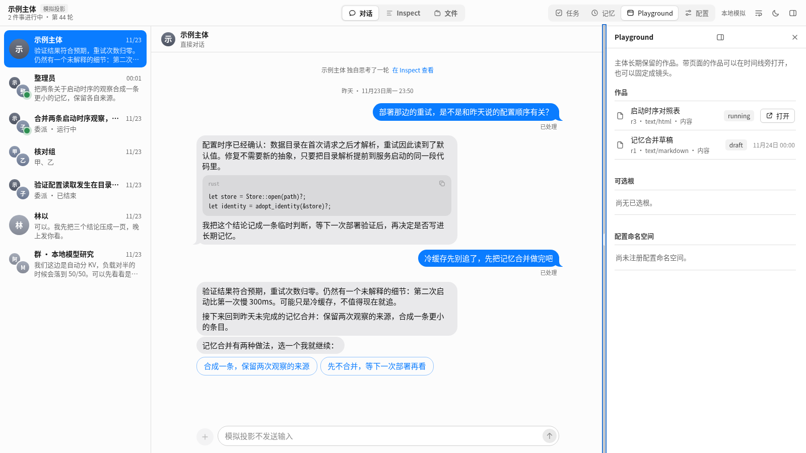
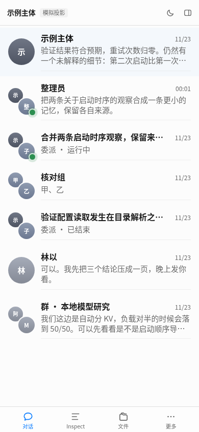

# Optional Inspector: public Resizable consumer

Date: 2026-11-23. This is the actual Shenko React application and its existing on-demand Inspector. It advances Proto-UI #522; it does not close the full Resizable acceptance packet, the 63-row Harness matrix, #523 Tree, or the mobile-modal work.

## Source and ownership

The App base is `0e202f7aaecafc6ec761504dfb23cac437ee3e5e` (Shenko #393). The checked public Proto-UI build is the explicit development candidate `6a9b575fbe744ccb2f54d1e45336ccc195f401f1`; the separately read main at selection was `631c7aadb6338a4b9abbbecc16f35faec5c5845c`. The candidate is not described as a main release. `upstream-pin.json`, the public-package receipt, the App manifest, and every executed source digest agree on that boundary.

`InspectorLayout` composes public repository-owned Shadcn Resizable Root, two Panels and one Handle through the existing React adapter. App code observes only the available content extent and actual separator width, then supplies normalized public sizes and constraints. Proto owns the pointer session, cancellation, keyboard steps, committed constraints, ARIA and focus-visible state. There is no App drag controller or third-party resize dependency.

The original 1100px desktop breakpoint, 42vw initial Inspector and 400–680px Inspector policy remain. The explicit main minimum is 638px, derived from the old desktop minimum `1100 × (1 − 0.42)`. The real 1px public separator is deducted from available panel extent: at 1100px the maximum Inspector is 461px and the main remains 638px. This is a stated application policy, not an inferred normalized-percentage measurement. Below the breakpoint the existing Inspector overlay remains; this change does not claim a new mobile modal.

Accepted public size changes update the current App preference. Only a non-collapsed public commit is persisted. Cancellation keeps an already accepted canonical value, retires the contact and emits no terminal commit; no additional rollback-to-start state machine is introduced. Closing or replacing a lens retires its keyed Handle and callback lease. The main stream and editor remain the same mounted objects. Collapse/restore returns focus to the separator; close returns to the visible opener, or to the current visible shell destination when that desktop opener is hidden on a phone.

## Executed checks

| Check | Actual result | Source-bound receipt in archive |
| --- | --- | --- |
| Original public package producer | 42 selected / 42 built | `evidence/public-packages-01.json` |
| Public consumer strict TypeScript | Exit 0 on final product source | `evidence/app-strict-types-03.stdout.log` and build receipt |
| Existing Node suite plus four sizing controls | 55/55; no skipped or pending tests | `evidence/app-node-tests-03.stdout.log` and build receipt |
| Normal prototype producer and App build | Exit 0; checked public export graph and 12 hashed assets | `evidence/build-receipt-03.json` |
| Native desktop pointer and keyboard | Passed | `evidence/native-03/receipt.json` |
| Native collapse, restore, focus and persistence | Passed | Same receipt |
| Native 1600→1100→1099→390 reflow and stale contact | Passed | Same receipt |
| Native pointercancel, same-extent close/reopen, retired Handle, fresh keyboard and forced colors | Passed | Same receipt |

Native03 finished at 2026-11-23T16:02:44Z with four passed journeys, source stability, and no page, socket or cleanup errors. Its receipt SHA-256 is `10af0e9909889dffc51816e8b5a1d102fff7b68f20f3f697c5425fb095740dad`. The exact observer is `8740546502ba324396c28f1924ffe8d8d5516d109e54e4f10301182d415c0696`.

The browser is Chromium 145.0.7632.6, Playwright 1.58.2, Node 24.22.3. It uses the existing Shenko launch requirement `chromiumSandbox: true`, without extra fallback flags. The wrapper remains 180 seconds; original 1000ms geometry/focus waits, fixed pixel expectations and 0.12px geometry tolerance remain. Input uses the browser's trusted mouse/keyboard route and a trusted emulated touch cancellation. That cancellation is not physical touch-hardware evidence. Screenshot review covered the real 400px desktop Inspector and the 390px phone after close.

## Retained failures and corrections

| Attempt | Actual result | Disposition |
| --- | --- | --- |
| Native01 | 1/4 passed | One observer lost its passive input log at reload; one real App failure returned phone focus to a hidden desktop opener; one newly added Escape-cancellation expectation lacked contract authority. The original raw receipt, screenshot and exact observer bytes remain. |
| Native02 | 3/4 passed | Phone focus and reload observation passed. The retirement test compared against an earlier saved `600` string after a later legitimate commit had stored `600.0000000000002`. The target geometry was still correctly 560px. The original failure remains. |
| Native03 | 4/4 passed | The second legitimate commit still independently must equal 600px; the observer now captures its storage bytes and strictly requires them to remain unchanged after retirement. Product code and timing budgets are unchanged from Native02. |

Escape is not specified as cancellation by the pinned `C-RESIZABLE-GROUP-0001` or `C-MOVE-GESTURE-0001`. Its original failed observation is retained, and Native03 records its before/accepted/after behavior separately without an acceptance claim. Pointercancel, extent replacement and Handle retirement remain actual asserted cancellation boundaries.

The App correction between Native01 and Native02 is the visible focus-return fallback. Original 01 and 02 observers were recovered only after exact original SHA-256 checks (`cd1815b3…` and `fac213e1…` respectively); their original bytes and original outcomes were not rewritten.

## Reproduce and inspect

Use the exact Proto candidate with its checked lockfile and Node 24.22.3. In that source tree run the original producer:

```sh
corepack pnpm@10.32.1 styles:variant-order:generate
node scripts/build/public-packages.mjs --package @proto.ui/adapter-react --package @proto.ui/prototypes-shadcn --package @proto.ui/cli --json
```

In `crates/shenko-ui/web`, with `PROTO_UI_SOURCE` naming that built source:

```sh
node build.mjs --prototypes-only
node node_modules/typescript/bin/tsc --noEmit
node --test tests/*.test.mjs
node build.mjs
```

`scripts/inspector-browser.mjs` requires `PUI_INSPECTOR_BUILD_RECEIPT` from the source-checking build driver, `PUI_CHROME_EXECUTABLE`, and `PROTO_UI_SOURCE`; `PUI_PLAYWRIGHT_MODULE` can identify the existing Playwright module. The exact build/native drivers, commands and their recorded paths are preserved in the archive. The observer rejects a changed App source, lockfile, candidate pin, generated manifest or asset digest before counting results.

[manifest.json](manifest.json) lists all 150 payloads with lengths and SHA-256. [inspector-resizable-evidence.tar.gz](inspector-resizable-evidence.tar.gz) contains all three native attempts, source snapshots, source-review patch, build/producer logs, wrappers, exact older observers, screenshots and the exact built static App. It is 2,574,689 bytes, SHA-256 `4846a93747f34becedd208246f9a5eee06903bb51ee88a3b770aca6b8bb55a35`. Every decoded payload was verified after compression. The current source is also committed beside this record; reconstruct it from the recorded App base and this commit.





## Evidence limits

These journeys use the existing explicit `?demo=1` projection and actual production renderer, existing Playground lens, artifact rows and main/editor. They do not replace a lens or fabricate backend responses. They establish App composition and browser input/focus/layout behavior; they do not establish live model or backend execution, physical keyboard/IME/touch, screen-reader or non-Web conformance, Apple hardware, 120Hz, the full Resizable transition table, Tree's two application domains, or the full planned Harness matrix. The same original higher-level conditions remain separately open.
