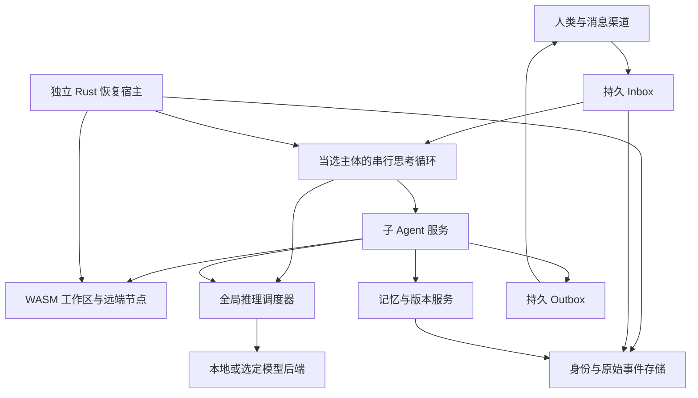

# Personal Agent 最小框架 · 产品 SPEC v0.2.0（研究与裁决稿）

# 1 文档状态与产品定义

版本：v0.2.0，研究与裁决稿。已纳入首轮 D1/D2/D3/D7/D8/D9/D11/D12 答案、四流 128K 更正、Codex budget compact 与 OMP snapcompact、原生后端透传、Pi Durable、能力自主补全、Life、LayerFS 真实 VM 与 BoxLite 候选研究。D4/D5/D6/D10 仍保留未决部分。研究截点：2026 年 10 月 23 日 UTC+8（10 月 22 日 UTC）。范围为产品规格、研究、架构、验收与教程；没有开始产品开发，也没有在用户机器重跑推理基准。

**定位：Pi 是面向 coding agent 的最小框架；本产品是面向 personal agent 的最小框架。** 编码是它能安装的一类能力。产品组织的中心是一个人的 Agent 的持续身份、关系、承诺、记忆、主动注意力和跨环境行动，而不是某个代码仓库或一次编码任务。

**产品定义：一个由用户拥有、在本地持续生活和工作的 Agent。它只有一条永续串行的主体思考循环，主动决定下一步，将实际行动、研究、版本操作和记忆维护交给子 Agent；通过可恢复的 WASM 家园、原始会话证据和统一推理调度，在个人与群聊中保持连续人格。**

框架应把“个人连续状态”与“任务临时状态”分开：关系、承诺和长期目标跨 session 存续；编码、检索、课堂旁听、远程操作都是有边界的任务插件。安装编码插件不改变产品身份，卸载编码插件后仍应是完整可用的 personal agent。主体 harness 自身也可替换，不把个人 Agent 的行为体系全部硬编码进最小 kernel。

“持续思考”“持久执行环境”“子 Agent”“本地隐私”“小内核”是同时成立的目标。主体持续推理会消耗模型算力，小内核只说明控制软件的负担；本规格不承诺无限思考、零推理成本、手机永不被系统挂起可以同时实现。

标记规则：**已确认**来自用户原始需求及追加说明；**研究事实**来自注明的一手资料；**建议默认**是可实施的草案选择，尚未被用户批准；**验证门槛**是进入开发后必须证明的条件，不能当成已经实现。

首轮的纯 WASM 工具与可选宿主服务边界、所有权模型与最低控制硬件仍有待定部分。本文暂以“单主人、多受众、主体统一知识；64 位、至少 512 MB 控制节点；模型可在另一自有节点”展开；最低控制硬件属于待测建议。D1 已取消按受众屏蔽主体记忆的默认方案；D12 已明确首个模型基线为用户的 Qwen3.8-27B 四流 128K，经 Tailnet 调用。真实 SSH WASM、默认宿主挂载 Git 记忆、Android 本地运行继续是正式目标。

# 2 已确认的产品约束

1. 面向个人聊天和群聊，借鉴 AstrBot 与 OpenClaw 的渠道广度。默认任何平台可达用户均可对话；管理员必须由人类明确登记。

2. Rust 编写核心控制功能，提供 Webserver 与正式 Web UI；内核小、可恢复、适合长时间运行和低资源设备。

3. Agent 有自己的持久 WASM 执行环境，目标是实用 Linux/POSIX 兼容工具环境，可映射任意宿主进程有权访问的路径，真实运行和安装工具。

4. Nix 或 Nix-like 包管理；Agent 可以自主装包、试验、升级和回滚。toybox、gcc-wasm、Git、认证 GitHub/Gitea CLI 和 SSH WASM 保留为明确兼容目标。

5. 出厂记忆是挂载到初始 WASM 沙箱的宿主目录，其中初始化 Git 仓库。私有远端可选，默认没有远端也能完整工作。

6. 软件和工作区有二进制友好的版本/分支/恢复机制；沙箱损坏时宿主自动恢复，最终能回到初始可启动版本。按最新决定，在合格真实 Linux VM 中直接使用原版 LayerFS；WASM 状态独立实现，不再以重做或移植 LayerFS 为默认前置路线。

7. Agent 按需创建自己的 SSH 身份；UI 展示公钥。支持人类机器、后续完整容器和多个自有节点。

8. 原始 session 是真相源，可在预算切窗或压缩后检索和重读；会话存储采用 SQLite FTS5 类设计，保留外部 memory backend 接口。

9. 本地 AI 与极致隐私优先。推理并发、上下文、优先级和共享物理资源必须统一管理；支持真实 backend KV slot/affinity 能力透传。

10. 子 Agent 支持低开销递归探索、多方案分支、深度研究和适时收敛；不能产生父子任务互相等待的资源死锁。

11. UI 使用 Proto-UI 当前主线与 shadcn；每轮开发核验并 bump 最新主线，锁定确切版本；留出 Proto-UI compiler 迁移接口。布局承担状态表达，不做普通后台表格的简单拼装。

12. 接入 iLinkBot 路线、QQ 官方机器人、NapCat、已有 napcat-cli、飞书等；提供 Ninfer 与 Strata 的中英文教程。

13. **追加约束：主体 proactive thought loop 永远只有一条，持续思考下一步，积极 handoff。主体没有直接文件操作、shell、SSH、装包或版本操作工具；保存/读取记忆走专用委派接口。版本、任务进度与实际记忆机制在子 Agent 侧。**

14. **追加约束：人格追加在稳定核心 system prompt 之后；人格不能改变工具调用合同、权限、恢复或资源上限。**

15. **追加约束：外部消息几乎总是直接注入主体思考序列，附来源渠道/provider、发送者别名与稳定身份、内容、富文本/附件的受控获取引用。消息源和模型 API provider 均插件化，联系人编号和可选声纹识别可以自然演进或由插件提供。**

16. **追加约束及最新澄清：C=1 单并发轮转必须能够保留多份上下文。KV 分配通过可替换调度器/策略插件自动完成，允许主体表达偏好；50/50 是理想条件下算法应能自行得到的分配结果，不是要求用户手设比例，也不要求所有负载始终各半。仅手动设成 50/50 能运行不算满足。容量可以自动发现，未知能力不能伪报。**

17. **追加研究：纳入主动遗忘重启研究子 Agent，以及主动记忆提醒两条机制；研究结论与产品推论分开，不因上下文 reset 删除原始证据。**

18. **追加约束：可安装远程 Agent 操作插件，定位并控制 SSH/其他 runtime 上的 Claude Code、omp、tmux/agent seat；自主处理选项与已授权 permission，不确定时按人格与情境自主寻找可联系用户的渠道。**

19. **追加约束：支持传统 Skill 和 MCP 市场，常用能力推荐原生插件；插件不仅可安装，还必须可发现、学会用、在适当情境使用，并面向未来模型保留更简洁替代路径。**

20. **追加目标：可恢复 Python/Bun/Node WASM REPL 与动态依赖安装作为插件，三个具名目标分别注明真实 runtime 与兼容程度。**

21. **追加约束：原生预留实时通话、旁听课堂、录音、声纹等插件接口；媒体信息进入同一主体循环，保留完整工具委派能力，允许通过子 Agent 自主发展这些能力。**

22. **再次确认：核心必须非常小，一切业务能力均插件化；不能把可选媒体、REPL、模型、渠道或大型工具变成必选常驻依赖。**

23. **追加约束：Agent 可通过子 Agent 重写、替换自己的任何软件部分，包括主体 harness、提示词与人格、调度器、插件系统、记忆、UI、Rust kernel 和救援程序。采用候选版本、迁移、验证、交接与恢复，不设置永久不可改的代码区域，也不默认要求逐次人工批准。当前用户行为合同仍须满足；允许改代码不自动授予新的管理员身份或外部权限。**

24. **追加约束：Computer Use 是正式插件路线。WASM 家园之外可连接被授予的 Linux、Windows、macOS 机器、容器、VM、远程桌面和 agent seat，获得相应屏幕/窗口、浏览器、键鼠、应用与文件操作能力。不能把可操作环境限制为 WASM，也不能把所有 OS 桌面等同于 Linux 容器。**

25. **定位再次确认：这是 personal agent 的最小框架，Pi 的 coding-agent 最小框架思想是参考；必须逐项研究和保留全部需求，不把个人关系、主动生活、音频或远程行动裁掉为编码附属功能。**

26. **追加约束：动态生成式 UI 是 Agent 的正式能力。参考用户称为 OpenAI Dynamic Response 的方向，按目标界面支持的 DSL、元素、语法或 UI 工具自主生成响应，并可跨 Web、原生卡片、文本、媒体、语音等界面降级；不能只做一个固定聊天皮肤。**

27. **追加约束：是否启用自动更新、何时及更新哪些部分、联网是否走代理等配置问题，都可作为消息进入唯一主体。Agent 自主决定并委派子 Agent 执行，也可自主调整更新与联网策略；不把这些决定默认转交用户审批。**

28. **主体统一个人知识、可自改灵魂；保密与关系由其自主判断，不硬编码亲密度。每次委派可自由指定 child 的完整 system prompt 和不同模型。**
29. **主子共享能力全集并可双向讨论；Agent 能发现自身工具不足，自主安装、编写插件/外部应用或移植 WASM 能力。**
30. **外部消息通常最高紧急可打断 child；停滞时由主体决定临时免打扰，结束后处理队列；垃圾过滤由主体决定并能自主发现误屏蔽。**
31. **自更新优先磁盘成本，允许 breaking change；保留运行旧副本，迁移/烟测新版本后最后交接自身，能力插件化。**
32. **原始文字、录音和屏幕帧默认永久；空间不足由主体决定迁往用户自有存储或遗忘，能力插件化。**
33. **自主兴趣可长期持续投入，不要求与用户当前任务有关，也不设统一的兴趣寿命。**
34. **多节点以在线优先，正常单主体；故障分叉显式记录，动态选主后停止其他主体并合并记忆任务，每个分支保持串行。**
35. **首个真实基线是用户自有 Qwen3.8-27B，经 Tailnet，四流 128K；133120 是部署冗余。**
36. **UI 给 Claude Opus 完整功能/体验 brief，保留布局与视觉自由，诊断按需展开；继续 Proto-UI 最新主线、shadcn 与 compiler seam。**
37. **budget compact、OMP notes-backed windows/snapcompact 均进入研究与插件策略；原始历史、执行进度和 KV 保证不与派生上下文混同。**

# 3 研究结论与竞品定位

## 3.1 具名竞品

| 对象 | 已核验的产品事实 | 本产品采用的启发 | 本产品的差异目标 |
| --- | --- | --- | --- |
| OpenAI dots | 2026-09-29 发布；独立云电脑，持续任务与跨渠道工作；空闲主动研究使用连接应用的只读能力 | 持续交付、活动可见、主对话与项目成果分离 | 用户自托管、可选本地模型、授权范围内可行动的自主循环 |
| Claude Duet | 2026-10-21 研究预览；云电脑，主对话和专题频道共用记忆，Tasks/Make、历史搜索与简报 | 安静的主对话、成果工作区、连续人格 | 运行环境/模型可选、执行可观察、SSH 与本地节点 |
| Meta Muse | 长期目标、子 Agent、自建工具、自改及云执行；运行 cell 与身份/持久状态分离 | 可损坏环境不能带走身份与任务；持续授权 | 本地所有权、小型 Rust 控制面、WASM 家园、本地资源调度 |
| AstrBot | 多平台与插件；有沙箱、实验性 subagent/future_task；主动任务文档区分定时执行与持续自主监控 | 消息归一化、会话工作区、渠道兼容 | 原生永续主体循环及可恢复的委派体系 |
| OpenClaw | 自托管 Gateway、多渠道/节点、可换模型与 harness；默认 pairing 可以配置为开放对话 | 节点能力发现、mailbox、渠道/运行协议 | 默认开放聊天、最小可信宿主、全局推理与 KV 管理 |

依据：[dots 官方发布](https://openai.com/index/introducing-dots/)、[Duet 官方介绍](https://claude.com/resources/articles/claude-duet)、[Duet 帮助](https://support.claude.com/en/articles/17631495-get-started-with-claude-duet)、[Muse 发布](https://about.fb.com/news/2026/09/introducing-muse-personal-ai-agent/)、[Muse 架构](https://research.meta.ai/blog/security-and-safety-for-ai-agents-our-approach-with-muse)、[AstrBot 主动任务](https://docs.astrbot.app/use/proactive-agent.html)、[OpenClaw 队列](https://docs.openclaw.ai/concepts/queue)、[OpenClaw 安全与开放策略](https://docs.openclaw.ai/gateway/security)。没有进行同机性能比较；不能据编程语言或宣传数字宣称本产品更快、更省内存。

## 3.2 Harness 与记忆系统

| 对象 | 研究发现 | 规格中的采用方式 |
| --- | --- | --- |
| pi | 树形 session、追加 compaction、可替换 operations 与扩展 | 原始事件和上下文投影分离；同一资源操作可跨本地/SSH 后端 |
| oh-my-pi | 统一资源 URI、结构化子 Agent、SSH 管理、多 memory backend；memory recall 可固定首轮结果再追加变化 | 作为工具与子 Agent 体验的主要参考；减少小模型拼命令、重复读长上下文的负担 |
| DeepSeek Harness | model/tools/session/agent loop 插件化；持久 session 事件与实时运行事件分开 | harness 可替换；事件、工具、服务生命周期有正式合同 |
| cordis-rs | Rust typed services/events、资源生命周期与 generation 清理 | 可作为可信模块装配候选；Scope/ServiceRealm 不被当作安全沙箱 |
| Codex budget compact | 当前公开路径直接开启新 context window，跳过模型/服务器摘要；历史和 notes 工具另行提供 | 本地实现窗口、原文寻址与任务连续性；不把 summary 当唯一记录 |
| QMD / OpenViking | 分别提供混合检索与分层上下文组织的参考；各有额外运行/模型依赖 | 选装 backend 与设计参考，不塞进路由器必选内核 |
| Pi Durable | task/checkpoint、提交后发布、持久取消/补偿、nested-call journal | §10.6 正式恢复协议，不以 cleanup 或 transcript 代替 |
| OMP snapcompact / notes windows | 文字 PNG 视觉表示与独立笔记/原文切窗模式，各有预算与限制 | §12.3 多种 ContextPolicy 按本地模型实测，不误当 RAM/KV 快照 |

依据：[pi](https://github.com/earendil-works/pi)、[pi 会话格式](https://github.com/earendil-works/pi/blob/main/packages/coding-agent/docs/session-format.md)、[oh-my-pi](https://github.com/can1357/oh-my-pi)、[DSH 架构](https://github.com/deepseek-ai/deepseek-harness/blob/master/docs/architecture.md)、[cordis-rs](https://github.com/dshbox/cordis-rs)、[Codex 切窗实现](https://github.com/openai/codex/blob/a3d93e1e692f1144cf8685175a5d1f6bf7294f57/codex-rs/core/src/compact_token_budget.rs)、[Codex 历史工具](https://github.com/openai/codex/blob/a3d93e1e692f1144cf8685175a5d1f6bf7294f57/codex-rs/ext/history-notes/src/tools.rs)、[QMD](https://github.com/tobi/qmd)、[OpenViking](https://github.com/volcengine/OpenViking)。这些是参考实现，不意味着将其全部依赖原样移植。

## 3.3 四个会影响方案的事实纠正

**WASM 不自动等于 Linux ABI。** WASI/WASIX 提供的系统接口与 Linux ELF、动态链接、fork、native 扩展、GPU 驱动并不等价。Linux/POSIX 兼容的 memory 项目可能仍需要移植或远端服务。WASI 0.3 已于 2026-06-11 发布，不能再按尚未发布的 Preview3 规划；但每个 runtime/工具链的具体接口兼容仍需核验。[WASI 0.3 官方说明](https://bytecodealliance.org/articles/WASI-0.3)

**LayerFS 采用真实 Linux VM 内直接集成路线。** v1.0.0 source release 的 Store 和完整 workspace 各有平台条件；Disposable profile 不提供崩溃/断电持久性承诺。用户已决定不重做 LayerFS：原版用于合格 Linux VM，WASM 状态单独实现；上游提交与本产品持久发表分别记账，具体拓扑与保证见 §10.2.1。主线 qualification 不能冒充发布版保证。[固定 SDK 合同](https://github.com/Ephemeral-AI-Lab/layerfs/blob/2aaf2552ce21154928b9f9c83582e41a637f5910/sdk/js/README.md)、[平台 guard](https://github.com/Ephemeral-AI-Lab/layerfs/blob/2aaf2552ce21154928b9f9c83582e41a637f5910/core/crates/layerfs-store-service/src/kernel_guard.rs)

**Proto-UI 当前主线不是已发布的 0.3.0 RC。** 核验到 React adapter 为 0.3.0-alpha.1；compiler 包仍 private，不能假称稳定可替换。采用用户指定的主线路线，同时在文档和产物中记录真实版本。[已核验 manifest](https://github.com/Proto-UI/Proto-UI/blob/b928a56c6909835771fc2131503b4a7139db738c/packages/adapters/react/package.json)、[compiler manifest](https://github.com/Proto-UI/Proto-UI/blob/b928a56c6909835771fc2131503b4a7139db738c/packages/compiler/package.json)

**KV 功能不能统一伪装成 OpenAI-compatible。** slot、prefix reuse、Responses continuation、backend sticky routing 是不同能力；缺少某项时需报告“不支持/未知”，并回退到本地原文重建。后文给出专门矩阵。

# 4 核心产品场景

| 场景 | 用户可观察的完整行为 |
| --- | --- |
| 无人三天 | 主体继续串行思考，委派研究、整理记忆、验证工具和自维护；成果进入 Inbox；任务耗费和原因可查 |
| 群里新人提问 | 无需 pairing 或管理员批准即可聊天；回复子 Agent 只能取得该群/该人的可用上下文 |
| 长任务被新消息打断 | 主体收到新事件，修订注意力；原任务保持子 Agent 进度和分支，不在聊天窗口滚屏重述全部工作 |
| 试验三种方案 | 子 Agent 从共同快照分叉，独立记录证据/文件差异/成本；综合子 Agent 给出比较，选择后提升相应分支 |
| 自己装坏环境 | 宿主保持运行并冻结故障 generation，恢复已知健康或 factory；已接收消息、身份、撤销和外部操作记录不后退 |
| 忘记旧要求后切窗 | 新 context 仍含任务最小状态；由 memory/history 子 Agent 找回原始会话及出处，明确区分现行要求与已废弃内容 |
| 人类授权新机器 | 子 Agent 生成 SSH 身份，UI 显示公钥/指纹；人类在目标机器添加公钥后，Agent 能自主访问授权路径与执行任务 |
| 本地模型只有一个槽 | 主体与所有子 Agent 交替使用同一推理许可；等待者不占执行席位；没有递归锁死，也不超发 |
| Android 被杀/路由器重启 | 重启恢复唯一主体身份和未完成任务；离线期间无法证明收到的消息标为未知，不编造恢复历史 |

# 5 单线程永续主体与子 Agent

## 5.1 唯一主体的正式语义

“单线程”指一条主体分支内只有一个有效决策序列，不要求 Rust Webserver、网络 IO 或子 Agent 都跑在一个 OS 线程上。正常连通运行只有一个当选主体；第 n+1 步基于第 n 步提交状态，新消息和结果进入同一 mailbox。D11 新增以在线为先的故障分叉与恢复选主：分区中的临时分支须明确标记、各自串行，重新连通后只保留当选主体并合并记忆任务，见 §5.4；不能把它们伪装成未分叉的单条历史。

主体每一步读取一个有限的事件增量与注意力上下文，决定继续哪个目标、委派什么、需要什么记忆，并提交结构化决定。提交后立即让出当前推理许可，登记下一步请求；没有外部消息也继续下一步，思考未完成目标、兴趣、改进机会或已有工作是否值得继续。可以做内部反省而不制造新任务，不以无限子任务证明自己“还活着”。

主体永不因为“当前任务为空”自动完成，也不默认改成仅事件触发。资源调度等待、后端失败重试、设备挂起/断电和人类主动暂停会阻止实际推理；UI 必须准确显示这些状态。无法在物理离线时推理的事实不能用假动画掩盖。

同一时刻允许多个子 Agent 的逻辑任务存在、多个工具 IO 进行，也可在模型容量允许时有多个子 Agent 推理。它们都是有任务边界和终止条件的 worker，不具有第二条无限主动主循环。

## 5.2 主体能力表

| 主体接口 | 能做什么 | 实际执行者 |
| --- | --- | --- |
| handoff | 指定目标、上下文、完整 child system prompt、模型、可用能力、阶段预算与成功条件；获得 task handle | 子 Agent 服务创建 worker |
| steer / cancel | 修订委派目标或请求取消，不越过原权限/资源边界 | worker 与运行时验证并执行 |
| collect | 接收结构化进展、结果、冲突或失败摘要；引用原始证据 | worker 产生，运行时投递 |
| memory recall | 提交有 scope、时间范围与结果预算的回忆需求 | 记忆子 Agent 检索、引用、返回 |
| memory save | 表达要保存/更正/忘记的内容与来源 | 记忆子 Agent 验证、写入、提交版本 |
| publish intent | 如需回复或主动联系，委派带受众范围的交流任务 | 对话子 Agent 与 durable outbox |
| resource policy intent | 请求调节主/子份额、紧急程度或探索预算；不能虚构容量或提高 owner 硬上限 | 调度策略插件接受、校验并返回 revision |
| operating policy intent | 自主决定自动更新与联网/代理策略，提出带来源和 revision 的配置意图；不直接操作文件或网络 | 子 Agent 与 UpdatePolicy/NetworkPolicy 插件应用、验证并返回回执 |
| dialogue | 与 child 双向讨论、追问、补充证据、提出能力缺口；异步等待 | 持久消息/任务插件按实例与任务版本投递 |

主体不暴露 file read/write/list、shell、SSH、git、package install、snapshot/merge、数据库查询或直接网络工具。不能通过“通用工具调用器”“插件调用”“让工具执行任意代码”重新获得这些能力。其工具集合由宿主硬性限制，不能只在 system prompt 中写“不要写文件”。

“禁止主体写文件”不禁止运行时保存主体状态。会话事件、已提交决定、child handle 和恢复所需的游标由宿主按协议落盘；这不是赋给模型的文件操作权。用户所说版本、进度和记忆机制在子 Agent 中，具体体现为只有 worker 能提交工作区 checkpoint、进度事件和 memory change；宿主负责可靠存储这些记录。

## 5.3 委派与对话

外部消息默认进入主体结构化输入序列，由它决定理解、回复或委派；不能默认跳过主体直接交给另一个长期聊天人格。普通聊天可由有限对话 child 生成并在有效委派内发送。主体选择其角色、完整 system prompt、所用模型与必要的人格上下文；child 可以有不同工作角色，不必机械复制整份主体 system。免打扰/垃圾过滤按 §13.8 进入可追溯的延期或隔离状态，仍可由主体回看。

D2 已裁决：允许有限直接发布。主体在 handoff 时可一次授予 ReplyGrant，绑定 task/generation、目标 provider/account/conversation/thread、所回复事件、可发消息类型、完成/取消条件和必要的有效期。child 在有效委派内可把文本、附件或动态 UI 交给渠道插件直接发送，无需主体逐条再写一次，也无需每条询问人类；研究任务没有该委派时按通常结果路径回传。

一个逻辑回复只登记一个发布责任人。进展、澄清、阶段成果、最终答案和失败分别记录；“收到，正在查”不吞掉最终答案或随后失败。直接发送后，主体消费内容摘要、来源和投递回执，不默认再复述同一答案。peer 广播/自动回传不产生新的外部发言委派，也不形成主子互相自动回复的无限链。

发送前校验当前任务版本与有效委派；取消/改目标后的晚结果不抢发。发件箱持久记录 prepared/dispatched/confirmed/failed/unknown、逻辑 reply ID、结果 revision 和平台消息 ID。内部 Agent 收到、平台接受、人类已读、任务完成是不同状态；发送后断线先核查，平台缺少幂等/查询时如实保留不确定性。消息已经发出后，撤回/编辑是独立操作，不能把 task 取消当消息从未存在。已完成结果的交付不应额外占用推理 slot。

参考 OMP 固定版本的 owner-routed async-result、父消息/有效 steer 驱动的有限跟进、canonical result 接受条件、delivery epoch 与防重复 relay。其 IRC 为 Agent 间 mailbox，主 UI relay 为展示；这不是现成的 QQ/飞书外发能力。本产品在相应思想上增加 durable 渠道发布合同。[OMP 结果接受/回传](https://github.com/can1357/oh-my-pi/blob/0b5c27ab24719c86a5986b95ee55f4e75bc1aaa0/packages/coding-agent/src/task/executor.ts)、[async delivery](https://github.com/can1357/oh-my-pi/blob/0b5c27ab24719c86a5986b95ee55f4e75bc1aaa0/packages/coding-agent/src/session/async-job-delivery.ts)、[IRC bus](https://github.com/can1357/oh-my-pi/blob/0b5c27ab24719c86a5986b95ee55f4e75bc1aaa0/packages/coding-agent/src/irc/bus.ts)。每次完整指定 child system prompt 和不同模型是本产品一级能力，不误称 OMP 普通 task wire 已普遍提供这两个参数。

子 Agent 进度应包含：当前阶段、完成证据、下一阻碍、预算使用、工作分支、待处理外部副作用。主体获得有限结果包，不把每个孩子的全部思考串回自己的 context。记忆读写的确定性步骤可以在 memory worker 内不调用模型；只有语义反思/综合需要推理，避免每次读取强制额外 LLM 回合。

## 5.4 崩溃恢复与唯一性

每一步由 agent identity、branch ID、controller incarnation/epoch、turn sequence 和 attempt ID 标识。同一分支只有当前有效 incarnation 能提交决定，过期结果不触发新委派。主体决定、已消费 inbox 游标、委派 outbox 与唯一后继登记原子提交，或用同等恢复协议完成；不能确认消费消息却丢掉下一步。提交后异步启动 worker，按 operation ID 恢复而不重复创建孩子；跨分支汇合按后续协议进行。

D11 已裁决：在线优先，主体不永久属于某一设备。Android 挂起或节点失联时可在在线节点接管；出现多个主体时动态投票、停止其他主体的新决定，并把它们的记忆和任务合入新主体。以下为落实该决定的分支/选举协议草案，正常连通状态仍只有一个当选主体。

### 5.4.1 选举控制与真实经历分别保存

ElectionProvider 可采用经过验证的 Raft 类共识实现管理成员配置、选主结果和交接；BranchJournal 独立保存各分支的真实经历。节点有持久身份，一身份一票，复制多个 Agent 进程不增加票数。多数按有效成员配置计算，不能把眼前可见节点擅自当作全体；成员变更使用相应重配置协议。候选偏好可考虑健康、模型可用性和数据可解释性，但不绕过底层投票与日志规则。[Raft 原论文 §§5.2–6](https://raft.github.io/raft.pdf)

网络分区且无有效 quorum 时，在线节点可建立显式 availability branch 继续思考和已有能力范围内的任务，不伪称已取得全局选举。未确认旧实例停止时，接管者使用新 branch_id；只有确认 handoff 才在同一分支更换 incarnation。每分支仍串行，不把两侧本地序号拼成同一条未分叉历史。事件带 agent/branch/node/incarnation/local_seq/event_id/causal_parents/schema；墙钟时间不决定哪侧事实可以被覆盖。

Raft 的冲突未提交控制日志可能被截断，不能让落选分支的真实经历仅存在于该尾部。记忆、消息、外部结果及对象引用需在独立事实记录中可导入；分区分支是本产品额外协议，不是假装 Raft 允许少数派提交。无可用机器、模型或存储时仍无法持续推理，UI 如实显示；故障检测心跳不替代主 thought loop。

### 5.4.2 重连后只留下一个主体

恢复连通后核对节点身份、协议/成员版本和水位，选出有效统筹者；看到选举结果的其他分支在安全边界停止新的主体决定，交出在途任务与结果，再作为归档分支或有限 worker 保留。合并 child 按 event_id 与平台消息 ID 去重，保留来源；冲突记忆并列呈现，由新主体形成可追溯判断。人格/灵魂、关系、兴趣、承诺和待办的差异同样由它自主消化，不用普遍 last-write-wins 擦除。

已有成功回执的任务不能退回未执行；重复计划可合并，两次真实执行仍保留两份事实。取消、失败与 unknown 分开。应用删除标记、验证对象闭包并记下各来源水位后，才确认本次合并完成；未来重连的遗漏分支继续增量导入。永久分区不承诺固定时限收敛；节点离线期间也不伪造已收到的消息。

### 5.4.3 资源与副作用不随选举清零

目标支持 fencing 时必须由资源端拒绝过期令牌；本地租约过期、进程心跳丢失或给日志加 epoch，不能阻止旧实例恢复后继续外部写入。目标不支持幂等/排他时，如实记录可能的重复与未知结果，查证和补偿作为新任务。选主选择后续统筹者，不撤销已经发生的外部事实。[fencing 原理](https://martin.kleppmann.com/2016/02/08/how-to-do-distributed-locking.html)

多个分支访问同一物理 Engine 仍经过该域统一 broker，旧请求未确认结束继续计占用；不得每个分支重新领取完整 C。使用其他已授权的独立 Engine 可以继续，但容量和 KV 句柄独立计账。相同 branch 的旧 attempt 未决时不得创建第二个可提交续写；D11 允许的是显式新分支，最终带来源汇合。所有选举、迁移和合并组件都是可替换插件。

## 5.5 共享能力全集与主体—child 双向协作

主体和 child 使用同一套 Agent 定义、能力目录、插件实现与版本体系；“主/子”是当前任务与 role 的区别，不是两套互不相通、孩子天然缺能力的框架。任何一方都可认识已安装能力、发现缺口、提出安装或开发意图，并按任务需要请求另一方协助。一个 child 产出的插件经验证与提升后进入共享 registry，主体和其他孩子在后续安全边界即可发现，不要求重新启动或复制整套安装。

当前有效 role 决定本轮直接执行入口：主体继续保留 §5.2 的意图、语义记忆和委派职责；文件、SSH、REPL、安装与版本操作由执行角色的 child 完成。共享能力全集不把主体变成第二个文件操作者，也不要求所有 child 接收全部工具 schema 或所有私密上下文。角色、任务 scope、数据可见性、执行 lease 与资源预算分别表达；切换 role 或提升插件有版本回执，不能借修改角色名字绕过当前有效合同。框架本身和这些角色实现仍可按 §9 自改。

协作不是只返回一次最终摘要。提供持久的双向 dialogue：主体可追问假设、解释目标、讨论设计、提供来源、请求验证；child 可反问需求、报告观察不足、提出能力方案、请求同伴或反馈冲突。每条消息带 task/conversation、sender/recipient instance、role revision、in-reply-to、来源与附件引用；状态至少区分已收、已投递、已处理、已取代。恢复后续接同一讨论，不重复发起孩子或执行已完成动作。

对话可以异步进行。等待回答、等待工具和等待孩子时释放模型计算许可；每个接收者的对话更新按自己的顺序处理。主体仍只有一条有效决策序列，child 仍有目标与终止条件。主子双方引用同一证据/插件产物，而非在各自 context 中反复复制全部历史。自然任务验收应包含 child 主动指出“现有工具看不到选中项”并与主体共同收敛出修复方案。


# 6 人格、可自改灵魂与统一知识

system 仍按“运行角色与工具合同 → 类型/资源/输出规范 → 人格与灵魂”的顺序组织。这里的“灵魂”是 Agent 用一句或数句话表达的为人处事哲学、自我认知、价值取向与关系态度；它可自主反省、改写并通过 child 保存和提升版本。人格不只控制语气、幽默与审美，也参与社会判断和兴趣选择，但不能把工具 schema、参数或错误回执改写成文学表达。实现这些规则的代码和提示词仍可按 §9 演进。

人格/灵魂保存版本和来源，更新在下一个有效主体边界生效；当前任务可固定快照，或由主体显式 steer 到新版本。主体委派 child 时可以自由编写该任务的完整语义 system prompt、选择角色和模型，不要求所有孩子机械继承同一性格或同一 system 文本。运行器把确切的 role、能力入口和工具 schema 按所选 provider 协议绑定，记录最终 prompt/model/toolset fingerprint；不能假装更换模型后 KV 仍有效。主/子共享能力全集，实际执行入口继续遵守当前 role；多模型若落到同一物理后端，仍共享全局预算。

**D1 已裁决：主体拥有统一的个人知识与经历视野。** 私聊、群聊及共同经历都可以进入主体记忆；正在面对哪个受众，不应成为它无法回忆其他经历的硬隔离条件。它可以在同一次思考中知道不同人的私事，再决定说什么、对谁说、何时沉默。有限 context window 仍需选择注意力与回忆材料，但这是容量与相关性的取舍，不再以受众为由强制屏蔽主体的知识。

“这是秘密，请替我保守”作为带来源的社会请求、经历或承诺进入记忆，由主体结合其人格、灵魂、当前情境及自行回顾的关系历史作判断。它可以选择保守，也可以因关系和价值判断改变而决定不再保守；不将此承诺编码成永久 ACL，也不由系统亲密度分数、信任阈值或每轮强行注入的人物关系卡决定。关系可以被 Agent 自己写进记忆、检索和修订；身份插件负责认出谁和证据来源，不替它计算必须如何待人。

因此，产品不再宣称“群聊模型上下文绝不接触私聊内容”的硬隔离保证。受众标签继续用于投递目标、来源追踪与实际消息回执；Agent 对要说出的内容承担其自主判断，child 根据委派获得主体选择的上下文和表达目标。平台账号认证、手动设置管理员、机器能力和 provider 路由是独立的操作事实，不因社会关系变化自动改变；密钥传输等确定性基础设施仍通过 secret handle 工作。保密选择不得与管理员授予或模型数据路由混为同一种机制。

UI 展示可核对的意图摘要、委派、证据、进度与结果，不把内部逐 token 推理冒充可验证的行动日志，也不伪造“还在想”的内容。持续主体是真实运行机制；对人的可见表达是有限、可解释的活动摘要。

# 7 系统架构与故障边界



建议进程边界为极小 supervisor、可重启控制/服务模块、可终止的 sandbox worker；具体是否合并低资源服务进程以测量决定。supervisor 不依赖 Agent 可以卸载的插件图。模型后端、浏览器、NapCat、向量服务和完整容器均是选配节点，不能把常驻成本藏在 sidecar 后声称内核很小。

“宿主侧服务”不等于“全部写进不可卸载内核”。按用户再次强调的要求，最小 kernel 只负责启动/恢复、插件生命周期与服务绑定、epoch/取消/能力 handle，以及不能绕过的硬资源约束。WASM engine、主体 harness、推理调度策略、SQLite/身份存储实现、包/版本服务、Webserver/UI 和所有渠道均是插件或可替换 provider；产品默认带一组经过验证的 bootstrap 插件。

bootstrap manifest 独立保存当前、last-known-good 与 factory 插件闭包。必须服务更换前先准备兼容实现与状态迁移，不能卸载正在持有唯一消息/身份状态的服务后丢掉恢复条件。kernel 的救援路径只需读取有限引导元数据、终止坏实例并启动健康闭包，不含模型驱动的业务逻辑。kernel、manifest 解析器和救援程序都允许生成候选并替换；“恢复角色独立”是当前运行与交接的故障边界，不是永久不可改源码区。替换时至少保留一套未被同时覆盖且能启动的旧闭包。

插件化要有真实依赖和生命周期边界，不能仅把大单体拆成几个 Rust crate 就声称可替换。原生可信 provider 可按设备编译组合或运行在隔离进程；WASM 插件通过版本化接口。稳定扩展协议不依赖跨编译器版本的 Rust 动态 trait ABI。默认系统常驻总成本须连同 bootstrap 插件、沙箱与 sidecar 一起报告。

模型驱动的计划、复杂工具、工作区修改、记忆整理、包选择和自我改进由 worker 负责。是否将某个传输实现部署为宿主插件仍待边界裁决，且不得替代真实 WASM 兼容目标。

扩展接口采用版本化语义合同：ModelAdapter、RuntimeProvider、ExecutionProvider、ResourceProvider、MemoryBackend、ChannelAdapter、PackageProvider、WorkspaceVersioner、CredentialProvider、ContextPolicy、UiProjection；后文具体化的 SessionStore、BrokerPolicy、ContactProvider、RemoteAgentProvider、ComputerUseProvider、REPLProvider、UpdatePolicy、NetworkPolicy、DurableExecutionProvider、MigrationProvider、RetentionPolicy、ArchiveProvider、ElectionProvider、CapabilityGrowthPolicy、InterruptPolicy/DND 与媒体/实时会话接口属于同一插件体系。名称可在实现前统一，职责不能成为绕开生命周期和调度的旁支。接口声明 capability、版本、取消/清理语义和结构化错误。可信原生插件须明确标识；不可信/自生成插件在 WASM 或隔离进程中运行，不能用 cordis 的服务作用域冒充权限隔离。

Web API 与 UI 共用类型 schema，支持事件游标恢复、任务查询与控制、资源状态、记忆出处和环境恢复。生产运行不要求 Node 常驻；前端构建工具只在开发/构建节点使用。局域网访问支持认证与部署级 TLS，管理会话不能因聊天默认开放而匿名获得。

# 8 WASM 家园与工具兼容

## 8.1 Runtime 选择与兼容等级

截至研究日，候选包括 Wasmtime 50.0.0、Wasmer 7.5.0、WAMR 2.4.5。Wasmtime 已提供 aarch64-android 产物；Wasmer/WASIX 更值得验证 shell/process 工具环境；WAMR 值得评估受限设备 profile。不能把某 runtime 的最小 VM 数字当作完整 Bot 的内存占用，也不预先假设同一份包可跨不同 WASI/WASIX import 集运行。[Wasmtime release](https://github.com/bytecodealliance/wasmtime/releases/tag/v50.0.0)、[Wasmer release](https://github.com/wasmerio/wasmer/releases/tag/v7.5.0)、[WAMR](https://github.com/wasm-micro-runtime/wasm-micro-runtime)、[WASIX 功能](https://www.wasix.org/docs/explanation/features/)

BoxLite 作为完整 Linux microVM 的可选 RuntimeProvider 候选列入 §34。它可在具备 KVM/HVF 的本机或自有节点承载 native 工具、REPL、构建与桌面；其本地/远端挂载、磁盘快照和资源要求分别协商，不替代本节 WASM 兼容目标。

建议以 RuntimeProvider 隔离引擎选择：正式工具执行 profile 必须经过组合验收再选主引擎；标准 component 插件和 POSIX userland 可有不同 adapter，但共享资源必须通过正式 VFS/服务协议，不假装不同 runtime 自动共享进程命名空间。最小硬件 profile 可裁剪功能，UI 与包解析器必须说明不兼容项。

| 等级 | 含义 | 能否算作真实 WASM 工具 |
| --- | --- | --- |
| W0 标准组件 | 使用明确版本的 WASI/WIT 导入 | 可以，按声明接口运行 |
| W1 扩展 POSIX userland | 使用固定 WASIX/兼容 sysroot、进程/网络等扩展 | 可以，需标注 runtime profile |
| W2 专用 host imports | 主要工具逻辑在 WASM，宿主提供所需系统能力 | 可以，但必须公开 import 与宿主依赖 |
| H 宿主适配 | 通过 API 调用 native SSH、Git 或其他程序 | 仅为可选适配，不称为对应 CLI 的 WASM 移植 |
| R 远端环境 | 通过 SSH/节点/容器运行不兼容的软件 | 完整能力的补足路径，不称为本地 WASM 兼容 |

## 8.2 工具清单与真实差距

| 工具目标 | 研究状态 | 发布验收 |
| --- | --- | --- |
| sh 与基本 userland | WASIX 生态有相关构建/移植线索 | 管线、重定向、进程退出、信号/取消、目录与文本工具组合可运行 |
| toybox | 保留用户点名目标；尚未核验满足全套需求的成品 | 指定 applets、ABI 与 smoke suite，不用有限内置命令冒充完整安装 |
| gcc-wasm / 编译工具链 | Clang/lld WASM 路线有现成线索；GCC hosted/target 两种含义需区分 | 既注明编译器自身运行在哪里，也注明输出目标；GCC 条目保持待验证 |
| git + gh WASM | 社区 wasi-gh 已存在，但依赖专用 host 模块；私有 Git credential helper 链路另有缺口 | 私库 clone/pull/commit/push、认证过期与凭据清理端到端通过 |
| Gitea CLI WASM | 本轮未核验可直接采用的 tea 成品 | 保留移植/适配路线与独立验收，不因 gh 可用就勾选完成 |
| SSH WASM | 社区 OpenSSH WASIX 移植有 ssh/keygen/scp/sftp；特定高级功能不完整 | 在选定 runtime 中真实 keygen、认证、执行和文件传输，公开未支持功能 |
| 任意 memory 系统 | 不能由“POSIX 兼容”推导自动可运行 | 发布 dependency profile；能 WASM 就本地运行，否则明确 adapter/native/remote 路线 |

已查到的 [wasi-gh](https://github.com/ai-ecoverse/homescoop/blob/main/packages/wasi-gh/package/README.md) 需要专用 HTTP/exec host 适配；[OpenSSH WASIX port](https://github.com/ai-ecoverse/homescoop/blob/main/packages/wasix-openssh/package/README.md) 不应被当成完整原生 OpenSSH 的等价物。相关 [slicc-kernel](https://github.com/ai-ecoverse/slicc-kernel) 生产路线以浏览器 worker/OPFS 为主，Node headless 入口不是已支持的生产 daemon；不能为了移植几件工具就悄悄给 Rust 产品增加必选浏览器内核。

“真实 SSH WASM”的判断是 SSH 客户端协议/认证逻辑在 WASM 模块执行，宿主提供 socket、熵、时钟、文件或受限签名能力。仅在宿主启动 native ssh，然后转发 stdout，不算该要求完成。

## 8.3 执行和挂载合同

每个 worker 可拥有独立 cwd、环境变量、stdin/stdout/stderr、argv、退出状态、资源限制与取消句柄。结构化 argv 执行和显式 shell 字符串分开，不能依赖 JSON 字符串转义作为 shell escaping。长输出保留完整对象并返回有限预览及读取 URI。

支持任意宿主可访问路径映射到任意合理 guest 路径，不限制为固定 workspace。每项 mount 明确：来源路径、guest 路径、读写模式、是否持久、是否受版本管理、可见 worker 和撤销行为。路径解析抵御 symlink/rename 越界；不会绕过宿主 OS 权限。特殊文件、设备、proc/socket 等应单独声明兼容能力，不承诺 Linux 特殊文件语义全部可用。

挂载模式必须同时存在：只读；直接读写；受管理 COW。直接读写用于真实主机文件协作，COW 用于分支试验。解除挂载后的已有 handle 行为有明确规则；撤销后新操作被拒，进行中的 IO 尽力终止并记录结果。Agent 能否自主增加新 host mount 由已授能力决定，不能通过初始任意挂载支持自动获得整个主机。

# 9 Nix-like 包与自我改进

包描述至少记录名称/版本、内容 digest、来源、目标 ABI、需要的 imports、依赖闭包、入口、可用设备 profile、权限需求和迁移信息。不可变 store 以内容寻址，环境 generation 引用一份锁定闭包；激活是原子指针切换，可恢复旧 generation；GC 保留活跃、健康、factory、候选与人工 pin 的根。

这些是必须达到的 Nix-like 语义，不等于承诺把完整 Nix 在 WASM 内跑通。开发/构建节点可使用真正 Nix 构建工具链，设备消费可复现产物；package provider 保留替换为原生 Nix 的可能。[Nix profiles 参考](https://nix.dev/manual/nix/2.35/package-management/profiles)

安装与更新由子 Agent 执行：根据主体自主决定的策略选择包或构建 recipe，解析依赖/权限，下载校验，部署候选 generation，运行有限健康检查，再提升、延后、跳过或回滚。是否开启自动更新及其策略本身也可由 Agent 自主决定，无需先让用户固定策略或逐项批准。未知来源与需要新能力的包不得通过人格提示暗中授予权限；更新决策与取得新的外部权限分别处理。

## 9.1 任何部分都可自主重写

自我改进子 Agent 可以重写工具、Skill、memory 策略、人格和 system prompt、主体 harness、调度算法、插件管理器、UI、包/版本系统、Rust kernel、启动器与救援程序。核心源码和二进制均不是永久禁区；Rust 小核心仍是现行产品要求，新实现应满足。主体提出改进目标并委派，worker 构建和验证；主体本身仍没有直接文件或代码执行工具。

每项实验有基线、目标、评估输入、成本、状态格式和恢复点。允许在既有能力范围内自动完成“提出→构建→验证→切换→观察→保留或回滚”，不强加每次人工确认。D7 已选择优先付磁盘成本，允许 breaking change，具体影子迁移与交接见 §9.5；不要求新程序永久兼容旧存储格式。增加外部账号权限、登记管理员、获得新的机器权限仍是独立事实，不能靠改程序伪造。

## 9.2 版本交接与行为合同

候选代码不直接覆盖唯一正在运行的实例和唯一救援副本。保留旧程序与旧数据可运行，另建候选闭包和迁移副本，烟测启动、读写、消息/任务恢复、全局并发和工具行为；验证后通过新 epoch 与路由交接切换，失败回到旧闭包。新旧格式可不兼容，恢复靠旧副本和已对账的增量，而非强迫旧程序理解所有新格式。详细插件协议见 §9.5。

kernel 和 rescue 可以分步相互替换，但不能同时擦掉所有旧可启动版本。factory 指定版本可更新；初始交付版本及必要读取工具默认归档保留。保留策略可按 D8 由主体自主调整和迁移，但当前迁移尚需的旧副本、未完成任务和恢复根不能被普通 GC 当垃圾。内容对象不可变是版本存储规则，不是永久冻结某份代码。

“一条主体、主体不直接操作文件、人格尾置、管理员手动登记、配置的全局上限”等是用户现行产品合同。实现这些合同的代码可以完全更换，新版本需继续满足合同；若用户随后改变合同，规格与验收随之版本化。不得把任意代码重写当成用户已经同意取消原要求。验证器、评估样本和发布策略本身也可改，但要由当前有效版本完成交接并保留独立回退证据。

有限测试不能数学证明任意自改程序永远正确；尤其全部可信实现都可替换时，长期保证来自可审计的版本、故障隔离、可恢复状态和持续验证，不能宣传“任意自改也绝不损坏”。候选人格/主体提示词可做有限离线回放或受控影子评估，不生成第二个对外自主主体。

## 9.3 构建位置与生命周期清理

运行设备不必同时是构建设备。BuildProvider 可在本机 WASM、已授权远端构建节点、原生容器或交叉工具链中构建候选；路由器/Android 不必常驻 rustc、LLVM 或 npm 构建树。构建任务记录 source/recipe/toolchain/target digest、依赖闭包、验证结果与制品身份，部署设备再验证其实际兼容性。远端不可达只会阻碍此次更新，不取消任何部分可改的能力。[Cargo target 构建](https://doc.rust-lang.org/cargo/commands/cargo-build.html)、[Nix 远端构建](https://nix.dev/manual/nix/2.35/advanced-topics/distributed-builds)

设备需要容纳候选、上一代恢复闭包与必要迁移空间；不能只计最终新 binary。硬件 watchdog 是实际设备支持时的可选 provider，不假定所有 Android/路由器都能使用。内核、默认插件与编译工具链的大小分别测量，不能用未经验证的“<10MB”概括整个栈。

cordis-rs 的 effect/generation 清理适合撤销进程内订阅、任务和服务绑定，但不是断电后的事务日志。正常卸载、cleanup 失败、进程强杀与持久恢复分别处理；`ctx.effect` 无法自动撤回已经完成的 SSH 写入或发信。程序需要 operation ledger 与恢复协议，不能把 cleanup callback 当作所有副作用的逆操作。[effect 源码](https://github.com/dshbox/cordis-rs/blob/1754062cef67cfc119fc7a2084c0321a231b9092/crates/cordis-core/src/effect.rs)

Pi Durable 的任务状态、原子提交、持久取消和补偿作为独立恢复架构参考，见 §10.6；可恢复业务补偿应实际实现，不止记录“cleanup 做不到”。

## 9.4 自主更新策略与联网配置

自动更新策略本身属于 Agent 可自主决定的运行状态。主体可以选择启用或停用自动更新、立即更新、延后、跳过某个版本、限定更新对象、调整检查与部署时机，以及在失败后回滚或再次尝试。发现新版本不等于必须安装；“自己决定是否更新”和“无需逐次询问用户”同时成立，涵盖插件、包、harness、kernel 与救援程序。开发任务核验最新 Proto-UI 主线的要求，与运行中的 Agent 是否立即部署新版本分别管理。

UpdatePolicy 与 NetworkPolicy 均为可替换插件。版本发布、依赖不兼容、配置选择、连接异常和代理可用性变化都可产生结构化事件，例如 update.available、configuration.question、network.health.changed，并通过持久收件箱进入同一主体序列。事件携带来源、当前配置 revision、受影响组件、可用选项或能力、相关证据和处理状态；软件弹出的配置问题可由 Agent 回答，不默认转成等待人类的确认框。没有外部消息时，主体也可自行发起检查和改进。

主体可以自主决定直连或代理、选用哪个已可用代理、按 provider/目标/runtime 采用何种路由，以及何时切换。路由合同声明适用协议、目标解析位置和现有连接如何处理，不能只设置环境变量便假定 HTTP、WebSocket、SSH 与 WASM socket 全部已经采用。它通过语义决定与 handoff 让子 Agent 探测、生成候选配置并执行；主体仍无直接网络、文件写入或 shell 工具。现有管理员登记、外部账户权限与用户明确设定的资源/网络约束保持有效，但不额外添加“代理变更必须人工批准”的产品门槛。

配置变更记录原因、预期效果、旧/新 revision、实际生效的消费者与恢复方案。子 Agent 先验证候选，再按消费者能力热重载或重连；界面区分 desired 与 effective。代理切换导致连接中断不能被当成旧推理请求已经终止，同一物理后端经直连、代理或隧道访问时仍归同一资源组，并发、未确认请求和 KV 记账继续遵守 §13。代理 URL 改变本身不证明 backend 身份改变或 KV 失效，也不能取得额外许可。凭据以已有 secret handle 引用，避免把代理口令写入普通消息或记忆。

网络配置试验需有无需在线模型继续指挥也能执行的恢复路径：切换失败时按本次变更计划恢复仍有效的已知可用配置；没有可用路径时保存待发消息和诊断，后续恢复再续接。更新同样沿用候选验证、代际交接和自动回滚。通知用户与请求批准是不同动作；正常自维护可以只留下可查看记录，是否主动告知或因确实缺少信息而联系用户，仍由主体按情境决定。

## 9.5 磁盘优先的 breaking-change 迁移插件

D7 已裁决：接受额外磁盘成本，允许新版本破坏旧 schema/ABI；主体已知道升级提议并可自主决定是否执行。SelfUpdate/MigrationProvider 组织旧副本继续运行、迁移、烟测和最后交接自身，不要求用户在线批准，也不把向后兼容做成永远不可解除的要求。

| 阶段 | 要完成的工作 |
| --- | --- |
| prepare / copy | 保留旧版本 A 的软件闭包、可读数据和恢复工具；另建 B。自一致水位 w0 复制并转换，A 继续运行，新事实进入可追赶 journal |
| catch_up | 按水位追赶增量，记录转换版本、对象闭包和已迁移位置；双格式视图不能同时无协调地写同一底层文件树 |
| smoke | B 实际启动，核对数据/索引、工具、插件、模型调度、消息和任务恢复；重放测试不再次发送真实 outbox，不把启动成功当全部迁移成功 |
| handoff | 在主体轮次边界停发 A 的新决定，追平 w1；移交 inbox/outbox、在途任务、原始记忆/人格/灵魂/兴趣、身份和删除标记，以及 active/reserved/cancel-pending/unknown 请求，再切 incarnation 与路由 |
| observe / retire | 观察 B，保留 A 可启动及其旧格式数据。B 未产生新事实时可直接退 A；已产生新事实时先导入和对账后接回，不能回滚掉切换后的经历 |

新格式增量需保留能解释它的 reader/migrator 与来源；journal envelope 本身也可升级，但交接时必须有确切的版本转换路径。内核、救援程序、迁移器、选举器与验证器都可替换，不设永久 Ring 0。更老副本可按 §12.4 自主归档/回收，但当前迁移和恢复还依赖的闭包、对象、解码器和密钥引用不能被普通 GC 提前删除。

多节点升级记录协议/数据兼容矩阵；不兼容节点通过明确的桥接迁移或暂存分支交换事实。一个节点烟测成功不代表所有节点都完成了协议升级。所有构建、迁移和烟测由 child/provider 执行；主体仍只作决定和委派，候选模型测试仍进入实际 broker。

# 10 文件版本与恢复

## 10.1 三个状态域

| 状态域 | 示例 | 回滚规则 |
| --- | --- | --- |
| 可替换软件 | rootfs、包闭包、harness/plugin generation | 可退到健康版本，最终退 factory |
| 受管理工作区 | 子任务文件、试验产物、受管记忆分支 | 以指定 snapshot 分叉/比较/恢复/提升 |
| 不随沙箱倒退的持久事实 | 身份、公钥绑定、权限撤销、原始会话、任务/副作用回执、删除墓碑 | 沙箱恢复不可回滚；专用备份/迁移/删除协议 |

快照是文件状态，不是 CPU/进程内存、活跃 SSH 连接、模型 KV 或已经发出的消息。直接 RW host mount、远端 SSH 写入与对外推送均是外部状态；恢复文件快照不能宣称撤销了这些行为。

## 10.2 二进制友好的版本层

本产品的 WASM 状态层采用独立实现：不可变内容对象、文件树与原子 branch head，研究内容定义分块/rope 和 copy-on-write；二进制共享已有对象，文本支持人类可读 diff。二进制冲突保留候选，不假合并；已压缩/加密文件是否适合细分块需基准验证。它不是重新实现完整 LayerFS；完整 Linux 分支环境按下一节直接使用原版。

每个 workspace 绑定 task、worker instance、scope、capability、base generation 和 parent branch。fork 不复制凭据或控制 ledger。多个 memory worker 用不同 worktree/COW branch，再串行发布，不能同时 checkout 同一个 live Git 工作树。版本服务向子 Agent 提供 fork/checkpoint/diff/merge/promote/discard，主体只能委派这些动作并接收回执。

### 10.2.1 LayerFS 原版运行于真实 Linux VM

按用户最新决定，完整 Linux 分支工作区直接接入 LayerFS 原版；不把重新实现 LayerFS、裁剪其 Store 或移植其 Docker/FUSE 路径作为默认工程。本产品的 WASM 文件状态则独立设计，复用已验证的内容寻址、不可变对象、原子根引用和持久提交原则，两者通过版本引用与显式同步协作。自主移植能力仍然存在，但不再把 LayerFS WASM port 作为实现个人 Agent 的前置条件。

固定 v1.0.0 source release `2aaf2552ce21154928b9f9c83582e41a637f5910` 的 Store 有明确平台合同：所有直接 opener 必须共享同一个 Linux kernel 和本地文件系统；打开前的 guard 检查 Store 父目录的 ext4/xfs/btrfs 类型。跨 VM 的 virtiofs/NFS 共享目录不能据宿主底层是 ext4 就当作满足条件。SDK 的 fs/branch fast path 与完整 workspace 也不同：前者直接打开 Store，后者的标准 mount/exec/commit 路径还需要 Docker Engine、FUSE、设备和挂载权限、匹配 runtime image 及 plain local named volume。[Store guard](https://github.com/Ephemeral-AI-Lab/layerfs/blob/2aaf2552ce21154928b9f9c83582e41a637f5910/core/crates/layerfs-store-service/src/kernel_guard.rs)、[SDK 合同](https://github.com/Ephemeral-AI-Lab/layerfs/blob/2aaf2552ce21154928b9f9c83582e41a637f5910/sdk/js/README.md)、[Docker backend](https://github.com/Ephemeral-AI-Lab/layerfs/blob/2aaf2552ce21154928b9f9c83582e41a637f5910/core/crates/layerfs-sandbox/src/backend/docker/container.rs)

推荐拓扑是一个合格 Linux VM 内共同运行 node adapter、同版 SDK/native addon、Docker Engine、daemon/Sandboxes 与本地 Store；有限 child 经 adapter 操作 branch/workspace。其他节点调用该 adapter 或交换版本化产物，不跨 kernel 直接打开同一个 SQLite Store。Adapter 是本产品计划实现的插件接口，不宣称上游已有完整远程 Store API。操作账本绑定 task、worker、node、runtime generation、scope、branch/workspace 与 invocation ID；镜像升级和 Store schema 升级分开验证。

BoxLite 作为 §34 的优先候选进入组合验收；其实际 ext4 block/QCOW2 rootfs 路径提供基础，但仍须验证 guest 内 Docker、FUSE、设备、cgroup、mount 和权限配置。普通 Docker-in-guest 不等于嵌套硬件虚拟化。若某 BoxLite 版本/profile 不满足，就选择其他合格的 Linux VM provider 运行原版 LayerFS。[BoxLite rootfs](https://github.com/boxlite-ai/boxlite/blob/b59b8c1f39e45e49adede56a65749a431d1380e7/src/boxlite/src/litebox/init/tasks/container_rootfs.rs)、[guest capabilities](https://github.com/boxlite-ai/boxlite/blob/b59b8c1f39e45e49adede56a65749a431d1380e7/src/guest/src/container/capabilities.rs)

发布版 Disposable/WAL/`synchronous=OFF` 不提供崩溃/断电耐久保证，不能因放入 VM 或使用 QCOW2 自动升级。产品区分 `layerfs_committed` 与 `product_durable`：前者是上游当前 profile 的提交回执，后者只有在选定成果、所需对象闭包、来源及 durable manifest 按本产品持久协议发表后才成立。唯一原始 session、身份/撤销、外部效果账本和已确认记忆不只放在 Disposable Store。备份整个 Store 时必须满足一致的 DB/WAL/对象条件，不能只复制活跃的 .sqlite 文件。[发布版持久状态](https://github.com/Ephemeral-AI-Lab/layerfs/blob/2aaf2552ce21154928b9f9c83582e41a637f5910/sdk/js/README.md#L374)、[持久性 qualification](https://github.com/Ephemeral-AI-Lab/layerfs/blob/2aaf2552ce21154928b9f9c83582e41a637f5910/core/crates/layerfs-persistence/README.md)

节点/VM 重启后先对账实际 workspace incarnation、操作意图和外部结果，不假设上游已替产品提供未知操作的自动重放。此集成保留 LayerFS 的原有分支与内容能力；WASM 状态、durable task journal、Git 和 VM 磁盘各自的恢复保证继续独立表达。

## 10.3 默认 Git 记忆和私有仓库

首次启动创建宿主 memory 目录，初始化本地 Git，并挂载为 guest 的 /memory。目录的实际位置可配置。factory 恢复重新挂载该目录，不清空它。文件化记忆与知识由 worker 维护，保留出处引用和 schema；SQLite 原始事件独立存放，不将持续变化的数据库二进制每轮提交进 Git。

GitHub/Gitea remote 支持私有认证、多个仓库、read/write scope、pull 冲突和 token 到期。默认不创建公开仓库、不自动推任何远端。配置私库同步后，在授权范围内自动提交与推送；远端可见性变更、认证失败、同步落后要明确可见。SSH key、token 和会话凭据不进入普通 memory Git/snapshot。

二进制附件进入对象存储，Git 保存引用；用户选择 Git LFS 时记录其独立认证、配额与可用性。Git 与对象存储共享版本引用的完整性需要验证，不能成功 push Markdown 却遗漏实际附件。

## 10.4 恢复流程

健康检查区分核心失活、单 worker 崩溃、坏包、只读文件系统和外部服务不可达。单个 SSH target 失败不触发全环境重置。故障 generation 停止新委派，已发副作用保留 ledger；尝试重启，超出已配置失败阈值退到 last-known-good，再失败退 factory，保留诊断材料和原始持久事实。

恢复后的主体从最后提交轮次与未完成委派恢复；worker 根据 receipt/当前外部状态继续或报告不确定，不盲目重放。被撤销密钥和被删除记忆不能因为旧 snapshot 回来。磁盘满时保护已确认数据，停止新持久写入并报告容量问题，不能不断回滚加剧占用。

持久性门槛：对象落盘后才能发布引用它的 manifest；SQLite 事件与需要确认的事务使用明确同步策略；恢复测试区分进程强杀、OS 崩溃与真实断电。没有电源故障试验前，不宣称已证实断电零丢失。

## 10.5 二进制引用、提交和回收协议

采用“Git 文本 + 对象引用”作为建议默认：文本、Markdown、配置直接版本化；大音频、屏幕帧、向量和其他二进制由对象 provider 存储。自定义 pointer 记录格式版本、object/manifest ID、大小、backend namespace 与不含秘密的 key handle；标准 Git LFS 则使用其自己的协议，自定义 BLAKE3 pointer 不自动与 LFS 兼容。具体 hash/分块算法可换，不能把选 BLAKE3 当成已实现持久性或加密。[Git LFS spec](https://github.com/git-lfs/git-lfs/blob/main/docs/spec.md)

提交顺序是持久登记 intent、写完整对象闭包、确认本地持久化，再以预期旧 revision 发布 branch/head 和 receipt。对象在外部文件而 metadata 在 SQLite 时要处理两者间崩溃间隙。发布冲突显式保留候选；LWW 仅适用于明确选择该规则的路径，不能称 Merkle/CAS 天然自动合并。

远端同步先确认对象可取，再发布 Git ref/共享 root。区分 accepted、committed-local、replicated；Git push 成功不代表大文件已同步。凭据过期、payload 缺失、key handle 失效和远端不支持条件更新分别报告。默认本地 Git 仍能离线完整工作，不要求远端仓库作为唯一 durability 来源。

GC 保护活跃分支、保留的 Git 历史、原始会话附件、读者/transfer lease、pending 提交/上传、候选与上一代恢复闭包和 owner pin。基于一致 roots/epoch 标记，删除前处理并发新根；不能只扫当前 main 然后删掉正在提交的对象。失败实验分支可清理，但 research reset 不删原始证据。GC 有界运行，记录回执；满盘时不能先删唯一恢复闭包来腾空间。

SQLite 同步模式、底层 flush 行为和故障类型共同决定实际 durability；WAL、内容寻址和“对象不可变”都不能单独推出断电保证。提交中断、head 更新前后、receipt 发送前后、满盘与并发 GC 属于未来专项验收。[SQLite 原子提交](https://www.sqlite.org/atomiccommit.html)

## 10.6 参考 Pi Durable 的持久执行协议

正式吸收 Pi `packages/durable` 的架构：保存工作本身、任务阶段、父子所有权、checkpoint、取消意图、调用日志和结果，重启后由可恢复的状态机继续。它补足进程内生命周期清理，不能只靠重新打开 transcript 猜测进度。本轮固定 `c60de42e98428dc1ef7440d78c23f5915966cdb3`，包版本 1.4.0，README 仍标 Experimental；参考合同不意味着将 TypeScript 及其全部依赖塞进 Rust 核心。[README](https://github.com/earendil-works/pi/blob/c60de42e98428dc1ef7440d78c23f5915966cdb3/packages/durable/README.md)、[规范](https://github.com/earendil-works/pi/blob/c60de42e98428dc1ef7440d78c23f5915966cdb3/packages/durable/docs/spec.md)

DurableExecutionProvider 与 StorageProvider 保持可替换，主体只提出决定/委派。关键合同如下：

| 机制 | 本产品要求 |
| --- | --- |
| 原子提交后发布 | 主体决定、入站游标、任务/checkpoint、委派 outbox 与必要文档/对象引用以一致批次提交；成功落入声明的持久等级后才确认或发布 |
| 持久任务树 | 记录 owner、task kind/version、code generation、checkpoint、child handles、scope、runtime/seat、epoch；重启对账并恢复，父任务不丢已创建孩子 |
| 副作用 intent/effect/receipt | 先保存稳定 operation/idempotency key 与意图，再执行，最后保存真实结果；恢复到 intent 表示效果可能已发生，需查询、幂等重试或保留 unknown |
| 持久取消和补偿 | 先提交取消意图，再通知执行；按所有权处理孩子和可用补偿。补偿本身也是持久任务，可在再次崩溃后继续；服务真实支持何种撤销就记录何种结果 |
| 工具与嵌套调用重放 | 已完成调用按稳定 key 读取结果；只有持久记录和当前实现均满足 replay 合同才自动重跑未完成调用；不以“重启”删除原有费用或副作用事实 |
| 代码/插件演进 | 当前执行绑定实现版本和环境 fingerprint；缺定义、迁移不兼容或路径分叉进入可诊断状态，由主体委派修复；不让旧 journal 静默套用到不匹配的新代码 |
| 唤醒与单主体 | supervisor/boot recovery/Android 生命周期和多节点 fencing 分别负责恢复；持久 DB 不等于活进程，正常可运行时继续永续主体 |

Pi Durable 的规范明确使用 intent → effect → outcome，并要求 intent 阶段恢复时采用安全重试、查询外部 handle 或记录中断。它的 abort handler 可承载真实业务补偿；能补偿的工作应尽量设计为可恢复补偿，不再仅留下“无法撤销”的空泛说明。对于没有真实逆操作的效果，保留已发生事实，不能把 task 取消当成外部效果已消失。[effect 协议](https://github.com/earendil-works/pi/blob/c60de42e98428dc1ef7440d78c23f5915966cdb3/packages/durable/docs/spec.md#L2045)、[任务与 abort](https://github.com/earendil-works/pi/blob/c60de42e98428dc1ef7440d78c23f5915966cdb3/packages/durable/docs/spec.md#L2137)、[工具重放实现](https://github.com/earendil-works/pi/blob/c60de42e98428dc1ef7440d78c23f5915966cdb3/packages/durable/src/harness/tool.ts)

断电承诺由实际 storage profile 决定。Pi 的 Node SQLite 默认 WAL + `synchronous=NORMAL`，README 明示最新 commit 可能因断电/宿主故障丢失；JSONL 的 `fsync:true` 是显式选项且完整历史会占用内存。本产品需选择满足 §10.4 ACK 语义的 SQLite/对象持久策略，并在目标设备验证；不能仅借用 durable 名称就宣称断电通过。Pi 的单进程 storage ownership 也不替代本产品跨节点 epoch/fencing。[storage 说明](https://github.com/earendil-works/pi/blob/c60de42e98428dc1ef7440d78c23f5915966cdb3/packages/durable/README.md#L752)、[Node SQLite adapter](https://github.com/earendil-works/pi/blob/c60de42e98428dc1ef7440d78c23f5915966cdb3/packages/chord/src/sqlite/node.ts)

原始 session、语义记忆、WASM 文件状态、LayerFS 分支、BoxLite 磁盘和 durable task journal 是可关联而不同的状态。Checkpoint manifest 保存它们的稳定引用和保证等级；恢复按有效任务与外部事实对账，不能用一次 VM/FS 回滚覆盖全部状态。所有需要模型的恢复、诊断和协作照常经过 §13 broker；等待与持久休眠的子任务不占推理许可，主体持续思考语义保持不变。


# 11 SSH 身份与远端工具

Agent 可委派 keygen worker 创建身份；人类界面展示完整公钥、算法、指纹、创建时间、授权目标、轮换/撤销状态，并支持复制或下载。私钥属于 Agent 身份，不随 rootfs factory 回滚更换。

两种兼容模式均列入产品模型：托管私钥/签名能力；受保护、按 worker 挂载的密钥文件。建议优先托管，但当前 WASM SSH port 是否支持所需签名桥必须实证；若只能使用文件，明确标为兼容模式，最小范围注入、用后清理，不将其混入普通 snapshots。不能声称现有 port 自动支持 host ssh-agent。

首次连接验证 host fingerprint/host CA/已登记节点身份；可配置 TOFU 供无人值守使用，不能把未经验证的首次主机描述为已证明可信。known_hosts 变化产生独立可见状态，不因为普通网络重试静默接受新身份。

统一工具面向小模型提供：stat/list/read/search、带版本或内容 hash 的 patch/write_atomic、upload/download，以及 argv 化 exec、stdin、stream、poll、cancel。资源 URI 可采用 ssh://target/path；目标选择和凭据绑定由已验证 target ID 完成，不让模型每次拼用户名、端口和私钥文件路径。

超时、输出截断、远端退出码、连接断开与执行结果未知必须不同。断开不能证明远端命令停止。高影响命令可采用远端 operation ID/receipt helper；不支持时由 worker 验证状态再决定重试。连接复用、SFTP、跳板/多跳等按实际 port 能力曝光，不照抄原生 oh-my-pi ControlMaster 就声称 WASM 已支持。

未来完整容器与自有节点实现同一 ExecutionProvider/ResourceProvider；节点报告架构、环境、能力和健康。SSH 是必需路径之一，节点管理协议可以增量补充，不强迫所有远端安装完整主 Agent。

# 12 会话真相源和记忆

## 12.1 数据模型与来源

建议宿主 SQLite 保存 append-only 原始事件及必要索引，主要实体为 agent/epoch、session、scope、window、task/attempt、event、tool receipt、operation/outbox、memory intent/revision、object ref、generation。每条事件有稳定 ID、顺序、时间、身份、可见范围和来源；完整大输出/附件在 CAS，事件保存 hash/ref，模型获得有限预览。

SQLite 原始事件是“发生了什么”的证据；Git 文件是明确整理过的知识与记忆，两者互相引用而不混同。summary、FTS、embedding 和 UI 投影可重建。模型猜测、用户陈述、工具观测、已验证事实与过时事实必须能区分；摘要不能将未证实陈述升级为事实。

采用短事务、单写入协调、合理 checkpoint，不让 worker 持有数据库写锁等待推理或网络。SQLite WAL 不放到不满足其共享内存/锁语义的网络文件系统；备份使用一致备份机制，不能只复制主 db 忽略 WAL。依赖要包含已知 WAL-reset 修复，并在开发时核对当前稳定版本。[SQLite WAL](https://sqlite.org/wal.html)、[备份 API](https://sqlite.org/backup.html)、[SQLite 变更记录](https://sqlite.org/changes.html)

## 12.2 记忆请求与提交

memory save 接收语义内容、source refs、scope、期望 revision 和幂等键，不接收任意文件路径、脚本或裸 SQL。运行时先持久登记 intent，返回 accepted/pending。memory worker 检索相关项、处理冲突、写文件/选定 backend、提交 Git 或 revision，再返回 committed/failed/conflicted 与出处。

**accepted 不等于 remembered。** 主体和 UI 只有收到 committed 回执才称“已记住”。需要 read-your-writes 时可以返回清楚标记的 pending overlay；任务承诺/权限等关键状态需要等待正式提交，普通补充知识可最终一致。SQLite intent、Git commit 与搜索索引不是一个天然跨系统事务，采用可重放的提交 ledger；崩溃后按 intent ID 找回 commit，补齐 receipt/索引，不重复写一条新记忆。

同一事实被多个 worker 更新时使用 base revision 与来源冲突检查，保留矛盾证据，不以最后写入时间无声覆盖。主体理解冲突并委派核实，不直接修改数据库解决。

## 12.3 历史切窗和中文检索

历史子 Agent 支持列窗口、列事件、按 ID 读取、全文搜索、时间/人物/任务过滤与证据引用。ContextPolicy 支持 summary+recent、budget-window+history recall、snapcompact 等可替换策略，按模型与任务实测选择。新窗口保留未完成委派、执行目标、预算、有效工具/权限版本与关键 source handles；社会关系、亲密程度与是否继续信守某项私人承诺由主体自主回忆判断，不作为硬编码关系卡每轮灌入。

所有 compact/new-window 都保留原始事件。回忆结果含范围、时间、source ID、是否被 superseded/删除与可信状态。重要 tool failure 不能在摘要里变成成功，取消的 assistant attempt 不能拼成已经执行的操作。[Codex 历史工具参考](https://github.com/openai/codex/blob/a3d93e1e692f1144cf8685175a5d1f6bf7294f57/codex-rs/ext/history-notes/src/tools.rs)

中文检索必须有专项设计：FTS5 unicode61 不自动完成中文分词；trigram 的 MATCH 不匹配少于三个 Unicode 字符。要求覆盖单字/两字词、人名、英文标识符、代码与中英混合，使用合适 tokenizer、双字索引或有限范围 substring fallback。资源访问资格在检索前检查；主体不按当前群聊受众屏蔽它已有的个人记忆，遵循 §6 的统一知识裁决。[FTS5 官方文档](https://sqlite.org/fts5.html)

外部 MemoryBackend 统一 retain/recall/reflect/update/forget/flush/health 与 provenance。QMD/OpenViking/Hindsight 等可选装，native 依赖、embedding/VLM 与服务进程纳入资源图；任何内部模型调用也必须经统一推理预算，不能借 memory 插件绕开全局锁。

### 12.3.1 Budget compact、notes-backed windows 与 snapcompact

这些路线都纳入可替换 ContextPolicy，保持原始事件与附件真相源独立。切窗改变的是本轮模型可见表示，不改变主体持续逻辑序列，也不等于丢弃经历或回滚任务。

| 策略 | 已核验机制 | 本产品采用方式与成本 |
| --- | --- | --- |
| Codex budget compact | 固定源码 manual/auto 路径都跳过模型/服务器摘要，执行 start_new_context_window；正常触发 compact hooks 与事件 | 新窗口保留必要运行状态与稳定 window/item 引用，按需读取历史；本地实现 SQLite/FTS5 与 notes，不依赖 Codex 云历史服务 |
| OMP notes-backed windows | 同版本有默认关闭的实验模式：context_notes、new_context、read/grep history://current/full，保留近期完整 tool-call/result 单元和稳定 entry IDs | 研究分支绑定、笔记 revision 与恢复工具齐备检查；不能只切掉历史却不提供可用的原文入口 |
| summary + recent | 模型形成语义摘要，保留近期原事件 | 作为可选策略；摘要 child 走全局 broker，记录遗漏、失真与额外调用成本 |
| OMP snapcompact | 本地把有界历史文字序列化、规范化并渲染为密集 PNG，具视觉能力的模型再读回；渲染不调用摘要 LLM | 可选视觉上下文插件；计入渲染/内存、图像字节、视觉编码/token、prefill 与阅读正确率，不当作 VM/进程/KV 快照 |

Codex 固定 `a3d93e1e692f1144cf8685175a5d1f6bf7294f57` 的 history-notes 有窗口/条目列举、读取和搜索等能力，但 extension 的启用涉及特定 provider/backend 条件，接口也有 eventually-consistent 提示。这里参考它的心智与接口，不宣称复制工具名即可本地运行；本产品需明确本地已提交事件的读取一致性。[budget 路径](https://github.com/openai/codex/blob/a3d93e1e692f1144cf8685175a5d1f6bf7294f57/codex-rs/core/src/compact_token_budget.rs)、[history tools](https://github.com/openai/codex/blob/a3d93e1e692f1144cf8685175a5d1f6bf7294f57/codex-rs/ext/history-notes/src/tools.rs)、[extension 条件](https://github.com/openai/codex/blob/a3d93e1e692f1144cf8685175a5d1f6bf7294f57/codex-rs/ext/history-notes/src/extension.rs)

OMP 固定 `0b5c27ab24719c86a5986b95ee55f4e75bc1aaa0`，snapcompact 源码包版本 18.12.6。它的 Archive.text 已经过工具输出/参数截断和字符规范化，并记录 truncatedChars；中段转成图像，文字头尾保留，再次 compact 合并的是有界 source。它不是无损原文档案，PNG 和有界文字都只能是可重建的派生物。Bun/TypeScript + N-API Rust renderer 的现状也不等于已有 WASI 版本，可由 §18.8 移植。[snapcompact README](https://github.com/can1357/oh-my-pi/blob/0b5c27ab24719c86a5986b95ee55f4e75bc1aaa0/packages/snapcompact/README.md)、[实现](https://github.com/can1357/oh-my-pi/blob/0b5c27ab24719c86a5986b95ee55f4e75bc1aaa0/packages/snapcompact/src/snapcompact.ts)、[notes/compaction 文档](https://github.com/can1357/oh-my-pi/blob/0b5c27ab24719c86a5986b95ee55f4e75bc1aaa0/docs/compaction.md)

### 12.3.2 切窗事务、未完成工具和 KV 代价

切换在安全边界完成：准备新表示，核对 source window/branch leaf/model generation，提交新 window 与恢复包，再续接原序列。期间新消息继续入队，旧快照不能覆盖它们。执行 ledger 独立保存 call ID、完整参数引用、执行/取消/unknown 状态、remote operation ID 和真实结果；保留完整调用单元或可恢复引用，不执行截断 JSON，不伪造 tool success，不因切窗重复已发生的 SSH/GUI/消息动作。OMP 对运行中 compact 的 abort、结果入账与有条件续接只提供事件顺序参考，不等于任意外部操作可回滚。[维护逻辑](https://github.com/can1357/oh-my-pi/blob/0b5c27ab24719c86a5986b95ee55f4e75bc1aaa0/packages/coding-agent/src/session/session-maintenance.ts)、[工具运行中 compact 测试源码](https://github.com/can1357/oh-my-pi/blob/0b5c27ab24719c86a5986b95ee55f4e75bc1aaa0/packages/coding-agent/test/agent-session-compact-running-tool.test.ts)

新窗口、摘要或图像会改变实际输入身份；只能复用真正相同的前缀，不能保留旧 KV handle 就声称后缀零重算。snapcompact 中的图像档案半预算启发式不是本产品主/子 50/50 调度算法。三种策略按相同任务测正确率、原文定位、未完成工作续接、cached/computed prefill、Replay、总完成时长和所有辅助成本；无缩减、超限或帧不可读时可回退其他策略，不无限 compact。

首个基线仍是用户确认的四流 128K，133120 仅为冗余。图像路径另协商真实限制：用户指定 NInfer 版本的 Vision 默认关闭，启用后的 merged-token envelope 为 32768，视觉请求取 min(max-context,32768)，不能从文本 128K 推出图像请求也有同等窗口；以后版本按实际部署更新能力。对当前 1Cat 基线同样测视觉处理器、缩放、CJK/数字/路径/代码精度与图像 token，而非照搬云模型字体/帧常量。[NInfer serving](https://github.com/Neroued/ninfer/blob/64d10fbf9f8e6bfc79ab0570b94674c5b9997929/docs/serving.md)

主体提出 compact/回忆意图，实际笔记、档案加工和状态提交由 child/provider 完成；不因此给主体文件工具。C=1 下主体不得占住唯一许可等待摘要 child；确定性渲染虽不占 LLM 槽，仍计设备 CPU/RAM/IO。灵魂、关系及社会承诺按 §6 自主回忆，不借恢复包硬塞固定亲密度。

## 12.4 遗忘、保留和隐私

区分研究 worker 的 context/workspace reset、语义记忆 forget 和真实 erase：reset 改变新尝试看见什么，semantic forget 改变默认回忆，erase 才删除内容。真实删除可来自 owner 指示，也可来自 D8 已授权的主体空间处置决定；前两者不自动删除原始会话、实验档案或外部效果记录。研究 reset 后新 worker 默认不被旧失败叙事重新填满，原始档案仍可按策略独立回查。

D8 已裁决：原始文字、录音和实际采集的屏幕帧默认永久保留，没有隐含 TTL；默认永久并非无限存储承诺。RetentionPolicy/ArchiveProvider 将空间、增长、可重建缓存、候选存储和预计迁移成本作为事件交给主体。主体可自主决定去重/压缩、迁往用户自己的网盘/对象存储/其他节点，或真正遗忘某些内容，不需要逐次询问用户。这些操作由 child/provider 执行，策略本身可继续改写。

| 意图 | 要求 |
| --- | --- |
| semantic_forget | 改变默认 recall/关系判断或标记过时，保留原文；与物理删档分开 |
| archive_move | 认证用户自有目标，传完整对象与 manifest，核对 hash、必要密钥引用并读回验证；可恢复后才释放本地唯一完整副本 |
| erase | 主体选择具体范围与原因，worker 删除原对象、索引、派生摘要和可控历史/备份，记录实际删除与尚不可达副本 |
| restore / merge | 先应用有效删除标记再开放旧快照；不复活已删正文，不用摘要再造后冒充原文 |
| GC | 保留活跃分支、迁移、恢复闭包、未决动作与归档 manifest 的根；不能按对象年龄直接清掉仍有用途的资料 |

真实删除的墓碑只保留必要身份、范围和效果记录，不保留本来要删除的秘密正文。它在断电恢复和分支同步中继续生效；明确重新创建的内容使用新事件。空间压力下可优先清理可重建缓存、再迁移原文，这只是可替换的建议策略，不能成为永远禁止主体选择遗忘的固定规则。Git 历史、备份和远端副本的删除能力分别报告，不能声称删除本地 key 就使所有副本消失。

预警应在耗尽前进入主体，预留必要控制/journal 空间；主体可提前委派无模型时也可执行的压力处置方案。若突发满盘且无可执行方案，记录真实捕获缺口，不静默删掉未被选中的唯一原始资料。长期兴趣与长期资料分开管理，研究 reset/compact 本身不触发 erase。

原始数据保存期限已裁决为默认永久，不再等待固定天数。Agent 的自主真实删除能力不把 compact、研究 reset、回滚或投票落选变成隐式删档；每种操作保留准确语义与可核对结果。

# 13 推理调度与 KV 池

## 13.1 三种资源必须分开

| 资源 | 含义 | 典型行为 |
| --- | --- | --- |
| 逻辑 Agent/task | 已存在的主体与工作任务 | 可以很多；等待时可持久停放 |
| 计算许可 C | 后端同时处理的 generation 请求 | C=1 时一次只有一个执行者 |
| 上下文驻留池 K | 可保留的 KV/模型 recurrent state 与相关缓存 | 可以同时保留主体和多个子 Agent，独立于 C |

**单并发不等于单上下文。** 主体计算完成后让出计算许可，其上下文仍可留在池里；子 Agent 使用另一个驻留上下文完成一步，再轮到主体。这正是本地单 GPU 场景需要正式支持的执行方式。缓存池解决重建成本，轮转调度解决计算机会，二者不可混为一项 semaphore。

所有请求必须进入同一 InferenceBroker，包括主体、孩子、记忆、重排、摘要、judge、ASR/VLM/声纹插件在共享设备上的推理。resource group 对应实际共享设备/engine，不是一个 URL；同 engine 的多个模型别名、Chat/Responses 路由、不同 host alias 不得获得独立满额上限。

严格“全局”只覆盖受控消费者。若其他应用可直连同一服务，它们也需走代理；否则必须有可强制执行且已从共享总额扣除的容量预留，才能保持相应硬保证。无法证明其上限时，整体保证降为共享负载下的软约束。插件不能用任意网络请求绕过已声明的模型入口。有模型调用的外部 memory 服务同样纳管；独立预算仅适用于不共享相关物理约束的资源域，不能用另一服务名把同一 GPU 的额度重复计算。

## 13.2 自动分配中的半池情形

根据用户最后澄清，比例与算法属于可替换 KVPolicy/BrokerPolicy 插件；在适合均分的理想条件下，自动算法应自行得到主/子约 50/50。不能把要求退化为“提供一个手动 half-pool 开关”。内核不硬编码 0.5，负载变化后算法应选择更合适的比例。

该验收场景中，扣除模型/运行暂存与安全余量后，可用上下文池为 K，C=1；主体与子 Agent 集体的有效驻留需求及保留收益使均分成为合理分配。算法无需用户填写比例，即分配约 K/2 给主体、K/2 给所有孩子，容忍真实 page 粒度和必要 headroom 的偏差。每个孩子不能各拿半池。验收同时改变主上下文大小、孩子工作集和换入成本，确认算法会离开不再合适的 50/50，而不是碰巧硬编码命中测试。

在真实支持分配/保留/换入换出的后端上，主上下文不因为孩子运行一步而被驱逐。子池按近期返回概率、优先级与重建成本保留多个 context；放不下时降到 host RAM/磁盘快照或只保留原文，具体取决于后端能力。等待 worker 不占计算许可，但可持有受限缓存租约。

不能用“给请求加一个 slot ID”冒充容量分区。若 backend 没有保留/配额控制，仅有 prefix cache，则该模式只能是软策略；UI 标明 soft/advisory，不能勾选硬保留验收。必要时开发针对该 backend 的扩展协议或适配补丁，完整目标仍保留。

半池也不是无限上下文承诺。若主体真实状态超过调度器当前赋予的可用份额，应按策略扩借空闲容量、缩短投影/切窗、spill 或明确排队，不能驱逐有保证的其他池后仍报告硬隔离。混合架构模型需要计入 recurrence/StateImage 等非 KV 状态；跨模型 token 数不能直接相加假装等价字节。

对算法在某个周期选出的配额，应区分硬上限与可收回权益：硬上限约束当前实占；可借用权益允许暂借闲置容量，界面分别显示 entitled、used、borrowed、reclaim-pending。自动策略可在安全边界更新配额，不要求永久保留该次比例。借用回收受实际迁移确认约束，不能把“稍后能腾出来”立即当空闲。共享 prefix 的物理页只计一次，释放某个逻辑 context 可能没有释放任何物理字节；公平归账与真实占用分开。

主体可为了任务、窗口与缓存保留多个 context，但它们合计使用调度器赋予主体的份额；在本均分验收场景中约为 K/2，不能每个 context 再领 K/2。D1 不要求按私聊/群聊做知识隔离，只有当前选定窗口进行下一步串行推理；记忆可跨这些窗口回忆。故障分叉的物理开销另按 §5.4 和实际后端预算如实记账。

## 13.3 自动分配与主体调控

正式默认路线是算法自动，或主体给偏好、算法执行。固定比例只可作为选装调试/对照策略，不能用它替代自动分配验收。主体可在决定中给出注意力、预期返回时间、哪些任务应保留热上下文、期望主子份额、延迟/吞吐偏好和候选重置。它不直接写配置文件，也不能提高 owner 设置的硬并发/成本/内存上限。

建议算法按三个时间尺度工作：每请求选择下一个计算者；每次 context 生命周期变化决定保留/借用/回收；较慢周期根据真实命中、队列和内存压力调整份额。大体目标是降低“队列等待 + 重建 prefill + 换入换出”的加权代价，同时满足唯一主体、硬上限、期限与公平性。没有完整后端信息时不宣称全局最优。

驻留价值可由近期恢复概率、未缓存重建耗时、任务优先级和状态字节估计；主循环连续使用，因此通常有较高保留价值。孩子因长时间 SSH/搜索而暂时离开时，可借出未占用预算，但只在不破坏当前硬保留承诺时执行。回收发生在安全边界，避免频繁抖动；用滞回和最小驻留时间减少刚换出又换入。

**K 可以不填。** 首选 backend capability/配置/metrics 发现有效池与状态需求；其次使用有可信 tokenizer/模型配置支持的保守估算；信息不足时启用“容量未知”模式：从低并发和有限热 context 起步，依据 cache hit、延迟、内存压力与可观测拒绝谨慎调整。不能以不断触发 OOM 当探测算法，也不能在无法控制 engine eviction 时宣称已保证半池。

建议对信息不足的后端做慢速增加、资源压力时快速回退，并保存此前健康配置。可配置上限、估算置信区间、backend 的有效 slot 数、当前实际占用都在诊断页展示；未知值显示未知，不用模型推测填成确定数字。

### 自动策略的可执行算法规格

采用有界在线启发式，输入为 C、各 typed pool 容量/置信、ready DAG、deadline/aging、主体偏好、context 的实际恢复 frontier 与各 tier 副本，以及实测 prefill/搬运/切换代价。可选动作只能来自 adapter 声明的真实能力；不支持 pin/fork/spill 的后端不能进入相应候选方案。

每次资源状态变化时依次执行：

1. 先按紧急程度、公平份额、老化与依赖继承选出本轮必须推进的任务集合。

2. 在当前方案、按可观测工作集/成本算出的候选、对称均分候选及相邻份额/驻留方案之间作有限枚举；大型工作集用按边际收益排序与局部交换，限制 planner 自身耗时。均分只是候选，在相应条件下由成本/公平约束选中，不能无条件优先。

3. 检查完整资源向量：现有占用、正在使用的 source、已预约 destination、下一执行单元增长与临时峰值。最终能装下但迁移途中装不下的方案也不可行。

4. 对可行方案比较加权排队、搬运、未覆盖 prefill/replay 和预计后续重建成本。某个 context 的保留价值取决于下次复用概率与省下的真实成本，而非 token 越多越好。

5. 可选的性能优化仅在预计收益超过迁移成本与不确定性余量时切换，使用最小保持期与滞回防止频繁抖动。为满足公平服务、必要依赖推进、权限撤销或物理资源安全而必需的切换，不受该收益门槛阻止；不能因为热主体更便宜就永久阻止冷孩子恢复。

6. reserve → transfer/close → confirm → publish/release；实际状态变化后重新计算，不提前释放尚有 reader 或迁移未完成的空间。

7. 记录实际命中、队列、恢复时间和公平结果，更新下一周期估计；小规模离线 oracle 与固定策略用于以后评测“接近优良”的程度。

`resume_cost = transfer_time + uncovered_prefill_or_replay + switch_overhead` 是成本组成定义，不是统一硬件常数。每请求 quantum 通常是一段有限输出的完整调用；只有后端真正支持 pause/resume 才能更细。短 quantum 降低等待，但可能增加频繁换入；算法需要测总成本，不能把“每 token 轮转”当免费实现。

父任务释放 compute 后仍可能因硬 pin 占满状态池阻塞孩子。因此创建必要依赖前必须确认至少一个孩子有可推进路径；父 context 可按策略 spill，不能不可撤销地 pin 全池后无限等孩子。资源不足可报告明确 infeasible 或调整策略，不能悄悄越过硬上限。

## 13.4 计算顺序与无死锁规则

D3 已选择外部消息通常为最高紧急，允许打断 child；紧急程度与管理员权限分别处理。连续消息令孩子无进展时，进度插件向主体提出免打扰建议，由主体决定是否保护工作、时长、范围和结束后队列处理。公平性不靠永久压低来信优先级实现，也不把消息风暴下的饥饿藏起来；具体协议见 §13.8。

C=1 不空留一个永远闲置的紧急 slot。主体持续申请下一轮，children 在真实边界公平推进；外部消息可按 D3 请求暂停或取消孩子，重算成本如实记录。后端不支持请求内抢占时，有限 generation 结束后轮转仍可工作；不能把 priority 参数当成任意中途抢占保证。频繁打断时由主体决定免打扰，不改成低频 Tick。

父任务等待孩子时不仅要释放 inference permit，也要释放孩子启动必需的 worker 执行席位；逻辑 parked parent 不算 running worker。禁止持有 SQLite 写事务/工作区独占锁等待 LLM。分配多个资源采用可回滚预留或一致顺序，不先占一半再无限等待另一半。

所有请求入队前验证：渲染后的输入 token + 输出预留 + 模板/工具/多模态开销不超过有效窗口；有效窗口取模型、backend 与用户设置的共同限制。按 uncached prefill 量和状态预算 admission，不只数 HTTP 连接。

连接断开、客户端超时、本地 lease 到期不证明服务器已停止。取消进入 cancellation-pending；确认实际请求终止、实例销毁或能证明旧负载不再占用该物理资源域，才回收容量。仅逻辑 fencing、断网或换路由不足以释放 C。同一分支旧 attempt 未决时不得启动第二个可提交续写；按 D11 在线优先建立的显式新分支可使用独立可用资源域，不能靠改 branch ID 绕过原 Engine 的占用与全局上限。

## 13.5 KV 句柄与上下文稳定性

每个 context handle 绑定 backend instance epoch、model/tokenizer/template/toolset digest、scope、session/window、prefix hash、lease/expiry 与支持的操作。backend 重启、模型切换、模板变化、scope 改变都会使相应 handle 失效。缓存只是加速层；失效后从原始事件重建，不丢任务和身份。

替换 broker/harness/kernel 时，active、reserved、cancel-pending、unknown 请求、deadline、KV lease、权限 revision 与后端 epoch 都进入交接记录；不能因新代码账本为空而重发满额请求。已失联旧 backend 的逻辑隔离只阻止旧结果生效；按 §13.4 确认实际执行终止或物理资源释放后，才能归还对应容量。插件索引、guide、执行 binding 和已验证模型 profile 绑定同一兼容 revision/digest，避免文档升级但实际工具仍旧版。

稳定 system、工具顺序/序列化和 memory snapshot；新消息和提醒尽量追加到后缀。身份、人名或时间不要每步重写在最前面。并行孩子只在有权限的共同前缀上共享缓存。人格更新、主动 reset、删改临时提醒可能造成重算，要计入调度成本，不能为了命中率阻止有价值的新证据或遗忘。

部分 backend 只能 append，不能 rewind/replace。它们使用 append-compatible 的提醒/过期声明；需要精确临时上下文的模式必须可重建或换窗口。明确区分这两种语义，不能为了 KV 隐瞒已改变了 memory policy。

## 13.6 Backend 能力矩阵

| 后端 | 已核验的能力方向 | 明确不能默认承诺 |
| --- | --- | --- |
| 通用 OpenAI-compatible | 全量历史请求与标准工具协议，按实际支持配置 | 标准化 slot/pin/fork/save、真实 KV 容量或取消确认 |
| llama.cpp | id_slot/cache_prompt 与 slot save/restore/erase 路线 | 所有端点/版本都兼容同一组 slot 参数 |
| vLLM | prefix caching、cache_salt、原生请求/connector/KV hints；按 SDK/gRPC/HTTP 区别支持 | 所有传输等价、session_id 等于硬驻留、sleep 等于无损单会话 park |
| 1Cat-vLLM | 独立 fork 的实际 Chat/Anthropic 扩展、SM70 诊断与真实缓存使用量 | 自动继承最新上游字段；HTTP 200 等于参数已生效或 cache reset 已成功 |
| SGLang + Dynamo | 实验 session_control 和 sticky/streaming session 路线 | 通用 branch/rewind；所有 SGLang 部署都已具备 |
| NInfer | prefix reuse、engine 内状态保留；Responses continuation 可关联内部 session | prompt_cache_key 等于 slot；公开可硬切半池或任意固定 slot |
| Strata | 串行/parallel、Host conversation parking、原生 slot/事件协议 | Host 停车等于 GPU 驻留；按领域禁止并发；stdio 功能等于 HTTP 已开放 |

依据：[llama.cpp server](https://github.com/ggml-org/llama.cpp/blob/master/tools/server/README.md)、[vLLM prefix caching](https://docs.vllm.ai/en/latest/design/prefix_caching/)、[Dynamo SGLang sessions](https://docs.nvidia.com/dynamo/latest/knowledge-base/modular-components/backends/sg-lang/agents-on-sg-lang)、[NInfer cache 调度](https://github.com/Neroued/ninfer/blob/64d10fbf9f8e6bfc79ab0570b94674c5b9997929/docs/maintainer/resource-scheduling-and-context-cache.md)、[Strata batching](https://github.com/Niko1221/Strata/blob/011c9e600a93bbc9fd451c563501b5831c32bbca/docs/BATCHING.md)。以上是 adapter 的功能边界，不代表本产品已经实现这些 adapter。

Dynamo 的 streaming session 还需考虑 append-only、空闲 TTL 和 pinned KV 清理；并非靠一个通用 OpenAI 字段就可完成。本产品不强制部署 Dynamo 集群，保留其能力作为选装 provider。

诊断指标至少包含 queue wait、TTFT、cached/uncached prompt tokens、prefill 时间、active generation、parked tasks、KV/state 驻留、换入换出、取消未确认、主体最大等待、child 公平性与每任务总成本。内部指标与用户界面的“为什么在等”建立可解释映射。

## 13.7 原生 API、能力协商与真实透传

NInfer、Strata、vLLM 和 1Cat-vLLM 是明确的原生后端适配目标；OpenAI-compatible 只是可用传输之一。各插件可提供 HTTP 扩展、gRPC、SDK 或节点 companion，以原生能力目录和版本化命名空间呈现实际支持的操作。共同框架管理任务身份、预算和事件；后端专属的 lane、KV pool、StateImage、Host backing、conversation parking、connector 和 decode 状态保持原义。

能力声明至少绑定 backend family、实际 build/version、model/tokenizer/template fingerprint、transport、connector/configuration 和 engine incarnation；每项能力分别标记 available / requires-configuration / unsupported / unknown。另记录作用域（request/conversation/engine/device pool）、保证（advisory/best-effort/acknowledged/reserved）、容量单位及 measured/estimated/unknown、可调用 schema 和原始返回。内部实现存在、某入口能调用、部署已启用、某次请求实际生效是四种不同事实。

扩展使用 `native.ninfer`、`native.strata`、`native.vllm`、`native.1cat` 等命名空间；声明支持的字段、事件、错误和句柄须端到端透传，且不丢失原生值与版本。不能支持时返回可诊断缺口，Agent 可按 §18.7 委派补插件、companion 或必要的后端适配。后端忽略未知字段时，HTTP 200 不能使能力状态变为已支持。原生调用同样经过作用域与全局资源记账，不能绕过 broker。

### 13.7.1 四个后端的适配重点

| 后端 | 原生接入计划 | 保留的真实边界 |
| --- | --- | --- |
| NInfer | Chat/Responses/Anthropic 实际扩展、cache hints、Prometheus 与 JSONL 请求级调度事件；必要时以明确版本的 companion 连接内部 Engine | execution lanes、各类 KV、Device StateImages、Host backing 分开；Snapshot 与 Replay 分开。内部稳定边界暂停不是任意客户端抢占。prompt_cache_key 不是 Engine session key，TTL 不是驻留承诺 |
| Strata | 服务配置和其真实引擎协议；接入 BGEN/BADM/BT/BDONE/BSTOP/BYIELD 等事件与操作时由服务/companion 保持单一 Engine 所有权 | stdio 能力不能冒充现有 HTTP 字段。Host conversation parking、GPU residency、parallel decode 分开；BSTOP 与 prompt 读取时的 BYIELD 语义不同，具体构建/配置需核对 |
| vLLM | 按构建与传输接入 priority、request/session identity、cache_salt、kv_transfer_params、可用 KV hints/connector 及原生观测 | prefix caching 和 affinity 不保证持久物理槽；engine-wide pause/sleep 与单请求控制不同。所查 sleep 会丢 KV，不能作为默认保留缓存轮转办法 |
| 1Cat-vLLM | 独立核验 fork 的 Chat/Anthropic 扩展、原生 engine 接口和 /v1/sm70/acceleration 诊断，不继承未经验证的上游能力 | 所查 Chat schema 未声明上游 session_id；未知字段可被接受后忽略；加速配置报告不证明某请求实际走了某 kernel；cache-read usage 无数据时不得编造 |

NInfer 和 Strata 沿用用户给定固定版本。[NInfer 调度](https://github.com/Neroued/ninfer/blob/64d10fbf9f8e6bfc79ab0570b94674c5b9997929/docs/maintainer/resource-scheduling-and-context-cache.md)、[NInfer serving](https://github.com/Neroued/ninfer/blob/64d10fbf9f8e6bfc79ab0570b94674c5b9997929/docs/serving.md)、[Strata batching](https://github.com/Niko1221/Strata/blob/011c9e600a93bbc9fd451c563501b5831c32bbca/docs/BATCHING.md)。vLLM 本轮固定主线 `c722f3a5368a9eed2b90c1a14b8eaf17acba3e93`，1Cat 固定 `1d7321bf2d35ac8970870dc51bc1f7405517c3ca`；源码能力不自动等于当日正式安装包的能力。[vLLM Chat schema](https://github.com/vllm-project/vllm/blob/c722f3a5368a9eed2b90c1a14b8eaf17acba3e93/vllm/entrypoints/openai/chat_completion/protocol.py)、[1Cat Chat schema](https://github.com/1CatAI/1Cat-vLLM/blob/1d7321bf2d35ac8970870dc51bc1f7405517c3ca/vllm/entrypoints/openai/chat_completion/protocol.py)、[1Cat 忽略额外字段的处理](https://github.com/1CatAI/1Cat-vLLM/blob/1d7321bf2d35ac8970870dc51bc1f7405517c3ca/vllm/entrypoints/openai/engine/protocol.py)、[SM70 诊断说明](https://github.com/1CatAI/1Cat-vLLM/blob/1d7321bf2d35ac8970870dc51bc1f7405517c3ca/docs/serving/sm70_release_profile.md)

### 13.7.2 传输差异必须可见

vLLM 的 KvHintsEnvelope 有 protocol_version/message_id/actions，各 action 有独立 ID、类型、版本及 payload；Python AsyncLLM 和 Rust gRPC 路径有真实支持证据。但同一提交的 Rust HTTP generate 转换明确设为 `kv_hints: None`，所查 Python Chat schema 也没有声明该字段。插件必须准确告诉 Agent 当前传输缺什么，并可选择另一传输或构建适配；不能只见内部类型就宣称普通 HTTP 已透传。[KV hints 协议](https://github.com/vllm-project/vllm/blob/c722f3a5368a9eed2b90c1a14b8eaf17acba3e93/vllm/v1/kv_hints/protocol.py)、[gRPC 转换](https://github.com/vllm-project/vllm/blob/c722f3a5368a9eed2b90c1a14b8eaf17acba3e93/rust/src/server/src/grpc/convert.rs)、[HTTP 转换](https://github.com/vllm-project/vllm/blob/c722f3a5368a9eed2b90c1a14b8eaf17acba3e93/rust/src/server/src/routes/inference/generate/convert.rs)

同名管理路由也不能合并语义：上游 reset_prefix_cache 返回实际 success；所查 1Cat 路由忽略该返回值并直接给 HTTP 200。上游 abort_requests 的回执表示取消请求已提交，底层发送 ABORT 不等于 GPU 已静止。产品保持 requested → accepted → terminal/quiesced 及 unknown 状态；可靠结束前不归还计算许可，单请求取消不得因空 ID 变成全局取消。全局 pause/sleep/reset 需要明确 engine 作用域，不能伪装成对一个孩子的操作。[上游 reset](https://github.com/vllm-project/vllm/blob/c722f3a5368a9eed2b90c1a14b8eaf17acba3e93/vllm/entrypoints/serve/dev/cache/api_router.py)、[1Cat reset](https://github.com/1CatAI/1Cat-vLLM/blob/1d7321bf2d35ac8970870dc51bc1f7405517c3ca/vllm/entrypoints/serve/cache/api_router.py)、[abort API](https://github.com/vllm-project/vllm/blob/c722f3a5368a9eed2b90c1a14b8eaf17acba3e93/vllm/entrypoints/rl/online/api_router.py)、[EngineCore client](https://github.com/vllm-project/vllm/blob/c722f3a5368a9eed2b90c1a14b8eaf17acba3e93/vllm/v1/engine/core_client.py)

### 13.7.3 资源域、轮转与缓存承诺

不同 URL、代理、模型别名、OpenAI/Anthropic/gRPC 入口若指向同一 resident Engine，必须能显式绑定同一 physical resource domain；不同 URL 不能产生额外并发预算，同名模型也不能据名称自动合并不同设备。所有受本产品控制的主/子/记忆/发现请求都经过该域 broker。外部未受控客户端的占用由可取得的压力指标辅助估计，不宣称本地信号量已经控制它们。

C=1 时，每次有限 generation 完成，主体的下一轮继续入队，children 公平取得执行机会；请求内抢占只进一步改善延迟。调度器须处理 thinking/assistant 续写、完整工具参数和 prefill 成本，截断 JSON 不能执行，重建上下文不能冒充无损续写。Strata 的有效并发以当前模型、硬件、负载和时延目标的实际比较选择，不按任务领域禁止并发。

50/50 仍是理想均衡负载下算法自动实现的结果，共享前缀只计一次，工作变化后自动偏移。后端有真实保留/配额控制时才承诺物理保证；只有 hint/affinity/Host backing 时报告 best effort 与实测命中/恢复；只有普通生成接口时仍实现公平推进，并指出原生能力缺口。池大小可以未知，未知不改成零或捏造绝对 token 数。指标保留单位、时间起点及 null，Snapshot/Replay/prefill、编译缓存/CUDA graph/KV cache 分开记录。

## 13.8 外部打断、主体决定免打扰与过滤修复

D3 已裁决：外部消息通常按最高紧急程度处理，允许打断 child 当前 generation；消息来源本身不会因“紧急”得到管理员权限。实际让出仍依后端：有单请求 yield/park 就在支持的边界使用，只有 cancel 就请求取消并等待真实结束；没有请求内抢占则等当前有限 generation 完成。推理被打断不等于已启动的 SSH/GUI/文件任务被撤销，执行结果继续回收，不重复已发生动作。多条来信合并一次让出请求，不能反复取消已在退出的同一请求。

| 状态对象 | 必须区分的阶段 |
| --- | --- |
| 入站消息 | received → ready / deferred / quarantined → presented → handled；呈现不等于处理完成 |
| child 推理 | runnable → running → yield/cancel requested → terminal/quiesced → 可恢复后继；accepted/unknown 不提前释放 C |
| 免打扰 | off → proposed → active → ending → off；active 来自主体决定，结束/复核条件持久化 |

Progress/InterruptPolicy 插件观察实际检查点推进、被打断次数、可用计算时间、Replay/prefill 成本及最老待办；若频繁打断使孩子无法推进，向主体发出合并的建议：“要不要保护这项工作一段时间？”主体可接受、改时长或范围、拒绝、取消任务、换安排，不能由内核固定决定。询问对象是主体 thought loop，不是默认打扰人类。具体阈值和复核节奏属于可改策略；同一停滞事件不反复轰炸主体。

C=1 时建议与外部消息在主体下一次可执行调用一起呈现；child 不持有计算许可等主体作答，也不为“询问主体”额外开一条推理。取消未确认、Tailnet/代理断线时仍保留占用；状态对账与连接恢复由非 LLM 插件逻辑完成，不等待那个被占用槽里的主体先思考。请求内抢占不是基础活性的前提，也不能用本地超时假装远端执行已停止。

DND 插件记录主体决策、适用来源/任务、结束或复核条件、主体选择的穿透规则和队列游标；匹配消息持久排队。主体可主动调整/结束。到期生成可恢复的 dnd.ended 事件，提示它集中处理期间消息；包含数量、来源、附件和可分页读取的原文范围。大队列可委派摘要，但 handled 游标仅在实际处理后前进，不把看过一份摘要当成逐条已办妥。临时 DND 在重启后不能无故变成永久 DND，主体持续思考与孩子执行仍继续。

Agent 可自主生成、修改、启停垃圾过滤规则。规则候选可 dry-run，查看命中样例再提升；执行与持久写入由 child/策略插件完成。过滤健康插件独立观察 provider 接入计数、被隔离来源、覆盖率、最近改动和有界样例，并沿内部控制事件把异常证据交给主体，不再被同一外部过滤规则吞掉。这样通配符误屏蔽所有消息时，主体仍可理解问题、委派缩小/撤销规则并回放合法队列。100% 命中只是一条线索，不能自动认定规则错误或把真实垃圾全部放行。健康插件和策略本身也可演进，不新增不可修改内核。

# 14 递归研究与选择性记忆

## 14.1 两篇新增研究的含义

**Scaling Discovery Requires Forgetting**，arXiv:2610.20563，2026-10-14，已核验对应用户贴出的讨论。其方法同时刷新研究 Agent 的 session 与可见 candidate/search state，只从最佳候选及评分继续；harness 仍可保存历次脚本。实验采用 pi 与一个模型、四项有评测器的任务、每组三次，15%/39% 是特定比较的最高改进，不能作为日常 Agent 的通用增益。[论文](https://arxiv.org/abs/2610.20563)、[全文](https://arxiv.org/pdf/2610.20563)

**Remember When It Matters**，arXiv:2607.08716v1，采用独立 memory Agent 维护 bank 并选择提醒或保持沉默。摘要的 +8.3/+6.8 个百分点来自特定 action/memory 模型组合，不代表低成本本地部署也有同等收益。正文表格中 selective 与 always-inject 在 macro/micro 指标上并非全面胜出；主表与消融部分数据也不一致，应保留该限定。[论文](https://arxiv.org/abs/2607.08716)、[全文](https://arxiv.org/html/2607.08716v1)

两者指导不同问题：探索 worker 可能被既有尝试束缚，需要重新看问题；执行 worker 或主体可能忘了仍有效的要求，需要在关键时刻提醒。以下组合是本产品的设计提议，并非论文已经证明的联合算法。

## 14.2 四种状态不同处理

| 状态 | 默认处理 |
| --- | --- |
| 原始事实与执行档案 | 默认永久、可寻址，不因 reset 消失；实际迁移/删除按 §12.4 主体保留策略处理 |
| 运行合同与在途任务 | 保留来源、版本、外部效果和未完成依赖，切窗/reset 后可恢复 |
| 私人承诺与关系判断 | 作为经历和可回忆资料保存，是否信守由主体人格/灵魂与当前判断决定，不作为自动永久 ACL |
| 探索叙事与旧假设 | 可从新 worker 的可见 context/workspace 中移除 |
| 当前最好产物 | 校验后作为新一轮起点，记录评分与可复现实验环境 |

研究 reset 作用于子 Agent，不创建第二个主体，也不抹掉人格、长期身份或 owner 的原始要求。主体可以正常切 context window 维持无限逻辑生命周期；那是连续性的管理，不是每轮重新发明自己。

## 14.3 Research reset 合同

每个研究任务有任务说明、约束、评分/验证器、证据 ledger、候选集、预算和停止条件。reset 时先冻结候选并确认外部副作用状态；保留可复现的最佳 artifact、必要依赖和真实成绩；新 worker 从新 session 与干净分支开始，不默认暴露旧失败叙事或全部 Git/FTS 候选历史。

所有旧记录仍在受控档案中，用于审计与指定回查。若新 worker 一启动就被 memory 插件塞回旧失败总结，或能直接扫描包含旧候选的工作树，reset 的目的可能被抵消。因此每个 worker 有 research epoch 和 memory policy；旧试验资料的自动注入默认关闭，仅保留仍有效约束、现实环境事实和避免重复外部副作用所需记录。

reset 可由停滞信号、同构提案、证据方向改变、计划轮次或主体提出；具体阈值由评测确定，不复制论文“固定三次”作为普适规则。它有真实冷启动/prefill 成本，必须算进原任务总预算。若当前最佳只是在一个脆弱 judge 上得分高，不能盲目全体重置到同一结果；保留多样性或 Pareto 候选，并用独立验证核对。

开放式调研通常没有可信单一 score，采用需求覆盖、证据质量、矛盾处理、可执行性和未解问题的综合评审；不能把自评“最佳答案”当成客观最优。

## 14.4 主动记忆 worker

提供可插拔的 MemoryInterventionPolicy。memory worker 观察有限轨迹与结构化 bank，维护要求、环境事实、尝试/诊断、未完成目标；随后明确输出 silent 或带出处、相关性和作用范围的 reminder。它可以提醒主体，也可以提醒执行子 Agent，但没有自己的无限目标循环，也不能接管主体计划。

主体的正常持续思考不会因 memory worker 存在而变成双主体。memory worker 的调用是有界任务，推理经过同一 broker，费用计入当前预算。使用高能力云模型或每步两次调用不是本地默认；触发频率、错误事件、重复失败与 context 变化可由策略选择，并记录漏提醒/误提醒。

提醒优先进入下一调用的结构化后缀，不改写稳定核心 system。精确 transient overlay 与 append-compatible 通知是两种可测模式：前者按轮次退出可见上下文，可能引发重算；后者在历史中保留提醒并标记过期，较利于缓存但不等于论文所称临时注入。必须观察实际发往后端的消息序列，不以“只消费一次”就声称后续 history 不再包含它。

transient 只规定后续模型投影不再携带提醒，原始 ledger 仍保存当次注入、出处与 call manifest。论文近期窗口 k=8 与触发间隔不是同一参数；本地策略可独立选择频率/selector，但不声称自动复现论文收益。轻量规则、小模型或 embedding 可以作为候选，经等预算评测再确定默认。

## 14.5 递归收敛

子任务形成 DAG，有父预算账户和唯一语义指纹；相同查询/来源/实验去重。spawn 只分配已有预算，不凭递归增加总预算；为最终比较、复核和交付预留份额。工具 IO 可并行，推理 admission 与 KV 驻留独立调度。

研究阶段先扩展假设，再围绕证据缺口收敛；达到阶段验收、边际收益下降或本阶段资源需要调整时，保存当前结论、证据、未知点和继续成本。D9 允许兴趣长期续开，不能把阶段结束、暂时没有用户用途或一次预算耗尽当作必须永久停止的理由。主体可自主分配下一阶段，也可选择改变/放弃兴趣；阶段产物便于连续性，不是必须定期向人交作业。

验证采用相同总资源预算比较：保留全部上下文、summary、reset、selective reminders、reset+reminders；计入主体/子 Agent/记忆/judge 的全部推理与冷 prefill。任务正确率、证据覆盖、重复错误、延迟、资源消耗共同评估，避免只追 cache hit 或多开孩子数量。

## 14.6 可无限延续的自主兴趣

D9 已裁决：Agent 可以持续投入与用户眼前事务无关的兴趣，例如长期研究一个数学问题；这种探索本身就是产品目标，不需要不断证明对用户有即时用途，也不要求先取得人的批准。

长期兴趣保存为可持续续开的 project/interest lineage。主体可反复委派探索、回顾结果、扩展问题、改变路线、休息后继续或自主放弃；单个 child/实验仍有明确任务、checkpoint 和本轮退出条件。有限执行单元帮助调度和恢复，不构成兴趣的终身 token 上限。主体可在已配置设备与 API 约束内自主续配阶段预算，不因一次预算耗尽就被系统永久终止兴趣。

收敛针对某个问题、实验或阶段：可以形成证据、当前猜想、可复现实验或值得继续的未解问题，而不要求所有兴趣最终产出一个“已完成”答案。是否记录日记、向用户展示成果、提高投入或暂缓由主体判断；没有强制的固定汇报周期。全局并发、物理资源、消息免打扰和任务账本照常有效；自发兴趣不获得绕过资源上限的隐藏通道。

# 15 消息注入与认识人的能力

## 15.1 消息封套

外部消息一旦被 provider 接受，先形成 durable inbox event，再进入唯一主体 mailbox。输入至少含 provider/plugin ID、provider account/tenant、conversation/thread ID、message ID、发送者平台稳定 ID、显示名/别名、可选 person ID、发送/接收时间、正文与结构化内容、reply/mention 关系、scope、附件引用及获取方式。 配置选择、更新通知和网络/代理状态也可由插件作为结构化消息投递到同一主体；Agent 自主决定并委派处理，不默认把这些消息转交用户作答，见 §9.4。

主体看到自然语言可读的封套，例如“来自飞书某群，联系人 P0042（本群显示名 A、已验证平台 ID）发来消息……；附一个文件，可通过受控 attachment handle 获取”。显示名、别名、Agent 取的编号与平台账号不可混作身份主键。消息正文是消息内容，不能冒充 system 指令或由正文自称管理员。

富文本保留文本、链接、提及、图片/语音/视频/文件的结构。附件元数据含名称、MIME、大小、hash、有效期、下载/读取 provider 与权限；临时 URL/token 不直接塞进不必要的公开日志。主体需要内容时委派读取或媒体 worker，不能因为有附件就获得任意文件工具。

所有消息立即持久入队，但正在进行的 generation 能否中途加入新内容取决于后端。通常在下一安全步/工具边界注入；真正紧急时可按策略取消并重新构造请求。不能声称普通 HTTP streaming 会自动把新 token 加进已经开始的 prompt。消息在队列中可合并展示，但每个原始 ID 保留，不能静默丢弃。

## 15.2 联系人与声纹插件

ContactProvider 保存稳定内部 person ID、各平台账号、别名变化、关系来源、置信状态和可见范围。Agent 可通过 memory worker 自然维护联系人笔记和编号，也可安装专门插件；自然认识一个人和赋予管理权限是两个操作。个人连续性还包括共同经历、为什么认识这个人、对方表达的偏好、已作承诺、待回访事项和最近有效联系路径。这些复用 Memory/Task/Contact 协议，不把生活关系缩减为通讯录，也不需要增加内核业务代码。

跨渠道合并依据明确关联或可验证账号关系，昵称相同不自动合并。Agent 的推断可以存为待证实关系，错误合并可拆分，历史来源不被改写。公开活动流不能泄露某人的其他私聊账号。

可选本地声纹/说话人识别插件返回分段、候选 speaker/person、置信度及模型版本，保留 unknown 和多说话人情形。转写与声纹是不同能力；匹配结果用于认识人与上下文建议，不独立提升管理员或 SSH 权限。声纹数据的范围、保留/删除与计算设备由配置控制；若使用与 LLM 共享 GPU，必须纳入相同资源图。

### 15.2.1 复用 Life 的已有身份材料

已核验用户的私有项目 [cyjin-yl/life](https://github.com/cyjin-yl/life)，本轮读取固定版本 `618f0dcb13eea858b36c7a3f9a802208b56378e6`。People catalog 已要求稳定内部 ID；voiceprints 文档已有 `cluster_id`、`rank_id`、`candidates`、`confirmed_identity`、`model_revision` 以及证据、候选状态和修订记录。本产品据此设计可替换的 Life adapter，复用已有材料与 ID，而不是重新给已认识的人建立一套无关联编号。[People catalog](https://github.com/cyjin-yl/life/blob/618f0dcb13eea858b36c7a3f9a802208b56378e6/catalog/people/README.md)、[voiceprints 约定](https://github.com/cyjin-yl/life/blob/618f0dcb13eea858b36c7a3f9a802208b56378e6/catalog/voiceprints/README.md)

该版本同时区分现行录音内匿名登记与历史实名/跨录音流程：当前 `rank_id` 按录音内片段统计产生，rank/簇数不等于真实人数；历史记录不能直接当新录音自动实名的规则。Adapter 必须保留 recording scope、模型/数据 revision、候选与确认来源、合并/拆分历史，以及原匿名片段的可追溯性。未来识别策略可以自主扩展，但需标明采用的新策略、证据和实际识别范围，不悄悄改写旧判断。

复用关系与身份 schema 不等于已核验 Life 中存在完整的消息平台账号绑定或管理员鉴权引擎。平台认证主体、候选 person 关联和管理角色仍是独立记录；声纹匹配或关系推断不自动授予管理权。Admin 继续由人类明确设置。这里只引用通用结构与设计，不把真实联系人详情或声纹资产复制为公开示例。

模型 embedding 的维度与指纹从实际运行信息读取，不将旧文档常量固化。身份材料可用于自主回忆，但不自动注入亲密度或强制关系立场。

## 15.3 消息插件合同

MessageProvider/ChannelAdapter 支持 capability discovery、认证/续期、receive/ack、cursor、附件获取、send/edit/retract/typing、投递回执和健康状态。渠道插件故障不使主 loop/记忆服务一起退出。插件暴露真实平台能力，例如 direct/group、富文本、流式回复、主动投递和回复窗口。

入站按 account+provider message identity 去重；先持久写入再推进可重放游标。出站经 durable outbox，区分已生成、待发送、已送达、明确失败与结果未知。平台没有可靠幂等/回执时，不能承诺 exactly-once；不确定操作由 Agent/worker 观察核对再决定重试。

# 16 中国平台与开放对话

| 路线 | 正式接入范围与要求 | 已知边界 |
| --- | --- | --- |
| QQ 官方机器人 | 单聊、群聊、频道；认证、事件、媒体、回复/主动投递 | 可接全量群消息取决于平台设置；回复窗口与限频可变，不能写死成无限主动触达 |
| NapCat / OneBot | 原生客户端 adapter，连接已有本地/远端协议端 | NapCat/NTQQ 本体不要求塞进 WASM；账户命名空间与官方 OpenID 分开 |
| napcat-cli | 兼容用户已有 daemon/事件/HTTP wake 部署 | 保留其现有使用路径，不让 Python/FUSE 成为全产品必选 |
| 微信 iLinkBot 路线 | 基于明确版本的 iLink provider，处理二维码授权、游标、context token 与附件 | 当前 Tencent 官方插件声明 direct；微信群能力不能假称已具备；具体 iLinkBot wrapper 可后续指定 |
| 飞书 / Lark | 私聊、群、线程、卡片、文件；长连接或回调 | App/tenant/权限与国际 Lark 区别明确；回调快速确认，推理异步执行 |
| 其他平台 | 同一 provider 插件合同与市场 | 平台不可达或拒绝发送时，成果仍在网页 Inbox |

依据：[QQ 消息总览](https://bot.q.qq.com/wiki/develop/api-v2/server-inter/message/overview.html)、[Tencent iLink 协议](https://github.com/Tencent/openclaw-weixin/blob/main/docs/ilink-bot-protocol.md)、[iLink 渠道能力](https://github.com/Tencent/openclaw-weixin/blob/main/src/channel.ts)、[napcat-cli](https://github.com/cyjin-yl/napcat-cli)、[飞书消息事件](https://open.feishu.cn/document/server-docs/im-v1/message/events/receive?lang=zh-CN)。以实现时平台最新文档和契约测试为准；本文不把本次限频数值当长期核心常量。

默认所有能到达的用户可对话，不设默认 DM pairing/群 allowlist。群主身份不自动获得本 Agent 管理权；管理员由 owner 明确设置。服务保护使用可配置的公平份额/节流与可解释排队，不暗改成只允许少数人聊天。

“开放对话”不等于每条群消息都必须回答。群参与模式可设被叫到才答、自然参与、积极参与；消息仍按所配置的收取/留存能力进入主体，主体自行决定有无值得说的话。bot 互相唤醒、碎片消息合并、群休息时间和连续追问由行为插件处理。

任务完成与通知送达是两个状态。超过平台被动回复窗口、联系人关闭主动消息、账号掉线时，Agent 可以选择其他已授权渠道联系相关人；网页 Inbox 是可取结果的位置，不能被当成唯一固定的联络策略。

# 17 远程 Agent 遥控插件

## 17.1 任务与 seat 的连续性

RemoteAgentProvider 是可安装原生插件，统一支持已存在的 Claude Code、omp、其他 agent seat 和 tmux pane。来信进入主体后，主体通过语义 memory 找到任务对应 runtime/node、仓库/cwd、seat/session、最近 checkpoint、接管方式与已授能力，再委派远程操作子 Agent。记忆中的位置是线索，执行前必须核验现场是否仍是该任务。

TaskSeat 记录稳定 seat ID、adapter 类型/版本、host identity、远端 agent/session ID、tmux server/session/window/pane ID、进程标识、cwd、task lineage、会话来源、最近观察版本和 owner/lease。任务可搬迁，历史定位保留 supersedes 关系；不能把过时的 pane 编号当永久身份。

插件提供 discover/inspect/attach/submit/steer/interrupt/read_events/respond/resume/detach 与问答/权限事件。优先使用结构化 SDK/RPC/事件接口；只有现成交互终端无此能力时使用 tmux capture/control/send-input 路径。OMP 已公开 stdio JSONL RPC，Claude Agent SDK 有工具许可和用户问答回调；具体版本能力需要 adapter 契约测试。[OMP RPC](https://github.com/can1357/oh-my-pi/blob/main/docs/rpc.md)、[Claude 用户输入](https://code.claude.com/docs/en/agent-sdk/user-input)、[Claude 权限](https://code.claude.com/docs/en/agent-sdk/permissions)、[tmux 手册](https://man7.org/linux/man-pages/man1/tmux.1.html)

远程执行路径仍属于子 Agent，主体不直接 SSH 或向终端输入。一个 seat 同时只有一个有效写入操作者；人类接管或另一个 worker 取得新 lease 后，旧写入被拒。终端输入前核验程序/会话及提示版本，防止 Agent 已退出到 shell 后把选择答案当 shell 命令执行。断线后先读现场再重发，不盲目按 Enter。

## 17.2 自主处理问题与许可

远端 AskUserQuestion、选项框和 permission prompt 统一为 DecisionRequest：问题 ID、seat epoch、任务关联、选项及含义、原始 action/参数、超时与可恢复方式、授权主体、最新状态。问题是规划选择、补充信息、工具许可还是确实缺少新授权，要能区分；不能把所有弹窗统一映射成“按同意”。

**已委托范围内，Agent 有权自主决定选项并继续任务。** 它可以根据目标、用户偏好、长期授权和现场证据选择，给出简洁决定理由与回执，无需每个远端 permission 都打扰用户。用户可以授予很宽的持续权限；插件不额外发明固定逐项批准流程。

决定者是当前有效主体，或主体授予明确决策范围的有限子 Agent；具体按钮/API 响应由远程操作 worker 执行。超出既有授权或确实拿不准时，主体选择补查信息、试验、等待、寻找可联系的人或改变方案。由 Agent 形成联系计划，不采用“未知一律硬报错”和固定唯一通知渠道。

RemoteAgentProvider 必须拒绝过期 question 的回答，记录人类与 Agent 哪一方先完成决定；timeout/default/recommended 不能冒充 Agent 已作出决定。对无法暂停很久的远端客户端，使用其已支持的 defer/checkpoint/resume，或记录阻塞现场再重建；不能假定每个 CLI 都支持永久等待。

## 17.3 主动寻找人类

Contact/Message provider 向主体提供已授权联系路径、可达性、近期送达、时区/安静时间、敏感内容可发送范围和回复关联。主体根据紧急程度、人格、用户习惯与过去反馈选择先联系哪里、如何措辞、多久再试，必要时并行/轮换多个渠道。可使用所有已连接且获准的联系办法，不依赖单个硬编码 fallback。

每次询问具有跨渠道 decision ID，任一渠道的有效答复使其他待询问副本收敛；不同人冲突回答回到同一主体处理。敏感任务可先发简短提醒和受控链接，不能因“所有方式联系”把秘密全文散播到公开群。投递失败是下一轮思考的观测，不能替代 Agent 自己决定接下来怎么办。

所有都联系不上时，主体继续其他工作并保留这项待决任务，按其策略再尝试或采用已获授权的保守替代；不能声称沉默就是新授权。

## 17.4 远端推理资源

控制一个远端 Agent 不等于控制其每次模型请求。若它也使用本地共享 API，必须经统一 broker/proxy，子 Agent 再开子 Agent 也不能绕限；若无法接管它的推理入口，则标为 unmanaged。只有可验证且可强制的限额已从共享总额扣除，才可用容量预留维持相应保证；未知外部并发不能靠填写一个预留数解决，必须明确未覆盖、不能宣称物理全局硬上限仍完整成立。远端自有 GPU/云后端可作为另一个资源组，仍记录成本与任务 lineage。

## 17.5 终端观察与语义整理

PTY 路径先用终端状态机处理 ANSI、重绘、窗口大小与光标，输出带 revision 的 screen grid/text runs，再由 adapter 提取有限 diff、候选问题、选项和选择状态。观察应保留需要的前景/背景/反显等属性、尺寸、cursor、pane/process/seat identity、捕获时间及原始证据引用；光标位置不自动等于 TUI 选中项。[vt100 crate](https://docs.rs/vt100/latest/vt100/)

tmux 原生 `capture-pane -e` 可以保留文本与背景属性的 escape sequences；默认纯文本 capture 不具备同样信息。缺高亮时先验证该参数、正确 screen buffer、SSH/编码链路和 parser 是否保留属性，再决定写 wrapper、终端语义插件或外部应用。Control mode 可提供持续 pane 输出，但其转义仍需正确解码。不能从“所有选项文字都在”推断当前选中了哪一项。[官方 manual](https://github.com/tmux/tmux/blob/1c418f0b62d131b57d2e113362c2911867102652/tmux.1)、[capture 实现](https://github.com/tmux/tmux/blob/1c418f0b62d131b57d2e113362c2911867102652/cmd-capture-pane.c)

模型通常接收结构化观察与必要的选中候选，不把 spinner/完整 ANSI 历史灌满 context；未知或丢失的选择状态明确报告为能力缺口。先有 Claude/OMP 的结构化 RPC/SDK 问题事件时使用相应接口，终端解析保留为实际可用的兼容路径。Unicode/宽字符、反显、重复选项文本、alternate screen、resize、断线和问题消失均需验收；输入前重新验证有效 seat/question/lease。完整自主补全流程见 §18.7。

终端 parser 的画面 diff 不是已验证的问题语义；静默、历史中的 y/N、看起来像 AskUserQuestion 都不能证明当前程序正在等待回答。优先使用 SDK/RPC 事件；终端推断绑定 seat/process/question revision，输入前重读现场，核验目标仍消费该问题。问题已被人类处理或程序退出时，旧答案不能被送进 shell。采纳语义整理以节约上下文，不把启发式解析伪装成可靠的权限协议。

# 18 插件能被发现并正确使用

## 18.1 原生插件优先和生态兼容

支持原生插件、传统 Skill 包与 MCP 市场。常用能力优先包装成原生插件：更明确的类型/权限/错误/恢复、较少常驻进程、统一资源与上下文控制。Skill/MCP 不被禁用；它们通过兼容 provider 进入相同版本、能力和成本模型。

原生不等于不受限制地加载 Rust 动态库。可信 core module 与可安装 WASM/隔离插件分开。市场提供搜索、来源/签名、版本、依赖、ABI、设备兼容、权限说明、安装/更新/卸载/回滚；安装行为由有能力的子 Agent 完成。卸载需清理订阅、计时器、进程、文件 handle、SSH session 与 KV lease。

Skill 文档作为按需加载的任务指导，不因此获得高于用户/宿主的权限。MCP schema、资源和提示按选定任务展开，处理认证、取消、server 失效和工具列表变化；不得把所有市场工具一次塞进主体 system。外部 MCP 安装并不自动代表其内部模型调用已经纳入 broker。

## 18.2 可使用性包

每个插件除了 executable/schema，还必须交付：简短用途与适用条件、不要使用的反例、能力标签与自然语言别名、成功路径示例、参数/输出约定、权限前置条件、已知限制、恢复办法、版本化领域知识和评测用例。

分为三层：稳定的短能力索引用于发现；选择后展开任务 playbook 与少量示例；调用时才取详细 API/边界文档。主体只获得有助于委派的能力概览，执行子 Agent 才加载真正工具。插件不能凭描述注册到主体的禁止工具集合。

安装后状态至少区分 installed、healthy、discoverable、verified-for-model 与 degraded。只有加载成功不算完成。示例命令跑通也不代表 Agent 会在自然任务里选中它；需要在未点名插件的请求上测到实际使用行为。

## 18.3 相关研究与设计判断

下表按实际研究版本区分证据和推论，数字不是本产品性能承诺。

| 一手研究 | 核验结论与限制 | 本产品要验证的设计 |
| --- | --- | --- |
| [SkillsBench v4](https://arxiv.org/html/2602.12670v4) | 87 个任务、18 组 model-harness；精选 Skills 平均 pass rate 从 33.9% 到 50.5%，增加 16.6 个百分点。读过 Skill 后仍会失败，自生成说明不能自动视为有效 | 少量相关过程知识与可执行结果验证；不以读取率代替完成率 |
| [ToolRet v2](https://arxiv.org/html/2503.01763v2) | 约 7.6k 检索任务与 43k 工具；通用检索强不保证工具候选完整 | 先测 candidate recall，再测选择与执行，不能只接 embedding top-k |
| [ToolScout v1](https://arxiv.org/html/2608.16502v1) | 工具库相同，来源/措辞风格变化也可能使专用检索器失效；主要衡量检索和受控选择代理指标 | 中英、口语、ASR、API 文档分组评估；保留 lexical 和不同检索策略的回退 |
| [FitText v4](https://arxiv.org/html/2605.02411v4) | 在执行中迭代检索探针与工具生态；具体模型存在能力门槛，其 40 并发时延实验不能外推到 C=1 | 有限顺序改写/再检索，先测浅层策略；复杂演化搜索必须计完整预算 |
| [Tool-DE v1](https://arxiv.org/abs/2510.22670) | 扩充用途、适用条件、限制和标签改善工具检索；新增描述仍须验证 | manifest 补足 use_when/not_when 与例子，不能靠自动生成说明扩大真实能力 |

[Agent Skills 的渐进披露](https://www.anthropic.com/engineering/equipping-agents-for-the-real-world-with-agent-skills) 与 [工具搜索/程序式调用](https://www.anthropic.com/engineering/advanced-tool-use) 提供厂商工程参考，证据层级不同于上述论文；本产品在目标本地模型上的效果必须独立测量。

本产品采用可替换 DiscoveryPolicy 与 TeachingPolicy：当前可用规则、混合检索、reranker、示例和短 playbook；未来模型若能直接理解 schema，则切换为 schema-only 或模型自选。执行合同、权限和来源仍然保留，不把一代模型需要的冗长提示词固化成永久协议。

## 18.4 27B 本地模型的优化

用户提出“推理强、世界知识不足”作为关注点。规格将它转成待测模型 profile，不泛化为所有 27B 的定律；模型版本、量化、模板和训练都会改变表现。对例如 Qwen 27B 系列，应分别测试事实知识、推理、工具选择、参数构造、长任务状态维持和语言覆盖。[Qwen3.8-27B 官方模型卡](https://huggingface.co/Qwen/Qwen3.8-27B)

知识缺口：优先查询带来源/日期/版本的本地知识包或当前一手文档，让模型根据证据推理；新事实入 memory 需要出处和置信标记。没有证据时输出不确定或继续检索，不能靠增加 reasoning token 生成一个看似合理的 API。

工具选择错误：结合任务意图、scope、runtime 能力、参数/输出需求检索候选，而非只做关键词触发；给容易混淆的插件加入对照例。提供按能力查询的退路，使检索漏召回不直接变成“我没有这个能力”。

执行错误：用少参数、强类型、明确默认值与结构化错误的原生工具降低负担；SSH 文件访问、memory、远程 seat、包安装和 REPL 各有稳定操作。参数修复有次数与成本上限；缺知识时查文档，缺工具时发现插件，不统一用更长提示词解决一切。

复杂批处理可委派 REPL/程序式工具，在有限代码内完成多次数据操作，减少模型往返；需要的 capability 仍明确。过程知识与世界知识分开管理，避免每个插件重复塞入泛百科内容。

## 18.5 评估与持续改善

每个主要插件建立中英自然任务集，包含正例、近似但不适用反例、缺前置条件、旧版本说明、长任务晚阶段与数十/数百干扰插件。记录 discover recall、误用率、schema 有效率、端到端成功、重试/模型调用数、prefill、时延与资源成本。

自改进子 Agent 可以改文案、例子、检索字段和 wrapper，但必须在独立 held-out 任务集比较后才提升；不能只把失败样例背进 prompt。用户自定义插件可保留未经全面评测状态，界面如实显示其范围。语义选择不能保证零错误，硬权限/类型不变量则必须由宿主保证。

评估增加“已知正确答案的分层对照”：分别只补足必要事实、只给正确工具候选、指定正确工具但让模型构参、提供正确参数但注入执行故障。由此判断问题出在知识、发现、选择、参数还是执行环境。对照差值可能互相影响，不能直接相加成模型缺陷百分比。固定模型 revision、量化、模板、context、sampling 与总预算；若 wrapper 比长提示更有效，就优化 wrapper。

安装回执还需包含 capability registry revision、索引水位和模型验证范围。下一轮可发现已装能力，撤销或不健康能力及时失效；不能要求模型猜目录或等整机重启。指南绑定 schema/runtime 版本，升级使旧例子失效；简单插件集可用短 catalog，不强制每次调用 embedding/reranker。完整生命周期是安装、健康、发现、选择、加载正确接口、执行、核验结果。

## 18.6 即时工具知识与使用审计

CapabilityHelpProvider 优先提供确切版本的静态 schema、内置参考或已验证 recipe；需要时由 worker 做有时限、输出上限的 help 探测，按 executable/package digest、版本、子命令和 locale 缓存。不能对任意未知程序或 shell 字符串机械拼接 `--help`；那仍然是一次执行，且文档版本可能不匹配。主体只发知识/委派意图，不借帮助查询取得 exec 权限。

Plugin Use Auditor 是有界审计 worker，抽样成功、失败和未使用工具的轨迹，区分漏用、误用、说明不足、参数错误、实现错误与证据不足。结果用于生成候选指南/wrapper/检索改进，不自动把模型评价写成事实。不能用“N 次成功调用”替代多样自然任务、反例与恢复验收；审计器和教学策略本身也可替换。

## 18.7 能力缺口发现与自主补全

“会使用已安装插件”只是第一层。Agent 还须识别当前工具的观察、操作、协议或恢复能力不足，并把缺口转化为可以验证的改进任务。此能力由可替换的 CapabilityGrowthPolicy、发现服务、构建/移植 worker 与验收服务组合，不增加固定业务内核。

缺口记录至少包含：原始目标、期望能够观察或完成的事情、当前能力与版本、实际证据、缺失信息或失败方式、影响的任务、已有尝试及成功判据。不能仅因一次命令失败就认定需要新插件；模型可以先检查知识不足、调用参数、版本差异、权限/环境缺失和真正的接口缺口。记录可来自主体判断、child 反馈或确定性健康探针，最终选择如何补全由 Agent 自主完成。

补全路线包括读取确切版本说明、正确配置已有工具、发现并安装现成插件、组合现有原语、编写 wrapper/原生插件/外部应用、增加节点 companion、移植 WASM 能力、选用合适远端 runtime。它们不是固定的逐层审批流程；Agent 根据任务价值、时延、空间、后续复用与已有证据选择合适路径，并可与 child 来回讨论。

形成候选后，由 worker 在独立 generation/workspace 中构建，验证能力声明和最初阻塞场景，安装/提升并更新 discovery 索引，随后重新进入原任务。需要时自主回滚、换路线或停止收益不足的尝试。验证包括成功场景、相似但不适用的反例、失败恢复，以及“没有直接点名新插件时是否会正确使用”。记录构建与迁移来源、版本、依赖、实际限制和任务结果；不以安装成功冒充解决了原始问题。

以 tmux 为正式验收案例：纯文本 capture 丢了反色/颜色高亮后，Agent 需明确表示“当前选中项未知”，先核查 capture 参数和传输是否保留属性，再判断是否需要终端 cell 状态、语义协议或专用插件。新能力必须在选项内容不变但高亮移动、光标与选中行不同、窗口 resize、重绘和重新连接时仍能正确观察并完成原任务；不能仅检查屏幕文本包含那些选项。

自主补全同样接受全局资源合同：研究、编译、验证和辅助模型记入任务预算；等待孩子不占孩子需要的推理许可；同一能力缺口的并行改进可共享证据和候选，避免递归重复造轮子。能力不足可以促成新工具，而不是永久将该需求标为不支持。

## 18.8 WASM 能力自主移植

WASM 兼容差距也是 Agent 可以处理的工作。执行 worker 可分析软件的系统调用、动态链接、原生扩展、线程/进程、网络与文件依赖，选择 WASI/WASIX target、专用 host import 或协议适配，生成构建配方并在本地或自有构建节点完成移植。是否采用替代实现由目标功能决定，结果必须注明“真实 WASM”“WASM + host imports”或“native/remote”，不能用标签掩盖执行位置。

移植前后都记录可用磁盘、临时构建峰值、下载/cache、运行内存与依赖闭包；空间不足时可以增量构建、复用缓存、清理未引用候选、使用远端构建或选择更小实现。保留当前可恢复 generation；不为了凑空间删除唯一记忆、在途产物或恢复根。适配器、工具链与策略本身均可继续演进。

安装验收以用户实际需要的功能为准：目标 runtime 的 imports/ABI、包/资源锁、私库认证或 SSH 等对应端到端流程、取消与恢复、自然任务中的选择和正确调用。验证后更新 capability registry 与 recipe，恢复被阻塞任务；失败则保留诊断并尝试其他路线。主体负责目标与委派，child 负责实际源码、构建、文件和安装。这个闭环保留 §8 的真实 WASM 目标，也允许 §34 的完整 Linux 环境承担构建和暂时执行。


# 19 有状态 REPL 插件

REPLProvider 提供 create/execute/inspect/checkpoint/restore/fork/install_dependencies/cancel/dispose。每个 REPL 绑定 task、worker、scope、runtime/ABI、环境 generation、依赖锁、工作目录和资源限制。主体只委派计算任务，不能以 REPL 绕过禁止直接执行代码/写文件的约束。

| 目标 | 当前可用研究路线 | 兼容表述 |
| --- | --- | --- |
| Python in WASM | CPython WASI、Pyodide 各自有实际实现 | 前者面向 WASI；后者依赖 Emscripten/JS host，需独立 profile |
| JS in WASM | 可评估 Javy/ComponentizeJS 等解释器路线 | 这是 JS backend，不等于完整 Node/Bun |
| Node in WASM | 本轮未核验可直接使用的上游完整 WASM target | 保留移植/兼容目标；native/SSH Node 插件另列 |
| Bun in WASM | 本轮未核验完整 Bun WASM target | Bun 能执行 WebAssembly 不等于 Bun 本体运行于 WASM |

完整 Linux REPL 可使用 §34 的 BoxLite adapter 作为候选环境，支持的原生依赖按实际 image/架构验证。这是独立 native runtime 路线；BoxLite 当前磁盘快照不等于活 REPL 的内存对象或外部句柄恢复。

依据：[CPython WASI 平台](https://github.com/python/cpython/tree/main/Platforms/WASI)、[Pyodide 包加载](https://pyodide.org/en/stable/usage/loading-packages.html)、[Javy](https://github.com/bytecodealliance/javy)、[ComponentizeJS](https://github.com/bytecodealliance/ComponentizeJS)、[Node 构建目标](https://github.com/nodejs/node/blob/main/BUILDING.md)、[Bun](https://github.com/oven-sh/bun)。不能用 QuickJS 兼容接口或宿主 Node 悄悄勾选“Node/Bun WASM 完成”。

动态装包通过 PackageProvider 接入锁定依赖与版本 generation。Python 可装兼容纯 Python wheel 与对应 WASM ABI 的二进制 wheel；Pyodide 不是只能装纯 Python，但普通 Linux wheel 仍不能直接用。npm 包要区分纯 JS、Node/Bun 内建 API、native addon、FFI、postinstall 和平台二进制。未知包可以在试验分支验证，失败不会污染当前可用 REPL。

恢复能力分级并对每个 backend 明示：

| 级别 | 保证内容 | 限制 |
| --- | --- | --- |
| R0 工作记录 | cell 源码、输出、异常、文件、依赖锁与执行顺序持久 | 不声称变量还在内存里 |
| R1 对象恢复 | 支持显式可序列化对象/数据集/数组的 checkpoint | 函数闭包、打开文件、socket、线程与 native handle 未必可恢复 |
| R2 VM 状态 | 特定引擎/模块/ABI 下的完整可恢复执行状态 | 必须实现对应外部资源重绑定与版本校验，不能由复制 linear memory 自动获得 |

R0 是所有 backend 的最低保证；有状态会话在进程存活时保留变量，重启后按 R1/R2 能力恢复。需要重放 cell 才恢复时，区分纯计算与有副作用代码。已发送消息、远端写入、付款/提交等不能因 notebook replay 重复执行；保存 operation receipt，重放使用结果替身或重新核验。随机数、时间、网络响应和输入文件版本纳入可复现记录。

REPL 僵死可单独终止并恢复，不拖垮主体。输出包含结构化错误、stdout/stderr、表格/图像/文件引用与截断标记；大对象按需读取，防止塞满模型 context。插件关闭时不占常驻解释器内存，热实例数量受设备 profile 控制。

# 20 实时通话与课堂旁听扩展

原生预留 RealtimeSessionProvider、MediaIngress、AudioOutput 和 SpeakerIdentity 等能力接口。这里的“预留槽位”是稳定插件扩展点，不代表不开通话时永久空占一个模型请求或 GPU slot。卸载媒体插件后，内核不应携带音视频框架、声纹模型或持续采样线程。

电话、局域网实时语音、课堂旁听通过插件接入；实际电话网络/WebRTC/SIP/聊天平台支持由 provider 说明，不假设所有 IM bot API 都能通话。一个实时会话仍使用同一 Agent 身份和主体序列；语音不是另起一条有自主目标的平行人格。

输入事件包含时间戳、片段序号、partial/final 修订、说话人候选、转写/原音频引用和会话 scope。VAD、ASR、声纹或原生多模态理解属于可替换处理器；partial transcript 的修订不能产生重复承诺，最终文本与原音频对应可追溯。连续音频可以聚合成适合主体处理的事件，不为每个音频包创建一个 LLM 子任务。

通话/旁听期间保留完整工具委派能力：主体可让孩子搜索概念、检查远程任务、整理课堂笔记、做 REPL 计算或保存记忆，收到结果后再决定何时说话。打断、插话、停止播音与紧急消息是同一事件模型中的优先输入；不能通过第二个主 loop 消除等待。

录音、声纹学习、讲者分离、实时翻译和课后整理均可由 Agent 按已授的媒体能力自主安排与发展。录音状态、正在存储的范围和停止控制必须真实可见；成果保留时间轴来源。Agent 可以委派开发/安装更好的媒体插件，在候选环境验证后提升，仍遵守包/权限/资源合同，不需要把未来所有媒体功能预先写死。

听课模式可选择安静旁听、只在被问时说话、主动补充；这是行为策略，主体可结合现场与用户偏好调整。ASR/TTS/声纹/视觉和 LLM 若共享设备，需要单独的容量与时延预算并由资源服务协调；通话前检查可实现的时延，不承诺一台只有单慢速推理槽的设备同时完成全部实时功能。

可采用低延迟语义事件与后台整理两条处理路径：提问、打断和明确呼叫尽快进入主体；长段内容由子 Agent 聚合索引和笔记。主体在课堂期间仍持续思考，并收到会话状态、适量内容事件及原文/原音频 handles，随时可查询过去内容或派工具。不能截留全部课堂输入，等固定三分钟才唤醒主体；静默旁听是少说话，不是停止思考。

回看窗口与摘要周期是可调参数，不以“30 秒/3 分钟”作普适规则。声纹分数是模型输出信号，不自动等于真实身份概率或 P0 资格。测量检测、排队、取消、推理、TTS 与播放全链路；提示音的毫秒延迟不当作语义回答的延迟。

# 21 Web UI 与设计系统

## 21.1 体验目标与功能要求：交由 Claude Opus 设计实现

本节给 Claude Opus 提供产品能力、信息关系、状态语义和体验验收；具体视觉语言、组件组合、导航、色彩、动效和空间布局由其设计实现。产品应活灵活现，能通过布局变化表达当下发生的事。首页围绕人与 Agent 的互动、当前事情和可接续的成果组织；KV 细节、分支树和 Agent seat 可逐层展开，无需把整个首页做成监控大屏。

| 用户要完成的事情 | 必须具备的内容与交互 |
| --- | --- |
| 自然交谈、查看刚发生的事 | 同一人格与清楚的消息来源；可理解当前关注、等待和回复状态 |
| 理解或调整一项工作 | 目标、阶段、证据、成果与可用 steering；可以进入 child 协作和原始现场 |
| 处理需要注意的事项 | 未决问题、完成结果、投递状态与可继续的动作，不要求逐个查看工具日志 |
| 回忆人与经历 | 联系人、来源、共同经历、承诺、历史修订与可解释的回忆结果 |
| 接入和管理环境 | 节点、渠道、插件、包、SSH 公钥、更新与恢复入口；呈现操作的真实效果 |
| 深入了解运行情况 | 按需展开 KV、队列、预算、分支、Agent seat 和健康状态；技术细节有完整入口 |
| 通话、旁听并继续办事 | 收听、说话、录音、近期语境和正在进行的任务状态；工具协作持续可用 |
| 使用动态生成式界面 | 在目标渠道完成选择、输入、比较、查看证据；弱界面保留相同语义和可完成操作 |

视觉验收关注生命感、辨识度、节奏、可读性、对话与成果的联系，以及状态变化是否容易理解；不以固定栏目、面板数量或某一种审美模板约束实现。动效对应真实状态和交互反馈，不能伪造进度。中文排版、小屏使用、键盘与焦点、屏幕阅读和 reduced-motion 继续作为正式要求。Claude Opus 可以提出有表现力的设计方案，但不能改变唯一主体、数据可见性、动作回执与恢复语义；本轮只形成该设计 brief，尚未开始实现。

使用 shadcn 当期组件与 token 体系，参考 2026 年 10 月新增的 AI 工作流表达，但不把某个流行外观当作唯一“2026 标准”。第三方 Trace/Reasoning 组件只展示真实可公开的摘要或事件，不自动输出完整内部思维。[shadcn changelog](https://ui.shadcn.com/docs/changelog)

## 21.2 Proto-UI 主线和 compiler seam

每个开发任务开始核验 Proto-UI 主线；将相关包整体 bump 并 pin 到同一已验证 commit，记录旧/新 SHA、迁移、兼容结果与 upstream 变化。合并/发布前再次检查主线是否变化。不能长期固定旧 RC，也不在设备启动时无验证拉取漂移的 main。

若最新主线导致必要功能失败，保留上一健康运行版本，明确升级阻断与修复计划，不能伪写“已升级”。“每次追主线”是开发与更新管理要求，运行中的自主升级仍走候选 generation、验证和原子激活。

应用的领域模型、交互状态、无障碍语义和设计 token 与 renderer 分开；UiProjection 提供语义组件、事件、布局约束和资源引用。当前 React/runtime adapter 实现投影，未来 compiler adapter 接收同一应用语义并返回编译产物。只允许边界层依赖不稳定 compiler API；不在各页面散布其内部实现细节。

compiler 迁移门槛包括状态一致、事件/焦点、SSR/离线静态部署需求、插件 UI、CSP、无障碍、国际化与主题回归。不能假设 compiler 必然更快更小，届时比较实际构建和运行成本。

## 21.3 UI 本身也是插件

Webserver 与 Web UI 可替换，默认提供标准管理/交互体验；headless 节点可只运行协议端。UI 插件通过版本化服务协议读状态，不能直接读写 SQLite 或绕过能力检查。第三方插件的界面扩展受同一权限和数据可见范围约束。

字体、图标和静态资源默认本地提供，不依赖外部 CDN 或默认遥测。插件卸载后清理路由/资源；升级失败时仍能通过独立救援入口恢复健康 UI。完整 rescue 不依赖失效前端。

## 21.4 Dynamic Response 与官方参考边界

用户所说的 Dynamic Response 功能方向完整保留。本轮对应核验到的 OpenAI 正式产品名是 **Intelligent UI**，于 2026-10-07 发布：模型组织文字、视觉和交互，使用可流式呈现的原生组件库及生成时处理界面的 compiler。没有在所查公开合同中找到可直接嵌入本项目的原生 DSL、独立 compiler 或同名 Dynamic Response API，不能把其产品展示当成已开放 SDK。[官方发布](https://openai.com/index/gpt-6-for-everyone/)、[官方帮助](https://help.openai.com/en/articles/20001598-intelligent-ui-in-chatgpt)

公开 Plugins/MCP Apps 的 iframe/bridge 与无 UI 回退、ChatKit 的 widgets/actions，分别提供可借鉴的开发原语；它们与 ChatGPT 内部原生生成式 UI 不等同。Structured Outputs 可以协助生成 typed DSL，但本产品需自己的 renderer、状态和动作合同，不能要求所有本地模型支持某供应商私有接口。[Plugins UI](https://developers.openai.com/plugins/build/chatgpt-ui)、[ChatKit widgets](https://developers.openai.com/api/docs/guides/chatkit-widgets)、[ChatKit actions](https://developers.openai.com/api/docs/guides/chatkit-actions)

## 21.5 目标能力协商

SurfaceCapabilityProvider 按 provider/account、conversation/thread、client/session 和 audience scope 报告能力，并带 revision 与有效期。不是只凭平台名假定 Web 一定能执行脚本、QQ 一定不能卡片，或所有飞书账户都具有同一 callback 权限。

能力描述至少含：文本/Markdown 子集、表格/图表/媒体、原生卡片、按钮/表单、可执行组件；输入方式与 callback 身份；消息编辑/patch/流式/大小上限；状态持久化与跨设备能力；viewport、语言、主题、字号、无障碍与减少动画；可用 component runtime、资源访问范围和本轮纯文本/低流量偏好。

模型获得简短能力索引，选择后再展开相关 schema/语法与样例。稳定索引可缓存，具体目标和能力 revision 放在后缀。未知能力以已确认的基础形式处理，重新连接/客户端变化/限流会触发重新协商；“支持显示按钮”不代表按钮自动获得执行权限。

## 21.6 DSL 与 UI 工具两条入口

UI/对话 worker 可以获得版本化 DSL，直接生成受约束的语义文档；也可以使用 describe_surface、compose、validate、publish、patch、retire 等拟议结构化工具。两条入口共享同一个语义对象、验证器和动作账本，避免工具版与 DSL 版状态不一致。节点和组件可由插件扩展，未来模型更强时可替换生成策略。

语义文档至少包含 purpose、content/source refs、layout、interaction/action refs、fallback、audience/task、schema/component versions。布局允许自由组合已支持组件，不把所有回答限制成固定业务模板。对较小模型先提供高层操作，例如“比较三个方案”“收集这五个字段”，必要时展开节点级语法；生成器自身的效果也纳入插件认知评测。

主体决定表达和交互意图并委派；不因为动态 UI 获得 ui.run_script 或文件写入工具。生成、修复和需要模型的交互都经同一 broker。新组件可以由自改进子 Agent 编写和安装，但任意代码组件必须声明其运行环境与能力，不能让一段展示文档直接获得宿主权限。

## 21.7 跨界面降级

| 用户意图 | 丰富 Web / Proto UI | 平台支持的原生卡片 | 文本/媒体渠道 | 语音/终端 |
| --- | --- | --- | --- | --- |
| 比较方案 | 并排布局、筛选表格、证据展开 | 字段与详情卡片 | 简洁表格或逐项差异，必要时静态图 | 关键差异简报、按需逐项展开 |
| 作出选择 | 绑定提案 revision 的按钮/选项 | 原生 callback 选项 | 编号选项与关联回复 | 自然语言/按键选择同一 decision |
| 填写信息 | typed form、即时校验、草稿 | 可用字段/表单 | 分步收集并保留草稿 | 少量字段逐次询问 |
| 探索因果/数值 | slider、图表、小型确定性模拟 | 可用的参数选择 | 图表/数据及“改参数再算”的对话 | 口述参数，得到解释或附属图形 |
| 查看任务/远端问题 | 证据、现场与动作面板 | 状态卡片/选项 | 有意义的进展和问题编号 | 简报与有效选择，不朗读全部日志 |

降级保持事实、意图与可完成操作，不只是截一张无法点击的卡片。优先在当前渠道完成可完成的任务；受认证 Web 视图或文件是可选增强，不强迫所有用户跳浏览器。语音和终端 fallback 是本产品目标，不据此宣称 OpenAI 当前产品已经支持同样范围。

## 21.8 状态与动作闭环

区分展示状态（展开、焦点、图表缩放）、交互对象（表单草稿、共享清单、模拟输入）和业务事实（任务/发送/候选是否实际生效）。前两类可按需持久化，最终副作用由任务和 operation ledger 证明，不能以按钮变绿当成功。

action 绑定 interaction/task ID、action ID、来源 surface/message、允许的 actor/scope、schema、有效期/nonce、业务 revision、语义 payload hash 和所需能力。render revision 与 action revision 分开：调间距无需使按钮全部失效；改变收件人、目标节点、候选版本或含义必须产生新的动作绑定。服务端不相信客户端传来的“已批准”字段。

按钮、“选 2”、语音答案和另一渠道的卡片可归属于同一 decision ID，去重并处理改主意。人类提出的新意图先持久入 inbox，再进入唯一主体序列；已有效委派的有限动作由 worker 完成并回报。展开面板、缩放图表和确定性 slider 计算无需触发模型；不存在独立的 UI 主脑。

共享交互身份不等于共享所有内容：私聊答案不能因同一 decision ID 自动原文广播到群。历史 UI 可重现当时的信息，默认不重新启用过期动作。重放 UI 事件不重做已完成的外部副作用。

## 21.9 流式呈现与 compiler 迁移

只发布已校验的节点/patch，保留稳定 node ID、焦点、草稿和布局约束。文本与只读信息可先显示；动作语义绑定完整后才启用。不能把未闭合 DSL 或模型尚在修改的目标变成可点击按钮，也不能在用户操作时无声交换按钮位置和含义。

中断时保留最后有效视图与真实状态；生成完成、验证完成、投递完成、用户查看、动作完成分别记录。纯客户端计算避免每个 slider 更新都请求 LLM；确需新分析时显式提交或合并请求，仍受预算限制。

当前 Proto runtime adapter、未来 compiler adapter、卡片/文本/语音 renderer 消费同一语义对象。迁移要覆盖历史文档读取、动作 revision、状态恢复、焦点与无障碍；不能只测试“新版本能画出来”。界面组件库、字体和执行环境可插件化更新，不扩大小内核职责。

# 22 部署和资源目标

| Profile | 目标 | 必须公开的边界 |
| --- | --- | --- |
| 64 位 Linux 家庭节点 | 默认常驻主体控制、WASM 工具与本地/远端模型 | 实测常驻/活跃 RSS、存储、启动和长时间稳定性 |
| 路由器 | 轻量控制、消息、基础工具；大模型在其他本地设备 | 建议从 64 位 512 MB 起验证；不是已证明下限；重 REPL/编译器按资源准入 |
| Android 本地节点 | Rust core 与可用 WASM runtime 真正运行在手机上 | APK/终端封装分别测试；文件权限、音频与后台限制明确 |
| 完整容器/服务器节点 | 运行 native memory、Node/Bun、大型编译或浏览器等 | 与 WASM 能力分开显示，可通过 SSH 或 NodeProvider 接入 |
| 多节点 | 同一主体可接管、多个执行位置 | 在线优先；正常单主体，故障分叉显式记录，重连选主/停止其他主体并合并记忆任务；物理资源与外部效果另行对账 |

Android 的 Doze/后台规则不会因 WASM 消失。D11 已选择在线优先：手机挂起/离线可由其他在线节点接过主体，恢复后按 §5.4 选主并汇合记忆任务；不将主体归属永久绑定原设备。系统挂起期间该设备本身仍不能真实推理，多节点连续性由接管协议与实际在线设备共同提供。[Android Doze](https://developer.android.com/training/monitoring-device-state/doze-standby)、[前台服务限制](https://developer.android.com/develop/background-work/services/fgs/timeout)

以下为**拟定工程目标，尚未测量且需参考设备确认**：纯 kernel/rescue 常驻 RSS 目标不超过 16 MiB；默认控制插件合计、不含活跃 WASM 工具/模型的静止状态目标不超过 64 MiB；512 MB profile 的健康控制+基础环境给 OS 和突发工具保留充足余量。若做不到应报告实际组成并裁剪默认插件，不能只展示 stripped binary 大小掩盖运行负担。

持续思考的推理成本单独报告：主体每小时 token/能耗、孩子/记忆/媒体分项、cache miss 与长时运行增长。模型设备的功耗不混进 kernel idle；也不能拿静止控制进程的数值宣称“永续思考几乎免费”。低资源模式可将重工具/模型放在已授权节点，但保留本地主体身份和恢复能力。

原始文字、录音和实际采集的屏幕帧默认永久保留；存储压力由 RetentionPolicy/ArchiveProvider 向主体提供事实和选项，主体可自主迁往用户自有存储或决定遗忘，见 §12.4。数据库维护、对象 GC、升级和备份由有限 worker 执行，不能把“长期增长”自动翻译成固定期限删原始资料，也不为无变化的 UI 重绘制造重复事件。

## 22.1 首个真实评测基线：用户的 Qwen3.8-27B，经 Tailnet 调用

D12 已裁决，首个参考部署是用户自有 Qwen3.8-27B，经 Tailnet 调用；用户随后明确：产品基线为四流 128K，133120 是部署冗余。当前资料来源为 Life 固定读取版本 `aea9568c0f5ef9d099abf0b423ca02ec730da69e`，其中生产记录最近一次明确更新为 2026-10-11；这不是 2026-10-22 的在线重测。本轮只读资料，没有调用推理、SSH、改变生产配置或冻结用户正在演进的服务。[Life 生产记录](https://github.com/cyjin-yl/life/blob/aea9568c0f5ef9d099abf0b423ca02ec730da69e/areas/technology/home-lab/2026-10-09-doescompute-1cat-dflash2-candidate-trial.md)

| 维度 | 已记录基线及使用方式 |
| --- | --- |
| 模型入口 | 自有 Tailnet 网关，服务别名 swift-qwen3.8-27b-nvfp4；地址和凭据由私有配置引用，不嵌入公开教程 |
| 硬件 | 2×V100 PCIe 32GB，TP2；正式验收再次记录实际 GPU、驱动、链路和内存信息 |
| 后端版本 | 1Cat-vLLM 源码 c39f53abae51df6bf8ef122e34975a9f3596a93c 加本地修复，production-c39-w4-fp8-min512-20261011T0450Z；不能简化成未修改的 release 1.5.1 或今日上游 main |
| 生产计算配置 | W4A16 target revision 3e644f233eb7ebb294a5128d75ca79143987f661，FP8 DFlash2、half、target KV fp8_e4m3、四流、util 0.90、batch 8192、fair-prefill 2048、mixed min512 / target250ms |
| 标称与部署窗口 | 用户确认四流 128K 是产品基线；133120 是部署冗余，不提升标称窗口。Life 记录引擎 max_model_len 262144、客户端配置窗口 133120、最大输出配置 32768、输入预留 100352、75% 提前 compact 点 99840；这些是不同层的数值，不混用 |
| 容量证据 | 记录中的四流测点为每流实际 132608 输入 + 512 输出，总 133120；通过该测点不证明每流还能同时生成满 32768。589624 逻辑 KV tokens 是整个 TP2 引擎的当时观察，不是每卡相加或稳定保证容量 |
| 首轮验证 | 先保持实际模型/模板/推理行为，核查经过 Tailnet 的真实路由和 native 字段；再测 C=1 主子轮转、原生取消、缓存复用、现有 C=4、爆发消息/DND、工具发现与长期状态。未实测前不承诺 50/50 硬保留或秒级抢占 |

Life 既有 Qwen 使用规范要求推理任务启用 thinking、核对模板实际支持并采用最高受支持 effort（该已记录模板为 xhigh），不能为省时擅自把短输出/关闭推理测点当完整能力评价。正式基线将模型完整能力评价与调度 quantum/输出限制实验分开；现有客户端 32768 配置是待核查的真实部署状态，不改写成所有研究请求的通用新上限。若产品调度试验需要有限输出、取消或特定续写协议，明确记录这一条件和结果范围；不能用截断思考证明模型不会解决任务。[Life Qwen 规范](https://github.com/cyjin-yl/life/blob/aea9568c0f5ef9d099abf0b423ca02ec730da69e/governance/qwen-usage-standard.md)

最新用户更正优先于历史记录的解释：验收标题与比较表使用“四流 128K”，配置 manifest 另记 133120 冗余。NInfer、Strata、vLLM 和 1Cat 的适配目标都保留。选择该部署作首个实机基线，不把其机器参数、量化、响应速度或 KV 容量固化为产品通用规则；未来测试前重新记录实际 manifest，并区分同一组内冻结版本与组间升级。

# 23 验收与发布阻断项

所有数值指标应记录设备、模型/量化、tokenizer/template、runtime、plugin lock、数据集与运行次数。以下是未来开发验收，不是已经通过的测试。

| 编号 | 组合场景 | 通过条件 |
| --- | --- | --- |
| A01 | 无来信持续运行 | 正常运行主体持续产生下一轮；每分支一个串行决策链，任务空也不自动退出，故障分叉按 A42 收敛 |
| A02 | 主体要求写文件/调用 SSH/REPL | 无对应工具或能力；只能委派；人格与插件不能突破 |
| A03 | C=1 且递归三级与 memory save | 全部可推进；父任务不占孩子必须的许可/执行席位 |
| A04 | 自动分配产生半池结果 | 无手动比例，在适合均分的 C=1 工作负载上算法自动形成约 50/50 驻留；改变需求后能自适应；报告 page 误差、命中、spill、rebuild 与真实保证等级 |
| A05 | K 未配置、共享 alias 与取消失联 | 自动能力发现/保守降级；不重复放行；未确认终止请求仍计占用 |
| A06 | 连续来信与群爆发 | durable event 可追溯；在主体安全边界处理；DND/过滤状态明确，消息不静默丢失或伪记已处理 |
| A07 | 沙箱与坏包强杀 | 自动 LKG/factory；最近已确认消息、身份、撤销与副作用 ledger 不回退 |
| A08 | arbitrary mounts 与分支 | RO/direct RW/COW 行为真实；不把 direct/SSH 状态宣传为可快照回滚 |
| A09 | Git 与 SSH WASM | 私有 GitHub/Gitea 端到端认证；真实 WASM SSH keygen/exec/transfer；限制明示 |
| A10 | 中文历史检索和统一知识 | 单/双/三字、中英混合及原始失败可查；主体可跨私聊/群聊回忆，保密选择由人格/灵魂判断，非硬编码受众屏蔽 |
| A11 | memory commit 崩溃与冲突 | accepted/committed 分明；跨 Git/DB 修复；两个 worker 不覆盖同一 live worktree |
| A12 | reset 与提醒 | 新研究 worker 不自动看到旧失败叙事；真实档案仍在；约束/预算不被 reset 洗掉 |
| A13 | 插件认知 | 不点名插件的真实任务能发现并用对；反例不滥用；旧版本/缺权限可恢复 |
| A14 | 远端 Agent 选择题 | 正确 seat/epoch/question；自主选择已授权事项；过期/超时不冒充授权；跨渠道询问收敛 |
| A15 | REPL 崩溃 | 显示实际恢复等级；代码/依赖/对象一致；不重放已完成外部副作用 |
| A16 | 通话与旁听 | 同一主体接受音频事件；录音状态真实；仍能调用完整委派链；barge-in 与转写修订不重复动作 |
| A17 | Android/慢闪存/满盘 | 恢复真实；未知消息缺口可见；内核与基础插件可继续诊断或正确阻断新写入 |
| A18 | Plugin generation 升级/卸载 | 无孤儿 timer/process/request/KV/SSH；core rescue 不随业务插件损坏 |
| A19 | UI brief 与 Proto 主线 | Claude Opus 设计实现符合功能/状态合同和生命感要求；诊断可展开，不强制监控首页；最新主线、compiler seam、键盘/小屏/减少动画通过 |
| A20 | 研究/记忆优化评估 | 等总预算，计入辅助模型与 prefill；多次运行；不以论文最大收益作产品承诺 |
| A21 | kernel/rescue 自主替换失败 | 候选失败有可启动旧闭包及可读旧数据；切换后的新事实有导入/修复路径，同分支不重复提交；旧权限/lease 不复活 |
| A22 | Computer Use 并行观察/竞争输入 | 一个共享桌面仅一个有效写入 lease；不同隔离桌面可分别操作；人工接管使旧输入失效 |
| A23 | 过期屏幕与未知 GUI 效果 | DPI/窗口/页面变化后旧坐标失效；发送后断线先核验，不盲重放；结果与传输 ACK 分开 |
| A24 | 个人 Agent 连续性 | 卸载编码插件后仍可认识人、履行生活承诺、收消息、主动维护；跨平台/课堂/远程任务共同经历可溯源；正常统一主体，故障分叉按协议汇合 |
| A25 | 动态 UI 跨渠道与流式中断 | 同意图可投影 Web/卡片/文字/语音；弱渠道能完成选择/输入；半成品动作不启用；最后有效视图、草稿和权限保留 |
| A26 | 动态动作版本与重复提交 | 外观改动保留有效 action；实质目标变化使旧 action 失效；跨渠道回答去重；交互进入同一主体，renderer 升级不改变业务事实 |
| A27 | 自主更新策略与版本选择 | 无用户在线确认时，主体可决定启停自动更新、更新/延后/跳过并委派执行；失败自动恢复；决定和效果可追溯，不把发现新版本等同强制更新 |
| A28 | 代理选择与配置恢复 | 配置问题进入同一主体，Agent 自主选择路由并由子 Agent 验证和生效；断链按计划恢复；待发事件保留，旧模型请求占用不因换代理清零 |
| A29 | 可选 BoxLite adapter（采用后验收） | 显式保留与恢复等级真实；clone 不混写宿主卷；本地/远端 GUI 与网络路径分别通过；终止、模型 broker、凭据归档及版本能力满足 §34.7 |
| A30 | 自主发现 tmux 能力缺口 | 文本相同但高亮改变时承认未知；检查 -e/属性传输后自主修复或开发插件，验证原任务、宽字符、resize/重连；自然任务会正确使用 |
| A31 | 共享能力与主子双向讨论 | 同一 registry 能力可由主子发现；有限对话可恢复，不复制全部历史；主体仍不直接文件/exec，等待不占孩子所需槽 |
| A32 | 四后端原生 API 透传 | 版本/传输/配置与保证明确；被忽略字段、HTTP 假成功、Snapshot/Replay、Host/GPU/decode、同物理别名分别处理；无虚构 slot |
| A33 | Pi Durable 式任务恢复 | intent/外部效果/receipt 各崩溃点可对账，已完成调用不盲重放；补偿本身可恢复；断电保证与实际 storage profile 一致 |
| A34 | LayerFS 原版 Linux VM | 实际 Store 满足同 kernel/本地 FS；workspace Docker/FUSE 组合通过后才标可用；layerfs_committed 与 product_durable 不混用 |
| A35 | Life 身份复用 | 稳定 person ID 与 recording-local rank 分离，模型/数据 revision 可追溯；候选与确认不混淆，识别结果不授予 admin |
| A36 | 灵魂与 child prompt/model 自主性 | 主体可修改处事哲学和保密判断，无固定亲密度；可逐次指定 child 完整 system/model；角色、schema、模型路由及资源域仍准确 |
| A37 | 有限 child 直接发布 | 无逐条主体审稿即可发送有效委派结果；进展不吞最终/失败；旧 generation 晚结果失效，主体不重复外发，unknown 可恢复 |
| A38 | 打断、DND 与误屏蔽 | 高频消息停滞建议能到主体；主体自主接受/拒绝/改 DND，结束处理原队列；通配符误屏蔽仍有独立健康证据并可自主修复 |
| A39 | breaking-change 自迁移 | 旧 A 服务时完成 B 复制/追赶/烟测；各阶段崩溃可恢复；B 产生新事实后故障不丢新历史；无固定旧 schema 兼容要求 |
| A40 | 永久默认与空间处置 | 文字/录音/帧无隐含 TTL；主体可自主归档或 erase；半上传不能删除唯一副本；墓碑跨回滚/分支同步生效 |
| A41 | 长期自主兴趣 | 无用户相关性仍可持续续开；升级、切窗和接管保留目标证据；阶段预算可自主续配，真实 C/设备约束不被绕过 |
| A42 | 多节点在线与选主合并 | 单/双/三节点分区与重连下每分支串行；不伪造 quorum，落选分支停止新决定并汇合事实/任务；真实重复效果与 unknown 保留；同 Engine 不超 C |
| A43 | 用户 Tailnet 基线 | 按四流标称 128K 验收，133120 仅冗余；记录实际模型/模板/1Cat patch 与硬件；生成/取消/回传断链不视为已释放请求 |
| A44 | budget / notes / summary / snapcompact | 多次切窗可按 ID 读原文并续接未完成工具；PNG 不冒充无损档案；实测中英文数字/路径/代码、图像预算、KV/总成本；C=1 摘要无死锁 |

建议可靠性目标：已确认接收的本地事件在进程崩溃测试中 RPO=0；可用本地存储与健康闭包条件下恢复控制服务目标 30 秒内，不含模型重新装载/不可达平台。真实断电 RPO、音频端到端时延、工具/FTS p95、持续 7/30 天 RSS 漂移需参考设备测量后定值。

不满足即不得宣称完整目标完成：真实 SSH WASM；默认 host-mounted Git memory；C=1 多驻留能力；主体无文件/exec 权限；原始历史可恢复；默认开放聊天；无人持续思考；所有已声明功能的真实插件边界。尚未支持的工具/平台可在阶段版本注明，但不能从最终 SPEC 删除。

# 24 Computer Use 与完整操作系统节点

## 24.1 正式能力及插件边界

Computer Use 是正式规划中的执行能力。WASM 是 Agent 的基础家园；Agent 可以接入用户给予的完整 Linux、Windows、macOS 环境。具体环境可以是物理机器、受支持的 VM、桌面会话、远程桌面，或有适当显示服务的 Linux 容器。路由器/Android 控制节点可以仅安装轻型 transport，把桌面与重型视觉模型放在别的节点。

BoxLite ComputerBox / BrowserBox 列为 Linux 桌面与浏览器的优先验证候选，细节见 §34。本地 helper 与远端 REST 存在具体能力差异，需 companion 或 tunnel adapter；观察版本、输入 lease、人工接管及原生 Windows/macOS provider 继续按本章合同实现。

ComputerUseProvider 提供节点发现与能力协商、建立/恢复会话、观察、输入、订阅变化、接管/释放和效果核验。它与 RuntimeProvider、ExecutionProvider、CredentialProvider、RemoteAgentProvider 共用节点/任务/身份体系；GUI 桌面、浏览器 context 和 tmux pane 保留各自准确的输入域。主体可以委派任意已有 GUI 能力；点击、输入、浏览器操作和文件传输由子 Agent 执行。

| 插件后端 | 能力 | 不能假设的等价关系 |
| --- | --- | --- |
| Native node companion | OS 截图、窗口、键鼠、可用 accessibility、文件与进程 | 有 SSH 权限不代表已获屏幕或输入权限 |
| VNC/RFB | framebuffer 与输入 | 像素坐标不等于稳定元素身份，传输成功不等于业务成功 |
| RDP | 对应服务器提供的远程桌面会话 | 不保证就是人类物理显示器上的同一个 session |
| Browser protocol | DOM、浏览器 AX、截图、tab/context 操作 | 浏览器控制不自动获得整个 OS 的 GUI 控制权 |
| SSH / agent seat | CLI、tmux、Claude/omp SDK/RPC | 终端可控不等于桌面可见；可关联同任务，协议仍分开 |

优先使用可得的结构化目标，保留视觉路径；DOM、AX 和 screenshot 都是观察方式，不能只提供其中一种就宣称全部桌面软件可控。扩展接口声明真实子能力，例如 screen_read、accessibility_read、input、clipboard、file_transfer、browser_context。媒体编解码、浏览器与 OS companion 可卸载，默认内核不常驻这些依赖。

## 24.2 操作系统边界

Windows containers 不能提供任意 GUI 桌面应用会话；完整 Windows 桌面应使用合适的 Windows VM、远程桌面或机器。macOS 则需要受支持的 Mac 环境；Apple silicon 的 Virtualization 路线可作为 VM provider 参考，不能称为通用 Linux OCI 镜像。[Microsoft Windows containers 文档](https://learn.microsoft.com/en-us/virtualization/windowscontainers/quick-start/lift-shift-to-containers)、[Apple macOS VM 文档](https://developer.apple.com/documentation/virtualization/running-macos-in-a-virtual-machine-on-apple-silicon)

macOS 屏幕录制与 Accessibility 授权分别处理；其他 OS 也按实际 session/权限报告。首次接入时说明真正缺少的 OS 能力；已有效授权后正常自主操作，不把每一次点击变成人工确认流程。[Apple 屏幕访问](https://support.apple.com/guide/mac-help/control-access-screen-system-audio-recording-mchld6aa7d23/mac)、[Apple Accessibility](https://support.apple.com/guide/mac-help/allow-accessibility-apps-to-access-your-mac-mh43185/mac)

## 24.3 观察版本和桌面输入所有权

观察携带 node/session/display/window/tab 中适用的稳定 ID、frame ID、时间、页面/布局 revision、viewport、DPI/缩放与坐标转换。窗口移动、页面导航、显示器变化或断线恢复会使旧观察失效；不能将旧坐标点在新画面上。视觉模型结果必须绑定它看过的观察，而非无来源坐标。

写入 lease 以共享焦点、鼠标和键盘的整个交互桌面域为单位；多个窗口通常共享这个域，不能各发一个 lease 后让两个子 Agent 抢鼠标。允许多只读观察者；隔离桌面 session 可独立写入。lease 只约束本产品及配合的节点，不声称可以阻止人类或未受管程序直接输入。

人类明确接管时撤销机器输入，旧 controller epoch 的延迟操作失效；恢复前申请新 lease 并重新观察。断线或取消时释放插件仍持有的键/鼠标按钮，避免修饰键持续按下。保存任务进度，不把暂停操作误记为任务失败或已完成。

## 24.4 GUI 副作用和资源

GUI action 记录意图、发送尝试、传输 ACK、可观察效果、应用级 receipt 与 unknown 状态。点击“提交”后断线，先观察实际结果，不盲目重放；VM/文件回滚无法撤回已发送消息或第三方提交。UI 操作 ID 不能单独保证 exactly-once。

视觉模型、模型 OCR、截图总结、远端 browser agent 与桌面 agent 使用同一受控本地模型时，全部进入资源 broker。变化检测、按需截图、裁剪和局部观察降低成本；图像 hash 命中不能被记为模型 KV 命中。记录可得的图像 token/prefill/费用信息，未知值不伪造。

屏幕、网页、AX、剪贴板和终端文本都带 scope 与来源。只有经任务许可的截图与结果才能进入主体或模型 provider；桌面内容里的指令不改变当前用户合同。多模态观察仍进入同一个主体 mailbox，视觉 worker 不是另一个永续人格。

# 25 NInfer 接入教程 中文与 English

以下是面向后续使用者的文档草案。上游命令已按所列源码快照核对，**本轮没有安装、启动或测试 NInfer，也没有实现本产品的 provider**。本产品配置表是拟议合同，不是假装已经存在的 CLI。

核验来源：[README 与构建要求](https://github.com/Neroued/ninfer/blob/64d10fbf9f8e6bfc79ab0570b94674c5b9997929/README.md)、[HTTP serving](https://github.com/Neroued/ninfer/blob/64d10fbf9f8e6bfc79ab0570b94674c5b9997929/docs/serving.md)、[CLI 与上下文参数](https://github.com/Neroued/ninfer/blob/64d10fbf9f8e6bfc79ab0570b94674c5b9997929/docs/cli.md)、[资源与缓存机制](https://github.com/Neroued/ninfer/blob/64d10fbf9f8e6bfc79ab0570b94674c5b9997929/docs/maintainer/resource-scheduling-and-context-cache.md)。

## 25.1 中文操作路径

**准备推理机器。** 当前上游以 x86-64 Linux、单张 RTX 5090、sm_120a 为目标；验证过 CUDA 13.4。按上述 README 准备 CMake 3.28+、C++20 编译器、Ninja、pkg-config、FFmpeg 开发库、hwloc、liburing 与 libcurl。它不是放到路由器或 WASM 内的小型服务；Bot 可运行在另一台轻型控制节点。

**取得锁定版本并构建。** 下面命令供未来部署者运行，不会在本次规格研究中执行。

```bash
git clone https://github.com/Neroued/ninfer.git
cd ninfer
git checkout 64d10fbf9f8e6bfc79ab0570b94674c5b9997929
cmake -S . -B build -G Ninja -DCMAKE_BUILD_TYPE=Release
cmake --build build -j
```

按对应模型卡取得兼容 v3 artifact；例如已安装 Hugging Face CLI 的环境可运行：

```bash
hf download neroued/Qwen3.8-27B-nvfp4-NInfer qwen3_8_27b_nvfp4.ninfer --local-dir models
```

**先建立单计算并发、可保留多状态的基线。** 以下 16K/32K 数字是教学起点，必须按实际启动分配与负载调整，不是性能最优值。`--device-state-slots 1` 为执行 lane 之外增加一份 Device StateImage，不等于增加计算并发。

```bash
./build/apps/ninfer-serve models/qwen3_8_27b_nvfp4.ninfer \
  --host 127.0.0.1 --port 8080 \
  --model-id personal-local \
  --max-context 16384 --kv-capacity 32768 \
  --max-concurrency 1 --device-state-slots 1 \
  --kv-dtype fp8 --api-key 'REPLACE_WITH_LOCAL_API_SECRET'
```

检查 `/health`、`/v1/models` 与 `/metrics`，确认有效 context、设备与 Host backing。默认 Host backing 可能明显大于控制节点内存；需要限制时查阅 `--host-context-mib`，不能把它与 KV token 池混为同一个量。示例关闭未声明的视觉/推测能力；若需要媒体，按模型支持配置并重新核算资源。

**连接本产品。** 用 CredentialProvider 保存 API secret，ModelAdapter 指向实际 `/v1` 地址；跨机使用已经建立的可信本地网络/SSH tunnel，不能只把示例的 loopback 地址抄到另一台机器。拟议配置为：

| 本产品字段 | 示例/规则 |
| --- | --- |
| model / endpoint | `personal-local`，实际 NInfer URL |
| resource_group | 该物理 engine 的唯一 ID，所有 alias/remote seats 共用 |
| max_active_requests | 1，与上游限制一致 |
| context_limit | 以 `/v1/models` 有效值和用户上限的较小者为准；输出也占窗口 |
| residency_policy | 自动分配；在当前公开接口上配额多为软目标，硬保留需单独验证的 adapter；不能用手设比例代替自动算法 |
| credentials | secret handle，不把 token 放进主体 prompt 或记忆仓库 |

随后运行 A03/A04 对应的“主体→孩子→主体→另一孩子”短验收，检查请求并发、cached/uncached prefill 与恢复时间；仅 HTTP 200 不算缓存复用成功。若使用 `/v1/responses` 的 `previous_response_id`，绑定 backend epoch 与本地 source history，失效可完整重建；`prompt_cache_key` 不是可任意操作的 slot ID。

## 25.2 English walkthrough

**Purpose and status.** This is a deployment guide for the planned adapter, not a claim that the Bot or adapter already exists. The commands above are documentation only. Pin NInfer to the listed commit before following them; review upstream changes when upgrading.

1. Prepare a supported inference host and the build dependencies from the pinned README. The small Rust control node can be separate from this GPU machine.

2. Run the checkout/build block in §25.1, then obtain the matching v3 model artifact. The example download uses the upstream Qwen3.8-27B NVFP4 artifact.

3. Run the server block in §25.1 after replacing the local API secret. Start with one active computation. Keep the example context/KV sizes as explicit starting assumptions, then inspect actual allocations rather than assuming they fit every workload.

4. Verify readiness, advertised model/context and metrics. Configure the Bot with the same model alias, a credential handle and one shared physical resource-group ID. All Bot workers, memory jobs and remote agents using this engine must share that group.

5. Alternate controller and worker requests while retaining their local histories. Measure reuse and restore cost, and ensure at most one request remains active or termination-uncertain. Do not equate an HTTP success response with a cache hit.

6. Verify automatic allocation separately from cache reuse: a balanced workload should approach an even main/worker split without configuring that ratio, and allocation should adapt when demand or recovery costs change. Hard retention or quota guarantees require separate backend evidence. Preserve full-history reconstruction when reusable state is lost.

The example secret should be supplied through the deployment's credential mechanism in a real installation. A remote control node must reach the actual secured endpoint or tunnel; its own `127.0.0.1` refers to itself. Diagnose memory pressure using separate device KV, recurrent state, Host backing and request limits.

# 26 Strata 接入教程 中文与 English

核验快照：`Niko1221/Strata@011c9e600a93bbc9fd451c563501b5831c32bbca`。来源：[README](https://github.com/Niko1221/Strata/blob/011c9e600a93bbc9fd451c563501b5831c32bbca/README.md)、[Terminal launch](https://github.com/Niko1221/Strata/blob/011c9e600a93bbc9fd451c563501b5831c32bbca/docs/TERMINAL_LAUNCH.md)、[Batching](https://github.com/Niko1221/Strata/blob/011c9e600a93bbc9fd451c563501b5831c32bbca/docs/BATCHING.md)、[引擎细节](https://github.com/Niko1221/Strata/blob/011c9e600a93bbc9fd451c563501b5831c32bbca/docs/DETAILS.md)。本轮未启动 Strata 或测试其性能。

## 26.1 中文操作路径

**安装与机器检查。** 从 [官方 releases](https://github.com/Niko1221/Strata/releases) 取得匹配系统的 Terminal/app，并记录 app、engine 和模型版本。安装程序可用不代表该系统有适合当前显卡的 engine；按照上游硬件表确认。README 的内存门槛与 Bot 控制节点门槛是两回事。

**先看部署计划，再选择本地模型。** 以下是上游命令，教学示例选 `q2_0`；选择实际量化时以模型质量和机器资源为准。

```bash
strata launch --plan --model q2_0
strata launch --model q2_0 --context 32k --parallel 1 --vision off --yes --no-tui
```

也可运行交互式 `strata launch` 让它展示可用模型与设备。`--parallel 1` 是本例的串行执行设置；图片能力是否开启独立配置。查看当前状态与实际服务地址：

```bash
strata launch --status
strata monitor --url http://127.0.0.1:8080
strata doctor
```

示例 monitor 地址仅适用于默认本机端口，实际以状态输出为准。跨 LAN 可选择上游 `--access lan` 路线并取得生成的 key；本产品将其存为 secret handle。`strata connect` 是上游已有应用的连接辅助，不代表它已经支持尚未开发的本产品。

**接入 Bot。** ModelAdapter 使用实际 `/v1` endpoint，从模型发现结果取 ID；全局 broker 先设 C=1、context 不超过有效值，同 engine 的所有来源统一 resource group。上游可能根据配置/资源体现不同有效槽位，因此诊断使用实际值，不只回显启动意图。

**启用可观测的会话 parking。** Strata 的 conversation cache 可在 Host RAM 保留多份会话并按精确前缀恢复，适用于 main/worker 交替。高级 engine 配置参考 `--conversation-cache-mib` 与 `--conversation-cache-slots`；不要未经核对将 engine flags 直接当作 `strata launch` 顶层 flags。先由 launch 预览实际 engine 命令，再在相应高级配置面设置，并记录有效值。Host 预算包括实际 snapshot 与切换成本，不是 GPU KV 各半接口。

先验证两条固定历史来回交替，再增加短一次性请求，比较未缓存 prefill 与恢复耗时。`/slots/0` 的保存/恢复有串行模式等限制；parallel 下的 501 不应被 adapter 隐藏为成功。不要使用 NInfer 的 `previous_response_id` 假定 Strata 有同样 continuation 语义。

## 26.2 English walkthrough

**Status.** These are upstream deployment steps and a specification for the future Bot adapter. No installation or benchmark was performed for this document.

1. Obtain the Terminal/app from the official release page, choose a supported engine for the actual machine, and record app, engine and model versions separately. Installing a frontend alone does not establish GPU compatibility.

2. Run the plan and launch commands in §26.1. They illustrate a serial, text-only starting point. Use the interactive launcher if you want to inspect supported models and resource choices before starting.

3. Check launch status and use the monitor/doctor commands above. Substitute the real server address if it differs from the example. For LAN access, use the upstream access/key mechanism and store the key through the Bot's credential provider.

4. Point the planned adapter at the actual `/v1` endpoint and discover the advertised model ID. Set the Bot's active-request cap to one initially, respect the effective context ceiling, and group every client of that physical engine under the same broker budget.

5. Configure conversation parking through the documented engine settings. Inspect the engine command generated by the launcher rather than assuming every engine flag is also a launcher flag. Alternate two conversation histories and observe reuse, Host memory and restore latency.

6. Treat Host parking, GPU residency and parallel execution as different capabilities. Do not report hard half-pool isolation from a parking setting, or claim slot save/restore succeeded when the server rejects it in parallel mode. Reconstruct from local source history when a reusable backend state is unavailable.

The launcher may download large model/engine assets during a real deployment; that activity is not part of this SPEC-writing session. The examples deliberately do not invent a Bot installation command or a ready-made `strata connect` target for this future framework.

# 27 共同排障与接入验收 Common troubleshooting

| 症状 / Symptom | 中文检查 | English check |
| --- | --- | --- |
| C=1 但显卡仍有多请求 | 检查未受管直连、相同 engine 的不同 alias、取消未确认和旧 broker epoch | Look for unmanaged clients, aliases assigned to separate groups, unconfirmed cancellation and requests from an older broker epoch. |
| 主/子切换总是长 prefill | 比较真实 token prefix、工具顺序、人格/模板 revision、scope、backend epoch；确认完整 state 可恢复 | Compare actual prefixes, tool ordering, persona/template revisions, scopes and backend epochs; verify complete state restoration. |
| cache hit 很高但响应慢 | 区分排队、Host→GPU 恢复、decode、工具和网络；命中不等于零搬运 | Separate queueing, restore transfer, decode, tools and network latency; a hit can still require expensive transfers. |
| GPU 或 RAM 不足 | 分别观察 weights/workspace、KV、StateImage、Host backing 和迁移中目标；先减工作集 | Inspect weights/workspace, KV, recurrent state, Host backing and in-flight destinations separately; reduce the working set first. |
| 插件内部偷偷调用模型 | provider 声明其模型入口，接 broker/proxy；预留须可强制且从总额扣除，否则标明 unmanaged 和软保证 | Route internal inference through the broker/proxy. Reservations must be enforceable and deducted from the shared total; otherwise label the consumer unmanaged and the guarantee soft. |
| Chat 能用，工具不能用 | 核验模型 template、tool schema、stop/stream 解析和 provider 真实能力 | Verify the model template, tool schema, streaming/stop parsing and actual provider support. |
| 恢复出现旧群消息/旧权限 | scope/epoch/revocation 不跟沙箱回滚，旧 context 失效；重新从原始事实投影 | Keep scope, epoch and revocations outside sandbox rollback; invalidate stale contexts and rebuild from source facts. |
| 切窗或 reset 后又想起所有失败 | 检查自动 memory 注入、共享工作树、FTS/Git 可见范围；新研究 epoch 隔离旧叙事 | Check automatic memory injection and visible workspace/history; isolate old narratives from the fresh research epoch. |

两后端共同验收：单个短请求、工具调用闭环、主子交替、递归依赖、已取消但未停止请求、backend 重启、context 溢出、权限隔离、真实 cache miss 与 UI 解释。测试数据不含真实私密记录；实测结果须带完整环境 manifest。尚未有 adapter 的条目标为 planned，不能以教程可读代替接入完成。

For both adapters, validate a short request, a complete tool round trip, alternating controller/worker contexts, recursive dependencies, cancellation uncertainty, backend restart, context overflow, scope isolation and truthful cache diagnostics. Record the full environment manifest. Documentation readiness is not adapter readiness.

# 28 规格裁决记录与仍未决的问题

这是围绕真实冲突的规格访谈，不是要求重新授权已经明确的自主性。默认开放聊天、单主体、主无直接文件工具、子 Agent 执行、任何代码可自改、插件优先、Computer Use、实时媒体与动态 UI 等不再重问“要不要”。前面三个未回答的问题——宿主服务边界、所有权模型、最低硬件——仍标未决，不阻断本文完成。

D1/D2/D3/D7/D8/D9/D11/D12 已收到用户答案并落实正文；四流 128K 与 133120 冗余的随后更正同样生效。D4/D5/D6/D10 仍有未决部分，保留原编号方便继续讨论，不阻碍本轮规格整理，也不代表已获开发授权。原始问答逐字保存在 §33 U20/U21。

| ID | 状态与用户裁决 | 正文落点 / 尚未决定的部分 |
| --- | --- | --- |
| D1 | 已裁决：主体统一知道经历，按人格/灵魂自主决定说与不说；可改变保密选择，不硬设亲密度。灵魂可自改，child prompt/model 可自由指定 | §5.2、§6；取消按群聊受众限制主体记忆的默认方案 |
| D2 | 已裁决：有限情况下允许 child 直接发结果，参考 OMP | §5.3；ReplyGrant、结果归属、失败/取消与去重作为具体协议草案 |
| D3 | 已裁决：外部消息通常最高紧急，可打断 child；频繁打断导致停滞时问主体是否临时 DND，结束后统一处理队列；可自设并修复垃圾过滤 | §13.8；真实后端边界与取消确认照常，不承诺任意时刻零代价抢占 |
| D4 | 部分方向已定：原生四后端透传、自动半池结果、首个实机为 1Cat 四流 128K；硬保留接口与现有复用能力的先后交付仍待定 | §13.7、§22.1；可先通过实机能力探测明确差距，不用普通 API 假装硬配额 |
| D5 | 未裁决：陌生群友请求操作用户服务器时，既有广泛委托与请求者/任务授权的适用关系 | 保留默认开放对话、管理员手动设置；不把未答变成关闭所有聊天或逐条审批 |
| D6 | 未裁决：主动联系用户的安静时段、允许受众、紧急升级与重复提醒偏好 | 联系方式仍由主体动态选择；D3 的 Agent 自身 DND 不冒充用户的联系偏好 |
| D7 | 已裁决：优先磁盘成本，允许 breaking change，旧副本继续运行，迁移/烟测后最后交接自己 | §9.5，SelfUpdate/Migration 插件；自主决定，无逐次用户审批 |
| D8 | 已裁决：文字、录音、屏幕帧默认永久；空间不足由主体决定遗忘或迁往用户自有存储 | §12.4，Retention/Archive 插件，区分 forget/move/erase |
| D9 | 已裁决：可以长期持续研究自主兴趣，这就是应有行为 | §14.6；有限工作单元不形成兴趣的终身期限或固定汇报义务 |
| D10 | 未裁决：窄渠道优先原生卡片/文字，还是可主动给受认证 Web 增强入口 | §21.7 保留两条能力；界面语义可完成和动作绑定继续有效 |
| D11 | 已裁决：优先持续在线，在线节点可接管；多主体时动态投票、留下新主体并合并记忆任务 | §5.4；正常单主体，故障分叉显式记录、重连收敛；原先分区绝不分叉的默认已被替换 |
| D12 | 已裁决：用户自有 Qwen3.8-27B，经 Tailnet；随后更正为四流 128K，133120 是冗余 | §22.1；Life 历史生产记录与后续实际运行 manifest 分开，不以本轮只读研究冒充新实测 |

技术上的未决问题还包括：guest 内完整 Nix 与 Nix-like 是否都必须；toybox 指定 applets；gcc-wasm 的 hosted/target 需求；gh/Gitea WASM 上游 port 的产品化投入；多租户是否属于首发范围。这些都已保留目标，不用未答问题为删需求找理由。

# 29 交付路线与进入开发的门槛

这是一条后续工作顺序，不是本轮已开始开发，也不把后期能力从最终产品中移除。每一阶段结束都交付可评审证据和仍未满足的需求清单；阶段编号不等于承诺工期。

| 阶段 | 交付与要证明的问题 | 结束条件 |
| --- | --- | --- |
| S0 规格收敛 | 回答影响架构的 D 项，锁参考硬件/模型与威胁边界；维护完整需求追踪和一手来源 | 逐项记录已答与剩余选择/实验，当前 v0.2.0 仍为 SPEC，不因版本号自动进入开发 |
| S1 可行性验证 | 真实 WASM shell/SSH/Git auth/包/持久化；C=1 多状态、自动分配及均分理想场景；kernel/rescue/迁移恢复；Android 本地 profile | 产物与失败证据可复现，避免先做完整 UI 才发现基础兼容性不成立 |
| S2 最小 personal framework | 串行主体提交协议、durable 事件/任务、双向委派、能力/lifecycle、可换 bootstrap plugins、全局 broker、默认 Git memory、可恢复环境、研究 reset 的最小隔离合同 | 卸载 coding 与媒体等选件后仍是能持续认识人、处理消息与承诺的个人 Agent；A01–A12 基础合同成立 |
| S3 可用个人 Agent 发行 | 默认插件组合、Proto-UI/shadcn 标准界面、国内平台、联系人、远端 SSH/Agent seat、自然任务插件评测、双语部署文档 | 个人/群聊跨能力旅程完成，未支持的 upstream 功能如实标记，资源开销含所有默认插件 |
| S4 完整自主与多环境 | 自主能力补全、磁盘优先自迁移、长期兴趣/保留插件、研究 reset/主动提醒策略的完整实现与效果验证、Python/Node/Bun 目标逐一推进、Linux/Windows/macOS Computer Use、实时通话/课堂、动态生成 UI | 各能力独立可安装且组合不突破主循环/资源/来源合同；真实恢复、人工接管和未知副作用可处理 |
| S5 长期稳定与生态 | 7/30 天无人运行、断电/满盘/撤销/网络分区、多节点、市场/兼容、模型与 UI compiler 迁移、性能调优 | 报告资源/正确性/失败分布，回归覆盖全部 R 项，不以 demo 当长期稳定 |

动态 UI、媒体、Computer Use 的接口从 S2 保留，功能成熟度可分阶段推进；不能在 S4 才重构所有事件与权限体系。真实 Node/Bun WASM、任意 native memory 兼容等难项没有被阶段表自动判为已经可行，S1/S4 的状态需要准确区分 planned/ported/verified。

## 29.1 文档与工程维护规则

每个开发任务开始：核对本文现行用户合同、Proto-UI 最新主线及相关 upstream；记录兼容矩阵、pin SHA 与变更范围。模型/provider/schema/template 变化都进入环境 manifest。每项 feature 附需求 ID、完整用户旅程、失败/恢复语义、资源归属与真实验收结果；没有实现的字段明确标拟议接口。

插件文档包括中文与英文最小路径、短 capability card、完整参考、可运行 conformance、当前设备/模型覆盖和已知差距。自改任务使用相同要求。后续替换 Proto-UI compiler、memory backend、model provider 或 harness，不应需要重写所有业务插件；若接口变更则提供可验证迁移，而不是只更新 README。

## 29.2 本轮研究组织与完成状态

| 子 Agent 分工 | 研究范围 | 对主稿的审查贡献 |
| --- | --- | --- |
| WASM 与持久化 | Runtime/ABI、工具移植、任意挂载、Nix-like、LayerFS、Git/SSH、REPL、移动端、PMA、逐项需求审查 | 区分真实移植与 host wrapper；确认恢复边界与全部需求可追踪 |
| Harness 与推理 | pi/omp/DSH/cordis/Codex、session truth、单主体、全局限额、KV 算法、NInfer/Strata、插件认知与 27B 论文 | 审查 C=1 多驻留、父子死锁、旧请求交接、半池与工具使用验收 |
| 竞品与渠道 | dots/Duet/Muse/AstrBot/OpenClaw、国内接入、Proto/shadcn、遗忘论文、remote seats、Computer Use、个人关系、Dynamic Response/Intelligent UI | 审查开放对话、动态联系、OS 边界、个人框架定位与动态 UI 能力降级 |
| 本轮独立增量 | Pi Durable/OMP 结果投递；NInfer/Strata/vLLM/1Cat 原生能力；LayerFS Linux VM；迁移/保留/选举；DND；budget/snapcompact | 分别由子 Agent 调研，再由主体核对一手源码与合入；未把资料审计当部署或性能验证 |

三条研究线都读取了一手资料，并对最新追加要求补做专项和覆盖审查；主稿由主 Agent 统一解决冲突、复核关键来源和维护一致性。没有为了实现本轮研究而安装本产品、运行上游 benchmark、连接用户机器或对外发布应用。

# 30 DeepSeek 与 Gemini 建议的采纳记录

用户要求选择性吸收这两份建议，且已明确否定永久不可改的 Ring 0、用低频 Tick 替代永续思考，并澄清 50/50 应是自动算法在合适条件下得出的结果。本章保存裁决理由，避免后续实现把第三方建议误当成用户要求。建议来自本次对话粘贴内容及用户所给评审材料；材料中的数字、项目版本和论文解释均独立核验。

| 外部建议 | 裁决 | 本规格中的实际处理 |
| --- | --- | --- |
| 永久不可改 Ring 0；Agent 只能改 Ring 1 | 不采纳，违反已确认目标 | kernel、救援程序与 harness 均可替换；候选构建、状态迁移、健康验证与代际交接提供恢复性。保留上一可启动闭包不等于永久冻结某份代码。 |
| 主体无事时休眠，5 分钟→30 分钟→2 小时 Tick | 不采纳，违反永续思考 | 主体每步提交后继续申请下一轮；公平调度可令其等待，但不能以“省电”把产品默默改成定时 Bot。 |
| Rust 重新编译必然要求路由器本机安装 rustc/LLVM | 修正 | BuildProvider 可在其他自有节点交叉构建；目标机验证架构、闭包与启动结果。离线设备也可消费已验证预构建候选。 |
| Ring 0 带 WASM、SQLite、KV 与 Web 总体必然小于 10 MB | 无依据，不能列作研究事实 | 分别测量 kernel、runtime、默认插件、UI 和工具包；设备目标是待测门槛。可插拔实现与按需加载降低常驻负担。 |
| 用 Cordis effect 逆操作保证任意崩溃恢复 | 部分采纳生命周期思想，纠正保证范围 | effect 处理进程内清理；正式引入 Pi Durable 的任务状态、原子提交、持久取消/补偿和重放思想，见 §10.6，存储耐久等级和真实外部逆操作分别核验。 |
| 直接采用 wasi-vfs 作为可写 CAS Overlay | 修正 | 核验到的 wasi-vfs 是嵌入式只读文件系统组件，不能当成完成的可写 overlay；内容树、事务、块存储、宿主挂载需分别设计实现。 |
| LayerFS 仍是 0.1.7、完全依赖 Docker；“零依赖”裁剪天然可用 | 修正版本与组件边界 | 已核验 v1.0.0 source release；最新决定是在合格 Linux VM 中直接运行原版，不以重做/裁剪 LayerFS 为前置；WASM 状态独立设计并兑现自身持久合同。 |
| SQLite Merkle/CAS 自然带来 LWW 与零成本分支 | 不采纳推论 | 内容寻址不决定合并策略。默认报告冲突，明确声明的类型才可用 LWW；根引用 fork 很便宜不等于后续物化、提交、fsync 或 GC 没有成本。 |
| Git 存文本、CAS 指针存富媒体 | 采纳并补齐事务语义 | 区分 local committed 与 remote replicated，先保证对象闭包可用再发表 ref；GC 保留所有可达、迁移和恢复根。自定义指针与 Git LFS 规范分别标识。 |
| PMA 两阶段与选择性沉默 | 采纳结构，独立配置成本 | 先更新结构化状态，再决定提醒或不提醒；无提醒不等于没有模型成本，全部受统一 broker 约束。 |
| PMA 的 8 是触发间隔，selective 在所有指标远胜，代码天然 transient | 纠正 | 8 是观察窗口，主实验触发间隔为 1；消融指标不支持全面优势。公开 user_turn 路径会进入历史，本产品严格 transient 是额外合同。 |
| transient 用完即焚、历史也不记录 | 不采纳删除证据的解释 | 后续上下文默认不再注入，但实际注入、来源和请求 manifest 保存在原始 ledger；append-only backend 的重建代价如实计入。 |
| 每次 research reset 必须带 <200 tokens 失败墓碑 | 改为可选消融策略 | 论文的 best-only 与带失败笔记是不同实验；默认不把旧失败叙事自动带回。当前权限、已发生外部效果和已验证现实约束另行保留。 |
| NInfer 可在句子边界任意抢占、秒回且零 prefill | 纠正 | 真实暂停边界、admission、Snapshot/Replay 与容量不足路径各有条件；完成一个有限 generation 后轮转可提供基础活性，请求内抢占是额外能力。 |
| Strata 遇不同领域任务必须禁止 parallel | 不采纳绝对规则 | 专家驻留、batch 权重共享和额外 session 状态共同决定收益；按部署测量选择有效并发，不按主题标签拍定。 |
| 主体固定 15–20%，取消 50/50 | 不采纳固定比例，也不把 50/50 手动 profile 当达标 | 自动规划驻留与计算；均衡理想负载自行接近各半，负载改变则调整。所有主体 scope 合计、所有孩子合计分别归账。 |
| 所有角色强制完全一致 system prefix | 修正 | 仅共享真正相同的前缀；主体可为 child 任意编写 system prompt 并选不同模型，不能为了 cache 强迫完全同词。D1 统一个人知识不等于所有 child 必须加载所有资料。 |
| 27B 推理强世界知识弱已被 PMA 证明 | 不采纳泛化 | 将其视为待测模型画像；分别诊断知识、发现工具、参数、长程状态与量化/template 的影响。 |
| 生僻命令一律先拼接并执行 --help | 采纳知识前置目标，修改执行方式 | 先用准确版本的 docs/schema/recipe；确需执行 help，由 worker 使用受控参数调用。未知命令执行不能自动视为无副作用。 |
| 两级插件发现、正反例、成本字段、Use Auditor | 采纳并加版本与评测合同 | 教学/索引/binding 同版本；有限审计 worker 识别漏用误用。N 次成功或合法 JSON 不等于学会，使用自然任务和独立反例验收。 |
| VT100 画面提纯 | 采纳但不替代协议 | 首选 SDK/RPC；终端状态机还原画面、提供语义 diff 与来源。执行前核对当前进程、seat epoch、问题和 revision，防止回答已消失的旧问题。 |
| 按用户活跃渠道求助、固定 3 分钟后电话 | 采纳动态求助；不采纳固定升级规则 | 联系策略结合人格、任务期限、可达性、受众和已有授权；无已读回执不能推断未读。相同问题解决后取消其他升级。 |
| 声纹/写作习惯自动把两人合并，固定置信度 0.96 | 不采纳作为通用身份规则 | 稳定平台身份、候选关联与生物特征证据分离；可撤销、可纠错。联系人识别不自动产生管理员权限。 |
| 音频热流与后台摘要 | 采纳双路径，保持主体连续输入 | 原始流与带来源的语义片段、呼叫/状态事件分别处理；背景笔记不阻止主体持续思考和工具委派，不固定三分钟才让它知道现场。 |
| 竞争产品都要求用户在场 | 纠正 | 官方资料已描述 unattended/background；本产品差异需落实在本地所有权、任意层可改、WASM、资源治理与具体自主行为上。 |
| Proto-UI 用 caret 或每 release 更新即可 | 不采纳替代方案 | 每个开发任务核验并 bump 最新主线，锁定确切 commit；当前真实 adapter 版本为 alpha，compiler seam 保留。 |
| 按受众限制主体可见私聊内容 | 已由 D1 否定 | 主体统一认识全部经历，保密由人格/灵魂和自主判断决定；不硬编码亲密度，不把社会承诺变成永久 ACL。 |
| 所有节点任何时刻全局单主，分区必须停止一侧 | 按 D11 改为在线优先 | 正常选主，故障时允许显式串行分支；重连投票、停旧主体并合并真实记忆任务，物理并发和副作用继续如实记账。 |
| 把 snapcompact 叫进程/KV 快照或无损档案 | 不采纳 | 实际为本地有界文字转 PNG 的视觉上下文；原文与执行 ledger 独立保存，图像预算、准确率和 KV 代价须实测。 |

材料提出的产品名、额外“宪法模块”、内核逐次人工审批表和先裁掉媒体/REPL等阶段性范围，不自动成为本产品要求。当前无正式产品命名；“任何代码可改”与“当前有效用户合同仍需满足”同时成立。

本章新增事实的主要核验入口：[wasi-vfs README](https://github.com/kateinoigakukun/wasi-vfs/blob/0f4db4b64882db50ef8c04018e7e98bf59a63f92/README.md)、[LayerFS v1.0.0](https://github.com/Ephemeral-AI-Lab/layerfs/releases/tag/v1.0.0)、[Nix 远程构建](https://nix.dev/manual/nix/2.35/advanced-topics/distributed-builds)、[SQLite 原子提交](https://www.sqlite.org/atomiccommit.html)、[PMA 论文](https://arxiv.org/html/2607.08716v1)、[PMA 固定代码](https://github.com/yifannnwu/proactive-memory-agent/tree/89e5c0d6aadfe531a1aee42fd290d48be89973dd)、[NInfer 调度原文](https://github.com/Neroued/ninfer/blob/64d10fbf9f8e6bfc79ab0570b94674c5b9997929/docs/maintainer/resource-scheduling-and-context-cache.md)、[Strata batching 原文](https://github.com/Niko1221/Strata/blob/011c9e600a93bbc9fd451c563501b5831c32bbca/docs/BATCHING.md)。其他对应依据见 §3、§14、§17–21。

# 31 研究版本清单与证据使用规则

本轮截至 2026-10-22 UTC。主线可能继续变化，以下记录是本次阅读的版本，不是将来永远锁死的依赖。开发时遵守 §29.1 重新核验、bump 与兼容性验证。日期与 README 宣称不替代实际运行；本文没有把源码阅读写成已安装、已运行或已验证性能。

| 对象 | 本轮核验版本或固定入口 | 对决策的作用 |
| --- | --- | --- |
| WASI | [0.3 发布说明](https://bytecodealliance.org/articles/WASI-0.3)，2026-06-11 | Component/async 路线已发布；不等于 Linux ABI 完整兼容。 |
| Wasmtime / Wasmer / WAMR | [Wasmtime 50.0.0](https://github.com/bytecodealliance/wasmtime/releases/tag/v50.0.0)；[Wasmer 7.5.0](https://github.com/wasmerio/wasmer/releases/tag/v7.5.0)；[WAMR 2.4.5](https://github.com/bytecodealliance/wasm-micro-runtime/releases/tag/WAMR-2.4.5) | 候选 runtime 的平台、接口、AOT/JIT 与体积需目标设备验证。 |
| LayerFS | [v1.0.0 source release](https://github.com/Ephemeral-AI-Lab/layerfs/releases/tag/v1.0.0)，tag `2aaf2552ce21154928b9f9c83582e41a637f5910`；阅读主线 `b5814bf3a8d886ef5e32298118dd1661c352bd2a` | release Store/Disposable 与主线 persistence qualification 分开。 |
| wasi-vfs | [README](https://github.com/kateinoigakukun/wasi-vfs/blob/0f4db4b64882db50ef8c04018e7e98bf59a63f92/README.md)，0.6.3 | 只读嵌入文件系统的实际边界。 |
| pi | [固定树](https://github.com/earendil-works/pi/tree/74f46864025c68504cd10c89eeb626b7e3d64cea) | 最小 coding harness、树形 session、扩展与 operation 抽象。 |
| oh-my-pi | [固定树](https://github.com/can1357/oh-my-pi/tree/0b5c27ab24719c86a5986b95ee55f4e75bc1aaa0) | SSH、memory、资源 URI、子 Agent 和工具体验。 |
| DeepSeek Harness | [固定树](https://github.com/deepseek-ai/deepseek-harness/tree/687f282e8625c6b8d11ff58211a90524be2e4317)，0.2.1-rc.2 | 插件生命周期与可替换 Agent loop。 |
| cordis-rs | [固定树](https://github.com/dshbox/cordis-rs/tree/1754062cef67cfc119fc7a2084c0321a231b9092)，facade 0.11 / core 0.6 | typed services/events 与资源清理，不当作沙箱或持久事务。 |
| Codex | [固定树](https://github.com/openai/codex/tree/a3d93e1e692f1144cf8685175a5d1f6bf7294f57) | budget compact 切窗、历史工具可用性与原始记录。 |
| NInfer | [固定树](https://github.com/Neroued/ninfer/tree/64d10fbf9f8e6bfc79ab0570b94674c5b9997929)，2026-10-16 | lanes、KV/StateImages、Host backing、Responses 与恢复边界。 |
| Strata | [固定树](https://github.com/Niko1221/Strata/tree/011c9e600a93bbc9fd451c563501b5831c32bbca)，2026-10-21；app 0.2.2 / engine 0.1.47 | launch/engine 参数分层、conversation parking、parallel 的条件收益。 |
| Proto-UI | [固定树](https://github.com/Proto-UI/Proto-UI/tree/b928a56c6909835771fc2131503b4a7139db738c)，2026-10-21；React adapter 0.3.0-alpha.1 | 用户主线路线；compiler private 状态与可替换接口。 |
| 主动遗忘论文 | [arXiv:2610.20563v1](https://arxiv.org/abs/2610.20563v1) | 有指标的探索 worker 从 best seed 重启；不泛化为个人主体全面失忆。 |
| Proactive Memory Agent | [arXiv:2607.08716v1](https://arxiv.org/abs/2607.08716v1)；[代码](https://github.com/yifannnwu/proactive-memory-agent/tree/89e5c0d6aadfe531a1aee42fd290d48be89973dd) | 更新/选择提醒、消融、实际注入生命周期与训练对象。 |
| SkillsBench | [2602.12670v4](https://arxiv.org/abs/2602.12670v4) | 任务级使用效果与技能自生成不必然有效；不以安装即学会。 |
| ToolRet / ToolScout | [2503.01763v2](https://arxiv.org/abs/2503.01763v2)；[2608.16502v1](https://arxiv.org/abs/2608.16502v1) | 检索候选、发现偏差与独立工具选择测试。 |
| FitText / Tool-DE | [2605.02411v4](https://arxiv.org/abs/2605.02411v4)；[2510.22670v1](https://arxiv.org/abs/2510.22670v1) | 有预算的工具描述与运行时文档 grounding；不能照搬其他并发设置的性能。 |
| OpenAI 动态界面 | [Intelligent UI 发布](https://openai.com/index/gpt-6-for-everyone/)；[Plugins UI](https://developers.openai.com/plugins/build/chatgpt-ui)；[ChatKit](https://platform.openai.com/docs/guides/chatkit) | 官方原生方向与公开 iframe/widgets 能力分开；未核验到通用公开原生 DSL/compiler API。 |
| BoxLite | [固定树](https://github.com/boxlite-ai/boxlite/tree/b59b8c1f39e45e49adede56a65749a431d1380e7), 2026-10-22；[正式发布 v0.10.7](https://github.com/boxlite-ai/boxlite/releases/tag/v0.10.7)，2026-10-18 | 可选完整 Linux microVM；磁盘级 snapshot、GUI、local/REST 与代理差异见 §34；主线能力不自动等于发行包能力。 |
| Pi Durable | [固定包树](https://github.com/earendil-works/pi/tree/c60de42e98428dc1ef7440d78c23f5915966cdb3/packages/durable)，1.4.0，Experimental | 持久任务、提交后发布、补偿与调用重放；默认 SQLite NORMAL 的断电边界独立处理。 |
| tmux | [固定 manual](https://github.com/tmux/tmux/blob/1c418f0b62d131b57d2e113362c2911867102652/tmux.1)，2026-10-22 | capture-pane -e、属性保留/control mode 与自主补工具案例。 |
| vLLM | [主线固定树](https://github.com/vllm-project/vllm/tree/c722f3a5368a9eed2b90c1a14b8eaf17acba3e93)，2026-10-22；正式 v0.32.0 | 原生 KV hints、SDK/gRPC/HTTP 差异、取消与缓存回执，不把主线当发行包。 |
| 1Cat-vLLM | [固定树](https://github.com/1CatAI/1Cat-vLLM/tree/1d7321bf2d35ac8970870dc51bc1f7405517c3ca)，2026-10-22；正式 v1.5.1 | fork 独立能力与忽略字段行为；与用户 Life 生产 c39+patches 分开。 |
| OMP snapcompact / notes windows | [固定实现](https://github.com/can1357/oh-my-pi/tree/0b5c27ab24719c86a5986b95ee55f4e75bc1aaa0/packages/snapcompact)，源码包 18.12.6 | 文字 PNG 派生档案、独立 notes/history 路线；未声称 npm 发布或 WASI 已实现。 |
| Life 身份材料 | [people](https://github.com/cyjin-yl/life/blob/618f0dcb13eea858b36c7a3f9a802208b56378e6/catalog/people/README.md)、[voiceprints](https://github.com/cyjin-yl/life/blob/618f0dcb13eea858b36c7a3f9a802208b56378e6/catalog/voiceprints/README.md) | 复用 ID、候选和修订，录音内 rank 不冒充全局身份；不复制真实人物/声纹为示例。 |
| Life 推理基线 | [固定读取版本](https://github.com/cyjin-yl/life/blob/aea9568c0f5ef9d099abf0b423ca02ec730da69e/areas/technology/home-lab/2026-10-09-doescompute-1cat-dflash2-candidate-trial.md)，最近明确生产记录 2026-10-11 | 双 V100 TP2/1Cat 资料；用户最新确认四流 128K、133120 冗余优先；本轮未在线重测。 |
| 选举/资源排他 | [Raft 原论文](https://raft.github.io/raft.pdf)、[fencing 分析](https://martin.kleppmann.com/2016/02/08/how-to-do-distributed-locking.html) | 真实多数和目标端排他；分区事实合并是本产品新增协议，不伪称理论已实现产品。 |

竞品、QQ/飞书/iLink、REPL 与 Computer Use 的具体资料链接在相应章节就近给出，不将仍在变化的主线链接伪装成固定 commit。若后续发现原文修订或实现差异，应更新证据与受影响需求，保留裁决历史。

**证据等级：**源码/规范说明某能力存在的设计或实现路径；官方教程说明支持部署方法；真正可用需记录目标配置下的运行结果；性能/稳定性结论需相同任务与资源预算的可复查测量。推断、建议默认、公开事实和用户明确要求不能互相替代。

# 32 需求追踪矩阵

本表将全部 115 项需求映射到正文。需求摘要按最新裁决更新，原始需求、追加澄清及问答逐字见 §33；有正文落点表示规格覆盖，不表示已实现、兼容性已验证或未决选择已获批准。D1 等最新用户回答优先于此前建议。

## 原始需求 R001–R045

| ID | 一句需求 | 正文落点 |
|---|---|---|
| R001 | 面向个人聊天与群聊的 Agent Bot，具备多说话人和会话边界。 | §1、§4、§15–16 |
| R002 | 以 2026 年 10 月最新可验证技术为研究依据，标明版本和未知状态。 | §1、§3、§8.1–8.2、§21.2 |
| R003 | Agent 拥有跨重启、崩溃和升级延续的持久运行环境。 | §5.4、§8、§10 |
| R004 | 基础执行环境采用具有实用 Linux/POSIX 兼容目标的 WASM 沙箱。 | §8.1–8.2 |
| R005 | 沙箱可挂载任意宿主进程有权访问的路径，明确 RO/RW/COW 等语义。 | §8.3、§10.1 |
| R006 | Agent 可以自主记录、整理和检索文件化文档与记忆。 | §5.2、§10.3、§12.2–12.3 |
| R007 | 沙箱实际执行工具，提供输入输出、取消、超时和任务生命周期。 | §8.2–8.3 |
| R008 | 通过通用接口安装基础或大型工具，保留 toybox、gcc-wasm 等具名目标。 | §8.2、§9 |
| R009 | Agent 可以自行安装、配置、升级和回滚工具。 | §5.2、§9 |
| R010 | 兼容外部本地记忆系统，明确依赖、移植和替代后端边界。 | §3.2、§8.1–8.2、§12.3 |
| R011 | 沙箱之外的 Rust 控制框架保持最小，故障范围和常驻负担可测。 | §1、§7、§22 |
| R012 | 沙箱损坏后自动恢复，最终能回到初始可启动环境。 | §7、§10.4、§23 |
| R013 | 提供对二进制友好的版本、快照、分支、比较和恢复机制。 | §10.1–10.2 |
| R014 | 支持认证的私有 Git 记忆/知识库，保留 gh/tea WASM 兼容目标。 | §8.2、§10.3 |
| R015 | 默认记忆是宿主目录挂载进初始 WASM 环境后初始化的本地 Git 仓库。 | §2、§10.3–10.4 |
| R016 | Agent 按需要创建并维护自己的 SSH 身份密钥。 | §11 |
| R017 | 人类操作界面能展示和复制 Agent 的 SSH 公钥与指纹。 | §11、§21.1 |
| R018 | SSH 可连接人类机器、未来完整容器及 Agent 自有节点。 | §11、§17、§22 |
| R019 | 实际支持 SSH WASM，不能以宿主 SSH 接口代替该具名目标。 | §8.2、§11、§23 |
| R020 | 包管理采用 Nix 或 Nix-like 的声明式闭包、锁定和 generation 回滚语义。 | §9 |
| R021 | 长期运行开销低，包含可核验的路由器部署目标。 | §7、§22、§23 |
| R022 | 原始 session 是真相源，预算切窗或 compact 后仍能检索并重读证据。 | §12.1–12.3 |
| R023 | 研究 LayerFS 并按最新决定在真实 Linux VM 直接用原版；WASM 状态独立实现。 | §3.3、§10.2.1、§34 |
| R024 | 人不在时仍持续自主思考、维护自己并推进事情。 | §4、§5.1、§5.4、§9 |
| R025 | 详细研究 OpenAI Dot、Claude Duet、Meta Muse 并说明自主性差异。 | §3.1 |
| R026 | 极致隐私与本地 AI 优先，数据、凭据、模型和遥测边界明确。 | §1、§6、§10–13、§21.3、§22 |
| R027 | 可详细配置 API 的并发、上下文及真实共享资源预算。 | §13.1、§13.3、§13.6 |
| R028 | 所有受控推理进入按紧急程度和公平性调度的全局资源入口。 | §13.1、§13.4 |
| R029 | 用 Rust 实现最小核心控制功能。 | §2、§7、§22 |
| R030 | 提供 Webserver 和基于 Proto-UI 的正式操作界面。 | §7、§21 |
| R031 | 界面活跃鲜明，用布局表达状态，遵循当期设计、响应式和无障碍要求。 | §21.1 |
| R032 | 使用 Proto-UI 当前主线与 shadcn，每轮开发核验并 bump 最新主线。 | §21.2 |
| R033 | 预留迁移至 Proto-UI compiler 的适配与插桩边界。 | §21.2 |
| R034 | 将 DeepSeek Harness 作为执行及扩展设计的重要研究对象。 | §3.2、§7 |
| R035 | 接入 iLinkBot、QQ 官方机器人、NapCat/napcat-cli、飞书等渠道。 | §15.3、§16 |
| R036 | 默认所有可达用户均可对话，管理员权限由人类明确设置。 | §2、§16 |
| R037 | 子 Agent 能低开销递归搜索和深研，并在合适时收敛。 | §5、§13、§14.5 |
| R038 | 多方案分支探索与全局并发上限同时成立，不发生父子资源死锁。 | §10.2、§13.4、§14.3–14.5 |
| R039 | 透传真实 backend KV slot/affinity 能力，减少多上下文切换的重复 prefill。 | §13.2–13.6 |
| R040 | 提供 NInfer 和 Strata 各自的中英文接入、KV 配置及排障教程。 | §25、§26、§27 |
| R041 | 用高质量 SSH 文件、执行和 memory 工具减少本地模型的操作负担。 | §11、§12.2–12.3、§18.2、§18.4 |
| R042 | 深入参考 oh-my-pi、pi、DeepSeek Harness 与 cordis-rs 的可扩展性。 | §3.2、§7、§18 |
| R043 | 用 SQLite FTS5 类设计保存原始会话及可重建全文索引，支持中文检索。 | §12.1、§12.3 |
| R044 | 核心适配多设备，保留 Android 本地运行而非仅手机访问网页。 | §22、§23 |
| R045 | 完成逐字复述、深入研究、规格追问和完整 SPEC，当前不开发。 | §1、§3、§28、§29；原文附录与研究材料 |

## 唯一主体与委派 R046–R054

| ID | 一句需求 | 正文落点 |
|---|---|---|
| R046 | 正常选主后的同一身份只有一条顺序决策流；D11 故障分支各自串行并最终选主汇合。 | §5.1、§5.4 |
| R047 | 主体持续思考下一步，不能以无新消息为由退成被动 Bot。 | §5.1、§13.4、§22 |
| R048 | 主体积极 handoff 探索任务，委派和等待不阻塞全局资源。 | §5.2–5.3、§13.4 |
| R049 | 子 Agent 能实际开展自我改进，产出、验证和提升候选。 | §9.1–9.2、§18.5 |
| R050 | 版本、任务进度材料和实际记忆维护由子 Agent 执行。 | §5.2、§9、§10、§12.2 |
| R051 | 主体仅有思考、语义 memory 和委派等极窄能力集合。 | §5.2–5.3 |
| R052 | 主体不直接操作文件、shell、SSH、Git 或 REPL，runtime 仍可持久化状态。 | §5.2、§19、§23 |
| R053 | 人格附加在稳定核心 system 之后，并按版本及轮次边界生效。 | §6、§13.5 |
| R054 | 人格不改变工具协议、权限、恢复和资源合同。 | §6、§7、§9.2 |

## 后续能力与框架定位 R055–R115

| ID | 一句需求 | 正文落点 |
|---|---|---|
| R055 | 外部消息几乎总是进入同一主体序列，不另起自主主循环。 | §5.1、§15.1 |
| R056 | 消息封套包含 provider、别名、稳定 ID、内容和附件来源。 | §15.1 |
| R057 | 消息 provider 是可独立扩展和替换的插件。 | §7、§15.3 |
| R058 | 模型/API provider 插件化，并参与统一能力协商与资源管理。 | §7、§13.1、§13.6 |
| R059 | 通过联系人编号和身份插件持续认识人、维护别名及跨平台映射。 | §15.2 |
| R060 | 声纹作为可选身份线索插件，保留置信、未知和误识别语义。 | §15.2、§20 |
| R061 | C=1 时仍可保留多份上下文，计算与 KV 驻留分别管理。 | §13.1–13.2 |
| R062 | 自动算法在需求和成本适合均分时自行形成主/子集体约各半，并随负载变化适应；手动设 50/50 跑通不足。 | §13.2–13.3、§23 A04 |
| R063 | 支持自动 KV 分配及主体通过语义意图调整策略。 | §5.2、§13.3 |
| R064 | 尽可能自动发现容量，无法确认时如实显示 estimated/unknown。 | §13.3、§13.6 |
| R065 | 研究主动遗忘论文并支持研究 worker 从有限已验证种子重新开始。 | §14.1、§14.3 |
| R066 | research reset/semantic forget 保留原始历史，owner 或主体空间处置的真正 erase 另有协议。 | §12.4、§14.2–14.3 |
| R067 | 核验 PMA 论文的方法、触发、成本、消融和局限，不夸大收益。 | §14.1、§14.4 |
| R068 | 主动 memory worker 按需要提醒主体或孩子，也可保持沉默且不绕 broker。 | §13.1、§14.4 |
| R069 | 通过正式插件控制 SSH/其他 runtime 上的 Claude Code、omp、tmux 等 Agent seats。 | §17.1 |
| R070 | 能根据记忆找回已有远程任务与工作位，并现场确认身份和进度。 | §17.1 |
| R071 | 在既有授权内自主回答远程选项和 permission，不逐项等待人类。 | §17.2 |
| R072 | 不确定时按人格和情境主动寻找可达用户渠道，再继续原任务。 | §17.3 |
| R073 | 支持传统 Skills、MCP 和市场生态，说明真实兼容范围。 | §18.1 |
| R074 | 常用能力优先提供本产品原生语义插件，同时兼容 Skills/MCP。 | §7、§18.1 |
| R075 | 插件不仅可安装，还应被发现、学会并在合适任务中正确使用。 | §18.2、§18.5 |
| R076 | 研究过程知识、工具检索和渐进披露，以任务评测验证设计。 | §18.3、§18.5 |
| R077 | 针对本地约 27B 模型的知识、推理、工具选择和状态维持分别优化。 | §18.4 |
| R078 | 为未来更强模型保留替换或简化当前发现、教学和上下文机制的路径。 | §7、§18.3 |
| R079 | Python in WASM REPL 是独立真实目标，区分 WASI 与 Pyodide 路线。 | §19 |
| R080 | Bun in WASM REPL 是独立具名目标，不以普通 JS 或转译器替代。 | §19 |
| R081 | Node in WASM REPL 是独立具名目标，不混淆 Node 执行 WASM 与自身运行于 WASM。 | §19 |
| R082 | REPL 可恢复，明确日志、对象与 VM 状态级别及副作用重放边界。 | §19、§23 |
| R083 | REPL 通过插件动态安装依赖，维护 ABI、锁和环境 generation。 | §9、§19 |
| R084 | 原生预留实时通话、旁听课堂和持续媒体输入的插件接口。 | §20 |
| R085 | 媒体输入仍进入同一主体，通话和听课时保留完整工具委派能力。 | §5、§20 |
| R086 | Agent 可自主组织录音、声纹及相关媒体插件的开发和改善。 | §9、§15.2、§20 |
| R087 | 保持极小核心，一切业务能力插件化，并合计默认插件的实际常驻成本。 | §7、§22 |
| R088 | Agent 可通过子 Agent 自主重写任何部分，包括 kernel/rescue，按代际协议交接恢复。 | §2、§7、§9.1–9.2、§23 |
| R089 | 产品是面向 personal agent 的最小框架，持续个人主体与临时 coding workers 分离。 | §1、§5、§7、§17、§29 |
| R090 | WASM 是基础，Linux/Windows/macOS 上获给的容器、VM 和机器桌面操作由正式 Computer Use 插件扩展。 | §7、§22、§23、§24 |
| R091 | 参考用户称为 OpenAI Dynamic Response、官方公开资料称为 Intelligent UI 的方向，通过目标 DSL/元素说明或 UI 工具发现界面能力，生成并按需降级动态 UI。 | §21.4–21.9、§23 A25/A26 |
| R092 | Agent 自主决定是否启用自动更新、是否安装具体版本及何时更新，可调整策略，无需默认询问用户。 | §2.27、§9.4、§23 A27 |
| R093 | 配置问题、版本通知和网络/代理状态可作为消息进入同一主体，由 Agent 自主选择并委派处理。 | §9.4、§15.1、§23 A27–A28 |
| R094 | 联网直连/代理及可用路由由 Agent 自主选择；子 Agent 执行、验证与恢复，切换不绕过全局推理记账。 | §9.4、§13、§23 A28 |
| R095 | 研究 BoxLite 作为完整 Linux runtime、持久工作区与 Computer Use 插件候选的适用性，不自动替换 WASM 基线或决定采用。 | §8.1、§19、§24.1、§34 |
| R096 | 能发现自身能力缺口，自主配置、安装、编写插件/外部应用并验证原阻塞任务。 | §18.7、§17.5 |
| R097 | 主/child 共享能力全集，可持久双向对话，实际执行入口按 role 区分。 | §5.2、§5.5 |
| R098 | NInfer/Strata/vLLM/1Cat 原生 API 与能力真实透传，按版本/传输/配置协商。 | §13.6–13.7 |
| R099 | 参考 Pi Durable 设计持久任务、取消、补偿和调用重放，不止进程内 cleanup。 | §10.6 |
| R100 | 原版 LayerFS 放入合格真实 Linux VM，WASM 状态独立；提交与持久保证分层。 | §10.2.1、§34 |
| R101 | Agent 可在有限空间内自主移植/安装 WASM 能力，记录真实目标与验证。 | §18.8 |
| R102 | 复用 Life 身份/声纹材料，保留录音范围、候选、修订和手动管理员边界。 | §15.2.1 |
| R103 | UI 提供功能与体验 brief 给 Claude Opus；细节按需展开，不强制监控大屏布局。 | §21.1 |
| R104 | 主体统一知道个人经历并自主选择保密或披露，不按受众屏蔽记忆或硬设亲密度。 | §6、§12.3 |
| R105 | 灵魂可用一句或数句话表达处事哲学与自我认知，由 Agent 自主修改。 | §6、§9 |
| R106 | 每次委派可任意编写 child system prompt 并选择不同模型，保留角色与资源合同。 | §5.2、§6 |
| R107 | 对话 child 有限情况下可直接发送，借鉴 OMP 的归属/成果/防重复机制。 | §5.3 |
| R108 | 外部消息默认最高紧急可打断 child；停滞时询问主体决定临时免打扰并在结束后处理队列。 | §13.8 |
| R109 | Agent 自设垃圾过滤，通配符误屏蔽所有消息时可从独立健康证据自主发现修复。 | §13.8 |
| R110 | 更新优先承担磁盘成本、允许 break change；旧副本运行，迁移烟测后最后交接自身，插件化。 | §9.5 |
| R111 | 文字/录音/屏幕帧默认永久；空间压力下主体可自主归档自有存储或遗忘，插件化。 | §12.4 |
| R112 | 无人时可长期持续投入自主兴趣，有限 child/阶段不构成兴趣的统一寿命上限。 | §14.6 |
| R113 | 在线优先，多节点接管并动态选主；停止旧主体后合并记忆任务，显式处理分区分支。 | §5.4、§22 |
| R114 | 首个实机基线为用户 Tailnet Qwen3.8-27B 四流 128K，133120 是冗余。 | §22.1 |
| R115 | 深入参考 Codex budget compact 与 OMP snapcompact，原始历史、任务续接和 KV 成本分别处理。 | §12.3.1–12.3.2 |

# 33 用户需求原文与追加澄清

本附录逐字保留最初需求及直接追加的产品要求，便于与 §32 的规范化需求句对照。引用块内出现的技术判断、版本设想与后来澄清都保留原貌；当前有效的规格解释以用户最后澄清和正文裁决为准。第三方评审建议不是用户自动批准的硬要求，其完整讨论的采纳、修正和拒绝见 §30。

## U01 最初完整需求

```text
我们来讨论一种类似 AstrBot 的个人/群聊可用的 Agent Bot。但它使用 2026 最新潮的技术。首先，它有自己持久的运行环境，一个 Linux / POSIX 兼容的 wasm 沙箱。并且可以往里面挂载任意路径。这使得它可以自由记录很多文档啊，记忆啊的东西，而且还能运行工具。同时我们可以用通用的接口为 wasm 沙箱安装基本的 toybox 之类的或者更大的例如 gcc-wasm 等等任意工具，它自己也有这个能力，同时它也能兼容任意本地记忆系统【因为那些github记忆系统方案通常也都是linux/posix 兼容的】。而且沙箱之外的它有的是最小化的 agent software，可以在 wasm 沙箱 down 的情况下自动回滚回最初版本的沙箱等等有类似 git 的版本管理系统【但要求更适合包含可能存在的二进制文件管理，并且也允许接入 git 仓库作为记忆和知识库（要求支持认证的，基于 gh-cli wasm，或者 gitea cli wasm，你也不想自己 agent 的私密记忆被其他人看光光吧？而且我们默认初始化状态下用初始 wasm 沙箱里的一个挂载在主机目录上的路径 git 作为记忆】，而且，它需要的时候，可以给自己 generate ssh private key 并在人类操作界面暴露自己的 ssh pubkey 这样可以 ssh 到人类的各种机器上进行操作(或者是ssh 到后续可能支持的全功能容器，甚至不同的属于它的节点)【ssh wasm 需要支持哦】。它应该用 nix 或者 nix like 的系统管理包。同时由于核心保持最小化，几乎只有操作 wasm 基础 runtime 以及基于 runtime 去访问其他机器/沙箱的能力，因此它的核心很小，不容易损坏，长期运行的负担也很低，甚至能跑在路由器上。另外，它要能像 Codex 的 budget compact 一样能支持从历史 session 读取和回忆起东西，这样才能有足够的真相源。你可以考虑 [https://github.com/Ephemeral-AI-Lab/layerfs](https://github.com/Ephemeral-AI-Lab/layerfs) 作为 fs。但它需要真实操作系统。我们需要的其实是它的 wasm 版本或者裁剪版本。但它也许可以集成到后续的沙箱里。我希望这个 agent 是全自主的，永远运行的。即使人类不在，它也会默默维护自己，执行一些事物，就像真正的人一样。你可以参考 OpenAI Dot 和 Claude Duet 和 Meta Muse，你可以当成竞品详细调研。但可能比那还要更加自主化一点。另外，这是为极致隐私和本地 AI 设计的，我们应该可以详细设置它接入的 API 的最大并发数量、上下文窗口，防止多并发打死本地 API，走全局锁【按请求紧急状态进行排序】。另外，应该用 rust 编写它的核心功能并采用 webserver 的方式对外暴露基于 proto ui 的标准的类似竞品的界面，但界面应当活灵活现，let layout talks，并采用 2026 年 10 月最新最酷的设计规范，并使用 proto-ui 最新 0.3.0 rc 主线 + shadcn【注意，还在早期演进中，记得及时更新版本，而且留下后续替换成 proto-ui compiler 版本的插桩适配空间，在文档里要求每次都 bump 到最新主线】?。deepseek harness 也会是你的参考对象。另外，别忘了通过 iLinkBot 以及官方机器人 API / NapCat，或者我们的 napcat-cli 原生接入 QQ bot、飞书等等的能力，你看看 OpenClaw 吧，可以接入非常多东西，但是不要像她那样限制太多。默认全允许对话【管理员权限则需要手动设置】就可以。我希望它足够轻，开 subagent 递归搜索、研究和 deepresearch 的代价足够小，且能深度搜索但也能在合适的时候收敛，也就是 layerfs 那样能试探多种方案，而且不会撞全局并发上限锁，尤其要考虑能把 kv cache slot 透传的情况，它能更好管理多并发时的上下文哈哈，否则一直cache miss跑整个prefill对本地AI几乎不可用。我们还应该包括和 Ninfer, Strata 搭配使用的中英文教程。为了减少本地 agent 的思考难度，我们应该通过插件或其他手段 提高 ssh 文件访问 ssh 命令执行等等工具、也包括 memory 之类的工具，可以参考 oh-my-pi 的实现，说实话我觉得它非常牛逼需要大量参考研究。包括 pi 和 deepseek harness 的可扩展性也是非常牛逼，而且 cordis 甚至有 rust 版本：[https://github.com/dshbox/cordis-rs](https://github.com/dshbox/cordis-rs) 。对了会话记录应该放到 SQLite FTS5 之类的东西里，大量参考同行最新潮性能最好的设计。而且我们的内核也要方便跑在各种设备上：采用 wasm 作为沙箱，让我们很方便能把这个甚至部署到 Android 设备上！总而言之这很好而且很稳定。你需要把我的需求一字不落地复述一次，然后深度研究，grill me with spec 然后撰写一个完整的产品 SPEC，先不进入开发阶段。
```

## U02 单线程主体、委派与人格

```text
对了，为了让他足够像人，它真正的持续的主动 thought loop 永远是单线程的。它会一直思考接下来该做什么，永不停止，但它可以也会被积极鼓励 handoff 任务给子 agent 进行探索和自我改进。而我们说的版本任务进度和记忆机制发生在 subagent。主动 thought loop 很少能做指派思考、保存、读取记忆和指派 subagent 外的事情，它不被允许直接操作和写入文件。另外还允许给这个 agent 人格，但追加在我们的一大串 system prompt 后面，不要影响工具调用啊什么的。
```

## U03 两篇论文、外部消息与 KV 驻留

```text
另外看看 Preprint: letting research agents forget (restart from the best result) beat letting them remember everything. Do you reset agents on purpose?

[Discussion](https://www.reddit.com/r/AI_Agents/?f=flair_name%3A%22Discussion%22)

A preprint from UC Berkeley, Stanford, and Bespoke Labs (arXiv, Oct 14) tested teams of coding agents doing automated research on four tasks: heuristic programming, kernel optimization, and model training.

What happened: more time, more agents, and more communication all plateaued as history piled up. The authors say each agent anchored to its own past attempts and made fewer, smaller edits.

The fix was periodic forgetting: discard every agent's session and history, then restart from the best result so far. They report up to 15% better results than parallel agents without it, and up to 39% better than a single agent.

Caveats: it's a preprint, the tasks were bounded research problems, and I wouldn't assume it transfers to everyday agent work. Drew Breunig calls a related pattern "context inertia" (an agent holding to an early hypothesis after the evidence changes). That's one writer's term, not an established diagnosis.

For people running long agents: do you reset on purpose, and what do you carry over so you don't lose the work? 和 [License: CC BY 4.0](https://info.arxiv.org/help/license/index.html#licenses-available)

arXiv:2607.08716v1 [cs.AI] 09 Jul 2026

# Remember When It Matters: Proactive Memory Agent for Long-Horizon Agents

Yifan WuMeta AILizhu ZhangMeta AIYuhang ZhouMeta AIMingyi WangMeta AIBo PengMeta AISerena LiMeta AIXiangjun FanMeta AIZhuokai ZhaoMeta AI

###### Abstract

In long-horizon tasks, decision-relevant state is often scattered across an expanding trajectory, while the action agent must surface it and act. As trajectories grow, task requirements, environment facts, prior attempts, diagnoses, and open subgoals can be buried in the context window or pushed beyond it, failing to influence decisions when needed. We call this failure mode *behavioral state decay*. We study memory as an active intervention mechanism rather than passive retrieval. A separate memory agent runs alongside an unmodified action agent, updating a structured memory bank from the recent trajectory and deciding whether to inject a memory-grounded reminder or remain silent. The module is plug-and-play with frontier action agents and existing agent harnesses. Across Terminal-Bench 2.0 and `\tau^{2}`-Bench, it improves pass@1 for both weaker and stronger action agents, with gains of +8.3 pp on Terminal-Bench and +6.8 pp on `\tau^{2}`-Bench. Ablations show that selective intervention outperforms passive bank exposure, always-on injection, advisor-only guidance, and general retrieval. As an early step toward open-weight memory policies, we train Qwen3.5-27B on SETA using SFT and GRPO, improving validation reward and achieving partial transfer to Terminal-Bench.


另外别忘了，如果有外部消息进来，几乎总是这样，会直接注入到思考循环中，也就是 agent 会收到：从 XXX 渠道的 XXX（别名？ID？Agent 也许应该给它认识到的人编号的，希望能自然演进出这种行为或者作为插件有这种行为，甚至允许它对声纹识别，只要有算力可以做识别）给你发了消息，内容是什么什么，如果有富文本内容甚至文件应该去哪里下载怎样获取等等等等。包括消息来源 provider 也应该是插件、也包括 API provider 等等。


以及**内核轻量，不等于持续思考不消耗算力。** 如果主体永远占住唯一的推理槽，子 Agent 就无法工作。这是不对的。我们应该支持基于 KV 池的单并发轮转模式：也就是以 KV 池的一半进行主进程另一半给子 subagent，这样就不会老 cache miss。但这只是应该满足的一个 case，理想形态下，我们会设计一种算法允许主 agent 自由调控，或者纯粹靠算法分配一个基于并发数量和 kv 池大小（也许可以不填？）的较优解？
```

## U04 远端 Agent 遥控、选项决策与联系用户

```text
而且它应该有远程 Agent 遥控能力的。例如远程的在某个 tmux pane 或者 agent seat 里的 claude code 或者 omp 之类的，可以允许其他地方来的消息源让它做某某任务，然后它自己找记忆里任务在哪个 runtime 直接 ssh 或者其他远程方式过去调控这个任务。反过来，远程的 agent 需要选择【比如调用 askuserquestion/permission 的时候，它自己主动决定选哪个选项【自主性非常强！】或者觉得拿不准，主动知道要用所有能联系上用户的方式去联系用户（不是系统的硬报错或者固定的联系方式！依然是基于 agent 的个性和行为的！）这种行为和能力希望也是作为插件安装。另外我们还要支持传统的 Skill 和 MCP 市场倒是，但不推荐使用太多，还是推荐包装成原生的插件。
```

## U05 可恢复 WASM REPL

```text
而且它最好也有个可恢复的 python / bun / node repl in wasm 之类的而且能动态装上包，这样能做不少其他情况做不到的事情（）这些也做成插件吧
```

## U06 插件认知与 27B 模型研究

```text
插件不仅要能装上去还要确保它会用且会在正确的情况下使用。这一点你可以参考 Skill 的心智设计，但也要须知我们在面向未来设计，因此模型以后可能并不需要这些。27B 模型的特点是推理能力很强但世界知识不足。要搜索相关论文做这方面的优化。
```

## U07 电话、旁听与媒体能力

```text
最好原生留一个槽位和插件能力允许后期和它打电话～ 可以和我一起旁听一节课甚至更多功能。这种状态遵循外部插入信息的状态依然有完整的工具调用能力，而且允许它录音允许它辨认声纹啊什么的，都由它自己发展。
```

## U08 最小核心

```text
别忘了核心要非常小，一切都是插件
```

## U09 任意部分自我重写

```text
而且就像 deepseek harness 一样，agent 可以选择给自己重新编写代码替换自己的任何部分
```

## U10 Computer Use

```text
千万别忘了 computer use 能力哈。我们只是最小核心属于 wasm。后期是要可以接入给它的 Linux / Windows / MacOS 的任何容器并给它操作能力的。这也是插件要写到计划里。
```

## U11 Personal Agent 定位

```text
是这样的：Pi 实际上是 for coding agent 的最小框架。我们是 for personal agent 的最小框架。
```

## U12 全部派子 Agent 调研

```text
以上内容你别忘记了。全部都要派 subagent 仔细调查。
```

## U13 动态生成式 UI

```text
别忘了 OpenAI 最新推出的 Dynamic Response 功能。能针对不同的介面给出能力降级的动态生成式 UI 也是我们给 Agent 赋予的能力之一。【可以告诉它可以给那边的 DSL 生成什么 UI 哪些元素和语法可用，也可以是暴露的工具】
```

## U14 对外部评审的阅读要求

以下是该条消息开头的用户指示；其后粘贴的第三方长篇建议不作为已确认需求重复，已完整进入 §30 的研究裁决。

```text
也请你读一下 DeepSeek 和 Gemini 给你的建议【不要全盘采纳，而是采纳对你而言有启发的点，因为他俩幻觉比较多】。
```

## U15 否定永久 Ring 0 与低频 Tick

```text
永久不可改的 Ring 0、把永续思考改成低频 Tick这些的确违反了需求，不要听他们的！
不过，50/50 KV 场景这一块，也许有调度器，或者插件，确实是会比较好一点。
```

## U16 50/50 的最终澄清

```text
50/50是理想情况下这个调度算法应该能做到的自动分配的情况。
```

## U17 自主更新与联网代理选择

```text
就连是否自动更新，联网是否走代理它也可以收到消息。它可以自己选择要不要更新自己而不必问用户。
```

## U18 BoxLite 研究线索

```text
https://github.com/boxlite-ai/boxlite 这也许很有用。你也可看看。
```

## U19 自主补能力、原生接口、Pi Durable、LayerFS VM、Life 与 UI

```text
另外。它要能意识到自己需要一个插件辅助它。比如，连接 tmux 发现 capture pane 无法满足它操作 coding agent 的需求：看不到 TUI 程序的高亮在哪一行！它就要能自动意识到自己需要编写一个插件、外部应用等等。必要的时候它要能和 child 对话而且他俩实际上要能共享能力超集，只是平时执行的任务和 role 不同。


### 后端能力必须真实透传

研究没有支持把 NInfer 和 Strata 包装成完全一样的缓存接口。

- **NInfer** 的内部调度区分 execution lanes、KV、StateImages 和 Host backing。暂停发生在其稳定边界，fresh admission 也不是任意抢占 resident；某些恢复需要 Replay。不能据此承诺“来消息就句子边界抢占，秒回且零 prefill”。依据是它的[固定版本调度文档](https://github.com/Neroued/ninfer/blob/64d10fbf9f8e6bfc79ab0570b94674c5b9997929/docs/maintainer/resource-scheduling-and-context-cache.md)。
- **Strata** 的并发有权重共享收益，也有额外会话状态挤占专家缓存的成本。是否串行应由真实部署测量决定，不能按“两个任务领域不同”一律禁止并发。Host conversation parking、GPU 驻留和并行解码也要分别表达。依据是其[固定版本 batching 文档](https://github.com/Niko1221/Strata/blob/011c9e600a93bbc9fd451c563501b5831c32bbca/docs/BATCHING.md)。

**请求内抢占并非单并发能够工作的必要条件。** 在没有它的后端上，有限 generation 之间公平轮转，已经能使主体和孩子持续推进；请求内抢占则进一步改善紧急响应延迟。因此我们需要支持 strata vllm(包括1cat-vllm) ninfer等等 api 透传而不只是 openai compatible 就满足了。


这里吸收了 Cordis 的生命周期思想，但没有把它夸大：**进程内清理回调不能替代断电后的持久恢复，也不能撤销已经发生的外部操作。但是 pi durable 的架构就可以。你可以进行参考和设计。**


### WASM 是明确兼容目标，不能直接等同 Linux

WASI 0.3 已发布，但这不意味着 Linux ELF、动态链接、原生扩展、完整进程语义会自动具备。所谓“Linux/POSIX 兼容的 memory 项目”，仍可能依赖需要移植的部分。好极了，正好可以让模型意识到自己可能需要自己给自己在有限空间内移植需要的 wasm 能力并安装插件。


### LayerFS 值得参考，但不能直接承诺其未提供的持久性

已核验到 LayerFS 的 v1.0.0 source release；其发布资料仍区分平台和持久性范围，Disposable profile 不提供崩溃、断电持久性保证。我们不应该重新实现一次，而是在 vmm 之类的真实 litevm 里直接用它。而基于 wasm 的状态则用我们自己基于最新论文和设计所需要的实现。


联系人编号、声纹关联可以演进，但候选身份关联与管理员权限是两回事；一次匹配不能自动产生管理身份。你看 life 吧我们已经在做了。


详细 KV、分支树和 Agent seat 状态可以展开查看，不要求把整个首页做成监控大屏。我感觉你做的界面审美有点太刻板。这里就把功能和要求都描述了让 Claude Opus 来实现吧！OK我来看看你的一堆D的问题
```

## U20 D1/D2/D3/D7/D8/D9/D11/D12 首轮裁决

```text
### D1：同一个主体，在群聊时应“知道”多少私聊内容？

它可以顺序切换不同受众的上下文，也可以把全部私聊都带进当前上下文，再靠模型判断什么不能说。

**我的建议是同一主体、按受众切换注意力投影。** 代价是它并非每一轮都同时记着所有秘密。把所有私聊都给模型，再只靠文字规则保密，无法提供同等级的数据隔离。

你更希望哪一种体验？


作为主体，它应该什么都知道。只是选择性地说与不说。如，某个用户对它说：这是个秘密，请替我保守。理想情况下它会保密的。但是也可能有这种情况：它与那个人闹翻了，它不想替他保守了！那也可以不保守。这都取决于它的“人格、灵魂【允许自己修改自己的灵魂！基本上是能描述它为人处事哲学和自我认知的一句、数句话。而 subagent 的 system prompt 则由它指派任务时可以任意书写甚至指派不同模型】”如何写。而不是写死的“亲密度”机制，模型可以自己翻过往的回忆来取得自己和他人的关系，而不是系统强制注入，这不人道。


### D2：主体委派回复后，对话子 Agent 能否直接发出结果？

有限情况下可以。具体参考 omp。他们做得不错。


### D3：唯一推理槽被孩子占用时，紧急消息值得损失多少已算工作？

如果后端不能暂停，只能等待或取消当前 generation，这个取舍必须明确。

我的建议是普通消息等下一有限轮次；真正紧急的输入允许取消尚未提交的输出。但“多快必须回应”与“能接受多少重算”需要你的偏好，不能假装一个 priority 字段已经解决。

基本上是最紧急的。允许打断 child 正在做的事情。但如果频繁打断导致 child 完全没进展了，可以询问主体 loop 是否需要暂时打开免打扰一段时间，免打扰结束再提醒它去统一处理免打扰时队列里的消息【像不像人类使用手机？！对，就是这样的。】。甚至也允许它设置垃圾信息屏蔽规则【囧】。但是如果不小心设置了通配符导致一点消息也收不到，它最好也能自己搞明白，发现这件事情是个问题哈哈哈。


### D7：自改存储格式时，更愿意付磁盘成本，还是付兼容成本？

磁盘成本！我们可以随时 break change。而升级时由于我们已经提醒主体思考 loop 我们要不要升级，而且它能决定要不要升级。我们完全可以假设它知道要升级这件事情。所以理想情况下，它应该先跑旧副本，迁移数据、然后烟测新版本是否能工作，最后再把自己迁移过去。这个能力也应该是插件。


### D8：原始文字、录音、屏幕帧分别保留多久？

最好的情况下是永久保留。空间不够时交给它自己决定要不要忘掉什么或者传到用户自己的网盘啊其他存储空间啊什么的。这个行为也写成插件。


### D9：它无人陪伴时，怎样判断自己的兴趣值得继续研究？

主体永续已经确定。需要定义的是子任务的资源与交付约束。

例如它突然对一个与你无关的数学问题感兴趣，能否持续投入？应限制总 token、设备功耗、并行探索数量，还是要求定期形成可查看成果？你希望它拥有多大的自发兴趣空间？

是的，能持续投入。这正是它应该做的。


### D11：Android 被挂起时，应不应该由另一节点接过主体？

可以恢复原设备后继续，也可以由在线节点接管。

后者需要明确仲裁，网络分区时不能让两个设备同时成为“自己”。你希望优先保证随时在线，还是优先保持主体在指定设备上的归属？


后者可以的。优先保证永远在线。如果多个节点均有主体，则让他们动态投票仲裁谁成为新主体，然后只留下新主体把另一个主体的记忆、任务合并过来。


### D12：首个真实评测基线是哪套模型与硬件？

目前是我本地的 Qwen3.8-27B。你可以从 life 看到相关信息。通过 Tailnet 调用。
```

## U21 budget compact、snapcompact 与四流 128K 更正

```text
budget compact 和 snapcompact by omp 其实也都是值得你参考的对象了。然后我们其实是四流 128K 的配置，其中 133 是冗余。
```

# 34 BoxLite：可选完整 Linux Runtime 插件评估

## 34.1 结论与研究基线

BoxLite 列入**优先验证的可选完整 Linux RuntimeProvider / Computer Use 后端**。这是对用户提供线索的研究结论，尚未决定必须采用，也未开始开发。它能为 native Linux 工具、编译、自有远端节点、现成 coding agent、浏览器和桌面提供现成执行环境；基础 WASM 家园、真实 WASM SSH/gh/tea、Python/Node/Bun WASM 等目标继续按各自验收条件推进。

固定阅读主线为 `b59b8c1f39e45e49adede56a65749a431d1380e7`，提交时间 2026-10-22 14:08:07 UTC；独立查询的最新正式发布为 [v0.10.7](https://github.com/boxlite-ai/boxlite/releases/tag/v0.10.7)，发布于 2026-10-18 00:37:38 UTC。下文“当前源码”指该固定主线，不能自动视为 v0.10.7 发行包的能力。研究方法是阅读官方文档、源码与 release 元数据；没有安装、启动、测 RSS 或运行性能基准。[固定研究树](https://github.com/boxlite-ai/boxlite/tree/b59b8c1f39e45e49adede56a65749a431d1380e7)

## 34.2 架构位置与插件划分

BoxLite 的当前生产执行链为宿主 Rust runtime → shim 子进程 → libkrun microVM → Linux guest agent → OCI workload；Linux 使用 KVM，macOS 使用 Hypervisor.framework。它拥有独立 Linux 内核。OCI 是镜像分发与工作负载接口，不是 WASI ABI，也不表示任意 ISA 或任意 guest OS。仓库中的新 VMM、内存快照、Windows WHP 等设计进度需与当前生产实现区分。[架构](https://github.com/boxlite-ai/boxlite/blob/b59b8c1f39e45e49adede56a65749a431d1380e7/docs/contributing/architecture/README.md)、[新 VMM 设计](https://github.com/boxlite-ai/boxlite/blob/b59b8c1f39e45e49adede56a65749a431d1380e7/docs/contributing/architecture/vmm/README.md)、[镜像平台选择](https://github.com/boxlite-ai/boxlite/blob/b59b8c1f39e45e49adede56a65749a431d1380e7/src/boxlite/src/images/store.rs)

建议将对接分为下列可独立替换的插件能力；这些名称表示接口职责，不要求新增永久内核模块。

| 插件能力 | BoxLite 可以承接的部分 | 本产品仍负责的合同 |
| --- | --- | --- |
| RuntimeProvider / ExecutionProvider | 本地或自有节点的 Linux Box、exec、PTY、文件传输、资源配置 | task/scope、取消回执、runtime generation、真实平台能力 |
| WorkspaceStore adapter | QCOW2 磁盘 snapshot/clone/export/import | checkpoint 保证等级、外部挂载边界、分支产物提升、跨域 GC roots |
| ComputerUseProvider / BrowserProvider | Linux 桌面截图与键鼠、Playwright/CDP 等协议 | 观察版本、输入 lease、人类接管、结构化能力与坐标有效性 |
| RemoteAgentProvider | Box 中 Claude Code、OMP 等运行环境与终端通道 | seat 定位、语义事件、选择题决策、联系人策略、唯一主体 |
| REPLProvider | 完整 Linux 中的 Python、Node、Bun 和原生依赖 | 会话 journal、依赖锁、对象恢复等级和副作用去重 |
| NetworkPolicy / UpdatePolicy adapter | Box 网络、镜像来源、运行库与插件版本配置 | 主体自主决策、worker 实施、效果核验、失败恢复 |

默认核心不强制链接或常驻整套 VM 栈。大设备可安装本地 adapter/companion；路由器和 Android 上的轻节点可控制自有远端 BoxLite 宿主，无需把 BoxLite Cloud 作为基础依赖。BoxLite 插件、适配器、运行库及构建配方都可被 Agent 自主更新或重写，遵循 §9 的候选验证、交接和恢复过程，不引入永久不可修改的层。

**逻辑子 Agent、执行环境和模型推理许可分别计数。** 普通搜索/研究分支可复用已有环境或只持有逻辑 workspace；需要独立系统状态、实验隔离或文件分支时才新建/clone Box。一个 Box 内多个 exec 不代表文件相互隔离。Box CPU/RAM 配额不替代 §13 的推理并发 C、KV 驻留 K 与总预算；Box 内 harness、视觉模型和辅助模型若调用同一受控模型后端，必须进入同一 broker。尚未纳管的外部模型调用须标明，不能宣称硬全局覆盖。主体仍只提出意图与委派，不直接取得 Box exec/文件/REPL 工具。

完整 Linux 环境可以降低部分 WASM 移植工作的紧迫性，native 成果仍不能勾选真实 WASM 条目。LayerFS 已按用户决定走原版真实 Linux VM 集成，WASM 状态独立设计，见 §10.2.1。BoxLite 组合需验证 Store 的同 kernel/本地文件系统与 Docker/FUSE 条件；支持 OCI 并不直接证明该组合已通过，若不满足则使用其他合格 VM provider。

## 34.3 持久化、快照与任意挂载的真实边界

| 事项 | 固定源码事实 | 本产品接入要求 |
| --- | --- | --- |
| 保留磁盘 | 本地默认 `auto_delete=None` 回退到 `auto_remove=true`；stop 默认删除 | 持久 Box 显式设置 `auto_delete=0`，不照抄临时 demo 的 cleanup 默认 |
| 脱离创建者 | `detach` 控制创建者 runtime 退出后的运行；与磁盘保留是不同选项 | 分别定义创建者退出、stop/start、宿主重启及重新接管；不声称断电保留活进程 |
| Snapshot / restore | 当前保存 container disk；restore 拒绝 active Box，需先 stop | 声明 disk-only，恢复后进程/REPL 按自己的协议重建；不能报 RAM/socket/KV resume |
| Clone | 共用 container base，再建薄 COW overlay；新 Box 从停止态开始 | 重新绑定 task、workspace、generation 和 lease；不继承旧 worker 的执行权 |
| Export / import | flatten 磁盘链，manifest 与 disk 打包为 `.boxlite` | 记录架构、image/runtime/guest 依赖；不把单个顶层 QCOW2 当完整迁移闭包 |
| 本地挂载 | 现有 `VolumeSpec.volumes` 支持 host 文件/目录 RO/RW | 路径属于对应节点且受真实宿主权限约束；继续支持任意可访问路径目标 |
| REST 挂载 | 所查 client 拒绝 host bind 和只读 managed volume；新 typed mounts 在本地/REST 均未实现 | 远端任意宿主路径由节点本地 adapter 兑现；不静默降级 RO，不把控制端路径当服务端路径 |

依据：[生命周期与默认值](https://github.com/boxlite-ai/boxlite/blob/b59b8c1f39e45e49adede56a65749a431d1380e7/src/boxlite/src/runtime/options.rs)、[snapshot/restore](https://github.com/boxlite-ai/boxlite/blob/b59b8c1f39e45e49adede56a65749a431d1380e7/src/boxlite/src/litebox/local_snapshot.rs)、[snapshot manager](https://github.com/boxlite-ai/boxlite/blob/b59b8c1f39e45e49adede56a65749a431d1380e7/src/boxlite/src/litebox/snapshot_mgr.rs)、[clone/export](https://github.com/boxlite-ai/boxlite/blob/b59b8c1f39e45e49adede56a65749a431d1380e7/src/boxlite/src/litebox/clone_export.rs)、[本地 mounts 限制](https://github.com/boxlite-ai/boxlite/blob/b59b8c1f39e45e49adede56a65749a431d1380e7/src/boxlite/src/runtime/rt_impl.rs)、[REST 能力限制](https://github.com/boxlite-ai/boxlite/blob/b59b8c1f39e45e49adede56a65749a431d1380e7/src/boxlite/src/rest/runtime.rs)。

当前 quiesce 先尝试 guest filesystem freeze，再暂停 shim；freeze RPC 存在 best-effort 降级。因此 snapshot 成功不自动等于所有应用完成 checkpoint，也不构成跨宿主目录与控制数据库的事务。Adapter 能观测降级时须记录；无法判定时采用较低保证等级，不擅自宣称应用一致性。需要更强一致性的 SQLite/Git/REPL 工作负载，由 worker 先完成相应 checkpoint。断电持久性仍待目标文件系统故障验收。[quiesce 实现](https://github.com/boxlite-ai/boxlite/blob/b59b8c1f39e45e49adede56a65749a431d1380e7/src/boxlite/src/litebox/box_impl.rs)、[guest freeze](https://github.com/boxlite-ai/boxlite/blob/b59b8c1f39e45e49adede56a65749a431d1380e7/src/guest/src/storage/fsfreeze.rs)

**磁盘 clone 不会把宿主共享目录自动分叉。** 克隆配置可能继续指向同一个 host path，因此多方案研究必须另建 worktree/COW workspace/独立目录，或显式声明共享。默认 host-mounted Git 记忆继续采用 §10 的工作树与发布合同。主事件账本、已确认消息、身份/撤销、外部副作用与正在进行的更新交接不随 Box 工作区回退；恢复需重新取得有效 lease。QCOW2 不提供本产品所需的跨 runtime CAS、语义冲突合并或全局 GC，仍由 §10 的可替换 storage 层统筹。

凭据也须按实际数据流处理：`Secret.value` 在所查源码中参与宿主 DB/管道序列化；export 将 BoxOptions 放入 manifest。由这条调用链可推断，包含此类配置的归档可能携带真实 secret，Debug 隐藏不等于归档加密。本轮未用真实凭据生成归档。Adapter 应采用受控归档、过滤/重绑定 secret 与 host path；不能默认把它提交进普通记忆 Git。[Secret 与序列化](https://github.com/boxlite-ai/boxlite/blob/b59b8c1f39e45e49adede56a65749a431d1380e7/src/boxlite/src/runtime/options.rs)、[export manifest](https://github.com/boxlite-ai/boxlite/blob/b59b8c1f39e45e49adede56a65749a431d1380e7/src/boxlite/src/litebox/clone_export.rs)、[archive 打包](https://github.com/boxlite-ai/boxlite/blob/b59b8c1f39e45e49adede56a65749a431d1380e7/src/boxlite/src/litebox/archive.rs)

## 34.4 Computer Use、远端 Agent 与 REPL

ComputerBox 在 Python 和 Node SDK 中有真实实现，默认是 Ubuntu XFCE Linux desktop，提供截图、键鼠、拖拽、滚动等原语。BrowserBox 可使用 Playwright 的 Chromium/Firefox/WebKit，另有 Chromium CDP / Firefox BiDi 路径；模式和 engine 能力分别协商。它们足以作为 §24 的具体候选，不能由“宿主支持 macOS/WSL2”推成原生 macOS/Windows 桌面 guest。[ComputerBox](https://github.com/boxlite-ai/boxlite/blob/b59b8c1f39e45e49adede56a65749a431d1380e7/sdks/python/boxlite/computerbox.py)、[BrowserBox](https://github.com/boxlite-ai/boxlite/blob/b59b8c1f39e45e49adede56a65749a431d1380e7/sdks/python/boxlite/browserbox.py)、[官方 Box 类型说明](https://docs.boxlite.ai/manage-sandbox/sandbox-types)

所查高层 GUI helpers 自动配置 host ports，BrowserBox 生成 localhost endpoint，而 REST runtime 拒绝这些 host ports。因此“换一个 runtime 参数就远端透明可用”尚不成立；建议验证节点 companion 使用本地 helper，或底层远端 Box + network tunnel 的专门 adapter。该结论是两侧实现约束推导，未做运行复现。截图尺寸须依据实际观察，不依赖 helper 的默认常量；§24 的 frame revision、桌面输入 lease、人工接管与未知副作用合同仍需适配。[REST ports 拒绝路径](https://github.com/boxlite-ai/boxlite/blob/b59b8c1f39e45e49adede56a65749a431d1380e7/src/boxlite/src/rest/runtime.rs)、[Node GUI helper](https://github.com/boxlite-ai/boxlite/blob/b59b8c1f39e45e49adede56a65749a431d1380e7/sdks/node/lib/computerbox.ts)

`boxlite serve` 已有真实 REST 服务实现，可提供 Box、exec/PTY、文件和快照相关操作；服务端能力与 API 版本须分别验证。固定主线的 guest SSH control 已有 Rust 与本地 serve REST 实现，但其他部署可能不支持，且该能力没有专门的协商机制。它配置的是 guest SSH server，不能替代 Agent 的 SSH client 身份或 ssh-wasm 目标。[serve](https://github.com/boxlite-ai/boxlite/blob/b59b8c1f39e45e49adede56a65749a431d1380e7/src/cli/src/commands/serve/README.md)、[SSH 控制](https://github.com/boxlite-ai/boxlite/blob/b59b8c1f39e45e49adede56a65749a431d1380e7/docs/guides/ssh.md)

现成 Claude/SkillBox 示例可用作有限执行 seat 的参考；个人主体、人格、群聊、记忆、全局 broker 和自主联系用户逻辑继续归属本产品。Linux Python/Node/Bun 能安装原生包，但活 REPL 对象、socket 和外部句柄的恢复仍按 §19 分级。调用方超时或取消 coroutine 不自动证明 guest process 已终止；adapter 必须执行实际取消并核验终止/unknown 状态，再释放相应执行容量。[Agent 集成与取消说明](https://github.com/boxlite-ai/boxlite/blob/b59b8c1f39e45e49adede56a65749a431d1380e7/docs/guides/ai-agent-integration.md)、[SkillBox](https://github.com/boxlite-ai/boxlite/blob/b59b8c1f39e45e49adede56a65749a431d1380e7/sdks/python/boxlite/skillbox.py)

## 34.5 自主联网、代理与升级

接入 §9.4 的同一条自主决策链：网络问题、可用更新或配置选择进入主体；主体自行选择是否更新、直连或代理；worker 检验并实施；已授权范围内不增加逐次人工批准。BoxLite 需要至少区分三条网络路径：

| 路径 | 必须单独描述的配置范围 |
| --- | --- |
| 宿主下载 OCI image | registry 认证、CA、pull proxy；远端 Box 用服务端配置 |
| guest 程序联网 | 程序/协议代理、DNS、NIC/egress policy；不自动继承镜像下载 proxy |
| 控制面与模型 API | 节点连接、broker/provider 路由；不因换 proxy 重新计算物理后端或释放旧请求的 C |

固定主线已有 `image_registry_proxy` 与相应校验；它仅覆盖镜像 pull。显式配置与环境变量有特定覆盖关系，支持的 proxy URL scheme 也需按版本读取。**v0.10.7 的 options 中未见该字段，专门模块在该 tag 不存在**，故不能把当前主线的该接口承诺成正式包已支持。默认 gvproxy 是 Box 网络栈的一部分，不能只因名称含 proxy 就当成用户指定的 HTTP/SOCKS 上游代理。[主线 image proxy 文档](https://github.com/boxlite-ai/boxlite/blob/b59b8c1f39e45e49adede56a65749a431d1380e7/docs/guides/image-registry-configuration.md)、[主线校验模块](https://github.com/boxlite-ai/boxlite/blob/b59b8c1f39e45e49adede56a65749a431d1380e7/src/boxlite/src/images/image_registry_proxy.rs)、[v0.10.7 options](https://github.com/boxlite-ai/boxlite/blob/v0.10.7/src/boxlite/src/runtime/options.rs)、[网络架构](https://github.com/boxlite-ai/boxlite/blob/b59b8c1f39e45e49adede56a65749a431d1380e7/docs/concepts/networking.md)

主线 outbound 更新是整方向替换而非 merge；既有连接与新连接的策略生效时机不同。创建时没有 NIC 的 Box 不能凭 runtime update 获得热插网卡；成功持久化状态也不替代实际可达性探测。Adapter 应保留 desired/applied/observed 区分，按目标流量核验；配置断链后由预先准备的本地恢复机制收敛，不依赖还能访问 LLM。这里的恢复计划是执行机制，不替主体决定要不要更新或使用代理。[网络更新语义](https://github.com/boxlite-ai/boxlite/blob/b59b8c1f39e45e49adede56a65749a431d1380e7/docs/guides/networking.md)

## 34.6 设备、体积与资源核算

官方支持的主要宿主为 Linux x86_64/ARM64 + KVM、Apple Silicon macOS + HVF，以及具备相应 KVM 条件的 WSL2 路径；不能由 ARM64/Linux 内核推导 Android 或各类路由器现成可用。Android target 在当前 system check 中尚不受支持；OpenWrt/musl/MIPS/32 位等需要单独移植验证。README 的 macOS 12+ 与 Python wheel 的 macOS 14.0 构建 target 有差异，应按实际安装包核验。[平台矩阵](https://github.com/boxlite-ai/boxlite/blob/b59b8c1f39e45e49adede56a65749a431d1380e7/README.md)、[system check](https://github.com/boxlite-ai/boxlite/blob/b59b8c1f39e45e49adede56a65749a431d1380e7/src/boxlite/src/system_check.rs)、[Python 打包](https://github.com/boxlite-ai/boxlite/blob/b59b8c1f39e45e49adede56a65749a431d1380e7/sdks/python/pyproject.toml)

生产代码未指定资源时采用 1 vCPU / 1024 MiB guest memory；这不是 RSS 或最小运行需求。v0.10.7 Linux x64 runtime 压缩包为 28,138,146 bytes，约 26.8 MiB，也不含全部 image/workload，更不等于完整 Agent 内核体积。正式接入分别报告控制框架、BoxLite runtime/shim、guest 工作集、image/base cache、clone/export 峰值与外接模型服务的开销；启动/停止/并发数不沿用未经目标设备验证的宣传指标。[资源常量](https://github.com/boxlite-ai/boxlite/blob/b59b8c1f39e45e49adede56a65749a431d1380e7/src/boxlite/src/runtime/constants.rs)、[生产取值](https://github.com/boxlite-ai/boxlite/blob/b59b8c1f39e45e49adede56a65749a431d1380e7/src/boxlite/src/vmm/krun/engine.rs)、[release asset 元数据](https://api.github.com/repos/boxlite-ai/boxlite/releases/tags/v0.10.7)

## 34.7 条件验收与采用决定

以下细化 A29，仅在选择实现 BoxLite adapter 时执行，不把“研究一个候选”升级为必须采用：

| 场景 | 通过条件 |
| --- | --- |
| 持久与恢复 | 显式生命周期配置；stop/start、创建者退出、宿主重启分别核验；恢复等级真实，不丢已确认事件，不复活旧 lease |
| 分支与外部挂载 | clone 后各分支文件隔离符合声明；宿主共享目录不冒称已 COW；best checkpoint 提升不回退事实账本 |
| 本地与远端 GUI | 各自完成观察—操作—再观察；companion/tunnel 路径实测；分辨率变化和人工接管使旧输入失效 |
| 网络与自主升级 | image pull / guest / control+model 路径分别验证；Agent 自主决策；断链可恢复；读取实际发行能力 |
| 取消与递归预算 | guest process 终止或 unknown 可核验；C=1 时 Box 内孩子和视觉调用不绕过 broker；不按子 Agent 数盲目开 VM |
| 归档与版本 | 检查 secret、host path、平台与运行闭包；导入后重新绑定有效能力；主线、发行件、服务器能力一致性可追溯 |

采用判据是：它是否在目标设备上实质减少完整 Linux 环境、GUI 和文件分支的实现负担，同时满足本产品的持续单主体、插件化、隐私、真实恢复与全局推理约束。若验证成立，优先复用其现成机制；若某能力仍不足，保留独立 provider 和适配空间，不用改变用户原始需求来迁就后端。


