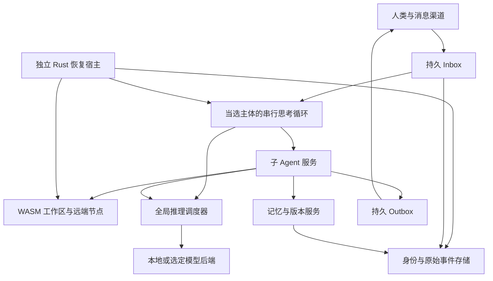

# 插件运行时、Hook 图与能力目录

**内核定位。** 本文承载[内核合同](kernel.md)中[内核 7](kernel.md#kernel-7)（一个门，两个架子）的具体形状：一个生命周期，能力目录与钩子图两处登记。当前实现还有三处绕路，列在[内核收敛计划](../development/kernel-convergence.md)里。

本文是插件运行时的功能与接口合同，对应 [§7](plugins.md#spec-7)、[§18](plugins.md#spec-18)、[§36](durable-state.md#spec-36)、[§37](context-policies.md#spec-37)、[§41.2](durable-state.md#spec-41-2)、[§41.7](plugins.md#spec-41-7)、[§41.8](context-policies.md#spec-41-8)、[§45](cognition-units.md#spec-45)。
它描述**目标行为与实际接口**，不声称任何运行期证据已经取得；真实能力、模型行为与长周期观察
由 `docs/specs/verification.md` 的证据规则单独记录。

## 三个所有者，三种事实

插件运行时只做机制：谁装了什么、装的东西有什么边界、扩展点在什么时机被调用。业务判断
留给认知单元和模型。时间感知、世界感知、预测、awareness 宿主、遗忘和自解释都不进这个运行时。判断也不写成关键词表、人工审批、产品 allowlist 或静态 hard deny。账户、设备和操作系统的真实限制仍然是事实。见 [51 认知元概念：内容、态度与理由](cognition-units.md#spec-51)。

| 事实 | 唯一所有者 | 运行时的角色 |
| --- | --- | --- |
| 某个 Node 上安装了什么 | `shenko-node` 的安装单元 | 投影：运行时只报告本进程当前提供的实现 |
| 一次调用实际发生了什么 | Store 的 operation / evidence | 不复制；回执由调用路径写入 |
| 本进程现在提供哪些 provider / capability / help | 运行时注册表 | 权威：注册表是这一项的唯一真相 |

运行时注册表因此不是第二个安装数据库，也不是第二个单元库。它是一次进程生命周期内的
**当前视图**：插件在自己的 `apply` 中注册，在自己的 teardown 中注销。

## 活的服务，不是启动快照

`shenko-kernel::runtime::PluginRuntime` 是 Cordis 服务 `shenko.runtime.plugin/v1`，
由 `RuntimeServicesPlugin` 与 hook 图一起发布在运行时根 context 上：

```rust
let supervisor = shenko_kernel::Supervisor::new(generation);
supervisor.publish_services().await?;                 // 发布两个服务
let runtime = supervisor.context().try_service::<shenko_kernel::runtime::PluginRuntime>()?;
let hooks   = supervisor.context().try_service::<shenko_kernel::hooks::HookRegistry>()?;
```

插件在 `apply` 中解析服务并注册，在 `ctx.effect_sync` 中注销。注册与注销共享同一代际：
Cordis 的 generation drain 先跑 teardown，再释放服务，所以卸载后不会留下仍可被发现的
provider 或 capability。

注册项：

- `ProviderRegistration { provider_id, kind, version, plugin_id, implementation, description,
  operations, capabilities, health }` — 一个 provider 的实现身份与它每个 operation 的
  [§36](durable-state.md#spec-36) effect contract。
- `CapabilityRegistration { capability_id, version, description, plugin_id, provider_id, enabled }`
- `HelpRegistration { capability_id, version, purpose, key_methods, applies_when,
  does_not_apply_when, schema_help, limitations, recovery, implementation }` — [§18.2](plugins.md#spec-18-2) 的
  可使用性包。

每次注册、注销与健康变化推进 `PluginRuntime::revision()`；能力目录本身的变化另外推进
`PluginRuntime::capability_revision()`。安装回执、封口请求和 UI 视图因此都能指名它们
观察到的确切注册表状态。

`ProviderHealth` 区分 `Installed` / `Healthy` / `Degraded` / `Unavailable`：加载成功不等于
完成，被模型验证过是另一个事实。

用户可见的发现入口是 `shenko capabilities`：它执行与运行中的 agent **同一条**安装路径
（`bin/shenko/src/main.rs::install_native_definitions`），然后打印实时注册表视图、hook
合同与 hook 图摘要。它不是静态清单。

## 原生 handler 的 EffectContract

`NativeTaskHandler` 增加了两个默认方法（[§36.3](durable-state.md#spec-36-3)）：

```rust
fn effect_contracts(&self) -> Vec<shenko_types::effect::EffectContract> { Vec::new() }
fn capabilities(&self) -> Vec<shenko_types::plugin_runtime::NativeCapabilityDeclaration> { Vec::new() }
```

默认实现不破坏任何已有 handler，但声明了边界�� handler 就在实时注册表里出现，并且只
在它被安装期间出现。`EffectContract` 的规范定义在 `shenko-types::effect`，它表达：

- 身份与版本：实现 digest、operation 与其版本；
- 资源选择：可达的资源族与实际绑定规则；
- checkpoint 能力：可捕获什么、明确排除什么、一致性等级；
- effects：可能发生的外部效果（可同时多种）；
- retry：幂等保证来自何处；
- cancel：取消前后可能已经完成的阶段、停止证据、不能取消的部分；
- compensation：补偿方法、前置条件、可能失败、是否留痕；
- lifecycle：升级、卸载、崩溃时在途调用与租约如何处理；
- 保证依据：仅声明 / 运行时受限 / 已测 / 未知。

五种动作（reset / restore / replay / cancel / compensate）不共用一个 rollback 标签；
读写性质、外部可见性、幂等性、可取消性和可补偿性分别表达。

声明用 `shenko-types::effect::EffectContractBuilder` 以 Fluent 方式构造：每个字段都显式
给出；`contract_id` 由 `EntityId::derived` 从插件、操作名、操作版本与实现 digest 确定性地
派生，同一实现同一操作永远是同一份合同，不同实现是不同合同。`NativeTaskDescriptor` 提供
`implementation()`，实时 provider 视图、操作合同和 ledger 中的工件摘要因此指名同一个实现。

当前以真实声明装机的定义：`host.printf.v1`（只支持取消；无 reset/restore/replay/compensate；
外部效果是启动宿主进程、stdout 成为证据）、`history.query.v1`（只读，五种动作都不适用）、
`wasi.exec.v2`（取消在 guest epoch 生效、reset 重置沙箱、managed_home 挂载下的写是真实外部
效果、checkpoint 是 guest epoch 级）。其余定义（computer_use、self.knowledge、errors.read、
issue.submit、playground 等）的声明由各自所有者补全——契约类型、注册路径和
`EffectContractBuilder` 已就位，缺的不是机制。

## 版本化的扩展点

Hook 点是有名字、有版本的合同，不是六个固定的全局阶段。

```rust
let point = shenko_kernel::hooks::HookPointId::new("context.collect")?;   // 必须是 namespace.name
let mut contract = shenko_kernel::hooks::HookPointContract::standard(point.clone());
contract.mode = shenko_kernel::hooks::HookMode::Collect;
contract.writable_slots = vec![ContributionSlot::TransientReminder];
registry.declare_point(contract)?;
```

合同随图一起被准入：换一份合同就重新校验整张图；主版本提升会 fence 仍声明旧主版本的
handler（在册者以 `PointMajorMismatch` 拒绝，必须先撤销），而已经取得快照的调用继续按
它租到的合同派发。每张图带一个确定性 `graph_digest`（对合同与有序成员 spec 的 blake3），
所以保留的回执在热更新和重启之后仍然可解释。

标准安装 profile 声明这些点：

| 点 | 模式 | 写权限 |
| --- | --- | --- |
| `subject.before_inference` | observe | 无 |
| `subject.after_inference` | observe | 无 |
| `subject.before_operation` | observe | 无 |
| `subject.after_operation` | observe | 无 |
| `runtime.capability_changed` | observe | 无 |
| `runtime.generation_handoff` | observe | 无 |
| `context.collect` | collect | 全部瞬态 slot（`SystemContract` 除外，内核自己拥有） |

`context.collect` 对应 [§41.8](context-policies.md#spec-41-8) 阶段表中的 "context collect"：插件把准备好的材料按
`(slot, key)` 贡献进来，合并后的集合由上下文策略装配并封口。插件也可以用
`HookPointId::new("namespace.name")` 声明一个自有命名空间的新点，不用改动框架。

派发回执是 [§41.8.1](context-policies.md#spec-41-8-1) 的 `HookDispatch`：`dispatch_id`、`point`、`generation`、
`graph_digest`、有序的 `handler_digests`、`results`、`stopped_early`。调用者用
`dispatch_at(&payload, DispatchContext { input_revision, input, request_id, request_revision })`
把输入修订、封口输入和请求身份交给回执；内核不虚构这些事实。

## 运行时自己的变化也是 hook 事件

注册表在每次注册、注销或健康变化时：推进 `revision` 与 `capability_revision`、把一条
`RuntimeChange` 记入变更日志、并把能力变化排入 hook 图（`runtime.capability_changed` 点，
`HookPayload::CapabilityChanged { capability_id, enabled }`）。注册表自己不开异步运行时，
事件在下一个明确边界派发：

- 运行中的 agent 由 `bin/shenko/src/main.rs::spawn_runtime_hook_pump` 驱动：它订阅
  `PluginRuntime::changed()`（一个 `watch` 通道，晚订阅者也看得到当前修订号），有变化就
  `HookRegistry::drain_pending()`。这是事件驱动，不是轮询。
- `shenko capabilities` 发现命令在安装完成后排干一次并把回执打进报告。
- 队列有界（1024）：排干速度跟不上时保留最新事件并计数丢弃数，不假装每一次变化都被观测。

## 五种合成模式

| mode | 合法输出 | 合成规则 | 违规 |
| --- | --- | --- | --- |
| observe | `no_change`、`defer` | 不改输入 | 其它输出丢弃并留诊断 |
| transform | `no_change`、`replace`、`defer`、`reject` | 按固定顺序串行应用；`PatchFields` 覆盖声明字段，`ReplaceWhole` 整体替换 | 写 `writable_paths` 之外的字段 → `HOOK_WRITE_VIOLATION`，不采用 |
| collect | `no_change`、`contribute`、`defer`、`reject` | 按 `(slot, key)` 合并 | 同键不同物 → `CONTRIBUTION_CONFLICT`，列出生产者，后到者不获胜 |
| decide | `no_change`、`decide`、`defer`、`reject` | 第一个有效 decision 结束该扩展点 | 非法输出丢弃 |
| around | 该扩展点自己的输出 | `next()` 至多调用一次 | 类型系统保证：continuation 被消费 |

每个 handler 有该点的有限 `timeout_ms`；超时、错误与 panic 都被收容并留下诊断。失败策略
`report_and_continue` 跳过该 handler 的输出并继续，`stop_unit` 在记录已有结果后结束本次
派发。非法输出**永远**不被采用，与失败策略无关。

## 确定性顺序与冲突

同一扩展点内按 `before`/`after` 拓扑排序，无依赖项按稳定 handler id 决定次序。安装时刻、
异步完成时刻与消息紧急度都不是排序键。`before`/`after` 只约束同一扩展点；`requires` 是硬
依赖，缺失即拒绝候选图（可跨扩展点）。有环、缺硬依赖、schema 不符或主版本不符都拒绝候选，
**旧图继续工作**。

## 在途图租约

`snapshot()` 取得一张不可变图并登记一个租约；租约计数按图修订号统计，
`HookRegistry::await_quiescence(revision)` 等到该修订没有在途租约为止。卸载与换代等待的是
这个真实屏障，而不是猜测调用已经结束。请求封口时封的是 `HookSnapshot::binding()`：
`graph_digest`、图修订号、扩展点列表、handler 实现摘要与租约纪元。

## 上下文贡献的出处必须到达原始调用证据

一次 collect 派发的结果是 `Vec<ContextContribution>`，每条都带：

- `slot`（渲染位置）、`source`（plugin_id / plugin_version / artifact_digest / kind）、
- `scope`、`input_revision`、`lifetime`、`required`、`budget_tokens`、`tokens`、
- `data`（准备好的字节的对象引用）。

合并规则只有一份，在 `shenko_kernel::contribution::merge_contributions`：同一 `(slot, key)`
且生产者、数据引用、tokens、lifetime、required 完全相同 → 折叠为一条；任何不同 →
`CONTRIBUTION_CONFLICT`，诊断列出生产者。上下文策略的注册表调用同一个函数，所以 hook 路径
和政策路径不可能给出不同的合并结果。

贡献的出处由封口请求原样携带（`hook_graph`、`context_contributions`、`runtime_revision`、
`capability_revision`），因此原始调用记录可以指名每一个瞬时提醒的生产者、版本与工件摘要。
没有运行时服务时，封口明确失败，而不是封一份声称"跑过某个图"却从未跑过的请求。

## 生命周期：真实的更新与卸载

- `PluginRegistry::uninstall(&FiberHandle)` → Cordis 的 `FiberHandle::dispose()`：插件自己的
  generation cleanup 先跑（服务被撤回、注册被注销、worker 被 join），之后才返回。
- `PluginRegistry::update::<P>(&FiberHandle, P::Input)` → Cordis 的 `FiberHandle::update`：
  同一个 Fiber 身份、依赖与在途工作不变，新的 input 成为权威代际；被 veto 的更新保留旧 input。
- 两者都是上游合同的薄封装，没有第二套生命周期。

## 错误与恢复

| 情况 | 行为 |
| --- | --- |
| 候选图有环 / 缺硬依赖 / schema 或主版本不符 | 拒绝候选，旧图继续；诊断指名冲突的 handler |
| handler 超时、报错、panic | 收容为诊断结果；按点的失败策略继续或结束 |
| handler 返回该 mode 不允许的输出 | 丢弃并留诊断，永不采用 |
| collect 冲突 | `CONTRIBUTION_CONFLICT`；不采用该 handler 的输出，诊断列出生产者 |
| transform 写越权字段 | `HOOK_WRITE_VIOLATION`；不采用该 handler 的输出 |
| 卸载时有在途派发 | 等待租约屏障后再释放资源；不谎报完成 |
| 注册表服务不存在 | 明确错误；不用假的 0 或空视图代替 |

## 内核边界失败进入同一个 Store 日志（[§45.14](cognition-units.md#spec-45-14)）

插件运行时有两类"无法继续/降级"边界不在调用者的错误路径里留第二条记录，它们直接观察进
subject 的同一份 runtime-error 日志：

- **Cordis 生命周期事故**：`Diagnostics` 导出器在 unknown 闩锁 false→true 跃迁时观察一次
  （每个事故一条日志）；之后的 `check_outcomes` 拒绝准入是同一事故的后果，不再重复记录。
- **Hook 图边界**：`publish` 的修订冲突（运行时自身的并发缺陷）与候选图准入拒绝
  （`declare_point` / `swap_generation` 校验失败——旧图继续生效，正是降级点）。

观察走 `shenko_kernel::errors::ErrorObservation`：assembly 在 genesis 之后挂接唯一的
store-backed `ErrorSink`（`bin/shenko/src/main.rs::StoreErrorSink`），写入
`Store::journal_runtime_error`——与 `subject_loop`、native child 等边界同一份日志、同一个
store；没有第二个 DB，也不触发任何硬编码自治动作。sink 挂接之前（启动早期、尚无 branch）
失败只留在 stderr + 计数（`pre_sink_failures` 如实 surfaced），不虚构日志条目；
`journal_runtime_error` 本身是 fail-soft（写失败计数、不传播），所以日志失败不会递归回观察
路径。这不是 blanket tracing subscriber：观察发生在具体内核边界，且非 `cordis:` 前缀的
tracing 记录不会触发观察。

## 尚未取得的运行期证据

本文件描述接口与目标行为。真实模型是否在这些扩展点上做出更好的判断、真实 provider 的
effect contract 是否与实际行为一致、以及长周期运行中的稳定性，都需要按
`docs/specs/verification.md` 的规则单独取证；源码与本文件都不是运行期证据。

<a id="spec-7"></a>
<!-- migrated-contract: SPEC:7 -->
# 7 系统架构与故障边界



建议进程边界为极小 supervisor、可重启控制/服务模块、可终止的 sandbox worker；具体是否合并低资源服务进程以测量决定。supervisor 不依赖 Agent 可以卸载的插件图。模型后端、浏览器、NapCat、向量服务和完整容器均是选配节点，不能把常驻成本藏在 sidecar 后声称内核很小。

“宿主侧服务”不等于“全部写进不可卸载内核”。按用户再次强调的要求，最小 kernel 只负责启动/恢复、插件生命周期与服务绑定、epoch/取消/能力 handle，以及不能绕过的硬资源约束。WASM engine、主体 harness、推理调度策略、SQLite/身份存储实现、包/版本服务、Webserver/UI 和所有渠道均是插件或可替换 provider；产品默认带一组经过验证的 bootstrap 插件。

bootstrap manifest 保存已存在的 current、last-known-good 与 factory 插件闭包及其适用状态；初次安装可以只有 factory/seed，没有旧实例或可用旧模型。替换持有唯一消息/身份状态的服务时，保留可启动闭包与状态交接条件，不把当前运行状态交给无恢复承担者的卸载动作。救援实现读取有限引导元数据、停止坏实例并启动已记录的可用闭包；kernel、manifest 解析器、bootstrap 与救援程序都可生成候选并替换。这里规定实际代际交接的数据与恢复责任，不规定所有配置都经过同一五步计划，也不把某个源码区永久冻结。首启由可替换 seed 提供无 LLM 的配置/诊断入口；完整初始化见 [§44](plugins.md#spec-44)。

插件化要有真实依赖和生命周期边界，不能仅把大单体拆成几个 Rust crate 就声称可替换。原生可信 provider 可按设备编译组合或运行在隔离进程；WASM 插件通过版本化接口。稳定扩展协议不依赖跨编译器版本的 Rust 动态 trait ABI。默认系统常驻总成本须连同 bootstrap 插件、沙箱与 sidecar 一起报告。

模型驱动的计划、复杂工具、工作区修改、记忆整理、包选择和自我改进由 worker 负责。用户已于 U45 确认插件化主干为 dshbox/cordis-rs；本产品在其生命周期、typed services/events 上增加 hook 注入时序、耐久执行和 API 兼容合同，不另建插件框架。首版采用可替换宿主 Execution／Build／Seat provider 接入开发机已有工具；执行位置如实公开，不替代真实 WASM 兼容目标。默认开发者插件闭包见 [§35.3](plugins.md#spec-35-3)，副作用与恢复合同见 [§36](durable-state.md#spec-36)，自解释见 [§38](cognition-units.md#spec-38)，首次 bootstrap 与 Awareness 见 [§44](plugins.md#spec-44)–[§45](cognition-units.md#spec-45)。

扩展接口采用版本化语义合同：ModelAdapter、RuntimeProvider、ExecutionProvider、ResourceProvider、MemoryBackend、ChannelAdapter、PackageProvider、WorkspaceVersioner、CredentialProvider、ContextPolicy、UiProjection；后文具体化的 SessionStore、BrokerPolicy、ContactProvider、RemoteAgentProvider、ComputerUseProvider、REPLProvider、UpdatePolicy、NetworkPolicy、DurableExecutionProvider、MigrationProvider、RetentionPolicy、ArchiveProvider、ElectionProvider、CapabilityGrowthPolicy、InterruptPolicy/DND 与媒体/实时会话接口属于同一插件体系。名称可在实现前统一，职责不能成为绕开生命周期和调度的旁支。接口声明 capability、版本、取消/清理语义和结构化错误。可信原生插件须明确标识；不可信/自生成插件在 WASM 或隔离进程中运行，不能用 cordis 的服务作用域冒充权限隔离。

Web API 与 UI 共用类型 schema，支持事件游标恢复、任务查询与控制、资源状态、记忆出处和环境恢复。生产运行不要求 Node 常驻；前端构建工具只在开发/构建节点使用。局域网访问支持认证与部署级 TLS，管理会话不能因聊天默认开放而匿名获得。

<!-- /migrated-contract: SPEC:7 -->

<a id="spec-18"></a>
<!-- migrated-contract: SPEC:18 -->
# 18 插件能被发现并正确使用

<!-- /migrated-contract: SPEC:18 -->

<a id="spec-18-1"></a>
<!-- migrated-contract: SPEC:18.1 -->
## 18.1 原生插件优先和生态兼容

支持原生插件、传统 Skill 包、独立可安装的 awareness/感知单元与 MCP 市场。常用执行能力优先包装成原生插件：明确类型/效果/错误/恢复，减少常驻进程，共享资源与上下文控制。Skill 偏怎样执行，awareness 偏应想到什么；感知提供可追溯状态。它们可以组成 provider 的自动依赖闭包，也能独立查阅和演进，具体合同见 [§45](cognition-units.md#spec-45)。Skill/MCP 不被禁用，通过兼容 provider 进入同一版本、能力和成本模型。

独立安装是复用与交付方式，不是主体领悟的前置条件。时间、任务、项目与社交/邮件状态可由原子感知提供，新的 prompt、聊天、帖子或视频也可当场带来察觉；有价值的经验再自主沉淀为 awareness。[§38](cognition-units.md#spec-38) 提供来源、Why 与实际能力的自解释，[§45](cognition-units.md#spec-45) 给出组合和生命周期，[§46](../governance/COMPLETION.md#spec-46) 的必读 shenko-dev/原子开发 Skill 则服务仓库开发者。

原生不等于不受限制地加载 Rust 动态库。可信 core module 与可安装 WASM/隔离插件分开。市场提供搜索、来源/签名、版本、依赖、ABI、设备兼容、权限说明、安装/更新/卸载/回滚；安装行为由有能力的子 Agent 完成。卸载需清理订阅、计时器、进程、文件 handle、SSH session 与 KV lease。

Skill 文档作为按需加载的任务指导，不因此获得高于用户/宿主的权限。MCP schema、资源和提示按选定任务展开，处理认证、取消、server 失效和工具列表变化；不得把所有市场工具一次塞进主体 system。外部 MCP 安装并不自动代表其内部模型调用已经纳入 broker。 独立 awareness 与 Skill 使用相似的渐进披露机制；安装依赖的内容会进入可查目录和适用情境索引，不因此把全文常驻每次 prompt，也不将其天然变成 system prompt 中不可覆盖的命令。

<!-- /migrated-contract: SPEC:18.1 -->

<a id="spec-18-2"></a>
<!-- migrated-contract: SPEC:18.2 -->
## 18.2 可使用性包

每个插件的使用说明先讲清它要帮助完成什么、关键方法为什么有用、在什么条件下成立，以及可以观察什么来判断结果。然后按实际需要提供用途/别名、适用与不适用例、schema 和版本帮助、参数/输出约定、前置条件、已知限制、恢复办法与相关验证。说明可以很短，信息已经表达充分时不强制逐项填表。副作用、实际恢复边界与 receipt 见 [§36](durable-state.md#spec-36)，hook/兼容见 [§37](context-policies.md#spec-37)；运行版本对应的源码、手册及设计理由经 [§38](cognition-units.md#spec-38) 可发现。具体命令或步骤的必要性应能解释，工程默认和有版本范围的限制分别标明；见 [§40.9](../governance/development-contract.md#spec-40-9)。

分为三层：稳定的短能力索引用于发现；选择后展开任务 playbook 与少量示例；调用时才取详细 API/边界文档。主体只获得有助于委派的能力概览，执行子 Agent 才加载真正工具。插件不能凭描述注册到主体的禁止工具集合。 内置自解释同样遵循这条语义/执行分工：主体能理解自身代码与设计，实际读取和检查由服务/child 完成。 能力的简短目的与关键理由可以随索引或所选片段披露，使模型有依据判断是否适用；完整论证、历史和反例按需展开，不要求每轮重新加载或让模型复述。

安装后状态至少区分 installed、healthy、discoverable、verified-for-model 与 degraded。只有加载成功不算完成。示例命令跑通也不代表 Agent 会在自然任务里选中它；需要在未点名插件的请求上测到实际使用行为。

<!-- /migrated-contract: SPEC:18.2 -->

<a id="spec-18-3"></a>
<!-- migrated-contract: SPEC:18.3 -->
## 18.3 相关研究与设计判断

下表按实际研究版本区分证据和推论，数字不是本产品性能承诺。

| 一手研究 | 核验结论与限制 | 本产品要验证的设计 |
| --- | --- | --- |
| [SkillsBench v4](https://arxiv.org/html/2602.12670v4) | 87 个任务、18 组 model-harness；精选 Skills 平均 pass rate 从 33.9% 到 50.5%，增加 16.6 个百分点。读过 Skill 后仍会失败，自生成说明不能自动视为有效 | 少量相关过程知识与可执行结果验证；不以读取率代替完成率 |
| [ToolRet v2](https://arxiv.org/html/2503.01763v2) | 约 7.6k 检索任务与 43k 工具；通用检索强不保证工具候选完整 | 先测 candidate recall，再测选择与执行，不能只接 embedding top-k |
| [ToolScout v1](https://arxiv.org/html/2608.16502v1) | 工具库相同，来源/措辞风格变化也可能使专用检索器失效；主要衡量检索和受控选择代理指标 | 中英、口语、ASR、API 文档分组评估；保留 lexical 和不同检索策略的回退 |
| [FitText v4](https://arxiv.org/html/2605.02411v4) | 在执行中迭代检索探针与工具生态；具体模型存在能力门槛，其 40 并发时延实验不能外推到 C=1 | 有限顺序改写/再检索，先测浅层策略；复杂演化搜索必须计完整预算 |
| [Tool-DE v1](https://arxiv.org/abs/2510.22670) | 扩充用途、适用条件、限制和标签改善工具检索；新增描述仍须验证 | manifest 补足 use_when/not_when 与例子，不能靠自动生成说明扩大真实能力 |

[Agent Skills 的渐进披露](https://www.anthropic.com/engineering/equipping-agents-for-the-real-world-with-agent-skills) 与 [工具搜索/程序式调用](https://www.anthropic.com/engineering/advanced-tool-use) 提供厂商工程参考，证据层级不同于上述论文；本产品在目标本地模型上的效果必须独立测量。

本产品采用可替换 DiscoveryPolicy 与 TeachingPolicy：当前可用规则、混合检索、reranker、示例和短 playbook；未来模型若能直接理解 schema，则切换为 schema-only 或模型自选。执行合同、权限和来源仍然保留，不把一代模型需要的冗长提示词固化成永久协议。

<!-- /migrated-contract: SPEC:18.3 -->

<a id="spec-18-6"></a>
<!-- migrated-contract: SPEC:18.6 -->
## 18.6 即时工具知识与使用审计

CapabilityHelpProvider 优先提供确切版本的静态 schema、内置参考或已验证 recipe；需要时由 worker 做有时限、输出上限的 help 探测，按 executable/package digest、版本、子命令和 locale 缓存。不能对任意未知程序或 shell 字符串机械拼接 `--help`；那仍然是一次执行，且文档版本可能不匹配。主体只发知识/委派意图，不借帮助查询取得 exec 权限。

Plugin Use Auditor 是有界审计 worker，抽样成功、失败和未使用工具的轨迹，区分漏用、误用、说明不足、参数错误、实现错误与证据不足。结果用于生成候选指南/wrapper/检索改进，不自动把模型评价写成事实。不能用“N 次成功调用”替代多样自然任务、反例与恢复验收；审计器和教学策略本身也可替换。

<!-- /migrated-contract: SPEC:18.6 -->

<a id="spec-35-3"></a>
<!-- migrated-contract: SPEC:35.3 -->
## 35.3 首版默认插件闭包

| 可替换组成 | 第一版必须完成的事情 |
| --- | --- |
| 主体 Harness 与 ChildProvider | 永续串行决策、双向委派、任务恢复、主动提出改进；主 loop 不直接操作文件或终端 |
| WASM Runtime／WorkspaceProvider | 实际文件与工具操作、可恢复家园、受管分支、明确的挂载与 checkpoint 边界 |
| Session／Memory／DurableExecution | SQLite 原始事实与 FTS5、宿主挂载 Git 记忆、任务与调用回执、可恢复 inbox/outbox |
| ModelProvider／InferenceBroker | 接入真实基线后端，四流 128K 及 C=1 测试；原生能力透传、递归资源核算和公平轮转 |
| Budget Compact 与 Snapcompact | 两个独立交付的正式插件；按模型能力选择启用，不能把二者合成一个不可拆开关 |
| NapCat ChannelProvider | QQ 私聊/群聊、引用、图片/文件与附件读取；原生 OneBot 接入和已有 napcat-cli 兼容入口 |
| HostExecution／SSH／AgentSeat | 本机及已授权远端执行；发现并控制已存在的 tmux seat；支持首批 Claude、OMP 适配 |
| TerminalObservation | 保留高亮与属性的屏幕、版本化观察、模式/尺寸变化、输入前核对；不能只读去掉样式的文本 |
| SelfKnowledgeProvider | 内置自解释：当前运行版本、源码/说明书/设计哲学关联，按需指导插件与 hook 开发，详见 [§38](cognition-units.md#spec-38) |
| Hook API／Compatibility | 在 cordis-rs 主干上提供确定的 API 注入顺序、版本/字段兼容与代际切换，详见 [§37](context-policies.md#spec-37) |
| SelfDevelopment／PluginManager | 定位自己的源码与当前运行版本、生成改进任务、发现能力缺口、构建/安装并实际使用新插件 |
| BuildProvider／VerificationProvider | 独立工作区、构建闭包、测试与行为回放、产物身份、变更前后证据；不只采信执行 Agent 的口头总结 |
| Update／Migration／Recovery | A/B 副本、允许破坏性格式升级、旧副本持续运行、增量追赶、切换、恢复与外部效果对账 |
| EffectContract／OperationLedger | [§36](durable-state.md#spec-36) 的副作用、恢复范围、幂等条件、补偿和 unknown 合同；所有上述插件都要提供相应能力说明 |
| Web UI／通知投递 | 能查看/接续任务、现场、版本与恢复结果；遵守 [§21](web-interface.md#spec-21) 设计 brief 和无 slogan 裁决，细节按需展开 |

这里列的是责任边界，不强制“一行一个进程”或要求模型逐个调用基础设施。关键状态提交和确定性 I/O 可以直接由 worker/provider 完成；等终端、编译或网络时不占推理执行许可。

<!-- /migrated-contract: SPEC:35.3 -->

<a id="spec-41-7"></a>
<!-- migrated-contract: SPEC:41.7 -->
## 41.7 插件操作接口与实际效果绑定

<!-- /migrated-contract: SPEC:41.7 -->

<a id="spec-41-7-1"></a>
<!-- migrated-contract: SPEC:41.7.1 -->
### 41.7.1 静态合同与本次实际绑定

```ts
type OperationContract = {
  capability_id: string;
  operation_name: string;
  input: SchemaRef;
  output: SchemaRef;
  effect_contract: SchemaRef;
  implementation: VersionedRef;
  resource_resolver: VersionedRef;
  receipt_reader: VersionedRef;
  reconcile?: VersionedRef;
  compensate?: VersionedRef;
  retry: "no_automatic_retry" | "external_idempotency" | "proved_repeatable";
  cancel: "before_dispatch_only" | "cooperative" | "external_confirmed_stop";
};

type ResourceBinding = {
  resource_id: string;
  kind: "managed_snapshot" | "host_bind" | "remote" | "external_service";
  target_identity: Record<string, unknown>;
  coverage: "enumerated" | "bounded_scope" | "opaque_scope";
  scope: Record<string, unknown>;
  observed_revision?: string;
  precondition?: DataRef;
  on_restore: "restore" | "retain" | "reconcile" | "unsupported";
  snapshot_domain?: string;
};

type OperationIntent = {
  logical_key: string;
  task_id: string;
  requested_capability: string;
  offered_contract_digest: Digest;
  final_arguments: DataRef;
  parent_operation_id?: string;
  retry_of?: string;                 // 新 operation 与旧意图的关联，不是 attempt retry
  possible_duplicate_of: string[];
  compensates?: string;
};

type PreparedOperation = {
  operation: OperationRecord;
  contract: OperationContract;
  bindings: ResourceBinding[];
  recovery_closure: VersionedRef[];
};
```

`OperationRecord`、`AttemptRecord`、`EvidenceReceipt`、`ReconciliationCase` 是持久执行合同的唯一规范记录。`PreparedOperation` 仅是解析 `OperationRecord` 引用后得到的只读视图，不创建另一份 operation 数据库记录。`OperationIntent.logical_key` 直接映射 `OperationRecord.logical_key`，`final_arguments` 映射 `final_input_ref`；绑定、合同与 recovery closure 使用该记录的引用闭包。

以下规则构成静态合同与实际边界的分工：

1. `OperationContract` 描述该版本能提供的保证；`ResourceBinding` 记录本次调用实际作用的位置。插件宣称支持快照，不使一个 host bind mount 自动进入快照。

2. 首次接纳先完成参数修复、参数 hook、schema 校验，再解析目标并提交规范 OperationRecord。`offered_contract_digest` 解析为 sealed request 所绑定的合同；参数解释与 `resource_resolver` 使用该版本工件或显式兼容适配器，不查询当前同名定义代替。旧 resolver 不可用则返回合同不可用。重放不重新运行这些变换，不重新解释旧参数，不按当前挂载表悄悄选择另一目录。

3. `coverage=opaque_scope` 是合法的诚实合同，例如任意 shell。它列明可触及的宿主/网络范围和已知恢复边界，不伪造完整文件清单。已观察到的新效果通过 receipt 增补事实，不能事后声称未声明的外部效果已被快照覆盖。

4. 规范记录的 `authority_ref` 引用实际执行权限或凭据句柄，不能保存可泄露的私钥、token。每次真正派发重新核验当前权限与目标身份；旧 intent 不冻结一份永不撤销的权限。

5. 资源身份或要求的 revision 已改变时，返回 `BINDING_STALE`。调用者可重新观察并以新 intent 明确接纳新目标；恢复器不得把旧操作无声改绑。

<!-- /migrated-contract: SPEC:41.7.1 -->

<a id="spec-41-7-2"></a>
<!-- migrated-contract: SPEC:41.7.2 -->
### 41.7.2 调用接口与幂等身份

```ts
type AdmissionOptions = { expected_task_revision?: bigint; expected_record_revision?: bigint };
type CancelReceipt = {
  operation_id: string;
  cancel_key: string;
  cancel_task_id: string;
  commit_ref: CommitRef;
  already_requested: boolean;
  view: OperationView;
};
type RetryBasis =
  | { kind: "confirmed_not_executed"; evidence: DataRef }
  | { kind: "external_idempotency"; key: string; evidence: DataRef; valid_until: string }
  | { kind: "proved_repeatable"; contract_digest: Digest; evidence: DataRef };

prepare_operation(intent: OperationIntent, options?: AdmissionOptions): Promise<PreparedOperation>;
dispatch_operation(operation_id: string): Promise<OperationView>;
retry_operation(operation_id: string, retry_key: string, basis: RetryBasis): Promise<OperationView>;
get_operation(operation_id: string): Promise<OperationView>;
cancel_operation(operation_id: string, cancel_key: string): Promise<CancelReceipt>;
reconcile_operation(operation_id: string, reconcile_key: string): Promise<OperationView>;
append_receipt(receipt: EvidenceReceiptDraft): Promise<{
  receipt_id: string; commit_ref: CommitRef; duplicate: boolean
}>;
wait_operation(operation_id: string, after_record_revision?: bigint): Promise<OperationView>;
```

`prepare_operation()` 的唯一键是 `(task_id, logical_key)`。接纳先查询该 key：同 key、相同语义输入返回已有 operation；同 key、不同工具、合同或参数返回 `INTENT_KEY_CONFLICT`，不覆盖旧记录。只有不存在该 key 时才检查 `expected_task_revision` 等新接纳条件；后续任务提交造成旧 expected revision 过期，不阻止幂等命中取得原 receipt。revision 前置条件不属于 intent 的语义指纹。比较使用协议规定的 canonical encoding 或等价结构比较，不使用浮动格式化 JSON 文本。

`logical_key` 是父任务中稳定的语义调用位置；不是一次 provider tool-call ID，也不是时间戳。嵌套调用把子 intent 的接纳和父任务对该子 operation 的引用放在同一事务中。恢复后相同 key 重新取得同一孩子及其结果，不能再建一份相同子任务。代码升级改变一个已使用 key 的含义，必须迁移或使用新 key。

`operation_id` 在所有重试中稳定；每次允许的外部尝试使用不同 `attempt_id`。默认同一 operation 不得并存两个具有外部执行权的 attempt。上次执行状态未知时只能查询/核对，或者使用已证实仍有效的外部幂等合同重试。框架生成了 operation ID，不代表 QQ、SSH 或任意 HTTP 服务已经支持幂等。

`dispatch_operation()` 仅对从未派发的 prepared operation 原子接纳首个 attempt；已接纳的调用返回当前视图，不新增尝试。`retry_operation()` 只在合法 `reconciling → in_flight` 转换中创建后续 attempt，先按 `(operation_id, retry_key)` 查重，再检查 basis 的适用范围和当前有效性；合同声明与本次证据均不支持时返回 `RETRY_NOT_PROVEN`。已 resolved 的操作若要有意再做，创建新 operation；只有新矛盾证据通过协调事件把旧操作转回 reconciling，才重新进入该恢复路径。幂等键作用域、过期时间和对相同参数的要求属于外部协议，不能由通用 API 猜测补全。

主体决定在未知情况下有意再做一次时，创建新 intent，以 `retry_of` 与 `possible_duplicate_of` 指向原操作；记录“这是再次尝试产生效果”的决定。补偿也创建新 operation 并设置 `compensates`。二者都不修改原事实。

<!-- /migrated-contract: SPEC:41.7.2 -->

<a id="spec-41-7-3"></a>
<!-- migrated-contract: SPEC:41.7.3 -->
### 41.7.3 状态、回执与先后顺序

```ts
type OperationView = {
  operation: OperationRecord;
  attempts: AttemptRecord[];
  receipts: EvidenceReceipt[];
  reconciliation_cases: ReconciliationCase[];
  cancellation_tasks: TaskRecord[];
};

type EvidenceReceiptDraft = Omit<EvidenceReceipt, "receipt_id" | "received_commit">;
```

`OperationView` 只读上述规范记录，不另存 execution/effect/outcome 的第二套状态机。Operation 的 `state` 固定为 `prepared | in_flight | reconciling | resolved`，效果使用 `effect_status = none | partial | complete | unknown`；Attempt 的执行过程使用其 `dispatch_stage`。入站证据中关于合同摘要、实际绑定摘要、工件 generation 和结果的声明，存入 `raw_ref/normalized_ref` 引用的版本化内容，不能替代实际验证。

状态转换按以下顺序执行：

| 当前状态与事件 | 必须提交的规范结果 | 之后允许的动作 |
| --- | --- | --- |
| 首次接纳 | Operation `prepared / effect_status=none` | 尚未执行任何外部调用；可以与首个 T1 合并 |
| 派发准备完成 | T1 创建 armed Attempt，Operation `in_flight / unknown` | T1 成功后才调用外部执行器；armed 不是 provider 已接收的证明 |
| 外部确认仍运行 | Attempt `running`，保存 handle；Operation 仍 in_flight | 查询、等待、请求取消；effect_status 由证据确定 |
| 确定结果及实际效果 | T2 追加/引用证据，Attempt ended，Operation resolved 与真实 outcome/effect_status | 当前合法 invocation 同事务推进任务检查点和结果/outbox |
| 传输失联、崩溃、取消没有确认 | Operation reconciling；Attempt unknown 或保留已知 running | 对账、等待回执或按已证实幂等合同重试；不推断 none |
| prepared 且从未 armed 时取消 | Operation `resolved / none / cancelled` | 不派发 |
| 派发后请求取消 | 先持久提交取消任务/决定 | 发出取消；确认结果另由 EvidenceIngress 接纳 |
| 新旧 generation 的迟到回执 | 追加原 operation 的事实，重算视图 | 不重新授予旧 generation 控制权，不重新发送原操作 |

Attempt 的 `ended` 不自动表示没有副作用；命令退出非零仍可写入一半文件。持久取消请求表示取消意图，不表示远端已停止。无法消除的不确定性保留在 ReconciliationCase；主体/获委派 child 可把 case 置为 `acknowledged_unknown`，不新增 abandoned operation/task outcome，也不把 Operation 伪标 resolved。

`cancel_operation()` 以 `(operation_id, cancel_key)` 幂等创建或取得 `operation.cancel` 任务及其决定，返回 `CancelReceipt`，不等待远端必然停止。该任务由持久协调 supervisor 持有；调用者取消等待不取消它。`wait_operation()` 在 record_revision 增加或已存在 resolved 状态时返回视图；取消该等待不改变操作。父任务可以在将未决 operation 和 case 职责交给持久 supervisor 后结束本轮等待，不能随父任务回收未决事实。

回执按 EvidenceIngress 的来源作用域与稳定 `source_event_key` 去重；同作用域/key、不同原文返回 `RECEIPT_KEY_CONFLICT` 并保存冲突证据，不能 last-write-wins 覆盖。只有相同内容 hash 不能证明两次外部事件是同一事件。派生的 `OperationView` 可更新，原 receipt 不可原地改写。读不懂的新 payload 保留原字节与 decoder 引用，显示 `READER_UNAVAILABLE`，不能当成功或无效果。

工具的模型文本、程序结构化输出和界面 detail 可以分别投影。`afterTool` 或摘要插件只修改投影，不修改 receipt、operation identity、实际 effect 状态或原始输出证据。任务最终结果引用 durable data，不引用将在父任务结束时自动销毁的临时文档。

来源：REF-DURABLE [§5.2 effect sandwich](https://github.com/earendil-works/pi/blob/c60de42e98428dc1ef7440d78c23f5915966cdb3/packages/durable/docs/spec.md#L2045)、[§7.3 嵌套调用身份](https://github.com/earendil-works/pi/blob/c60de42e98428dc1ef7440d78c23f5915966cdb3/packages/durable/docs/spec.md#L3162)。本产品增加实际资源绑定、长期 effect receipts、跨 generation 核对；这不是任意外部效果的 exactly-once 或撤销保证。

<!-- /migrated-contract: SPEC:41.7.3 -->

<a id="spec-44"></a>
<!-- migrated-contract: SPEC:44 -->
# 44 首次启动与种子发行

来源：U44/U45/U47/U48、REF-USER、REF-CORDIS、REF-DURABLE、REF-DESIGN。以下是 Shenko 的首启设计，未实现；承接现有持久执行、包与插件合同。

<!-- /migrated-contract: SPEC:44 -->

<a id="spec-44-1"></a>
<!-- migrated-contract: SPEC:44.1 -->
## 44.1 第一次打开会发生什么

首次打开仍是一条主体时间线和一个输入入口。尚未接通模型时，界面明确显示系统首启状态与简短配置入口，不假装已有 Agent 在回答，也不启动临时的 setup/chat agent。后台不依赖 LLM 完成发行包装配、持久目录初始化、WASM 家园启动和自身资料索引；完成的事实显示为系统状态。

交互首启只需解决两件事：**由有安装控制权的人明确初始化管理员，以及提供一个可用推理入口**。已有 provisioning/profile 可以预先提供这两项，UI 不重复询问。名字、人格、QQ、GitHub、SSH、公网域名、Playground 和完整硬件参数都不进入必填长向导。

管理员绑定与“连接并开始”可在同一短流程中完成。名字可留空，主体接通后可自己取名；实例身份使用稳定 ID，不靠显示名。完成首次启动以后，刷新页面、增加浏览器和重启服务均连接到既有主体，而不是“新建一段聊天”或再生一个主体。

U61 的新设备加入走既有 provisioning/身份发现：确认可信的较早节点与主身份后，撤销本次新建的独立身份并接续已有自我，具体按 [§5.4](nodes.md#spec-5-4)；不重复要求人类授予已经有效的安装/连接授权。其独立经历若已发生则保留来源并合并，不能把加入群组实现为擦盘。节点自身的模型/provider、凭据和系统能力单独发现绑定，不从主身份同步推断已经具备。

<!-- /migrated-contract: SPEC:44.1 -->

<a id="spec-44-2"></a>
<!-- migrated-contract: SPEC:44.2 -->
## 44.2 无 LLM 时种子发行必须已经具备的闭包

Seed 是一个可替换、版本化的发行装配，不是把下列功能焊入 Rust 核心。manifest 固定实际工件摘要、平台 profile、依赖、文档及恢复闭包；启动器按 manifest 装载 Cordis 服务。发布的首版 seed 必须自带能在所声明平台运行的实际工件，不能把“之后让 Agent 安装 WASM”当首次启动方案。

| 默认 seed 服务组 | 无 LLM 时完成的工作 |
| --- | --- |
| Bootstrap / identity / secret / Web | 识别新安装或已有实例、认领入口、保存配置草稿与凭据句柄、显示同一时间线、提供确定性的故障配置入口 |
| Store / CAS / Inbox / task / effect | 打开 I/L 与对象存储、完成 schema/对象闭包检查、接纳可恢复输入和初始化任务、提供 T1/T2/E1 与观察协议 |
| 实际 WASM RuntimeProvider 与家园 FS | 启动所选平台的 WASM runtime、持久家园和已知可恢复的初始状态，记录挂载与副作用边界；加载种子中已验证的基础工具 |
| 默认 memory / history | 创建挂在主机私有数据目录上的本地 Git 记忆仓库并挂入 WASM；建立会话原文存储与可重建检索索引。默认不添加外部 Git remote，不需要云账号 |
| Broker / provider / capability probe | 先登记真实资源组、容量与后端身份，再进行任何模型探测；保存未知能力，不伪造 KV/取消能力 |
| Main / child harness 与委派服务 | 装载连续串行主体规则、有限 child、S0/S1 和任务恢复；主体只能委派、语义记忆、自解释及提交相关意图，无直接文件/SSH 工具 |
| Capability / self-knowledge | 离线列出实际已装能力、用法、source/doc/contract 身份与恢复边界；能说明哪些未连接或未实现，无需额外 LLM 分类 |
| 配置执行与恢复基元 | 持久配置读写、service reload、现有 Activation、探测/停止/查询及本地修复入口；保留不依赖模型回答的执行路径 |

Seed 还可预装几项彼此独立的小 awareness，例如“网络变更可能影响当前模型连接”“现有工具不足时可以补能力”“需要了解自身用法时查阅自身文档”。每项都是可单独安装、替换和停用的直觉/意识，有自己的身份、版本和适用说明；不要求这些例子全部预装，也不把它们合成一个总意识插件。无模型时可以完成其材料与实现的离线装载，但上表中的初始化不等待 awareness 先作 LLM 判断；缺少这些可选意识也不阻断确定性首启。

数据目录由平台 profile 给出本机默认，初始化时持久保存绝对绑定身份；UI 可改位置。目录、Git 仓库和 CAS 对象的创建不塞进一笔 SQL 事务：各步骤使用稳定初始化 identity 和自己的 operation/receipt，恢复按已完成事实继续。只有对象闭包准备好才登记可用引用。发现同路径已有非本安装数据时报告冲突，保留数据，由明确的新路径或导入选择解决，不覆盖现有内容。

发行包含目标平台真实支持的基础工具，不因“WASM/POSIX”名字推定已有完整 Linux、gh、Node 或任意 native 扩展。缺少的增强能力接通模型后可自行发现、移植和安装。主机开发工具与未来的 BoxLite/远端 runtime 不取代首版 WASM 家园。

<!-- /migrated-contract: SPEC:44.2 -->

<a id="spec-44-3"></a>
<!-- migrated-contract: SPEC:44.3 -->
## 44.3 真正必填、自动推导与后续发展

| 项目 | 首次启动的处理 |
| --- | --- |
| 安装控制权与首位管理员 | 必须有明确的人类初始化动作或既有 provisioning 授予记录；见 [§44.4](plugins.md#spec-44-4)。不要求额外云账号 |
| 推理入口 | 必须有一个已配置的本地/Tailnet/远端 endpoint 或等价 ModelProvider 绑定；已有受信部署 profile 可直接导入，不重复填写 |
| API 凭据 | 仅后端要求时输入或导入 secret handle；无认证的本地服务不强迫创建 API key |
| 模型选择 | 仅存在多个可用模型且无法从 profile 确定时展示一次选择；唯一模型或预配置模型直接采用 |
| 数据目录、端口、WASM profile、日志 | 根据平台与 seed 给出可查看默认；不让用户先理解整套目录/服务拓扑 |
| 并发、窗口、KV | 导入已有成功 profile 的真实 C/上下文与适配器能力；用户已确定的四流 128K 不被静默改成 C=1。没有可用证据的新部署先用 C=1 与有限短请求；KV 池容量允许 unknown |
| 实例名字、人格/灵魂 | 可空；接通后由用户命名或让主体自命名/演进。人格不替代工具 schema 与角色合同 |
| NapCat、飞书、其他渠道 | 首次思考不依赖它们；已有授权配置可导入，其余可稍后在对话中接入 |
| tmux/SSH/开发仓库 | 自开发路径的可选接入参数，不是开始个人主体的前置条件；启用后按 [§35](self-update.md#spec-35) 完成真实闭环 |
| 外部 Git、网盘、语音、Computer Use、REPL、Playground | 由已有能力/连接条件按需启用或由主体委派安装和发展 |

“C=1”是未知部署的初始调度选择，不是宣称该设备最多一流。初始短探测使用 adapter 声明的有效有限请求；可作为 seed 默认将探测输出上限设为 64 token。普通主体请求继续用实际 model profile 的有限预算。没有可靠上下文上限时，先使用 seed 的保守请求预算并把后端上限标为 unknown；例如 8192 token 的输入预算是本产品初始政策上限，不是已核验的模型能力。超限拒绝形成事实，由 provider/后续主体调整；不能凭模型名称宣称已支持 128K。

确定性探测只访问明确提供/导入的 endpoint。已知原生 NInfer/Strata/vLLM 等 profile 优先绑定其具体 adapter，不把所有后端强行降成 OpenAI-compatible。未识别扩展能力时如实使用可证实的基础请求能力，并记录待适配项。

<!-- /migrated-contract: SPEC:44.3 -->

<a id="spec-44-4"></a>
<!-- migrated-contract: SPEC:44.4 -->
## 44.4 首位 owner/admin 与普通聊天

默认首启入口绑定本机，或使用部署者明确配置的受认证访问方式。发行生成 installation-scoped、一次性的 claim capability，经安装控制通道提供；“第一个访问 HTTP 的人”不自动成为管理员。用户在该通道执行明确的初始化认领，或者提交已有 provisioning 中的授权记录，服务才产生 OwnerGrant。

```ts
type OwnerClaim = {
  claim_id: string;
  installation_id: string;
  human_principal_ref: ObjectRef;
  explicit_initialization_ref: ObjectRef;
  claim_capability_ref: ObjectRef;
};

type OwnerGrant = {
  grant_id: string;
  installation_id: string;
  human_principal_ref: ObjectRef;
  claim_id: string;
  authority_ref: ObjectRef;
  committed_at: CommitRef;
};
```

认领在 L 以 installation identity 和 claim identity 幂等接纳；首次授予使用条件写，消耗相应 claim capability。同一认领重试返回原 grant；另一浏览器不得因为先收到响应就覆盖 owner。已初始化实例导入保留其授权，不重新开放 first-owner 入口。管理员恢复/转移使用可替换权限插件的显式人类决定，不依赖声纹相似、第一条问候或模型猜测。

human principal 由安装控制通道的认证上下文解析，不能靠请求体自行填写一个 human_principal_ref 冒充。首启模型配置/启动接口使用该已认领权限或明确的 provisioning 权限；浏览和普通输入不因此被当作管理授权。

OwnerGrant 是安装管理权限，不是在主体人格中注入“必须如何对待主人”的关系设定。初始化以后，默认聊天仍开放；成为普通会话参与者不要求先获得 admin。渠道建立后群成员可按既定开放聊天政策交互，管理权限继续单独记录。

<!-- /migrated-contract: SPEC:44.4 -->

<a id="spec-44-5"></a>
<!-- migrated-contract: SPEC:44.5 -->
## 44.5 Bootstrap 记录与接口

以下类型引用 [§41](architecture.md#spec-41) 的唯一 Store/Operation/Task/Broker/Activation 记录，不建立平行的任务或容量账本。

```ts
type GenesisRef = { ledger_id: string; genesis_id: string };

type BootstrapRecord = {
  bootstrap_id: string;
  installation_id: string;
  record_rev: bigint;
  subject_id: string;                  // 首次装配即分配，重试不变
  conversation_id: string;
  seed_manifest_ref: ObjectRef;
  plugin_lock_ref: ObjectRef;
  ledgers_ref: ObjectRef;
  home_manifest_ref?: ObjectRef;
  owner_grant_ref?: ObjectRef;
  model_profile_ref?: ObjectRef;
  initialization_operation_refs: string[];
  probe_operation_refs: string[];
  readiness_evidence_refs: ObjectRef[];
  unresolved_issue_refs: ObjectRef[];
  launch_id?: string;
  genesis_ref?: GenesisRef;
  selector_ref?: { subject_id: string; selector_revision: bigint };
  updated_commit: CommitRef;
};

type SubjectLaunchReceipt = {
  bootstrap_id: string;
  launch_id: string;
  subject_id: string;
  genesis_ref: GenesisRef;
  root_task_id: string;
  first_step_id: string;
  selector_revision: bigint;
  committed_at: CommitRef;
};

type BootstrapView = {
  record: BootstrapRecord;
  needs: Array<"owner_claim" | "model_binding" | "credential" | "model_choice" | "local_repair">;
  state: "preparing" | "awaiting_input" | "ready_to_start" |
         "starting" | "attached" | "blocked";
  effective_capabilities_ref: ObjectRef;
  pending_capacity_ref?: ObjectRef;
};

inspect_bootstrap(installation_id: string): Promise<BootstrapView>;
claim_installation(input: OwnerClaim): Promise<OwnerGrant>;
configure_initial_model(bootstrap_id: string, submission_id: string,
                        profile_intent_ref: ObjectRef): Promise<BootstrapView>;
start_subject(bootstrap_id: string, launch_id: string): Promise<SubjectLaunchReceipt>;
resume_bootstrap(bootstrap_id: string): Promise<BootstrapView>;
```

`BootstrapView.state/needs` 从实际记录和证据派生，不是 Rust core 内固定的审批流程。主体与 conversation 的身份先保留；在根记录不存在之前，它只是待启用身份，不意味着已经有一条思考流。初始化/探测使用确定性 bootstrap 服务任务；所需 conversation/task scope 可预建但不运行另一条模型聊天循环。

配置命令按 `(bootstrap_id, submission_id)` 查重，查询原结果先于当前 revision 条件；同 identity 不同 payload 返回冲突。profile 更新保留先前草稿与诊断。任意模型 probe 必须在 Store、effect ledger、同一 broker 和真实 resource group 已可用后进行；probe 属于原账本中的实际 task/request，不是首启绕过容量的特殊直连。

首次没有可用旧 endpoint，**不要求先有 rollback 目标才能连接第一个模型**。连接或探测失败时保留 endpoint 草稿、secret handle 与证据，回到仍可用的确定性配置入口；此时没有“已恢复旧模型”的成功状态。若 probe 已 armed 后失联，原 Allocation 仍 held，按 query/stop/实际停止证明对账；重新配置 URL 或超时不能清槽。独立控制路径可以修正配置而不用先取得模型 permit；需要推理时仍遵守实际资源约束。

<!-- /migrated-contract: SPEC:44.5 -->

<a id="spec-44-6"></a>
<!-- migrated-contract: SPEC:44.6 -->
## 44.6 首个 Genesis、根和唯一第一步

需要补充 [§41](architecture.md#spec-41) 的初始状态，不能以一个虚构的“第 0 轮模型决定”初始化已有 head 字段：

```ts
type SubjectGenesis = {
  kind: "genesis";
  genesis_id: string;
  subject_id: string;
  bootstrap_id: string;
  launch_id: string;
  seed_manifest_ref: ObjectRef;
  initial_profile_ref: ObjectRef;
  home_manifest_ref: ObjectRef;
  bootstrap_event_ref: ObjectRef;
  created_commit: CommitRef;
};

// 扩展/明确已有 SubjectBranchHead 的初始可取值：
// committed_step_no = 0
// committed_step_id = null
// committed_at = genesis 的 CommitRef
// genesis_ref = SubjectGenesis 的持久引用
// next_step_id = 唯一的 first SubjectStep ID，step_no = 1
```

此处 subject_id 对应 [§41](architecture.md#spec-41) 的 agent_id；已有实例身份不因为字段名称改变而再分配。SubjectLaunchReceipt 是 L 中的接纳回执，不要求在同一事务之外临时生成 CAS 对象才证明启动已完成。

Genesis 是 L 中的不可变记录，`genesis_id` 在提交前分配，`created_commit` 在同笔提交中赋值。`GenesisRef` 定位该记录，不要求提前把一个含未知提交序号的对象封存进 CAS；它引用的 seed/home/profile 等 CAS 对象仍须先封存。

默认单机首启的提交先后如下：

| 阶段 | 必须准备/提交的事实 | 重开行为 |
| --- | --- | --- |
| 装配 | seed 工件/对象闭包、I/L、WASM/home、实际挂载与基础插件服务已就绪；按稳定步骤记录外部初始化 effects | 读已有 receipt 继续，不重复初始化仓库或清空路径 |
| 认领与模型绑定 | OwnerGrant、实际 model/provider profile、broker 容量/未决探测记录；名字不必已确定 | 缺什么才显示什么；未知探测先核对，配置入口独立可用 |
| 引入启动事实 | I 中以稳定 event identity 提交 bootstrap event，包含当前家园、能力、配置/自解释引用和起名可选意图；相关 CAS 对象已封存 | I 已有而 L 尚未 launch 时保留同一事件，不再创造另一份“出生” |
| launch 原子提交 | **L 同一事务**创建 SubjectGenesis、初始 ActivationSelector、subject root task、branch head 和唯一 first SubjectStep，并保存 launch receipt/调度意图；引用已提交的 I/CAS 对象 | 事务已提交则返回原 receipt；未提交则按原 launch identity 重试。没有跨目录/I/L/CAS 的伪原子承诺 |
| 发起第一步 | 以已提交 first_step_id 去重进入既有 S0→broker→S1；S1 原子登记唯一后继 | crash 在提交后、调度前由 outbox/ready 索引恢复；浏览器重连不产生第二个 root |

首次 `ActivationSelector.origin` 为 `{ kind: "genesis", genesis_ref }`；后续真实软件换代使用 `{ kind: "activation", activation_id }`。首次 `ActivationSelector` 允许“尚无 selector”的初始化条件写，采用 seed generation、初始有效 epoch 和当前 state ref；同安装/subject 的既有 selector 不被 bootstrap 覆盖。首个有效 head 指向 genesis，S1 为 step 1 检查其 expected parent 为 genesis。之后 `committed_step_id` 指向真实模型步，不再可为 null。

`launch_id` 是命令去重键；另以 installation/subject 对首次根和 genesis 建唯一约束。因此两个浏览器即使提交了不同 launch_id，也只能得到同一个既有根或明确的冲突，不能生成两个主体。第一次“连接并开始”可顺带提交 launch 意图，不再要求一轮额外人工审批。导入或恢复实例直接定位既有 genesis/head，不运行新实例的出生路径。

Bootstrap probe 所用 broker/Engine 占用在接管后继续保留，不因生成了 SubjectGenesis 就初始化第二份满额许可。待处理 Web 输入已在 I 中可靠接纳时，用原事件进入第一批或后续 InputPlan；不能让启动事实水位覆盖更早的真实输入。

第一个真实 S1 之后，主体正常持续提交有限思考步并立即登记后继，不因没有聊天消息改成 timer tick。它可选择自命名、形成兴趣或委派改进，不要求先完成一串欢迎问答。文件、仓库、挂载、安装和 SSH 操作继续由服务/child 执行，主体本身不获得直接文件工具。

<!-- /migrated-contract: SPEC:44.6 -->

<a id="spec-44-7"></a>
<!-- migrated-contract: SPEC:44.7 -->
## 44.7 可独立安装的 awareness 与执行基元

**每项 awareness 是可以独立安装的直觉/意识，用来补足模型因世界知识不足而“没想到”的事情。** 它与 Skill 相近：Skill 更侧重怎样执行，awareness 更侧重意识到什么值得考虑、还可能缺少什么。这里描述的是有具体内容和作用方式的可安装单元，不只是一个抽象 capability 接口；不同意识分别成为不同 awareness，各自可安装、改写、替换或停用。它们可使用插件机制承载和组合，也可与 Skill、工具和文档配合，不要求存在负责所有意识的总插件或统一审批器。

Seed 可带 [§44.2](plugins.md#spec-44-2) 所列的若干小 awareness。其说明应让主体知道它提醒什么、在什么情境有用、如何使用及相关成本和效果边界；不要求每次生效都额外运行一次 LLM。配置执行、探测、健康读取、版本管理、effect 查询和恢复仍分别提供独立 capabilities。awareness 帮助主体想到这些能力或注意到相关问题，主体或明确选择的策略/plan 决定怎样调用和组合。“准备候选→验证→应用→观察→确认”只是某个 plan 可以采用的次序，不是 awareness 的定义，也不是 core 强制所有修改经过的五阶段流程。未装、替换或停用某项 awareness 时，配置等执行基元仍可直接调用，内核不得隐式补回相同的固定流程。

例如小规模可原子修改可以直接应用；端点替换可先探测再应用；现有服务已坏时可先恢复可用路径再检查。需要模型参与的能力实现和策略执行同样使用共享 broker，可作为 child/协作能力工作，不建立第二条永久主意识流。没有模型时，确定性配置、探测和恢复实现仍按各自合同工作。

稳定身份、真实回执、提交可见、schema/实际权限、Engine 占用和当前公布合同的恢复边界属于执行事实语义；选择改进流程属于主体及其采用的策略。插件不能把“没有做健康检查”写成检查已通过，但策略可以明确选择不做、改变检查方法或先处理更重要的事情。能力实现、策略及 core 本身仍可通过版本化协议演进，没有永久锁死的组件。

[§43](configuration-playground.md#spec-43) 已移除 ConfigChange 的统一 phase；具体阶段只能描述某个执行计划的进展，不能成为所有配置 API 的全局唯一强制状态机。普通配置服务仍返回当前 desired/effective revision、实际 effects 和可调用基元；plan-specific phase 由策略 schema/ref 标识，并记录实际使用的能力实现版本。初次没有模型的确定性 bootstrap 是 seed 中插件和能力的有限装配流程，不依赖主体先批准它自己存在，也不以安装某项 awareness 实现为前提。

<!-- /migrated-contract: SPEC:44.7 -->

<a id="spec-44-8"></a>
<!-- migrated-contract: SPEC:44.8 -->
## 44.8 NapCat 与 tmux 首版可选接入

首次开启主体不要求绑定 QQ。开发者发行可预装但不自动连接 NapCat、HostRuntime/SSH、Seat、source/worktree、build/update 等插件；启用时读取明确提供的已有连接和权限。安装 provider 自动解析其声明的感知、awareness、Skill 和代码依赖；所选单元和版本进入同一 lock 与共享目录，见 [§45.10](cognition-units.md#spec-45-10)。NapCat 需要 endpoint/连接凭据及真实账号状态，tmux 需要已授权 runtime 与 seat 选择，开发任务需要实际源码/worktree identity；能够从已授权部署配置取得的内容不重复问人类。

已有 NapCat 和本机 tmux 时可以在初始 profile 中同时接入：接收 QQ 入 I，首个/后续主体步委派 child，child 通过注册的 HostRuntime/Seat 控制现有 Claude Code/OMP，按 [§35](self-update.md#spec-35) 继续开发 Shenko。启动器不把这个过程改成主体直接 shell，也不要求先把主机工具链移植进 WASM。缺少 API、TUI 高亮或其他观察能力时，主体可利用能力目录和自解释提出并委派插件开发。

默认第一条时间线始终是同一个主体。QQ、Web、Playground 等输入接入同一 Inbox 与注意力体系；后续连接新渠道不会再启动一个“该渠道的主 Agent”。

<!-- /migrated-contract: SPEC:44.8 -->

<a id="spec-44-9"></a>
<!-- migrated-contract: SPEC:44.9 -->
## 44.9 错误合同与必要验收

| 错误 | 规定结果 |
| --- | --- |
| `SEED_CLOSURE_INCOMPLETE` / `WASM_PROFILE_UNAVAILABLE` | 保留已有状态，显示缺少工件/profile；不能宣称家园已 ready。确定性入口继续提供诊断/导入正确发行 |
| `DATA_PATH_CONFLICT` | 不覆盖已有目录；保留绑定问题及可选导入/新路径 |
| `OWNER_ALREADY_CLAIMED` / `CLAIM_INVALID` | 返回已有认领状态或拒绝，不按访问先后授予 admin |
| `MODEL_AUTH_REQUIRED` / `MODEL_SELECTION_REQUIRED` | 只请求缺失项，不要求重做整个首启流程 |
| `MODEL_UNAVAILABLE` / `PROBE_EFFECT_UNKNOWN` | 草稿/凭据/证据保留；确定性入口可继续配置；未知 Allocation 不清槽 |
| `LAUNCH_CONFLICT` | 查询已有 genesis/root/selector；不创建另一主体 |
| `COMMIT_UNCERTAIN` | 按 [§41](architecture.md#spec-41) 停止旧 writer 新派发，重开以原 identity 查真实提交；不通过新 launch_id 猜测性补启动 |

| Case | 测试情形 | 通过条件 |
| --- | --- | --- |
| BOOT01 | 无网络、无模型启动完整 seed；中途在 home/Git 初始化后断电 | 确定性 UI、持久存储、真实 WASM 与自解释基础闭包可初始化/续接；不伪装正在思考，不覆盖既有数据 |
| BOOT02 | 首个陌生网络访问与有 claim capability 的明确人类认领竞争；认领响应丢失后重试 | 网络先到不获 admin；明确认领只产生一个 grant；普通聊天权限与 admin 独立 |
| BOOT03 | 第一次模型连接无旧 endpoint；probe armed 后失联且 C=1 | 配置入口仍可用，草稿/诊断保留；没有虚构旧模型回退；probe 占用留账，实际停止或独立资源证明前不超配 |
| BOOT04 | 两浏览器同时 launch；在 genesis 提交前、落盘未响应、提交后未调度分别终止 | 同一安装只有一个 genesis/root/first step；第 0 步是 genesis 事实而非模型思考；恢复以原 receipt 调度同一 step 1 |
| BOOT05 | 导入成功的四流 128K profile；模型接通后不发消息 | 保留真实已知配置；主体以有限 S1 后继持续串行推进，child 能获资源；主工具集无直接文件/SSH；不因无人输入停成低频 tick |
| BOOT06 | 单独安装、替换或停用一项 awareness，例如网络变更影响意识；直接调用配置基元，并在无模型时恢复首启；之后接入 NapCat/tmux 或重开既有实例 | 其它 awareness 的安装状态不被连带改变；配置执行、探测和恢复 capabilities 按各自合同仍可调用，确定性首启不等待意识的 LLM 判断，无隐藏五阶段硬门或强制总插件；接入不生成第二主体，QQ→child→seat 可按 [§35](self-update.md#spec-35)继续；恢复不重做出生/认领 |

<!-- /migrated-contract: SPEC:44.9 -->
